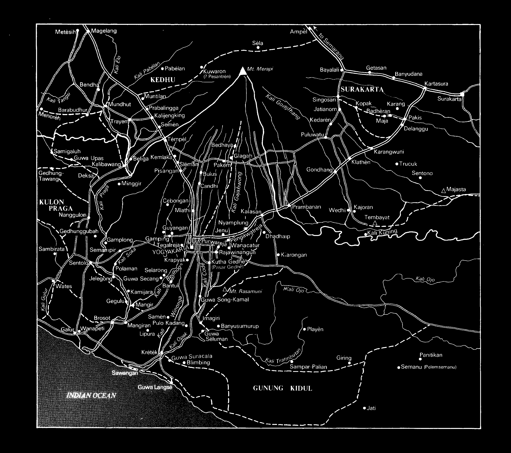
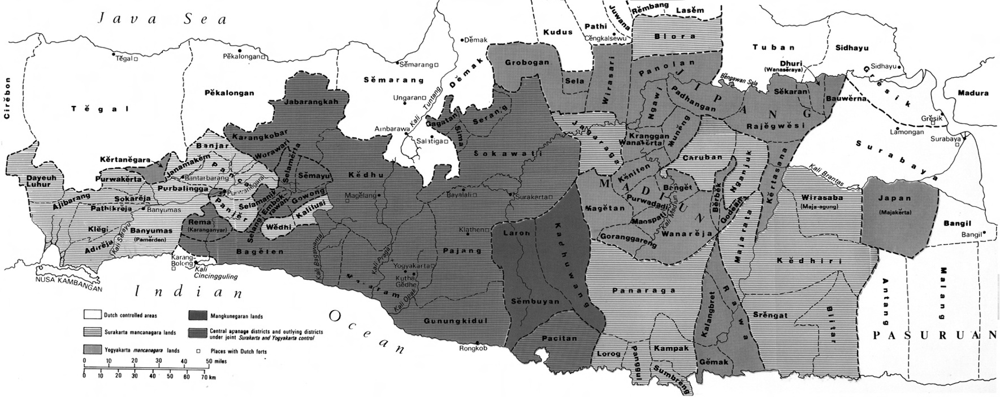

# Maps of Central and East Java

*(Note: In the original print volume, pages 26–29 contain two-page cartographic plates.)*

### Map 1: The Yogyakarta Area in the Early Nineteenth Century
**Pages 26–27**

Map of the Yogyakarta area in the early nineteenth century showing the main roads and villages.
- **Source:** Map outline taken from P.J.F. Louw and E.S. de Klerck, *De Java-oorlog van 1825-30*, IV (1894-1909); adapted by J. Wilbur Wright of Oxford.

---

### Map 2: Central and East Java Showing Apanage Provinces (pre-1811)
**Pages 28–29**

Map of central and east Java showing the apanage provinces belonging to the central Javanese courts pre-1811.
- **Source:** Map outline taken from P.J.F. Louw and E.S. de Klerck, *De Java-oorlog van 1825-30*, VI (1894-1909); adapted by J. Wilbur Wright of Oxford.
