# Chapter I: The South-Central Javanese World, circa 1792-1825

## The ‘Versailles of Java’: Yogya in the early nineteenth century

Willem van Hogendorp (1795-1838), a Leiden trained lawyer and eldest son of Gijsbert Karel van Hogendorp, was a member of Commissioner-General Du Bus de Gisignies’ inner cabinet and served as his right-hand man (De Prins 2002:112-3). On a visit to Yogyakarta in 1828 after nearly three years of warfare had laid waste many of its finest buildings, he wrote: ‘Sala [Surakarta] had already made an unusual impression on me, but Djocja [Yogyakarta] in its glory must have been the Versailles of Java. Not a tenth of it remains, but [what it once was] is visible from the massive stone ruins’.[^1]

In the view of a mid-nineteenth century Dutch Resident of Yogya, the sultan’s capital had reached its apogee in about 1820, some five years before the outbreak of the Java War (1825-1830):

> Then Yogya was prosperous, rich and beautiful, the land fertile and fortunate, the capital clean and handsome, boasting many beautiful buildings, fine gardens and magnificent hunting lodges. Everywhere there was an abundance of food and water. Then trade, handicrafts and production flourished. Then the Javanese [of Yogyakarta] had pride in the place of [their] birth.[^2]

Although this mid-nineteenth century official was about ten years too late in dating the sultanate’s zenith given the events of 1811-1812 (Chapter VII), it is true that as a city pre-1825 Yogya was almost unique in Java at this time because nearly a quarter of its buildings were constructed of stone brought from the limestone quarries at Gamping to the west of the town.[^3] Even Dipanagara’s country residence at Tegalreja was built in this fashion much to the wonderment of a post-Java War Dutch visitor.[^4] Even those houses built of bamboo and wood were kept whitewashed and clean, often being surrounded by low stone walls enclosing a yard with fruit trees and shrubs.[^5] Another perceptive traveller and high Dutch government official, Jan Izaäk van Sevenhoven, also commented on the cleanliness and orderliness of the place on a visit in 1812. At that time, the main avenue leading to the kraton was lined with tall and shady banyan trees with the residences of the princes and court officials as well as the dwellings of the ordinary Javanese inhabitants being set back at some distance on either side of the road. Further down the avenue was a row of Chinese shop-houses which to the west gave onto the site of the spacious residency house, seat of the senior Dutch representative in the sultan’s capital, fronted by an ornamental garden and three large ponds. Immediately opposite stood the fort, Vredenburg,[^6] completed in 1795 with cannon mounted on its four triangular bastions, the whole giving an impressive appearance. In the thoroughfares around the fort, there were also tall banyan trees in whose shade the main market of the city was held.[^7]

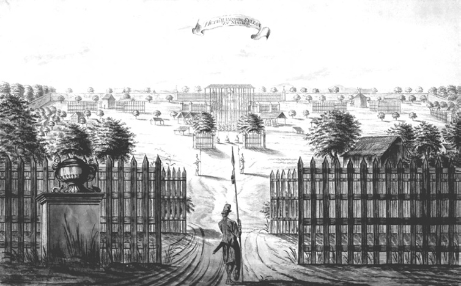

> *Plate 1. View of the Yogyakarta kraton from the northern square (alun-alun) sketched by A. de Nelly, one of Johannes Rach’s pupils, in circa 1771. Courtesy of the Rijksmuseum, Amsterdam.*

Less impressive, according to Van Sevenhoven, were the Chinese and European quarters behind the fort where the narrow houses, shut off from the street by very tall brick walls, seemed jumbled on top of each other, the streets outside small and dirty. The Indo-European burgers (‘citizens’) domiciled there appeared to live very poorly, eking out a bare existence from money-lending and petty retail trade.[^8] At the same time, the local Chinese inhabitants, who engaged mainly in money-lending and petty trade, were, in Van Sevenhoven’s view, neither as numerous nor so well established as their compatriots in Surakarta.[^9] The situation in the European and Chinese quarters thus formed something of a contrast with the Javanese urban settlements (kampung), each clustered around the residence of one of the Yogya princes or senior court officials, which were intersected by broad shady roads and had large squares planted with trees. Each kampung formed a community in its own right, often having its own mosque and being surrounded by a low stone boundary wall.[^10] The Javanese inhabitants of Yogya, in Van Sevenhoven’s estimation, were cleaner, better clothed and had much more sense of their own worth than the inhabitants of the rival court city of Surakarta.[^11] There were also fewer bands of ‘shabby idlers and beggars whiling away their time in games of chance or at roadside food stalls’, a situation the Dutchman ascribed to the better police force in the sultan’s capital,[^12] an explanation we will have occasion to reconsider later in this chapter.

The Yogya kraton itself stretched across the southern boundary of the northern maidan (alun-alun), an open field some 1,200 metres wide which had been cleared on the first sultan’s orders but which had since been encroached upon by European and Chinese houses to the north and east.[^13] The fenced banyan and other trees near the paséban or meeting place for the Yogya officials outside the kraton, were well maintained and carefully trimmed by the court coolies. The whole approach formed a marked contrast to that of Surakarta which appeared ‘extremely messy and neglected’.[^14] The great fortified wall of the kraton with its extending buttresses (pojok baluwerti; Carey 1992:399 note 4a, 400 note 6) dominated the approach from the north. Encircling the entire area of the court, it contained within its girth the numerous dwellings of the sultan’s retainers (abdi-dalem) and the members of his bodyguard regiments, whose houses formed a veritable city in miniature clustered around the court pavilions. This was the nagari, the royal capital proper, impressive even to the supremely confident British Lieutenant-Governor Thomas Stamford Raffles (in office 1811-1816) who wrote (Raffles 1817, I:84):

> The circumference of the wall of the kraton of Yúgya-kérta [Yogyakarta] is not less than three miles, and it was estimated that at the time of the [British] assault in [June] 1812, it did not contain fewer than from ten to fifteen thousand people. That of Súra-kérta [Surakarta] is neither so extensive nor so well built.

Close by the kraton to the west, stood the great Taman Sari (Water Palace) complex, which had been built supposedly by Portuguese architects during the reign of the first sultan (1749-1792) for religious and military purposes (Dumarçay 1978:589-623). Although its structure was fast falling into decay as a result of earthquakes during the first decade of the nineteenth century, its massive walls and secret passageways still afforded many natural defensive positions in case of attack.[^15] Prior to the British assault in June 1812, the sultan’s armaments foundry was situated in its grounds (Thorn 1815:185, Plate XIX no. S; see p. 334 Map 5).

## The Yogya military establishment

The architecture of many of the principle buildings of Yogyakarta underlined the military spirit which animated the sultan’s court and administration, itself the outcome of the fashion in which the first sultan had secured his kingdom by conquest (Van Hogendorp 1913:141). Although in Raffles’s view, this military spirit had been gradually subsiding between the end of the mid-eighteenth-century wars of succession and the British interregnum (Raffles 1817, I:84-5), the court establishment in Yogya in the first decade of the nineteenth century was still overwhelmingly military in character. In 1808, for example, the second sultan had at his disposal some sixteen kraton regiments numbering 1,765 men, of whom 976 were armed with muskets and the rest with pikes. These regiments formed the personal bodyguard of the ruler and were salaried in land and domiciled in the immediate proximity of the court. Some of the members of these elite companies were Balinese or Bugis soldiers of fortune who had taken service with the Yogya ruler.[^16] The sultan also had an entourage of female soldiers, a sort of Amazon corps of about 300 women, known as the prajurit keparak èstri, who were drawn from the daughters of prominent officials or village gentry families. They were armed with spears and were agile on horseback.[^17]

By the early nineteenth century, many of the functions of these bodyguard regiments were of a ceremonial nature, but they could still take to the field as witnessed during the expedition against Radèn Rongga Prawiradirja III in November-December 1810,[^18] and the defence of the kraton against the British in June 1812.[^19] Apart from these elite bodyguard troops, the sultan could also call on a quasi-feudal levy of 7,246 men from the princes of the blood, in particular his heir apparent (Pangéran Adipati Anom), who had apanages or land given in fief in the core districts (nagara agung) close to the court. A further 2,126 men were provided by the district administrators (bupati) from the eastern outlying districts (mancanagara). Until June 1812, when many of these areas were annexed by the British, the sultan could also use these levies for construction work on various court buildings and fortifications when the eastern mancanagara administrators came to the royal capital to celebrate the major Javanese-Islamic festival of The Prophet’s Birthday – known as the Garebeg Mulud – to pay their annual land-rent (Carey 1986:71-2; Houben 1994:52 note 9; Remmelink 1994:17). In cases of military emergency, the sultan could thus muster a force of about 10,000 men within a short space of time to guard the kraton and take part in offensive operations. Some of these troops were undoubtedly of limited military value, but Raffles commented favourably on the quality of the bodyguard regiments and levies which were mustered to provide an honour guard for his official entrance into the capital on 27 December 1811 (p. 309):

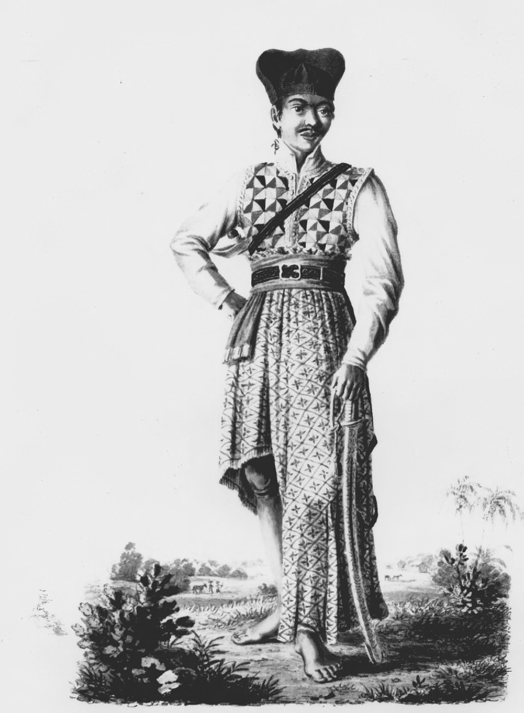

> *Plate 2. Lithograph of a member of the sultan of Yogyakarta’s bodyguard in the early nineteenth-century. Taken from J.J.X. Pfyffer zu Neueck, 1829: Plate IX. Photograph by courtesy of the KITLV, Leiden.*

> The roads and streets were lined with about ten thousand armed men of various descriptions, mostly cavalry, dressed and accoutred according to the fashion of the country, but by no means making as a body that despicable appearance which I had been led to encounter.[^20]

Although most of the troops were mounted and some carried muskets, cavalry carbines and other firearms, the most effective armaments were the more traditional Javanese weapons such as pikes, slings and stabbing daggers or kris with intricate meteorite metal inlays. The majority of the muskets used by both Javanese and European soldiers in Java at this time were antiquated flintlock models dating from the mid-eighteenth century which were difficult to load, susceptible to damp conditions, and usually jammed after a number of rounds (Chapter XI, note 7). Contemporaries noticed that Javanese soldiers were not skilled in musket drill but were far more dexterous in the handling of their long Javanese pikes. During engagements with European troops, especially cavalry, Javanese pikemen operating in disciplined formation were often found to have a distinct military advantage over their European adversaries. They could sometimes dismount their assailants and engage them in hand-to-hand conflict before the latter had had time to reload their small cavalry carbines.[^21] Slingers were also reasonably accurate at short range and they were used to good effect against the British in June 1812 (Raffles 1817, I:295; Carey 1992:406 note 34a) and the Dutch during the Java War (Van der Kemp 1896a:405). At the same time, the kris culture of the central Javanese courts had been carried to such a sophisticated art by the early nineteenth century that Javanese smiths (empu) could forge a wide range of stabbing and cutting blades for use in every exigency of hand-to-hand combat.[^22]

Artillery was also known and used by the Javanese; prior to the fall of the Yogya kraton in June 1812, the second sultan had cast iron and brass cannon, probably at the royal foundry at Taman Sari, and at Kutha Gedhé where gunpowder and small shot were manufactured during the Java War. Light cannon of Javanese manufacture known as kalantaka, about the size of a half-pounder, were occasionally used by the sultan’s troops on military expeditions.[^23] Heavier brass cannon were imported from Gresik in east Java where there was a thriving armaments industry supervised by the local Arab and Chinese communities who could draw on traditional skills in the field of ballistics.[^24] Large numbers of cannon were later captured by the British from the battlements of the Yogya kraton in June 1812, but it seems that during the British assault itself the sultan’s gunners were not effective in the use of their artillery pieces and some of the guns disintegrated when fired (Carey 1992:206-7, 400 note 8). This suggests that many of the sultan’s heavier cannon were acquired as much for ceremonial as for battlefield use (Ricklefs 1974a:304; Crucq 1938:78:93-110, 1940:80:49-59).

## The landed base of the military establishment

The basis for the upkeep of this large military establishment was the tribute and corvée services produced by the agricultural population. Some of the income from the lands administered directly by the sultan (bumi pamajegan-dalem) in the core regions was used to maintain and equip his personal bodyguard. At the same time, the grants of land made to the sultan’s family and officials specifically stipulated that armed levies were to be produced whenever the sultan required them (Raffles 1817, I:294; Carey 1986:67-70). This essentially military foundation of the central Javanese apanage system can be discerned in the ancient official titles of the district officials, panèwu, panatus, panèket, penglawé, namely chiefs of 1000, 100, 50 and 25, titles which referred not so much to units of land but to equivalent numbers of armed men (Carey 1986:67). Even some of the older names for the districts and bupati of south-central Java, such as ‘land of the pikes’ (tanah sulastri) for Bagelèn, Arung Binang (‘lord of the red pikes’), and Sawunggaling (‘the golden fighting cock’) for its local bupati, underscored the original military character of the Mataram polity (Rouffaer 1905:610 note 1, 620; Ricklefs 1974a:423 note 1; Carey 1992:93). So too did the tumbak (lance length) name for the one rood (1,210 square yard) land measurement in the Principalities, supposedly derived from the fifteenth-century kingdom of Demak (Rouffaer 1905:617).

By the early nineteenth century this military basis had been somewhat modified and martial exigencies no longer loomed so large. The term cacah, for example, had come to refer more to the numbers of cultivators or their families – usually reckoned as comprising five active members – who could be maintained on a particular plot of irrigated rice-land, rather than to the number of armed men that area could sustain. It was thus no longer so much a military term as a unit of economic measurement.[^25] But the princes of the blood (putra sentana), high Javanese nobility and the sultan’s senior officials, literally the ‘younger brothers’ (para yayi) of the ruler, who were often linked to him by ties of marriage and blood, were still required to parade with their troops on important ceremonies such as the Garebeg, the thrice-yearly Javanese-Islamic feasts, and to take part in major military exercises and reviews. One such was held at the royal retreat at Rajawinangun (Arjawinangun) to the east of Yogya on 1 June 1808 in which the young Dipanagara (then Radèn Antawirya) participated (pp. 179-80). This involved over 5,000 men including troop detachments from the eastern outlying districts and was held as a response to Daendels’ military manoeuvres in central Java aimed at strengthening the island’s defences against the British.[^26] Later, during the Java War (1825-1830), Dipanagara was able to make use of some of these levies, brought over by the princes and officials who rallied to his cause, in his struggle against the Dutch and what he termed their ‘apostate’ local supporters. Thus the original military character of the central Javanese apanage persisted until 1830 when the annexations and reforms of the post-Java War period dismantled it for good (Houben 1994:17-69).

## The royal apanage system

According to the Javanese concept of sovereignty derived from Java’s Hindu-Buddhist past, the ruler was the overlord of all the land in his kingdom. But this right was delegated by him to his officials and family members in order that they could support themselves together with their household, retainers, subordinate officials and assorted hangers-on. The apanage or ‘seat’ (lungguh) varied in size according to the seniority of the official or his relationship to the ruler. Quasi-hereditary rights to certain apanages were sometimes admitted in the case of close family members or of trusted officials who were linked to the sultan by ties of marriage. They were also accorded to scions of eminent ‘spiritual’ dynasties such as the Sérang family in north-central Java, who supposedly traced their lineage back to the famous apostle of Islam (wali) Sunan Kalijaga and who would become strong supporters of Dipanagara during the Java War.[^27]

But officials, however senior and well-favoured in terms of marriage alliances with the ruler, were liable to lose their landholdings and their means of family support when they were dismissed from office. This happened with Radèn Tumenggung Purwadipura, a favourite of the second sultan who was appointed as a nayaka, senior official in charge of the court administration, in 1797, whose landholdings were completely broken up when he was dismissed from office in December 1810 for illegal currency deals and trading in opium during the military expedition against Radèn Rongga in Madiun (Carey 1980:189-90). Similarly the dependants of Radèn Tumenggung Danukusuma, another nayaka and a member of the prominent Danurejan family, were reduced to penury after his murder on the sultan’s orders in January 1812. The fact that Danukusuma’s wife was a daughter of the first sultan and well connected in Javanese-Islamic circles afforded them no protection.[^28]

The precariousness of office holders and their utter dependence on the ruler’s favour can be seen in the Javanese words – gadhuhan (‘a temporary [land] grant’), anggadhuhi (‘to loan provisionally’), and anggadhuhaké (‘to give as a provisional grant’) – which were written into their official letters of appointment (Carey 1986:74). In the central apanage regions, the Javanese landed system was thus firmly subordinated to the requirements of the royal administration and never acquired the character of a contractual relationship between ruler and ruled such as could be found in Tokugawa Japan (1603-1867), still less the status of private property which had begun to develop in Europe since the fifteenth century (Neale 1981:91). At the most, it was a classic usufruct system which allowed officials rights of appropriation of produce (Hall and Whitmore 1976:222) without the prospect of allowing them to acquire full-blown ‘feudal’ tenure such as had grown up in medieval Europe where prominent families held ‘fiefs’ on behalf of the ruler (Rouffaer 1905:621; Carey 1986:74). The only possible area where such a ‘feudal’ system operated in early-nineteenth-century Java was in the eastern outlying districts to which we shall come shortly.

The apanages granted to the sultan’s blood relations and his senior officials were all in the core districts which were governed directly from Yogya.

In the early nineteenth century, these districts included parts of the provinces of Banyumas,[^29] Bagelèn, Kedhu, Mataram, Pajang, Sokawati and Gunung Kidul (Rouffaer 1905:589-92), areas which had come under early seventeenth-century Mataram’s control by treaty arrangements and marriage diplomacy in contrast to the eastern outlying districts which had been largely acquired by military conquest (De Graaf and Pigeaud 1974:116; Carey 1992:93-4). The apanages granted in these core areas were never contiguous but were spread out over a wide area. John Crawfurd, the Resident who served in the sultan’s capital throughout most of the British interregnum (1811-1816), remarked that it was common for a senior court administrator holding over 1,000 cacah (units of land cultivated by productive peasant families), to have as few as twelve cacah grouped together and the rest scattered in small pieces over a distance of 200 miles.[^30] Dipanagara’s 700 jung[^31] granted to him in July 1812 when he received his princely title (Carey 1992:284, 442 note 211), spanned the western and south-central Javanese districts of Banyumas, Bagelèn, Kedhu, and Sokawati, as well as core areas to the south of Yogya in the vicinity of Bantul (Louw and De Klerck 1894-1909, V:745; Carey 1981a:238 note 20). Even Pangéran Natakusuma (post-22 June 1812, Pangéran Adipati Pakualam I), who was accorded 4,000 cacah of hereditary tenure by the third sultan under orders from the British, found that his holdings were parcelled up between Bagelèn and Mataram with many being situated in infertile, marshy or inaccessible areas. Only at the end of the Java War, following the 1830-1831 revision of the boundaries of the Principalities, were the Pakualaman landholdings grouped together in the Adikarta area of southern Kulon Praga.[^32]

One of the main reasons for this highly dispersed nature of apanage allocation in the central districts was to prevent a prince of the blood or influential high-ranking official from establishing a power base from which he could challenge the position of the ruler. Indeed, all those holding lands in the core areas, including the central area bupati, were required to reside in the capital where they could be supervised by the ever suspicious monarch.[^33] The only exceptions to this rule were the eastern outlying bupati, who were given contiguous areas to govern and allowed to reside in their kabupatèn for two-thirds of the year (Carey 1986:71-2). But even these officials were constrained to journey to the sultan’s court once a year on the occasion of The Prophet’s birthday to pay the yearly tribute in cash and kind which were due from their districts. As we will see in more detail at the end of this chapter, they were also required to bring a sizeable labour force with them to work on royal building projects in the royal capital and its environs, for three or four months, a period which under the second sultan was nearly doubled (Onghokham 1975:44; Carey 1986:71 note 43). On these occasions, the eastern bupati were entirely dependant on the sultan’s favour and could be relieved of their office if their labour force deserted. Many were also heavily in debt to the ruler, another way in which the sultan kept them under control.[^34]

The rather unique position of the administrators of the eastern districts owed something to the historical rivalry between the kingdoms of east Java (especially Surabaya) and Mataram in the late sixteenth and early seventeenth centuries (Carey 1992:93-4; Ricklefs 1993a:41-2). At the same time, the sheer distance between Yogya and Madiun, separated as they were by nearly 200 kilometres of difficult terrain with execrable dirt roads which turned to mud in the rainy season (Milaan 1942:205-39; Schrieke 1957, II:105-11), gave the eastern bupati, especially the chief administrator of the eastern outlying districts at his administrative centre of Madiun, a certain feeling of independence. Cut off from the sultan’s capital by the towering bulk of Mount Lawu, the tiger-infested forests of east Java[^35] and the broad expanse of the Sala River valley, the influential bupati families in these sparsely populated regions developed a strong sense of local identity even though they hailed originally from other regions. None more so than the family of Radèn Rongga Prawiradirja III (in office 1796-1810), whose low-born grandfather Mas Rongga Wirasentika, also known as the ‘champion’ (gegedhug) of Sokawati, had served as the first sul tan’s army commander during the Giyanti War (1746-1755) and had married his sister. He had been sent to Madiun to replace an unsatisfactory predecessor deemed too close to the previous Kartasura (post-1745, Surakarta) court, and had founded a dynasty whose members would continue to administer Madiun until well into the nineteenth century.[^36] Prophesied as a future ruler (Adam 1940:333), the gifted but headstrong third Radèn Rongga, as we will see below, would chose to die in rebellion rather than agree to be delivered into the murderous hands of Marshal Daendels in November 1810.[^37]

A more basic reason for the scattered nature of the apanage holdings in the central districts as opposed to the contiguous character of the administrative units in the eastern areas was the nature of the territorial settlement at the treaty of Giyanti in 1755. This stipulated that lands and even villages in the richer central regions should be divided up in a haphazard fashion between the courts of Yogyakarta and Surakarta, a situation which was complicated still further by the creation of the Mangkunagaran and Pakualaman semi-independent Principalities in 1757 and 1812. Just why the Giyanti settlement should have been so complicated is not entirely clear. Dipanagara later ascribed it to the devious tactics of the kafir Dutch and their ‘divide and rule’ policy.[^38] But, according to a Dutch report, it was the first sultan himself who insisted on the minute sub-division of land in the core regions, first in order to ensure that the most fertile areas were shared equally and secondly to make it impossible for the Sunan to plot an invasion of his territory without his prior knowledge (Van der Kemp 1896b:545-6). Whatever the reason, the administrative results were chaotic. The ‘patchwork quilt’ of landholdings and villages, sometimes internally divided between the two courts, created insuperable problems for irrigation, agriculture and law enforcement. Rouffaer pointed out some of the more serious effects in his famous article on the princely territories, namely, the sub-division of ricefields and common lands in the villages, the increase in the number of local officials from both courts salaried in land, the heavier tax burdens and the aggravation of the security situation in country areas due to the multiplication of disputes about land and offices (Rouffaer 1905:624 quoting Nahuys van Burgst 1835, I:205). It is undeniable that the Giyanti settlement exacerbated these difficulties by involving the courts in a complex process of redrawing village and territorial boundaries in south-central Java: in Bagelèn, for example, the local peasantry in the mid-nineteenth century referred to Giyanti as the tumpang paruk, the time when everything was ‘heaped together’ (Kollmann 1864:354). But there were perhaps some concealed advantages for the common man not touched on by Rouffaer.

The most important of these advantages was the very fact that especially after Giyanti most of the larger apanage holders resided in the royal capital. They thus had less scope for living off the land than they might have done had they actually resided on their landholdings. According to Crawfurd, some apanage holders never bothered to visit their usufruct lands and others were even ignorant of their geographical location.[^39] Indeed, with landholdings spread out over a wide area, the actual process of visiting them at a time when communications were so poor, would have been quite an undertaking. Conscientious landlords, like Radèn Mas Said (Mangkunagara I, reigned 1757-1795), and his successor Pangéran Prangwedana (Mangkunagara II, reigned 1796-1835) in Surakarta, or Dipanagara in Yogya, who took a personal interest in the lands under their charge and visited them regularly, were the exception not the rule.[^40]

## The role of the tax collectors

Apanage holders domiciled in the kraton towns left the administration of their lands to local tax collectors (bekel), who collected the land-rents (pajeg) and other levies on their behalf and exercised some judicial authority in their name (Carey 1986:75). They were usually responsible for one village or part of a village with areas of agricultural land ranging between a half and six jung. They were entitled to retain one fifth of the land-rent as well as a portion of the other taxes, including the pacumpleng or ground rent tax for houses. They also had rights over personal services: it was customary, for example, for bekel to take a few villagers with them when they visited the capital in order to enhance their own authority and enable them to undertake small tasks for the apanage holders when they made the half-yearly tax payments at Mulud and Puwasa (Rouffaer 1905:625; Carey 1986:75). On festive occasions celebrated by the apanage holder’s family, such as marriages, circumcisions and births, the tribute-paying peasant cultivators or sikep – sometimes referred to as kuli sikep – were expected to make presents of chickens, eggs, coconuts and other farm produce. They also undertook, or delegated their dependant lodgers (numpang) to undertake, the above-mentioned personal services for the landholder.[^41] Building materials such as wood, bamboo, rattan and thatch were also demanded for the upkeep of the apanage owner’s residences (Raffles 1817, I:302). It was these fringe benefits, as well as the ‘homage’ of their peasant cultivators, which caused apanage holders to resist accepting money payments from the courts during the post-1812 period when the British annexations drastically reduced the area of land available, and to desist from leasing their lands to European and Chinese land-renters in the period 1816-1823 when foreign capital began to flow into the Principalities to fund cash crop production of coffee and indigo.[^42]

In Crawfurd’s view, the modicum of authority which the bekel possessed was not such as to render their power dangerous or oppressive. It was rather in their interests to treat the local cultivators with moderation and consult with them over the yearly division of village land or on matters of irrigation.[^43] On these occasions, the tax-collectors would address the tribute-paying farmers as ‘comrade’ or ‘colleague’ (kanca). Indeed, their social position does not seem to have set them apart from their village neighbours since for the most part the bekel were drawn from the tax-paying farmer class or from established village-head (lurah) families (Carey 1986:76).

It is likely that Crawfurd was drawing too favourable a picture of the village tax collectors as a group in order to persuade his superior Raffles to use them as the basis for his land-rent scheme in 1812-1813 rather than settle directly with the peasant cultivators themselves (Bastin 1954:94-104, 118-9; Day 1972:180 note 3). Even Crawfurd admitted that the bekel’s insecurity of tenure and the practice of paying part of the tribute payments in advance encouraged some tax collectors to resort to unscrupulous methods.[^44] Furthermore, it was often the case that, on the replacement of an apanage holder, the former incumbent’s bekel would be removed by the new appointee in order to make way for his own tax collectors. On such occasions, it was not uncommon for the old bekel to refuse to accept the authority of the new man and for a local conflict to break out in the village. The issue would then frequently be settled by force of arms. These disputes over tax-collectorships were the most common reason for the numerous ‘village wars’, or prang désa, which scarred the face of the south-central Javanese countryside in the decades preceding the Java War (Van Kesteren 1887:1268-9; Chapter X note 132). One Dutch traveller referred to them as an almost daily occurrence in the months leading up to Dipanagara’s rebellion.[^45] Another contemporary witness, a Yogya prince, stressed the numerous differences of opinion between the apanage holders, the bekel and the villagers themselves over questions of tribute payments and corvée demands during these years, a situation compounded by the fact that the villages themselves were frequently divided up between the various apanage holders who each appointed their own bekel to look after their interests.[^46] According to Onghokham (1977:632-4), the tax-paying peasants also switched their loyalties and played court official apanage holders off against each other. In his words, ‘factionalism was so rife in the dynastical politics [of the central Javanese courts] that the peasant could switch his loyalties among the [members of the] elite in order to get [the best] terms from his overlord’. In Onghokham’s view, ‘a sort of frontier society’ was created at this time due to the deep instability in the Javanese countryside.

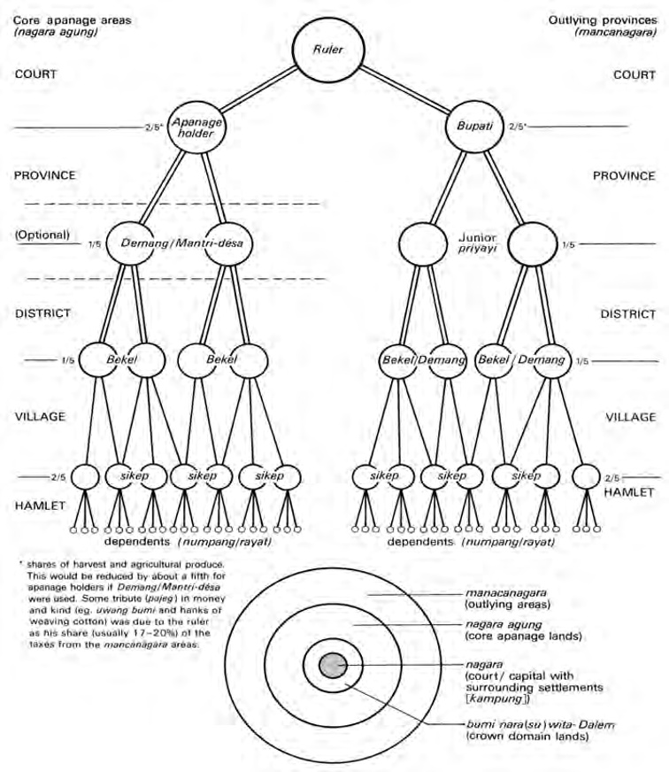

> *Figure 1. The Javanese apanage system in the early nineteenth century showing the major administrative levels of land tribute division*

We will return to this insecurity shortly when we consider the criminal world of rural south-central Java. In the meantime, the system of using bekel as the direct agents of the apanage holders in the villages seems to have been a lot less onerous than the practice of administering those areas through various intermediate officials. The latter arrangement arose because many landowners resident in the royal capitals were either too indolent or too disinterested in having dealings with the numerous bekel on their lands. Instead they appointed intermediate tax-collectors, known as demang or mantri désa, who gathered in the rents from between ten to thirty bekel according to the size of their apanage. In return, they were allowed to retain one-fifth of the rents as their own remuneration becoming in this fashion the main link between the apanage holder and the bekel, a situation which presented great opportunities for personal enrichment. According to Crawfurd, some demang administered as much as 100 jung of agricultural land in rich core provinces such as Kedhu.[^47] They were also rather more distant socially from the peasant cultivators than the bekel since they were often drawn from the families of lower officials with court connections (Carey 1986:77-8). Social distance seems to have made them less constrained in their use of rapacious administrative methods.

A particularly egregious example of such a man was the Surakarta mantri désa of Karang Bolong on the south coast of Java within the boundaries of the pre-1825 province of Bagelèn, an area known for its birds’ nest rocks on the coastal cliffs.[^48] The local inhabitants protested to the Surakarta chief minister (patih) that this official, known as Juni, had refused to cooperate with his colleague. He never placed the proper offerings on the ceremonial bed of the goddess of the Southern Ocean (Ratu Kidul), an omission which, in the villagers’ view, had caused a series of exceptionally poor birds’ nest harvests during the period of his tenure.[^49] Furthermore, he always insisted that the villagers offer him any large fish which they might catch and ordered them to purchase rotting buffalo flesh when one of his animals died. At the same time, he forced all the local families to weave coarse striped linen cloth (ginggang) which he bought at scandalously low prices in order to make a handsome profit when he traded them in Surakarta. He also expected villagers to purchase provisions – such as pungent fish paste (trasi) and gambir, a plant with astringent leaves used in the preparation of betelnut – at inflated prices when he returned from these trading journeys to the capital. Finally, he was said to have constantly adulterated the supply of opium for the coolies at Karang Bolong, to have paid their wages tardily in debased copper coinage and to have been hand-in-glove with local bandits. This litany of abuse, overdrawn though it may have been by local villagers successfully seeking Juni’s dismissal, gives an insight into the sort of practices an unscrupulous sub-district tax collector could become involved in.

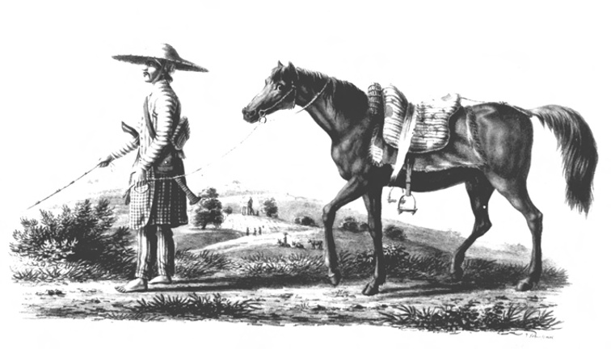

> *Plate 3. Lithograph of a Javanese provincial official (priyayi-dhusun mantri-désa) travelling through the Javanese countryside in the early nineteenth-century. In the background peasants can be seen harvesting the ricefields near a high watch tower for guarding the fields against birds and other predators. Taken from J.J.X. Pfyffer zu Neueck, 1829: Plate V. Photograph by courtesy of the KITLV, Leiden.*

Even more miserable, according to Crawfurd, who sometimes had difficulty disguising his sinophobic prejudices, was the plight of those peasant cultivators who were subjected to the extortions of Chinese demang. Such men were often appointed by impecunious apanage holders at the courts, who had either contracted debts to Chinese moneylenders or mortgaged their lands or both. Chinese tax-collectors were also sometimes preferred to Javanese because, in Crawfurd’s words, ‘their skill, frugality and extortion’ enabled them to pay higher rents.[^50] Large tracts of fertile provinces like Kedhu were let to them (Afdeling Statistiek 1871:78; Carey and Hoadley 2000:111, 155, 176-9), and they were also numerous in the eastern outlying districts (Louw and De Klerck 1894-1909, VI:379; Carey 1986:79; Carey and Hoadley 2000:259-61). Crawfurd urged Raffles to modify their leases as much as possible, a plea which was later heard from contemporaries in Yogyakarta at the end of the Java War.[^51] We shall see below, how similar complaints were levelled against European land-renters, who moved into the Principalities in larger numbers after 1816 and effectively assumed the role of ‘white’ demang for court apanage holders. Their harsh corvée demands and their introduction of cash crops in a predominantly rice-growing economy created localised hardship for peasant cultivators and was one of the precipitating factors for the growing peasant unrest in the build-up to the Java War.[^52]

## The western mancanagara: Banyumas

Despite all the difficulties, Javanese peasants in the core areas were undoubtedly better off than their countrymen in the outlying districts. Not only were they spared the demands of the resident bupati, but the scattered nature of the apanage holdings shielded them from the grosser aspects of fiscal exploitation. The situation in the eastern outlying areas of the sultanate will be described at the end of this chapter, but a comparison between Banyumas and Bagelèn may be illustrative here of the very different conditions prevailing in the central and outlying districts in the half century before the Java War.

Banyumas proper had been administered as a western outlying province of Surakarta until 1773 when its status was changed to that of a core region in order to assuage Sultan Mangkubumi who resented the fact that Yogya had very little land in the western extremity of the old Mataram polity (Rouffaer 1905:591). The official population of the province in that year when a new land register, the Serat Ebuk Anyar (‘New Book’), had been drawn up,[^53] numbered some 6,160 cacah (productive family units) or 30,800 inhabitants if one cacah is reckoned as supporting a family of five (Rouffaer 1905:591), but this was a gross underestimate, the real population being probably closer to 260,000.[^54] Banyumas’s change of status, essentially an administrative sleight of hand, did not alter its style of administration. It continued to all intents and purposes to be governed as an outlying area given its distance from the capital and the structure of its administrative hierarchy.

Captain Godfrey Phipps Baker of the 7th Bengal Light Infantry Volunteer Battalion, who surveyed the area for Raffles in 1815,[^55] commented on the wilful rule of the Surakarta ngabèhi (sub-district heads) of Ayah and Adipala. Their extortions had led to the emptying of half the twenty large villages along the fertile valley of the Serayu River. In Baker’s words:

> Not only are their pajegs [land-rent/taxes] too high in money, but besides there is no end to every species of extortion under the head of ‘feudal services’, that is contributions of cattle, provisions and materials […] whatever [in fact] the Ngabehis [ngabèhi] think fit to call them.[^56]

These sub-district officials collected a money rent of 1,000 Spanish dollars, but were able to retain another 800 Spanish dollars for themselves out of the profits of their administration. They had some twenty village heads and 100 bekel under them charged with policing and revenue matters.

In a potentially rich area like southern Banyumas, it is no surprise that the ‘vexatious services and contingents’ demanded by the ngabèhi were greatly complained of by the local inhabitants.[^57] Furthermore, the population suffered terribly from the depredations of Balinese, Bugis and Timorese pirates, who anchored their ships in the lee of the great island of Nusa Kambangan and paddled up the creeks and inland waterways in their small dug-out canoes to carry off people and provisions, the former being pressed into service to crew the pirate vessels[^58] or for sale to British sea captains in Melaka.[^59] Baker reported that only three of the twelve villages around the important market centre of Jeruk Legi, which once had a population of 13,000, were still inhabited, the rest having ‘never recovered from the invasion of pirates’ twelve years earlier.[^60] Since that time, two Hungarian sergeants had been posted to Nusa Kambangan to give advance warning of further attacks, although the local inhabitants suggested that the lack of incursions over the three-year period prior to Baker’s 1815 visit was more due to the fact that there was nothing left to take than to the watchfulness of the Central European NCOs.[^61]

Banyumas district capital was described by Baker as the most important of the western outlying district towns in terms of population and resources. Governed by two influential local bupati, it suffered severely from the misrule of the bupati wedana, the head of the erstwhile outlying province administration. This official, Radèn Tumenggung Yudanegara, who was to be relieved of his office in the aftermath of the September-October 1815 Sepoy conspiracy in south-central Java (Carey 1977:308), was described in the blackest terms by the British Resident of Surakarta, Major Jeremiah Martin Johnson:

> When he is in Banyumas his whole time is spent either in gambling or with tandak [tandhak; dancing women, prostitutes], whilst the duty of the district, the largest in the emperor’s [Sunan’s] territory, is totally neglected or left to sons and dependants, men as profligate as himself, whose whole study is how to exact money from the population in order to supply their own extravagance.[^62]

In the face of such administrative irresponsibility, the agriculture and trade of the province languished. Reports from the immediate post-Java War period indicate that there was little money in circulation and outside the fertile river valleys, where there some wet-ricefields, the local inhabitants existed mainly on mountain rice or root crops such as potatoes and tubers.[^63] Rice even had to be imported from neighbouring Bagelèn and the north coast residencies in order to feed the population.[^64] In the lowlands, particularly in the marshy areas (rawa) during the dry season (Toestand van Bagelen 1858:72), important quantities of raw cotton were produced, but this was mainly exported to the thriving cottage industries of neighbouring Bagelèn, the cloth woven in Banyumas being used only for local consumption.[^65] Even Chinese traders, a sure yardstick of the prosperity of an area, were few in number and those who had settled in the region were generally very poor.[^66] The province’s economic potential, which was widely recognised by contemporaries (Raffles 1817, I:20; Lettres de Java 1829:73), was thus far from being realised.

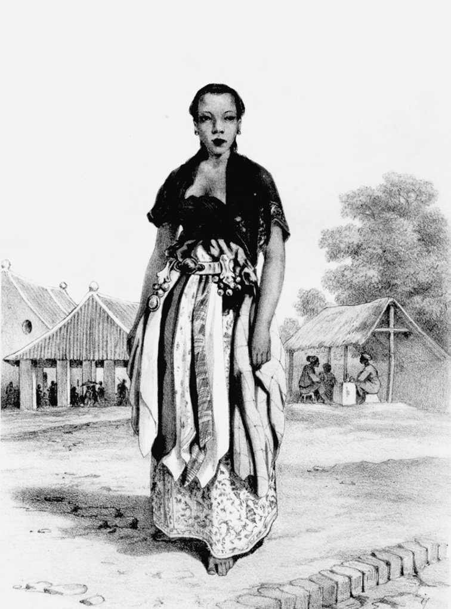

> *Plate 4. A Javanese singer-dancer (ronggèng or talèdhèk). Taken from Hardouin and Ritter 1853-55:219. Photograph by courtesy of the KITLV.*

## The western nagara agung: Bagelèn

How different indeed was the prospect which greeted Baker as he journeyed to the east across the broad expanse of the crocodile-infested Cingcingguling River into the neighbouring central apanage province of Bagelèn, the so-called kaki-tangan (arms and legs) of the Principalities.[^67] During his sixty-mile ride to the ferry town of Brosot on the Kali Praga, the sepoy captain was struck by the ‘most luxurious and highly populous country’ through which he passed, and the well-maintained coastal high road with its good level surface, ‘the finest in Java’ in his estimation.[^68] In his words:

> The population is truly surprising, it being in fact an almost continuous village the whole way. On the northern side [of the high road] there is scarcely an interval or boundary between the villages which run in an almost uninterrupted line the whole distance […] the country is a perfect garden.[^69]

Nearly the entire district seemed to be under cultivation except at the height of the rains and there was pasture in the immense rawa or fens, which lay to the northward, for great herds of cows and buffalo. These fens also abounded in fish which were dried locally and traded extensively along the south coast and as far west as the mouth of the Serayu River.[^70] Salt was likewise produced in the coastal villages for local consumption and export to landlocked sub-districts like Ledhok (present-day Wonosobo) and Gowong in the northern part of the province, and to Kedhu.[^71] The strength of the local economy derived primarily from its rice production and thriving village cloth industries. Western Bagelèn, in particular the area around the Rawa Tambakbaya, produced major surpluses of rice as well as soybean, and together with Kedhu, was the principal exporter of grain and foodstuffs to the more easterly regions of south-central Java such as Mataram and Pajang.[^72] At least a quarter of western Bagelèn’s rice crop was exported or traded internally to parts of eastern Bagelèn, which were subject to harvest failures as a result of droughts and floods due to the poor drainage on the local red clay soils (Toestand van Bagelen 1858: 75-6; Louw and De Klerck 1894-1909, I:234, 245-7). Surprisingly little use was made of the rivers for bulk transport outside the province, although there was some internal riverine and cross-fen (rawa) traffic for locally traded goods (Toestand van Bagelen 1858:71, 76).

Cotton and linen weaving were the mainstay local industries: linen cloth, batik cotton shawls, ladies blouses, head-dresses and sarongs made up in Bagelèn villages were traded to all parts of Java as well as to the islands of eastern Indonesia via the north coast port of Semarang.[^73] The three most important weaving centres in pre-Java War Bagelèn were Jana, Wedhi and Tangkilan (near Gombong) all of which were home to considerable numbers of Chinese involved in the cloth trade.[^74] When Baker visited in 1815, the province was nearing the peak of its prosperity as a cloth-producing region. But its glory days were drawing to a close. Already in late 1814 and early 1815, British machine-manufactured textiles had begun to enter the Javanese market with printed batik patterns based on models supplied by British Residents of Crawfurd’s ilk to Paisley and Lancashire cotton masters.[^75] Although the local market proved surprisingly resilient, especially when many of the early British imports were found not to be dye fast (Raffles 1817, I:216-7; Chapter VIII), the local weaving industry would be severely damaged by the disruption caused by the Java War, the flight of the local Chinese merchants (Louw and De Klerck 1894-1909, II:332-3, V:433), and the post-war import of textiles from the nascent Dutch cloth industry around Twenthe.[^76] Interestingly, given the strong anti-Chinese sentiments evinced at the time of the outbreak of the Java War, the local population of eastern Bagelèn were soon begging the Chinese cloth merchants to return not as ‘market tax collectors but as traders, saying that they now [June 1829] had problems producing their goods […] having to pay over the odds for the [inputs] required’ (Louw and De Klerck 1894-1909, V:433).

The province also produced special labour services for the courts – hence its ‘arms and legs’ epithet. The most important of these were recruits for the porters’ guilds (gladhag) in the royal capitals, where Bagelèn labourers served for a six-month period before returning to their villages (Kollmann 1864:355, 359, 361). In return for their labour services, the local areas which produced such recruits were given a remission in the level of land-rent (Toestand van Bagelen 1858:74). The heavily afforested and sparsely populated northern districts, such as the Yogya area of Gowong, were liable for blandhong or forest services and the supply of building materials to the courts.[^77] Other regions, like the Surakarta territories of Wolo (Ambal) and Tlogo, which were directly taxed for the upkeep of the ruler’s court, paid part of their yearly tribute to the Sunan in local delicacies for the Sunan’s table: the first in dried fish and trubu (salt roe or shad, a type of Javanese caviar) and the second in dhèndhèng or dried deer flesh (Kollmann 1864:360-2). We will see how, on the eve of the Java war, Sunan Pakubuwana VI (reigned 1823-1830) became especially exercised over the Dutch annexation of the Surakarta area of Jabarangkah between Kedhu and Pekalongan on the north coast because of the loss of its durian dodol, a fruitcake delicacy sent every year in the pikul load to Surakarta in lieu of tax (Chapter X note 168).

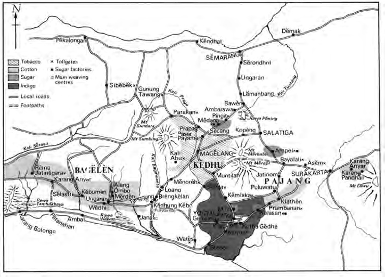

> *Map 1. Central Java showing the main areas of cash crop production in the pre-Java War period. Map outline taken from Raffles 1817, I and adapted by J. Wilbur Wright of Oxford.*

Given all these assets, it is hardly surprising that the courts should have considered Bagelèn a central part of their patrimony. So much so that in 1824, when the Dutch government made a move to annex the province as part of a proposed indemnity for the abolition of the tollgates in the Principalities, both first ministers at the courts protested strongly to the Dutch negotiators. The latter reported (Louw and De Klerck 1894-1909, I:19):

> They pointed out to us that […] Bagelen especially, was considered in their naive expression the arms and legs [kaki tangan] of the kingdoms of Surakarta and Yogyakarta, for the various chiefs and nobles [at the courts] derived their livelihood from it [and] it served for the production of men for the gladhag [porters’ guilds].

Similar sentiments were expressed at the end of the Java War by the Surakarta patih, Sasradiningrat II (in office 1812-1846), when the Dutch were again considering the annexation of the area. On this occasion, Sasradiningrat observed that he was prepared to surrender Banyumas and the eastern mancanagara, but not Bagelèn because, if that province was lost to the court, it would be as though the Surakarta grandees had forfeited their key means of support – again the ubiquitous epithet ‘arms and legs’ was used. In his view, the people of the region were uniquely well suited for work in the porters’ guild for although other Surakarta areas – for example Banyumas – produced many dependable soldiers, this was one of the few districts which produced really good coolies.[^78] Official kraton recognition of the importance of this heavily populated province can be seen in its formal administrative appellation as the siti sèwu (the ‘thousand land’), and of the senior bupati in charge of it as the wedana bumi sèwu (the chief administrator of the ‘thousand land’).[^79]

## Social groups and the village community

In view of the striking prosperity of Bagelèn at this time, it is pertinent to consider the situation at the village level in the core regions such as Bagelèn to build a picture of the village structure and the key social groups who made up the village or désa in the core regions before the Java War. Material from other central territories such as Kedhu, Mataram and Pajang will also be referred to.

Most contemporary observers were agreed that each village constituted a separate entity during this period embracing a population of between 50 to 200 people. In Raffles’ words (Raffles 1817, I:81-2):

> Every village forms a community in itself, having each its village officers and priest, whose habitations are as superior to those of others as their functions are more exalted.

On the basis of the statistics available to him for Kedhu, Raffles came to the conclusion that the average Javanese village in the core regions comprised about twelve families, each numbering four to five adult members, and that the total amount of irrigated rice-land available for each village was about seven jung (Raffles 1817, I:146). This would indicate that an individual peasant cultivator had at his disposal one quarter of a jung or one hectare of ricefields, although Crawfurd, who supervised the land-rent survey in Kedhu in 1812, and a Javanese gamelan orchestra. Watercolour by John Newman, circa 1811-1813.

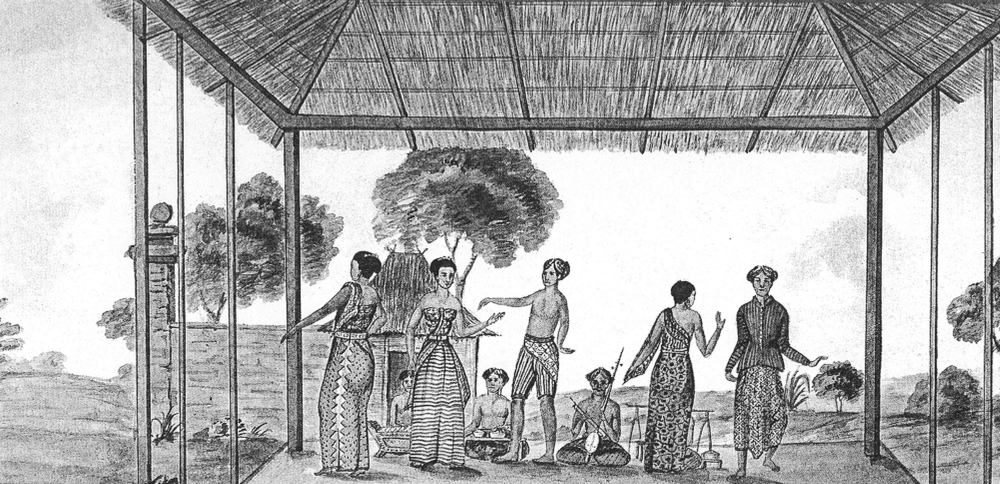

> *Plate 5. A tayuban (dance) party with tandhak/ronggèng (professional dancing girls/prostitutes) Courtesy of the British Library,*

London, WD953, f. 90 (101). pointed out that it was often as little as one sixteenth of a jung.[^80] Moreover, the size of these jung varied considerably according to the fertility of the area, the availability of irrigation and population pressure in a particular area. In the western core regions, for example, where there had been a great increase in cultivation since the mid-eighteenth century, the jung had been frequently sub-divided. Smaller areas of land now had to support a much larger population than in the poorly governed outlying regions where it was possible to traverse large tracts of land without finding a single peasant cultivator.[^81]

In similar vein, the Yogya Resident, Matthijs Waterloo (in office 1803-1808),[^82] remarked that in Mataram at least as many as fifty peasant cultivators could get their livelihood from a well irrigated jung in the vicinity of the royal capital, whereas a corresponding quantity of land would only support between two to four farmers in the impoverished southern hills (Gunung Kidul).[^83] Although some jung in this mountainous district were barren and infertile, Waterloo was of the opinion that there was enough land in the Yogya area for every villager to have rights over a small strip of wet ricefield or sawah. He pointed out that the only truly landless members of south-central Javanese society at this time were the mountain dwellers, those who worked in the royal teak forests (blandhong), and the porters on the roads who often took up their occupation in order to escape from onerous village obligations.[^84]

Waterloo certainly gave too favourable a picture of the structure of landholding in the central district villages in the first decade of the nineteenth century. He glossed over the fact that there were distinct classes or groups in the south-central Javanese désa in this period, classes which enjoyed hugely unequal shares and access to village ricefields and local labour. A Surakarta report of 1832, for example, referred to three main social groups: the sikep (literally ‘users of the land’), who bore the tax burden in the form of land-rent (pajeg) payments for the village; ngindhung, often close relations of the sikep, who owned their own houses and yards, but had no access to the village ricefields; and finally the wong numpang, unmarried strangers, who lived in the yard (pekarangan) or the house of the sikep and performed a range of agricultural, corvée and menial duties for him.[^85]

This last group approximated most closely to a class of landless labourers in south-central Java at this time. Unlike the ngindhung who could often improve their lot by marrying into sikep families, the numpang had very little chance of raising their social status unless they were prepared to leave the village entirely and open up new ricefields in hitherto uncultivated areas. But such opportunities were becoming increasingly rare in the pre-Java War countryside of south-central Java as perceptive observers like Waterloo himself acknowledged when he noted that although there was some ‘waste’ ground in the more remote parts of Mataram, most of the land was scrupulously cultivated.[^86] Indeed, Crawfurd reported from Kedhu in 1812 that population pressure had led to a much greater use of dry crop fields (tegal) in the poorly irrigated central plain and that mountain rice was being cultivated at ever higher reaches of the foothills of the volcanoes surrounding the province.[^87]

Besides this shortage of suitable agricultural land in the core regions, Crawfurd noted that even if an enterprising numpang did open up new ricefields in a waste area, his right of possession after three successive harvests as laid down in the Javanese agrarian law codes was not assured.[^88] Good land pioneered in this fashion would often be claimed back by the sultan (Carey 1986:82 note 81). Furthermore, numpang and other landless peasants were often deterred from trying to set themselves up as peasant cultivators (sikep) because of the prospect of having to meet the onerous corvée and tax requirements which sikep status necessarily involved. For these reasons, numpang who wished to break out of the cycle of poverty and rural servitude as day labourers to well-established sikep families would sometimes adopt the course of leaving the land entirely. Some drifted into marginal employment as porters on the main trade routes, others joined the numerous bands of vagabonds and robbers which terrorised the Javanese countryside, still others took service in the entourage of influential noblemen, who sometimes used them for criminal activities, a phenomenon which persisted right into the late nineteenth century as Isaac Groneman (1832-1912), kraton cognoscenti and personal physician to the seventh sultan, so vividly portrayed in his short story ‘A robbers’ history’ (‘Een kètjoegeschiedenis’) depicting links between court officials and the criminal underworld of Yogya in the mid-1880s.[^89]

In Kedhu alone, Crawfurd estimated the number of porters at 20-30,000 or nearly ten percent of the total population.[^90] In his words:

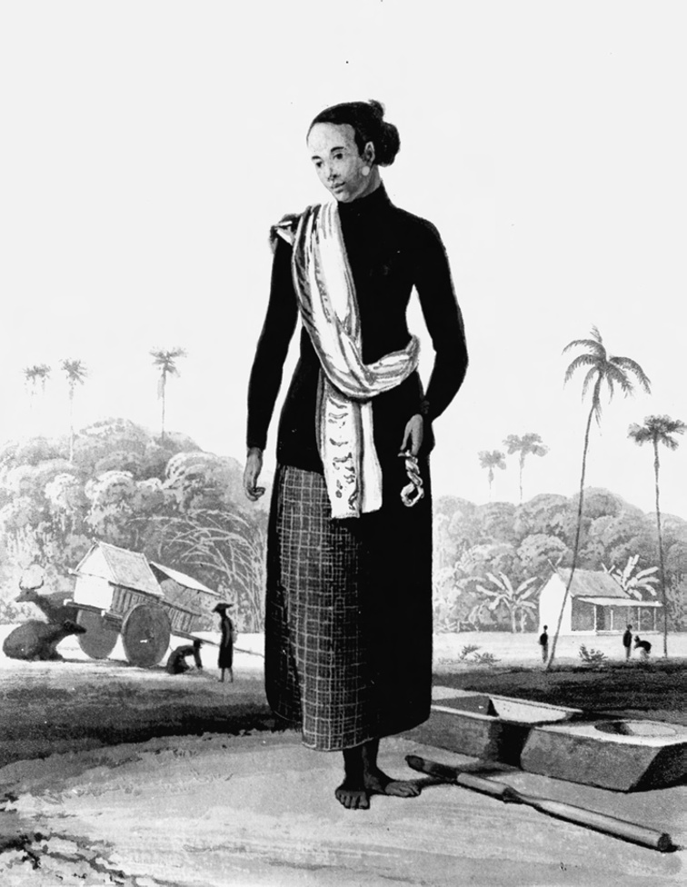

> *Plate 6. A Javanese woman of the lower class. In her left hand she holds a skein of cotton (the most important manufacture in the central Javanese villages in the early nineteenth century). To the right of the picture there is a rice stamper (alu) and block, and in the background a country ox cart (pedhati). Taken from Raffles 1817, I: p. 86 facing.*

> They have no fixed abode, and by the wandering and unsettled life they pursue, [they] have contracted the most inveterate habits of idleness, dissipation and profligacy. No sooner is their hire paid to them than they may be seen in groups to gamble it away and they are altogether so improvident that they go nearly naked. With such habits it is no wonder that they are accused of being the principal agents of crime and irregularities which are so prevalent in the countryside […] a good road would dispense [with] such people.[^91]

## The golden age of the sikep?

The structure of landownership in the core regions in early-nineteenth-century south-central Java seems to have been heavily weighted in favour of a small but influential sikep class of peasant cultivators. They held rights over the fields cultivated by the village in common since they were either the first farmers of the land (cakal-bakal) or their immediate descendants. As such they were directly responsible for the land-rent and the payment of the other village taxes in money and kind to the apanage holders through their tax-collectors (Carey 1986:84). At the same time, they provided the candidates for the position of village head and other offices. They also exercised joint control over the yearly division of the communal ricefields as well as the village commons which often covered extensive areas of woodland and pasture (Carey 1986:84 note 87). They also appear to have had a say in the appointment of the local tax-collectors and, as we have seen, many of these bekel were drawn from the sikep class.

The lands cultivated by the sikep were often passed from father to son and sikep families of long-standing were found in many south-central Javanese villages.[^92] Lands controlled by the sikep were of two sorts: tanah pusaka or ‘heirloom’ lands, which were part of the original patrimony of the village and could be bequeathed to their heirs – hence the pusaka (heirloom) epithet (Carey 1986:84) – and tanah yasa or individually developed lands. These last had been opened up on the initiative of the sikep themselves using their resident labour force of family dependants/boarders (ngindhung) and numpang.

As far as the heirloom lands were concerned, the sikep only had usufruct rights and not full ownership for their tenure was conditional on their performance of corvée services and payment of the land-rent/tribute to the ruler or his apanage holder. The central Javanese sovereigns retained residual rights over the eventual disposition of the land and a sikep could in theory be dispossessed if he failed to meet his labour and tax obligations. Thus his tenure of tanah pusaka was more akin to the lungguh or land grants given to the royal officials at the courts than to any species of private property. Such insecurity of tenure on heirloom lands was a major hazard for the sikep but unlike the situation at the courts where, as we have seen, there are frequent references in the records to the dismissal of apanage holders and the redistribution of their lands (Carey and Hoadley 2000:144-5, 153, 155-6), the sources are largely silent on the dispossession of sikep.

The individually developed lands, on the other hand, were more truly the sikep’s own property since these had been established by their own endeavours. Although the ruler could sometimes seek to reclaim such lands or impose new tax burdens on them, this was seldom done because, as we will see at the end of this chapter, the cadastral registers of the royal administrations were not revised after 1773-1774 to take account of the changes in land use at the village level (Carey 1986:109). The numpang and other dependants or rayat were extremely important for the sikep in this context: their labour was at his sole disposal and could be used at will to carry out daily agricultural duties, to perform the required corvée duties, and to extend the sikep’s rights over adjacent waste lands. Indications that the numpang and rayat were used extensively to develop new land can be seen from a late-nineteenth-century Dutch report on landrights. This stated that in circa 1830 there were quite a few sikep with as much as ten bau of irrigated ricefields or about seven hectares of which only about a fifth was tanah pusaka (Onghokham 1975:170, 186 quoting Bergsma 1876-96, I). Just how wealthy an individual sikep could be at this time is illustrated by a list of stolen possessions drawn up after a robbery in 1808 at the village of Pedhalangan in the Béji district near Klathèn, a fertile and well-irrigated area where much cotton was grown. Amongst the individual losses reported by one sikep was a cache of 180 silver ducatoons, a very sizeable sum, then worth £ 65, which calculated at £ 3,000 in the money of the mid-1980s (Carey 1986:86 note 93).

The period of the most rapid extension of agricultural land by the sikep appears to have been the latter part of the eighteenth century when population pressure was less intense than it came to be in the immediate pre-Java War decades as we will see shortly. Although much more research needs to be done on the subject, it is clear that sikep acted in an independent fashion in their localities and exercised great control over their numpang. A Dutch writer spoke of the quasi ‘patron-client’ which prevailed in Bagelèn before the Java War where a small number of sikep had rights over most of the ricefields and enjoyed the services of large numbers of dependants who had no hope of setting themselves up as independent cultivators (Kollmann 1864:368), observations which were echoed by Willem van Hogendorp in Kedhu in 1827 when he commented on the large amount of ‘private property’ belonging to peasant cultivators and the practice of inheritance in peasant families, both of which, in his view, contributed to the prosperity of the province.[^93]

Such a system permitted sikep to act as virtually self-sufficient farmers having only the loosest of links with the local village community. In Kedhu, Crawfurd noted that each cultivator farmed the lands which he had rented for his own advantage, shared no property in common and only gathered together in village associations in order to get some protection in a deeply insecure countryside: ‘peasants who live as close neighbours in the same village’, he wrote, ‘often have as little to do with each other as those who live at a distance of twenty miles’.[^94] Crawfurd’s remarks may have been exaggerated and the situation in Kedhu somewhat unique, but it is clear that the pre-Java War village with its loose association of peasant cultivators and dependants was a very different entity from the closely ordered community of the late nineteenth century, shaped as the latter was by the economic exigencies of the Cultivation System (1830-1870) and the administrative policies of the late Dutch colonial government with its passion for uniformity and social control (Kāno 1977:34-5; Breman 1980:38-9; Carey 1986:87). It was also different because of the steps taken in the post-Java War period to break up the more extensive peasant farms and extend ownership to a wider group of cultivators in order to make more people liable for tax responsibilities and corvée services to the colonial administration (Onghokham 1975:185; Fasseur 1977:146). In this fashion, the golden age of the sikep came to an end and with it a unique peasant ‘landowning’ society which was such a salient feature of the core regions of south-central Java in the years before the Java War.

## Extension of ricefields and development of irrigation

The golden age of the sikep was mirrored in two linked developments in Javanese agriculture in the late eighteenth and early nineteenth centuries: the rapid extension of irrigated ricefields and the construction of ever more elaborate irrigation systems in the core regions. European observers of rural Java were unequivocal about the impact of this great enlargement of sawah in the aftermath of the 1755 Giyanti treaty which had brought peace to south-central Java after nearly seventy years of war. In another of his prolific reports to the governor of Java’s Northeast Coast, Waterloo reported that the increase in rice production was visible everywhere in the central regions: ‘one only has to direct one’s eyes to those lands which [now] produce rice and which just twenty years ago were still waste and uncultivated’. In particular, he was impressed by the wooded areas of the Jambu hills on the northern border of Kedhu and neighbouring Semarang which had recently been turned into the most magnificent sawah.[^95] Similarly, many ricefields had been laid out in the adjacent province of Grobogan which had become a major rice producer for the Dutch establishments on the north coast.[^96] Commenting on the same phenomenon just under a decade later, Crawfurd was struck by the amount of recently opened sawah in the vicinity of the sultan’s capital in areas which older inhabitants remembered as having been ‘impenetrable jungle and the haunt of tigers’.[^97]

The first two sultans had led the way in encouraging their subjects to open up new land in the recently established Yogya kingdom. A report penned shortly after Sultan Mangkubumi’s death on 24 March 1792 by the governor of Java’s Northeast Coast, J.G. van Overstraten (De Jonge and Van Deventer 1884-88, XII:260) praised the tireless zeal of the inhabitants of the sultanate in restoring ruined lands at the end of the Giyanti Wars and quietly appropriating unclaimed areas, zeal which stood in marked contrast to the nonchalance of their neighbours in Surakarta. In particular, Sunan Pakubuwana IV (reigned 1788-1820), had shown gross dereliction of duty of his care as ruler by allowing a key aqueduct built by his father, Pakubuwana III (reigned 1749-1788), which carried water from Pengging and the old kraton of Kartasura to his capital, to fall into disrepair.[^98] Mangkubumi’s large stone dam in the Winongo River to the south of Yogya provided much needed irrigation for the royal ricefields at Krapyak and lasted until the great storm of 22 February 1861.[^99] His successor, Sultan Hamengkubuwana II, followed suit, constructing a number of irrigation channels and dams to the east and west of the royal capital in areas adjacent to his numerous royal retreats.[^100] Most notable here was the dam in the Kali Bedhog between Gunung Gamping and Ambarketawang which irrigated ‘numerous skilfully laid out sawah’,[^101] which were under the supervision of a kraton official known as mantri jurusawah (‘ricefield inspector’), who doubled as the manager of the royal limestone ovens at Gamping.[^102] These irrigation systems, built partly on the second sultan’s initiative, had led, in Waterloo’s estimation, to a 25 percent increase in wet-rice cultivation in the Mataram region in the space of a decade (1796-1806). On a tour to Gamping, the Resident noticed that the main road westwards was so thronged with traders and pack-horses making for Yogya that he could hardly get through on horseback.[^103]

Royal initiatives in irrigation were paralleled at the local level by the efforts of thousands of peasant cultivators who laid out their own simple networks. In the remote district of Pacitan on the south coast, many new ricefields had been pioneered in this fashion along the fertile valley of the Grindulu River.[^104] Meanwhile, in the sub-districts of Lowanu in northern Bagelèn and Menorèh in southern Kedhu, the cultivators living along the main Brèngkèlan to Magelang highway had been so zealous in the construction of new sawah that they had even dug up the road and planted it in many places![^105] North of Yogya, the greater part of the irrigation systems based on the flow from the Merapi-Merbabu watershed were the work of farmers living in the Slèman and Kalasan districts, and similar activities were noted in Pajang and Kedhu.[^106] In the latter province, Crawfurd pointed out that most of the best sawah was produced by simple irrigation ditches at the foot of the western volcanoes (Mount Sumbing and Mount Sundoro), writing:

> The whole [of this area] has the appearance of an extensive and beautiful garden [irrigated by] numerous streams and rills which have their source in the high mountains and which, with some art, are directed into a thousand little canals and water courses [...] thus fertilis[ing] the [entire] country.[^107]

Not all the core apanage lands were so fortunate and Waterloo’s assertion that nothing more needed to be done in the Yogya area in terms of opening out new ricefields was clearly wide of the mark.[^108] There were still many potentially productive areas which continued to be dependant on rain water to irrigate their fields: the Sendhang Pitu region between Slèman and the Kali Praga, for example, only began to receive adequate irrigation in the early part of the twentieth century.[^109] The same was true of both Gunung Kidul and Kulon Praga where only the most basic irrigation was attempted during the course of the nineteenth century and where water was still mainly obtained from the few available wells and dew ponds.[^110]

An 1836 report on the post-Java War Residency of Yogyakarta observed that whereas nine-tenths of the available agricultural land in Mataram proper was under cultivation, two-thirds of it sawah, only one hundredth of Gunung Kidul was farmed. The forest corvée services in the royal teak forests in the southern hills bore hard on the local population and many were forced to seek seasonal employment on the Mataram plain during the east monsoon (May-September) rice harvest.[^111] Other areas which depended on locally built irrigation systems, suffered severely from flooding during the rainy season (November-April). This was especially the case with the low-lying lands of Bagelèn in the vicinity of the great marshes (Louw and De Klerck 1894-1909, I:246), the Adikarta area of southern Kulon Praga between the town of Wates and the sea, and many parts of Grobogan and the eastern mancanagara which were under water for months on end. In these regions irrigation walls and dikes had to be strengthened and rebuilt nearly every year.[^112] Even when good drainage and irrigation networks had been established in productive areas such as Ampèl near Boyolali, the system of dividing water was often so complicated that numerous disputes had to be referred for arbitration to court officials from the patih’s office or special irrigation supervisors like the Surakarta pengulu banyu (‘water overseer’).[^113]

Despite the many shortcomings, developments in irrigation during this period from the Giyanti treaty (1755) to the Java War wrought a profound change to the agriculture of the central districts. Whereas in the pre-Giyanti period, dry fields, mountain rice and rain-fed ricefields (sawah tadhahan) had been the norm, by the eve of the Java War many of the lowland areas of south-central Java boasted large areas of irrigated sawah. This shift can be seen most clearly in the Javanese tax system and the method of rendering the land-rent in two instalments at Mulud and Puwasa, which according to Rouffaer (1905:617-8) was only introduced in the mid-eighteenth century in response to the changing agricultural patterns in the core regions. Whereas earlier only one harvest a year had been produced on dry ricefields, the considerable extension of irrigation systems in the core regions had permitted an additional harvest of secondary crops (maize, cassava) to be gathered in many places. The central Javanese rulers had exploited this to raise the tax obligations of the sikep, who were also required to meet the costs of the additional journeys of the tax-collectors (bekel) to the royal capitals. In the eastern outlying regions, however, where irrigation systems had not been so widely developed, the tribute was paid only once a year at Mulud, and the produce of any second harvest was kept by the cultivator (Louw and De Klerck 1894-1909, VI:380).

In the light of the available evidence, it is thus possible to modify the statement of a recent historian of Madiun who wrote that ‘the Java we know today covered with ricefields was mainly the achievement of the nineteenth-century peasantry’ (Onghokham 1975:200). While this may have been the case for certain depopulated parts of east Java (p. 59), which only began to undergo significant agricultural expansion after the end of the Java War, south-central Java was really transformed by the labours of the three generations of peasant cultivators who lived during the seventy years of peace which followed Giyanti.

## Demographic growth, 1755-1825

The opening up of new lands and extension of sawah in the core regions mirrored a steady population growth in the south-central Java in the seventy years between 1755 and 1825. Although reliable population figures for the Principalities are not available for this period or indeed for any period up to 1940 (Gooszen 1999:9), most European accounts point to a figure of between 1.4 and 1.6 millions in the decade 1806-1816.[^114] In fact, this was probably somewhat of an underestimate. Crawfurd spoke of one million inhabitants in Yogya alone even after the British territorial annexations of August 1812,[^115] which would suggest an overall figure well in excess of two million for the Principalities given Surakarta’s greater density of population. Estimates of general demographic trends, however, can be established by comparing the number of households recorded at the time of the cadastral survey (‘Book of Klepu’, 1756) which followed the Giyanti settlement (1755) with those registered in the ‘New Book’ (Serat Ebuk Anyar) of 1773-1774. This shows an increase of seventeen percent over eighteen years or around 0.9 percent per annum (Ricklefs 1974a:159-60). However, if this is projected for the period until 1795 on a compounded annualised increase basis, then a growth of more than 58 percent is indicated.

As Ricklefs has pointed out, however, the 1755 cacah figures were undoubtedly too high since they were based on conventionalized figures from the mid-seventeenth century and bore no relationship to the demographic realities of mid-eighteenth century Java when the population had declined sharply due to years of warfare and political instability between 1675 and 1755 (Ricklefs 1986:28-9). Given this artificially inflated 1755 figure, Ricklefs suggests that the population in the Javanese kingdoms and the European-controlled areas of the north coast was certainly growing in excess of one percent per annum and probably substantially more than that in many areas in the late eighteenth century.[^116] This may have some important implications for recent scholars of Java’s demographic history who have tried to explain the island’s remarkable ‘population explosion’ entirely in nineteenth-century (especially post-1830) terms (Peper 1970:71-84; Widjojo Nitisastro 1970:1-26; Boomgaard 1980:35-52).

European observers were particularly struck by the age structure of the population in the Principalities and the large number of children born between 1785 and 1805, exactly the same period which, as we have seen, witnessed the greatest extension of agricultural land and the foundation of new villages in the core regions. In these two decades, live births in the Yogya area had apparently exceeded deaths by a factor seven to five. Children under the age of five seemed especially numerous although it was precisely this age group which was most prone to the very high rate of infant and child mortality in Java during these years.[^117]

In the outlying provinces, however, the population actually fell by about five percent between 1755 and 1773. This was partly due to the fact that these regions were never able to recover from the depredations caused by the warfare of the seventeenth and early eighteenth centuries. It was also a result of the move to include large areas of the mancanagara such as Banyumas in the core regions in order to provide more apanage land for the growing court populations. This redesignation of territory, which occurred in 1773-1774 (Ricklefs 1974a:159), also had an effect on the demography of the outlying areas. But even if this had not taken place, the figures for population growth in the outlying areas would still show a slower rate of increase than the central districts. Raffles’ statistics in his History of Java seem to confirm this. Thus in 1815 the ‘eastern mancanagara and distant areas’ only accounted for ten percent of the total population in Surakarta and slightly under twenty percent in Yogyakarta (Raffles 1817, I:62, 228). The densest population at the time of the British government census of 1815 was Semarang with 281 inhabitants per square miles, followed by Kedhu with 239. Yogyakarta and Surakarta, both with a population of 147 per square mile came sixth in density after Pekalongan, Batavia and its environs (Bataviasche Ommelanden), Priangan and Rembang. The average for Java as a whole was a little over 100, but the mancanagara regions were even below that. The causes for their demographic deficit were probably local: the prevailing insecurity in the outlying territories which we will explore in more detail shortly, and the structure of the royal administrations which delegated power to the bupati in the outlying areas but ruled directly through the patih in the core districts.

Public health Apart from the long period of peace which followed the Giyanti settlement together with the incentives for farming and opening up new land, the steady population growth in south-central Java in the late eighteenth and early nineteenth centuries seems to have been encouraged by a number of benign conditions: first, the lack of large-scale epidemics and the health of the peasant populations; second, the availability of adequate food supplies and the balanced diet of families in country areas; third, the very early marriages in rural communities and the importance of children in the Javanese peasant economy.

The generally healthy condition of the Javanese peasantry at this time was referred to by Raffles (1817, I:69). Although he was attempting to draw a favourable picture of the five-year British interregnum (1811-1816), it is clear that there were no large-scale epidemics until April 1821 when the first of a cycle of virulent Asiatic cholera infections reached Java from Bengal and the Malay Peninsula.[^118] The only serious ailment in terms of mortality in pre-1821 south-central Java was smallpox, which wrought such havoc amongst infants and children that it was nicknamed the ‘child’s disease’ or lara bocah by the Javanese (Winter 1902:78; Peper 1975:51). A Dutch report on Kedhu in 1823 noted that although two-fifths of the total population of 330,000 were under twelve, one-third of these children succumbed to smallpox and other related diseases before their twelfth birthday. Forty-five percent of all deaths in the province were apparently accounted for by children.[^119]

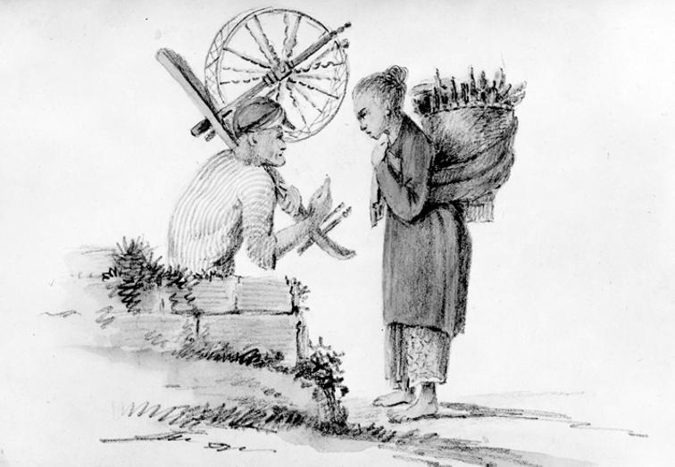

> *Plate 7. Sketch by the Belgian artist, A.A.J. Payen (1792-1853) of a south-central Javanese scene with a weaver carrying his spinning wheel talking to a female jamu (herbal medicine) seller. Photograph from the A.A. Payen collection (sketchbook WE/76). Courtesy of the Rijksmuseum voor Volkenkunde, Leiden.*

Despite its virulence, smallpox never reached serious epidemic proportions as in some European countries in the eighteenth century because of the fact that the Javanese rural population mainly lived in scattered village settlements and large and densely inhabited urban centres were rare. Moreover, Javanese parents usually made provision for the high infant mortality by having more children (Raffles 1817, I:72). In the words of the aged patih (first minister) of Yogya, Danureja I (in office circa 1755-1799):

> Too long a period of peace was just as disastrous as a time of [prolonged] warfare for the inhabitants [of south-central Java] and people regarded child deaths as a wise provision of Providence.[^120]

A start was made on smallpox vaccination in the Principalities in 1804, although the number of children immunised remained extremely small until well after the Java War.[^121]

## Diet and peasant lifestyles

This absence of pandemics until the third decade of the nineteenth century was partly the result of good fortune: Java’s situation as an island was certainly important here. But it was also due to a greater resistance to disease amongst the Javanese population as a whole, itself the outcome of the greater availability of foodstuffs in this period. In this respect, it is no coincidence that the cholera epidemics of the 1820s should have occurred during years of drought, harvest failure and warfare. The localised famines which resulted from the deteriorating agricultural situation during this third decade of the nineteenth century led to a sharp decline in the health and dietary patterns of the rural populations of south-central Java. In the 1820s, for example, observers noted an increased consumption of less nutritious secondary food crops such as maize, cassava as well as other tubers and vegetables gleaned from forests and waste lands.[^122] But until that decade of economic crisis, disease and conflict, most of the inhabitants of the south-central Javanese countryside could enjoy a mainly rice diet and times of dearth were rare.[^123] The only exception was the yearly ‘hungry gap’ when the new season’s rice crop was being planted with the onset of the rains in November. At those times, according to a report from Bagelèn, the price of padi (unhusked rice) could exceed by 200-300 percent that which a farmer could get for his crop at the time of the rice harvest (Toestand van Bagelen 1858:76).

A detailed insight into the dietary habits of the various social classes in Java at this time was given by J.W. Winter who served as Residency translator at both Yogyakarta (1799-1806) and Surakarta (1806-1820). Winter reported that the usual food of the Javanese ‘middle class’, by which he probably meant the inhabitants of the court towns, was rice with some dried fish and vegetables. This fare would be considerably more lavish on festive occasions when chicken and meat were consumed (Winter 1902:47). The ‘common’ Javanese, meanwhile, had a much more ‘sobre’ lifestyle, but still possessed enough to purchase a sufficient quantity of daily sustenance. According to Winter, 12 duit (copper farthings) a day were adequate for an unmarried man.[^124] These would be spent as follows: three duit on betelnut and tobacco, three duit on vegetables, salt and soybean cake, and six duit on rice. A farmer with a wife and children could exist on 25 duit a day with the wife contributing about four duit a day to the family budget by her activities at the loom or by acting as a tradeswoman carrying goods produced by the family to the local market (Winter 1902:47-8). In this context, the sale of produce from the farmer’s fruit and vegetable gardens was often of some economic significance in supplementing the family budget as Raffles noted (Raffles 1817, I:110):

> What can be spared of the fruits of their joint industry […] is carried to market and exchanged for a little salt fish, dried meat or other trifling comforts, hoarded as a store for the purchase of an ox or buffalo, or expended in procuring materials for repairing the hut and mending the implements of husbandry.

Although Raffles mentioned the purchase of salt fish and dried deer meat, these did not form a staple part of the ordinary Javanese peasant diet except in areas close to the sea coasts such as Pacitan and Bagelèn or in the more heavily afforested outer regions where there was an abundance of livestock (buffalo), as well as wild deer and game.[^125] Only rice and salt were regarded as being the two necessities of life in south-central Java and of the latter, the local inhabitants preferred the stronger tasting south coast variety to the cheaper product from the north coast.[^126] There were, however, many regional differences in eating habits: in Kedhu, for example, where a wide range of local fruit and vegetables were grown, the inhabitants were noted as having a better diet than in some of the neighbouring districts such as Karang Kobar, Ledhok, Gowong and Sélamanik where such commodities were scarce.[^127] More specialised delicacies, such as fish and shrimp sauces, prepared on the north coast, were eaten widely in south-central Java at this time as were chicken and duck eggs, particularly salted Muscovy duck eggs which were useful on long journeys (Raffles 1817, I:98-9). The only foodstuffs which do not seem to have been properly exploited were dairy products for which the Javanese apparently had an aversion.[^128]

A description of the ‘sobre’ lifestyle of the Javanese peasant cultivator and day labourer in early nineteenth-century south-central Java is given by Winter in his account of Surakarta between 1806 and 1820 (Winter 1902:49). He related how a farmer would usually leave singing for his fields before sunrise at five o’clock every morning. His first meal would be eaten at noon. A second repast would be taken shortly before sunset on his return home, but some cultivators only ate once a day. He would rarely burn an oil lamp, but would rely instead on the light of his hearth fire which was usually situated in the centre of the house and was lit both for night-time warmth and to protect him from the clouds of mosquitoes. The houses and huts used by the Javanese peasantry at this time were usually of a very simple construction: the single-hipped roof dwelling (omah limasan) being preferred. In this respect, the style of peasant architecture in the central and eastern parts of Java was less elaborate than in the mountainous western (Priangan) regions because of the greater scarcity of suitable building materials. This was also partly due to Dutch encroach ments on the teak forests in the eastern mancanagara regions bordering the north coast, an issue to which we shall return in later chapters.[^129] According to Winter, the ambitions of the average Javanese peasant cultivator were very modest, being limited to saving enough money for the purchase of a buffalo which would give him sufficient independence to work his lands by himself for half a day. ‘Then’, in Winter’s words, ‘he [counts himself] rich and more satisfied than the wealthiest man’ (Winter 1902:48).

The lifestyle of a Javanese coolie or member of the porters’ guilds in the court towns was even more spartan. Winter noticed that they would often sleep out in the open at night when they were carrying loads on the highways, and even when their duties were discharged they would only have a tumbledown shed or hut to return to. Their bed was usually a coarse mat of woven coconut leaves laid out on the bare ground. A simple set of clothes comprising a head-dress, jacket and breeches, all woven out of rough cloth and purchased once a year from a second-hand clothes dealer, would constitute their entire wardrobe. When these were being washed in a convenient river once every two months, the coolie would stretch himself out in the sun until his clothes had dried. Despite the simplicity of his attire and livelihood, the porter was better off, in Winter’s view, than the impoverished mountain dweller in the isolated hill regions whose only dress was a simple loin cloth (Winter 1902:48).

## Early marriage and the value of children

Although the Javanese peasant lived in a plain fashion, there were few restraints against marriage and European observers noted that it was customary for Javanese in country areas to marry early: the men at around sixteen and the women at between thirteen and fourteen.[^130] This was because marriage had distinct financial advantages: women were generally recognised to be more dexterous than men in money matters and they would usually make an important contribution to the household budget by their marketing activities (Raffles 1817, I:353). Celibacy was also viewed with distaste in Javanese peasant culture: Crawfurd related that ‘an old maid is quite unknown amongst Javanese women because however old or ugly, they never find difficulty getting a husband’.[^131] Divorces were also frequent in Javanese rural communities and couples would part with very little ceremony in order to choose new partners. The practice was apparently so common that on his inspection journeys Crawfurd was shown individuals of both sexes who had had as many as ten or twelve different ‘marital’ (namely, sexual) partners.[^132]

Modern rural sociologists have pointed out that frequent divorces usually mean fewer births per woman and longer gaps between them, but it is clear that children were highly valued by peasant cultivators in rural south-central Java at this time and played a vital role in the Javanese peasant economy (White 1975:127-46). According to Raffles (1817, I:70, 109), most peasant cultivators would raise families of between eight and ten children, only half of whom would survive into adolescence. Infants were an economic burden on their parents for only a very short time and, provided they survived the scourges of endemic diseases like smallpox, they soon became valuable assistants in the houses and fields. Boys were sometimes given a short period of Qur’ānic education with a local kaum or modin (village ‘priest’), but most started work immediately after they reached the age of eight.[^133] At that stage, boys were taught the rudiments of agriculture, while girls received instruction from older female family members in spinning and weaving, an occupation at which they would be active, in Winter’s words, ‘day and night’, turning out coarsely woven clothes for their families and more finely worked materials for the local market (Winter 1902:50; Raffles 1817, I:86; Lettres de Java 1829:101). Some also took part in agricultural duties, particularly the transplanting and harvesting of rice, activities which were regarded as the particular preserve of women. Thus a large family was an undoubted asset to peasant cultivators who had opportunities to open out new land but continued to face increasingly onerous fiscal and corvée demands from the rulers and apanage holders (Raffles 1817, I:70).

## Rural criminality, social bandits and fighting cocks

Two elements, however, were working against the prosperity of the core regions in this period: the lack of security in the countryside and the increasingly burdensome demands of the royal administrations, especially in the second sultan’s Yogya. The issue of insecurity has already been touched on in connection with the volatility of tenure arrangements, the village wars, and the activities of the numpang or day labourers. We have seen how some of these landless labourers drifted into semi-criminal activities after they had left their villages. Others joined the bands of robbers and highwaymen which roved country regions. These were often led by men of local influence and charisma. Known as jago (‘fighting cocks’), they had a popular reputation for magical invulnerability (kebal) and innate spiritual power (Onghokham 1975:63-9; Anderson 1972:9). In the years before the Java War, such village jago provided local leadership in the numerous village wars, or helped to expand village boundaries and defend its interests. During the war itself many were appointed as army commanders in their local areas by Dipanagara (Carey 1981a:243 note 36). A few of these men were what Eric Hobsbawm has called ‘social bandits’: rural leaders ‘who remained within peasant society, and were considered by their people as heroes, champions, fighters for justice, perhaps even leaders of liberation’. Oppressive landlords and government agents, especially Chinese tollgate keepers or bandar, were their natural enemies and it would have been unthinkable for them to snatch the peasants’ harvest in their own territory. Others were more clearly freebooters, rural criminals who were prepared to commit any crime on the orders of a superior or for personal gain. They thus lacked the special relationship with the local population which made banditry social (Hobsbawm 1969:13-5).

A good description of a jago figure, probably based on a real character who became one of Dipanagara’s henchmen in Kedhu,[^134] can be found in the Surakarta version of the Babad Dipanagara. During the confrontation with the prince’s supporters over the construction of the road across his estate at Tegalreja in July 1825, the immediate casus belli for the Java War,[^135] this man is depicted in the chronicle boasting of himself in bravado fashion (Carey 1981a:28-9):

> III. 18 Come on men of the Dipanagaran fall back immediately!

> 19 It is as if you have not heard the news yet that I am a picked champion, a [robber] chieftain [and] leader in Kedhu of the bandits of Parakan. No forged weapon is strong enough for me!

The elements of bombast and magical invulnerability which lay at the heart of the jago’s charisma are here nicely depicted. A more historical example of a jago figure and the popular awe which he could arouse can be found in a Dutch report on a rebel leader or kraman from Cirebon who took refuge in Bagelèn in 1808. Described as being small in height with long sideburns and dressed in a flowing tabard of checked linen cloth (kabaya ginggang), this man evoked respect because of his presumed magical power and the royal authorities found it difficult to get locals to touch him still less cooperate in his arrest.[^136]

Some local jago held important positions in the provincial administration and the Dutch Resident of Yogya complained in 1807 that a number of district chiefs were placing themselves at the head of robber bands.[^137] The martial and energetic spirit of the Yogyakarta inhabitants when compared to their more easygoing compatriots in Surakarta was noted by a later Dutch official who remarked that most of the successful bandit leaders in south-central Java were from the sultan’s dominions (Van der Kemp 1897:14 note 1). Demang Jayamenggala, the tax-collector of the rich désa of Samèn to the south of Yogya, was an example of just such an enterprising sub-district official who doubled as a social bandit. Renowned as an expert in gunpowder manufacture, he later became leader of all Dipanagara’s bandit supporters to the south of the sultan’s capital (Carey 1981a:243 note 36, 275 note 166).

Some villages strategically situated on roads, river crossings and border areas, where opportunities for smuggling and plunder were great, were used as the headquarters of brigands and highwaymen. One of these villages in the foothills of Mount Merbabu, which belonged to Yogya and had a sizeable population, was apparently so totally controlled by robber leaders that all the inhabitants, even down to the village ‘priest’, were involved in sorties into adjacent Dutch-controlled territory.[^138] The désa of Témpèl in the Slèman area athwart the main Yogya-Magelang post-road was another such bandit centre: its inhabitants apparently preyed on the busy highway traffic (the stone walls on each side of the post-road providing convenient hiding places) and later terrorised European leased estates and villages on the flanks of Mount Merapi in the years immediately preceding the Java War.[^139] It was the same with the settlements along the Praga River, which commanded certain key crossing points, such as Mangiran and Kamijara whose local bandits were supposedly summoned by Dipanagara in mid-July 1825 to coordinate resistance before the outbreak of the Java War (Carey 1981a:243 note 36). Jelegong and another settlement further to the north, which had inhabitants who were feared and respected, were also reported to have rendered assistance to the prince (Carey 1981a:262 note 112, 282 note 197). Known as ‘elders of the hunt’ (tuwa buru), they made their living by trapping tigers for the tiger spearing or rampog macan contests at the courts, a difficult and dangerous occupation which involved the use of secret charms and great personal bravery (D’Almeida 1864, II:35-7; Brandes 1900:184; Kartomi 1976, V:9-15, VI:7-13; Carey and Hoadley 2000:31).

The numerous links between the local jago/bandits in the Yogya area and Dipanagara – links which are even today the subject of critical comment by Yogya contemporaries[^140] – underline an important aspect of rural criminality in Java in the early part of the nineteenth century, namely the close association between certain robber chiefs and court notables. Certain members of the sultan’s family earned themselves notorious reputations as paymasters of bandits in the early nineteenth century.[^141] One young nobleman, Pangéran Mangkudiningrat II, a nephew of Dipanagara, who would later report the support given his uncle by the criminal elements in Javanese rural society (Chapter IX), even had some of his lands confiscated during the reign of the fourth sultan (1814-1822) because of his brazen use of jago in raids on Chinese-run tollgates.[^142] Although most of the connections established between priyayi and bandits were for financial gain, some had a political purpose. Dipanagara’s reliance on bandits as auxiliaries during the Java War has already been noted. They were also implicated in his uncle, Pangéran Dipasana’s, revolt in Kedhu in February 1822.[^143]

The second sultan himself employed bandits for both purposes. An 1801 report noted that he seemed loathe to curb his father-in-law, Kyai Adipati Purwadiningrat, the bupati of Magetan’s (in office 1797-1810) sponsorship of bandits in his district because he derived such a substantial cut from them.[^144]

Six years later, the sultan was suspected of having been involved with a particularly well accoutred robber band which was rounded up by Dutch cavalry after an attack on a Chinese tollgate keeper at Salatiga.[^145] Meanwhile, the ambush by a group of bandits in the area of the Jambu hills in northern Kedhu of the unpopular and sickly Yogya Resident, Pieter Engelhard (in office 1808, 1810-1811) as he journeyed to Semarang to relinquish his post in mid-November 1811 was clearly a politically motivated action sanctioned by the ruler.[^146]

In the eastern mancanagara districts the political authority of the local bupati was largely dependant on their use of criminal elements in the countryside. Here robbery for profit was widespread and bandit leaders were less selective about their targets. As we have seen, the prestige of the powerful Yogya bupati wedana of Madiun, Radèn Rongga Prawiradirja III (?1779-1810; in office 1796-1810), himself the grandson of an influential jago figure from Sokawati was largely derived from his adroit use of robber bands.[^147] Indeed, the scale of bandit activities in the eastern provinces was so extensive that in some areas such as Jipang the population had begun to fall drastically. In 1813, the British Resident, Lieutenant George Richard Pemberton, reported that ‘family after family’ had quit the district because ‘it was so infested with thieves that it was unsafe to sleep’. Good agricultural land had reverted to an uncultivated state leaving the area ‘most wild and desolate’ in many places.[^148] It was apparently the same in the neighbouring Surakarta mancanagara province of Jagaraga where robber bands, based in the mountain regions, plundered local villages and smuggled opium.[^149] An insight into the sheer scale of the banditry in these eastern outlying districts can be gained from the description of an attack on a Chinese-run customs’ post and settlement referred to as ‘Bunder’ (from the Javanese-Malay bandar, tollgate, customs’ post) on the borders of Kertasana and Surabaya on 25 May 1808 which involved no less than 250 bandits armed with pikes, clubs and blazing torches.[^150] The security situation in these areas was rendered even more critical by the second sultan’s policy of banning all petty criminals from Yogya to the eastern districts, and making the bupati wedana responsible for their supervision.[^151] We will see below how, during the period of Marshal Daendels’ administration (1808-1811), the whole issue of rural criminality and the border raids into adjacent European-government controlled territories would involve the Yogya court and the head of the eastern mancanagara districts in a crisis which would cost the bupati wedana his life.[^152]

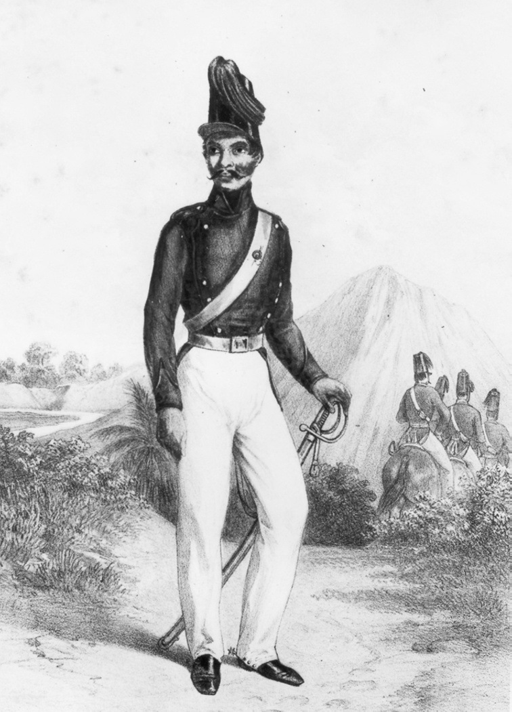

> *Plate 8. A Jayèng Sekar (mounted constabulary) in the early nineteenth century. Taken from Hardouin and Ritter 1853-55:236.*

## The forces of law and order

Few steps were taken by the courts or even by the European government to establish an effective system of police.[^153] In 1808, Daendels, drawing on Majapahit precedent (Stutterheim 1948:65), established a corps of mounted constabulary known as Jayèng Sekar, which was recruited from the sons of well-to-do Javanese court official families and was trained by European instructors. But it was organised on far too small a scale to have much impact in rural areas. Indeed, the duties of the Jayèng Sekar were mainly restricted to mounting night patrols in European-controlled towns, serving as escorts for prisoners and treasure convoys and accompanying officials when they went on inspection journeys. When serious trouble broke out, as for example in February 1822 in Kedhu when the sultan’s uncle went into revolt, a regular cavalry unit of European hussars had to be called up from the nearest Dutch garrison in Semarang in order to reinforce the meagre constabulary forces in Magelang.[^154] Police methods in both the Principalities and government areas relied heavily on a network of police informers and spies. Judicial torture rather than detective work was used to extract confessions, particularly in the Principalities where trial by ordeal was a common feature of the judicial process up to its abolition by Raffles in August 1812 (Van Deventer 1891:319, 329; Carey 1987:296; Chapter VIII). An insight into the police methods used in the Principalities at this time can be seen from the Surakarta version of the Babad Dipanagara’s account of the behaviour of the Macanan (‘tigers’) police unit responsible for security in the sultan’s capital (Carey 1981a:20-1, 28-9, 249 note 55):

> II. 15 They did exactly as they wished Their duty was to make the rounds at night [and] make tours inside the capital.

> *The evil folk they saw, if it was daytime, were prohibited from [playing] gimer, keplèk and kubuk [games of chance with dice and coins]. As a matter of fact they were old hands at the trade, [and] if the alarm sounded at the first thump, a Macanan would arrive, 16 and at the third thump the Macanan would descend like drizzle: […] young Macanan all at once would be ready to gather evidence, in high spirits, as if they expected to encounter gold dinars of a dhacin in weight. [...] III.16 [...] They were puffed up with flattery and self-glorification. Their daily task was to strike people guilty of theft and robbery when they lay face down and bound on a bench, [then] they hit them time and again.*

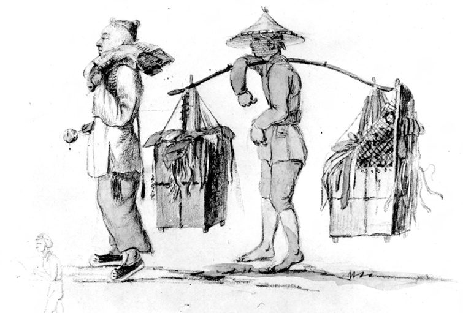

> *Plate 9. A Chinese tailor and his assistant in early nineteenth-century Java. Sketch by the Belgian artist A.A.J. Payen (1792-1853). Photograph from A.A.J. Payen collection (Sketchbook E no. 778). Courtesy of the Rijksmuseum voor Volkenkunde, Leiden.*

The courts also appointed a special group of officials, known as gunung in Surakarta and tamping in Yogyakarta, to oversee policing in the countryside. But they were required to combine these duties with a range of other responsibilities and their salaries were paid out of the taxes they raised in their assigned districts. They were thus more often a burden than a help to the local population and moves were undertaken to abolish them completely during the administrative reforms of the third sultan in 1812-1814.[^155] Police matters were likewise complicated by the close juxtaposition of Yogya and Sala lands in the core districts which meant that criminals could easily slip across jurisdictions and seek asylum in lands belonging to another court. Investigations of crimes committed in areas situated far from the royal capitals also usually entailed the dispatch of lengthy commissions by the patih. This was the case with all incidents of a serious nature in the outlying districts and was sometimes necessary in the central regions as well. As we will see in greater detail in Chapter V, some attempts were made to establish better cooperation between officials of both courts in security matters during this period, most notably by the agreements signed between the Yogya and Sala chief ministers at Klathèn in 1804 and 1808.[^156] But there was no lasting improvement until the complete separation of the territories owned by the courts in the core regions in 1830-1831 (Houben 1994:143-50).

Security matters were thus left largely in the hands of private individuals and communities. Most villages in south-central Java were fortified with thick bamboo palisades which were sharpened when bandits were reported to be in the vicinity. In the district of Prabalingga in southern Kedhu, the security situation was so bad that the villages were ringed by stone walls.[^157] Many local communities also had their own stocks of weapons and Javanese farmers would often carry a kris (stabbing dagger) with them for personal protection when they went to their fields. They were also usually well versed in the use of traditional Javanese weapons such as clubs, pikes and slings, and this local military expertise later proved of immense value to Dipanagara during the Java War.[^158] Chinese tollgate keepers in isolated areas depended for protection on their own private bodyguards who were drawn from the mixed race Chinese coolies attached to the tollgate. In the troubled eastern provinces, for exam ple, where tollgate keepers often had their own stocks and prisons to detain criminals, a Dutch report referred to influential bandar maintaining their own ‘private armies’.[^159] The houses used by Chinese and Europeans in south-central Java were also fitted with heavy wooden shutters and doors to enable the occupants to barricade themselves in the event of a sudden attack, a fact which did not escape the notice of the bandits who often carried axes with them when they mounted robberies on the property of foreigners.[^160] In the royal capitals, where there were large numbers of porters, beggars and unemployed people, court dignitaries had the habit of processing with extensive retinues as much for personal safety as for ceremonial display.[^161] The dangers inherent in a violent countryside were also reflected in trading patterns: Crawfurd noted that the most successful merchants at this time were the rulers themselves, not so much because of their business acumen but more because they were able to arm their trading flotillas on the Sala River against pirates and provide powerful escorts for their merchant convoys of bullock carts to Semarang.[^162]

## The Yogya taxation system and the eastern outlying districts

Besides the endemic security problems, a second problem for peasant cultivators in this period was the increasing burden of taxes imposed by the rulers. They were liable for four main royal imposts, the first of which we have already encountered, namely, the pajeg (from the Javanese ajeg = ‘fixed’), a fixed tax on the produce of the land usually rendered in kind and referred to as ‘land-rent’ (Rouffaer 1905:618; Onghokham 1975:171; Carey 1986:75-6). We will return to this shortly in connection with the revisions introduced by the second sultan to boost his revenues in the early 1800s.

In addition, there were three lesser levies: the pacumpleng (‘door tax’ from the Javanese cumpleng = ‘an opening’), a tax on each sikep household which in the eastern mancanagara districts at least was paid partly in hanks of weav ing cotton or cotton yarn;[^163] the kerigaji (literally ’ruler’s gathering or attendance’, hence ‘royal corvée’), a labour obligation for the upkeep of roads in the Principalities which was usually commuted to a money payment fixed at one Spanish dollar per jung in the mancanagara, but only half or a quarter of that in the core regions (Carey and Hoadley 2000:339-44); and finally a variety of irregular taxes and corvée duties known by a number of names such as taker tedhak, wang bekti, gugur gunung, and pegawéyan (Winter 1902:68, 108-9; Rouffaer 1905:625-6; Carey and Hoadley 2000:344-8). There are indications that these last were not unduly onerous in the core districts, but did constitute a very heavy burden in the outlying areas where they were administered by the local bupati.

As we have seen, before August 1812, when the corvée duties of the eastern mancanagara bupati in the royal capitals was abolished,[^164] very heavy labour demands were made on the work forces from the outlying regions. This was particularly the case in Yogya where the second sultan undertook ambitious construction projects. In August 1803, the outgoing Yogya Resident, J.G. van den Berg, informed his successor that whereas the first sultan had only detained the mancanagara administrators for four – or at the most five – months in the royal capital following the Garebeg Mulud festivities, the second sultan would often keep them for double that period.[^165] The labourers were extremely hard worked and Van den Berg noticed that when the sultan grudgingly delegated about 200 men to carry out repairs on the Dutch fort and other government buildings, they executed their tasks ‘with the lethargy of an exhausted people’.[^166] Moreover, their long sojourns in the royal capital meant that the men from the eastern districts could not return home in time to attend to the rice harvest, which in turn had an adverse affect on agricultural production in the mancanagara. Although the total numbers of cultivators brought to Yogya each year for these labour services from the eastern regions was not large – in 1808 they amounted to just over 2,000 men spread throughout the entourages of fifteen separate bupati[^167] – this still amounted to about six percent of the adult male inhabitants given the small population of the eastern regions at this time (Raffles 1817, II:290).

The eastern bupati also experienced difficulties in supporting themselves during such extensive periods away from home. Van den Berg remarked that they would almost always return to their districts in an impoverished state. Indeed, it was sometimes only due to the help of their relatives in Yogya that they could make the journey at all, often travelling back like ‘common men’ stripped of their money and escort.[^168] Faced with these demands, the bupati tried to meet the very heavy financial burdens placed on them by requesting increases in the journey money paid by the mancanagara inhabitants to assist their district administrators in their sojourns in the royal capital.[^169] Thus the local population found themselves doubly burdened: both by the corvée requirements and the increased fiscal demands of their bupati. This left a legacy of bitterness which manifested itself in the region’s political affiliations in the early nineteenth century. Radèn Rongga Prawiradirja III’s revolt in Madiun in November-December 1810, for example, attracted considerable local sympathy because it was a regional movement directed as much against Pakubuwana IV (and to a lesser extent the second sultan) as against the Dutch.[^170] At the same time, many of the mancanagara bupati supported Dipanagara’s father, the Yogya Crown Prince (later Sultan Hamengkubuwana III) against the second sultan during the power struggles at the court in 1810-1812,[^171] because the former was much more lenient in his corvée demands (Carey 1992:508-9 note 532). Even as late as August 1826, when the second sultan was briefly reinstated as ruler during a difficult period for the Dutch in the Java War, his exactions were still remembered. In the Yogya Resident, Jan Izaäk van Sevenhoven’s words (Louw and De Klerck, 1894-1909, II:421-2):

> One [only has] to visit the sixteen or eighteen country seats which he constructed, mostly with stone buildings, ponds with brick sides and other extensive pieces of masonry, and to think how these constructions as well as a large part of his kraton were put up at the cost of the sweat and tears of the inhabitants of his entire kingdom.

Hardly surprising then, in view of the continuing memory of the second sultan’s labour requirements, that the mancanagara inhabitants as a whole showed little sympathy for Dipanagara’s rebellion in 1825-1830, which they probably saw as essentially a ‘Mataram’ affair.

Besides the burden of the labour obligations to the rulers, the population of the outlying regions also had to contend with a number of more minor levies and labour services to local dignitaries, impositions which the cultivators in the core regions did not experience so acutely. The main reason for this was because the bupati and their subordinate officials actually resided in their districts whereas the apanage holders in the nagara agung lived mostly in the royal capitals. The former thus had more opportunity to insist on a wide variety of personal services and taxes.[^172] When the Dutch annexed Madiun in 1830, they found some 65-70 separate impositions rendered by the local inhabitants besides the main taxes due to the rulers and the provincial administrators.[^173] Although none of these impositions were levied on all taxable members of the local communities, the Dutch calculated that a wealthy sikep in the eastern districts rendered the equivalent of f 50-60 a year in corvée, kind and money taxes, a substantially higher fiscal burden than for peasant cultivators in adjacent government-controlled areas (Onghokham 1975:173).

Many of these minor taxes, such as those paid for the slaughter of livestock (tugel gurung) or levied by irrigation officials for the use of water (pamili toya), as well as the craftsmen’s patents and tribute in lieu of building materials (wilah welit), were common throughout the core and outlying regions (Louw and De Klerck 1894-1909, VI:381-4). But the amount of corvée and special duties associated with the upkeep of a bupati and his entourage were almost certainly greater than the services demanded by resident officials in the nagara agung. Throughout the eastern districts, for example, it was usual for district administrators to demand that sikep work for certain periods without payment in their fields, an obligation sometimes commuted to a money tax known as kuduran. Moreover, the residences (dalem) of the bupati also required considerable labour for their maintenance (Nagtegaal 1996:187), especially in the case of a dalem such as that of Radèn Rongga Prawiradirja III at Maospati just to the west of Madiun, which had been laid out ‘like a kraton with thick stone walls’.[^174] Special tributes in rice were likewise levied from the sikep for the support of members of the bupati’s personal staff such as grooms, gardeners, dancers, musicians, goldsmiths, saddle-makers and payung (state parasol) carriers (Onghokham 1975:140-1 note 71). Indeed, the lifestyle of many of the senior officials in the mancanagara emulated that of the central Javanese rulers albeit on a reduced scale and had to be maintained by numerous extra levies on the local inhabitants. We will see below how one of the principal grievances against Rongga was that he had used a local bandit to furnish him with fine Javanese gamelan orchestras which he had carried off from the adjacent Surakarta-controlled territory of Panaraga.[^175]

## The ‘pancas’ revisions of the second sultan and their impact

If the tax-paying peasant cultivators in the core regions escaped some of these extra levies and labour demands, they were still faced with major fiscal challenges. The key problem for the sikep in the late eighteenth and early nineteenth centuries was that the level of tax payments demanded by the rulers was steadily increasing. This was especially the case in Yogya, where the second sultan instituted a practice known as pancas – literally ‘cutting through’ or ‘pruning’ – whereby the size of the jung in his dominions was diminished while the tax obligations on each land unit remained at the same level (Rouffaer 1905:593; Carey 1986:115-6).

The background to this initiative lay in the lack of up-to-date cadastral registers at the courts. This meant that there could be no annual reassessment of tax burdens which took account of the rapid extension of sawah and irrigation systems in late eighteenth-century south-central Java (Rouffaer 1905:618; Carey 1992:440 note 205). We have seen above how no new cadastral surveys were compiled by either of the courts after the completion of the ‘New Book’ (Serat Ebuk Anyar) in 1773. Both the second sultan and his Surakarta counter part, Sunan Pakubuwana IV, steadfastly refused to countenance a new survey proposed by the Dutch in April 1792 because they feared that the Dutch East Indies Company would either seek to even out the landholdings between the courts or annex to itself all the new lands opened up since the 1773 measurement (De Jonge and Van Deventer 1884-88, XII:260; Rouffaer 1905:591; Carey 1978:123, 146). Even the Dutch seem to have treated this cadaster and its predecessor, the ‘Book of Klepu’ (1756), as quasi-pusaka (heirlooms) keeping them both in a locked secret chest in the archives of the governor of Java’s Northeast Coast in Semarang.[^176] Although subsequent attempts were made both by the British (1811-1816) (Blagden 1916:107-12) and the post-1816 restored Dutch administrations[^177] to compile accurate statistical accounts of the Principalities, they proved abortive. Indeed, it was not until 1865-1866 that the first detailed topographical maps of Surakarta and Yogyakarta were completed.[^178] Eighteenth-century land registers were thus all the central Javanese rulers and the European government had to go on until well into the nineteenth century.[^179]

The accounts kept by the sultan – at least in the form they have come down to us – give the impression of a somewhat disordered administration (Carey 1980:4-5; Carey and Hoadley 2000:441-3). Land grants to royal officials and lists of revenue payments are mixed up with documents of a very eclectic nature: political correspondence between the sultan and the Dutch Residents, royal prohibitions on apparel and etiquette, notes on disputes over villages, payments for pradikan santri (tax free benefices for men of religion) and court haji, reports from spies in government districts, letters from provincial officials to Yogya senior court bupati, as well as items of a more intimate nature such as challenges to cockfights, instructions on fasting and personal letters with imagery from the wayang.

We have the looting British to thank for much of this mess given the disorder in which everything was carted off from the kraton after its fall on 20 June 1812 (Carey 1980:12 notes 1-4, 1992:94-6, 248-51, 421 note 111-2). But the nature of the sultanate’s administrative system was also to blame. As Mason Hoadley has pointed out, it was in no sense a Weberian rational bureaucratic polity. Instead, its underdeveloped administrative structure and lack of functional chain of command meant that orders from the sultan were filtered through a whole hierarchy of intermediaries, none of whom had autonomous authority over a region or an administrative department. The final version of a royal command could thus be very different from the original, a system made even more perilous by scribal error in the cross-checking of documents.[^180] Temporary absence of key intermediaries with privileged access to the ruler due to sickness, and the existence of a number of ministers known as miji answerable directly to the sultan and thus outside the normal bureaucratic hierarchy compounded these problems (Carey and Hoadley 2000:442). This meant that the strength and weakness of the kingdom depended very much on the character of the monarch: a strong authoritarian ruler could overcome the system’s centripetal tendencies, a weak one would fall prey to them (Remmelink 1994:23).

What is clear is that post-June 1812, the already disordered Yogya administration of the second sultan began to sink into even greater disarray under a succession of short-lived (Hamengkubuwana III, reigned 1812-1814), and under-age rulers (Hamengkbuwana IV, reigned 1814-1822; Hamengkubuwana V, reigned 1822-1826, 1828-1855). Even the most basic land registers and revenue lists were not maintained.[^181] In September 1823, the parlous state of the kraton archive was graphically illustrated in a letter from the mother of the fourth sultan, Ratu Ageng, to Pangéran Dipanagara in reply to the latter’s request for the copy of a legal document from the British period (Chapter VII notes 235-6; Chapter IX note 170) which he had originally lodged with the court. Ratu Ageng excused herself as follows:

> As regards the letter of contract from the British, which came from you, I do not know where it is because the stack [in the kraton archive] consists of many letters which are in complete disorder spread here and there.[^182]

Indeed, it was not until the early years of the twentieth century that an effective reform of the sultan’s treasury and financial affairs was carried out under the supervision of a Jewish accountant appointed to the kraton staff on the recommendation of the Dutch Resident.[^183]

This combination of administrative disorder and reliance on antiquated cadastral surveys proved an insuperable barrier to the functioning of a fair taxation system at the central Javanese courts in the late eighteenth and early nineteenth centuries. However, whereas in Surakarta, the financially incompetent Sunan, Pakubuwana IV, took no new fiscal initiatives beyond demanding forced loans from his subjects to pay off his debts,[^184] in Yogya, the second sultan wished to see the great increase in the productiveness of his lands reflected in steadily rising tax returns, and was prepared to use arbitrary methods to achieve his ends. This led eventually to the twin fiscal revisions of 1802 and 1808-1811, the background to which is necessary to consider in some detail. Amongst his royal officials, the Yogya ruler disposed of a handful of ‘village surveyors’ known as abdi-dalem priksa dhusun or mantri papriksan negara whose main task was to supervise the tax-collectors to see that they did not take too much land.[^185] They may have had a wide knowledge of agrarian conditions, but they were far too few in number to keep the sultan fully informed about developments in land use in his far-flung dominions. The Yogya ruler thus had to rely on reports from individual apanage holders and mancanagara bupati as to the productivity of the lands under their charge (Carey and Hoadley 2000:65-6). This led to frequent notifications regarding cacah which had become uncultivated or depopulated, especially in the eastern outlying areas, where a distinction began to be made in land grants between cacah gesang (inhabited or cultivated cacah), and cacah pejah (depopulated or uncultivated cacah; Carey 1986:11; Carey and Hoadley 2000:69-74, 240-50), but understandably few admissions concerning increased productivity on established sawah or the opening up of new lands. And naturally so – every one of the sultan’s subjects from the grandest apanage holder to the lowliest sikep was loathe to face new fiscal demands. This was remarked on by the Dutch Resident, W.H. van IJsseldijk (in office 1786-1798), in Pacitan where peasant cultivators had made a point of not informing the courts about the great increase in irrigated sawah along the Grindulu River in the late eighteenth century because they were afraid that new lands would be appropriated by the rulers.[^186]

Faced with this situation, the sultan responded by threatening the apanage holders with royal disfavour if they refused to send in accurate reports. In the Yogya archive, there is an important royal order, unfortunately undated but probably issued around the time of the first fiscal revision in July 1802, in which recipients of lands were commanded to inform the ruler within two months of any discrepancies between the lands listed in their piagem (official land grants) and the actual extent of their apanages after new clearances had been accounted for. If no replies were forthcoming in the appointed time, the sultan warned that he would dispatch his village surveyors to make independent enquiries, a threat he must have known he could not enforce given the limited number of them available to him (Carey 1986:110-1; Carey and Hoadley 2000:81).

In a vain attempt to address the issue, the second sultan continued the resurveying of some of the most fertile landholdings in the Mataram area begun by his predecessor in 1791 when the old agrarian unit of the Majapahit rood had been reintroduced into the core regions (Rouffaer 1905:593, 617; Carey 1986:114). The second Yogya ruler had encouraged the extension of this measure in order to create more ‘unity’ in the size of the Yogya fields and to discover undeclared apanage ground, thus enhancing his tax income. The survey seems to have aroused little opposition amongst the apanage holders but it proceeded too slowly to make any real impact on revenue returns. The impatient sovereign thus embarked on a much more drastic plan: sometime before the Garebeg Mulud of 14 July 1802, he carried out his first fiscal revision. Known as the pancas, this reduced the size of the old Majapahit rood considerably while making the new measure applicable throughout all Yogya territories both in the core regions and the outlying areas (Carey 1986:114-5). According to Nahuys van Burgst (1835, I:8 note 1) and Jan Isaäk van Sevenhoven,[^187] who both served as commissioners for the land settlement in the Principalities after the Java War (Houben 1994:17-71), a further revision followed some years later during the period of Daendels’ governor-generalship (1808-1811).

The effects of these – possibly two – fiscal revisions was the artificial creation of twenty percent more apanage land in the sultanate from the pared off landholdings of members of the sultan’s family and Yogya officials. Crawfurd estimated that at least 10,000 new size Yogya cacah were added by the measure[^188] and in the pajeg returns of 1808, the Yogya ruler is listed as having enjoyed an extra 20,000 ronde real (1 ronde real = £ 2)[^189] in rent from the new royal domain grounds created by the first pancas.[^190] From this time onwards a considerable discrepancy existed between the size of Yogya and Sala jung, which was commented on by a number of European land-renters in the Principalities during the course of the nineteenth century.[^191]

The pancas revisions were the equivalent of a debasement of the currency as Rouffaer (1905:593) pointed out and they aroused bitter opposition amongst Yogya apanage holders, who were quick to pass on the fiscal burdens entailed by the new measure to their sikep when resistance proved useless.[^192] This undoubtedly led to a significant increase in the amount of tax borne by sikep in Yogya areas and compounded the difficulties faced by poorer farmers and numpang who had ambitions to set themselves up as independent cultivators. Most important of all, the pancas sharpened the inherent differences in the tax burdens on individual jung which were already fixed in a most haphazard fashion by the apanage holders and the sovereign. Thus, in the lands around Nanggulon in the Kulon Praga area, which were administered directly by the Dutch government between 1833 and 1851, government surveyors found huge discrepancies both in the size of jung and the pajeg levied on each unit, with no obvious connection being made between population density, the fertility of the soil and the level of pajeg payments (Carey 1986:112). Even then, the new land measurement inaugurated by the pancas does not seem to have been applied to all Yogya lands even in the core regions and as late as 1830 there is evidence that the old measurement of the Majapahit rood was still being used in some Mataram villages.[^193] In this context, the third sultan’s attempts to revert to his grandfather, Sultan Mangkubumi’s, administrative methods, both during his period as Prince Regent (Raja Putra Naréndra) in January-September 1811 and during his brief reign (1812-1814) (Carey 1980:21), must have created yet further complications in the already dizzyingly complex Yogya tax structure. Local migrations away from areas of high taxation to those regions where the fiscal burdens were lighter can be seen as partly the outcome of this fiscal imbalance. Although the pancas enabled the second sultan to tap some of his subjects’ additional wealth, it was implemented in such a rough and ready fashion that it exacerbated agrarian problems at the village level and in the longer term prepared the ground for the widespread rural uprising in south-central Java which accompanied Dipanagara’s revolt in July 1825.[^194]

## Conclusion

In assessing the taxation structure of the Principalities at the beginning of the nineteenth century, certain key themes can be singled out. The most obvious was the difference in tax burdens between the core regions and the mancanagara. This goes far to explaining the declining population in the outlying districts in the latter part of the eighteenth century and provides insights into the area’s affiliations after 1800. Another important theme was the general trend for corvée services to be replaced by money taxes. This was happening nearly everywhere in the Principalities except in the mancanagara, and it was a development which appears to have been welcomed by the independent peasant cultivators (sikep). It also suggests a lively cash economy in some rural areas of south-central Java at this time. A third theme was the inexorable rise in pajeg demands, especially in Yogya where the second sultan’s pancas revision had drastic effects at the local level. Taken together with the numerous extraordinary levies such as the taker tedhak and uang bekti pasumbangan raised by both the apanage holders and the rulers, they amounted to sharply increasing tax burdens on the sikep. Despite these difficulties, it is certain that many independent peasant cultivators were able to hang on to much of their wealth in this period. The inefficiencies of the royal administrations, the lack of accurate cadastral surveys and the paucity of village surveyors all meant that their newly opened lands could be concealed. It was only in the five years preceding the Java War when harvest failures were common and the operation of the Chinese-run tollgates began to have a devastating effect on local trade that agrarian conditions in south-central Java became intolerable for cultivators. These conditions would precipitate the widespread agrarian uprising in south-central Java which was the most significant feature of the outbreak of the Java War in July 1825.

Socially and culturally, Yogyakarta and its Surakarta counterparts presented a generally confident and prosperous aspect in this period. They were still predominantly military societies, but martial requirements were assuming less prominence in an age when there were fewer major conflicts. In this respect, Yogya retained more of its original character than the Surakarta court in large part because of the legacy of the first sultan. But even here there was a tendency for cacah to become units of economic measurement rather than the basis of general military enlistment, and the calling up of auxiliary levies declined except in situations of emergency. In the countryside, besides the existence of a class of more or less wealthy peasant cultivators, the main features were numerous landless labourers (numpang) and an even larger group of tax-collectors (bekel, demang) acting on behalf of apanage holders resident in the royal capitals.

This was the world into which Dipanagara was born in 1785. It was a place full of tensions and dynamism, at once violent, insecure and prosperous where one could encounter great social differences and extreme geographical variety. In the span of just under five hundred kilometres from the furthest western to the most easterly outlying provinces, one could traverse abandoned landscapes as well as fertile and densely populated core regions where Java seemed like a tropical Eden. This was a society where a wealthy sikep could have a personal fortune in silver ducatoons kept for display under his bed and where a landless labourer or porter had but the second-hand clothes he wore on his back. This was frontier Java, a very different world from the ordered agrarian society of the post-Java War era with its cultivation systems (1830-1870) and Delft and Leiden-educated colonial administrators, a society no longer geared for war but for the world market in international cash-crop production. Culturally too, the days were numbered when the high court etiquette of the south-central Javanese kraton set the tone, a place where the villages had their customs and the court centres their order.[^195] This would soon give way to a new native elite exemplified by the post-1830 Dutch-appointed priyayi, an indigenous bureaucratic class more at home in the butchered cadences of ‘Service Malay’ than the refinements of high court Javanese (Sutherland 1979; Hoffman 1979:72). For the Europeans too, as we will see in Chapter IX, the post-1816 returned Dutch government would mark a social and cultural watershed. The great Indies families, who had dominated the higher echelons of the Dutch East Indies Company administration in the eighteenth century, would be swept aside by the flood of placemen, adventurers and former Napoleonic War officers who came to the Indies on the coat-tails of Governor-General G.A.G.Ph. van der Capellen’s administration (1816-1826). The days of the mestizo, mixed race slave-owning Indo-Portuguese elite, evoked so vividly by Jean Gelman Taylor (1983) in her study of colonial Batavia, were numbered. Soon, a new type of Dutch Indies official, members of the post-Revolutionary Dutch bourgeoisie, born and educated in the Netherlands, would rule Java. Over a century would pass before the Indonesians, led by those who had benefited from a Dutch education, would have the opportunity to shake them off.

For a Javanese prince born fifteen years short of the new century, how was it possible to surmise all this? For such a person it must have seemed that the Javanese ‘old order’ of the south-central Javanese Principalities, successor states to the once mighty Mataram Empire of the seventeenth century, was a fixed entity, culturally secure even if politically and socially turbulent. In the imaginings of such a man, especially if like Dipanagara he was brought up to be a pious Javanese Muslim, the faded glories of the Ottoman Empire and the holy mosques (haraman) of Medina and Mecca, the very places trod by the feet of The Prophet, were what mattered. If there was a sacred centre on this earth, it was in Arabia where the heart of the Muslim community of Believers beats. In such a universe, who could have imagined that it would not be the Sublime Porte or the holy places of the Hejaz (present day Saudi Arabia) which would shape his future, but the political and industrial revolutions even then germinating in the bleak mill towns of Lancashire or the teeming artisan quarters of Paris? Protean energies would flow from these twin revolutions leading to what historian Kenneth Pomeranz has aptly termed ‘The Great Divergence’ (Pomeranz 2000), when the technical efficiency and standards of living in Europe and Asia – in particular China – began to part company. But at this early stage it would take a genius to perceive them.[^196] In the meantime, before the two divergent worlds smashed into each other and south-central Java felt the full force of the new European order, it would be vouchsafed a brief period in which its own ancien régime would remain intact. In those twenty-three years, Dipanagara would grow to manhood and find his own place in the spiritual and cultural universe of his native Yogya. That coming of age in the unusual surroundings of his great-grandmother’s country estate at Tegalreja will be the subject of the next three chapters.

## Notes

[^1]: Van Hogendorp 1913:174. Many of the Yogya princes and high officials had destroyed their residences before going over to join Dipanagara in July-August 1825, Carey 1981a:291 note 233, 1988:56, 105 note 95.

[^2]: Dj. Br.19¹, A.H.W. Baron de Kock, ‘Memorie van Overgave’, 17-5-1851. On Albert Hendrik Wendelin de Kock (1808-1891), who was a son of the Dutch army commander during the Java War, Hendrik Merkus de Kock (1779-1845), see Louw and De Klerck 1894-1909, I:291 note 2; Genealogie De Kock 1996-97:22-3.

[^3]: On the limestone quarries and ovens at Gamping which were run by Chinese workers and produced some 600 pikul (1 pikul = 61.761 kgs) a month in 1820, see Carey 1981a:238 note 21. The control of these quarries and their Chinese labour force would become one of the casus belli between Dipanagara and his opponents in the Yogya court in July 1825, see Chapter IX.

[^4]: See Chapter II.

[^5]: Nahuys van Burgst 1852:135; KITLV H 503, Jan Izaäk van Sevenhoven, ‘Aanteekeningen gehouden op eene reis over Java van Batavia naar de Oosthoek in […] 1812’ (ed. F. de Haan), 6-4-1812 – 2-8-1812 (henceforth: Van Sevenhoven, ‘Aanteekeningen’), 107, noted that the only other towns in Java with a large proportion of stone houses were Batavia and Gresik.

[^6]: Sometimes referred to in contemporary accounts as ’Rustenburg’.

[^7]: Lettres de Java 1822:100; Van Sevenhoven, ‘Aanteekeningen’, 105-10. The market is now called Pasar Beringhardjo (‘Prosperous Waringin Market’). On the completion of the buildings in the Dutch fort in 1795, AvJ, Wouter Hendrik van IJsseldijk (Yogyakarta) to P.G. van Overstraten (Semarang), 4-3-1795.

[^8]: Van Sevenhoven, ‘Aanteekeningen’, 110; Dj.Br. 52, A.H. Smissaert (Yogyakarta) to President Hooge Raad van Justitie (Batavia), 7-4-1823, mentioned that the value of the 70 houses in the European quarter ranged from f 4,000 to f 220. The number of ‘European’ males over the age of 16 in Yogya in 1819 was 102, MvK 3124, ‘Register van het Europese personeel op Java en Madoera (Djokjokarta)’, 1-1-1819.

[^9]: According to Van Sevenhoven, there were only two or three Chinese houses worth f 1,500, the rest were small shop-houses of very simple construction, Van Sevenhoven, ‘Aanteekeningen’, 110. In 1808, there were 758 Chinese males over the age of 14 in the sultan’s capital compared to 1,282 in Surakarta, Carey 1984a:16.

[^10]: Raffles 1817, I:83; Van Sevenhoven, ‘Aanteekeningen’, 110.

[^11]: Van Sevenhoven, ‘Aanteekeningen’, 110.

[^12]: Van Sevenhoven, ‘Aanteekeningen’, 116. For a contemporary description of Surakarta in circa 1812, Mack.Pr. 86(1), Colonel Alexander Adams, ‘Some observations respecting Souracarta’ (henceforth: Adams, ‘Souracarta’), 1812, 63-73.

[^13]: AvJ, A.H. Smissaert (Yogyakarta) to Algemeen Secretaris (J. Bousquet) (Batavia), 24-4-1823.

[^14]: Van Sevenhoven, ‘Aanteekeningen’, 110.

[^15]: Ricklefs 1974a:84-6; D’Almeida 1864, II:128-32. A serious earthquake caused by the eruption of Gunung Guntur in west Java on 7 September 1803 damaged the Taman Sari’s foundations draining the water from the ponds, although Hamengkubuwana II again went boating there on 9 November 1803, Dj.Br. 49, Matthijs Waterloo (Yogyakarta) to Nicolaus Engelhard (Semarang), 8-9-1803, 9-11-1803. A further earthquake struck on 19 March 1806 which destroyed much of the Yogya fort, IOL Mack.Pr. 2, ‘Surakarta Sengkala list’, entry for 28 Besar AJ 1732; vAE (aanwinsten 1900) 235, Nicolaus Engelhard, ‘Speculatieve Memorie over zaken betreffende het bestuur over Java’s N.O. Kust’ (henceforth: N. Engelhard, ‘Memorie’), 14-5-1808. Another earthquake damaged the fort at Klathèn on 28 February 1808, so it is possible that this might have had similar effects in Yogya a mere 30 kilometres away, Dj.Br. Lieutenants Schraag and Detelle (Klathèn) to Matthijs Waterloo (Yogyakarta), 1-3-1808. It was not used after 20 June 1812, when British cannon fire damaged its superstructure, Thorn 1815:292. By the time Willem van Hogendorp visited in 1828, it was infested with thousands of bats, Van Hogendorp 1913:175.

[^16]: The entire Yogya military establishment in 1808 is listed in dK 145, Matthijs Waterloo, ‘Memorie […] van het Hof van Djocjocarta […] aan zijn Successeur […] P. Engelhard’(henceforth: Waterloo, ‘Memorie van Overgave’), 4-4-1808. Two of the court regiments, the daëng Secadipura and the Bugis with 106 and 40 men apiece, were recruited from South Sulawesi (Bugis, Makassarese), whereas the Blambangan sepuh and panakawan Blambangan, both with 100 men each, were recruited from Bali and the Oosthoek. See further Remmelink 1994:20.

[^17]: Thorn 1815:293; Carey 1992:413 note 73. See also Chapter II note 29.

[^18]: See Chapter VI.

[^19]: See Chapter VII.

[^20]: BL Add MS 45272, T.S. Raffles (Batavia) to Lord Minto (Calcutta), 21-1-1812.

[^21]: Louw and De Klerck 1894-1909, I:228, II:380; Carey 1992:406 note 34a, 427 note 138. The Javanese dexterity with pikes is also mentioned in Dj.Br. 23, Pieter Engelhard (Yogyakarta) to H.W. Daendels (Batavia), 2-6-1808. For a less favourable view, Crawfurd 1971:409 sub: ‘spear’. See further p. 333. See also Remmelink 1994:19 on the Javanese lack of skill with muskets.

[^22]: Tanojo 1938:1-20. On Dipanagara’s heirloom (pusaka) kris and other weapons, see Appendix XI.

[^23]: Raffles 1817, I:296; Louw and De Klerck 1894-1909, II:283 note 1; Poensen 1905:158; Gericke and Roorda 1901, I:485. For references to Kutha Gedhé as an armaments centre during the Java War, BD (Manado) III:276, XXIX:42; UBL BPL 616 Port. 12 no. 8, ‘Verklaring van Radèn Mas Machmoed, een gevangen muiter’, 1-8-1829. On the capture of kalantaka from Radèn Rongga Prawiradirja III’s residence at Maospati in December 1810, Dj.Br. 46, Lieutenant Thomas Paulus (Madiun) to Pieter Engelhard (Yogyakarta), 7-12-1810; and on the stationing of cannon in Rawa by Hamengkubuwana II in 1826, Dj.Br. 6, ‘Vergadering bij den raad uitmakende het bestuur over het rijk van Djocjocarta’, 23-12-1826.

[^24]: Stockdale 1812:383, 387; Raffles 1817, I:296, 471; Gomperts and Carey 1994:16, 25. Purchases of cannon and saltpetre from Gresik by Hamengkubuwana II are mentioned in UBL BPL 616 Port. 3 no. 1, W.H. van IJsseldijk (Yogyakarta) to Anthonius Schwenke (Gresik), 10-12-1792, 22-1-1793.

[^25]: Rouffaer 1905:617-8; Kāno 1977:22 note 43; Carey 1986:68; UBL BPL 616 Port. 22 no. 4, H.G. Nahuys van Burgst, ‘De Montjonegorosche-Djocjokartasche landen’, n.y. (? 1826).

[^26]: Dj.Br. 23, Pieter Engelhard (Yogyakarta) to H.W. Daendels (Batavia), 2-6-1808.

[^27]: See Chapter VI and Chapter XI.

[^28]: Rouffaer 1905:619; Carey 1992:489 note 424; Carey and Hoadley 2000:144-5, 155-6. See further Chapter III on Dipanagara’s links with this family, especially R.T. Danukusuma’s widow, Radèn Ayu Danukusuma, a daughter of Hamengkubuwana I. See further Remmelink 1994:25-7.

[^29]: Banyumas refers here to the post-1830 district of that name: the older and much smaller area of Banyumas proper around the district capital was under Surakarta administration in this period and was the seat of the chief administrator (bupati wedana) of the Surakarta western mancanagara regions until 1773, Rouffaer 1905:591.

[^30]: Carey 1986:74-5; IOL Mack.Pr. 21 pt. 7, John Crawfurd, ‘Remarks on the nature and condition of the landed tenures of the native government of Java with some suggestions for the improvement of the land revenue in the territories of the European power’, 17-5-1813 (henceforth: Crawfurd, ‘Landed tenures’), 234.

[^31]: Land measurement usually reckoned at 600 square feet of irrigated sawah (ricefields) but variable according to the quality and productivity of the land. Other sources give Dipanagara’s land grant in July 1812 as 500 cacah, see Chapter VIII.

[^32]: Rouffaer 1905:593-4; Carey 1992:458 note 286, 458-9 note 288, 483 note 397; Houben 1994:65; GKA, Exhibitum, 20-9-1830 no. 56k, ‘Verbaal van de verrigtingen van Commissarissen te Djokjokarta en aanteekeningen gehouden in de comparative ter zake hunne commissie met onderscheidene personen’ (henceforth: ‘geheim verbaal’), interview with Pakualam II, 24-4-1830. On the drainage problems in Adikarta, see note 109.

[^33]: Dj.Br. 86, Pieter Engelhard (Yogyakarta) to H.W. Daendels (Batavia), 8-6-1808, stating that the Yogya bupati of Kedhu (also known as Bupati Bumija), Bagelèn, Mataram, Sokawati and Pajang, all resided in the sultan’s capital.

[^34]: See Chapter V; and Remmelink 1994:17 for examples from the eighteenth century.

[^35]: On the tiger-infested forests of east Java in early to mid-nineteenth century, Dj.Br. 23, Corporal Pieter Gulin (Bunder, Surabaya) to Pieter Engelhard (Yogyakarta), 19-7-1808 (reference to travelling for two days without seeing people but many tigers in the forests of Kertasana during his investigation of 25-5-1808 attack on the Chinese trading community at Bunder); D’Almeida 1864, II:32 (Ngawi and Madiun countryside so full of tigers that often seen by inhabitants crossing the road and lapping water from the ditches besides the main highway); KITLV H 395, ‘Rapport van de assistent-resident [P.F.H.] Chevallier over de werking der tolpoorten’, 15-6-1824 (henceforth: Chevallier, ‘Rapport’; reference to Surakarta bupati of Nganjuk being more afraid of the Chinese-run tollgates on the main roads than the tigers in the forests through which he had to pass in order to get to round these tax-posts). See further pp. 475-8.

[^36]: Balé Poestaka 1939:14 sub: ‘Gata’; Adam 1940:331-2. See also Appendix Vb.

[^37]: See Chapter VI.

[^38]: Makassar Notebooks (Sejarah Ratu Tanah Jawa) I:170: iku awitnya rusak ing Tanah Jawa, sabab kapir wus mélu masésa sarupané Tanah Jawa, padha sabar iku saparoné ing Tanah Jawa ginadhuh dènaturaken pametuné marang kang jumeneng Ratu ing Pajang [Surakarta] lawan Mantaram [Yogyakarta], kang saparoné kang jumeneng bumi Jawa iku dènpara padha, rasané kaduwé ing ratu loro. Iku akalé kapir laknatullah.

[^39]: Crawfurd, ‘Landed tenures’, 229. See further p. 521 on the Yogya regional bupati’s ignorance of the lands under their administration; and further Remmelink 1994:26-7 for earlier examples.

[^40]: Pringgodigdo 1950:18 note 2. On Dipanagara’s supervision of his lands, see Chapter II.

[^41]: GKA, Exhibitum, 20-9-1830 no. 56k, geheim verbaal, interview with Panembahan Mangkubumi, 18-4-1830; interview with Haji Ngisoh [Ngisa], 21-4-1830.

[^42]: According to Van Sevenhoven, ten jung of Mangkunagaran land brought in an annual tribute (pajeg) of 500 Spanish dollars, but fringe benefits such as the additional services and presents were worth another 200 Spanish dollars, S.Br. 55, J.I. van Sevenhoven, ‘Nota over de landverhuringen aan partikulieren in de Vorstenlanden op Java’, 16-3-1837. On land-rent by Europeans, see Chapter IX.

[^43]: Crawfurd, ‘Landed tenures’, 242.

[^44]: Crawfurd, ‘Landed tenures’, 226.

[^45]: Büchler 1888, II:3. Numerous references to these village wars can be found in the Surakarta Angger Gunung (Village Police Law Code) of 1840, especially articles 80-2 and 89, the last stipulating that no village wars were to be allowed without the permission of the first minister (patih) and the Resident. Copy in AN, Besluit van den Gouverneur-Generaal, 17-2-1841 no. 16. See also Soeripto 1929:163-7.

[^46]: GKA, Exhibitum, 20-9-1830 no. 56k, geheim verbaal, interview with Pangéran Mangkudiningrat II, 13-4-1830.

[^47]: Crawfurd, ‘Landed tenures’, 228-9.

[^48]: The details are taken from S.Br. 131, ‘Translaten en Verbalen Solo, 1816-1819’ (Surakarta Notarial Archive annotated by J.W. Winter; henceforth: ‘Verbalen Solo’), 1-2-1817 (complaint against Demang Juni of Karang Bolong). He was eventually dismissed in June 1825, AN, Besluit van den Gouverneur-Generaal in rade, 12-6-1825, no. 22. On the weaving industry in Karang Bolong, see further Chapter V note 88.

[^49]: On the relationship between Ratu Kidul and the harvest of birds’ nests, see Hadiwidjojo 1972:131-2; Jordaan 1984:104-5.

[^50]: IOL Mack.Pr. 21 pt. 8, ‘Report upon the district of Cadoe by Mr Crawfurd’ (henceforth: Crawfurd, ‘Report on Cadoe’), 15-11-1812, 300-1.

[^51]: GKA, Exhibitum, 20-9-1830, no. 56k, geheim verbaal, interview with Pangéran Mangkudiningrat II, 13-4-1830; interview with Haji Ngisoh (Ngisa), 21-4-1830.

[^52]: See Chapter IX.

[^53]: The registers were signed and sealed by the patih and the Residents on behalf of the rulers in Semarang on 2-11-1773 and ratified by the rulers on 26-4-1774, see Ricklefs 1974a:158.

[^54]: On this gross under-estimate, see Raffles 1817, II:289, who reckoned the population at 176,947 in 1815, and the Resident of Surakarta, D.W. Pinket van Haak, who put it at 261,090 in 1816 (report in S.Br. 37:1213). By the time of the administrative reorganisation in 1830-1831, the population stood at 370,000, AN Kab, 13-9-1832 no. 1599, J.E. de Sturler (Banyumas) to Johannes van den Bosch (Batavia), 5-9-1830.

[^55]: Baker’s survey had a political aim in that Raffles ordered the survey to identify places where a British-Indian force could be put ashore on the south coast of Java in the area of the Principalities in order to link up with the central Javanese rulers in the event of renewed hostilities with the Netherlands following the end of the Napoleonic Wars, T.S. Raffles (Batavia) to G.P. Baker (Surakarta), 20-5-1815, in IOL Map Room MS no. 24, G.P. Baker, ‘Memoir of a survey of the prince’s dominions of Java’, Calcutta, 25-11-1816 (henceforth: Baker, ‘Memoir’). This seems to justify Dutch concerns, expressed most forcibly by Johannes van den Bosch in private correspondence with King William I during his period as governor-(post-1832, commissioner-)general (1830-1834), that prominent exiles like Dipanagara should be sent back to the Netherlands to prevent them falling into British hands in the event of a conflict over Belgium in Europe, AN, GKA, Exhibitum, 9-12-1834 La R geheim, and Chapter XII.

[^56]: Baker, ‘Memoir’, 104-6. Baker was superintendent of forts, public buildings and roads in the Principalities at this time, De Haan 1935a:491-2.

[^57]: Baker, ‘Memoir’, 33.

[^58]: A Javanese, who escaped by swimming ashore from a pirate ship at Segarawedhi (Rawa), described how he had been captured on the Cirebon coast with twenty others, mostly women and children. His captors were Timorese pirates who spoke Malay and were commanded by two captains who may have been Bugis, Raja Datuk Namak and Raja Datuk Unus. More Javanese were captured at Cilacap, Dj.Br. 38, Relaas of Mas Reksamerta, in Matthijs Waterloo (Yogyakarta) to Nicolaus Engelhard (Semarang), 8-5-1805. See further Chapter V note 20.

[^59]: Dj.Br. 86, Relaas of Sarip Husein, 12-12-1805, Husein, an Arab, on a voyage from Java to Trengganu (east coast Malaya) described how Javanese captured by Riau and Lingga pirates in Cirebon and Banyumas were sold for 16 ronde real a head to British sea captains at Melaka to make up their crew complements. They were said to have been well treated and had no desire to return to Java.

[^60]: Baker, ‘Memoir’, 28-9, 107; AvJ, Matthijs Waterloo (Yogyakarta) to Bogislaus Friederich von Liebeherr (Surakarta), 27-10-1807. Baker noted that the former Chinese tollgate keeper of Jeruk Legi, who had amassed a 2,000 Spanish dollar fortune by trading in pearls, had lost all his assets in the same pirate raid.

[^61]: Baker, ‘Memoir’, 28.

[^62]: Dj.Br. 23, Major J.M. Johnson (Surakarta) to T.S. Raffles (Batavia), 6-3-1816.

[^63]: AN Kab 13-9-1832, J.E. de Sturler (Banyumas) to Johannes van den Bosch (Batavia), 5-9-1832.

[^64]: Louw and De Klerck 1894-1909, I:245. On the fertility of Banyumas, Raffles 1817, I:20; Lettres de Java 1822:73.

[^65]: Baker, ‘Memoir’, 33, noted that Banyumas women wove considerable quantities of striped cloth (lurik), batik and white cloth (kain putih).

[^66]: AN Kab 13-9-1832, J.E. de Sturler (Banyumas) to Johannes van den Bosch (Batavia), 5-9-1832.

[^67]: The term kaki-tangan is difficult to translate because it has different meanings in different contexts: in contemporary Indonesian idiom it means ‘accomplice or henchman’, Echols and Shadily 1968:161, but in the early nineteenth-century it referred to ‘coolies, porters and labourers’ who were sent from Bagelèn to work in the porters’ guilds (gladhag) at the courts.

[^68]: Baker, ‘Memoir’, 109. For a less favourable view of the road, AN Kab 18-4-1837 no. 62 geheim, F.G. Valck (Yogyakarta) to D.J. de Eerens (Batavia), 11-3-1837, who warned the governor-general on the occasion of Prins Hendrik De Zeevaarder’s visit to central Java in 1837 that the numerous sand dunes on the road sometimes made it difficult for carriages. See further Toestand van Bagelen 1858:72.

[^69]: Baker, ‘Memoir’, 109. The total population of Bagelèn at this time is not known: Raffles (1817, II:289-90) estimated the Yogya areas including Rèma (modern-day Karanganyar), the patrimony of the Danurejan family, at 122,214 persons in 1815, but the figures for the Surakarta districts are amalgamated with other provinces.

[^70]: Raffles 1817, I:20; Toestand van Bagelen 1858:70; Baker, ‘Memoir’, 109. The main rawa were Tambakbaya in the west and Wawar in the east, Louw and De Klerck 1894-1909, V:Map. Coastal fishing was difficult because of the heavy surf on the south coast. On the fish-farming of guramé (a kind of carp), which were caught in pools at the junction of the Opak and Oyo rivers, and raised in fish farms at Kutha Gedhé from whence they were sold to Kedhu and Semarang, Dj.Br. 3, ‘Algemeen Verslag der Residentie Djocjocarta over de jare 1833’, 30-11-1834.

[^71]: AvJ, H.G. Nahuys van Burgst (Surakarta) to Inspector of Finances (Batavia), 31-8-1820.

[^72]: AvJ, Matthijs Waterloo (Yogyakarta) to Nicolaus Engelhard (Semarang), 29-12-1804.

[^73]: Toestand van Bagelen 1858:74; Dj.Br. 61, R.C.N. d’Abo (Yogyakarta) to H.A. Parvé (Semarang), 4-12-1818. On ginggang, Gericke and Roorda 1901, II:641.

[^74]: Raffles 1817, I:20; Toestand van Bagelen 1858:70; dK 145, Matthijs Waterloo, ‘Memorie van Overgave’, 4-4-1808. Jana later became part of the apanage of the Yogya kapitan cina, Tan Jin Sing, when he was appointed as a Javanese bupati in December 1813, see Carey 1992:484 note 399; Chapter VIII.

[^75]: On the sale of English cloth printed with Javanese patterns in Semarang on 15 February 1815, see S.Br. 23, Charles Assey (Batavia) to Major Jeremiah Martin Johnson (Surakarta), 24-12-1814. The British government’s sale of such imported cloth in other locations in Java is mentioned in IOL, G21/26, Java Public Consultations, 22-12-1814, 1298-9. Crawfurd had apparently sent parang rusak and kembang cina patterns as well as Javanese head-dresses to British manufacturers and these had been copied and found a good market in Yogya, where they were imported by the British firm Deans, Scott & Co in Semarang and sold through Chinese middlemen. Local consumers apparently prized them because the colours did not run, see Dj.Br. 51A, H.G. Nahuys van Burgst (Yogyakarta) to G.A.G.Ph. van der Capellen (Batavia), 10-12-1819. On the small role played by Dutch textile producers in this trade, see AN, Besluit van den Gouverneur-Generaal, 4-9-1819 no. 9. See further Rouffaer 1904:6-7; Van Deventer 1891:cxvi.

[^76]: Burger 1939:102-3. By 1838, public sales of European-manufactured cloths in Yogya, especially high quality Dutch chintzes, had begun to cut into the Javanese market, Dj.Br. 3, ‘Verslag van de Resident ter gelegenheid der inspectie reis der Gouverneur-Generaal in de maand Juni 1838’. During the Java War itself, Gent in the southern Netherlands (post-1830, Belgium) was the main source of textile exports to Java, see De Prins 2002:236.

[^77]: Louw and De Klerck 1894-1909, I:19; Toestand van Bagelen 1858:73; Leiden UB, BPL 1346, ‘Brieven van en aan Mr J.B. de Salis’, ‘Approximatieve staat van inkomsten van het landschap Gowong sorteerende onder Sourakarta’, 22-10-1826; ‘Approximatieve staat van inkomsten van de landschappen Gowong, Selomanik, Ledok en Kalibeber sorteerende onder het rijk van Djokjokarta’, 25-10-1826, in J.B. de Salis (Magelang) to Jan Izaäk van Sevenhoven (Yogyakarta), 28-10-1826.

[^78]: Louw and De Klerck 1894-1909, VI:108-9. On Dipanagara’s view of the fighting qualities of the men of Bagelèn, Louw and De Klerck 1894-1909, V:743; and for a modern view of the people of Banyumas as the ‘Prussians of Java’, Simatupang 1972:76.

[^79]: Rouffaer 1905:609. One of the most prosperous districts (near the post-Java War provincial capital of Purwareja) was also known as Urutsèwu, Dumont 1917:400; Toestand van Bagelen 1858:69.

[^80]: Crawfurd, ‘Landed tenures’, 221.

[^81]: Crawfurd, ‘Landed tenures’, 220. See also Van Kesteren 1887:1267 note 1, quoting Nahuys van Burgst, who noted that jung became smaller and more productive the closer to the royal capitals.

[^82]: On Waterloo’s career see Chapter V note 15.

[^83]: Dj.Br. 86, Matthijs Waterloo (Yogyakarta) to Nicolaus Engelhard (Semarang), 28-2-1806.

[^84]: Dj.Br. 86, Matthijs Waterloo (Yogyakarta) to Nicolaus Engelhard (Semarang), 28-2-1806.

[^85]: S.Br. 2a, ‘Statistieke beschrijving der Residentie Soerakarta’, 1832. See further Kollmann 1864:366-8 on the situation in Bagelèn, and Carey 1986:81-2.

[^86]: Dj.Br. 86, Matthijs Waterloo (Yogyakarta) to Nicolaus Engelhard (Semarang), 28-2-1806. Crawfurd observed in 1812 that a traveller could journey over 100 miles in south-central Java without encountering an uncultivated spot, IOL Mack.Pr. 21 pt. 4, ‘Sultan’s country by Mr Crawfurd in 1812. Observations on the nature and resources of the territories under the authority of the Sultan of Mataram’ (henceforth: Crawfurd, ‘Sultan’s country’), 71, 148.

[^87]: Crawfurd, ‘Report on Cadoe’, 274, 278.

[^88]: Crawfurd, ‘Sultan’s country’, 73.

[^89]: Groneman 1887; Nieuwenhuys 1973:204; Onghokham 1975:68-9; Carey 1981a:243 note 36; Dj.Br. 86, Matthijs Waterloo (Yogyakarta) to Nicolaus Engelhard (Semarang), 28-2-1806.

[^90]: Crawfurd, ‘Report on Cadoe’, 283; MvK 3054, ‘Statistieke beschrijving der residentie Kedoe’, 1836, estimated the total population at 300,000.

[^91]: Crawfurd, ‘Report on Cadoe’, 283; for similar views in the 1836 statistical report, MvK 3054, ‘Statistieke beschrijving der residentie Kedoe’, 35.

[^92]: Dj.Br. 86, Matthijs Waterloo (Yogyakarta) to Nicolaus Engelhard (Semarang), 28-2-1806.

[^93]: Hogendorp 153¹, Willem van Hogendorp, ‘Over den Staat van Java’, no. 2, 1827.

[^94]: Crawfurd, ‘Landed tenures’, 221.

[^95]: Dj.Br. 38, Matthijs Waterloo (Yogyakarta) to Nicolaus Engelhard (Semarang), 31-1-1804; AvJ, Matthijs Waterloo (Yogyakarta) to Nicolaus Engelhard (Semarang), 29-12-1804; vAE, Nicolaus Engelhard, ‘Speculatieve memorie over zaken betreffende het bestuur van Java’s N.O. Kust’, 5-1808. For a later published description of agricultural development in the Jambu hills, see Lettres de Java 1822:111.

[^96]: Raffles 1817, I:268-9; Dj.Br. 22, G.W. Wiese (Yogyakarta) to H.W. Daendels (Batavia), 12-9-1809.

[^97]: Crawfurd, ‘Sultan’s country’, 146.

[^98]: De Jonge and Van Deventer 1884-88, XIII:129. On this aqueduct, see further Mack.Pr. 86 (1), Adams, ‘Souracarta’, 65.

[^99]: Dj.Br. 1, C.P. Brest van Kampen, ‘Politieke verslag der Residentie Djokjokarta over het jaar 1861’, 24-3-1862, mentions the destruction of this dam in a great storm on 22-2-1861. Dj.Br. 18, ‘Statistieke der Residentie Djocjokarta’, 1838, indicates that this dam at Badran irrigated 120 bau of ricefields.

[^100]: Dj.Br. 86, Matthijs Waterloo (Yogyakarta) to Nicolaus Engelhard (Semarang), 28-2-1806. Dj.Br. 18, ‘Statistieke der Residentie Djojcjocarta’, 1838, gives a total of 2,870 bau of sawah as having been irrigated by these newly laid out dams and channels, including Hamengkubuwana I’s dam at Badran. See also Appendix VI.

[^101]: Dj.Br. 86, Matthijs Waterloo (Yogyakarta) op Nicolaus Engelhard (Semarang), 28-2-1806.Dj.Br. 18, ‘Statistieke der Residentie Djocjocarta’, 1838, mentions two dams in the Kali Bédhog in the Bantul Karang sub-district: Pendhawa and Gesikanreja irrigating 600 and 1,000 bau respectively.

[^102]: Carey and Hoadley 2000:48-9. See also note 3.

[^103]: Dj.Br. 86, Matthijs Waterloo (Yogyakarta) to Nicolaus Engelhard (Semarang), 28-2-1806. Apart from the trade in rice to Yogya, many cloth merchants from Bagelèn passed through the tollgate at Gamping, Dj.Br. 27, Tan Jin Sing (Kapitan cina of Yogya) to J.W. Moorrees (Yogyakarta), 22-5-1810.

[^104]: Baker, ‘Memoir’, 54-5, who estimated that the total amount of sawah developed by these initiatives was 108 jung supporting a population of 8,000. Further details can be found in Dj.Br. 81, A.H. Smissaert (Yogyakarta) to Radèn Adipati Danureja IV (Yogyakarta), 20-8-1824.

[^105]: Dj.Br. 45, Wouter Hendrik van IJsseldijk (Yogyakarta) to P.G. van Overstraten (Semarang), 13-1-1793.

[^106]: Louw and De Klerck 1894-1909, I:242-3; Dj.Br. 86, Matthijs Waterloo (Yogyakarta) to Nicolaus Engelhard (Semarang), 28-2-1806.

[^107]: Crawfurd, ‘Report on Cadoe’, 272-3. Baud 91, ‘Copie verslag over de Residentie Kedoe van de Resident P. le Clercq’, 30-3-1824, also mentions the extensive local irrigation systems in pre-Java War Kedhu.

[^108]: Dj.Br. 86, Matthijs Waterloo (Yogyakarta) to Nicolaus Engelhard (Semarang), 28-2-1806.

[^109]: Proyek Irigasi Kali Progo 1973:1. Attempts had been made as early as 1847 to irrigate this area (Dj.Br. 3, ‘Algemeen Verslag der residentie Djokjokarta over het jaar 1847’), but the engineering work was too difficult and it only received an irrigation channel in 1909 when the Van der Wijk canal was opened.

[^110]: Dj.Br. 5, ‘Algemeen Verslag der residentie Djokjokarta over het jaar 1876’ (on the wells and dew ponds in Gunung Kidul); ‘Algemeen Verslag’, 1889, 1890 (on the construction of a banjir canal in the Adikarta area of southern Kulon Praga in 1888 and the opening of the irrigation channel at Sélagiri in Gunung Kidul in 1890).

[^111]: MvK 3055, ‘Statistieke beschrijving der Residentie Djokjokarta’, 1836.

[^112]: Dj.Br. 86, Matthijs Waterloo (Yogyakarta) to Nicolaus Engelhard (Semarang), 28-2-1806.

[^113]: Soeripto 1929:142, 145-6, 251-2; Dj.Br. 37, Pieter Engelhard (Yogyakarta) to W.N. Servatius (Surakarta), 16-9-1810; Dj.Br. 27, Kyai Muhamad Jayiman (Ampèl) to Radèn Adipati Danureja II (Yogyakarta), 13-9-1810, relating a quarrel over water supplies to Jacob Andries van Braam’s estate at Ampèl (later taken over by J.A. Dezentjé), supplies which had to be divided up equally between Yogya and Sala and the porters’ guild (gladhag) at Ampèl. On the pengulu banyu, see art. 61 of the Angger Gunung (Village Police Code) in AN, Besluit van den Gouverneur-Generaal, 17-2-1841 no. 16.

[^114]: Daendels 1814, I:13; Raffles 1817, I:62. Dj.Br. 86, Matthijs Waterloo (Yogyakarta) to Nicolaus Engelhard (Semarang), 28-2-1806, suggested a total population of 1.4 millions for the Principalities in 1806.

[^115]: Crawfurd, ‘Sultan’s country’, 150.

[^116]: Ricklefs 1986:29-30; Dj.Br. 86, Matthijs Waterloo (Yogyakarta) to Nicolaus Engelhard (Semarang), 28-2-1806, estimated (on the conservative basis of five adults per cacah) that the population of the Principalities had risen from 905,000 in 1755 to 1.4 millions in 1806.

[^117]: Dj.Br. 86, Matthijs Waterloo (Yogyakarta) to Nicolaus Engelhard (Semarang), 28-2-1806. In 1823, about two-fifths of the estimated 328,921 inhabitants of Kedhu were said to be children under the age of twelve, Baud 91, P. le Clercq, ‘Copie-verslag der Residentie Kadoe over het jaar 1823’ (henceforth Le Clercq, ‘Copie-verslag’), 30-3-1824.

[^118]: Muller 1832:1-111; Schillet 1832:115-81; Crawfurd 1971:120-1; Carey 1986:123, 132.

[^119]: Baud 91, Le Clercq, ‘Copie-verslag’, 30-3-1824.

[^120]: Baud 306, Wouter Hendrik van IJsseldijk, ‘Nota voor den Prov. Res. den Majoor Nahuijs te Djocjocarta’ (henceforth: Van IJsseldijk, ‘Nota’), 22-10-1816, in ‘Rapport van W.H. van IJsseldijk omtrent de vorstenlanden’, 11-12-1816.

[^121]: Peper 1975:49-70. The second sultan of Yogya supported vaccination when it was first introduced from Mauritius in December 1804, but a failed vaccination on the fourth sultan in 1820 turned the court against it, Dj.Br. 49, Matthijs Waterloo (Yogyakarta) to Nicolaus Engelhard (Semarang), 27-12-1804; Dj.Br. 51B, H.G. Nahuys van Burgst (Yogyakarta) to Inspector of Vaccine (Batavia), 10-8-1820; Dj.Br. 52, A.H. Smissaert (Yogyakarta) to Radèn Adipati Danureja IV (Yogyakarta), 22-7-1823. Governor-General G.A.G.Ph. van der Capellen’s 1820-1821 decrees on smallpox vaccination (Reglementen op de uitoefening der koepokinenting in Nederlandsch-Indië in Besluit van den Gouverneur-Generaal in rade, 11-4-1820, 19-4-1821 no. 16) had some effect on vaccinations in government-administered areas: the number of children vaccinated in Kedhu rose from 1,745 in 1820 to 5,273 in 1832, but in Yogya vaccinations were completely halted during the war years and hovered at between 1-3,000 in 1830-1847 when there was still great distrust of the measure, Dj.Br. 58, J.F.W. van Nes (Yogyakarta) to Commissarissen ter regeling der vorstenlanden, 16-6-1830; Dj.Br. 3, ‘Algemeen verslagen over der residentie Djokjokarta’, 1833-1847. See further Winter 1902:78; Chapter VIII.

[^122]: Raffles 1817, I:123; Winter 1902:49; Dj.Br. 51c, R.C.N. d’Abo (Yogyakarta) to Director of Finances (Batavia), 26-6-1821. Dj.Br. 4, ‘Algemeen Verslag der residentie Djokjokarta over het jaar 1855’, on the consumption of palawija crops after a long drought and the failure of the rice harvest.

[^123]: Raffles 1817, I:99, 108, 123. There is no evidence to support the assertion by Sollewijn Gelpke and Scheltema that palawija crops and not rice were the staple food of the Javanese peasantry in the late eighteenth and early nineteenth centuries, Peper 1975:42-3. For general observations on food consumption amongst peasants in early nineteenth-century Java, see Crawfurd, ‘Landed tenures’, 237; and Raffles 1817, I:99.

[^124]: Payments for day labourers varied considerably at this time: Yogya coolies working on the post road (postweg) in Pekalongan received two duit a day with one kati of rice (1 kati = 0.617 kgs) and one-tenth of a kati of salt, Dj.Br. 52, A.H. Smissaert (Yogyakarta) to Radèn Adipati Danureja IV (Yogyakarta), 3-4-1823; workers in the Chinese-run sugar factories at Ampèl were given 15 duit (18 cents) a day and government coolies in Semarang as much as 25 duit (30 cents), Dj.Br. 30, Dr Daniel Ainslie (Yogyakarta) to T.S. Raffles (Batavia) 30-11-1815; Journal 1854:158; whereas those working in the Chinese-run sugar factories in Kedhu earned 25-30 cents, and those in Bagelèn 35 cents a day, Residentie Kadoe 1871:103. Members of the porters’ guild (gladhag) in the court towns were paid a retainer of eight duit (10 cents) whether they worked or not, Van Sevenhoven, ‘Aanteekeningen’, 49-50. During the Java War, daily wages for coolies rose to 30 duit (40 cents) in Yogya and 25 duit (30 cents) in outlying Dutch forts (bènthèng), but fell back to half those figures in 1830, Dj.Br. 58, J.F.W. van Nes (Yogyakarta) to Commissarissen ter regeling der vorstenlanden, 3-6-1830. See further Chapter IX note 72.

[^125]: Dj.Br. 46, Matthijs Waterloo (Yogyakarta) to Nicolaus Engelhard (Semarang), 28-2-1806; Büchler 1888, I:415 (on trade in buffalo from mancanagara to Yogya and Sala for slaughter); Mack.Pr. 21 (5), J. Crawfurd, ‘Report upon the District of Pachitan’, 1812-13:170 (on consumption of dried fish); Mack.Pr. 21 (10), Lt. H.G. Jourdan, ‘Report on Japan and Wirosobo’, 28-4-1813:350; Berlin SB MS. Or. Fol. 568 (Radèn Adipati Cakranagara I, ‘Diary of the Purwareja Regency, 1833-60’) (henceforth: Cakranagara, ‘Diary’), 5, 17 (on wild buffalo [banthèng], deer, hogs, jungle fowl [ayam alas], and peacocks hunted by local inhabitants and sent to the courts and Purwareja [Bagelèn] kabupatèn as delicacies for the rulers’/bupati’s table).

[^126]: Dj.Br. 3, F.G. Valck, ‘Algemeen Verslag der residentie Djokjokarta over het jaar 1836’, 31-3-1837, where Valck noted that even though south sea salt was almost ten times as expensive as the north coast variety (a government monopoly since 1814, IOL G21/69, Order of Lieutenant-Governor [T.S. Raffles] in Council establishing salt monopoly, 29-11-1814), Javanese in the Principalities preferred it because of its greater flavour. One can only speculate that both these ‘staffs of life’ – rice and south sea salt – would have had a spiritual resonance for Javanese coming as they did from the realms of the rice goddess, Déwi Sri, and the goddess of the southern ocean, Ratu Kidul. See further Houben 1994:89; Chapter VIII note 126.

[^127]: Louw and De Klerck 1894-1909, I:234-7, 245-6; Hogendorp 153¹ pt.b, Willem van Hogendorp, ‘Over den Staat van Java’ no. 1 (Kedhu, 1827), 80 (better diet of Kedhu population and export of onions and cauliflowers to northeast coast/pasisir); Crawfurd, ‘Sultan’s country’, 75-7 (on fruit, vegetables and peanuts [kacang] grown in Merapi-Merbabu area). See further Chapter IX note 80.

[^128]: Raffles 1817, I:96; Crawfurd, ‘Sultan’s country’, 90; ‘Report on Pachitan’, 194 (on astonishingly low milk yield of Javanese cows and lack of dairy products in diet); Carey 1977:310 (on dairy trade between Kedhu, Boyolali and the courts by ex-Sepoy soldiers).

[^129]: See Chapters V and VI.

[^130]: Raffles 1817, I:70; Crawfurd, ‘Sultan’s country’, 149; ‘Report on Pachitan’, 169. The same situation was true of the court communities, see Chapter II on the age profile of Dipanagara’s mother and father at the time of his birth on 11-11-1785. Geertz 1961:56, describes early marriages amongst women in contemporary Java.

[^131]: Crawfurd, ‘Sultan’s country’, 149.

[^132]: Crawfurd, ‘Sultan’s country’, 150; Jourdan, ‘Report on Japan and Wirosobo’, 349 (on the frequency of divorces and the unfaithfulness of the women in the eastern mancanagara).

[^133]: Dj.Br.19¹¹, F.V.H.A. de Stuers (?), ‘Inleiding tot de geschiedenis van den oorlog op Java’ (henceforth: De Stuers, ‘Inleiding’), n.y., 37 (on the education of village boys in Qur’ān repetition [turutan], Arabic prayers and the study of Arabic letters [alip-alipan] from their seventh year); AN, Kabinet 1431, 19-9-1831, Secretary of Kedhu Residency (Magelang) to Johannes van den Bosch (Batavia), 29-9-1831 (on the reluctance of parents to leave their children long at local religious boarding schools [pesantrèn] because they needed them for agricultural duties); Winter 1902:49 (on neglect of formal education for children by peasant families and concentration on instruction in agriculture and weaving).

[^134]: For a description of a bandit chief in northeastern Kedhu who rallied to Dipanagara and on whom this figure may have been based, see Louw and De Klerck 1894-1909, III:90-1.

[^135]: See pp. 597-600.

[^136]: Dj.Br. 23, Pieter Engelhard (Yogyakarta) to H.W. Daendels (Batavia), 2-8-1808; Nagtegaal 1996:190-1, 209-12 (on the role of the santri as kraman and bandit leaders).

[^137]: Dj.Br. 38, Matthijs Waterloo (Yogyakarta) to Radèn Adipati Danureja II (Yogyakarta), 10-12-1807.

[^138]: Dj.Br. 38, Matthijs Waterloo (Yogyakarta) to Nicolaus Engelhard (Semarang), 3-12-1807. On the greater incidence of banditry in frontier regions, see Hobsbawm 1969:16-7; Nagtegaal 1996:182-3, 190-1, 209-12.

[^139]: Dj.Br. 52, A.H. Smissaert (Yogyakarta) to Algemeen Secretaris (Batavia), 5-9-1823; A.H. Smissaert (Yogyakarta) to Hendrik MacGillavry (Surakarta), 6-9-1823. The stone walls were later taken down during the Java War to prevent Dutch convoys being ambushed by Dipanagara’s troops, Dj.Br. 81, A.H. Smissaert (Yogyakarta) to Radèn Adipati Danureja IV (Yogyakarta), 11-8-1825.

[^140]: Dipanagara is still compared unfavourably with his great-grandfather, Sultan Mangkubumi, in some Yogya circles because the latter did not rely on bandits during his war against the Dutch (1746-1755), interviews with B.P.H. Adinegara, Yogya, 8-12-1971; W.S. Rendra, Yogya, 24-2-1972.

[^141]: Dj.Br. 38, Matthijs Waterloo (Yogyakarta) to Nicolaus Engelhard (Semarang), 3-2-1807; Waterloo, ‘Memorie van Overgave’, 4-4-1808, refer to the following Yogya pangéran as having had links with bandits: Ngabèhi, Pamot, Demang, and Abubakar/Dipawijaya I. On their relationship to the sultan’s family, see Appendix VIII.

[^142]: GKA, Exhibitum, 20-9-1830 no. 56k, geheim verbaal, interview with Pangéran Mangkudiningrat II, 13-4-1830; Dj.Br. 9B, F.G. Valck (Yogyakarta) to Johannes van den Bosch (Batavia), 22-4-1831; AN, Besluit van den Gouverneur-Generaal, 6-12-1831 La F, Note of F.G. Valck, 22-10-1831; Meinsma 1876:131.

[^143]: NA, Besluit van den Gouverneur-Generaal in rade, 7-3-1822 no. 34.

[^144]: Dj.Br. 48, J.G. van den Berg (Yogyakarta) to Nicolaus Engelhard (Semarang), 8-11-1801, 29-9-1802, 22-11-1802, where Van den Berg noted that robber bands were more active in the dry monsoon (May-November) than in the rainy season (November-April).

[^145]: Dj.Br. 23, Pieter Engelhard (Yogyakarta) to Radèn Adipati Danureja II (Yogyakarta), 15-6-1808, who reported the capture of a fine musket worth 200 Spanish dollars as well as numerous Japanese (samurai) broadswords.

[^146]: Hageman 1857:414; BL Add MS. 45272, T.S. Raffles (Batavia) to Lord Minto (Calcutta), 21-1-1812. On a similar action by a Yogya band which was suspected of plundering the baggage train of the British Resident of Surakarta, Hugh Hope, in November 1812, S.Br. 24, John Crawfurd (Yogyakarta) to Hugh Hope (Surakarta), 2-11-1812.

[^147]: See pp. 219-21; and Nagtegaal 1996:184-5 for use of armed guards by north coast priyayi and Madurese rulers in early eighteenth century.

[^148]: Mack.Pr. 21 (9), G.R. Pemberton, ‘Report on Djiepan [Jipang]’ (henceforth: Pemberton, ‘Djiepan’), 1-4-1813, 335-6; IOL Eur. F 148/23 (Secret & Political no. 1), T.S. Raffles (Batavia) to Lord Minto (Calcutta), 6-8-1812. On the disposition of the Jipang population, which P.H. van Lawick van Pabst described as being ‘amongst the worst and most difficult to rule in the whole of Java’, Louw and De Klerck 1894-1909, III:360.

[^149]: S.Br. 127, ‘Oostelijke montjo-negorosche landen’, 1830.

[^150]: Dj.Br. 38, Relaas of spy Ranawijaya (Bunder) to Radèn Adipati Danureja II (Yogyakarta), 31-5-1808. On this Bunder raid and its aftermath, see pp. 195-6.

[^151]: Dj.Br. 86, Matthijs Waterloo (Yogyakarta) to Nicolaus Engelhard (Semarang), 28-2-1806, who noted that Radèn Rongga was so afraid of incurring a heavy fine if any of the banished criminals slipped back to Yogya that he put most of them to death.

[^152]: See Chapter VI.

[^153]: Crawfurd, ‘Report on Cadoe’, 309; Jourdan, ‘Report on Japan and Wirasaba’, 356.

[^154]: Raffles 1817, I:299; Lettres de Java 1822:20; Van der Chijs 1895-97, XV:164-6, XVI:545-6; pp. 495-9 (on Pangéran Dipasana’s revolt in Kedhu in February 1822); Baud 91, P. le Clercq, ‘Copie-Verslag Kedoe’, 1823, 8-9 (on the 35 Jayèng Sekar stationed in Magelang at that time).

[^155]: Toestand van Bagelen 1858:77; Gericke and Roorda 1901, II:550-1; Winter 1902:33; Rouffaer 1905:614.

[^156]: Dj.Br. 42 (ii), ‘Kopij boek van contracten Djokjo, 1755-1812’, 79-84 (contract of 26-9-1808), 87-96 (contract of 27-9-1804). See IOL Eur. F 148/18, ‘Memoirs of Java at the time of the capture. Collected by Captain [William] Robison’, 24-9-1811, for an English translation. See further pp. 196-7.

[^157]: Dj.Br. 19¹¹, De Stuers, ‘Inleiding’, 2-4.

[^158]: Raffles 1817, I:295; Dj.Br. 19¹¹, De Stuers, ‘Inleiding’, 9.

[^159]: KITLV H 395, Chevallier, ‘Rapport’, 15-6-1824; Crawfurd, ‘Report on Cadoe’, 281, referring to the great expenses incurred by the Chinese tax farmers in protecting their lives and property ‘in a country where they are neither liked nor respected’; S.Br. 89¹¹, H.J. Domis (Semarang) to J.I. van Sevenhoven (Surakarta), 25-4-1824, on the 40-strong Chinese and Bengali bodyguard maintained by J.A. Dezentjé on his Ampèl estate.

[^160]: Nahuys van Burgst 1858:102; Bataviasche Courant 41, 12-10-1825:1; S.Br. 131, ‘Verbalen Solo’, entry for 8-2-1819 (on axes used to chop down the door of the house of the widow of the Brunswick-born surgeon, Friedrich Willem Baumgarten, in Yogya); Dj.Br. 51B, R.C.N. d’Abo (Yogyakarta) to H.G. Nahuys van Burgst (Surakarta), 23-6-1820 (on axes carried by wong durjana plundering European estates on Mount Merapi).

[^161]: Mack.Pr. 86 (1), Adams, ‘Souracarta’, 71-2.

[^162]: Crawfurd, ‘Sultan’s country’, 93-4, who noted that the rulers also benefited from the privilege of customs’ free lighters (prau pengluput) on the Bengawan Sala and oxen to carry loads to Semarang.

[^163]: Raffles 1817, I:134; Kollmann 1864:365; Rouffaer 1904:12-3; Carey and Hoadley 2000:240, 244, 257; Crawfurd, ‘Landed tenures’, 223.

[^164]: UBL BPL 616 Port. 22 no. 4, H.G. Nahuys van Burgst, ‘Montjonegorosche-Djocjokartasche Landen’, n.y. (? 1826) on the abolition of these corvée duties in 1812, possibly at the instigation of the third sultan. See also Chapter VIII.

[^165]: KITLV H 97 (8), J.G. van den Berg, ‘Memorie op het Hof van Djocjocarta, onder den Sultan Hamengcoeboeana den tweede […] aan zijn Successeur […] M. Waterloo’, 11-8-1803 (henceforth: Van den Berg, ‘Memorie’). The mancanagara bupati were required to arrive in Yogya in the Javanese month of Sapar, ten days before the Garebeg Mulud, when they were ordered to render their pajeg, and they would sometimes not be allowed to return to their districts until Puwasa or Besar, a full 6-9 months after their arrival, AvJ, Matthijs Waterloo (Yogyakarta) to J.G. van den Berg (Surakarta), 24-1-1805; Matthijs Waterloo (Yogyakarta) to B.F. von Liebeherr (Surakarta), 12-11-1806.

[^166]: Van den Berg, ‘Memorie’, 11-8-1803.

[^167]: Dj.Br. 45, Matthijs Waterloo, ‘Accuraate aanthooning van zodanige contingent troupes […] die gezaamentlyk uitmaaken den sulthan’s oostersche of mantjanagarasche regenten’, 22-3-1808, gives a total of 2,126 men, of whom 1,025 were pikemen, 1,025 musketeers, 38 pennant bearers, 19 drummers and 19 pipers.

[^168]: Van den Berg, ‘Memorie’, 11-8-1803.

[^169]: Van den Berg, ‘Memorie’, 11-8-1803. Louw and De Klerck 1894-1909, VI:382-3 for the list of the wang pesangon levies given in P.H. Lawick van Pabst’s 21-8-1830 report on taxes in the eastern districts, full citation, note 172.

[^170]: See Chapter VI.

[^171]: See Chapter VII and VIII.

[^172]: S.Br. 127, Pieter Merkus, ‘Verslag’, 21-8-1830, in ‘Oostelijke montjo-negorosche landen’ (henceforth: Merkus, ‘Verslag’), quoting a report of P.H. Lawick van Pabst, who noted that the bupati’s scope for demanding personal services and taxes was ‘virtually unlimited’. They also had sole responsibility for the appointment of lesser officials and controlled justice in the area, see Louw and De Klerck 1894-1909, VI:378-84; P.H. Lawick van Pabst, ‘Beschrijving der onderschiedene belastingen welke in de oostelijke montjo-negorosche landen geheven worden’, 21-8-1830 (henceforth: Van Pabst, ‘Beschrijving’).

[^173]: Merkus, ‘Verslag’, 21-8-1830; Van Pabst, ‘Beschrijving’, 21-8-1830; Onghokham 1975:172. According to Merkus, the total amount of taxation paid by the population of the eastern mancanagara (estimated at 56,540 families or about 281,700 people) in 1830 was f 725,657. Of this f 126,758 was paid to the courts, f 186,162 was given to subordinate officials and f 408,747 kept by the bupati. The total figure was certainly much larger because the local tax collectors took substantial cuts at source. The average amount of taxation per head worked out at f 2.34 compared to f 1.10 to f 2.00 in adjacent government areas. The fiscal demands of the Surakarta court were apparently more onerous than those of Yogya.

[^174]: UBL BPL 616 Port. 22 pt. 4, Nahuys van Burgst, ‘Montjonegorosche-Djokjokartasche landen’, n.y. (? 1826) (on various dalem built by Yogya bupati wedana at Wanasari and Maospati); Merkus, ‘Verslag’, 21-8-1830 (on their maintenance); S.Br. 37:87, Relaas of Surakarta spy, 9-12-1810; Dj.Br. 27/ Dj.Br. 46, P.H. van Lawick van Pabst (Rembang) to Carl von Winckelmann (Inspector General of Forests), 30-11-1810, 1-12-1810; Carey 1980:38 note 1, 39 note 4; Madioen 1855:3. Adam 1940:334 (on Rongga’s stronghold at Maospati with its stone perimeter wall or pager banon armed with cannon, which in 1940 was still known to locals by the name of ‘kraton’, a toponym which appears on the 1922 Dutch ordnance survey map of the eastern side of Maospati near the old posting station).

[^175]: Pp. 220-1.

[^176]: Java NOK 1, ‘Memorie met derzelver bylaagen tot naricht voor den Heer Johan Frederik Baron van Reede tot de Parkeler aankomend Gouverneur en Directeur van Java’s Noord-Oost Kust ingericht en overgegeven door Mr Pieter Gerardus van Overstraten geeligeerd Commissaris en Gouverneur over gehele Nederlandsch Indië en afgaand Gouverneur en Directeur by vertrek naar Batavia Anno 1796’ (henceforth: Van Overstraten, ‘Memorie’), 13-10-1796, 1.

[^177]: Van der Kemp 1913:24; AvJ, A.H. Smissaert (Yogyakarta) to G.A.G.Ph. van der Capellen (Batavia), 19-4-1823 (on the difficulty of compiling statistical survey of region because of juxtaposition of landholdings in nagara agung); A.H. Smissaert (Yogyakarta) to Curator Militaire School (Semarang), 26-10-1823 (on the absence of key maps of the Yogya kraton and landholdings which were thought to have been sent to Semarang prior to the British attack in June 1812).

[^178]: Dj.Br. 1, ‘Politieke Verslag der residentie Djokjokarta over het jaar 1865’, on topographical survey of Yogyakarta by K.F. Wilsen (1865). A similar map was produced for Surakarta by Beijerinck and Okerse in 1866. Copies of these maps can be found in BL, IOR X IX 3 (Wilsen), IOR X IX 7 (Beijerinck and Okerse).

[^179]: S.Br. 14B, Col. Alexander Adams (Surakarta) to T.S. Raffles (Batavia), 20-7-1812 (dispatch of Surakarta copy of ‘Book of Klepu’, Serat Buk Kalepu, drawn up in 1756-1757 after the Giyanti treaty, to help Raffles form an impression of the landholdings in the Principalities before his negotiation of August 1812 treaties with the courts); Dj.Br. 58, J.F.W. van Nes (Yogyakarta) to Commissarissen ter regeling der vorstenlanden, 25-6-1830 (reporting that Radèn Adipati Danureja IV had admitted that the Book of Klepu given to Van Nes by Panembahan Mangkurat [ex-Pangéran Mangkubumi] gave more detailed statistics for landholdings in Pajang and Mataram than he could provide from his own archive). See further Houben 1994:45.

[^180]: See Carey and Hoadley 2000:302, 365 (for care taken by court scribes, carik-dalem, in drawing up land grants and revenue lists and references to use of rough drafts, serat rèngrèng, as well as cross-references to financial registers – buk); Carey 1980:152-3 (for letters from carik begging forgiveness for scribal errors).

[^181]: vAE (aanwinsten 1941), A.H. Smissaert (Yogyakarta) to G.A.G.Ph. van der Capellen (Batavia), 25-11-1824.

[^182]: Yogya kraton MS A.62 (Babad Dipanagaran), 62, Ratu Ageng to Dipanagara, Sura, Dal AJ 1751 (AD 9-1823): bab layang kuntrak pranjanji nawarawan Inggris kang saka sira, ingsun nora weruh pangonané, amarga tumpukan layang luwih akèh, sarta pating baléngkrah kalèwèran. See further p. 545 for confirmation of the state of the kraton archive in 1823.

[^183]: AN, Algemene Secretarie archive, J.H. Liefrinck, ‘Memorie van Overgave’, Yogyakarta, 11-10-1913, referring to the appointment of J.L. Israël as kraton accountant in 1911.

[^184]: vAE (aanwinsten 1900) 235, N. Engelhard, ‘Memorie, 14-5-1808, refers to Pakubuwana IV’s forced loan of 100,000 Spanish dollars in 1807-1808, but states that the Sunan kept most of it for himself rather than pay his creditors.

[^185]: Louw and De Klerck 1894-1909, I:594; Carey 1986:110-1; Carey and Hoadley 2000:81, 310-1; GKA, Exhibitum, 20-9-1830 no. 56k, geheim verbaal, interview with Mas Tumenggung Sindujaya (mantri papriksan negara), 13-4-1830.

[^186]: Dj.Br. 45, W.H. van IJsseldijk, ‘Eerbiedige bericht aangaande de landen van Z.H. den Sulthaan van Djocjocarta’, in W.H. van IJsseldijk (Yogyakarta) to P.G. van Overstraten (Semarang), 15-1-1793.

[^187]: S.Br. 55, J.I. van Sevenhoven, ‘Nota over de landverhuringen aan partikulieren in de vorstenlanden op Java’, 16-3-1837. The usual Majapahit land measurement was the fathom (dhepa), the length of the chest whit both arms outstretched, Gericke and Roorda 1901, II:360; Carey 1981a:26-7. Rood may be a Dutch translation of this.

[^188]: Crawfurd, ‘Sultan’s country’, 120.

[^189]: The value of the ronde real, a silver coin also known as the real batu or rix dollar (rijksdaalder), had a notional exchange rate of 64 stuivers or f 3.20, although the value varied according to the silver content (it was usually worth between f 2.40 and f 2.56). The sterling (English currency) equivalent was four shillings and sixpence, Carey 1980:200.

[^190]: Van Kesteren 1887:1315; dK 145, Matthijs Waterloo (Yogyakarta) to Nicolaus Engelhard (Semarang), 22-3-1808.

[^191]: Dj.Br. 51C, H.G. Nahuys van Burgst (Surakarta) to H.J. van de Graaff (Batavia), 18-5-1821 (estimated that Sala jung were four times as large as those of Yogya after pancas); S.Br. 88¹¹, Dr Harvey Thomson (Rajawinangun) to R.C.N. d’Abo (Yogyakarta), 6-1-1823 (reckoned that pajeg from a jung of sawah in Surakarta averaged 120 Spanish dollars as opposed to 50 Spanish dollars in Yogya); MvK 3054, ‘Statistieke beschrijving der residentie Kedoe’ (1836), 29 (reported on two sizes of jung in the province – 2,000 and 1,952 square roods – which may have originated in different Yogya and Sala land measurements); Besluit van den Gouverneur-Generaal, 15-9-1844 no. 3 (land grant of 80 Yogya jung – equivalent of 64.25 Surakarta jung – to European land-renter Timmerman Thyssen in Slèman).

[^192]: Dj.Br. 49, J.G. van den Berg (Surakarta) to Matthijs Waterloo (Yogyakarta), 26-9-1803; Van den Berg, ‘Memorie’, 11-8-1803.

[^193]: GKA Exhibitum, 20-9-1830 no. 56k, geheim verbaal, interview with Tumenggung Malangnegara, 15-4-1830.

[^194]: See pp. 498-9.

[^195]: The original Javanese expression is: désa mawi cara, nagara mawi tata.

[^196]: One such genius was the German Romantic poet, Johann Wolfgang von Goethe (died 1832). Surveying the surprise rout of the Prussian army at the battle of Valmy (20 September 1792) at the beginning of the Revolutionary Wars by the newly engineered precision field artillery of Jean-Baptiste Vacquette de Gribeauval, he wrote that he had told the Prussian generals: ‘This spot and this day mark the beginning of a new epoch in world history, and you can say that you were there’ (‘Von hier und heute geht eine neue Epoche der Weltgeschichte aus, und ihr künnt sagen, ihr seid dabei gewesen’), J.W. von Goethe, Campagne in Frankreich 1792 (1822), in: Erich Trunz, Goethes Werke, Hamburger Ausgabe in 14 Bänden. X: Autobiographische Schriften II, p. 235. Hamburg: Wegner. 14 vols. I am grateful to Dr Kevin Hilliard of St. Peter’s College, Oxford, for this reference. The application of reason and experiment to the development of a new weapons system which could bombard targets accurately at up to 1,100 yards, the range of the advancing Prussians at Valmy, combined with the industrial capacity of late eighteenth-century France and the nationalist zeal of the French Revolutionary armies had transformed the nature of warfare, McNeill 1982:170-1, 197.
