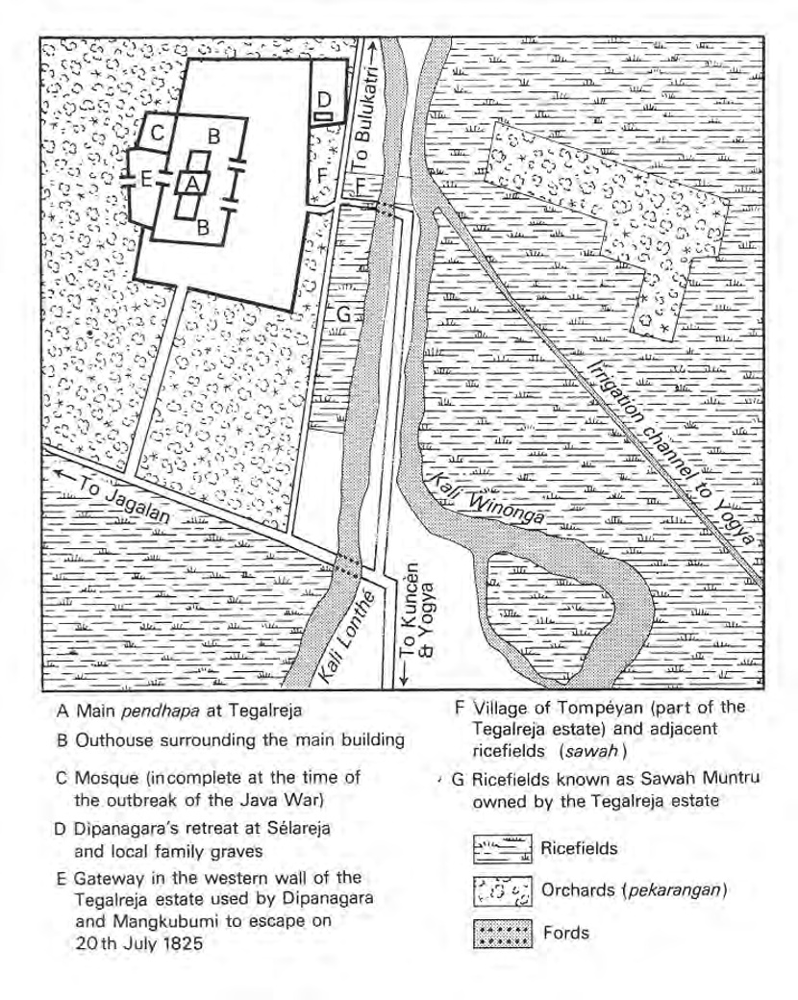
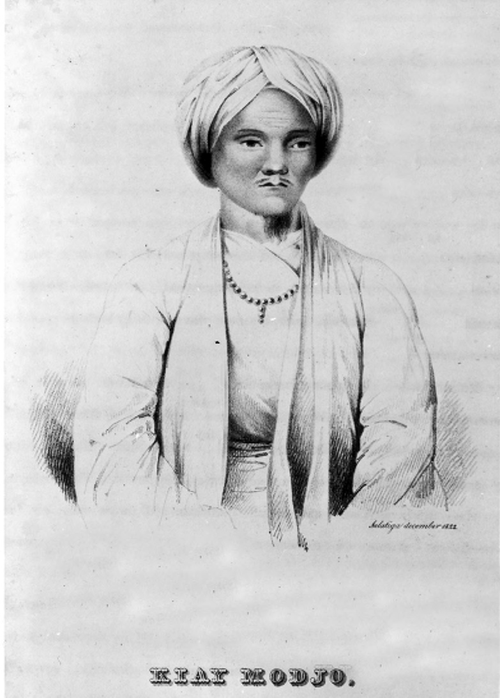

# Chapter II: Dipanagara’s Youth and Upbringing, 1785-1803

## A prophetic birth

Dipanagara – who was given the childhood name of Bendara Radèn Mas Mustahar (Dwidjosoegondo and Adisoetrisno 1941:102) – was born in the Yogyakarta kraton on 11 November 1785 just before sunrise.[^1] In Javanese chronology, the date of the future Java War leader’s birth was especially auspicious because it fell in the Javanese month of Sura, the first month of the Javanese year when traditionally new kingdoms are founded and new historical cycles begin (Carey 1981a:261 note 108). The day was also significant in modern-day Javanese almanac literature because the combination of the day of the week and that of the five-day Javanese market week, Jumungah Wagé (Friday Wagé), is said to indicate a person of great fluency and power of speech, generosity of heart, and the character of a sage, but one who would encounter great hindrances in his life because of his frank and argumentative manner.[^2] It is interesting to note here that Indonesia’s first president, Soekarno (1901-1970), was also a child of the dawn and of the new century and saw himself as being endowed with a special destiny because of it.[^3] Even the Arabic year of the prince’s birth – AH 1200 – seems to have been significant: it is mentioned in some of the more self-consciously Islamic versions of the prophecies traditionally ascribed to the twelfth-century king of Kedhiri, Prabu Jayabaya, as the year in which the Javanese Ratu Adil (‘Just King’) would appear.[^4]

Dipanagara’s father was the eldest son of the second sultan of Yogya, Hamengkubuwana II (reigned 1792-1810, 1811-1812, 1826-1828), by his official wife (garwa padmi), Ratu Kedhaton (circa 1750-1820), who was of Madurese royal ancestry and distinguished in court circles for her Islamic religious piety (Carey 1980:173-4, 1992:187, 382, 401 note 12). His father was a little over sixteen at the time of Dipanagara’s birth, but already had the reputation of being a charming and prepossessing young man beloved by many for his mild character and quiet sense of humour. As a keen amateur historian and a budding littérateur in his own right, Dutch sources report that he was often called by his grandfather Sultan Mangkubumi, the first sultan (reigned 1749-1792), to read to him from old Javanese tales and histories.[^5] It is not known how much influence Dipanagara’s father had on the young prince during his youth because at the age of seven he was taken away from the women’s quarters in the kraton to live with his great-grandmother at her estate of Tegalreja, some three kilometres to the west of Yogya across the ricefields.[^6] But later the two were to be close during the 1811-1812 crisis, precipitated by the confrontation between the Yogya court and the European government, and during his father’s own short reign (1812-1814).

It is possible that through his father – the favourite grandchild of the ageing first sultan – Dipanagara was brought to the notice of the founder of the Yogya kingdom when he was still a baby in arms. In his autobiography, Dipanagara described how he was presented to Sultan Mangkubumi by his mother, and the ageing ruler had foretold that he would cause the Dutch greater destruction than he had done during the Giyanti War (1746-1755), but that only the Almighty knew the outcome.[^7] The anecdote provides an insight into the importance which Dipanagara attached to the charismatic figure of the first sultan, and the way in which Mangkubumi’s example inspired family members who were close to the prince during the Java War (1825-1830).[^8] The first sultan’s prophecy can also be linked to another prediction, ascribed to the great seventeenth-century ruler of Mataram, Sultan Agung (reigned 1613-1646), which Dipanagara also relates in his autobiography. This had foretold that after the death of Agung in February 1646, the Dutch would rule in Java for 300 years and that although one of the Mataram ruler’s descendants would rise against them, he would be ultimately defeated.[^9] It seems almost certain that Dipanagara identified himself with this descendant indicated by Agung, thus providing what might be seen as a prophetic context in which to understand his later failure against the Dutch. We will see below how these predictions would be reinforced by the enigmatic prophecy of the disembodied voice heard by the twenty-year-old Dipanagara as he slept at Parangkusuma on the south coast: ‘You alone are the means, but that not for long, only to be counted amongst the ancestors’.[^10]

## Female relatives and influences

Although Dipanagara’s male forbears were of considerable significance to the young prince on a personal and inspirational level, his female relatives were perhaps even more important in moulding his unique social outlook during his childhood and young adolescence. This outlook was rooted in deep religious convictions and extensive connections with the santri (pious Muslim) communities in south-central Java, connections which were somewhat unique for a person of his birth. Both were to be critical to his style of his leadership during the Java War and the nature of his personal charisma. The fact that Dipanagara was mainly brought up under the care of strong females until the age of eighteen may also have contributed to the development of those feminine aspects of his character which were to mark him out as unusual amongst his Javanese contemporaries. One thinks here of his sensitivity and intuition which manifested in his gift for the reading of character through the study of facial expression – what the Javanese call ngèlmu firasat (p. 108) – as well as his physical resilience. It may even have informed his supposed disgust at the bloody nature of battle to which we will return in the next chapter.

Through the female members of his family Dipanagara could claim blood links with some of the most prominent kyai (country gentlemen, and teachers of religious and spiritual disciplines) in Java. Some of these could trace their ancestry back to the legendary wali sanga or ‘nine apostles of Islam’ of the fifteenth and sixteenth centuries. Others were renowned as religious leaders and scholars in their local communities. Dipanagara’s mother, Radèn Ayu Mangkarawati, an unofficial wife (garwa ampéyan) of the future third sultan, who gave birth to him at the age of fifteen,[^11] was descended from Kyai Ageng Prampèlan, a revered contemporary of the first Mataram ruler, Panembahan Sénapati (reigned 1575-1601). Another of her forbears was Sunan Ngampèl Dentha of Gresik, one of the first wali in Java, who had founded an Islamic community in east Java before the final fall of the Hindu-Buddhist kingdom of Majapahit in circa 1527.[^12] Although the evidence about his mother is somewhat fragmentary, she appears to have been born in the pradikan (tax-free village set aside for men of religion) of Majasta close to the famous religious centre of Tembayat in the Pajang area.[^13] Both these places had been settled by descendants and supporters of Panembahan Kajoran, a major opponent of the Mataram dynasty in the seventeenth century. The area had apparently remained a potential centre of opposition to the central Javanese courts right up to the time of Dipanagara’s birth.[^14] The fact that Dipanagara’s father had chosen a wife from this potentially troublesome region is a good illustration of the courts’ policy of containing the threat to their authority from the independent-minded religious communities by marriage alliances and generous grants of tax-free land and villages.[^15] These ties of family and courtly patronage were later to produce considerable support from this area for Dipanagara during the Java War.[^16]

Dipanagara made few references to his mother in his autobiography beyond mentioning that she was ‘strong’ (kuwat) and ‘unusually beautiful’ (luwih bagus), but he seems to have been attached to her: between 1825 and her capture on 14 October 1829 while hiding in a village in the Adikarta area of Kulon Praga, they shared the vicissitudes of war together, and immediately after the war, when she had returned to the kraton, there is a touching description of her weeping bitterly at the homage paid by five of Dipanagara’s children to the dowager queen, Ratu Ageng (formerly Ratu Kencana), the mother of the fifth sultan, rather than to herself as their grandmother, when they made their formal submission in April 1830.[^17] As late as 1849, when the prince had been in exile for nearly twenty years first in Manado (1830-1833) and then Makassar (1833-1855), he received correspondence from her which caused him to hope that she would come out to join him in exile (she declined saying that at 82 Javanese years she was too old to make the sea voyage from Semarang to Makassar).[^18] She apparently died of dropsy in Yogya in 1852 only three years before her son passed away in Makassar (8 January 1855).[^19] During his boyhood and adolescence, Dipanagara probably saw less of his mother than he would normally have done had he remained in the kraton. But his great-grandmother’s estate at Tegalreja lay within easy reach of Yogya so it is likely that frequent family visits were made and they remained in close contact. Dipanagara appears to have been her only son by the future third sultan according to the official Yogya genealogy (Mandoyokusumo 1977:29-33). Another female relative mentioned above who may well have helped to shape Dipanagara’s outlook in his youth was his grandmother, Ratu Kedhaton, a descendant of Panembahan Cakraningrat II of Madura (reigned 1680-1707). In his autobiography, Dipanagara refers to her with respect.[^20] Her staunch attitude towards Islam, for which the Madurese are noted, may have impressed him. At the same time, according to a contemporary Dutch Resident, the Ratu had ‘a strong Madurese spirit which seemed to flag little in her old age’. Her husband, the second sultan, according to this same source, ‘with his usual Javanese thought patterns’, was completely unable to understand her.[^21] As an unwavering protagonist of her son, the future third sultan, she had a spectacularly volatile marital relationship with the Yogya ruler, who favoured his offspring from another queen.[^22] On four separate occasions in January-June 1812, she was subjected to twenty-four hour detentions in the Bangsal Kencana (Golden Hall) in the kraton to try to break her spirit and force her to divulge the nature of the ‘intrigues’ between the British and her son (Chapter VII), but this only hardened her resolve.[^23] Her son’s Madurese ancestry was also remarked on by European observers. In early September 1811, for example, when news of the capture of Madura by the British invasion force reached Yogya (p. 286), it was said by the Dutch Resident to have ‘fermented his Madurese blood’.[^24] The fact that Dipanagara was himself one quarter Madurese through his father’s family may well have had an effect on his personality and contributed to his volatile temper and sudden rages, which we will encounter quite often in these pages.

Easily the most important influence on the young prince was his great-grandmother, Ratu Ageng, sometimes referred to as Ratu Ageng Tegalreja. When Dipanagara was seven, she became his guardian. Her motives for adopting him are not discussed in the sources. Perhaps she recognised in him a certain spiritual depth which set him apart from other family members and made him fit for serious religious study. Perhaps the youth of Dipanagara’s mother – still in her mid-teens when she gave birth to him – influenced the old lady’s decision, although in this pre-modern era in Java teenage brides were the norm, at least in court circles. Perhaps she just wanted to have the company of a young child as she set off to open out new lands – part of the late eighteenth-century expansion of sawah in the core regions which we discussed in the previous chapter – around the royal estate where she settled just to the west of Yogya. Certainly the practice of ‘adoption’, or more accurately ‘lending’ children, was not unusual in Javanese society (Geertz 1961:36-41). Dipanagara’s own father, as we have seen, was largely brought up by his grandfather, the first sultan, and there were many instances of royal children being lent to older relatives to ensure they received an education.[^25]

Whatever the reason, Dipanagara found himself as a pre-pubescent boy living with a remarkable old lady who had a very critical view of developments at the Yogya court under the wayward and unskilful rule of her son, the second sultan. The daughter of a prominent kyai in the Sragèn district[^26] – the same district where Dipanagara’s mother hailed from – Ratu Ageng Tegalreja could trace her descent to the sultan of Bima in Sumbawa, a fiercely independent Islamic principality in eastern Indonesia (now province of Nusa Tenggara Barat) (Serat salasilah para leloehoer in Kadanoerejan n.y.:127). Other close relations were linked to the court religious hierarchy in Yogya: Ratu Ageng’s sister, for example, was married to the Yogya pengulu (head of the religious hierarchy), Pekih Ibrahim (Appendix Vb), and another family member was a Yogya santri, Haji Ibrahim, who carried secret messages between the central Javanese rulers during their doomed attempt to mount a conspiracy against the British in 1811-1812 and later travelled to Sumbawa to engage in the slave trade where he was again suspected of acting as a secret emissary for the then exiled second sultan.[^27] These latter relations – less than scrupulous though some undoubtedly were – stood Dipanagara in good stead when he began to forge closer links with established religious officials in the sultan’s capital as a young man.

By all accounts, Ratu Ageng was an exceedingly tough lady: she followed the first sultan throughout all his campaigns against the Dutch during the Giyanti War (1746-1755), and gave birth to the future second sultan while her husband’s forces were bivouacked on the slopes of Mount Sundoro in Kedhu – hence the future second sultan’s childhood name of Gusti Radèn Mas Sundoro.[^28] After the foundation of Yogyakarta in 1755, she became commander of the elite female bodyguard or royal Amazon corps, the only military formation to have impressed Marshal Herman Willem Daendels during his visit to the Yogya court in July 1809 (p. 210).[^29] At the same time, she was renowned, according to one Yogya court chronicle, for her Islamic piety and the pleasure she took in reading religious texts, as well as her firm insistence on preserving traditional Javanese adat (customs) at court.[^30] Her unshakeable commitment to Javanese adat would pass in full measure to her great-grandson who would later be described by the veteran VOC official Nicolaus Engelhard as ‘in all matters a Javanese [who] followed Javanese customs’ (Van der Kemp 1896a:415; p. 510). By the time Dipanagara was taken away to live with her at Tegalreja, she remained even in her mid sixties an exceedingly strong-willed lady who must have been quite redoubtable for a young boy of seven. There is an interesting passage in the Surakarta version of the Babad Dipanagara where the prince is made to comment that ‘in my childhood people used to make me afraid when giving an order’, a reference which has a brief resonance in his own autobiographical account (Carey 1981a:78-9, 271 note 145). If Ratu Ageng did indeed occasionally act the stern step-mother, the portrait which Dipanagara draws of her in his babad is overwhelmingly affectionate. In two short verses, he evoked the rigorously simple life she led amongst the farming communities around Tegalreja and the numbers of visiting santri who were drawn there:

> XIV. 50 We describe the Ratu [Ageng]: [how] she delighted in farming and in her religious duties. She made herself anonymous in her profession of her love of God.

> 51 [...] Tegalreja became extremely prosperous for many people came to visit. All sought food [while] the santri sought [religious] knowledge. There was much devotion and prayer, moreover, there were also farmers.[^31]

The atmosphere in which Dipanagara was brought up could not have been more different than that of the Yogya court under the second sultan. The rural simplicity which was late eighteenth-century Tegalreja taught him from an early age to mix easily with all levels of Javanese society and to do so in an easy and unpatronising manner. Ratu Ageng’s careful administrative methods and her willingness to engage in trade may likewise have made an impression on him.[^32] We know from later Dutch accounts that Dipanagara was nearly unique amongst contemporary Yogya princes in that he derived substantial income from his lands without having to engage in extortionate practices, and that his personal wealth later helped him to finance the early stages of the Java War.[^33] He was also careful with his money to the point of miserliness in the estimation of the Dutch Resident of Manado, D.F.W. Pietermaat (in office 1827-1831), who first oversaw his exile (Van der Kemp 1896a:331; Chapter IX note 64). European contemporaries were likewise struck by his ‘common touch’. In the words of Willem van Hogendorp (1913:154):

> A special characteristic about Dipanagara in the view of the Javanese, who are always extremely exalted and distant in their dealings between superiors and inferiors, is that he consorts as easily with the common man as with the great ones. Because of this he has made himself much loved everywhere.

Dipanagara later mentioned that ‘in emulation of what the priests do, I often went to Pasar [Kutha] Gedhé, [Ima]giri, the south coast [Guwa Langsé] and to Selarong […] to the [last] two places I always took a large mounted escort with me […] to help cut and plant padi [rice] which [helped] popularise the chiefs with the people’ (Louw and De Klerck 1894-1909, V:744; Carey 1981a:240 note 27). From the point of view of the contemporary Yogya court, Dipanagara may have been regarded as a village dweller because he was brought up outside the bounds of the sultan’s capital.[^34] But for the rural inhabitants of south-central Java at this time the prince’s unusual upbringing only enhanced his charisma as a popular leader. Furthermore, the country gentry-origins of Dipanagara’s female relatives who had the most influence on him in his youth, namely his mother and great-grandmother, were a distinct advantage when it came to assuming a leadership role during the Java War. Not only did it relate him to influential village-based religious leaders, but it almost certainly endowed him with some robust genes. In general, marriages between scions of ruling dynasties and country gentry produced more enterprising offspring than the inbred alliances between families of high court nobility. It is no coincidence in this respect that some of the most effective leaders in Javanese history during this period were children of unofficial wives – most of whom hailed from rural gentry stock. One thinks here of the first sultan Mangkubumi, of Dipanagara himself and of his cavalry commanders, Ali Basah Senthot and Pangéran Jayakusuma (Ngabèhi),[^35] Dipanagara’s kinsman. In the post-Java War period, two other sons of low-born wives, one a daughter of a court puppeteer, Pangéran Suryanagara (1822-circa 1886), and Radèn Gandakusuma (Patih Danureja V),[^36] both made important contributions to the cultural and literary life of mid-nineteenth century Yogya (Behrend 1999:388-415; Carey 1974a:8 note 23, 9-10, 1981a:xxviii-xxix). Even amongst Dipanagara’s own offspring this same pattern was visible. Thus his eldest son, Pangéran Dipanagara II, born of an unofficial wife at Tegalreja, whom we shall meet below, was apparently the most impressive of his children, far outshining his younger brothers, who had mothers of more eminent lineage.[^37]

## A Tegalreja childhood

The reasons why Ratu Ageng left the Yogya kraton so suddenly in the early part of the second sultan’s reign are not entirely clear. According to Dipanagara, she had become saddened and embittered by the conflicts with her children and the incessant domestic intrigues of the court. As he put it in his babad:

> XIV. 49 We now tell of the Ratu Ageng how she was often at odds with her own sons. She therefore broke away in anger and cleared new land: the waste fields were opened up, [and] then she settled there. The distance from the town of Yogya

> 50 was a journey of one hour [on foot]. When it was ready, it was called Tegalreja [‘Fields of Prosperity’].[^38]

It is likely that Ratu Ageng did not approve of the lifestyle of her son, the second sultan, in particular his nonchalant attitude towards Islamic religious observance. He appears to have rarely visited the great mosque, Mesjid Ageng, the official worshipping place of the Yogya rulers,[^39] although he seems to have been rather more diligent about dispatching court santri to undertake pilgrimages to Mecca and to various holy sites in south-central Java and the north coast.[^40] The Dutch Resident’s report about the deathbed speech which Ratu Ageng addressed to her son before her demise on 17 October 1803 affords an insight into her disapproving attitude towards the Yogya ruler and his entourage. It also casts light on Ratu Ageng’s exceptional humility and deep-rooted faith, a rare combination indeed in the court circles of her day:

> Sultan! The path I have to lay aside is difficult and now I feel that I am essentially no more than an ordinary person. My son, keep that in view and do not believe that, although you are now ruler, after your death you will be anything more than a common coolie. So live accordingly![^41]

In his autobiography, Dipanagara later reflected on the religious climate in Yogya at this time and the way in which many of its inhabitants ignored the precepts of Islam. In particular, he was highly critical of the second sultan’s three sons-in-law, Radèn Tumenggung Sumadiningrat, Radèn Adipati Danureja II and Radèn Rongga Prawiradirja III, all of whom were to meet violent ends.[^42] In his babad, he described these three as ‘incorrigible sinners’ even though he had close family relations with at least two of these men’s families:[^43]

> XIV.56 The three officials were all young; the desires of the sultan were greater than those of his father as also were [the desires] of these three officials, who all sinned against religion. The pengulu and all the people in Yogya as well, from the highest to the lowest, rarely followed the truth.[^44]

It is likely that Ratu Ageng’s bitterness towards the frivolity, religious laxity and self-serving politics of the Yogya court left a lasting mark on the mind of the young prince. At the very end of the Java War, he was to confide to the senior Dutch officer accompanying him to Batavia that ‘if I had continued to insist on my known demands [to be recognised as the regulator of religion] then it was out of the conviction that people at the courts did not follow the old customs as scrupulously as before [and] above all that people neglected religion’ (Louw and De Klerck 1894-1909, V:744). Indeed, in his babad he was to speak of it being ‘the will of God’ that ‘he should follow his great-grandmother, for it was his wish to be absorbed in religion’.[^45]

Already in her mid-sixties when she moved to the Tegalreja estate in the early 1790s,[^46] Ratu Ageng seems to have led an active life almost until the end. Then in late September 1803, when she was long past seventy, she developed a serious fever after falling heavily by one of the ponds at Tegalreja.[^47] This was a rather dramatic time for the inhabitants of Yogya for the great volcano behind the city, Mount Merapi, had started to erupt on 22 September with more minor eruptions noted on the twin Kedhu volcanoes of Mount Sumbing and Mount Sundoro – the last especially appropriate given Ratu Ageng’s experience of giving birth there in March 1750 when she had been delivered of the second sultan.[^48] Although she was moved to the crown prince’s quarters in Yogya and rallied somewhat in early October, her condition soon deteriorated. The end came at three o’clock on the afternoon of 17 October after she had whispered the previously noted trenchant last words to her son, the second sultan.[^49] She was then laid in state in the kadipatèn (the crown prince’s residence) and buried at sunset the following day at the royal graveyard at Imagiri some four hours journey on foot to the south of Yogya.[^50] Her cortège was followed by all the members of the sultan’s family (including no doubt the young Dipanagara), with the exception of the second sultan himself and Dipanagara’s father, the crown prince, who accompanied his grandmother’s coffin only as far as the southern meeting place on the alun-alun (open square) before the court.[^51]

## Inheriting the Tegalreja estate

The Dutch Resident reported that both the sultan and the crown prince were very distressed at the old lady’s passing, but it must have been a particularly heavy blow for the eighteen-year-old Dipanagara.[^52] He now remained alone at Tegalreja and succeeded his great-grandmother in charge of the estate.[^53] Although he was soon to marry the daughter of a local kyai[^54] and was even threatened for a time with having yet another elderly female relative – his grandmother, the redoubtable Ratu Kedhaton – sent out to live with him,[^55] his life in Tegalreja continued to run its quiet course.

> *Map 2. Plan of Tegalreja estate and its surroundings, circa 1830, on a scale of one inch to 100 metres. Adapted from Louw and De Klerck 1894-1909, I: ‘Plattegrond van de hoofdplaats Jogjakarta omstreeks 1830’, by J. Wilbur Wright of Oxford.*

What then of Tegalreja itself? What did this estate which went by the auspicious name of ‘Fields of Prosperity’ look like? By the time of Ratu Ageng’s death in 1803, it was probably already an impressive complex including an extensive residence with gardens, orchards and ponds (one of which Ratu Ageng had fallen besides at the start of her fatal last illness), as well as many hectares of adjacent ricefields. A Dutch visitor who inspected the ruins (the residence had been burnt at the start of the Java War)[^56] in the 1840s described it in admiring terms (Brumund 1854:184-5):

> The princes of Yogyakarta were apparently better lodged than at present. At least I know of no princely residence in Yogya which can compare to the earlier one at Tegalreja. The [princes’] houses are [now] mostly [built of] wood [and are] low, small and insignificant. Dipanagara’s [residence], [however], was large, spacious, high and entirely built of stone. On both sides there ran rows of no less large and spacious stone outhouses. There [Dipanagara’s] friends lodged and the priests who came to visit him. There were also his warehouses and repositories [for storing the products of the Tegalreja estate], and the places where his immediate followers and retainers lived. The other followers lived in the village which surrounds the dalem [princely residence].

The visitor went on to describe in detail the lay-out of the house itself, which included the remains of a large open-sided pavilion/audience hall and an adjoining gallery suitable for staging shadow-puppet performances which, along with the Javanese gamelan orchestra of stringed, wood-wind and percussion instruments, we know from other sources were much appreciated by Dipanagara.[^57] The visitor also noticed the high stone wall which surrounded the yard of the residence and the many fruit trees which were planted on the estate (Brumund 1854:185).

Although the original residence and estate garden were laid out on Ratu Ageng’s orders, Dipanagara seems to have had a hand in some of its later features. In his babad, he related how many of the buildings were improved and enlarged after his great-grandmother’s death, presumably to house the increasing number of visitors, especially wandering santri and other Islamic divines who came to engage in prayer and religious discussion.[^58] According to the prince, the amount of religious observance at Tegalreja ‘exceeded that of his great-grandmother’s days’.[^59] It was probably at this time that plans were laid to build a stone mosque at Tegalreja, a building which had been almost completed at the time of the outbreak of the Java War. As Dipanagara later reflected (Louw and De Klerck 1894-1909, V:744; Van der Kemp 1896a:418; Carey 1992:495 note 464):

> I always had the desire to have a really fine mosque [and] I spent much money on the one I had at Tegalreja which was very nearly completed when I had to leave [in July 1825] […] a mosque has always been a delight for me: one does not always have to pray in it, but it directs the heart towards religious sincerity.

Like the Ratu Ageng before him, Dipanagara took an interest in the arrangement of the trees and ponds on the estate, and later built himself a retreat at Sélareja just outside the northeast wall of Tegalreja, where he often withdrew to meditate and pray (see Map 2). This was encircled by a moat filled with different kinds of fish, and the island where Dipanagara’s meditation seat[^60] was placed was planted with various types of fruit trees, especially kemuning (Brumund 1854:192-4; Carey 1981a:236-7 note 14). With its white pungently scented flowers, this tree, which is favoured in Java for shading graveyards and holy sites, would have spread a ‘canopy of white flowers’ over the prince’s head as he sat meditating (Brumund 1854:188; Van Raay 1926-27:51). There was also apparently a banyan tree (waringin) which gave its name to the island, Pulo Waringin (Chapter X note 208).

The prince took similar pains to lay out fruit orchards, vegetable gardens and shrubberies on his lands at Selarong near the cave of Secang in the Bantul district to the south of Yogya which he likewise used as a place of retreat during the fasting month Puwasa and which he would later extend significantly in terms of its facilities (Carey 1981a:238-9 notes 20-5; Louw and De Klerck 1894-1909, I:435-7; Chapters VIII and X). He subsequently boasted that ‘there is nothing on earth that does not grow luxuriantly on the soil of Java’.[^61] Like many Javanese, Dipanagara had a great affinity with nature: some of the most lyrical passages in his autobiography describe the retreats which he set up in caves, mountain fastnesses or in the midst of fast-flowing streams, or at his garden in Selarong, where a Dutch report noted the construction of a wall the height of a man.[^62] He also referred with affection to the different types of animals which kept him company during his periods of silent withdrawal: the fish at Sélareja, the turtles, turtle-doves, crocodiles[^63] and tigers during his jungle retreats during the Java War, and his beloved cockatoos while in exile in Manado and Makassar.[^64] Such affinity with nature and the animal kingdom, in the Javanese view, was a reflection of the sensitivity and spiritual wholeness of a human being, a state best expressed in the descriptions of the wandering knight (satria lelana) in Javanese wayang literature (Boedihardjo 1923:28).

Dipanagara’s preoccupation with religious matters and the development of his own spiritual practice through periodic retreats and meditation clearly placed a strain on his relationship with the Yogya ruler, Hamengkubuwana II. By his own admission, the prince rarely attended audiences at the court and only brought himself to come to Yogya for the thrice yearly Garebeg ceremonies which celebrated The Prophet’s birthday (Mulud), the end of the fasting month (Puwasa), and Abraham’s willingness to sacrifice his son as well as the Great Day (Ari Besar) of the pilgrims in Mecca (Besar) (Groneman 1895:40; p. 373). These latter attendances, Dipanagara described as a ‘great sin’, perhaps because the Garebeg were more Javanese than Islamic in character.[^65] But he forced himself to take part out of fear for his grandfather, the second sultan, and his father, the crown prince.[^66] He also relates how he came to the capital on certain special occasions such as on 3 September 1805 when at the age of twenty (Javanese years), he received his adult name and title of Radèn Antawirya,[^67] and on 25 February 1807 when he married the daughter of a Yogya outlying region bupati, an unhappy union to which we will return shortly.[^68]

## The Tegalreja circle: early contacts with the Islamic religious communities

Dipanagara clearly grew up in an environment dominated by religious discussion. Already, during his boyhood in the kraton, he had probably mixed with santri. The Suranatan corps, a group of armed religious officials at the Yogya court, for example, formed part of the military establishment of Dipanagara’s father’s residence, the kadipatèn,[^69] and there were also members of the kaum (firm Islamic community) in receipt of tithe (zakat) payments from the court who are listed in the kraton records as having been domiciled at both the kadipatèn and at Tegalreja in the late 1790s (Carey 1980:170).

Ratu Ageng had also encouraged members of the Yogya religious hierarchy to visit or take up residence at Tegalreja. Amongst these were her own pengulu (head of religious establishment), Kyai Muhamad Bahwi, after August 1825 known as Muhamad Ngusman Ali Basah, who had previously served as the presiding ulama (religious scholar) of the Suranatan mosque (the sultan’s private mosque) in the kraton,[^70] and Haji Badarudin, a commander of the Suranatan corps who had twice made the pilgrimage to Mecca on behalf of the Yogya court and was considered knowledgeable about Ottoman administrative practice in the holy cities.[^71] Furthermore, both the two Yogya pengulu, who served in the sultan’s capital during Dipanagara’s youth, were attached to the Tegalreja ulama circle through their links with the Suranatan.[^72] One of them, Kyai Rahmanudin, even came to live with Dipanagara for a year at Tegalreja after his abrupt dismissal in September 1823.[^73] We shall see below (pp. 626-9) how these contacts, formed between the young prince and the Yogya religious establishment in the late 1790s and 1800s, operated during the early stages of the Java War when many kraton santri rallied to Dipanagara’s cause.[^74]

Besides the members of the court religious hierarchy, Dipanagara almost certainly met many of the main independent teachers in the Yogya region during his boyhood at Tegalreja. The estate was close to three of the four main centres for scholars of Islamic law known as pathok negari (literally ‘pillars of the state’), namely those at Kasongan (near Bantul), Papringan (between Yogya and Prambanan), and Melangi.[^75] Dipanagara would later marry the daughter of the kyai guru (revered teacher) of Kasongan during the Java War[^76] and may well have passed through the centre on his way from Tegalreja to his lands at Selarong to the south of Yogya. But compared to Kasongan and the other pathok negari, Melangi seems to have been by far the most important at this time. It lay just three kilometres north of Tegalreja and the land was part of the patrimony (tanah tiyasa) of the Danurejan family with whom Dipanagara had close family ties (Appendix II). They maintained a religious teacher at Melangi, who served as mentor to members of the Yogya court community. One teacher in particular, Kyai Taptajani, whose family may have hailed from Sumatra, achieved considerable local recognition as a scholar and translator of difficult Islamic texts (Carey 1974b:272-3). We know from Dutch sources that Dipanagara greatly respected this kyai, whom the Dutch described as a ‘prominent priest’ whom the prince always took care to treat well. Taptajani’s pathok negari at Melangi was intentionally spared any damage during the Java War on Dipanagara’s express instructions and the prince accepted the kyai’s sons into his wartime service. In October 1826, when Taptajani was involved in brokering the first peace negotiations with Dipanagara’s key religious adviser, Kyai Maja, he was said to have been in his ninetieth year.[^77]

It is unclear whether Dipanagara ever studied under him, but there is a reference in the prince’s autobiography to the locally renowned teacher as the guru of his younger brother, Pangéran Adisurya, who took the name of Ngabdurakim during the Java War and was said to have died a ‘remainderless’ (moksa) death on Mount Sirnabaya in Bagelèn in 1829 (Carey 1974b:273). In the Surakarta version of the Babad Dipanagara, there is also a passage in which Taptajani is described as having visited Dipanagara at night at the head of all the ulama from the tax-free (pradikan) areas, as well as the mosque officials and experts in Islamic law, and having given him advice as to the right moment for the Ratu Adil (‘Just King’) to proclaim himself and for the prang sabil (holy war) to begin (Carey 1981a:43-7, 261 note 108; Chapter IX). Although there is nothing in the contemporary Dutch sources to confirm that particular visitation, the links which Dipanagara maintained with Taptajani’s family during the early stages of the war indicate that the ageing kyai continued to command the prince’s respect.

After Taptajani fled to Surakarta in 1805 following a dispute with the Yogya pengulu regarding his influence over the princes of the court (Carey 1974b:273) – in itself a telling reflection on his local renown – he settled in the Sunan’s territory and continued to maintain contacts with his family relations scattered throughout central and east Java. These included prominent religious scholars residing in tax-free areas in Kedhu,[^78] and a highly placed royal official in Madiun who had links with the famous pesantrèn (religious boarding school) of Tegalsari.[^79] Furthermore, he was also on intimate terms with Kyai Maja’s extensive family, who were settled in the tax-free villages of Maja and Badhèran in the Pajang area just to the north of Delanggu, and at Pulo Kadang near Imagiri to the south of Yogya.[^80] These far-flung connections, which pivoted around Taptajani’s influential position as a legal scholar and teacher, were clearly vital for Dipanagara when he appealed for support from ulama in Pajang, Madiun, Kedhu, Bagelèn and Pacitan at the start of the Java War (Chapter X note 124; pp. 626-9).

During the time Dipanagara was reaching early manhood in Tegalreja, it seems that Surakarta was much more important than Yogya as a spiritual centre. One of the reasons for this may have been that there were more generous patrons of the religious communities at the Sunan’s court than in the sultan’s capital. Pakubuwana IV himself was described by the Surakarta Resident J.G. van den Berg in 1806 as ‘a great friend of the ulama who can get him to do anything’.[^81] In 1812, he was said to have no less than 24 court haji (returned Mecca pilgrims) and some 51 ulama in his pay.[^82] At the same time, a senior Dutch official who was travelling through Surakarta just before the British attack on Yogya (20 June 1812) spoke of ‘the priests who are here [in Surakarta] in large numbers’.[^83] The Garebeg Mulud and Garebeg Puwasa ceremonies, appear to have attracted droves of haji, kaum (lower ranking village religious officials), and pradikan (men of religion from tax-free areas) who made their way to the Sunan’s capital from all over Java.[^84] This was not the case in Yogya which only attracted santri from the immediate neighbourhood, probably because the sultan was less generous than the Sunan about bestowing largesse at religious feasts.

> *Plate 10. Kyai Maja (circa 1790-1849), Dipanagara’s principal religious adviser during the Java War, who came from the Surakarta pradikan village of Maja just to the north-east of Delanggu, and died in exile in the Kampung Jawa, Tondano, Sulawesi Utara. Although he had never made the pilgrimage to Mecca (haj), he commanded great authority amongst Dipanagara’s santri followers because of his intimate knowledge of the Qur’ān and his forceful character. Uncoloured lithograph by Jean Augustin Daiwaille (1786-1850) and Pieter Veldhuizen (1806-1841) based on a sketch made by the Dutch army officer, Major F.V.H.A. Ridder de Stuers (1792-1881), in Salatiga in December 1828 after Kyai Maja had given himself up to the Dutch with over six hundred of his followers who later accompanied him into exile in Minahasa (North Sulawesi). Taken from De Stuers 1831. Photograph by courtesy of KITLV, Leiden.*

Nor was it only the Sunan, who gained a reputation for largesse. The Surakarta patih, Radèn Adipati Danuningrat (in office 1804-1810), was renowned as a ‘great friend and champion of santri’ and took part in daily prayers as well as going to the Great Mosque every Friday.[^85] Another such patron was the Sunan’s younger brother, Pangéran Buminata. Described in a French source as ‘a tall dessicated man with an officious and artful manner’ (Lettres de Java 1829:70), he was known for his generous support of religious teachers, amongst whom was Kyai Maja. The kyai guru apparently held the Surakarta prince in high esteem and often discussed religious matters with him.[^86] Indeed, so wide was Buminata’s renown in santri circles that even before he fled to Surakarta, Kyai Taptajani (known as Bagus Taptajani in the Surakarta kraton) decided to send his sons to study in Surakarta where they received minor positions from the prince.[^87] Reflecting on this case, the Yogya Resident, Matthijs Waterloo (in office 1803-1808), remarked that when young men left the Yogya area to receive a religious education in Surakarta, they usually became more attached to the Sunan’s capital than to the area of their birth.[^88] Much later, another Yogya Resident, A.H. Smissaert (in office 1823-1825), whose behaviour so alienated Dipanagara on the eve of the Java War, would remark that there were many more princes in Surakarta than in Yogyakarta who were known by the Dutch authorities to be ‘fanatical’ about their religious duties.[^89] It is perhaps relevant here that Dipanagara’s eldest son, Pangéran Dipanagara II, who subsequently adopted the santri name of Radèn Mantri Muhamad Ngarip and who was almost certainly the most intelligent of his offspring, decided after long peregrinations to sit at the feet of a Surakarta teacher, Kyai Maja, rather than one of the many guru he had visited in the vicinity of the sultan’s capital. The favoured position which Kyai Maja later acquired amongst the ranks of Dipanagara’s numerous religious supporters underscored Surakarta’s ascendancy as a centre of religious instruction in the early nineteenth century.[^90] It would also help to fuel the latent tensions between the prince’s aristocratic and santri followers. The former, nearly all Yogyanese, tended to view Kyai Maja and his Surakarta fellow ulama and pradikan with deep suspicion, an attitude which was reciprocated amongst the Sala santri (Louw and De Klerck 1894-1909, V:744; Carey 1987:279-84; Chapter XI). In the early 1800s, however, all this lay in the future. At this time, the prince’s personal links seem to have been largely confined to the immediate Yogya area. They remained this way until the period of H.G. Nahuys van Burgst’s residency (1816-1822) when, according to Dipanagara’s own testimony, he travelled out of the Yogya area for the first time on foot along back country roads to the village of Maja to seek out his eldest son (born circa 1805), who had then become a pupil of the kyai guru, later the prince’s bane and inspiration during the Java War (Louw and De Klerck 1894-1909, V:744; Carey 1981a:261 note 110; Chapter III, Chapter X note 184, Chapter XI). Shortly thereafter, Kyai Maja visited Dipanagara at Tegalreja, arriving according to the prince of his own accord and unbidden shortly after the prince himself had returned from one of his personal retreats at Selarong (Louw and De Klerck 1894-1909, V:744-5), probably during one of his fasting month (puwasa) sojourns at Guwa Secang.

## Conclusion

Dipanagara’s upbringing at Tegalreja under the formidable and pious Ratu Ageng fixed the bearings for his future life. The old adage ascribed to the Jesuits, ‘give us a child until he is seven and we will have him for the rest of his life’ did not quite hold in Dipanagara’s case since he only joined his great-grandmother at her country estate at the age of seven in the early 1790s, but even before his departure from the Yogya kraton it is very likely that he began to feel the influences which would later shape his character and personality. The links between his father’s establishment, the kadipatèn, and the court santri communities may have already begun to tell. At the same time, the young prince would have certainly been influenced by the presence of his mother and great-grandmother, both offspring of prominent kyai, during his young boyhood in the female quarters. These influences would become even more pronounced during the critical 1793-1803 decade when he grew into a young man under Ratu Ageng’s watchful and discerning eye. A prince raised in a village environment and instilled from his youth with a sense of shared identity with the common man; an offspring of the ruling family with an intimate knowledge of the life of the Javanese peasantry as well as the world of the rural santri and religious teachers, these were indeed rare combinations. Is it any wonder that such a young person would have had an unusual destiny? While the prophecies supposedly uttered by the first sultan and subsequently during the prince’s pilgrimage to the south coast in circa 1805, to which we will come shortly, foretold tragedy – ‘You alone are the means but that not for long, only to be counted among the ancestors’[^91] – the shadows which these evoked still lay some way ahead. The immediate future for the eighteen-year-old,[^92] who now had sole charge of the Tegalreja estate, seemed bright. Living comfortably removed from the incessant intrigues of the Yogya court, and beginning to come into his own as a young adult with a growing sense of commitment to the religious path, Dipanagara could look forward to a life of spiritual and personal fulfilment sustained by his ever widening circle of santri and pious priyayi associates. It is to these links and the formation of the prince’s intellectual character and understanding of Islam that we must now turn.

## Notes

[^1]: BD (Manado) II:114, XIV (Sinom) 44. Ing taun eBé punika/ wulan Mucharam nujoni/ tanggal ping wolu kang dina/ Jumungah Wagé puniki/ Alip ingkang lumaris/ Kulawu mapan anuju/ wektu saur babarnya; ‘In the year Bé/ just in the month of Muharam/ on the date the eighth. The day being/ Friday Wagé/ in the [Javanese year] Alip/ in the wuku [one of 30 seven-day periods which make up 210-day Javanese year] Kulawu/ his delivery was at saur [Muslim meal just before daybreak in the fasting month]’.

[^2]: Tanojo 1966:31. Tanojo’s description for no. 20 (Friday Wagé birthdays) reads: wong lamun lair ing dina Juma’at Wagé, wataké bisa amicara juwèh rècèh pratitis watak pandhita, cetha nanging cengkiling, lilan nanging kerep kesandhung.

[^3]: Adams 1965:17, who quotes Soekarno as saying: ‘We Javanese believe that one born at the moment of sunrise is pre-destined […] with me [Soekarno] it wasn’t only the dawn of a new day, but also the dawn of a new century’.

[^4]: Drewes 1925:167. The particular recension of the Jayabaya prophecies referred to by Drewes derived from west Java and was of late nineteenth-century origin. Ricklefs notes that although the prophecies were traditionally ascribed to Jayabaya, a real twelfth-century king, he may have had nothing to do with them, Ricklefs 2006:92.

[^5]: KITLV H 97 pt. 7, W.H. van IJsseldijk, ‘Korte schets van de gesteldheid van Sultans Hoff, tot narigt van den pl. Opperhoofd I.G. van den Berg’ (henceforth: Van IJsseldijk, ‘Korte schets’), 31-8-1798, quoting from his predecessor, J.M. van Rhijn’s (in office 1773-1786) final memorandum, ‘Beschrijving der toestand van Sulthan’s hof’, 21-2-1780 (Ricklefs 2006:159). So taken was the first sultan with his grandson that, according to Van IJsseldijk, he placed himself in charge of his education and taught him to appreciate Javanese history and legends, drawing, painting and the courtly arts of literary composition and the chanting (macapat) of chronicles (babad). For a less sympathetic view, see Thorn 1815:291, quote cited in Chapter VII note 242.

[^6]: Veth 1896-1907, III:572 noted that Javanese royal children were usually kept in the women’s quarters (keputrèn) in the kraton until they were circumcised.

[^7]: Carey 1974a:30-1; BD (Manado) II:114, XIV (Sinom) 45-6. Kangjeng ibu ingkang bekta/ prapta ngarsaning Sang Aji/ pinarak Prabayeksa/ pan lajeng iling-ilingi/ Jeng Sultan ngandika ris/ Bok Ratu buyutirèku/ besuk wruhanira/ wus karsaning Hyang Widhi/ pan pinasthi iya karya lampahan. 46. Pan iku luwih lan ingwang/ rusaké Walonda bénjing/ wekasan Walahu Alam. See further Chapter VIII.

[^8]: Pangéran Jayakusuma I (Ngabèhi) (circa 1787-1829) (Chapter III note 3), one of Dipanagara’s principle commanders during the Java War, almost certainly echoed the prince’s opinion about the first sultan when in a letter to Hamengkubuwana II in 1826 he referred to the founder of Yogya as a ‘wandering knight’ (satria lelana), whom they had sought to emulate during their five-year struggle, Dj.Br. 42, Jan Izaäk van Sevenhoven, ‘Nadere toelichting en vervolg van de nota bevattende een kort overzicht van den staat der vorstenlanden en van het rijk van Jocjocarta in het byzonder […]’, 4-12-1826, enclosing a report from Mas Selaya, a Javanese spy employed by the Dutch, 17-10-1826. See also AN, Besluit van den Gouverneur-Generaal, 10-10-1834 no. 4 (Decision by Governor-General Jean Chrétien Baud to exile Dipanagara’s eldest son to Sumenep), Report of Mas Sumadipura on Pangéran Dipanagara II, 10-1833, reporting the latter to have said: wataké wong Mentaram […] telung prakara […] kang dhingin bisa simpen, kapindho gelem mbuwang, kaping telu kenceng agamané. Niku adaté sok dadi becik. Sinuwun Suwarga mawon kadospundi, ngluwihi saking gerah, nanging kenceng agamané, katrima dadi nurunaké; ‘The people of Mataram [Yogya] have three characteristics: first they can keep things to themselves, second they are generous, and third they are strict about their religion. That is the sort of adat [custom] which frequently produces quality. [As for] the late sultan [Hamengkubuwana I] how about him? He suffered great pains, but was firm in his religion – something which has been received as a transmission [to this day].’

[^9]: Carey 1974a:30. The present author was wrong to ascribe the phrase in Dipanagara’s babad, bénjing sapengker kula, as referring to the date of the failure of Agung’s second siege of Batavia (1629), when the Mataram ruler attempted to force the Dutch out of their fortress. It is clear that Agung is referring instead to the period after his death. This would in fact fit better with the period of foreign rule in Java which lasted well beyond the Japanese capitulation on 15 August 1945 and the Indonesian declaration of independence two days later (17-8-1945) to the Dutch ‘police actions’ (politionele acties) of July 1947 and December 1948, when large areas of Indonesia were taken back under temporary Dutch control. See further Tjantrik Mataram 1966:76-8.

[^10]: See Chapter IV note 58.

[^11]: In 1849, when there was talk of her coming out to Makassar to join Dipanagara in exile (pp. 74, 747-52), she is mentioned as having been 82 years of age, AN Kab Geheim La V, 11-5-1849, P.J.B. de Perez (Surabaya) to Governor-General Jan Jacob Rochussen (Batavia), 20-3-1849. If this refers to Javanese years – which is likely – she would have been born in AJ 1696 (AD 1770-1771). She would thus have been barely 15 at the time of Dipanagara’s birth.

[^12]: Padmasusastra 1902:209-10; BNg I, 13:III (Pangkur) 15. sing Dyah Mangkarawatya/ trahing Kyageng Prampèlan rumuhun. The information that Ki Ageng Prampèlan lived at the time of Panembahan Sénapati was provided by the jurukunci (keeper of the keys) of Ki Ageng’s gravesite which lies nine kilometres to the south of Sragèn near Surakarta, interview, jurukunci pasaréyan Ki Ageng Prampèlan, 2-4-1973. See also Serat salasilah para leloehoer ing Kadanoerejan n.y.:27, which mentions a Kyai Tumenggung Prampèlan of the kraton of Pajang who became a ‘true believer’ (mukmin kas) with the title ‘Ki Ageng’; Mandoyokusumo 1977:15, who refers to a ‘Tumenggung Parampilan’ [sic] as amongst the immediate ancestors of Hamengkubuwana I’s mother, Mas Ayu Téjawati; Padmasusastra 1902:210 who lists a ‘Ki Ageng Prempuhan’ of the Karang Lo dynasty as a tenth generation descendant of Sunan Ngampèl Dentha.

[^13]: Knoerle, ‘Journal’, 6, where he reported Dipanagara as saying that his mother was born in the village of Madèsta in het district van Padjitan [sic], which immediately suggests the remote south coast district of Pacitan, but is more likely to have referred to Pajang, see Knoerle, ‘Journal’, 24, where he uses the phrase in het Padjitaansche to refer to Kyai Maja’s campaign in Pajang in 1828. ‘Madèsta’ was almost certainly Majasta. On the location of the latter, which is often referred to as ‘the hill of Majasta’ see Rinkes 1911:449; and IOR X IX 7, ‘Topographische Kaart der Residentie Soerakarta opgenomen ingevolge gouvernements besluit dd. 9 Junij 1861 no. 6 en 13 November 1862 no. 26’, where Majasta is placed almost exactly due south of Surakarta on the Kali Dankang in the Tawangsari sub-district, see further Balé Poestaka 1939:66.

[^14]: De Graaf 1940:273-328, 1962:38.

[^15]: Carey 1981a:258 note 101. Rinkes 1911:454 and Mandoyokusumo 1977:21 no. 31, both mention that one of Hamengkubuwana II’s daughters married the spiritual lord of Tembayat, Sayyid Ngabdani, who later joined Dipanagara during the Java War, see Bataviasche Courant, 22-12-1827. See further Remmelink 1994:18 on marriage politics in early eighteenth-century Mataram.

[^16]: Carey 1974a:23. There were reports at the beginning of the Java War that Dipanagara would go to Majasta to rally support, AvJ, Haji Ali (Tembayat) to Danureja IV (Yogyakarta), 18-7-1825. See also Louw and De Klerck 1894-1909, II:532; Bataviasche Courant, 29-11-1826, on the campaign of Radèn Mas Papak (later Pangéran Adipati Natapraja) around Tembayat in 1826; and Bataviasche Courant, 20-12-1827, on the campaign of the ’priestly’ Pangéran Sumendi, a relation of the family of Pangéran Sérang, around Tembayat in 1827.

[^17]: BD (Manado) II:240, XVIII.154 (on Mangkarawati’s appearance and character); Louw and De Klerck 1984-1909, V:412-3 and Chambert-Loir 2000:274 (give details of Mangkarawati’s capture along with one of Dipanagara’s daughters, Radèn Ayu Gusti [Appendix IV pt. 1], at the village of Karangwuni near Wates in the Adikarta area of Kulon Praga); Houben 1994:23 (on obeisance made by Dipanagara’s children to Ratu Ageng, the mother of Hamengkubuwana V). There seems to be a mistake in Houben, or in the sources he cites, because when Dipanagara’s children made this obeisance in April 1830, neither of the mothers of the previous two rulers (Hamengkubuwana III and Hamengkubuwana IV) were still alive: Hamengkubuwana III’s mother, Ratu Kedhaton (post-1814, Ratu Ageng), had died on 12 July 1820 (AvJ, H.G. Nahuys van Burgst (Yogyakarta) to G.A.G.Ph. van der Capellen, 12-7-1820), and Ratu Ibu (post-18-5-1822, Ratu Ageng), the mother of Hamengkubuwana IV, had died on 20-6-1826, Chapter VIII note 46. There is even a question as to whether Hamengkubuwana V’s mother, Ratu Kencana (post-August 1826, Ratu Ageng) was still living as she is known to have suffered from a severe psychological illness (p. 412) and may have died before the end of the Java War.

[^18]: AN Kab, 11-5-1849 no. La V, Dipanagara (Makassar) to Radèn Ayu Mangkarawati (Yogyakarta), 25 Rabingulakir AJ 1777 (AD 20-3-1849); Radèn Ayu Mangkarawati (Yogyakarta) to Baron A.H.W. de Kock (Resident of Yogya), 24 Jumadilawal AJ 1777 (AD 11-4-1849). See also Appendix XIII.

[^19]: Dj.Br. 4, ‘Algemeen Verslag over de Residentie Djokjokarta’, 1852.

[^20]: BD (Manado) II:164, XV.135.

[^21]: Dj.Br. 49, Matthijs Waterloo (Yogyakarta) to Nicolaus Engelhard (Semarang), 12-2-1807.

[^22]: See pp. 322, 331.

[^23]: IOL, Eur F148/24 (Raffles-Minto correspondence, vol. 24) no. 14, John Crawfurd (Yogyakarta) to T.S. Raffles (Batavia), 22-3-1812; Dj.Br. 19¹, A.H.W. Baron de Kock, ‘Memorie van Overgave’, Yogya, 17-5-1851.

[^24]: Dj.Br. 24, Pieter Engelhard (Yogyakarta) to Jan Willem Janssens (Semarang), 11-9-1811.

[^25]: See KITLV H 97 pt. 7, Van IJsseldijk, ‘Korte schets’, 31-8-1798, who mentioned that Dipanagara’s uncle, Pangéran Mangkubumi (born circa 1781), had been brought up by Hamengkubuwana I’s daughter, Ratu Bendara I, the divorced and childless former wife of Mangkunagara I (reigned 1757-1795). Dipanagara’s younger brother, Pangéran Adinagara (post-1825, Pangéran Suryèngalaga; born circa 1788), had been apparently adopted by Radèn Tumenggung Sumadiningrat who had no children by his official wife, Ratu Bendara II, a daughter of Hamengkubuwana II and Ratu Kedhaton, Carey 1981a:238 note 20. Meanwhile, in Surakarta, Pakubuwana IV’s sister, Radèn Ayu Sekartaji, had been entrusted to Ratu Bendara I’s former husband (Mangkunagara I) until his death in December 1795, Java NOK 47, W.H. van Overstraten (Semarang) to Willem Arnold Alting (Batavia), 2-1-1796; and the future Pakubuwana VI (reigned 1823-1830), Radèn Mas Saperdan, was brought up by his maternal uncle, Radèn Adipati Sasradiningrat II (in office 1812-1846), after the death of his mother following his delivery on 27-4-1806, see Chapter X note 160.

[^26]: This was Ki Ageng Derpayuda, see Serat salasilah para leloehoer ing Kadanoerejan n.y.:125-7 (which gives an account of Ratu Ageng Tegalreja’s ancestry); Mandoyokusumo 1977:11 and Appendix I. Very little is known about Derpayuda apart from the fact that his burial site at Majangjati near Sragèn is visited by pilgrimages sent out from the Yogya court and that in Yogya he is revered as the patron saint of gamblers, Musium Nasional (Jakarta), MS 933 DJ, Ir Moens, ‘Platen Album’ no. 8 (‘Slametan cèmbengan bij de Gunung Gamping [Jogja] met offers’), 42 (picture 25) and 90 (picture 86). Further details can be found in Sumahatmaka 1929. De Graaf 1961:61, refers to a Kyai Demang Derpayuda at the time of a VOC ambassadorial mission to Mataram. See further p. 190.

[^27]: Serat salasilah para leloehoer ing Kadanoerejan n.y.:127; Carey 1980:55 note 1. While in Sumbawa, Haji Ibrahim was suspected by the Dutch authorities of carrying secret messages from Hamengkubuwana II, then in exile in Ambon (1816-1826), to the Sultan of Tidore, S.Br. 87, Besluit van den Gouverneur-Generaal, 10-10-1818 no. 13, cited in Assistant-Resident Caspers (Ambon) to H.J. Domis (Semarang), 15-4-1823. See further Chapter VII note 87.

[^28]: Yogya kraton MS A62 (Babad Dipanagaran):1; Mandoyokusumo 1977:17.

[^29]: Poensen 1905:144. The one-hour of mock tournaments performed by the Amazon corps (pasukan Langenkusuma) before Daendels on the morning of 30-7-1809 is mentioned in Dj.Br. 24, J. Groenhoff van Woortman, ‘Dagverhaal van het voorgevallene ter gelegenheid van de komst alhier van Z.E. den Heer Maarschalk en Gouverneur-Generaal, Herman Willem Daendels’, 17-9-1809 (henceforth: Groenhoff van Woortman, ‘Dagverhaal’). Presumably, this ‘tournament’ was performed on horseback on the northern alun-alun, because Daendels later mentioned how impressed he had been by the female bodyguard’s handling of their cavalry carbines while on horseback, Poensen 1905:144. A vivid description of the appearance of the Surakarta Amazon corps in 1821 is given in KITLV H 788, ‘Verzameling van documenten, meest brieven aan Jos. Donatien Boutet, particulier te Jogjakarta’, H.G. Nahuys van Burgst (Resident Surakarta) to J.D. Boutet (Yogya), 5-1-1822, une quarantaine de femmes assises en rang immédiatement en dessus du trône et littéralement armé jusqu’aux dents: outre une ceinture garni de kris chaqu’une tena à la main un sabre ou un fusil […]. Il faut avouer qu’elles sont une singulière garde de corps; ‘forty or so women seated immediately below [the Sunan’s] throne and literally armed to the teeth: besides a belt with a kris tucked into it, each one held in their hand a sabre or a carbine […] one has to admit that they are a remarkable bodyguard’. For an early reference to Hamengkubuwana II’s interest – while still Crown Prince – in this corps, see Ricklefs 1974a:304 note 42; and on his unscrupulous methods of recruitment, see Carey 1992:413 note 73.

[^30]: Yogya kraton MS A62 (Babad Dipanagaran):3 (on Ratu Ageng’s study of the wédha).

[^31]: BD (Manado) II:116, XIV (Sinom) 50-1. Kangjeng Ratu winarni/ pan tetanèn remenipun/ sinambi lan ngibadah/ kinarya namur puniki/ lampahira gèn brongta marang Yang Sukma. 51. […] / langkung kerta Tegalreja/ mapan kathah tiyang prapti/ samya angungsi tedhi/ ingkang santri ngungsi ngèlmu/ langkung ramé ngibadah/ punapa déné wong tani. We know from the administrative records of the Yogya court that the produce of the Tegalreja estate in the year 1798-1799 was some 74 amet (1 amet = 150 kgs) of rice, of which some had been used for religious feasts (ajat) and the support of men of religion (abdi-Dalem pradikan) via tax-free benefices from the state, Carey and Hoadley 2000:135-6.

[^32]: For details of the produce of the Tegalreja estate, see Carey and Hoadley 2000:135-6; and for references to Ratu Ageng’s trading factors (juragan-Dalem) and business agents (abdi-Dalem sudagar), see Carey 1980:118-26; Serat salasilah para leloehoer ing Kadanoerejan n.y.:307. It is clear from the murder of one of her agents in northern Kedhu that she was trading the produce of the Tegalreja estate as far afield as the pasisir (northeast coast of Java).

[^33]: Dj.Br. 18, Jan Izaäk van Sevenhoven, ‘Nota over de landverhuringen aan particulieren in de Vorsten Landen op Java’, 16-2-1837. See further pp. 594, 606-7, 650-3.

[^34]: Interview with B.P.H. Adinegoro, Yogyakarta, 10 December 1971; and Kota Jogjakarta 200 Tahun 1956:23 on the western boundary of the old royal capital which lay to the east of the Tegalreja estate and the Kali Winonga, see Map 2.

[^35]: On Jayakusuma (Ngabèhi), who was killed in September 1829 together with his sons in a bloody encounter in the Kelir mountains, see Louw and De Klerck 1894-1909, V:393-5; Carey 1974b:275-6. On Senthot, see Soekanto 1951a:5, 1959:10-1; Serat salasilah para leloehoer ing Kadanoerejan n.y.:130-1. These all mention that Senthot was the child of Radèn Rongga Prawiradirja III by a selir, something which I have accepted in Appendix III. However, it should be noted that a contemporary source from the Java War period indicated that Senthot’s mother was a sister of Ratu Maduretna, Hamengkubuwana II’s daughter who died on 16-11-1809, dK 119, ‘Reports of spies: Note of Ngabèhi Nataraja on Radèn Mas Tumenggung Rongga (Senthot)’, 15-5-1826. This would mean that Radèn Rongga Prawiradirja III married two daughters of Hamengkubuwana II, his second marriage thus dating from post-1809. The Pakualam babad does indeed state that soon after Ratu Maduretna’s death, Hamengkubuwana II offered Rongga another of his daughters, Radèn Ajeng Suratmi, so that he would remain as his son-in-law. This young woman (born circa 1797), who was only thirteen at the time of her betrothal to Rongga, was the second daughter of Hamengkubuwana II by his third and favourite consort, Ratu Kencana Wulan, dK 145, Waterloo, ‘Memorie van Overgave’, 4-4-1808; Poensen 1905:154-5, 188-9. But even though the ratu provided Rongga a substantial dowry in the shape of jewels and other precious ornaments, which he took with him when he went into rebellion (Chapter VI note 166), it does not seem that the marriage was consummated. There is also no mention of this second marriage in the official Yogya court genealogy, Mandoyokusumo 1977:24 no. 58, where Ratu Kencana Wulan’s second daughter, Ratu Timur, is cited as having married the Yogya bupati, Radèn Tumenggung Jayawinata (Appendix VIII) and after his death (? during the Java War), Pakualam II (reigned 1829-1858), the husband of her deceased elder sister, Ratu Anom. Even if Rongga had married this other daughter of Hamengkubuwana II in 1810, she could not have been the mother of Senthot, who was born in 1808. Senthot’s mother may well have been the bibi (‘aunt’, low-born unofficial wife) Dayawati whose demise Rongga reported to his brother-in-law Radèn Tumenggung Sumadiningrat on 12-3-1810, Carey 1980:35.

[^36]: On Danureja V who served as patih from 1847-1879, see LOr 11089 (1), R.M.P. Santadilaga, Lelampahanipoen Kangjeng Pangéran Arja Djoeroe:1; Appendix II.

[^37]: On Pangéran Dipanagara II, see AN, Besluit van den Gouverneur-Generaal, 3-4-1834 no. 19 (Governor-General Baud’s decision to exile Dipanagara II to Sumenep), F.G. Valck (Yogyakarta) to Jean Chrétien Baud (Batavia), 15-3-1834, who described him as ‘the only one of Dipanagara’s five sons who played an important role in the Java War. During the last year of the war, according to Valck, ‘he showed signs of enterprise, courage and perseverance in the Ledhok [northern Kedhu] area’. Dipanagara’s second son, Pangéran Dipaningrat was referred to by Valck as ‘insane’ (he had apparently tried to murder his housekeeper and his wife – a daughter of Radèn Tumenggung Danuningrat – had separated from him); Dipanagara’s third son, Dipakusuma, was in Valck’s opinion ‘through and through a bad character who gambles away all his possessions’; and his fifth son, Radèn Mas Jonèd, also behaved ‘strangely’ and was later killed in a brawl with a Dutch officer in 1837 (see further Hageman 1856:412). Only Dipanagara’s fourth son, Radèn Mas Raib, showed signs of ‘good character’: according to a Dutch report, he later became a pious Muslim during his period of exile in Ambon (post-April 1840) where he lived apart from his two elder brothers (Dipaningrat and Dipakusuma), AN Ambon 1189b, ‘Staat der te Amboina aanwezige staats gevangenen onder ultimo December 1841’. For a discussion of Dipanagara’s two surviving adult sons, Radèn Mas Kindar (born 4-1-1832) and Radèn Mas Dulkabli (born cicra 1836), born to him in Manado and Makassar respectively by his official wife, Radèn Ayu Retnaningsih, a daughter of a Madiun bupati, see pp. 731, 753-4; and Appendix IV note 1.

[^38]: BD (Manado) II:116, XIV (Sinom) 49-50. Kangjeng Ratu Geng winarna/ pan sering selayanèki/ lan kang putra pribadi/ dadya mutung adudhukuh/ babad kang ara-ara/ mapan lajeng dèndalemi/ tebihira saking nagri ing Ngayogya. 50. mapan lampahan saejam/ mengkana pan sampun dadi/ winestanan Tegalreja. See also BNg I:13-4, III.17-20, where Ratu Ageng is described as having lived in a small pavilion (pacangkraman) called Tegalbener before the fields were cleared and the residence (dalem) of Tegalreja constructed, see further Map 2. The ‘one hour’s journey’ which Dipanagara referred is the journey on foot from the kraton. J.F.G. Brumund, who visited Tegalreja in the 1840s, mentioned that the carriage journey took ‘a good half-hour’ perhaps because of the state of the roads in the rainy season when he visited (Brumund 1854:181).

[^39]: dK 145, Waterloo, ‘Memorie van Overgave’, 4-4-1808; Dj.Br. 9A pt. 8, F.G. Valck, ‘Overzigt der voornaamste gebeurtenissen in het Djocjokartasche rijk sedert dezelfs stichting tot aan het einde van den […] oorlog in den jaren 1825-30’ (henceforth: Valck, ‘Overzigt’), Yogyakarta, 1-8-1833, 96. It is possible that Hamengkubuwana II may have attended Friday prayers at his private (Suranatan) mosque in the kraton, but there is no record of this. On his greater diligence in attending Friday services (salat Jumungah) at the Mesjid Ageng during the Java War after his second restoration (1826-1828), see Van den Broek 1875:284.

[^40]: Carey 1980:171-4. Pilgrimages from Yogya to Mecca are recorded in the years 1788 (Ricklefs 1974a:313), and in 1805-1806. In the latter year, the pilgrims encountered great difficulties with shipping because of the stringency of the British naval blockade and the opposition of the Dutch authorities, see Van der Chijs 1895-97, XIV:194-5; Besluit, 12-7-1805, which refers to nine ‘priests’ sent by Hamengkubuwana II in an entourage of 35 who were brought from Semarang to Batavia by the VOC at Company expense because the Raad van Indië was unwilling to allow them to have too much contact with local traders by travelling on ‘native’ ships. They were still in Batavia in January 1806 and seven of the pilgrims asked to be allowed to go back to Yogya because they had heard that the grave of The Prophet had been ‘destroyed’ by the Wahhābī (in fact, they had destroyed the grave of The Prophet’s companion, Zayd bin al-Khāttāb). The remaining two with an undisclosed number of followers eventually departed on an Arab brig bound for Jeddah from Tegal, Dj.Br. 86, Matthijs Waterloo (Yogyakarta) to Nicolaus Engelhard (Semarang), 29-7-1806, A.A. Cassa (Tegal) to Matthijs Waterloo (Yogyakarta), 4-8-1806. Amongst the duties performed by the Yogya pilgrims when they eventually reached Mecca was the religious feast (sedhekah) to mark the thousand-day memorial for the recently departed Ratu Ageng (Tegalreja). This was held on the plain of Arafat, a particularly auspicious location. The cost of the ceremony was partly borne by Ratu Kedhaton and other female members of the Yogya court, Carey 1980:173; Carey and Houben 1987:31. In June 1811, another 24 kraton santri asked permission to go on the haj, but the Franco-Dutch government refused to allow them to take ship from Semarang because of the British blockade and the threat of imminent invasion, see Dj.Br. 27, Pieter Engelhard (Yogyakarta) to J.W. Janssens (Batavia), 10-6-1811, 24-6-1811.

[^41]: Dj.Br. 49, Matthijs Waterloo (Yogyakarta) to Nicolaus Engelhard (Semarang), 28-10-1803. Ratu Ageng apparently used the expression batur (porter, coolie).

[^42]: Sumadiningrat, who served as wedana jero (1797-1812), was killed on 20-6-1812 in his residence when the British stormed the kraton (Chapter VII; Carey 1992:90-1, 419 note 94), Danureja II, the patih of Yogya (1799-1811), was murdered in the kraton on Hamengkubuwana II’s orders on 28-10-1811 (Chapter VII; Carey 1980:60-1, 76-7, 184), and Radèn Rongga, the bupati wedana of Madiun (1796-1810), was hunted down and killed on 17-12-1810 during a brief rebellion in east Java in November-December 1810 (Chapter VI).

[^43]: Dipanagara was later (1814) married into the Prawiradirjan family, and two of his younger brothers and two of his children married into the Danurejan, see Appendices II and III.

[^44]: BD (Manado) II:118, XIV (Sinom) 56. katiga samya nemira/ déné karsanya Sang Aji/ pan langkung saking kang rama/ tanapi punggawa katri/ maksiyat carub sami/ kalawan agamanipun/ Ki Pangulu mengkana/ kabèh lan wong Ngayogya sami/ ageng-alit awis ingkang lampah nyata.

[^45]: BD (Manado) II:119, XIV (Sinom) 49. wus karsaning Suksma/ Pangéran Dipanagari/ kedah mumuri kang eyang/ buyut mapan karsanèki/ kerem marang agami.

[^46]: If it is assumed that Ratu Ageng was in her late teens when she gave birth to the second sultan on 7 March 1750, she would have been in her early sixties when she moved to the Tegalreja estate in circa 1793. She would thus have been in her early seventies by the time of her death in October 1803. AvJ Matthijs Waterloo (Yogyakarta) to Nicolaus Engelhard (Semarang), 27-9-1803 referred to Ratu Ageng as already an ‘old woman’ by the time of her last illness in September-October 1803.

[^47]: AvJ, Matthijs Waterloo (Yogyakarta) to Nicolaus Engelhard (Semarang), 27-9-1803. Waterloo did not specify whether the fall occurred in Tegalreja or in Yogya, but the former seems most likely. In his babad, Dipanagara describes Ratu Ageng’s death as due to ‘old age’, BD (Manado) II:118, XIV (Sinom) 57, dhasar wanciné wus sepuh.

[^48]: Dj.Br. 49, Matthijs Waterloo (Yogyakarta) to Nicolaus Engelhard (Semarang), 28-9-1803; Mandoyokusumo 1977:17.

[^49]: Dj.Br. 49, Matthijs Waterloo (Yogyakarta) to Nicolaus Engelhard (Semarang), 18-10-1803.

[^50]: Dj.Br. 49, Matthijs Waterloo (Yogyakarta) to Nicolaus Engelhard (Semarang), 25-10-1803, 29-10-1803.

[^51]: Dj.Br. 49, Matthijs Waterloo (Yogyakarta) to Nicolaus Engelhard (Semarang), 25-10-1803.

[^52]: Dj.Br. 49, Matthijs Waterloo (Yogyakarta) to Nicolaus Engelhard (Semarang), 29-10-1803. Dipanagara had turned 18 (Javanese) years on 15 April 1803, although according to the Western calendar he was still just over three weeks short of his eighteenth birthday when Ratu Ageng died on 17 October 1803.

[^53]: BD (Manado) II:118, XIV.57-8.

[^54]: See Appendix IV pt. 1. It is not known when this marriage took place, but a pre-25 February 1807 date (when Dipanagara married his second wife, the daughter of the Yogya bupati of Panolan) is clear, and judging by Dipanagara’s eldest son’s study at Kyai Maja’s pesantrèn in the period 1816-1822, he must have been born in circa 1803. So an 1803 marriage – when Dipanagara would have been nineteen Javanese years old – is likely.

[^55]: Dj.Br. 49, Matthijs Waterloo (Yogyakarta) to Nicolaus Engelhard (Semarang), 5-4-1805. Hamengkubuwana II apparently made an attempt to give the Tegalreja estate to Ratu Kedhaton to get her away from the kraton, but nothing came of this because the redoubtable Ratu refused to move.

[^56]: According to Brumund 1854:191-2, part of the estate was being used at the time of his visit as a fruit and vegetable garden by Dipanagara’s uncle Panembahan Mangkurat (pre-1825, Pangéran Mangkubumi). It was later used as grazing land for horses by the Dutch Resident of Yogyakarta, R. de Fillietaz Bousquet (in office 1845-1848), AN, Besluit van den Gouverneur-Generaal, 24-11-1848 no. 1.

[^57]: Carey 1974a:10-6. On Dipanagara’s gamelan orchestra which he kept at Tegalreja, see Knoerle, ‘Journal’, 4; and for a reference to what seems to have been a wayang and tayuban (Javanese dance with professional dancers) at the time of Dipanagara’s marriage to Radèn Ayu Maduretna in circa September 1814, see BD (Manado) II:72, XVIII.58; Carey 1974a:11 note 33; Chapter VIII.

[^58]: BD (Manado) II:119, XIV (Sinom) 60-1. mengkana Tegalarja/ langkung duk kang eyang swargi/ kang ngibadah tenapi kathah ing tiyang. 61. miwah ingkang wewangunan/ sedaya mapan wus salin. See also Ricklefs 1974b:251.

[^59]: BD (Manado) II:119, XIV.59-60.

[^60]: According to Brumund 1854:194, Dipanagara’s meditation seat was made up of six large stone yoni (female Sivaitic symbols) arranged in threes with one row slightly higher than the other to form a sitting place, which he referred to as a séla gilang (a stone which radiated light), see also Carey 1974a:26 note 86; Chapter X note 175. We know from a report made by the Resident of Yogya A.H. Smissaert in 1823 that many statues and stone artefacts had been taken from Prambanan and other Hindu-Buddhist sites in south-central Java by members of the Yogya court to beautify their residences and he later specifically mentioned the ‘Brahmanical images’ which Dipanagara had taken from temples around Yogya to adorn Tegalreja, AvJ, A.H. Smissaert (Yogyakarta) to President of Antiquities Commission in Java (Japara), 10-7-1823; vAE (aanwinsten 1941), ‘Stukken betreffende het ontslag van A.H. Smissaert als Resident te Djokjokarta 1828-29, met retroacta’ (henceforth: ‘Stukken Smissaert’), A.H. Smissaert (The Hague) to King William I (The Hague/Brussels), n.y. (?-9-1828) (on Dipanagara’s acquisitions).

[^61]: Knoerle, ‘Journal’, 24.

[^62]: Carey 1974a:24. On the small prayer house (langgar alit) which Dipanagara had constructed in a river (Kali Praga?) under the sloping flanks of a mountain where he undertook ascetic practices (tapa) in the Kulon Praga area after the death of his beloved wife, Ratu Kedhaton (pre-1825, Radèn Ayu Maduretna) in February 1828, see BD (Menado) III:320, XXX.78-80; and Carey 1974a:25 note 82. On his use of a white gauze veil to hide his face during his journey into exile, see Van Doren 1851, II:328 note 1. See further p. 701 (on Dipanagara covering his face with the end of his turban).

[^63]: On the crocodiles which Dipanagara used to watch besporting themselves in the Kali Cingcingguling during his campaigns in Bagelèn towards the end of the Java War, see BD (Manado), IV:110, XXXV (Dhandhanggula) 30. Sang Nata winuwus/ nèng Bagelèn apan lama/ sring meng-ameng dhateng lèpèn Cingcingguling/ apan ningali baya.

[^64]: Kielstra 1885:408; Louw and De Klerck 1894-1909, I:151; Carey 1974a:26-7. Turtle-doves are used for divination in Java (Pigeaud 1967-80, I:269, 277); and tigers are believed to harbour the souls of men at night (when they are known as macan gadhungan), Winter 1902:85. See further Chapter IX note 138.

[^65]: For a discussion of whether Dipanagara really meant to refer to the Garebeg or to his frequent absences from the court as the principal reason for his ‘great sin’(dosa ageng), see Ricklefs 1974b:231 note 17, who argues for the latter pointing out that Dipanagara’s absence would have been a destabilising factor in court affairs. The present author favours the former explanation, on the basis of the stress in Dipanagara’s babad that the Garebeg were major court festivals when all members of the sultan’s family were required to be present. On the role of the Garebeg as traditional fertility ceremonies, see Lind 1975:30-5. See further p. 406 on Dipanagara’s annoyance at the magico-religious practices used by one of his great-uncles at the time of his father’s death on 3 November 1814.

[^66]: BD (Manado) II:119, XIV.60.

[^67]: AvJ, Matthijs Waterloo (Yogyakarta) to Johannes Gerardus van den Berg (Surakarta), 3-9-1805. Dipanagara was appointed Radèn at the same time as two of his younger brothers: Bendara Radèn Mas Said, who became Radèn Sumawijaya (later Pangéran Adinagara, post-1825, Pangéran Suryèngalaga), and Bendara Radèn Mas Sabandi, who became Radèn Poncakusuma (later Pangéran Purwadiningrat, post-1825, Pangéran Suryabrangta).

[^68]: Dj.Br. 21, Matthijs Waterloo (Yogyakarta) to Nicolaus Engelhard (Semarang), 5-9-1807, ‘List of marriages in Yogya since 1801’; and on Dipanagara’s father-in-law, Radèn Tumenggung Natawijaya III, bupati of Panolan (also known as Jipang-Kepanolan; in office 1803-1811), at that time one of the most depopulated districts in east Java (it was later annexed by the British in June 1812), which suggests that he was either a very poor administrator or just rather unlucky with his allocated kabupatèn, see Carey 1992:255 note 264; Carey and Hoadley 2000:240-4. Dipanagara’s bride’s name was Radèn Ajeng Supadmi and the wedding took place on 27-2-1807. Natawijaya III’s official wife – and the putative mother of Dipanagara’s bride, Radèn Ajeng Supadmi – may have been a daughter of Hamengkubuwana II by one of his favourite unofficial wives, Mas Ayu Sumarsonowati, who was of partly Chinese descent and was renowned for her beauty, Mandoyokusumo 1977:23 no. 47; Carey 1984a:20-1. According to LOr 6488 (Babad Dipanagara, Surya Ngalam):5, I.15-6, Dipanagara had only met her three months before his marriage and, as he never mentions her in his babad, it does not seem to have been a very happy union. She became known as Bendara Radèn Ayu Antawirya (also spelt ‘Ontawirya’) and is mentioned as in receipt of an annual court allowance of six seka (f 3) in circa 1807, see Carey and Hoadley 2000:395-6.

[^69]: Carey 1980:173 note 4, 1981a:259 note 105, 1992:404 note 26; Carey and Hoadley 2000:287; BD (Manado) II:114, XV.44, 117, XV.53. On the origins of the Suranatan, see De Graaf and Pigeaud 1974:68, 100, 214, 257 note 66, 268 note 103. See further p. 208.

[^70]: Louw and De Klerck 1894-1909, II:468. BD (Manado) II:341, XXI.11; see also Appendix VIIb.

[^71]: BD (Manado) III:55, XXIV.90, 95, XXV.42; Knoerle, ‘Journal’, 21; dK 165, ‘Translaat-verhaal van Prins Adiwinotto van hetgeen den opstand van Diepo Negoro heeft veroorzaakt’ (henceforth ‘Translaat-verhaal Adiwinotto’); see also Appendix VIIb. It is not known when Haji Badarudin made the haj, but there are records of Yogya court-sponsored pilgrimages to Mecca in 1788, 1805-1806 and 1811. In 1788, Haji Abdul Wahid was dispatched with four others to the Holy City to seek ‘priestly investiture’ for Hamengkubuwana I and to repair a ‘consecrated house’ (possibly a mosque or langgar for Yogya pilgrims) (Ricklefs 1974a:313), returning in June 1792 via Ceylon, UBL BPL 616 Port. 3 no. 1, Wouter Hendrik van IJsseldijk (Yogyakarta) to J.G. van Overstraten (Semarang), 21-6-1792. On the 1805-1806 pilgrimage which numbered four Yogya haji under the leadership of Haji Muhamad Mataram, see note 40. Badarudin may have been one of these. Although there was an attempt to send pilgrims in 1811, the enterprise was cancelled because of the strength of the British blockade. There are no records of further court-sponsored pilgrimages in the post-1811 period.

[^72]: BD (Manado), II:316, XX.21-33, 330-4, XX.59-68; Appendix V pt. 3.

[^73]: Carey 1981a:259 note 103; BD (Manado), II:316, XX.22-3. On Rahmanudin’s appointment as pengulu, see p. 370, and on his dismissal in September 1823, see pp. 545-7.

[^74]: See Appendix VIIb.

[^75]: Carey 1981a:258 note 99. See Appendix VIIa, where other minor centres listed as pathok negari in a pre-1832 list include Plasa Kuning, Purwareja and Dhongkèlan.

[^76]: See Appendix IV pt. 2.

[^77]: J.F.W. van Nes (Surakarta) to L.P.J. du Bus de Gisignies (Batavia/Bogor), 13-10-1826.

[^78]: These were Kyai Musa and his son, Kyai Gajali, see Jayadiningrat, ‘Schetsen’, 100; LOr 2168 no. 108, ‘Kiai Modjo, zijne afkomst’, n.y.; Appendix VIIb.

[^79]: This was Radèn Suradirja, who was serving as chief minister (patih) to the bupati wedana (senior bupati/administrator) of Madiun, Pangéran Adipati Prawiradiningrat (in office 1822-1859), in 1828, LOr 2168 no. 46, ‘Report on the mission of Tumenggung Sasradilaga to Madiun’, 5-8-1828. According to Madioen 1855:15-6, there were 42 pesantrèn in the Madiun area before the Java War with upwards of 1,800 students (santri). This number increased greatly during the period of the war itself when religious fervour was at its height in central and east Java.

[^80]: Carey 1981a:261 note 110; dB 412, J.F.W. van Nes (? Surakarta) to L.P.J. du Bus de Gisignies (Batavia), 30-10-1826.

[^81]: vAE (aanwinsten 1900), J.G. van den Berg, ‘Copia memorie op het hoff van Souracarta’ (henceforth: Van den Berg, ‘Copia memorie’), 8-1806.

[^82]: S.Br. 14B, Colonel Alexander Adams (Surakarta) to T.S. Raffles (Yogyakarta), 17-6-1812.

[^83]: KITLV H 503, Van Sevenhoven, ‘Aanteekeningen’, 50.

[^84]: vAE (aanwinsten 1900), Van den Berg, ‘Copia memorie’, 8-1806.

[^85]: vAE (aanwinsten 1900), Van den Berg, ‘Copia memorie’, 8-1806.

[^86]: Dj.Br. 49, Matthijs Waterloo (Yogyakarta) to Nicolaus Engelhard (Semarang), 22-6-1805; dK 111, H.M. de Kock, ‘Beschrijving van het karakter en die hoedanigheid van de keizer, de prinsen en de rijksbestuurder van Soerakarta’, 21-11-1829; Büchler 1888, I:419 (where Buminata is described as ‘the best educated and most intelligent member of the Surakarta court’), II:32 (where Büchler speculated that he might have been of Dutch descent!); Louw and De Klerck 1894-1909, III:62. Buminata later played a major role in the secret correspondence between the courts in 1811-1812 by negotiating with the Yogya santri messengers, see IOL Eur F148/24 (Raffles-Minto correspondence, vol. 24), ‘Information given to Mr [Herman Warner] Muntinghe by Radèn Adipati Tjokro Negoro [Cakranagara], the late prime minister of Surakarta’, n.y. (? late July 1812). See further Chapter VII.

[^87]: Dj.Br. 49, Matthijs Waterloo (Yogyakarta) to Nicolaus Engelhard (Semarang), 22-6-1805.

[^88]: Dj.Br. 49, Matthijs Waterloo (Yogyakarta) to Nicolaus Engelhard (Semarang), 22-6-1805.

[^89]: vAE (aanwinsten 1941), ‘Stukken Smissaert’, A.H. Smissaert (The Hague) to King William I (The Hague/Brussels), n.y. (?-9-1828).

[^90]: Louw and De Klerck 1894-1909, V:742, where Dipanagara remarked that, although Kyai Maja had never been to Mecca so perfect was his knowledge of the Qur’ān and the rules laid down in it that even santri who had made the haj (pilgrimage) deferred to his authority. For a list of Dipanagara’s religious supporters, see Appendix VIIb.

[^91]: BD (Manado), II:125, XIV (Sinom) 80. tan ana malih-malih/ nanging sira srananipun/ mapan iku tan dawa/ nanging kinarya leluri. See further Chapter IV.

[^92]: I am continuing to calculate Dipanagara’s age at the time of Ratu Ageng’s death in Javanese years, see note 52.
