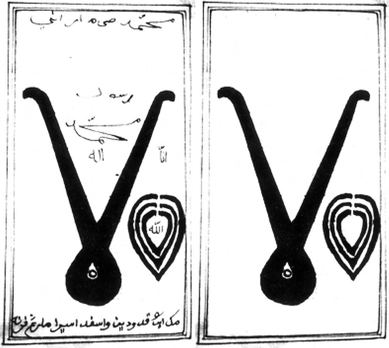
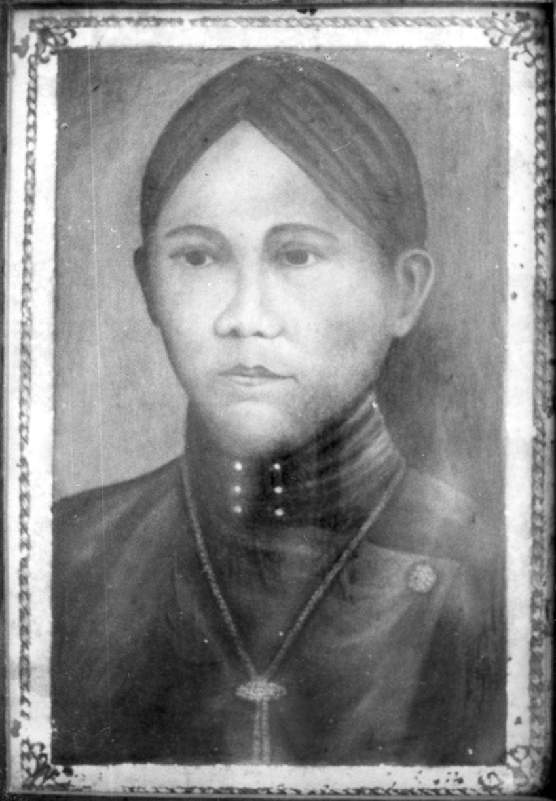

# Chapter III: Young Manhood: Marriage, Education, and Links with the Santri Community, 1803-1805

## First marriage and development of the Tegalreja community

It is likely that in the period immediately following his great-grandmother’s death in October 1803, Dipanagara deepened his connections with a number of intimate associates among the ulama who resided in the villages around Tegalreja. Some of these he would later dispatch on pilgrimages to local shrines and holy sites in the period before the Java War.[^1] Such relationships were undoubtedly strengthened through the prince’s first marriage (circa 1804) to the daughter of a prominent religious teacher from the Slèman area to the north of Yogya.

This young woman, Radèn Ayu Retna Madubrangta, was the second daughter of Kyai Gedhé Dhadhapan from the village of Dhadhapan near Tempèl in the Turi sub-district close to the Yogya-Kedhu border.[^2] She was the mother of Dipanagara’s eldest and most able son, whom the prince always favoured amongst his other children (Javasche Courant 92, 6-8-1829), and who would later take his father’s young adult name of Radèn Mas Antawirya, subsequently being appointed as Pangéran Dipanagara II in August 1825. Under his post-war Javanese Muslim name of Radèn Mantri Muhamad Ngarip, he would write a prophetic-historical account of his life and times – the Babad Dipanagara Surya Ngalam – in which his mother is described in glowing terms as a very devout woman who took pleasure in accompanying her husband in his religious duties. According to Dipanagara II, they remained close until the elder Dipanagara was prevailed upon by his father, the third sultan, to make a more prestigious ‘political’ marriage to Radèn Ajeng Supadmi (post-1807, Radèn Ayu Retnakusuma), the possibly part-Chinese daughter of the Yogya bupati of Panolan, Radèn Tumenggung Natawijaya III, on 25 February 1807.[^3]

This was an elaborate affair – a double wedding ceremony in fact since the prince’s younger sister was also married on that day – and the gifts from the Surakarta court alone amounted to over 1,600 kati (one tonne) of rice, 16 buffaloes and 200 ronde realen (480 guilders).[^4] The Dutch Resident, Matthijs Waterloo (in office 1803-1808), even gave the prince and his younger sister 21 ells (just under five feet) of parchment in addition to his other more predictable wedding presents such as lengths of chintz and prestigious silk patola cloth from the former Dutch trading post of Surat in western India, the last of which was often used as bride wealth. This gift of parchment must have assumed a certain level of literacy on the part of the newly weds.[^5]

This second wife had only met Dipanagara three months before their marriage and their union does not seem to have been a particularly happy one since the prince never once referred to her in his autobiography.[^6] She also behaved, according to Dipanagara II, in an arrogant and unjust way towards his more lowly-born mother,[^7] and one can only surmise that this may have driven the latter to an early grave. The elder Dipanagara made only one mention of Madubrangta in his babad and that was late in the Java War, when he wrote that she had died during his time at Tegalreja (namely, pre-July 1825), referring to her as bibi (auntie), a term often used in Javanese court circles to designate mothers of less elevated social standing.[^8] Her father Kyai Gedhé Dhadhapan is not specifically mentioned in Dipanagara’s babad, although there are references to a certain Kyai Dhadhapan in the group of close ulama (Islamic scholars) around Kyai Maja in 1828.[^9] He is even mentioned as Maja’s key ‘adviser and confidant’ at this time.[^10] It is possible this may have been the same man, although the Kyai Dhadhapan referred to in the prince’s autobiography is described as a pupil (murid) of Kyai Maja, which would not seem to fit Radèn Ayu Madubrangta’s father who already appears to have been an eminent kyai by the mid-1800s and could hardly have been the ‘pupil’ of a man seven years’ Dipanagara’s junior.[^11]

Besides the village-based ulama, Dipanagara also had friends among the Yogya court official and royal related families who were interested in Islam and had private collections of Islamic texts. The Danurejan family,[^12] whom we have met above, was particularly important here. They were to provide all but one of the chief ministers in the nearly two centuries following the sultanate’s establishment in 1755,[^13] and their links with the pathok negari (centre for experts in Islamic law) at Melangi and its locally renowned kyai, both of which connected them with the circle of ulama at Tegalreja, put them at the very centre of the santri world of south-central Java. One family member in particular, Radèn Ayu Danukusuma, a daughter of Sultan Hamengkubuwana I and the mother of Danureja II (in office 1799-1811), seems to have been especially appreciated by the prince. She is mentioned in his babad as his chess partner, a game he greatly enjoyed.[^14] More significantly, she was known for her knowledge of Javanese-Islamic literature and her facility with pégon (Carey 1992:157, 343, 489 note 425), both skills which would have resonated with Dipanagara, who likewise wrote in pégon. Amongst the texts in her private collection were Nūruddīn ar-Rānīrī’s Malay work Bustān as-Salatīn (‘Garden of kings’; Ricklefs and Voorhoeve 1977:48) and Muhammad ibn Fadl Allāh al-Burhānpūrī’s al-Tuhfa al-mursala ilā rūh an-Nabī (‘Gift addressed to the spirit of the Prophet’; Ricklefs 1973:347-9; Carey 1975:341-4), precisely the sort of texts which Dipanagara is reported to have studied in his youth.

Other priyayi dynasties with strong interests in Islam included the Wiragunan and Kertadirjan families, both of whom were closely connected with the prince by virtue of their service as senior officials of his father’s establishment, the kadipatèn (see Appendix Vb). Radèn Tumenggung Wiranagara, the son of Mas Tumenggung Wiraguna I, the much respected patih of the kadipatèn in Dipanagara’s youth, ‘could write letters in the style of a priest (santri)’, namely had mastered pégon script, and was the pupil of Kyai Taptajani,[^15] with whom he had studied Islamic legal and mystical texts (Carey 1981a:245 note 41). He was described in a Dutch source as a ‘lettered Javanese, acquainted with the history of his land and well versed in the Qur’ān’ (Louw and De Klerck 1894-1909, I:599). His santri name was ‘Mas Mukidin’. Many of his relatives were santri and some joined Dipanagara during the Java War (Carey 1981a:245 note 41). Married for a time to the prince’s eldest sister, we will see below (Chapter VIII, Chapter IX) how he would later incur Dipanagara’s bitter enmity by conducting an affair with his stepmother, Ratu Ageng (official wife of the third sultan), and by taking her side and that of the Yogya chief minister, Danureja IV (in office 1813-1847), against the prince in political disputes over the land-rent and other matters in the troubled decade preceding the Java War.

The prince’s relations with the Kertadirjan family, who briefly succeeded Mas Tumenggung Wiraguna in the office of patih kadipatèn (Appendix Vb), appear to have been rather closer and more mutually supportive. A member of this family, Mas Tumenggung Kertadirja II, who served as one of the Yogya bupati in the Sokawati area (1812-1821),[^16] had many Islamic works in his possession at the time of his dismissal in December 1821.[^17] A personal friend of Dipanagara, he subsequently took up residence at Tegalreja and became one of his principal army commanders in the Madiun area of east Java at the time of the outbreak of the Java War lasting out six months before his capture on the slopes of Mount Lawu in January 1826 (p. 544; Louw and De Klerck 1894-1909, I:523 note 2, 559, 576; Carey 1981a:284-5). The prince also had non-Javanese priyayi connections amongst his intimate circle at Tegalreja. One such was Sèh Abdul Ahmad bin Abdullah al-Ansari (alias Ahmad Ansar Sharif, alias Sèh Habib Ahmad al-Ansari), an Arab from Jeddah who had married into the family of Pangéran Blitar, a son of the first sultan (Nahuys van Burgst 1835-36, I:13; Louw and De Klerck 1894-1909, III:570-1; Carey 1974a:35 note 116). Sèh al-Ansari apparently earned his living as a trader between Semarang and Yogya, and there are references to him travelling between the two cities in January 1824. He may have kept Dipanagara informed of developments outside the Principalities.[^18] As a Sharif (presumed descendant of the Prophet) he may even have exercised some religious influence over him. His son-in-law, also known as Ahmad, was likewise part of the prince’s pre-Java War Tegalreja circle and later died defending Dipanagara’s headquarters at Selarong in October 1825.[^19] One of Dipanagara’s sons, Radèn Mas Alip, claimed that these two Jeddah-born Arabs were amongst his father’s most important councillors in the lead up to the Java War and both supported him during the war itself, Sèh al-Ansari only giving himself up to the Dutch early in 1828.[^20]

Unsurprisingly, Dipanagara is silent in his autobiography about another group of ‘friends’ who may have formed part of his wider Tegalreja circle, people who would be of considerable assistance to the prince at the time of the outbreak of the Java War. These were the members of the Yogya criminal underworld made up of local jago (literally: ‘fighting cocks’, thugs), wong durjana (highwaymen, robbers) and ‘social bandits’, men like Demang Jayamenggala, the tax-collector of Samèn to the south of Yogya, who was renowned as an expert in gunpowder manufacture, and who would later become the leader of all Dipanagara’s bandit supporters to the south of the sultan’s capital (Carey 1981a:243 note 36); or the ferry-crossing bandits of Mangiran and Kamijara on the Praga River who were reported to have been summoned to Tegalreja to give the prince assistance during his mid-July 1825 confrontation with the Yogya authorities over the planned road across his property (Carey 1981a:243 note 36); or even the tiger hunters of Jelegong who were ordered to prepare their arms and give him lodging at the time of the outbreak of the Java War (Van der Kemp 1896a:390; Carey 1981a:262 note 112; 282 note 197). Some of these people seem to have come from apanage lands controlled by the prince or from villages adjacent to his landholdings or from areas through which he may have passed during his many journeys and pilgrimages through the countryside to the south of Yogya (Carey 1981a:238 note 20; Louw and De Klerck 1894-1909:744-5; Chapter VIII). Others, like local robber chieftain in northeastern Kedhu, Wirapati, who joined him during the course of the war (Louw and De Klerck 1894-1909, III:90-1), were clearly not part of his pre-1825 Tegalreja ‘circle’. Even today, as we have seen, Dipanagara is compared unfavourably to his great-grandfather Sultan Mangkubumi in some Yogya circles because the latter eschewed the use of such elements in his campaigns against the Dutch during the Giyanti War (1746-1755),[^21] criticisms which are found too in the babad literature (Carey 1981a:244).

## Education and literary interests

These then were some of the prince’s friends, advisers and underworld associates during his youth and early manhood at Tegalreja. What now of his education and intellectual formation over the same period? Compared with the upbringing of most of the sons of the Javanese nobility at this time, Dipanagara’s intellectual and spiritual development at Tegalreja was unusual: a post-Java War Dutch report mentioned that the education of the Javanese nobility at the time was normally arranged on an informal basis whereby a ‘house’ ulama (Islamic scholar) would teach Arabic prayers and Qur’ān exegesis,[^22] but we know from J.W. Winter’s description of the kraton of Surakarta in 1824 that the education of the court elite at that time was rather a hit and miss affair (Winter 1902:39-40). The situation in the Yogyakarta kraton must have been the same. Against this background, Dipanagara’s education in Javanese-Islamic literature and his more formal pesantrèn (religious boarding school)-style instruction at the hands of visiting ulama in the Qur’ān and Hadith (traditions of The Prophet) at Tegalreja was considerably more impressive. Indeed, it was something he took care to try to pass on to his own children both at Tegalreja and in Makassar, at least four of whom – Pangéran Dipanagara II, Radèn Mas Raib, Radèn Mas Kindar and Radèn Mas Dulkabli – followed in his footsteps by gaining a pesantrèn education and devoting themselves to Islam (Louw and De Klerck 1894-1909, V:744; Sagimun 1965:359-60; Carey 1981a:lxiii note 112; Chapter II note 37). Dutch contemporaries, would later remark on the greater ‘refinement’ of Dipanagara’s family when compared to others in the Yogya court in the Java War period, and no less a person than Governor-General Johannes van den Bosch would conclude that only a ‘narrow-minded person’ like the pre-Java War Resident of Yogya, Anthonië Hendrik Smissaert, could have misjudged such a man.[^23]

From Javanese sources, it is possible to gain a glimpse of the sort of texts Dipanagara may have studied at Tegalreja with his circle of friends and associates.[^24] Amongst his favourite Islamic works was the Kitab Tuhfah, a Sufi ontology on the doctrine of the ‘seven grades of being’ which was much appreciated by the Javanese when speculating on God, the world and man’s place in it (Drewes 1966:290-300). He also seems to have been familiar with treatises on Islamic theology and mysticism, such as Usul and Tasawwuf, as well as Javanese mystical poems such as suluk. The history of the prophets (Serat Anbiya) and Tāfsir, a Qur’ān exegesis, likewise formed part of his literary curriculum,[^25] as did didactic works on Islamic political philosophy such as the Sirāt as-salātīn and the Tāj as-salātīn. The latter was even prescribed by the prince as a text for his younger brother, the fourth sultan (reigned 1814-1822), when he was completing his education in the kraton.[^26]

Another special area of interest seems to have been Muslim jurispru dence: the Taqrīb, Lubāb al-fiqh, Muharrar and Taqarrub (a commentary on the Taqrīb) were all known to Dipanagara, and he later mentioned with pride his personal collection of Javanese-Islamic law codes which had been kept for him by a friend in Yogya during the Java War.[^27] In this connection, he was extremely critical of the 1812 legal reforms introduced by the interim British administration of Thomas Stamford Raffles (1811-1816) which curtailed the power of the Javanese religious courts (surambi) in criminal cases (Carey 1987:299-301; pp. 386-7). Such works on Muslim jurisprudence, scholastic theology, grammar and explanations of the Qur’ān seem to have been in general use for instruction in religious boarding schools (pesantrèn) in Java during this period according to the official surveys on vernacular education conducted in 1819 and 1832.[^28] Amongst these, the Taqrīb, Usul, Nahwu and Tafsir featured prominently.[^29] We also know that these texts were consulted in the various centres for Islamic law with which the prince was connected.[^30] His special interest in works on Muslim jurisprudence was thus not so unusual given the context of contemporary pesantrèn education in south-central Java just before and immediately after the Java War.

Despite the range of his reading and supposed expertise in Javanese-Islamic legal matters, it is striking that Dipanagara did not feel secure enough in his own knowledge of the holy scriptures to carry out the mandate given him by his pre-war vision of the Javanese Ratu Adil (‘Just King’) to fight on the basis of the Qur’ān. Instead, he decided to summon ulama whom he judged especially well versed in the Qur’ān to his headquarters at Selarong at the beginning of the war to give him the necessary advice. Lacking confidence in the scholars and religious teachers whom he had met and studied with in the immediate vicinity of Yogya, he decided to invite Kyai Maja and another much older Pajang-based ulama, Kyai Kuwaron, to join him as his senior religious advisers (Chapter X note 184), a decision which later sparked many jealousies amongst his local supporters (p. 634).

Besides these Javanese-Islamic texts, Javanese sources relate that Dipanagara also studied – or had read to him – works of a more moralistic and Javanese literary nature. These included edifying tales on kingship and statecraft adopted from Persian and Arabic classics such as the Fatāh al-Muluk (‘Victory of kings’), the Hakik al-Modin and the Nasīhat al-Muluk (‘Moral lessons for kings’),[^31] as well as Modern Javanese versions of Old Javanese classics like the Serat Rama, Bhoma Kāwya, Arjuna Wijaya and Arjuna Wiwāha.[^32] The prince was likewise well versed in Modern Javanese wayang (shadow puppet) literature and made numerous allusions to characters in the Javanese show theatre in his autobiography (Carey 1974a:12-37). It is interesting in this respect that amongst the texts which Dipanagara asked the Dutch government to copy in Surakarta for the education of his children who had been born to him in exile in Manado (1830-1833) and Makassar (1833-1855), was the whole of the Purwa cycle of wayang plays down to the great ‘brothers’ war’ (Bratayuda).[^33] Other texts requested by the prince at this time included the famous Islamic epic tale, Ménak Amir Hamza, the Asmara Supi, a romance related to the Ménak cycle, the Serat Manikmaya, a text on cosmogony dating from the Kartasura period (1680-1745) which deals with agricultural myths and wayang traditions (Pigeaud 1967-80, I:154; Carey 1992:495 note 466), the Serat Gandakusuma (Angling Driya) and the Serat Angrèni, an episode from the Panji cycle.[^34]

A copy of the popular Javanese romance, Jaya Lengkara Wulang, written on treebark paper was found at Dipanagara’s headquarters at Selarong in October 1825 and may have formed part of the prince’s private collection.[^35] The text deals with various aspects of statecraft in the form of a tale of a young prince wandering (lelana) through Java and meeting many masters of secular, religious and arcane lore. This was a theme which had universal appeal amongst the courtly elite at this time epitomising as it did the ideal education of the young satria (warrior nobleman) (Pigeaud 1967-80, I:230; Ricklefs 1998:271). We shall see below how Dipanagara gave practical expression to this satria lelana ideal during his pilgrimage to the south coast in circa 1805.

## Character, intellectual ability and relations with Europeans

While the list of works on Islam, Javanese-Islamic law and Javanese literature reportedly studied by Dipanagara seems impressive, their bare enumeration affords few real insights into the prince’s character. How really intelligent and discerning was he? Can we believe the post-Java War Dutch sources which suggest that he was somewhat unique amongst his Yogya contemporaries? How much formal education did he really have? Could he read and write? What was his understanding of Islam, and how deep was his spiritual commitment?

The answers to some of these questions can be found in the records of some of the European officers who spent time in his company, in particular the diary of Second-Lieutenant Julius Heinrich Knoerle, the German officer who accompanied the prince for seven weeks on his journey into exile in Manado.[^36] Knoerle, a lawyer by training, who had been born in Stargard in West Pomerania (Prussia), had been in Java for just four years (1824-1828) before personal sickness forced him to return to Holland. The veteran VOC official Nicolaus Engelhard, who got to know him during his three-month recuperative stay at Engelhard’s villa at Pondhok Gedhé near Cililitan in the Bataviasche Ommelanden in 1828 (Heuken 2000:280), spoke well of Knoerle’s character and recommended him to the minister of the Colonies, C.Th. Elout (in office 1824-1829), describing him as a man closely acquainted with the language, manner and customs of the Javanese, as well as with the colonial system and the current political situation in Java.[^37] This seems to have had the desired effect for the second-lieutenant had apparently come back to Java with Governor-General Johannes van den Bosch (in office 1830-1834) on 2 January 1830 as his military adjutant. However, P.J.F. Louw and E.S. de Klerck (1894-1909, V:604, 752-3), the Dutch military historians of the Java War, are contemptuous of his character and abilities describing him as a pushy and dishonest ‘careerist’. They noted that he had risen to only the most junior commissioned rank in the colonial army,[^38] and referred to an official govern ment decision which censured Knoerle’s fitful grasp of Javanese (even his Dutch was far from perfect) which made it difficult for him to command native troops in the field (Louw and De Klerck 1894-1909, V:752). The young German also had problems in dealing with the local population more generally. He would later meet a violent end while serving as Assistant-Resident in Bengkulèn in July 1833 at the hands of the local chiefs and inhabitants who had been goaded to murder by his ‘hot-tempered and wilful’ character and by his ‘often brutal and immoral’ actions which may have included the embezzling of f 4,000 earmarked for the relief of famine in his district (Sartono Kartodirdjo 1971:99; Carey 1981a:lxvi note 147; Fasseur 1993:81-2). All this means that his record of his conversations with the prince needs to be treated with circumspection. But the fact remains that his journal – part of which has been published (Knoerle 1835:137-85) – is by far the most complete European account of day-to-day encounters with Dipanagara over an extended period (May-June 1830), so it needs to be cited.

At the time of his mission to Manado with Dipanagara, Knoerle was still serving as military adjutant to Van den Bosch, and his journal was personally written for the governor-general who had to consider the pressing political implications of the prince’s exile at a time of looming war in Europe over Belgian independence.[^39] According to Knoerle, the prince ‘appeared as a noble, but at the same time proud man, gifted with shrewdness, a strong [and] enterprising character, and penetrating judgement such as is rarely found amongst high-born Javanese’ (Knoerle 1835:171). He seems to have little formal education and his writing – at least in Javanese characters – was extremely untidy and full of grammatical errors (De Hollander 1877:192-6; Kielstra 1885:408; Louw and De Klerck 1894-1909, I:151). Similarly, in Knoerle’s words, the prince’s style of speech was ‘unusually unmannerly […] and inaccurate’. But the force and vitality of his personality showed through in the vividness of his ideas, which were, according to Knoerle, ‘in themselves rich, powerful and very clear’ (Knoerle 1835:172). This enabled him to make a deep impression on people after even a short meeting: at the Magelang ‘peace conference’ in March 1830, the Dutch supreme commander, Lieutenant-General Hendrik Merkus de Kock, and his staff, none of whom were initially well disposed towards the prince, all spoke with praise about his ‘open-hearted and intelligent’ character when they had been in his company for only a few days.[^40]

The prince apparently spoke some Malay, but always avoided using the language in European company because he found it so distasteful and was not fluent in it.[^41] He also had an excellent memory: during his conversations with Knoerle he was able to recall developments in pre-Java War Yogyakarta with great clarity and he later set down the whole of his life history in babad form during his exile in Manado. This was apparently done in under nine months (May 1831-February 1832) entirely without notes, but with remarkable chronological rigour and attention to detail (Carey 1981a:xxiv-xxvi). Another facet of Dipanagara’s intelligence was his intuitive ability to discern other people’s characters from their facial appearance (ngèlmu firasat; the science of physiognomy and physical traits, from the Arabic ilm al-firāsa, Drewes 1966:335-6, 356-7). At the beginning of the Java War, he is depicted in one of the babad as having picked his officials, army commanders (basah), and religious advisers entirely on the basis of his ngèlmu, his choice of subordinates usually being a good one. Even his uncle, Pangéran, known after August 1825 as Panembahan Mangkubumi, is described as deferring to his superior judgement.[^42] Dipanagara also appears to have been rather careful and astute with money, as we will see in his negotiations for the indemnification of the European land-renters in Yogya in 1823 (pp. 537-43) and his management of his administration and finances during the Java War and subsequent exile (pp. 606-7, 650-3, 726-7).

The prince’s judgement of European officials with whom he came into contact during his pre-Java War life in Yogya and subsequently was also penetrating and critical. Huibert Gerard Nahuys van Burgst (1782-1858), the bluff Harderwijk lawyer, administrator and ‘pseudo-military’ man (Louw and De Klerck 1894-1909, III:386-7; Chapter IX), who served as Resident of Yogya immediately after the Dutch restoration in 1816, he dismissed as a person who ‘merely enjoyed eating and drinking and the spreading of Dutch ways’,[^43] and he correctly described the hapless Jonkheer Anthonië Hendrik Smissaert (1777-1832), the Yogya Resident (in office 1823-1825) immediately preceding the outbreak of the Java War as a ‘good man but weak’ (Louw and De Klerck 1894-1909, V:743). As for Frans Gerhardus Valck, who served as Resident of Kedhu (in office 1826-1830) at the time of his meeting with De Kock at Magelang in March 1830, the prince found him ‘extremely wearing because of his stupid and piffling questions […] he commanded no respect and […] had not the appearance of a Resident who has to govern large numbers of Javanese’.[^44] Dipanagara reserved his highest praise for John Crawfurd (1783-1868), who served as Resident of Yogya (in office 1811-1814, 1816) during the British interregnum, stating that:

> He had never known any Dutch [official] endowed with the same love of his fellow man and with the same noble-hearted character as Crawfurd. [….] Crawfurd spoke about everything with his father or with himself, and he had made the Javanese language his own in under six months because the Malay language is the language of chickens which no ruler in Java wished to hear.[^45]

Perhaps in the dour but talented Scotsman, Dipanagara had found a kindred spirit, someone who was as abstemious and frugal as Nahuys van Burgst was hearty and bombastic?[^46] ‘In everything he said,’ Knoerle later noted, ‘Dipanagara’s attachment to Crawfurd shines through and the latter must have been particularly well suited to win the esteem and attachment of the rulers of Java’.[^47]

On another level, it is clear that Dipanagara had an enquiring mind and a wide-ranging knowledge of eclectic topics, especially Javanese history and legends. This can be seen in his Makassar notebooks which deal with wayang, Javanese mythology, legendary heroes and holy sites (Carey 1981a:xxx-xxxi). In his conversations, Knoerle noted that the prince talked at length about the goddess of the southern ocean (Ratu Kidul), the kingdoms of Pajajaran and Majapahit, the first sultan of Demak, Radèn Patah (reigned circa 1500-1518), and the late seventeenth-century Balinese mercenary-adventurer, Untung Surapati (circa 1645-1706), as well as more general topics of commerce, navigation, and European dynastic history.[^48] At the same time, he showed a lively interest in the illustrations of books lent to him during his voyage into exile which covered topics as diverse as Singhalese Buddhism and the First Crusade (1095-1099).[^49] On all occasions, Dipanagara showed himself perfectly at ease in the company of Europeans and his first escort, Major François Vincent Henri Antoine Ridder de Stuers, De Kock’s son-in-law, even spoke of his ‘genteel manners’ (in zijn omgang zeer fatsoenlijk) (Louw and De Klerck 1894-1909, V:746).

## Understanding of Islam

Dipanagara’s understanding of Islam can be best assessed from the vantage point of his own writings, most notably his autobiographical babad and his Makassar notebooks. We will look at these shortly, but first it may be helpful to hear how those Europeans with whom the prince came into contact at the end of the war saw his practice and understanding as a Javanese Muslim. Knoerle, for example, commented favourably on his understanding of Islam and the depth of his religious commitment:

> Dipanagara is very closely acquainted with the spirit which pervades the religious system of [The Prophet]. I believe he judges all miracles achieved by Muhammad from a fair point of view and knows very well how to distinguish [their supernatural aspects from] the [historical] circumstances in which Muhammad found himself.[^50]

Later, during a discussion about the Old Testament prophets, the German officer declared himself surprised by the prince’s ‘correct opinions’.[^51] Towards Christians, Dipanagara evinced a certain tolerance, although he viewed their concept of the trinity as a ‘blasphemy’ and bitterly blamed them for persecuting other religions. In his words:

> No matter who should be given preference between Jesus and Muhammad, the spirit of patient endurance was to be found more in the Qur’ān than in [….] [Christian] works. Muslims had included many of the teachings of Jesus in the Qur’ān […] [and] they also considered him a man chosen by God and born from the breath of the Almighty. Christians, on the other hand, had soiled the Divine Sending of Muhammad with contumely and sought to show the Prophet as an impostor.[^52]

As regards Dipanagara’s doctrinal position as a Muslim, it can be seen from his writings that he was more a typical Javanese mystic than an orthodox Muslim reformer. This was recognised early in the Java War by his principle religious adviser, Kyai Maja, himself a possible adherent of Shattārīyya mystical brotherhood (tarekat), who pointed out that the prince seemed to be striving for the mystical unity of the Sufi.[^53] Despite an impressive display of quotations from the Qur’ān in his Makassar notebooks, Dipanagara laid the greatest stress on the use of dhikr (short prayers for the glorification of Allah which are endlessly repeated in ritual order) and on various forms of meditation (Carey 1981a:xxx-xxxi). In the same passages where he praises the efficacy of dhikr, he also refers to daérah (diagrams for regulating breathing during prayer) and to some of the rituals adopted by the Naqshabāndīyya and Shattārīyya mystical brotherhoods.[^54] Similarly, when he was giving advice to his younger brother, Pangéran (Ngabdurakim) Adisurya, on religious matters he recommended him to use the fourfold dhikr (napi-isbat, isim, isim gaib, isim gaib-ginaib), which befitted the ‘perfect man’ (insan kamil) and would lead to the end of separation between Lord and servant (kawula lan gusti).[^55]

According to Dipanagara, the repeated use of such dhikr would enable the ‘name of majesty’ (isim jalalah), which is Allah, to become ‘engraved’ on the innermost heart (ati sanubari).[^56] Finally, he took a mystical view of the fundamental dogma of Islam, namely tokid (Arabic tawhīd), the profession of Allah’s unity and uniqueness. He considered that all man’s efforts should be directed towards living up to this profession of unity by denying being to all that exists, inclusive of himself, and striving after union with the Eternal and Muhamad s.m. arané Rosul Muhamad Allah illa Only Being (Kang Jati Purbaning Sukma). The development and progress of the mystic, in the prince’s view, ran from iman (faith) via tokid and ma’ripat (gnosis) to true islam, the most absolute surrender of the individual, and the effacement of the human personality and its being in the Divine. Significantly, there was no mention of the sharī’a (Islamic law) as the container for such mystical striving, precisely the sort of oversight which so struck the teachers of the Jâwah (Indonesian) community in Mecca in the later nineteenth century (Snouck Hurgronje 1931:271) and led to the trial of the pasisir mystic, Kyai Haji Ahmad Mutamakin, in early 1730s Kartasura for having ‘disclos[ed] the essence of the mystical science of Reality [haq] […] but [having] reject[ed] the stage of the law [sharī’a]’ (Ricklefs 1998:127-62, 2006:115-7).

> *Plate 11. A page from the second book of Dipanagara’s Makassar manuscript depicting a daérah (mystical diagram) for the regulation of the breath and the utterance of dhikr (short religious phrases) during prayer. Probably taken from the Shattārīyya tarekat (mystical brotherhood). Hikayat Tanah Jawa, p. 22. Photograph by courtesy of R.M. Yusuf Diponegoro, Jl Irian no. 83, Makassar.*

As Dipanagara put it in his autobiography:

> XXXIII. 27 Iman means ‘acceptance’ because man is granted life by God Most High. The meaning of tokid is truth that one has to observe God’s ordinations [as stipulated in the law] be they onerous or light to fulfill. 28 Ma’ripat means to reject duality; as this body is bound to perish, do not take it into account. Its [being] is an illusion, too absurd to endure. Strive only after the primordial Essence of the All-Pervading One. The meaning of islam

> 29 is surrender, the avowal of man’s nullity. All comes from God, man has only to accept humbly. Equally in this world and the hereafter, there is nothing but the grace of God, Lord of the Worlds, creature being transitory. That is my view.

> 30 These four together are [also] called tokid. They are evidence of earnest application [to the striving after God].[^57]

For readers familiar with Javanese mystical literature, it will be evident that there is nothing unusual about this fourfold path towards unity propounded by Dipanagara. Indeed, it is typical primbon (divination almanac) material. Moreover, the prince’s repeated references to the mystical practices of the tarekat cannot be taken as an indication that he was in touch with the centres of the mystical brotherhoods in the Middle East. Both the Naqshabāndīyya and Shattārīyya had long been established in Indonesia – the latter having been introduced by the great seventeenth-century Sumatran Sufi Abdurrauf of Singkil (circa 1615-1693) and spread in Java by his pupil Shaikh Abdul Muhyi (circa 1640-1715) – and by the early nineteenth century the Shattārīyya in particular had become degenerate, serving as a receptacle for many old-fashioned mystical teachings as can be seen from a study of the Serat Centhini (1815), the great encyclopaedia of Javanese manners, history and belief systems in the early nineteenth century (Ricklefs 2006:195-206). It had also died out in Arabia by this time.[^58] Thus Dipanagara drew on traditional sources for his religious inspiration and remained unaffected by the fanatical Wahhābī reform movement which for nearly a decade (1803-1812) in the early nineteenth century controlled a large part of the Arabian peninsula including the holy cities of Mecca and Medina, and which later had such a profound influence on the course of events in West Sumatra both before and during the Padri War (1821-1838).[^59] There was nothing in Dipanagara’s vision which involved the creation of an Islamic society along the lines of the Padri reformers, nor did he have any problems with reconciling his experience of the Javanese spirit world with his own unshakeable commitment to Islam. Even his desire to end his days in Mecca after making the haj (pilgrimage) should be seen more as a way of arranging an honourable retirement in the aftermath of the Java War than a wish to imbibe the teachings of leading Islamic divines in the holy city.[^60] This is what Ricklefs has termed the ‘mystic synthesis’ of pre-colonial Java, a synthesis which reached its most remarkable flowering in the life and career of the young Dipanagara (Ricklefs 2006:206-20).

## Appearance, personality, family and pleasures

Apart from the nature of Dipanagara’s religious convictions, what were the main traits of his personality? What did he look like as a young man and was he attractive to women? Did he have a sense of humour? Did he have any special interests or pleasures? Was his religious zeal tempered by compassion and humanity?

A sketch of the prince drawn by a Yogya court artist when he was about twenty years old, possibly at the time of his second marriage to the daughter of the Yogya bupati of Panolan on 27 February 1807, shows him dressed in an iket (head-dress) and high-collared Javanese jacket (surjan) fastened at the neck with six gold buttons. A gold cord hangs over his shoulders on which a pen-knife may have been fastened and tucked into his jacket. The face is still young with tightly pursed lips, a slightly splayed nose and powerful downcast eyes.[^61] Even in advanced old age, according to a witness who met Dipanagara in exile, the prince’s eyes still retained the fire and energy of his youth (Schoemaker 1893:409; Van der Kemp 1896a:358). The whole appearance gives the impression of concentrated energy and cahya (internal spiritual power; personal radiance). The sketch is unique: it is the only drawing from life by a Javanese artist showing the prince in Javanese dress. All the other known portraits are by Dutchmen and show him in santri garb, in particular the dress which he adopted during the Java War, namely, the open-necked kabaya (tabard), black jacket, shawl and turban under which one can just discern that the prince has shaved his head in the manner of the paras Nabi (The Prophet’s tonsure). They also unwittingly give the prince’s face a European cast, although the sketch by the bailiff or chief magistrate of Batavia, Adrianus Johannes Bik (1790-1872), which now hangs in the Musium Kota (Jakarta), is especially fine.[^62]

According to Dutch sources, the prince was heavy in build and of middling height.[^63] But he apparently had great reserves of energy and a remarkably robust constitution. Dutch officers who were given the task of tracking him down in the jungles of Bagelèn at the end of the Java War were all impressed by his perseverance and will-power: in De Kock’s words, ‘Dipanagara must be made of iron when one reads the descriptions of the terrain in which he is holding out and of the shacks in which he rests his exhausted body – everything is [utterly] desolate’.[^64] Dipanagara himself reflected in his babad that he had never walked such distances in his life and was literally ‘on his last legs’ at this time.[^65] During his youth, however, he had accustomed himself to making long journeys on foot (Louw and De Klerck 1894-1909, V:744). We have seen in the previous chapter how he walked from Tegalreja to Kyai Maja’s pesantrèn in the Pajang area – a distance of some thirty-five kilometres – to find his eldest son in the post-1816 period, and we shall see in the next chapter how in circa 1805 he embarked on a seventy-kilometre pilgrimage to various caves and holy sites to the south of Yogya. On these journeys, or when he withdrew to his cave at Secang (Selarong) for retreats, known in Javanese as tirakat, he either travelled alone or with his two intimate retainers (Carey 1981a:246 note 44). He also carried a special pilgrim’s staff which had been given to him in circa 1815 and was supposed to have been made in the sixteenth century for one of the rulers of Demak. This staff was said to have had a wrought iron handle in the shape of a cakra (solar disc), the weapon of Wisnu which in Javanese mythology is particularly associated with the ‘Èrucakra’ title of the Javanese Ratu Adil (‘Just King’) (Plate 65) which Dipanagara would assume at the start of the Java War.[^66]

Dipanagara’s robust constitution and ability to endure great privations, including severe bouts of tropical malaria at the end of the Java War,[^67] made him a firm believer in traditional medical treatments. During the Java War, he had his own personal physician, a Muslim Bengali by the name of Nurngali who may have perhaps been a former Bengal sepoy who had stayed on in Java after the British departure in 1816 (Carey 1977:310, 322 note 117; Chapter VIII). He ministered to the needs of the prince and his family as well as his key army commanders.[^68] Later, during his voyage to Manado, Dipanagara expressed his contempt for Western medicine to Knoerle:

> How can you speak to me about your Dutch doctors and medicines […] [when] every day we have dead men on board this vessel who are thrown into the sea? How suspicious [you] Europeans are about [your] doctors![^69]

Throughout the journey, he continued to treat himself with Javanese herbal potions (jamu) such as beras-kencur and kedawung[^70] and restricted his diet on some days to dry sweet potato to counteract the effects of sea sickness.[^71]

In terms of physical appearance, Dipanagara could not be described as handsome in the sense that Arjuna – the wayang hero with whom the prince particularly identified – can be recognised as good-looking in Javanese terms (Carey 1974a:16). But it is likely that he had a strong personal magnetism which made him attractive to women and enhanced his personal charisma. Dipanagara himself related that one of the main ‘impeding qualities’ (sipat ngaral) in his youth was that he was ‘often tempted by women’ and during the Java War, as we will see shortly, he ascribed one of his most serious defeats (Gowok, 15 October 1826) to an illicit dalliance he had had with a Chinese girl, who had been taken as a prisoner-of-war at Kedarèn and acted as his masseuse.[^72] Even in exile, he apparently boasted of his conquests: the Resident of Manado, Daniel François Willem Pietermaat (in office 1827-1831), reported that ‘his greatest conversation is about women of whom he seems to have been a great lover’ (Kielstra 1885:408; Louw and De Klerck 1894-1909, I:151). He even made an attempt to marry a local woman, the daughter of a leading Muslim citizen of Manado, Lieutenant Hasan Nur Latif, who objected to the union – as did the Dutch authorities – saying that it would bring his child ‘ill fortune’.[^73]

> *Plate 12. Charcoal sketch of Dipanagara as a young man probably made by a Yogya kraton artist at the time of his marriage to his first official wife (a daughter of the Yogya bupati of Panolan, in east Java, Radèn Tumenggung Natawijaya III, ? died 1811) in March 1807. It is the only known sketch of the Pangéran which shows him dressed in Javanese kraton style in a surjan and blangkon. Photograph by courtesy of Ibu Sahir (great-great granddaughter [canggah] of Dipanagara), Jl. Nyoman Oka 7, Kota Baru, Yogyakarta.*

Certainly, in his pre-exile period, as we have seen, Dipanagara had an active family life. During his time at Tegalreja, he had four wives, whose names are known, and perhaps some unofficial ones as well (Brumund 1854:188). One of these latter was attractive enough to catch the roving eye of the Dutch Assistant-Resident of Yogyakarta and serial lecher, P.F.H. Chevallier (in office 1823-1825), who took her as his mistress for a few months (Chapter X). The prince had nine children (five sons and four daughters) by his wives, at least two of whom died young at Tegalreja. During the Java War, he took three new consorts, one of whom, Radèn Ayu Retnaningsih, a daughter of the Yogya bupati of Kenitèn in the Madiun area, Radèn Tumenggung Sumaprawira, accompanied him into exile where she bore him two sons. She was quite a beauty according to Knoerle, who met her while she was still in her early twenties during the voyage to Manado in May-June 1830, and had a beautifully formed face and large eloquent eyes.[^74]

Although Dipanagara clearly had a great deal of personal charm, which may have enhanced his attractiveness to the opposite sex, the sources are silent about his sense of humour. European contemporaries in particular tend to portray him as a rather dour and forbidding figure: Willem van Hogendorp (1913:146), the lawyer son of Gijsbert Karel van Hogendorp who served in Commissioner-General L.P.J. du Bus de Gisignies’ administration (1826-1830), spoke of his ‘sombre and intense’ character, and A.M.Th. de Salis, a pre-war Resident of Yogya (in office 1822-1823), described his appearance as ‘stupid and mysterious’.[^75] But neither knew Dipanagara well. In fact, Van Hogendorp had never met him. A Javanese contemporary, the prince’s great-uncle, Pangéran Panular, author of a major chronicle on the British interregnum (1811-1816), referred to the prince as ‘behaving almost like a ruler’ and ‘making himself little liked generally’ (Carey 1992:144, 327). But his testimony is contradictory; in other passages he describes his great-nephew in rather flattering terms (Carey 1992:119, 290; pp. 373-4). Dipanagara later acknowledged that very few of his relations in the kraton dared to make jokes with him.[^76] But he did have a light-hearted side. His clown-retainers constantly engaged the prince in frivolous banter[^77] and Knoerle noted that occasionally Dipanagara infected those in his company with a sense of irrepressible joy.[^78] He was also able to see the comic side of the most awkward situations: one such was when he found the Yogya Resident, Nahuys van Burgst, a true ladies man, in a rather compromising position with the wife of his Assistant-Resident at his country house at Bedhaya on the flanks of Mount Merapi. At the time, the prince showed acute embarrassment, but when he related the incident to Knoerle, he laughingly asked whether it was not a rather eccentric ménage when two prominent European officials shared the same woman in common.[^79] On another occasion, he wrote humorously in his babad about an episode during the disastrous battle of Gawok (15 October 1826), when he found himself contesting a hiding place behind a very small fruit tree with a rather stocky uncle.[^80] But frequently the prince’s humour was tinged with savage irony: during the Java War, he seems to have had the habit of sending women’s clothes to his army-commanders deemed guilty of cowardice with handwritten notes pointing out that these became them better than the Javanese prajuritan (fighting dress) they wore into battle.[^81] He was also feared for his ability to place curses on those who did not deliver on their promises or who otherwise betrayed him (Louw and De Klerck 1894-1909, VI:251; Chapter VIII). Even the places frequented by him, such as his Guwa Secang retreat at Selarong (Louw and De Klerck 1894-1909, I:435-7), and his personal belongings such as his walking staff, were thought to be kramat (supernaturally charged) and imbued with power, misfortune being the fate of those who wittingly destroyed them or abused their owner (see note 66; Van Rees 1867, II:66-8; Van den Broek 1873-77, 22:40-2). During the period of his exile in Sulawesi, the very leftovers of his food were considered to have the capacity to cure sickness (Kielstra 1885:409). Here was a man not to be trifled with, a spiritually powerful individual steeped in the Javanese mystical arts.

Popular belief in his spiritual powers also extended to the battlefield, where he was thought to be invulnerable to bullets. The Resident of Manado, Pietermaat, noted that although he was struck twice, once above the left chest and once in his right hand during the battle of Gawok (15 October 1826) (p. 634), none of the shots had left a trace on his body (Kielstra 1885:409; Louw and De Klerck 1894-1909, II:517). According to Dipanagara the bullet that hit his left chest bounced back (Louw and De Klerck 1894-1909, VI:745) and that which penetrated his right hand had already broken into fragments by the time it reached him (Louw and De Klerck 1894-1909, II:517). There was speculation in Dutch sources that the prince may have been wearing body armour (Louw and De Klerck 1894-1909, II:517, quoting Hageman 1856), although there is no mention of the use of such protective devices anywhere in the Javanese sources. In the section of his babad which deals with this incident, Dipanagara has a revealing take. In particular, he seems to have been keen to stress the lightness of his wounds to reassure his wife that he had not been unfaithful to her, Javanese popular belief holding that invulnerability and other powers would be neutralised if the individual possessing them indulged in immoral or unsuitable acts (Louw and De Klerck 1894-1909, II:517 note 1). Since he had indeed been unfaithful just before this battle when he had slept with his Chinese masseuse (note 72), he was anxious that his wife, Ratu Kedhaton (formerly Radèn Ayu Maduretna) would not make the link between his wounds, his battlefield defeat and his sexual conduct. We will return to this issue in the chapter on the Java War (Chapter XI).

Dipanagara’s pleasures were modest and typically Javanese. His two main ones have already been alluded to, namely gardening and the keeping of song birds, especially turtle-doves (perkutut) and cockatoos. Even in exile he spent much of his time in the company of his cockatoos (Louw and De Klerck 1894-1909, I:151) and while in Manado he was given permission to lay out a garden retreat on a nearby river and a meditation pavilion on the hill overlooking it.[^82] As we have seen, he was also an avid chess player, and like many of his kraton contemporaries was an accomplished horseman, keeping a large stable at Tegalreja.[^83] This expertise in the saddle later stood him in good stead during the Java War when he was frequently able to elude pursuers over difficult terrain. Betelnut chewing was one of his few habits; he appears to have done this constantly, so much so that he even reckoned the passage of time by how long it took him to masticate mouthfuls of the lime, leaf and betelnut mixture.[^84] Indeed, amongst the few personal belongings to survive from his time of exile in Makassar (1833-1855) there are some heavily stained patterned scarves which the prince used to wipe the betelnut juice from his mouth.[^85] Later, it appears he drank wine in European company though he never took this habit to excess as so many other princes did at the central Javanese courts at this time.[^86] According to Knoerle, he held that it was not an offence against the Qur’ān to drink sweet white wine in view of the fact that Europeans at the time drank it as a form of ‘medicine’ whenever they were intoxicated with Madeira or red wine, a view which indicates that Dipanagara had his own independent interpretation of The Prophet’s injunctions.[^87] Knoerle also noticed him smoking Javanese rokok (hand-rolled thick cigarettes/cigarillos made of local tobacco wrapped in maize leaves).[^88] As for opium, which during Radèn Adipati Danureja IV’s administration (1813-1847) came to be more widely used in Yogya kraton circles (Chapter VIII note 147) and was later sup plied by Chinese to the prince’s followers during the Java War itself,[^89] there is no evidence that the prince ever touched the drug.

Despite his religious zeal, Dipanagara gave Knoerle the impression that his spiritual commitment was tempered by a deep sense of humanity and compassion. When he heard of the suicide of a Dutch sailor who had killed himself on the voyage to Manado rather than undergo punishment for a crime he did not commit, the prince expressed pity and indignation, asking:

> How was it possible to punish a man of whose guilt people were unconvinced? In Yogya, when either his father [the third sultan] or himself had tried to bestow justice on the Javanese, they had always started from the principle that no one should be punished who was not clearly convicted of committing a crime.[^90]

‘In everything Dipanagara said during the course of our conversation about this matter’, Knoerle noted, ‘he gave evidence of deep religious feelings. He steadfastly pitied the sailor whom he said must be a man with a pure heart who could certainly reckon on God’s mercy.’[^91] The prince also told Knoerle that he had never been able to bring himself to bear arms during the Java War and was revolted by the sight of battlefield carnage. After an ambush at Kasuran (28 July 1826) in the Slèman area when all but seventeen of a fifty-strong Dutch-Indonesian platoon had been killed (Louw and De Klerck 1894-1909, II:380-3), Dipanagara described how ‘he had rode over the [battlefield] and was deeply moved by the sight of the dead and wounded’. Indeed, so terrible was the scene, he said, that he covered his eyes.[^92] He also stated that he had always given orders to his army-commanders to spare Dutch prisoners but that his commanders had not always obeyed him strictly enough.[^93] Later, we will see how in his visionary encounter with the Ratu Adil (‘Just King’) in May 1824, he begged to be excused from his summons to lead the Ratu Adil’s armies because he was ‘unable to fight’ and ‘could not bear to see death’.[^94] The prince’s credentials as a wartime leader were even questioned by the Dutch military historian, E.S. de Klerck, given his reluctance to involve himself in any of the fighting (Louw and De Klerck 1894-1909, IV:676-7). But this is perhaps to miss the point. In the eyes of his followers, it was as the living embodiment of the Ratu Adil – a human jimat (amulet) – rather than as a battlefield commander per se that his leadership was prized.

At the same time, there may have been some special pleading on Dipanagara’s part when he talked of his compassion and abhorrence of violent death. True, Dutch prisoners were spared and some offered ranks and responsibilities, but in the latter case only after they had agreed to embrace Islam.[^95] As for bearing arms, Dipanagara may well not have fired a gun in anger or wielded a sabre in a cavalry charge, but he omitted to mention that he had an extensive collection of pusaka (heirloom) weapons most of which he distributed amongst his close family members, but one of which – the kris (stabbing dagger) Kyai Ageng Bandayuda – he forged from other pusaka in the second year of the war more perhaps as a jimat (amulet) than as a fighting weapon.[^96] He also had inherited a kris, Kyai Abijaya, from his father probably at the time of his appointment as Radèn Antawirya in September 1805 (Appendix XI note 2). So the idea of a weaponless prince is stretching the truth a bit, especially when it is clear from his babad that he was conscious to the last of his dual rule of Ratu Tanah Jawa (‘ruler of Java’) and as a prajurit (soldier), and even considered what the consequences might be of an amok attack on General De Kock at Magelang at the time of his arrest on 28 March 1830 (Carey 1982:14, 22). Finally, according to Dutch sources, there is evidence that Dipanagara was not averse to demanding sanguinary punishments against civilian officials and others who aided and abetted the Dutch cause: De Stuers, for example, relates the supposed order given by the prince in late 1825 to behead all the village chiefs to the west of the sultan’s capital who had assisted in the rebuilding of the main highway from Yogya to the ferry town of Brosot on the Praga River. Their severed heads were even reported to have been displayed on long bamboo poles as a warning to others (De Stuers 1833:58-9; Chambert-Loir 2000:284-5).

## Conclusion

Separating man and myth in Dipanagara’s case is difficult. The most valuable sources are the rarest, namely Javanese babad written by contemporaries who knew the prince before fame or notoriety – depending on perspective – skewed his image for ever during the Java War. One such is his great-uncle’s chronicle of the British interregnum (Carey 1992). But there are no others known to the present author. Instead, we have been forced to construct a portrait of the prince and his world from the most varied material. That so much of this derives from the Java War and its immediate aftermath should not surprise us given the seismic shock of that event both for the Dutch and the central Javanese courts. But it remains inevitably coloured – if not flawed – by hindsight. It has also required us to range far beyond early-nineteenth-century Tegalreja and the prince’s world as a young man. In so doing, we have built a portrait of the prince which is almost like a pointilliste sketch of the Post-Impressionist school, a number of tiny dots which put together give an illusion of depth, movement and colour but which at the end of the day is just that, an impression if not a trompe l’oeil. The fact that since Indonesian independence in 1945, Dipanagara has become an official Indonesian pahlawan nasional or ‘national hero’, his name gracing the main thoroughfares of numerous Indonesian towns and cities, not to speak of the Indonesian army (Tentara Nasional Indonesia/TNI’s) Central Java division, makes the task of the contemporary historian even more difficult. A flawed and all too human prince is certainly not in accord with ‘national history’ in present-day Indonesia.

The present work is, however, about early nineteenth century realities, not contemporary myth making. Indeed, just as there is but one truly contemporary chronicle presently known to this author in which the prince features, so there is but one contemporary sketch – that by the unknown Yogya court artist of circa 1807. All the others are of Java War vintage and by Europeans – iconic but distorted. It is now time to return to the period of that early sketch and take up once again the prince’s own story as he set out for one of the most significant journeys of his life – his pilgrimage to the south coast in circa 1805 and his encounter with the guardian spirits of Java and some of its greatest rulers. These encounters would provide further prophetic perspectives on the prince’s future as a born leader in changed times, a leader who would also be counted among the ancestors even if for such a brief and tragic time.

## Notes

[^1]: See Plate 14 and Appendix VIIb, sub: Jaèlani, Muhamad, Jayamustapa (alias Sukbatuliman), Mopid, Mudha. One of Dipanagara’s sons, Radèn Mas Alip (see Appendix IV note 1), mentioned the names of two other close associates, Wiryakusuma and Jaya Muhamad, Nahuys van Burgst 1835-36, I:13.

[^2]: LOr 6488 (Babad Dipanagara, Surya Ngalam):14, I.14.

[^3]: The bride’s mother may have been a daughter of Hamengkubuwana II by one of his favourite unofficial wives, Mas Ayu Sumarsonowati, who was of partly Chinese descent, Chapter II note 68. This would explain Dipanagara’s very close relationship with his uncle Pangéran Jayakusuma I (post-1825, Pangéran Ngabèhi Ngabdulrahman) (circa 1787-1829), who later became one of his principle army commanders during the Java War and lost his life in a skirmish in the Kelir mountains on 21-9-1829, see Chapter XII note 4. Mas Ayu Sumarsonowati was also Ngabèhi’s mother, Mandoyokusumo 1977:21 no. 30; Carey 1984:20-1. There is a reference to one of Sumarsonowati’s daughters marrying into the Natayudan family of Yogya bupati of Kedhu, but then styling herself as Bendara Radèn Ayu Natawijaya, which suggests that she had a connection with the family of the bupati of Panolan, see Dwidjosoegondo 1941:100 no. 47 (where Bendara Radèn Ayu Natayuda [Crèma] is described as changing her name to Bendara Radèn Ayu Natawijaya [Slèman]); Mandoyokusumo 1977:23 no. 47. On Radèn Tumenggung Natawijaya III (in office 1803-1811), see pp. 99-100, 195, 255-6, 512; and Carey and Hoadley 2000:294, 352, 360, 378, 383.

[^4]: Dj.Br. 38, Hamengkubuwana II to Pakubuwana IV, 10 Sura AJ 1734 (AD 20-3-1807), and see Appendix IV pt. 1. Dipanagara’s sister, Radèn Ajeng Murtinah married a son of Radèn Tumenggung Danukusuma I, the husband of Dipanagara’s aunt Radèn Ayu Danukusuma, who became one of the prince’s closest friends at Tegalreja, see Appendix II (on family connection between Dipanagara and Danurejan).

[^5]: Dj.Br. 49, Matthijs Waterloo to Nicolaus Engelhard, 1-3-1807. The other gifts were two pairs of allegrassen (? coverlets), two large silk patola cloths (patholen), two pieces of chintz (chitzen) and two red armozijnen, presumably another type of fabric. I am reckoning 1 ell at 27 inches. On the use of patola cloth as bride wealth and on ceremonial occasions, see Bühler and Fischer 1979, I:287-90; Nabholz-Kartaschoff 1989:181-97; Barnes 1989:82-7, 107-8. Bühler and Fischer 1979, II:248-53 have illustrations of patola being worn by court officials in Yogya as well as being used to decorate the cushions on a ceremonial bed in the kraton.

[^6]: See Chapter II note 68.

[^7]: LOr 6488 (Babad Dipanagaran, Surya Ngalam):14, I.16. edir lan siya-siya/ iya marang maru.

[^8]: BD (Manado) IV:4, XXXII.24-5.

[^9]: He is reported to have been a leading participant in the negotiations which led to Maja’s surrender to the Dutch with a 600-strong force on 12 November 1828, Louw and De Klerck 1894-1909, IV:604; BD (Manado) IV:94-5, XXXIV.89-90.

[^10]: Louw and De Klerck 1894-1909, IV:628 (quoting General H.M. de Kock). A certain Kyai Gajali from the village of Dhadhapan is listed along with other followers of Kyai Maja who were captured by the Dutch at this time, Louw and De Klerck 1894-1909, IV:889; Appendix VIIb.

[^11]: Kyai Maja is thought to have been born in circa 1792, see De Stuers 1833:15, who refers to Maja as 36 years old in 1828, and Roorda van Eysinga 1832, IV:327, writing in February 1830, gives his age at 38. So it would have been almost impossible for him to have been the teacher of Kyai Gedhé Dhadhapan, whose daughter married Dipanagara in circa 1803.

[^12]: The original family name was Gandakusuma, but they also used the name Yudanagara after the title of the district administrator (bupati) of Banjarnegara in Banyumas, which office the first Yogya chief minister, Danureja I (1755-1798), had held before his appointment in circa 1755, see Appendix Va.

[^13]: Pigeaud 1931-32, 11-4:126-32, 12-1:34-40; Carey 1975:347-9; Appendix II. The only patih who was not from the Yudanegaran line was Danureja IV (in office 1813-1847), see Appendix Va. The family continued to provide all the subsequent Yogya chief ministers until the abolition of the post in 1943, see Selosoemardjan 1962:51.

[^14]: BD (Manado) II:307, XIV:96; Carey 1975:343. See further p. 512.

[^15]: dB 412, J.F.W van Nes (Surakarta) to Commissioner-General (L.P.J. du Bus de Gisignies), 30-10-1826. Wiranagara (post-1829, Pangéran Adipati Prabuningrat), also had various other leading Javanese ulama as his teachers, friends and counsellors, including Kyai Muhamad Ngarip (also known as Ahmad Ngarip) of Melangi (Appendix VIIb), Kyai Melangi (Kyai Iman Ngali) (Appendix VIIb), Haji Usman (Waru, Surakarta), Haji Asro (Gabudan, Surakarta), Haji Idris (pengulu of the landraad /Javanese-Islamic religious law court), Kyai Plasa Kuning, Kyai Karang (Appendix VIIb), Kyai Daud (Gegulu, Kulon Praga, former apanage of Dipanagara) and Kyai Pekih Ibrahim (also known as Kyai Muhamad Kusèn, pengulu of Dipanagara [1828-1830], Appendix VIIb), AN, Exhibitum, 20-9-1832 no. 1, interview with Kyai Ahmad Ngarip, 11-8-1832.

[^16]: Kertadirja II was the son of the patih of the kadipatèn, Mas Tumenggung Kertadirja I (in office 1807-circa 1810), and served as Yogya bupati of Kerja and Masaran (Sokawati) until his dismissal in December 1821, see pp. 543-4.

[^17]: Dj.Br. 9B, Hendrik MacGillivray to Pieter Merkus, 16-2-1832, in: ‘Aankomende Geheim Stukken’, enclosing a ‘List of belongings given to H.G. Nahuys van Burgst by [Mas Tumenggung] Kertadirja’, 8 Jumadilakir AJ 1755 (AD 27-12-1821), which mentions six Qur’ān and nine other texts in his possession at the time of his dismissal.

[^18]: Sèh al-Ansari’s travels between Semarang and Yogya are referred to in Dj.Br. 67, H.J. Domis (Semarang) to A.H. Smissaert (Yogyakarta), 23-1-1824. He gave himself up to the Dutch in early 1828 and was rewarded with a pension of f 250 a month after the Java War, see Javasche Courant 31(11-3-1828), 80 (5-7-1828), 82 (10-7-1828), Bijvoegsel (11-8-1828); GKA, 20-9-1830 no. 56k, interview with Ahmad Ansar Sharif, 15-4-1830. His wife, Radèn Ayu Sèh Ansari, appears on a Dutch list of stipends and incomes paid to members of the Yogya court in February 1830 as receiving f  100 a month, a very high stipend, and being domiciled (? with her husband) in Palembang, Dj.Br. 19¹¹, F.G. Valck, ‘Voordragt voor de uitgaven ten behoeve van Z.H. den sultan zoomede van de inkomsten en toelagen aan de prinsen, hoofden en andere personen tot het hof van Djokjokarta behoorende’ (henceforth: Valck, ‘Voordragt’), 20-2-1830. See further note 20.

[^19]: Dipanagara mentioned the death of a ‘Sèh Ahmad from Jeddah’ in the fighting around Selarong on 25-10-1825, see BD (Manado), III:22-3, XXIII.146-52.

[^20]: UBL BPL 616 Port. 9 no. 2, ‘Proces-Verbaal van Radeen Maas Alip’, 3-8-1825; Louw and De Klerck 1894-1909, III:570-1, 573, on Sèh al-Ansari’s surrender to the Dutch, his request to settle in Surakarta and the f 600 given to him by Nahuys to pay for a house for himself and his family. See note 18.

[^21]: See Chapter I note 140.

[^22]: MvK 3055, ‘Beschrijving en statistieke rapport betreffende de Residentie Djokjokarta’, 1836. For a list of religious teachers in Yogya in circa 1831, see Appendix VIIa. The Dutch government conducted two surveys of local Javanese-Islamic education in Java in 1819 (AN Besluit van den Gouverneur-Generaal, 8-3-1819 no. 9) and 1832 (AN Kabinet 2065, 31-12-1832), which elicited reports from Residents throughout Java to governor-generals G.A.G.Ph. van der Capellen (in office 1816-1826) and Johannes van den Bosch (in office 1830-1834), some of which can be found in Van der Chijs 1864:212-323.

[^23]: Van Nes 1844:136; dK 111, ‘Beschrijving van het karakter en de hoedanigheid van den Sultan, de prinsen en den Rijksbestierder van Djokjokarta’, 20-12-1829; dK 161, J.F. Walraven van Nes, ‘Korte verhandeling over de waarschijnlyke oorzaken die aanleiding tot de onlusten van 1825 en volgende jaren in de vorstenlanden gegeven hebben ‘ (henceforth: Van Nes, ‘Korte verhandeling’), 28-1-1830; Van der Kemp 1896a:416 (on Van den Bosch’s comment).

[^24]: References in Javanese sources can be found in BNg, II:149, XXXVI.15-9; and KITLV Or 13 (Buku Kedhung Kebo):47-8, IV.32-8.

[^25]: BNg, II:149, XXXVI.17; KITLV Or 13 (Buku Kedhung Kebo):47, IV.35-6. See also Ricklefs and Voorhoeve 1977:69, where a copy of the Serat Anbiya (IOL Jav 74) which originally belonged to Ratu Ageng (? Ratu Ageng Tegalreja, the great-grandmother of Dipanagara) is described.

[^26]: BNg, I:388, XC:26-7; II.149, XXXVI.18, where Dipanagara is described as having read the texts at Tegalreja. The Tāj as-salātīn was one of the first works re-copied in the Yogya kraton after the library had been plundered by the British in 1812, Mudjanattistomo 1971:63 no. 235 (copied in 1831).

[^27]: Knoerle, ‘Journal’, 30-1, where Dipanagara mentioned that ‘these lawbooks […] contain everything that had been instituted in an excellent and exalted spirit by The Prophet and his caliphs [wali]. They were particularly made for Java and have been in use for a thousand years’. It is likely that Dipanagara was referring to compendia of jurisprudence of Old Javanese origin such as the Jugul Mudha, Surya Ngalam, and Praniti Raja Kapa-Kapa, see Pigeaud 1967-80, I:308; Raffles 1817, I:279-80; pp. 387-8.

[^28]: Van den Berg 1887:518-55. See note 92.

[^29]: AN, Besluit van den Gouverneur-Generaal, 8-3-1819 no. 9, F.E. Hardy (Resident of Kedhu) to Algemeen Secretaris (Jean Chrétien Baud), 15-4-1819.

[^30]: See Chapter II.

[^31]: BNg, II:149, XXXVI.18; KITLV Or 13 (Buku Kedhung Kebo):21-3, II.47-54.

[^32]: BNg, II:149, XXXVI.19; KITLV Or 13 (Buku Kedhung Kebo):43, IV.13, 48, IV.37; BD (Manado), II:304, XIX.87; Carey 1974a:10-6.

[^33]: AN, Besluit van den Gouverneur-Generaal buiten rade, 25-10-1844 no. 6, P.J.B. de Perez (governor of Makassar) to Governor-General (Pieter Merkus), 29-1-1844. See pp. 743-4.

[^34]: The texts, with the exception of the Ménak Amir Hamza, which the government deemed too expensive, were copied for Dipanagara in Surakarta, mainly from kraton MSS, see AN, Besluit van den Gouverneur-Generaal buiten rade, 25-10-1844, Assistant-Resident of Surakarta to Algemeen Secretaris, 10-6-1844, 10-10-1844. For brief descriptions of these texts, see Pigeaud 1967-80, I:154, 212-5, 223-4, 235. See pp. 743-4.

[^35]: Pigeaud 1967-80, IV:86 (sub: LOr 12.586). The original is in dK 222, see VROA 1905:76. On the capture of Dipanagara’s papers at Selarong, see Louw and De Klerck 1894-1909, I:399.

[^36]: For a discussion of Knoerle’s journal, whose full title is, ‘Aanteekeningen gehouden door den 2e Luit. J.H. Knoerle, adjudant van Z.E. den gouverneur-generaal van Nederlandsch-Indië, betreffende de dagelyksche verkeering van dien officier met den prins van Djocjakarta, Diepo Negoro, gedurende eene reis van Batavia naar Menado, het exil van den genoemden prins’, Menado, 20-6-1830 (‘Notes kept by 2nd Lieutenant J.H. Knoerle, adjutant of His Excellency the governor-general of Netherlands-Indies, concerning the daily contacts of the above officer with the prince of Yogyakarta, Dipanagara, during a journey from Batavia to Manado, the exile of the aforementioned prince’), a copy of which, with underlining by Johannes van den Bosch, is in the Van den Bosch private collection no. 391 in the Nationaal Archief in The Hague, see Carey 1981a:xxxv.

[^37]: NA, Ministerie van Koloniën 3195, ‘Rapporten en andere stukken van A. de Wilde en N. Engelhard betreffende de cultures op Java, houtbosschen, afstand van land &c, 1816-30’, Nicolaus Engelhard (Pondhok Gedhé) to C.Th. Elout (The Hague), 30-9-1828. After a period of leave in Europe (1828-1829) to restore his health (‘Journal’, 45), Knoerle appears to have accompanied Van den Bosch to Java on the sailing ship Z.M. Rupel which sailed from Texel on 24-7-1829 arriving in Batavia on 2 January 1830, see Chapter XII note 38.

[^38]: As a second-lieutenant, Knoerle had served briefly (2-2-1826–16-6-1827) as an infantry officer in the 19th National Infantry Division during the Java War before returning to Batavia to work as assistant editor of the government newspaper, the Javasche Courant (1827-1828). His request to be given an honourable discharge from military service on health grounds – he was suffering from a liver complaint – was refused partly because of his dishonest representation of his war record, see Louw and De Klerck 1894-1909, V:752-3. By 9-7-1830, was signing himself as ‘first-lieutenant adjutant’ (Louw and De Klerck 1894-1909, V:751) so he may have been given a promotion in recognition of his services in escorting Dipanagara to Manado.

[^39]: See pp. 734-8, where fears of a European conflict over Belgium, and a possible British attack on Indonesia, caused Van den Bosch to recommend Dipanagara’s transfer to the Netherlands.

[^40]: Van der Kemp 1896a:416; Johannes van den Bosch (Batavia) to Minister of Marine and Colonies (Den Haag), 14-3-1830, in GKA, 30-7-1830 no. 32k.

[^41]: On Dipanagara’s distaste for Malay, see Major F.V.H.A. de Stuers to Johannes van den Bosch, 31-3-1830 Kab. no. 65, in GKA, 20-9-1830 no. 58k; and on his poor command of the language, see vdB 391, ‘Voorstellen [van den] Pangerang Diepo Negoro aan den Luitenant Adjutant Knoerle in de tegenwoordigheid van den […] Luitenant [C.] Bosman’, Manado, 19-6-1830.

[^42]: KITLV Or 13 (Buku Kedhung Kebo):107, X.16-8. sapepaké para bekel sami/ demang-dema[ng] ngabèhi lan rongga/ Kangjeng Pangéran karsané/ tata-tata Sang Bagus/ ingkang pantes dadi bupati/ ngabèhi kliwon rongga/ demang lan tumenggung/ kang abdi-abdi sedaya/ sapantesé karsané jinu[n]jung linggih/ tuwin wong désa-désa. 17. kang prajurit dènpantes prajurit/ tuwin lurah tanapi wedana/ bekel tuwin kebayané/ semana Sang [A]bagus/ matur marang kang rama aglis/ kang rama lon ngandika/ bener putraningsun/ punika sumongga rama/ pernatané pantesé sedaya sami. 18. ingkang rama angandika aris/ aku tholé mapan nora bisa/ apa karsanira anggèr/ ingkang putra gumuyu/ rama datan kénging tinari/ nanging kajeng kawula/ sampéyan kang sepuh/ wus putus ngèlmi wirasat/ awon-saé jujur-sendhet tekon jalmi/ sampéyan naté garap.

[^43]: BD (Manado), II:271, XVIII (Kinanthi) 130-1. Inggris wus salin Walanda/ Résidhèn Nahis namèki. 131. karemanya mangan-minum/ lan anjrah cara Walandi.

[^44]: Knoerle, ‘Journal’, 17.

[^45]: Knoerle, ‘Journal’, 41. Knoerle’s text reads: dat hy nog geenen Hollander had gekend die met het menschlievend en hooghartige karakter van Crawfurd was gesmeekt geweest. Since Knoerle’s first language was German not Dutch, it is certain that he used hooghartig not in the Dutch sense of ‘arrogant’ or ‘haughty’, but in the German sense of hochherzig, ‘dignified’ or ‘noble’. Gesmeekt is likewise a neologism derived from the German geschmückt, ‘adorned’. I am grateful to the late Dr Th.G.Th. Pigeaud for these clarifications.

[^46]: See Chapter IX.

[^47]: Knoerle, ‘Journal’, 41.

[^48]: Knoerle, ‘Journal’, 8, 21, 25, 32, 45.

[^49]: Knoerle, ‘Journal’, 11, 19. Amongst the books lent to him during his voyage to Manado were Edward Upham, The history and doctrine of Buddhism popularly illustrated with notices of Kappoism or Demon worship and of the Bali, or planetary incantations of Ceylon (1829); and a Dutch translation with illustrations of Torquato Tasso’s epic poem set at the time of the First Crusade, Gerusaleme Liberata (‘Jerusalem delivered’) (1581). Dipanagara seems to have favoured books with illustrations and later asked that the wayang texts and other MSS which he ordered for his children in Makassar should be copied with the original drawings and figures, see AN, Besluit van den Gouverneur-Generaal buiten rade, 25-10-1844 no. 6, P.J.B. de Perez (governor of Makassar) to Governor-General (Pieter Merkus), 29-1-1844.

[^50]: Knoerle, ‘Journal’, 46. For a less fabourable view, see p. 676.

[^51]: Knoerle, ‘Journal’, 14-5.

[^52]: Knoerle, ‘Journal’, 15.

[^53]: BD (Manado), IV:13, XXXII (Maskumambang) 85-6. Ki Maja malih turira. 86. Paduka Ji kekadhangan jalma Supi/ kantawis punika/ kang kresa naming satunggil. On Kyai Maja’s doctrinal position, see further LOr 8652k, Diponegoro, ‘Salasilah Kiai Modjo Tondano’, Manado, 15-12-1919. This genealogy, drawn up by a descendant of Dipanagara (? son of Radèn Mas Raib) who had been exiled to Ambon, purports to show that Kyai Maja and his father Kyai Abdul Ngarip had used the teachings of the Shattārīyya tarekat in their religious instruction. The same source also refers to the possible presence of Qadiriyyah and Naqshabāndīyya tarekat in Ambon in the late nineteenth and early twentieth centuries. For a modern reference to Kyai Maja’s elder brother, Kyai Hasan Besari, as a member of the Shattāriyya tarekat, see Hamka 1973:5.

[^54]: Makassar MS, II:26. istilah Naksabandiah wus nora nganggo obah badané, déné kang dènpandhang sarupané zhikir thoriq iku, iya wus nora ana liya daérah Satariyah iku. For references to contemporary Shattārīyya salsilah (genealogies) in MSS collections made by the British in 1811-1816, see Ricklefs and Voorhoeve 1977:69 (IOL Jav. 69), 70 (IOL Jav. 83).

[^55]: BD (Manado), IV:213, XXXVIII (Mijil) 69-71. déné dikir papat aranèki/ mapan iku dhingin/ napi-esbat iku. 70. yèn wus tutug ing niskaranèki/ mapan isim mangko/ iya edat adhiku arané/ mapan nuli dikir isim aib/ lan aib-ginaib/ iku papatipun. 71. papat iku mulih mring san-kamil/ kang kinarya gedhong/ marma yèn wus teka san-kamilé/ adhi ilang arané pan iki/ kawula lan Gusti. Sufi teachings on the ‘perfect man’, the al-Insān al-Kāmil of Arabic mystical literature, seem to have been derived in Java from the fifteenth-century author ‘Abd al-Karim b. Ibrāhim al-Jīlī’s al-Insan al-Kāmil fī ma’rifat al-Awākhir wa’li-i Awā’il, see Ricklefs 2006:197.

[^56]: BD (Manado) IV:212-3, XXXVIII (Mijil) 67-8. iya isim mangko/ mapan isim jalalah arané/ iya ingkang anèng jronèng ati/ mapan dènarani/ sanubari iku. 68. pan ing janthung mengko lahirnèki. Allah Maka iku dudu dènwaspada sira marang pernahé thoriq iku

[^57]: BD (Manado), IV:40-1, XXXIII (Durma) 27-30. ingkang iman tegesé pan panarima/ rèhning pinaring urip/ mring Alah Tangala/ tokit tegesé sang nyata/ olèhé angelakoni/ maring paréntah/ abot-enthèng tan nampik. 28. kang makripat wus ora roro paningal/ badan pan rusak iki/ tan tinolih ika/ cipta mongsa kariya/ nging karep maring Kang Jati/ Purbaning Sukma/ islam tegesnèki. 29. mapan pasrah wus tan derbé apa-apa/ kabèh Purbaning [Widi]/ nging karya sumongga/ dunyakérat wus padha/ nging sihing Rabil Ngalamin/ [makluk wus sirna/ iku pangrasa mami].* 30. kumpulira papat tokid aranira/ pratondha wus ngantepi. The last two lines of this verse in brackets (*) are missing in the BD (Manado) MS so I have taken them from Rusche 1908-09, II:42.

[^58]: Personal communication Professor G.W.J. Drewes, Leiden, 24-9-1977. On the tarekat in Indonesia in the late nineteenth century, see Sartono Kartodirdjo 1966:157-65; and in the eighteenth and early nineteenth century, see Ricklefs 1998:255 note 41, 2006:178, 204.

[^59]: The Wahhābī were a fanatically puritan and fundamentalist Muslim sect founded in the 1740s by Muhammad ibn Άbd al-Wahhāb which by the beginning of the nineteenth century controlled much of Arabia: in 1793, the Wahhābī leader Άbd al-Aziz had taken control of Nejd and later (1803-1804) captured the holy cities (Mecca and Medina). These were only reconquered by Muhammad Ali Pasha, Ottoman governor of Egypt in 1812-1813, see Dobbin 1983:128-30; and on the impact of the Wahhābī on the Padri movement in West Sumatra, see Dobbin 1974:319-56. See also Ricklefs 2006:231.

[^60]: Van Hogendorp 1913:159 (reporting from Du Bus’ peace negotiations with Kyai Maja in Salatiga in late September 1827 that Dipanagara would be prepared to make peace if he was to be allowed to make the haj to Mecca); Knoerle, ‘Journal’, 4, 33 (refers to Dipanagara’s intention to ask Governor-General J. van den Bosch for a boat and money to make the journey to Mecca and to settle there permanently after buying land from the Sherif of Mecca); AN, Exhibitum 2-7-1831 no. 15, J.P.C. Cambier (Manado) to Johannes van den Bosch (Batavia/Bogor), 22-4-1831 (reporting that Dipanagara had confided to his scribe, Tirtadirana [Appendix XII no. 4], that he was still hoping that Captain Johan Jacob Roeps would come with a boat to take him to Mecca and that he was saving money from his f 600 a month stipend for the trip); BD (Manado) IV:418-9, XLIII.249-50 (Dipanagara reports that shortly after his capture at Magelang on 28 March 1830, he had been told by Captain Roeps that Van den Bosch had a problem with his making the haj because no one of his status in Java had made the pilgrimage before and that he would have to seek permission from the Dutch king, William I: yèn bab kaji ika/ ingsun tan wani ngrampungi/ sawab durung ana iya. 250. ingkang adat yèn wong gedhé munggah kaji/ ingsun ayun nerang/ mring nagara Londa dhingin).

[^61]: The original sketch to which this description refers was owned by Ibu Dr Sahir of Kota Baru, Yogyakarta, a great-great-granddaughter of Dipanagara (descended through his eldest son, Pangéran Dipanagara II, who was exiled to Sumenep in 1834). I am grateful to Ibu Dr Sahir for allowing me to take a photograph of this sketch, September 1972.

[^62]: The best known sketches of Dipanagara by Dutchmen are those by Major F.V.H.A. de Stuers and A.J. Bik, the first drawn at Semarang on 2 April 1830 before Dipanagara’s departure for Batavia on the steamship ‘Van der Capellen’ (De Stuers 1833:Atlas) and the latter at the Stadhuis (Town Hall) in Batavia before Dipanagara left to board the Pollux on 1 May 1830 (Plate 75). A number of prints and lithographs were subsequently made of these sketches, see Bastin and Brommer 1979:13-4, 139 note 228, 140 nos. 230-2, 141 nos. 236-7.

[^63]: GKA 11-10-1828 no. 208 L geheim, A.M.Th. de Salis, ‘Pro Memorie over de Javasche Vorstenlanden’, The Hague, 8-5-1828, described Dipanagara as van lichaamsgesteldheid log and as someone who led a ‘lazy and indolent life’ at Tegalreja. See further Smissaert’s view of Dipanagara’s ‘indolence’, in Chapter X. Major F.V.H.A. de Stuers related that Dipanagara was of middling height, see Dj.Br. 19¹¹, ‘Inleiding’, n.y., 17.

[^64]: Hendrik Merkus de Kock (Magelang) to Colonel F.D. Cochius (commanding the army in the field), 6-1-1830, quoted in Kielstra 1896b:298-9.

[^65]: BD (Manado), IV:220, XXXVIII (Mijil) 106-7. kawarna Sang Katong/ mapan langkung remben ing lampahé/ sabab ingkang pada Sri Bupati/ mapan rempu kalih/ datan naté iku*. 107. pan lumampah dharat Sri Bupati/ marma [sangsaya doh]**/ ingkang pada Sang Nata kalihé/ mapan ngrémpong ing samargi-margi. (*) Rusche 1909:145 gives an alternative reading here: dadya rendhetipun. (**) Text in square brackets is taken from Rusche 1908-09:145, the BD (Manado) MS has marma samya adoh. For a modern comparison of Dipanagara’s situation at the end of the Java War, see General T.B. Simatupang’s description of Panglima Besar Sudirman’s desperate journey to Pacitan during the last stage of the Indonesian Revolution, Simatupang 1972:151-60.

[^66]: Baud 1036, ‘Description of Dipanagara’s pilgrim’s staff by Pangéran Adipati Natapraja [Radèn Mas Papak]’, 7-1834. According to stories still current about Dipanagara in Sulawesi, when he was in the market in Manado and felt that he was not being shown due respect, he flung his walking staff on the ground and the whole market ‘rocked’ as though in an earthquake, interview with Pak Abdurrachim, Makassar, 8-9-1972. See further Kielstra 1885:409, where the legend that Dipanagara could wander over the sea from Manado to Ternate is recounted. On the capture of a ‘priestly staff’from Pangéran Dipanagara II in July 1828, see Javasche Courant 83, 12-7-1828.

[^67]: On Dipanagara’s sometimes heavy bouts of malarial fever which he endured every 3-4 days during the voyage from Batavia to Manado, see Knoerle, ‘Journal’, 7, 11, 14, 21, 24, 39. A.J. Bik’s sketch of the prince, which now hangs in the Musium Kota in Jakarta, also shows him with the sunken cheeks of a man who has suffered the ravages of prolonged malaria.

[^68]: On Dipanagara’s Bengali doctor, referred to in BD as Benggala Nurngali or dhukun Nurngali and his ministrations to Dipanagara’s mortally wounded bodyguard commander, Ali Basah Iman Muhamad Ngabdulkamil, who died in early August 1828, see BD (Manado) IV:21-3, XXXII.145-55. There is also a ‘Nurngaliman’ mentioned as one of those who came to Tegalreja along with a number of kyai and ulama from Dipanagara’s close circle of santri advisers on 18-7-1825 just before the outbreak of the Java War, see BD (Manado) II:350, XXI.52. It is not clear whether this is the same man.

[^69]: Knoerle, ‘Journal’, 11, to which Knoerle had reflected ‘I did not know quite how to answer him because in the space of five days we had had four dead on board’.

[^70]: Knoerle, ‘Journal’, 32. Kedawung is the Javanese name for the tree Barkia roxburghii G., the seeds and leaves of which are used as a well-known Javanese remedy for colic and other stomach ailments, see Sastroamidjojo 1967:196 no. 160, illustration 51.

[^71]: Knoerle, ‘Journal’, 7.

[^72]: BD (Manado), II:120, XIV.62. nanging sipat ngaral maksih/ asring kénging ginodha dhateng wanodya. See further Carey 1974a:15. On Dipanagara’s dalliance with his Chinese masseuse, see Louw and De Klerck 1894-1909, II:517 note 1; Carey 1981a:260 note 106, 1984:2 note 6. There are significant issues involved with this episode which will be explored in greater detail in Chapter XI (pp. 618-20). See also Carey 1984:1-47.

[^73]: AN, Besluit van den Gouverneur-Generaal in rade, 2-7-1831 no. 15, J.P.C. Cambier (Manado) to Johannes van den Bosch (Batavia/Bogor), 22-4-1831. There is a tradition in Manado that the Ménot family are descended from Dipanagara, but I have not been able to substantiate this.

[^74]: Knoerle, ‘Journal’, 8-9. See Appendix IV note 7 on Retnaningsih’s possible family connection with the Prawiradirjan family.

[^75]: GKA, 11-10-1828 no. 208 L geheim, De Salis, ‘Pro Memorie’, 8-5-1828, where he described Dipanagara as dom en raadzig.

[^76]: BD (Manado), II:319, XX (Dhandhanggula) 29, where Dipanagara’s uncle, Pangéran Mangkubumi’s eldest wife, Radèn Ayu Sepuh, is described as one of the very few who dared to make jokes with him: mapan Dèn Ayu Sepuh/ ingkang purun gujengan iki/ lawan Kangjeng Pangéran.

[^77]: Knoerle, ‘Journal’, 13.

[^78]: Knoerle, ‘Journal’, 20: ‘A bark hove into view [and] Colonel Eeg [captain of the vessel on which Dipanagara was travelling] sent a sloop with an officer on board to the vessel. Dipanagara went up to the fore-deck and asked me to accompany him. The speedy passage of our sloop, which cleft, as though it were flying, through the mirror-like surface of the calm sea, aroused the attention of the prince and he laughed at the picturesquely fine view of the crew all dressed in white, transmitting his joy to all of us.’

[^79]: Houben 1994:108; Knoerle, ‘Journal’, 7. The woman in question, née Anna Louisa van den Berg, a lady from Padang, was the wife of the Eurasian assistant-resident, Robbert Christiaan Nicolaas d’Abo (in office 1816-1823, died in Padang 1824). She was the daughter of J.G. van den Berg (1762-1842), the former Resident of Yogya (1798-1803) by his wife Maria Elisabeth Coert (1772-1848), Genealogie Van de Berg 1918:32. She had married D’Abo in April 1805 and was later reported to be involved in divorce proceedings with him, see KB, Cornets de Groot private collection, IXe pt. 4:39, A.D. Cornets de Groot Jr (Surakarta) to A.D. Cornets de Groot Sr. (Gresik), 26-11-1822. After her estranged husband’s death in Padang in early 1824, she married Nahuys van Burgst on 12-9-1824 in Yogya, accompanied him to Europe where she gave birth to a son who died short after delivery. She died soon after in Passy (Paris) on 8-8-1825, Genealogie Nahuys 2000-1:39. Her younger brother, C.L. van den Berg, who was brought up in Padang and had been trained as an élève voor de Javaansche taal in Yogyakarta (1826-1832), served with intermissions as acting translator in Yogyakarta between 1847-1849 and 1851-1862, but his career was compromised by the fact that he was seen as too close to the Javanese and exercised too much local influence even as an élève, Dr.Br. 17, ‘Minuten van Sevenhoven’, J.I. van Sevenhoven (Yogyakarta) to Johannes van den Bosch (Batavia/Bogor), 2-2-1831 no. 5 (suggesting he be sent to Kedhu as assistant-resident of Jetis); Houben 1994:121, 123-4. There is an interesting reference to D’Abo in Dj.Br. 48, J.G. van den Berg (Surakarta) to Nicolaus Engelhard (Semarang), 6-9-1803, stating that D’Abo, who ‘has a ready intelligence [for a Eurasian] […] had insinuated himself’ into Van den Berg’s entourage in Surakarta and that he would be kept on to learn Javanese and ‘copying’.

[^80]: BD (Manado), III:236, XXVIII (Sinom) 39-40. kang pélor langkung dresipun/ bubar kang ponakawan/ ampingan kajeng kuwèni/ Sri Naléndra semana tumut ampingan. 40. lawan kang paman satunggal/ ingkang nama Pangran Wijil/ pan langkung dhap-alitira/ rebatan kajeng kuwèni/ lawan Sri Narapati/ mapan gegujengan iku/ mengkana aturira/ gih kula sampun nèng wingking/ alah kayu déné katingal Naléndra.

[^81]: Dj.Br. 18, Valck, ‘Geheime memorie’, 31-3-1840, reporting on Dipanagara’s dispatch of such clothes to his younger brother, Pangéran Suryèngalaga, during the war. For a modern account of the dispatch of such ironic presents in time of war, see Anderson 1972:142.

[^82]: AN, Besluit van den Gouverneur-Generaal, 12-4-1831 no. XI, D.F.W. Pietermaat (Resident Manado) to Johannes van den Bosch (Batavia/Bogor), 13-1-1831.

[^83]: Knoerle, ‘Journal’, 19, who related that Dipanagara had some 60 grooms to look after his horses at Tegalreja, where the large stone drinking troughs to water his horses could still be seen on a visit by the present author in January 1972. On the training of the sons of the Javanese nobility in horsemanship from the age of twelve, see Winter 1902:43. At the time of his flight from Tegalreja on 20 July 1825 at the start of the Java War, Dipanagara’s superb black mount (Kyai Githayu) and dexterity in the saddle were both noted by a European observer, Payen 1988:51, 96 note 49. See further p. 602.

[^84]: Carey 1981a:277 note 170; Knoerle, ‘Journal’, 14 refers to Dipanagara’s request to purchase sirih at Surabaya or Madura during his voyage to Manado.

[^85]: Interview with Radèn Mas Jusuf and Radèn Saleh Dipanagara, Jalan Irian no. 83, Makassar, 8-9-1972.

[^86]: Louw and De Klerck 1894-1909, V:743. Knoerle, ‘Journal’, 35-6, quoted Dipanagara as saying that he had drunk ‘much sweet wine at the Loji [Residency House] and that Resident Smissaert on the occasion of every midday meal had also given him sweet wine’. See further Chapter X.

[^87]: Knoerle, ‘Journal’, 35-6, citing Dipanagara’s use of the word tombo for ‘medicine’. Knoerle’s text reads: ‘Dipanagara told me that he would willingly drink some sweet [white] wine because he felt weaker daily, and that although it was forbidden by The Prophet to drink wine, that could be applicable only to wines which had an intoxicating quality such as Madeira and red wines’.

[^88]: Knoerle, ‘Journal’, 37; see also Gericke and Roorda 1901, I:332 sub: rokok; ‘thick Javanese cigars with maize-leaf covering (wiru) which the Javanese high court nobles smoke’.

[^89]: Louw and De Klerck 1894-1909, I:263, 450, II:215; Carey 1984:35. See the report of the captured Mangkunegaran legion cavalry officer, Captain Radèn Mas Suwangsa, about the situation at Dipanagara’s headquarters at Selarong at the beginning of the war, ‘the princes usually sleep until nine or ten o’clock in the morning and several are enslaved to the smoking of opium’, cited in Louw and De Klerck 1894-1909, I:263; original in dK183, ‘Verklaring van den Radeen Maas Soewongso, Kapitein der Dragonders, bij het Legioen van Pangerang Adipati Ario Mangkoe Negoro’, Surakarta, 7-8-1825.

[^90]: Knoerle, ‘Journal’, 30.

[^91]: Knoerle, ‘Journal’, 30, referring to Dipanagara as having said that the sailor’s heart was ‘pure’ (ingkang manah wonten suci).

[^92]: Knoerle, ‘Journal’, 21.

[^93]: Knoerle, ‘Journal’, 20-1.

[^94]: BD (Manado), II:314, XX (Dhandhanggula) 16-7. amba nuhun tan kuwawa jurit/ lawan tan saged ika. 17. aningali dhumateng pepati. See further Chapter X note 181.

[^95]: Carey 1981a:259 note 106, 294 note 244. The process required for Dutch prisoners embracing Islam apparently involved circumcision and the learning of the confession of the faith (sahadat) and other Islamic prayers.

[^96]: See Appendix XI. Kyai Ageng Bandayuda (Sir Duelling without Weapons) is now part of the divisional emblem of the Central Javanese Diponegoro Division.
