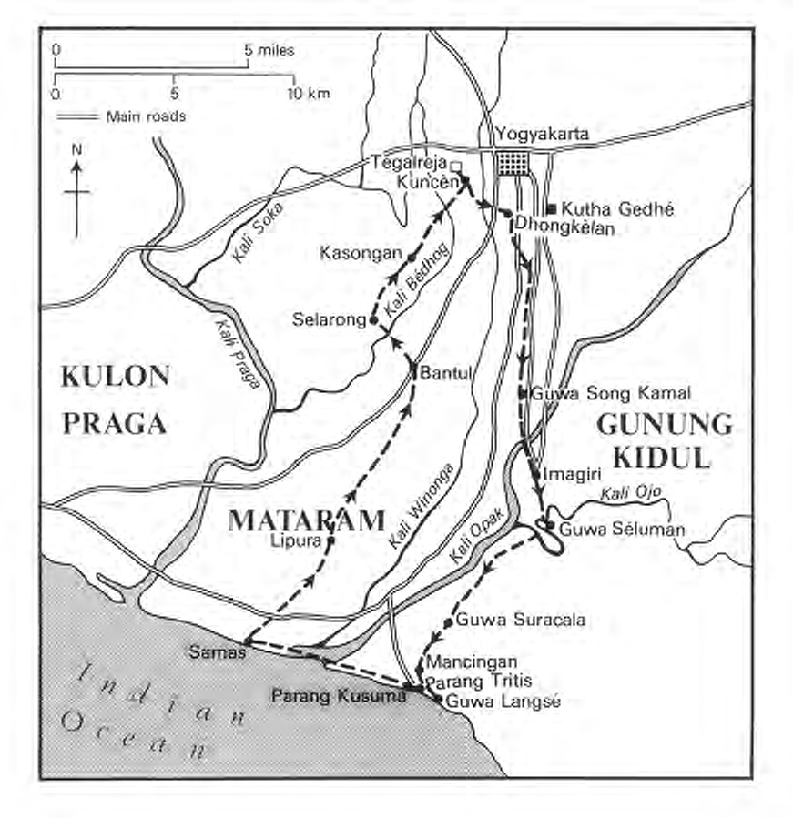
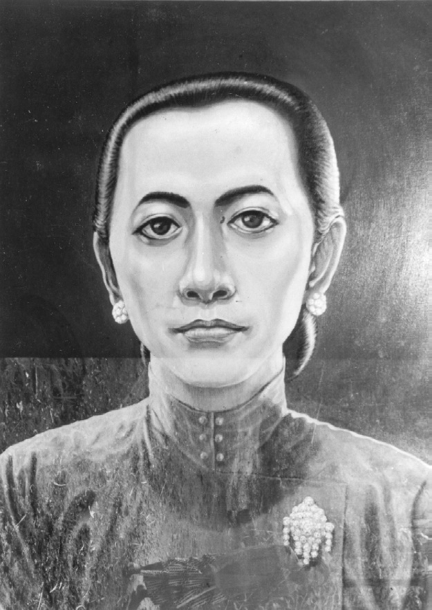
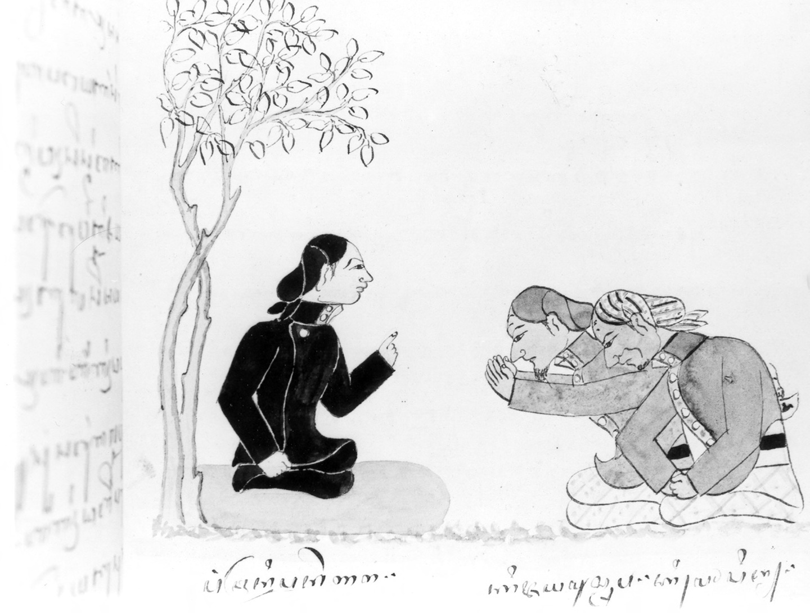
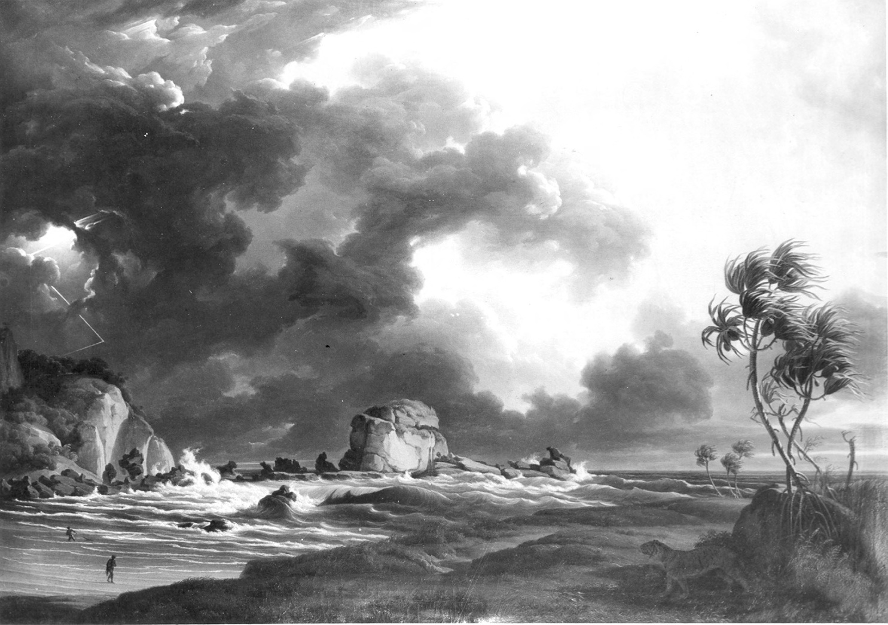
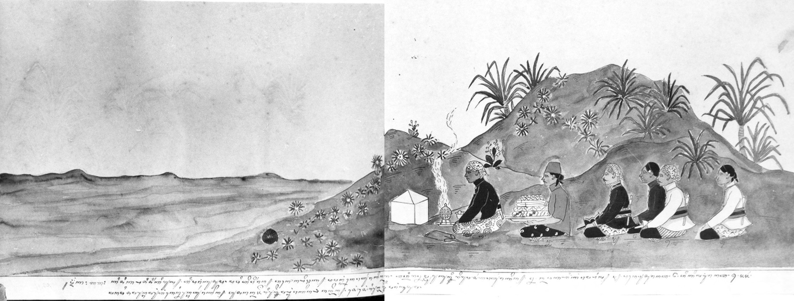

# Chapter IV: Pilgrimage to the South Coast, circa 1805

## Lelana: spiritual wanderings as rite de passage

Dipanagara’s emergence into manhood, as we have seen, was marked by a number of significant events: the passing of his great-grandmother on 17 October 1803, his inheritance of the Tegalreja estate, his investiture with his new adult name of Radèn Antawirya on 3 September 1805, and finally his lavish kraton nuptials with the daughter of the Yogya bupati of Panolan on 27 February 1807. These last could be perceived as something of an official court rite de passage between his teenage years under the tutelage of Ratu Ageng and the beginning of his young adult life as a Javanese nobleman. But, whereas for most of his contemporaries such a young adult life would most likely have entailed family and official responsibilities around the Yogya kraton, for Dipanagara there was an added dimension. A second and more meaningful rite de passage – this time an extended form of lelana[^1] or spiritual wandering – was now required for him to come into his own and confirm the spiritual practices of his youth as well as to clarify his prophetic destiny. Just exactly what this entailed has been well expressed by the celebrated historian of pre-colonial Java, Soemarsaid Moertono (1976:20-1):

> To set off on wanderings when one’s age was approaching adulthood meant to find wisdom in the sense of finding a teacher who could guide one’s development in a fashion in which one’s powers would outstrip those of ordinary men. It also sometimes entailed acquiring tranquility […] so that on one’s return one would be able to withstand all temptations. It was even occasionally a time of testing of the knowledge and wisdom which one had already acquired [through youthful spiritual and meditative practice]. This tradition was continued during the Islamic period in Java when people set off on long journeys – sometimes from west to east Java and back again – to find esoteric knowledge at religious schools.

We have already seen how the first sultan, Mangkubumi’s, image as a satria lelana (wandering knight), so impressed Dipanagara’s contemporaries.[^2] We also know from inscriptions on Radèn Mas Said (Mangkunagara I’s) heirloom sword (pedhang) and his court gamelan, Kyai Kanyut-Mèsem (‘Venerable Attempted to Smile’), that he also set great store by his wanderings in the time before his appointment as an independent ruler in 1757.[^3] Such testing journeys were the making of both his and Mangkubumi’s spiritual power. So it was with Dipanagara.

The exact timing of the prince’s wanderings away from Tegalreja and his pilgrimage to the south coast is unclear. In his autobiography, he states that he started visiting pesantrèn at the age of twenty (Javanese) years, hence sometime after April 1805, visits which led on to his pilgrimage. The next events related in his babad after his return to Tegalreja following his description of his journey to the south coast are the description of the changes in the position of the Dutch Residents (post-July 1808, ministers) at the courts brought about by Marshal Herman Willem Daendels’ (in office 1808-1811) decrees – Ordnance on Ceremonial and Etiquette – of 25 February and 28 July 1808.[^4] If the chronology in Dipanagara’s babad is correct – and we have no reason to doubt it – then his journey to the south coast must have taken place sometime before the early months of 1808. In the present author’s view, it is likely to have occurred even earlier, namely before his 27 February 1807 marriage after which date he may have spent more time at Tegalreja and visited Yogya more often. We can thus surmise that his journey took place in circa 1805, probably in the dry season (May-October) when travelling was easiest.

## Preparations for a pilgrimage

In preparation for his journey to the south coast, Dipanagara described in his babad how he departed at the age of twenty (Javanese years, post-April 1805) on a series of visits to mosques and religious schools in the Yogya area. The importance of these visits was to complete his education as a student of religion and to find appropriate teachers to guide his further spiritual and religious development. The prince also prepared himself for his spiritual quest by taking a new name, Sèh Ngabdurahim, which he was to use on his wanderings. This was derived from the Arabic Shaykh ‘Abd al-Rahim (Ricklefs 1974b:231-2), and may have been suggested to Dipanagara by one of his re-ligious advisers – perhaps even Sèh al-Ansari – at Tegalreja.[^5] The adoption of such a second ‘Islamic’ name – which became the norm for Dipanagara’s princely and priyayi supporters during the Java War[^6] – was not so unusual amongst members of the Javanese nobility at this time especially those who wished to apply themselves to religious study or undertake the pilgrimage to Mecca. Thus one Surakarta prince adopted the ‘religious’ name of Pangéran Abdul Arifin when he came to Yogya to study theology under the Yogya pengulu, Mas Muhamad Sapingi, in 1807,[^7] and another prince, this time from Yogya, changed his name from Pangéran Dipawijaya I to Pangéran Muhamad Abubakar in preparation for making the haj to Mecca in 1810.[^8] Dipawijaya I/Abubakar also shaved off his hair – which was traditionally worn long by the Javanese nobility at that time (Carey 1981a:254 note 79, 1992:462 note 300a) – as a sign that ‘he wanted to become a santri’,[^9] something which both Dipanagara and his followers also emulated during the Java War.[^10]

Although there is no reference to this in his babad, the prince may well have shaved his head before setting out on his wanderings to pesantrèn in order to pass unnoticed in the communities of common santri. Certainly, he seems to have disguised himself in simple attire so that few people would recognise him.[^11] Thus he discarded his princely clothes – the high-collared Javanese jacket, hand-drawn batik wrap-around and head-dress – for the coarsely woven sarong, buttonless open-necked white coat (kabaya) and turban which were the normal dress for nineteenth-century santri.[^12] After the Java War, his eldest son, Pangéran Dipanagara II, would seek to emulate his example by going around in Kedhu dressed in the garb of a common farmer to emphasise his closeness with the people.[^13]

> *Map 3. Dipanagara’s pilgrimage to the south coast of Java (circa 1805), showing the main places he visited. Adapted from Louw and De Klerck 1894-1909, I by J. Wilbur Wright of Oxford.*

When the preparations were complete, Dipanagara departed from Tegalreja and began to lead a typical wandering santri existence visiting many religious schools and mosques, and living together in the same pesantrèn dormitories with students of humble background.[^14] It is not certain which religious schools he visited but they may have included Gadhing, Grojogan, Sèwon, Wanakrama, Jejeran, Turi, Pulo Kadang and the two pathok negari of Kasongan and Dongkèlan, all of which are to the south of Yogya.[^15]

## Tirakat: solitary withdrawal and first visions

After a time, according to the testimony in his babad, the prince ceased visiting pesantrèn and departed far from inhabited areas to engage in asceticism and meditation. There now began a very crucial stage in Dipanagara’s wanderings during which he sought out some of the most important shrines and holy places associated with the Mataram dynasty (Ricklefs 1974b:232). This period of withdrawal and self-negation, as we have seen in the passage from Soemarsaid Moertono, had much of the quality of tirakat, the retreat from the world of a man who wished to prepare himself for a serious undertaking (Winter 1902:87; Carey 1974a:15). It afforded an interval of solitude in which to purge himself of pamrih (selfish or concealed personal motives and ambitions) and to legitimize his actions by contacts with his departed ancestors and the spiritual guardians of Java.

Dipanagara’s first vision occurred at the cave of Song Kamal in the Jejeran district to the south of Yogya (see Map 3). Sunan Kalijaga, one of the nine apostles of Islam (wali), appeared before the prince in the shape of a man ‘who shone like the full moon’. He informed the prince that it had been determined by God that in the future he would become king (ratu). After delivering this warning prophecy, the vision immediately disappeared.[^16] The appearance of Sunan Kalijaga and his prophecy of kingship was clearly of great importance for Dipanagara. Not only was the wali especially revered in south-central Java as the adviser of kings and the spiritual protector of Mataram, appearing in visions to royalty and commoners alike,[^17] but legend has also ascribed him a key role in the spread of Islam in the area (De Graaf and Pigeaud 1974:28-30; Solichin Salam 1963). Moreover, in Javanese political history, he was viewed as the agent who had presided over the division of Java at Giyanti (1755) (Ricklefs 1974b:233-7), something which does not seem to have weighed particularly heavily with Dipanagara who saw himself as transcending such political divisions by aspiring to govern the whole of Java as a pandhita-ratu (priest-king).

Sunan Kalijaga’s grave at Kadilangu, together with the great mosque at Demak, were regarded by Javanese rulers as the two indispensable pusaka (heirloom) of Java and pilgrimages from the courts were regularly dispatched there.[^18] During the Java War, distant descendants of the wali, namely Pangéran Sérang (circa 1794-1854) and his mother, the redoubtable Radèn Ayu Sérang (circa 1769-1855), were both held in high esteem by Dipanagara’s followers as persons imbued with unusual kasektèn (inner spiritual power) (Louw and De Klerck 1894-1909, I:361-3; Carey 1981a:284 note 205).

Indeed, there was even a rumour that Dipanagara was preparing to delegate some of his authority to one of Radèn Ayu Sérang’s grandsons – Radèn Mas Papak (Pangéran Adipati Natapraja) – in the event of his victory over the Dutch.[^19] This was because the descendants of the Kalijaga line were regarded as being most fit to wield spiritual power in Java. Thus the vision of the revered wali and the support of his descendants helped to legitimize Dipanagara’s subsequent rebellion.

But the vision was important on another level for the style of political leadership represented by Sunan Kalijaga and the other eight wali served as an example for the prince, who came to see himself not merely as a temporal ruler but also as a spiritual overseer of the sovereigns of Java much in the same fashion as the legendary wali were said to have acted in the fifteenth and sixteenth centuries (Carey 1974a:16-7, 21-2, 1974b:285-8). Indeed, the example of the wali, especially those of Kudhus, Demak and Giri, were often debated by Dipanagara and his advisers when they were striving for consensus during the war regarding their overall political and religious aims (Carey 1974a:19-22). Furthermore, the dream which Dipanagara had just before the outbreak of the Java War in which he described meeting eight wali wudhar, namely wali exercising both temporal and spiritual office, confirmed him in his conviction that he had been chosen to rule as a latter-day wali or priest-king in Java.[^20] Dipanagara’s experience at Song Kamal must therefore be interpreted in the light of later developments, pointing as it did to the sort of state which the prince would have striven to establish in Java had he been successful in the Java War.

Following his stay in the Jejeran district, Dipanagara walked across the countryside to Imagiri, the royal gravesite or pasaréan of the Mataram rulers. There at Bengkung by the pond at the top of the great stairway leading to the royal graves, he spent a week in meditation. He then observed the Friday prayer at the mosque at Jimatan, the mosque of the keepers of the keys (jurukunci), known officially as jimat, of the royal graveyard which stands some 230 feet below the summit of the hill at Imagiri. In his babad, Dipanagara related that all the jurukunci recognised him despite his ragged appearance and ‘paid him honour with all they possessed’.[^21] It was perhaps an indication of how much Dipanagara was admired by the royal religious officials, many of whom were to support him during the Java War.[^22]

> *Plate 13. Radèn Ayu Sérang (Nyai Ageng Sérang), circa 1766-1855. A scion of the prestigious Sunan Kalijaga wali (apostle of Islam) family, and an ex-official (para nyai) of the Yogyakarta court during the reign of Sultan Hamengkubuwana II (reigned 1792-1810, 1811-1812, 1826-1828), she led a cavalry squadron in the Sérang-Demak area during the first months of the Java War. Her fame as a lady of unusual spiritual power (kasektèn), acquired through meditation at isolated caves on the south coast, enabled her to continue to exercise an influence over the local population of her home (Sérang-Demak) region long after formal hostilities finished in March 1830. Painting by Anyool Subroto (Institut Teknologi Bandung). Photograph by courtesy of Radèn Mas Boedi Oetomo, Nataprajan, Yogyakarta (DIY).*

Apart from visiting the graves of his immediate and recently deceased relations, especially those of Sultan Mangkubumi (Hamengkubuwana I) and Ratu Ageng, Dipanagara’s meditation at Bengkung was almost certainly directed to Sultan Agung (reigned 1613-1646), the famous seventeenth-century Mataram ruler. We know from the description of the construction of the royal graveyard in the prince’s babad that he understood that Bengkung had been Agung’s special place of retreat.[^23] In a Javanese source written shortly after the Java War under the orders of one of the prince’s pro-Dutch protagonists,[^24] Dipanagara is depicted sending an intimate retainer to Sultan Agung’s grave at Imagiri to beg for a sign. After a night spent in meditation, the account states that a dark red spot about the size of a plate appeared on the curtains surrounding the tomb. The Yogya jurukunci, Kyai Balad, then explained that this meant that God had decreed that warfare should break out in Java and that much blood would be shed.[^25]

In his own description of his visit to Agung’s grave as reported in his autobiography, Dipanagara makes no mention of having received a sign. But, as we have seen, the prince did refer to one of Sultan Agung’s prophecies relating to the 300-year period of Dutch rule in Java which had a connection with his own career.[^26] Furthermore, in other sources he gave evidence of his great admiration for the seventeenth-century ruler referring to him as ‘a spi ritual man who did as I did travelling around everywhere’ and as ‘a consummate Islamic ruler who had established the five pillars [rukun] of Islam’.[^27] One European account even relates that at the time of the siege of Yogya by Dipanagara’s troops in August 1825, Agung appeared to Dipanagara in a dream to instruct him regarding the most auspicious time to launch an attack on the sultan’s capital (Payen 1988:65, 120 note 161).

There is nothing to confirm this report – the result of the heated imaginings of Yogya’s fearful European inhabitants during the first anxious weeks of the war when they were closely besieged – but there are many other links between Dipanagara and Agung which suggest that the latter did serve as a major source of inspiration for the prince. It is no coincidence, for example, that the prince’s crucial vision of the Javanese Ratu Adil (‘Just King’) on 21 May 1824 occurred on Mount Rasamuni, a hill on the western escarpment of Gunung Kidul traditionally associated with Sultan Agung (pp. 566, 571), and that some of the caves visited by Dipanagara during his journey to the south coast were close to similar caves and holy sites traditionally thought to have been frequented by Agung, and in one case – Guwa Langsé – actually visited by him.[^28] Dipanagara’s links with the holy site of Tembayat and his attempt to set up his standard of revolt there on 15 August 1825 (AJ 1 Sura 1753) (Carey 1974a:23), likewise revived memories of Sultan Agung who had been closely involved with the place in the latter part of his reign (Ricklefs 1974a:17). Finally, during the war itself, Dipanagara appears to have visited Agung’s gravesite frequently (Louw and De Klerck 1894-1909, III:76, 219, V:744; Bataviasche Courant 44, 2-11-1825; Javasche Courant 143, 29-11-1828) and also took care to bury his favourite wife, Radèn Ayu Maduretna (pp. 401-5; Appendix IV), at the royal gravesite at Jimatan in late February 1828 despite the problem of having to cross through Dutch-held territory to do so.[^29] The figure of the great Javanese ruler thus had a continuing importance for Dipanagara throughout his life.

## At the south coast: meetings with Ratu Kidul

After staying at Imagiri, Dipanagara made his way to the south coast, breaking his journey to spend one night at the cave of Séluman, home to the spirit Genawati (Ricklefs 1974a:406 note 89 no. 85, 2006:209) near the Oyo River, and a further two nights at the cave of Suracala, also known as Guwa Sigala-gala, on the left bank of the Kali Opak in the Gamelan sub-district of Gunung Kidul.[^30] Both these places seem to have been well known to the kraton elite at the time and were probably frequented by them as places of retreat and meditation. The second sultan, for example, had built a small pavilion at Séluman and maintained two royal site guardians or abdi-Dalem kemit-siti to look after the place, which is referred to in contemporary court documents as the kelangenan-dalem, the ‘royal retreat/pleasure ground’ of the ‘river source/spring’ of ‘Guwa Séluman’.[^31] Later, one of Dipanagara’s heirloom kris, subsequently presented to the Dutch king, William I, as a war trophy, was said to have borne the name of Kangjeng Kyai Naga Siluman (Kraus 2005:280-1; Appendix XI note 2). At Suracala, there are two hewn rock chambers in the grotto which are said to have been used by Sunan Amangkurat I’s (reigned 1646-1677) son, Radèn Mas Tapa (later Pangéran Aria Mataram/Sunan Panutup), when he was contemplating rebellion against the Kartasura court.[^32] Both caves have associations with the Javanese spirit world and with Javanese legends. The first is mentioned in the Kidung Lalembut (‘Song of the spirits’) as a part of the ‘palace of the spirits’ ruled over by the goddess of the southern ocean, Ratu Kidul, through her deputy, princess Genawati.[^33] The second is referred to in the Bima Raré series of shadow-plays, which deal with the wayang hero Bima’s exploits as a young man, as the cave in which he had meditated while searching for the ‘water of life’ and in which he had undergone a test by fire.[^34] followers, Kyai Jayamustapa and Kyai Mopid, before they set out on their pil-tree (wit kemuning) on his meditation stone (séla gilang) at his retreat (panepèn) of Kebo, f.81v. Photograph by courtesy of the KITLV, Leiden.

> *Plate 14. Pangéran Dipanagara (dressed in black) giving instructions to his two grimage (ziarah) to Nusakambangan. Dipanagara is sitting under a kemuning Sélareja just to the north-east of Tegalreja. KITLV Oriental MS 13, Buku Kedung*

It is also mentioned in the Serat Centhini, the great early-nineteenth century encyclopaedia of Javanese history, lore and legends written in the form of a wandering knight romance, as one of the sites visited by its scabrous hero, Sèh Amongraga (Sumahatmaka 1981:80-1). In neither of these two caves did Dipanagara receive any visitations, however.

The prince then walked across the Gunung Kidul foothills to the cave of Langsé which overhangs the thunderous Indian Ocean and is only reached by a steep and precipitous path down the limestone cliffs and through an entrance which is almost at sea level.[^35] The cave, and the adjacent sites of (Pa)mancingan, Parangtritis, Parangkusuma and Prangwédang, a warm-water spring, are places of great importance in the local cult of Ratu Kidul, the spiritual protector and consort of the rulers of the central Javanese kraton.[^36] Mancingan, from example, is known as one of the eight principal residences of the spirits (lalembut) of Java and the home of the female hermit, Cemara Tunggal, who is closely identified with Ratu Kidul.[^37] The same place is also associated with Sèh Maulana Maghribī, a wali said to be from the Demak period, who lived and was buried at the top of one of the small hills overlooking the sea.[^38] Parangtritis, so called because of the water which gushes out of the rocks in a petrified grotto, is the spot where Sénapati set out to meet Ratu Kidul in her underwater court and where on his return he encountered Sunan Kalijaga,[^39] and from the twin rocks on the seashore at Parangkusuma, an offering – known as the labuhan (from Javanese labuh, ‘to throw into the water’)[^40] – is made each year by the sultan of Yogya to his spiritual consort, the south sea goddess (Van den Broek 1873-77, 24:143; Groneman 1888:13-4; Adam 1930:157-8). The whole site is thus deeply connected with the Javanese spirit world and still attracts visitors in their hundreds from all over Java.

At the time Dipanagara visited the place in circa 1805, it was already a major pilgrimage site, especially for the Yogya court. The second sultan made regular trips there during the first part of his reign and had the habit of residing at Mancingan for a number of days.[^41] Small open pavilions, known in Javanese as pondhok, had been constructed by the sea at Parangkusuma, Parangwédang and Parangtritis for meditation and the ceremonies associated with the goddess of the southern ocean, as well as a larger wooden pesanggrahan or overnight residence at the last place to house the sultan and his retinue during their periodic visits.[^42] There was also some land set aside for the men of religion (wong putihan, literally ‘people [dressed] in white’) who tended the grave of Sèh Maulana and saw to the upkeep of the pavilions.[^43] In 1812, Storm on the south coast of Java), executed after his return to Europe in 1826. From (Inv. No. 200/2). Photograph by courtesy of the Rijksmuseum voor Volkenkunde, a Dutch visitor noticed some of these wong putihan meditating with a young Javanese ‘in a religious attitude’ at Parangtritis, and was told that people often came there to pray for things which they desired or if they were in difficult circumstances.[^44] He was likewise informed about a cave in the mountains, perhaps Guwa Suracala or Guwa Langsé, which was frequently visited and where the names of those who had meditated there were cut into the rock.[^45]

> *Plate 15. Painting by A.A.J. Payen entitled ‘Onweder aan de Zuidkust van Java’ the Payen painting collection of the Rijksmuseum voor Volkenkunde, Leiden Leiden.*

Dipanagara was therefore following a well worn route when he arrived at the south coast as a young man of twenty. His aim was to prepare himself for a meeting with Ratu Kidul and in his babad he described how he remained in the cave of Langsé for two weeks ‘striving to purify his desires’. As his physical and mental state grew calmer, he began to enter a deep meditative trance, ‘a condition that cannot be described’ and was visited by Ratu Kidul whose presence was heralded by an aura of light. However, the prince was so sunk in his meditation that the goddess realised ‘he could not be tempted’ and withdrew, promising that when the time was right she would come to him again.[^46] Twenty years would elapse before the time to which Ratu Kidul referred arrived. The Java War was then at its height and Dipanagara was encamped at Kamal on a tributary of the Praga River in the Kulon Praga district.[^47] The exact date is unclear in his account, but it seems to have been in mid-July 1826, possibly on the night of the full moon which fell on 20-21 July.[^48] The following is the description of this second encounter as given in the prince’s babad:

> XXV.63 Then the sultan [Dipanagara] was sitting at night in his pavilion unattended by anyone, for they were all asleep.

> 64 He was sunk deep in meditation with his back against a pillar, for heavy was his heart. Now it is told that swiftly someone came. It was as though a falling star had descended on the pavilion. Immediately sitting before the sultan was the form of a woman.

> 65 Two accompanied her,[^49]

> both women with a similar appearance which cannot be described. But, of the three, one was slightly different from those who escorted her. For long the sultan did not address her, dumbfounded he gazed

> 66 and closely observed her. She was sitting but did not touch the ground.[^50]

> The sultan said softly: ‘I ask [your name] for I am quite mystified.’ Ratu [Kidul] said: ‘Earlier I made a promise to you

> 67 that in the future, when the time had come, [I] should not fail to meet you.’ The sultan understood in his heart. Thus were his thoughts that perhaps her name was Ratu Kidul for she was exceedingly young. The sultan spoke quietly:

> 68 ‘I now recall it.’ Ratu [Kidul] then said gently: ‘If I am allowed to help you, I beg a firm promise that once they have all disappeared the unbelieving devils [the Dutch],

> 69 you will intercede for me with Allah the Almighty that I may return again to be a human being. Moreover, all your army let there be none who join the battle, for it is I who promise

> 70 to [bring about] the disappearance of the devils.’ The sultan said softly: ‘I do not ask your help against my equals [fellow human beings], for in religion there is only the assistance of the Almighty.’ Ratu [Kidul] immediately disappeared.[^51]

It can be seen from this account that Ratu Kidul’s appearance before Dipanagara at Guwa Langsé and later during the Java War had a specific objective. As the queen of the Javanese ancestral spirit underworld, she was offering her help to the prince on condition that he interceded with the Almighty to enable return to the world as a human being and thus bring about her karmic deliverance.[^52] This is a request which the goddess makes to all her royal lovers. In the Babad Tanah Jawi she is described imploring Sultan Agung to help her in similar terms. But, as this text explains, no one can interfere with her fate for it has been decreed by the Almighty that she will not escape from the spirit kingdoms until the Ari Kiyamat or Day of Judgement when all the different planes of existence will be united together as one.[^53] Such is the Will of God. It does not, however, prevent Ratu Kidul from constantly beseeching her royal lovers to intercede with the Almighty to alleviate her fate. Indeed, for all her magical powers and beauty, the goddess of the southern ocean is more a tragic and pathetic figure than is commonly recognised. She is as much in need of help herself as she is capable of helping others. Certainly, Dipanagara viewed her in this light and resolutely refused her offer of assistance perhaps because he thought at the time that he was close to achieving a complete military victory against the Dutch.[^54]

What then was his purpose in including this episode in his babad? One explanation is that he wished to put himself on a par with Sénapati and Sultan Agung, both monarchs who had enjoyed a special relationship with Ratu Kidul and who had brought the Mataram state to the pinnacle of its power. We have seen above how Dipanagara was especially keen to draw a parallel between himself and Agung in terms of the exercise of spiritual and temporal power. At another level, the prince may have referred to his meeting to stress that he had no use for the assistance of the spirit realms or unorthodox magical powers in his struggle against the Dutch. As a true Muslim, he placed his faith in the Almighty. Moreover, as he constantly pointed out in his autobiography, From Musium Nasional (Jakarta), MS 933 DI, Ir Moens, ‘Platen Album’, no. 8, Slametan his primary aim during the Java War was the furtherance of religion, specifically ‘the raising up of the high state of the Islamic religion throughout Java’, which included not just formal Islamic practice but the moral order in general (Carey 1974b:285).

> *Plate 16. Sketch of a Yogya kraton delegation with offerings to Ratu Kidul at Parangkusuma. Cembèngan, 116, plate 120.*

The prince’s refusal to accept help from Ratu Kidul underscores this ideal for which he made so many sacrifices during the war. He nevertheless remained fascinated by the ever beautiful goddess and the legends which surrounded her. A Javanese to the core, he drew inspiration from the ancestral spirit world of the Javanese heartland just as much as from his devotion to Islam and the esoteric teachings of the Shattārīyya, precisely the type of ‘mystic synthesis’ which Ricklefs has described as reaching its epitome in early nineteenth-century Java (Ricklefs 2006:195-220). On his journey into exile, he referred to her at length in his conversations with Knoerle, and later his eldest son, Pangéran Dipanagara II, would produce a very similar account of his own encounter with Ratu Kidul in his allegorical chronicle of the Java War. [^55]

## Final instruction at Parangkusuma and return to Tegalreja

After his first wordless encounter with Ratu Kidul at Guwa Langsé, the prince described in his babad how he descended to the sea shore and walked back along the beach to Parangtritis where he bathed at the fresh water spring grotto. He then slept at Parangkusuma presumably in the small open pondhok constructed by the second sultan. During the night a final visitation occurred.[^56] A disembodied voice, perhaps that of Sunan Kalijaga, addressed Dipanagara telling him of the coming destruction of Yogya and ‘the beginning of the ruin of the Land of Java’ (wiwit bubrah Tanah Jawi) in just under three years’ time. He was instructed to change his religious name from Ngabdurahim to Ngabdulkamit and was informed that a sign would be accorded him in the shape of the arrow Sarutama. This eventually appeared to him like a flash of lightning piercing the stone on which he was leaning as he rose from his slumber. He was also enjoined to watch over his father, the crown prince, at the time of his accession as sultan and was sternly warned not to accept the Pangéran Adipati Anom or crown princely title himself from the Dutch ‘for that would be definitely sinful’.[^57] Finally, the voice ended on this enigmatic note:

> XIV.80 There is no other: you alone are the means, but that not for long, only to be counted amongst the ancestors. Ngabdulkamit, farewell, you must return home![^58]

This final statement may have a connection with Sultan Agung’s prophecy mentioned at the beginning of Chapter II during the discussion about Dipanagara’s babyhood, in particular Agung’s prediction that the Dutch would rule in Java for 300 years following his death in 1646 and that although one of his descendants would rise against them he would be defeated, a prediction which was relayed to Dipanagara’s mother by the ageing Sultan Mangkubumi.

The implications of the other passages are slightly more straightforward. The reference to the destruction of Yogya in under three years’ time perhaps presaged the arrival of Marshal Herman Willem Daendels as governor-general in January 1808 and his humiliation of the sultan’s court in the aftermath of the November-December 1810 revolt of the bupati wedana of the eastern mancanagara, Radèn Rongga Prawiradirja III, which we shall consider in more detail in the next two chapters. This set in train a whole series of events which eventually culminated in the fall of the kraton (20 June 1812) to a British-Indian army during the administration of Thomas Stamford Raffles (1811-1816), and the plundering of the court by the British and sepoy troops. The desecration wrought by the theft of the invaluable court heirlooms (pusaka), the removal of the entire court archive and manuscript collection, and the unceremonious deposition and exile of the second sultan really marked the beginning of ‘the destruction of the land of Java’ prophesied by the disembodied voice at Parangkusuma.[^59]

The change of name from Ngabdurahim to Ngabdulkamit was of great significance. The latter was the name which Dipanagara bore throughout the Java War and which he incorporated prominently in his royal title as Sultan Èrucakra in August 1825 (Carey 1981a:287 note 218; Ricklefs 1974b:244). He also used it in exile in Manado, where immediately after his arrival he asked to be only addressed as ‘Pangeran Ngabdulkamit’ rather than ‘Pangéran Dipanagara’ a title which he had passed on to his eldest son,[^60] and in Makassar where he styled himself as fakir (the religious mendicant) Ngabdulkamit in his religious writings.[^61] According to Ricklefs, the choice of this name may have a connection with ‘Abd al-Hamīd I, the late eighteenth-century Ottoman sultan (reigned 1773-1787), who was the first Turkish ruler to lay claim to the authority of caliph, the protector of all Muslims throughout the world (Ricklefs 1974b:241, 2006:210). We will see below how ‘Abd al-Hamīd I’s pretensions, which were not very vigorously pursued by him, may have especially attracted the attention of Dipanagara and his haji advisers because, as Ricklefs has recently pointed out, in advancing this claim the sultan was behaving like the Sultan Rum of Javanese legend, like an Islamic universal monarch (Ricklefs 2006:210).

The attempts by ‘Abd al-Hamīd I to reform the Ottoman army and his tentative pretensions to the caliphate may have been reported to Dipanagara by returned Mecca pilgrims: Haji Badarudin, for example, who had twice made the haj on behalf of the Yogya court and served Dipanagara throughout the Java War, is reported to have been consulted by Kyai Maja about examples of Turkish administrative practice in Mecca, presumably in the period either before or after the occupation of the holy cities by the Wahhābī in 1803-1812/3.[^62] Moreover, many Javanese admired the Ottoman Empire at this time as a bulwark of Islamic power in the Middle East and as a potential protector against the expanding might of Christian Europe (Carey 1979:217 note 93). Dipanagara even copied some of the ranks and regimental names used in the Ottoman army for his own military formations. Thus his elite bodyguard troops, who wore turbans of different colours and had regimental banners with serpents, half-moons and inscriptions from the Qur’ān (Van Doren 1851, II:328-9), were arranged in companies with names such Bulkio, Turkio and Arkio, which were directly modelled on the Bölüki (from bölük, a squad or troop), Oturaki, and Ardia Janissary corps regiments of the Ottoman sultans just then undergoing major changes between the failed Nizam-i-cedit (‘New Order’) reforms of Sultan Selim III (reigned 1789-1807) and the establishment of the new model army of the ‘trained victorious soldiers of Muhammad’ (muallem azakir-i mansuri-i Muhammadije) by Sultan Mahmud II (reigned, 1809-1839) in 1826.[^63] At the same time, his most outstanding military commanders, such as the sev enteen-year-old Senthot, received the title of Ali Basah, which is derived from the Turkish ‘Ali Pasha (the ‘High’ Pasha) (Carey 1974b:287 note 6). The prince also mentioned the example of the Ottoman sultan in his babad as the supreme authority in Mecca contradicting Kyai Maja who saw this authority as vested in the heads of the four law schools or madzhab.[^64] Dipanagara’s own personal battle standard – a three cornered green pennant with a solar disc at the centre and crossed arrows (Plate 65) – was also perhaps inspired by Ottoman military precedent (Louw and De Klerck 1894-1909, II:283).

Apart from these contemporary contacts with Turkey, the figure of ‘Sultan Ngrum’ – from the Arabic Rūm (eastern ‘Rome’ or Byzantium, hence Constantinople, Turkey, the Ottoman sultanate) – was well known in Javanese mythical literature. In several Javanese texts, such as the Aji Saka tales and the messianic Jayabaya prophecies, Sultan Ngrum appears as a king who organized the civilising and peopling of Java, and later dispatched a force to drive out the foreign oppressors (Pigeaud 1967-80, III:366; Ricklefs 1974b:242-4). Such texts incorporating traditions concerning Sultan Ngrum were available in the Yogya kraton at the time when Dipanagara was reaching manhood at Tegalreja (Ricklefs 1974a:393, 1974b:242-4). Indeed, the prince himself later rewrote a version of the Aji Saka tales dealing with Sultan Ngrum’s peopling of Java and ridding the island of evil spirits during his period of exile in Makassar (1833-1855).[^65] We will also see how in January 1817 just eight years before the outbreak of the Java War, a millenarian movement occurred in eastern Bagelèn which looked to the arrival of Sultan Ngrum as the first step in the process of the purification of Java from the illegitimate rule of the Yogya sultan (pp. 483-4). It is possible to conclude therefore that the assumption of the name Ngabdulkamit had a deep significance for Dipanagara both because of its contemporary associations with the temporal and religious power of the Ottoman Empire, and because of its links with the numerous mythical tales in modern Javanese literature featuring Sultan Ngrum.

The gift of the arrow Sarutama, which came to the prince like a flash of lightning, again recalls Arjuna, the wayang figure with whom he most closely identified (Carey 1974a:12-6; pp. 403-5). In the shadow-play tales drawn from the Mahabharata, the same magical weapon was associated with the Pandhawa prince during his meditation at Lake Tirtamaya.[^66] It may also have a connection with the period of destruction that Dipanagara would bring about in Java as predicted by the disembodied voice at Parangkusuma, in much the same fashion as Arjuna’s arrow, Pasopati, served as the agent of destruction against the demonic forces in the poem Arjuna Wiwāha (‘Arjuna’s victory’; Poerbatjaraka 1926:288-90). Certainly, Dipanagara treasured the weapon. On his return to Tegalreja, he fashioned it into a small stabbing dagger or cundrik, which was later carried by his fourth wife, Radèn Ayu Maduretna (post-August 1825, Ratu Kedhaton), during the Java War.[^67] In about 1827, it was melted down together with two other pusaka belonging to Dipanagara to make a single heirloom kris, named Kyai Ageng Bandayuda, which was used to rally his troops’ morale during a difficult stage in the fighting against the Dutch.[^68]

Finally, the voice’s injunction to the prince to watch over his father in facilitating his accession as sultan and the stern warning to refuse the title of crown prince if it was offered by the Dutch had immediate relevance. They referred to the political revolution which was about to engulf Yogya between the arrival of Marshal Daendels in January 1808, and the gutting of the Yogya kraton by Java’s new colonial masters, the British, with their British-Indian army as their battering ram, in June 1812. During this four-and-a-half-year period, according to the account given in his babad, Dipanagara did indeed play a role very similar to that predicted in the prophecy. As we shall see in the next chapters, he helped to mediate between his father and his grandfather, the second sultan, both rivals for political power at court, and later acted as a negotiator between his father and the British which resulted in the former’s accession as third sultan on 21 June 1812. At the same time, according to the prince’s testimony, he was able to deflect attempts made by the British to appoint him as crown prince by getting them to recognise his younger brother – the future fourth sultan (reigned 1814-1822) – whose mother was better born than Dipanagara’s, as heir apparent.

The visitation at Parangkusuma was the last which Dipanagara received on his south coast pilgrimage. His period of tirakat was now over. The prince made his way on foot back to Tegalreja, stopping for a short while at Sawangan, a marshy area at the mouth of the Opak where the river flows into the sea. He then went on to Lipura, probably by way of the second sultan’s pavilion at Samas right on the seashore close to Sawangan.[^69] At Lipura, he spent a night at Séla Gilang, the holy black stone – probably a meteorite – which is watched over by the spirit Kyai Jangga.[^70] According to historical legend, this stone had descended over Sénapati’s head as he lay asleep, and had announced that it was God’s Will that he should become king of Java. The place thus had important associations for Dipanagara with the founder of the Mataram dynasty and it is still revered today as a site where holy kris blades are sometimes struck (Ricklefs 1974b:247 note 59; Chapter IX). Although Dipanagara made no mention in his babad of any visionary experiences there in circa 1805, his association with the Sénapati would be reinforced later in the context of his final vision before the outbreak of the Java War (p. 579). The following day he went on to the cave at Secang situated on what would become his lands in the Selarong area to the west of the Kali Bédhog (p. 369), a spot much frequented by him as a place for withdrawal and meditation, especially during the fasting month Puwasa. It would later become his first headquarters during the Java War. The ground around the cave had been converted into a garden and a special rock chamber hewn out of the cave wall with a stone niche for sleeping. Here the prince passed the night before setting out on the last stage of his journey back to Tegalreja.[^71]

Dipanagara’s return from his pilgrimage in the latter part of 1805, marked the end of a crucial stage in his life. The period of his youth was over, his spiritual apprenticeship complete. He had learnt much from his great-grandmother in terms of self-discipline, religious devotion and the ability to mix with all classes of Javanese society. Living at Tegalreja had also taught him the advantages of distancing himself from the Yogya court and had turned him into an intensely private person, a lover of solitude and that inward peace which comes from silent reflection. The prince was now a capable young man, whose sense of self-importance was tempered by the insights gained on his pilgrimage. In particular, he had begun to understand the significant but fleeting role he would be called upon to play in the great events which were about to unfold in his native Yogyakarta. As we shall see (p. 543), he would return again to the south coast to meditate in its caves and grottos on the eve of the Java War as part of his spiritual preparation for his great rebellion. But by then he would have received new visions which would make his destiny all the clearer.

## Conclusion

The passages in his babad relating to the visions Dipanagara received on his south coast pilgrimage in circa 1805 afford an insight into the way he perceived his place in Java’s spiritual destiny. Much is still obscure, but certain key themes stand out. The first is the importance of the historical example of the wali or apostles of Islam, especially Sunan Kalijaga, the wali most closely associated with the proselytisation of south-central Java, both in legitimizing Dipanagara’s subsequent rebellion and in prefiguring the style of leadership which the prince would aspire to during the Java War. The second is the influence of Sultan Agung, whom Dipanagara viewed as the Mataram ruler most worthy of emulation on account of his success in combining the exercise of temporal and spiritual power. The third is Dipanagara’s conscious rejection of help from the Javanese spirit kingdoms – as represented by Ratu Kidul – and his stress on his faith as a Javanese Muslim in the Almighty, references to whom are frequently rendered in his autobiography by the Sanskrit-derived Hyang Agung (‘The Great One’), Hyang Suksma (‘The Immaterial One’) or Hyang Widi (‘The One Who Leads’) rather than the more Islamically orthodox Allah Ingkang Rabulngalimin (‘God the Forgiving One’) or Allah Tangala (‘God the Sublime’). This was yet another indication of the strength of Dipanagara’s Hindu-Javanese cultural inheritance. It can be seen too in the final theme of the prince’s identification with the wayang hero Arjuna which would be a leitmotif throughout his life. Dipanagara was clearly fascinated by the shadow-play hero’s role in the Arjuna Wiwāha tale, particularly the actions undertaken by the Pandhawa prince to prepare himself through asceticism to achieve invincible power in the world. We shall see below how Dipanagara’s brief period as a Javanese Ratu Adil (‘Just King’) bearing Arjuna’s weapon, Sarutama, which he had emblazoned on his personal battle standard, would be linked with a time of purifying destruction similar to that carried out by the wayang hero in the Arjuna Wiwāha story. These four themes, in the view of the present author, formed a framework within which the prince’s career would later develop.

At the time of his return from his pilgrimage in late 1805, all this lay in the future. What was clear, however, was that he would now return to the world with a clearer sense of his prophetic destiny and his place in Javanese history. But he would do so just as the old Javanese order in which he had grown up was about to be overwhelmed by the forces of a new and hugely destructive European imperialism. Born of the twin forces of industrial and political revolution in late eighteenth-century Europe, it would reshape the world of Dipanagara and his contemporaries in ways beyond their wildest imaginings.

## Notes

[^1]: For a general discussion of lelana in Modern Javanese literature, especially wandering student romances, see Pigeaud 1967-80, I:227-35.

[^2]: See Chapter II note 8.

[^3]: Gomperts and Carey 1994:22. See S.Br. 37, 719, for a reference to the special Mangkunagara pusaka pedhang with the inscription Jeng Gusti Pangéran Adipati ingkang rawuh saking lelana (‘His Lordship the Pangéran Adipati who has returned from his wanderings’); and the Kyai Kanyut Mèsem gamelan inscription on the bronze bars of the saron demung, satriya kang lalana, 1700 (‘the knight who went on his wanderings, AJ 1700 [AD 1774-1745]’). Radèn Mas Said’s original nom-de-guerre in 1745 when he began his campaigns in the Panambangan area to the east of Surakarta was: Sultan Adiprakasa Lalana Jayamisésa, Pringgodigdo 1950:354.

[^4]: BD (Manado) II:120-5, XIV.62-5, 84.

[^5]: See Chapter III. Perhaps the prince knew of the name from his study of Javanese literature, in particular the well-known romance of the three brothers – Abdurahman, Abdurahim and Radèn Aji – who set off in search of a cock which crows the name of God, but this story is perhaps better known in west Java rather than the Principalities, see Pigeaud 1967-80, I:221, 226.

[^6]: dK 158, ‘Lyst der personen die zich als muitelingen hebben opgeworpen’, n.y., gives some of the Arabic names and titles (Basah, Dullah) adopted by the Yogya princes and high officials who fought for Dipanagara, see further Appendix VIII.

[^7]: Dj.Br. 38, Matthijs Waterloo (Yogyakarta) to Bogislaus Friederich von Liebeherr (Surakarta), 18-2-1807; Radèn Adipati Danureja II (Yogyakarta) to Radèn Adipati Danuningrat (Surakarta), 10 Besar AJ 1733 (AD 18-2-1807), and see Padmasusastra 1902:162, who gives Natapura’s genealogy as a son of Pakubuwana IV (reigned 1788-1820). There is also a reference to a certain Pangéran Ngabdularipin receiving an allowance from the Yogya court pre-January 1803 but it is unclear whether this is the same man, see Carey and Hoadley 2000:411.

[^8]: Carey 1992:291-2, 336, 340, 400 note 5. See also Appendix VIII. Dipawijaya I/Abubakar was not allowed to embark on his haj by Hamengkubuwana II because there was ‘no past precedent’ (ing kina datan ana) for members of the sultan’s close family undertaking it, Carey 1992:291.

[^9]: Dj.Br. 36, Pieter Engelhard (Yogyakarta) to H.W. Daendels (Batavia), 3-11-1810. Engelhard also related that he had made the move to hold himself aloof in the coming conflict between Radèn Rongga Prawiradirja III and Daendels, see below Chapter VI.

[^10]: Louw and De Klerck 1894-1909, II:497. Dipanagara apparently cut his hair in honour of a vow he had made before the battle of Kasuran on 28-7-1826 that he would shave his head if he was victorious. His supporters then followed suit as a sign of their commitment to Islam and to distinguish themselves from the ‘apostate’ (murtad) Javanese with their flowing locks who still supported the Dutch. Dipanagara wrote that even the grooms/grass-cutters, day-labourers and beggars followed suit even though they had received no express order, see BD (Manado), III:205, XXVII (Pocung) 114-7. Kangjeng Sultan nulya sampun paras iku/ ing bakda Jumungah/ dadya samya béla iki/ sagung Islam pan sampun cukur sadaya. 115. ing Mentaram Pajang kalawan ing Kedhu/ Pagelèn sadaya/ Ledhok Gowong Jawi-kori/ pan weradin samya béla cukur ika. 116. myang pakathik buruh kéré samya cukur/ punika sadaya/ datan mawi dèndhawuhi/ kadya sampun karsaning Allah Tangala. 117. sagung Islam tinengeran samya gundhul/ murtad réyab-réyab/ bathilan sagung wong kapir/ wektu iku mengkana tengreranira.

[^11]: BD (Manado), II:120, XIV.63. angagem kang sarwa gaib; KITLV Or 13 (Buku Kedhung Kebo), 21, II.46 also mentions that Dipanagara wore ragged clothes: 46. tanpa busana éndah/ luwas kang rinasuk.

[^12]: Raffles 1817, I:90; Djajadiningrat 1936:20. For references to the ‘priestly’ clothes used by Dipanagara during the Java War, see Louw and De Klerck 1894-1909, II:384; Carey 1981a:276-7 note 169; Payen 1988:51, 95-6 note 48.

[^13]: AN Kab, 8-3-1834 no. 166, C.L. Hartman (Magelang) to Jean Chrétien Baud (Batavia), 22-2-1834.

[^14]: The passage in Dipanagara’s autobiography (BD [Manado], II:121-6, XIV.65-83) which deals with his wanderings in 1805-1806 has been extensively analysed by Ricklefs 1974b:227-58 with some clarifications in Carey 1974a:12-36, 1981:237 note 17-9.

[^15]: See Appendix VIIa and VIIb (Map).

[^16]: BD (Manado) II:121, XIV.66-7; Ricklefs 1974b:232-7. The last two lines (XIV.67, verse 11 in the Ricklefs translation) should read: 67. lamun sira ing bénjing/ dadi ratu ngiring-iring nuli musna; ‘that in the future you/ shall become king. Warning, he vanished’. There is thus no need to speculate, as Ricklefs does (1974b:236 note 27), on the term Ratu Ngiring-iring as indicating some sort of special ruler (Ratu Ngérang-ngérang), see further Gericke and Roorda 1901, I:65, sub: ngiring-iring, I:66, sub: ngérang-ngérang; Carey 1974a:16 note 56. I am grateful to the late Professor P.J. Zoetmulder S.J. for having pointed this out to me.

[^17]: For a post-Java War description of a vision of Sunan Kalijaga, who is said to have appeared to Bagus Santri, a wandering mystic who headed a brief religious rebellion in south-central Java, see Dj.Br. 19¹¹, Interview with Bagus Santri, 10-1832, who described the wali as appearing to him in a green turban, green jacket and black sarong, and ordering him to distribute letters calling for a religious rebellion. He had also given him a three-pronged (trisula) lance head, the weapon of Wisnu, which Bagus Santri had turned into a pike. On the weapon received by Dipanagara during his pilgrimage, see below note 68. On Panembahan Sénapati (reigned circa 1574-1601), the first ruler of Mataram’s, visionary encounter with Kalijaga as related in the Babad Tanah Jawi, see Olthof 1941a, I:82, 1941b:79.

[^18]: Carey 1980:171. For another reference to a Yogya court pilgrimage to Kadilangu in 1804 during a tour by court santri (ketib, modin and members of the Suranatan) from Tegalarum (site of the grave of Sunan Amangkurat I, reigned 1646-1677) to Madura to strew flowers (sajèn) and present money for the upkeep of the holy gravesites, see AvJ, Matthijs Waterloo (Yogyakarta) to Nicolaus Engelhard (Semarang), 22-10-1804. On Hamengkubuwana II’s dispatch of money to repair ‘the great mosque’ at Demak, see Dj.Br. 48, J.G. van den Berg (Yogyakarta) to Nicolaus Engelhard (Semarang), 19-4-1803. See further Chapter IX note 152.

[^19]: Dj.Br. 18, F.G. Valck, ‘Geheime Memorie’, 31-3-1840; on an earlier occasion at the time of the arrest of Pangéran Mangkudiningrat II in Yogya in December 1831, there had been a rumour that Natapraja would be made ‘Sultan of Demak’ by Mangkudiningrat if the latter had ascended the Yogya throne, see AN, Besluit van den Gouverneur-Generaal buiten rade, 6-12-1831 no. 1, interview with Tumenggung Prawirasenjaya, Yogya, 16-11-1831.

[^20]: See below Chapter X.

[^21]: Ricklefs 1974b:237-8, 254-65; BD (Manado) II:122-3, XIV.71. On the lay-out of the royal gravesite, see LOr 8987 no. 1 (Babad Alit), pt. 13, map. For a reference to the five jurukunci from the central Javanese courts at Imagiri at this time, see Winter 1902:74 and Van den Broek 1873-77, 24:136-8, which gives an account of the royal gravesite at the time of Pakubuwana VI’s visit there in June 1830 during his flight to the south coast. For references to Dipanagara’s connections with Imagiri during the war and the fortified redoubt he built there, see Bataviasche Courant 44, 2-11-1825; Javasche Courant 143, 29-11-1828; Louw and De Klerck 1894-1909, III:219.

[^22]: See Appendix VIIb.

[^23]: BD (Manado), I:403-4, XI (Pocung) 86-8. sampun dadya langkung asri yèn dinulu/ ingkang papethètan/ cengkèh jawi nagasari/ saking Ngambon cengkèh iku wijilira. 87. Kangjeng Sultan sigra animbali sampun/ Kyai Manglar Monga*/ kang kinèn tengga puniki/ Kyai Kebo Kemili maksih tinilar. 88. kantun tengga pesaréyan ing Mentarum/ kawarna Jeng Sultan/ awis kondur dhateng puri/ anèng Bengkung punika panepènira. * Kyai Manglar Munga is the tutelary spirit of Imagiri which has the shape of a peacock and gives out piercing shrieks when one of the rulers of the central Javanese courts is about to die, see Winter 1902:74; Lettres de Java 1822:99; Musium Nasional (Jakarta) MS 933 DJ, Ir Moens, ‘Slametan Cembèngan’, 112 picture 110; S.Br. 131, ‘Translaten en Verbalen Solo, 1819’, entry of 27-8-1819, for a report on such a cry before Pakubuwana IV’s death on 1-10-1820, see further Chapter IX note 169. On Sultan Agung’s construction of Imagiri in circa 1624, see further De Graaf 1958:289-90.

[^24]: For a description of this post-Java War source – the Buku Kedhung Kebo (‘Book of the Buffaloes’ Watering Hole’ [a previous name for the seat of the bupati of Bagelèn at Purwareja] – written under the orders of Radèn Adipati Cakranegara I, the first Dutch-appointed bupati of Bagelèn (1830-1862), see Carey 1974b:259-88, 1981:xxvi-xxvii.

[^25]: KITLV Or 13 (Buku Kedhung Kebo):69-70, VI.32-9; Carey 1974a:38-9; Van der Kemp 1896a:372-3, and for a reference to Kyai Balad in a contemporary source (circa 1794-1796), see Carey and Hoadley 2000:34, and further Van de Broek 1877:137.

[^26]: See page 71.

[^27]: Louw and De Klerck 1894-1909, V:744; Carey 1974a:17. There is a similar reference to Agung in Makassar notebooks, I:168. For a later reference to the popular belief in Agung as a great Islamic ruler, see LOr 8987 no. 1 (Babad Alit) pt. 14 (henceforth: ‘Babad Alit’). The five ‘pillars’ (rukun) of Islam refer to the shahādah (confession of the faith), salāt (five daily religious observances), zakāt (religious offerings), haddj (pilgrimage to Mecca), and the observance of the fast during the month of Ramadhān known in Java as Pasa (or Puwasa), see Juynboll 1930:45.

[^28]: Sumahatmaka 1981:84-5, 124-5. The caves mentioned in this source, Sumhatmaka’s précis of the Serat Centhini, are Guwa Manganti on the Kali Oyo and Guwa Songpati, both caves in the Paliyan sub-district of Gunung Kidul, and Kanigara, also in the Paliyan sub-district where Agung is supposed to have built a mosque, see Schoel 1931:151.

[^29]: On the burial of Radèn Ayu Maduretna at Jimatan in late February 1828, see BD (Manado), III:366-7, XXXI.143-5.

[^30]: BD (Manado) II:123, XIV.72; Ricklefs 1974b:238; and for a description of the site of the cave of Suracala, see G.P. Rouffaer’s note to Winter 1902:166 note 77. Both Séluman and Suracala are marked on the 1861 Residency Map of Yogyakarta, see IOR X IX7, K.F. Wilsen, ‘Topographische Kaart der Residentie Djojokarta’.

[^31]: Carey 1980:112; Carey and Hoadley 2000:409. See also Appendix VI.

[^32]: G.P. Rouffaer’s note in Winter 1902:166 note 77, refers to the name of Kangjeng Susuhunan Ratu Amangkurat being cut into the rock wall of one of the cave chambers with the date AJ 1624 (AD 1700-1701). For the history of the last days of Pangéran Aria Mataram (Sunan Panutup), see Ricklefs 1978:197-9.

[^33]: Ricklefs 1974a:406 note 89 no. 85, 1974b:238-9. A cognate manuscript in the Moens collection, the Sejarah sétan lan jim (‘History of devils and jinn’) describes the term séluman as referring to the spirit world, an invisible society, which is an exact replica of human society and like it divided into nations and races each ruled over by their individual spirit kings and queens, see Musium Nasional (Jakarta), MSS 933 DJ (Ir Moens coll) , pt. 2; and see also Gericke and Roorda 1901, I: 835, who give the meaning of bongsa siluman as ‘invisible beings’.

[^34]: LOr 12576 (Ir Moens coll. pt. 2):757-820, Bima Raré series of wayang plays as created by the Yogya dhalang Kyai Widi Prayitna: Wéja Séna kabesmi wonten Guwa Sigala-gala (‘Wéjaséna endures fire in the cave of Sigala-gala’). See further Pigeaud 1967-80, I:205. The name ‘Sigala-gala’ likewise recalls the Balé Sigala-gala (Wax Palace) episode in the Mahabharata cycle of wayang plays, see Pigeaud 1967-80, I:205, 245, 256, II:160 (sub: LOr 3917), 603 (sub: LOr 9821); Rajagopalachari 1970:52-4.

[^35]: On the site of Guwa Langsé, see Babad Alit, pt. 28. The cave probably takes its name from its particular natural location whereby its entrance is entirely covered by a sheet of rock overhanging the Indian Ocean. The word langsé in Javanese means a curtain or drape, see Gericke and Roorda 1901, II:173.

[^36]: See Jordaan 1984:99-102, 107, 2006:14, who equates the sick princess with the primeval fertility goddess of the Javanese, Śri Devī, and with the Hindu goddess of death Durgā (Ra Nini)/Kālī. He argues that her connection with fertility is shown especially by her linkage with the waxing and waning of the moon (see below) and with the Nagini serpent goddess. See also Stange 1975:1-2, 26 note 3, on the supposed association of this part of the south coast with the spirit world (lalembut), a connection which, he argues, dated back to the establishment of small kingdoms by former officials of the Majapahit empire following its fall in circa 1527. According to this theory, Nyai Lara Kidul (Ratu Kidul) was the ruler of a small ‘tantric’ state in the Imagiri area who subsequently became the overseer of the spirit kingdoms of the south coast. Other traditions (Soemarsaid Moertono 1968:148; De Cock Wheateley 1929:205-11) associate Ratu Kidul with the Pajajaran princess, Déwi Retna Suwida, the daughter of Prabu Mundingsari and a descendant of the king of Sigaluh, namely the ruler of the spirit kingdoms of west Java. According to legend, she was exiled from her father’s court either because she refused to marry or because she had contracted leprosy in her feet and had had to be confined either to a leper colony on the south coast or to an offshore island. Despairing of her fate she had committed suicide by flinging herself from the high cliffs into the sea. She was then restored to her beauty by the curative power of the sea water on condition that she remained as queen of the underwater spirit realms until the Day of Judgement. She took the name Ratu Kidul and had magical powers appearing young or old according to the waxing and waning of the moon. In Javanese popular tradition, she is sometimes referred to as Nyai Rara (or Lara) Kidul, an allusion either to her virginity and maidenhood (rara) or to her suffering (lara) from leprosy, Hadiwidjojo 1972:126. In other traditions, Nyai Lara Kidul refers to one of Ratu Kidul’s patih (chief officials), see further Poerbatjaraka 1962, V:20-4, VI:17-23; and Mulyadi 1983:30, where she is known as nènèk penjaga tasik (‘the old lady guardian of the sea’). Dipanagara appears to have viewed Ratu Kidul as a Pajajaran princess who had been exiled from her father’s court to an island variously named as Pulau Toris, Pulau Putri or Pulau Onrust, see Knoerle, ‘Journal’, 25. For a discussion of the connection between Ratu Kidul and the Dutch, see Ricklefs 1974a:375-6.

[^37]: De Graaf and Pigeaud 1974:248 note 18; Ricklefs 1974a:375 note 33. For references to the various tutelary spirits guarding the sites around Mancingan, see Musium Pusat (Jakarta), MS 933 DJ, Ir Moens Platen Album no. 8, ‘Slametan Cèmbengan bij de Gunung Gamping met offers’ (henceforth: ‘Slametan Cèmbengan’):114-6; Ricklefs 1974a:405 note 89 nos. 54-7). See also Appendix VIIa.

[^38]: Adam 1930:158-9. See also Babad Alit, pt. 26; Ir Moens coll., ‘Slametan Cèmbengan’, 90 Plate 87, which refers to the sajèn (offerings) placed on Sèh Maulana Maghribī’s grave by those who wished to become priyayi (court officials); Appendix VIIa.

[^39]: Olthof 1941a, I:82, 1941b:79. On the spirit Nyai Gadhung Mlathi, who is the tutelary spirit of Parangtritis, see Ir Moens coll., ‘Slametan Cèmbengan’, 116 Plate 120; Babad Alit, pt. 24. For descriptions of the site in circa 1812, see KITLV H 503, Van Sevenhoven, ’Aanteekeningen’, 126-30; Thorn 1815:295. See also Appendix VIIa.

[^40]: See Gericke and Roorda 1901, II:163 sub: labuh.

[^41]: Dj.Br. 49, Matthijs Waterloo (Yogyakarta) to Nicolaus Engelhard (Semarang), 24-10-1805, 28-10-1805, 20-11-1805, referred to three visits made by Hamengkubuwana II to the south coast in the space of just two months. On the first visit, the clothes and other offerings made by the sultan were thrown back on the beach by the tide supposedly because a slametan (dedication ceremony) had not been held before the labuhan (commitment of offerings to the sea), and because Hamengkubuwana II had insisted on standing on the beach with a gold payung (sovereign’s state umbrella) over his head, thus appearing in an arrogant and unseemly posture to Ratu Kidul. See further Groneman 1888:14 for a description of a three-day visit to Parangtritis by Hamengkubuwana VII (reigned 1877-1921).

[^42]: Van Sevenhoven, ‘Aanteekeningen’, 125, 131; Thorn 1815:295; and see below Appendix VIIa.

[^43]: Van Sevenhoven, ‘Aanteekeningen’, 131; Appendix VIIa.

[^44]: Van Sevenhoven, ‘Aanteekeningen’, 132.

[^45]: Van Sevenhoven, ‘Aanteekeningen’, 133-4. It appears that Van Sevenhoven was referring to Guwa Suracala because he mentioned a certain Javanese ‘sultan’ who had stayed there many years earlier, seemingly a reference to Pangéran Aria Mataram (Sunan Panutup), see note 32. There are, however, many other caves in the area which were used as retreats, see Carey 1981a:284 note 205, on Radèn Ayu Sérang’s use of the cave of Trisik (? Sirisik) on the south coast during the Java War, and Dj.Br. 17, ‘Minuten van der uitgaande brieven aan den Gouverneur-Generaal van den Kommissaris aan de hoven van Souracarta en Djocjocarta, Jan Izaäk van Sevenhoven, van 1e Januari tot en met December 1831’ (henceforth: ‘Minuten Van Sevenhoven’), J.I. van Sevenhoven (Surakarta) to Johannes van den Bosch (Batavia), 5-5-1831, for a reference to the cave of Suralanang supposedly used by Dipanagara in 1825, and from whence Smissaert attempted to summon him for a meeting before the outbreak of the Java War. See further page 543.

[^46]: BD (Manado) II:123-4, XIV.73-6, especially 75. Jeng Ratu Kidul wus prapta/ nèng ngarsa Sèh Ngaburahkim / mapan padhang jruning guwa/ nging Jeng Ratu wus udani/ lamun Sèh Ngabdurahkim/ lagi suwung tan ciptanipun/ datan kénging ginodha/ dadya umatur ubanggi/ lamun bénjing tekèng mongsa badhé prapta; Ricklefs 1974b:239, 256.

[^47]: Louw and De Klerck 1894-1909, II:346-8, V:Map. The fact that Dipanagara was encamped by a tributary of the Kali Praga when the second visitation occurred may be significant. In Javanese popular belief, Ratu Kidul uses the two main rivers (Praga and Opak) as her means of transport and outbreaks of disease or sudden deaths in the village communities living along the river banks are associated with her sorties, interview with R.W. Hardjanta Pradjapangarsa, Surakarta, 14-2-1972.

[^48]: Ratu Kidul’s beauty and youth are dependant on the waxing and waning of the moon. When she is young, namely before the middle of each Javanese month, she is also known as Retna Déwati, see Ricklefs 1974a:200.

[^49]: These refer to Ratu Kidul’s two lieutenants (patih), Nyai Rara (or Lara) Kidul and Radèn Déwi, the tutelary spirit of Guwa Langsé, see Ir Moens coll., ‘Slametan Cèmbengan’, 73, 116.

[^50]: The fact that Ratu Kidul is depicted as sitting ‘above the ground’ is interesting: one meditation leader (pamong) in Java described a visitation from the goddess at night at Parangkusuma in which she appeared as a very young woman dressed in wayang costume but invisible from the knees downwards, interview with Bapak Darno Ong, Surakarta, 20-3-1972. It is possible that this invisibility of her lower body had a connection with those parts of her body affected by leprosy, see note 36.

[^51]: BD (Manado) III:92-4, XXV (Pangkur) 63-70. mengkana kangjeng sultan/ dalu lenggah anèng pesanggrahanipun/ tan ingandhep déning jalma/ [pan] wus samya néndra iki. 64. pitekur séndhéyan saka/ apan saking sungkawa ing tyasnèki/ mengkana ingkang winuwus/ nulya ana kang prapta/ kadya daru dhateng pesanggrahanipun/ nulya lenggah ngarsanira/ jeng sultan werni pawèstri. 65. kalih ingkang ngiring ika/ samya èstri déné kang warna sami/ pan wus tan kena cinatur/ mapan katiga pisan/ undha-usuk lawan kang dèniring iku/ jeng sultan dangu tan nyapa/ kamitenggengen ningali. 66. lawan mespaosken ika/ gènnya lenggah datan kangsrah ing siti/ kangjeng sultan ngandika rum/ nilakrama kawula/ langkung tambet kangjeng ratu lon turipun/ rumiyin mapan kawula/ lan paduka sampun jangji. 67. ing bénjing yèn sampun mongsa/ lan paduka boten wandé kepanggih/ jeng sultan ènget tyasipun/ mengkana ciptanira/ baya iki kang ingaran Ratu Kidul/ déné banget anomira/ kangjeng sultan ngandika ris. 68. pan sampun ènget kawula/ kangjeng ratu aris aturirèki/ yèn pareng amba tetulung/ inggih dhateng paduka/ nging kawula anuwun jangji satuhu/ yèn sampun sirna sadaya/ sagung ingkang lanat kapir. 69. kawula Tuwan [suwuna]/ dhateng Alah Ingkang Rabulngalimin/ mantuka malih puniku/ inggih dados manungsa/ déné sagung wadya paduka sedarum/ sampun wonten tumut yuda/ kawula ingkang nyagahi. 70. sirnanipun lanatolah/ kangjeng sultan mapan ngandika aris/ kawula tan nedha tulung/ inggih mring [sama-sama]/ yèn agami aming pitulung Hyang Agung/ kangjeng ratu nulya musna. Words in square brackets in the text indicate that because of the demands of the macapat metre a small correction has been made on the basis of Rusche 1908-09, I:190-2.

[^52]: According to popular Javanese belief (Poerbatjaraka 1962:20), the soul of Ratu Kidul and those who have sought her help for the purposes of personal power or worldly gain, are entrapped (dikurung) in the Javanese ancestral spirit underworld until the Final Day of Judgement. See further Stange 1975:21-2.

[^53]: Balai Pustaka 1940:31-7. An older version of this story can be found in BL Add MS 12320 (Babad Kraton), LXV (Kinanthi) f.281v-282r:20-6. Sang Dyah nangis pangkonipun/ sasambaté ngasih-asih/ umatur dhateng kang raka/ dhuh kakang Sultan Matawis/ amba gusti anenedha/ dadosena jalma malih. 21. pan panduka ratu agung/ trus ing tingal tur asekti/ kasusra ing Tanah Jawa/ yèn panduka ratu adi/ sakalir kang pangruwatan/ tan waten angker kang sungil. 22. Panjenengan Sang Aprabu/ apan sampun dènidèni/ saking negari ing Mekah/ ing Jawi tan wonten tandhing/ jumeneng Sultan Mataram/ sagung ratu sami ngabdi. 23. amba ruwaten pukulun/ pan kawula asal jalmi/ Sri Naréndra angandika/ dhuh a[ng]gèr pan ora keni/ wus pasthi karsaning Sukma/ datan kena owah gi[ng]sir. 24. déning sira lamun tuhu/ asal ing manusa dhimin/ ing bésuk Ari Kiyamat/ sira nunggal lawan mami/ Sang Dyah anangisa lara/ sasambaté amlas asih. 25. akathah sasambatipun/ sumu[ng]kem pa[ng]koning laki/ sarwi anyekeli asta/ dhuh kakang Sultan Matawis/ ruwaten sarira amba/ kapéngin dadosa jalmi. 26. Sang Nata aglis anulung/ anyendhal cindhé sumampir/ Sang Dyah pan sampun ingemban/ rinungrum ing arih-arih/ binekta marang ing taman/ ngideraken sarwa sari. I am grateful to Professor Merle Ricklefs for this quote.

[^54]: In July 1826, when Ratu Kidul’s second visitation occurred, Dipanagara was poised to break out of the Kulon Praga area and win a series of victories against the Dutch and their Surakarta allies which brought his forces by mid-October 1826 to within striking distance of the Sunan’s capital, see Louw and De Klerck 1894-1909, II:368-520; p. 642.

[^55]: Knoerle, ‘Journal’, 25: ‘Dipanagara told me in an interesting tone about the history of Ratu Kidul, elaborating about the exile of the second daughter of [Prabu] Munding Wangi [Mundingsari] to Pulau Toris’, see further note 36. The meeting which Pangéran Dipanagara II recounts in his post-Java War chronicle follows that in Dipanagara’s babad very closely, see LOr 6488 (Babad Dipanagara, Surya Ngalam):24-8, VII.3-VIII.12.

[^56]: Ricklefs 1974b:240-7, 256-8; BD (Manado) II:124-6, XIV.76-81. The way the disembodied voice manifested to Dipanagara at Parangkusuma points to a form of wangsit or interior prompting, see Gericke and Roorda 1901, II:76; Chapter X note 182.

[^57]: BD (Manado) II:125, XIV (Sinom) 79-80. ywa gelem sira kinardi/ ya Pangéran Dipati. 80. mapan wus pesthi duraka. See further Ricklefs 1974b:245-6, 257. On the full title of the Yogya Crown Prince, see Chapter V note 121.

[^58]: BD (Manado) II:125, XIV (Sinom) 80. tan ana malih-malih/ nanging sira srananipun/ mapan iku tan dawa/ nanging kinarya leluri/ Ngabdulkamit wus poma sira muliya.

[^59]: BD (Manado) II:125, XIV (Sinom) 77-8. kurang telung taun iki/ ing bubrahé iya Negara Ngayogya. 78. mapan wus karsaning Sukma/ wiwit bubrah Tanah Jawi/ iya kurang telung warsa. See further Ricklefs 1974b:240-1, 256.

[^60]: See Knoerle, ‘Journal’, 29; vdB 391, ‘Voorstellen [van den] Pangerang Diepo Negoro aan den Luitenant Adjudant Knoerle in de tegenwoordigheid van den […] 2e Luitenant [C.] Bosman’, Manado, 19-6-1830, proposal 5, which spells his name as ‘Pangeran Abdulhamit’.

[^61]: Makassar notebooks II:67.

[^62]: Carey 1974a:36 note 117. See also Chapter II note 71; Chapter III note 59.

[^63]: Marsigli 1732:68-9; Louw and De Klerck 1894-1909, II:277; Booms 1911:34; Aukes 1935:74 note 1; Shaw and Shaw 1977, II:22-4. For a reference to similar emulation of Ottoman military formations in eighteenth-century Holland, where some schutterij (local shooters’ companies) used the name Turkiye, see Schama 1977:81. Even the Javanese term tambur (battalion) derives from the Turkish tabur, see Shaw and Shaw 1977:24.

[^64]: BD (Manado) III, XXIII (Durma) 104. nadyan Mekah […]/ papat iku badan/ déné nyawané iku/ samengko anèng Ngrum nagri/ pan Kangjeng Sultan/ ing Ngrum kang misésani.

[^65]: Makassar notebooks I:50-3.

[^66]: LOr 12544 (Ir Moens coll. pt. 2), no. 3, Punika cariyos Sarutama murca dados Ratu Janaka tapa wonten ing Sendhang Tirtamaya. The usual arrow associated with Arjuna is Pasopati, see Poerbatjaraka 1926:263; Hardjowirogo 1965:262; the Ratu title for Arjuna (Janaka) also reads slightly oddly here, one would have expected Radèn. See further Plate 65 for Dipanagara’s incorporation of the arrow motif on his personal battle standard.

[^67]: BD (Manado) II:126, XIV (Sinom) 83. lajeng dènbusanani/ Ki Sarutama puniku/ rinéka cundrik ika. See also Appendix XI.

[^68]: See Appendix XI note 2. The three major pusaka were: Kyai Sarutama (cundrik), Kyai Barutuba (pike), and Kyai Abijaya (kris).

[^69]: Ricklefs 1974b:247; BD (Manado) II:126, XIV.82; and see p. 229 and Appendix VI.

[^70]: On Kyai Jangga, the tutelary spirit of Séla Gilang who is given offerings by Javanese who wish to become priyayi (officials), see Ir Moens coll., ‘Slametan Cèmbengan’, 90 no. 88.

[^71]: Ricklefs 1974b:247; Carey 1981a:238-40 notes 20-7; BD (Manado) II:126, XIV.82-3.
