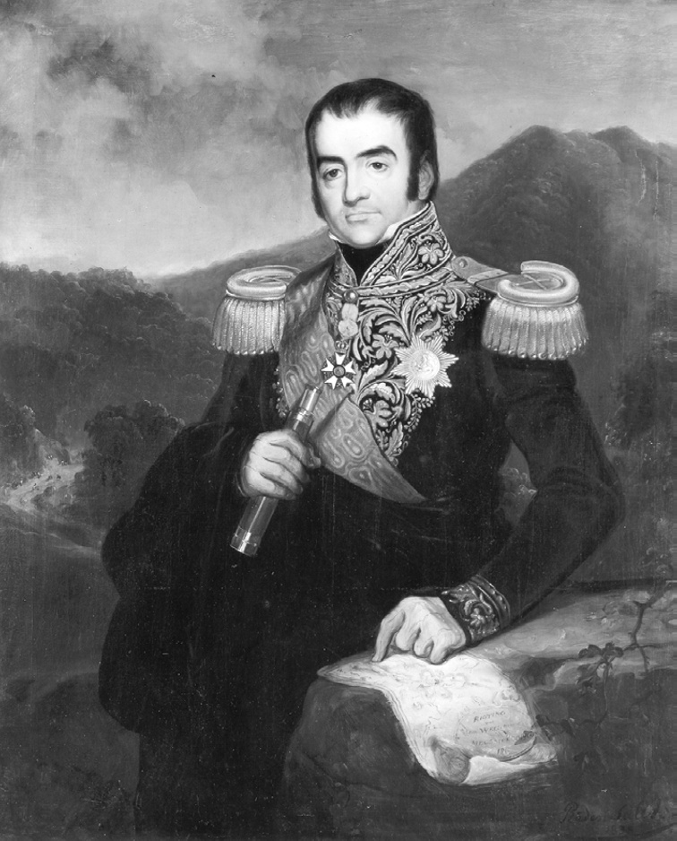
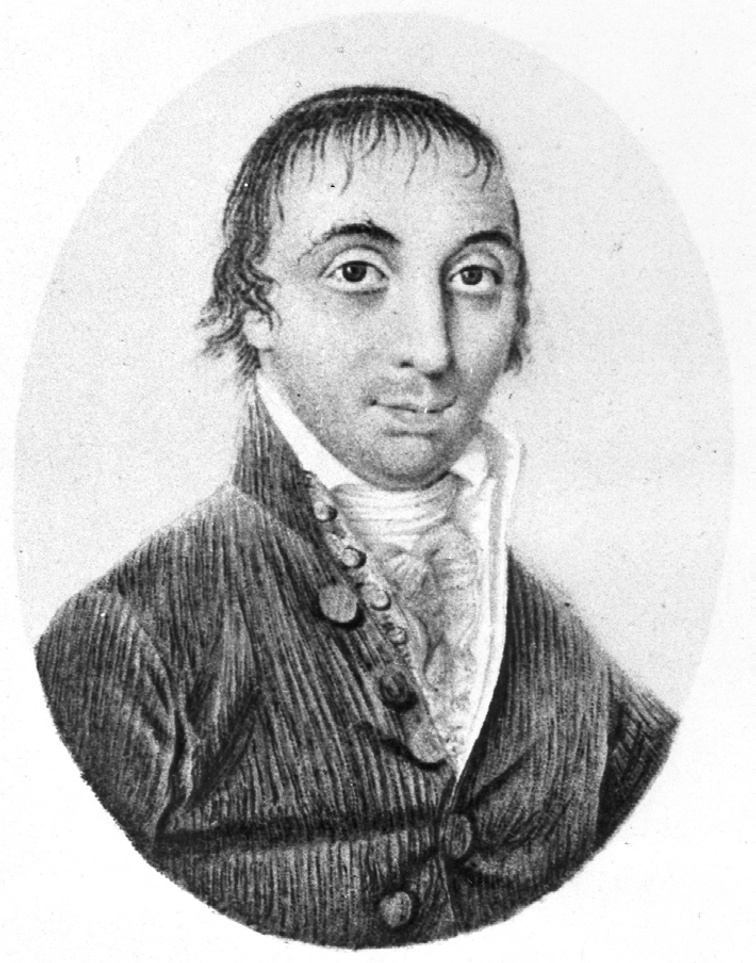
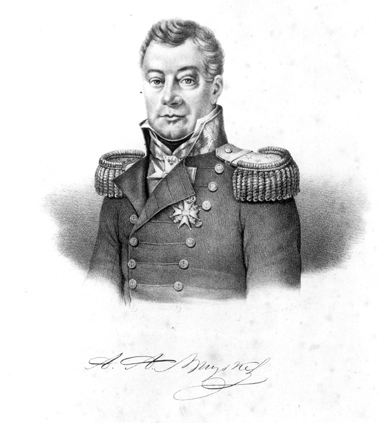
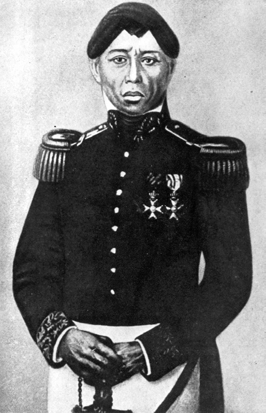
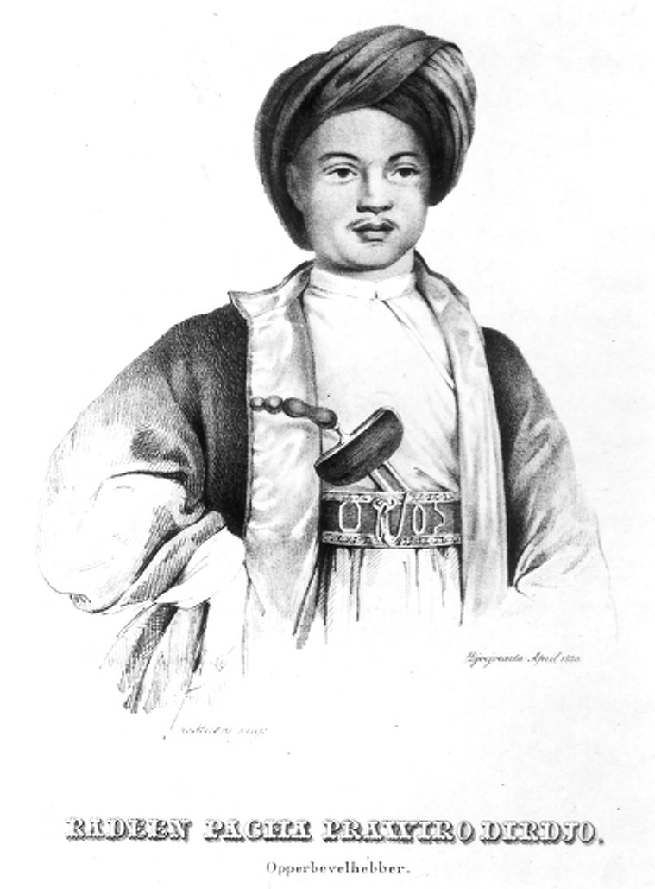
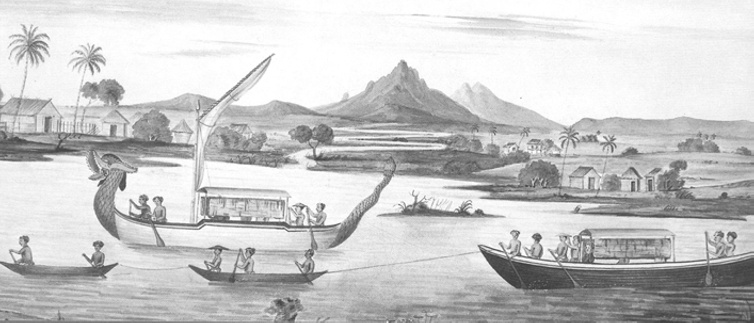
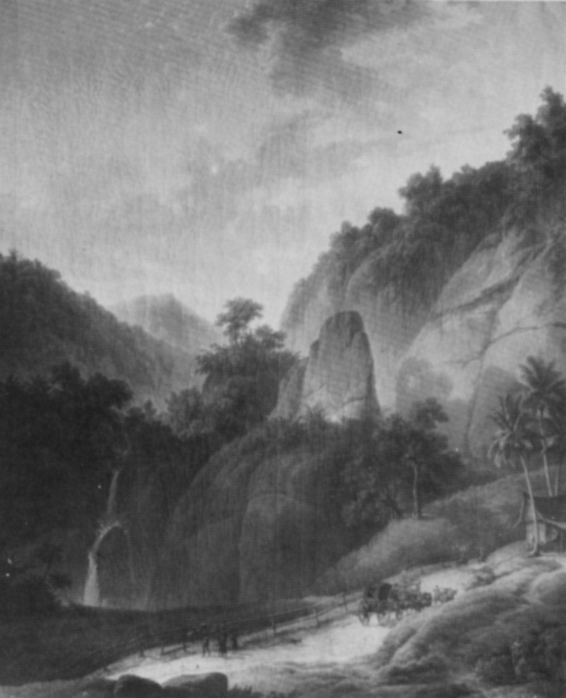
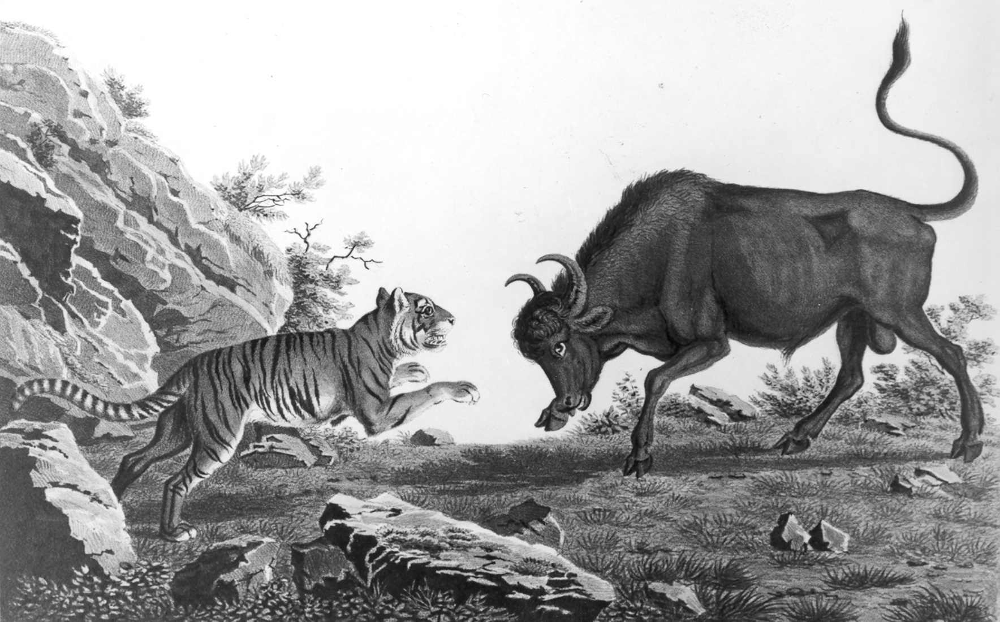

# Chapter V: The Beginning of the Ruin of the Land of Java: Yogyakarta and Daendels’ New Order, 1808

## Daendels’ new order

The ‘beginning of the ruin of the Land of Java’ had been the prophetic warning delivered to Dipanagara at Parangkusuma just before his return to Tegalreja from his south coast pilgrimage in circa 1805. Specifically, the disembodied voice had foretold that this would start in just under three years’ time. As though on cue, on 5 January 1808, Marshal Herman Willem Daendels arrived in Batavia to take up his post as governor-general to which he had been nominated exactly a year earlier by King Louis (Lodewijk I) of Holland (reigned 1806-1810), the younger brother of Napoleon Bonaparte (Stapel 1941:77). ‘The last of the tyrants’ in Colonel Henry Yule’s words (Boulger 1897:112), Daendels was very much a product of the new Europe forged by the French Revolution. Lawyer, revolutionary, politician and career soldier, he had been involved with the ‘Patriot Revolt’ against the Stadhouder in Holland (1786-1787), and had helped set up (and commanded) the Batavian Legion (1792-1795) which had fought alongside French Republican forces in the 1794-1795 invasion of the Dutch Netherlands. Later, as head of the pro-French Unitarian Party, he had earned himself a reputation as a ‘headstrong, sentimental and obstinate’ character (Schama 1977:342-3). A man of few scruples, great energy and a penchant for using force to achieve his ends, he was destined to make a lasting mark on the history of Java, in much the same fashion as the almost equally ruthless Johannes van den Bosch (in office 1830-1834) in the aftermath of the Java War.[^1]

> *Plate 17. Posthumous portrait of Herman Willem Daendels (1762-1818), painted by Radèn Saleh in 1838. Daendels’ hand points to a map of the Mount Megamendhung (West Java) section of the famous postweg (highway) which ran from Anyer on the Sunda Straits to Panarukan in the Eastern Salient (Oosthoek) of Java, and which was built during his administration. Photograph by courtesy of the Iconografisch Bureau, The Hague.*

Such character traits were precisely what had recommended him to Napoleon who had tasked him – the only non-French marshal – to secure Java as a military base against the British in the Indian Ocean. Fortuitously avoiding the stringent British naval blockade, Daendels arrived to find the island nearly defenceless. In October-December 1806, a British squadron commanded by one of Nelson’s former captains, Admiral Sir Thomas Trowbridge (1760-1807), had destroyed the remnants of Vice-Admiral Pieter Hartsinck’s fleet in the roads of Batavia and disabled a large part of the former Dutch East Indies Company’s merchant marine. A year later, another squadron under Admiral Sir Edward Pellew (1757-1833) had landed in Gresik to destroy the shore batteries and defences, and had attacked remaining Dutch ships in the Oosthoek, briefly preventing the vital trade along the Sala River by blockading the Madura Straits.[^2]

Although the marshal’s immediate task was a military one, he was also vested with sweeping powers to reform the corrupt former Company administration, the VOC itself having recently passed under the control of the Dutch state following its bankruptcy in 1799. The new Colonial Charter of 1803 envisaged considerable changes to the system of colonial rule in the Indies (Day 1972:127-48), and Daendels brought to his new post all the ruthlessness and determination which had been the hallmark of his previous political and military career. The three years of his administration (1808-1811) laid the foundations for the modern colonial state in Indonesia (Van ’t Veer 1963:107-86).

One of the marshal’s primary strategic considerations in planning Java’s defence was the position of the independent courts. Their power and influence marked them out as potential rivals to the European government and as dubious allies in the event of an enemy attack. In this respect, the court of Yogyakarta constituted a far more redoubtable threat by virtue of its military resources and substantial cash reserves, the latter the outcome of the second sultan’s ruthless fiscal innovations and heavy tax demands.[^3] Writing in early 1812 after his first bruising encounter with the Yogya court, Raffles reckoned that the sultan was the main power in the eastern outlying districts. In a secret dispatch to Lord Minto, he speculated that if the European government was withdrawn the Surakarta ruler would be unable to maintain his authority and the sultan’s power ‘would [then] at once extend over the whole of the eastern districts of Java including the sea coasts’.[^4] Such considerations may have already weighed with Daendels. According to Nicolaus Engelhard (1761-1831), then governor of Java’s Northeast Coast (in office 1801-1808), even before he left Holland, the marshal (Engelhard 1816:257-8):

> already had a prejudice against the sultan […] he had the wish to make [him] feel his superiority and to attack him at the first opportunity […] some officers [in Daendels’ entourage] were of the same opinion and spoke from the moment they landed of the sultan and when they could give him a good hiding.

Engelhard also shrewdly observed that Hamengkubuwana II’s well-stocked treasury had aroused the jealousy not only of Daendels, but also of the other independent rulers in south-central Java – namely Sunan Pakubuwana IV (reigned 1788-1820) and Pangéran Prangwedana (post-1821, Mangkunagara II, reigned 1796-1835) – who showed themselves only too willing to side with the European government to further their designs against the sultan.[^5]

While Engelhard’s views of Daendels should be treated with caution given his later position as a bitter critic and opponent of the marshal, it does seem that from the start of his administration Daendels was anxious to place the relationship between the government in Batavia and the courts on a new footing. As early as 24 February 1808, he had informed Engelhard of his wish for detailed information concerning the south-central Javanese kingdoms and intimated that the VOC official’s position as governor and director of Java’s Northeast Coast would soon be abrogated. Daendels wished to correspond directly with the First Residents, namely the senior Dutch representatives at the courts, without the interference of the Semarang-based governor.[^6] In the same letter, he recalled the incumbent Residents, Matthijs Waterloo from Yogyakarta and Bogislaus Friedrich von Liebeherr from Surakarta, and replaced them with more dependable figures, Pieter Engelhard and Jacob Andries van Braam, the latter a close political ally and friend.[^7] These new appointees had been fully briefed on the new administration’s attitude to the courts and on 25 February 1808 they received their instructions.[^8] The fifth article summed up the great importance Daendels attached to the honour and prestige of the European government stating that:

> They should exert themselves in an impassive [ongevoelige] enough way to give the rulers an impression of the power and splendour of the present Royal government in Holland and of the protection of the great Napoleon, and to inspire them with awe and respect for [said] government.[^9]

We will see shortly how this new policy, almost calculated to arouse the indignation and suspicion of the rulers, played out at the courts in the course of the following year. But first it is necessary to turn aside for a moment to consider the new territorial division between the European government and the courts which the outgoing Yogya Resident and others were pressing on the new governor-general in the early months of 1808.

## Plans for annexation of territory in central and east Java

Before they left their posts in central Java, both the outgoing governor of Java’s Northeast Coast, Nicolaus Engelhard, and the Yogya Resident, Matthijs Waterloo, advanced plans for the annexation of territory in central and east Java at the expense of the courts. Engelhard suggested a new boundary between the districts controlled by the government on the north coast and the Principalities so that productive lands could be brought under Batavia’s control.[^10] In particular, he urged the annexation of the pepper and indigo producing areas of Pacitan and Lowanu (Bagelèn) as well as the linen weaving district of Tanggung near Kedhung Kebo (post-1830 Purwareja) in Bagelèn. Even distant Malang, then part of the Surakarta eastern mancanagara, a region which had been extensively depopulated by the wars of the late seventeenth and early eighteenth centuries (Ricklefs 1986:28), was slated for take-over in Engelhard’s scheme.[^11] Noting the reluctance of north coast bupati families to marry their daughters into the courts on account of the great danger and expense involved,[^12] Engelhard urged Daendels to ‘break the connection between the courts and the north coast for good’. This should be done once a sufficiently redoubtable military force had been put together to overawe the courts. The incorporation of the annexed districts into government-controlled territories could then proceed by dismissing all the court-appointed bupati who had family relations with the south-central Javanese rulers, but keeping on those who were not bound by such ties, precisely the policy adopted by the Dutch administration after the Java War (Carey 1974b:276-7; Houben 1994:54-7). The outgoing Yogya Resident, Waterloo, was even more detailed in his proposals. Before he relinquished his post in mid-April 1808, he sent an exhaustive list of the sultan’s revenue and military strength to Engelhard.[^13] He also committed some of his thoughts to paper in a long letter to the governor intended for Daendels’ perusal.[^14] Drawing on his twenty-year experience in central Java,[^15] he reviewed the whole relationship of the VOC with the Yogya court, referring to the strandgeld payments (rent for VOC-annexed north coast areas) made by the Company for the territories ceded by Sunan Pakubuwana II (reigned 1726-1749) in 1743 and the terms of ceremonial address used in correspondence with the kraton. He stressed the deep suspicion and jealousy of the two Surakarta courts towards Yogya, in particular the hatred of Pangéran Prangwedana (Mangkunagara II) for the sultan, an outcome of the memory of a previous political crisis in 1787-1790,[^16] and referred to the ‘expansionist tendencies’ of Yogyakarta during that episode. He concluded, as Raffles would do in 1812, that if an enemy force landed in Java the attitude of the sultan was most to be feared. In a prescient passage, the Yogya Resident surmised that once the British had opened up secret relations with the Javanese courts prior to an attack things would go badly for the Dutch – all of which indeed came to pass during the course of the British invasion of Java in August 1811.

In terms of internal court politics, he portrayed the second sultan as a fearful and selfish man preparing to meet the challenges of old age. Neither Dipanagara’s father, the Crown Prince, nor the Yogya patih (first minister), Danureja II, in Waterloo’s estimation, had the courage to stand up to him although they bore him little affection. The Yogya first minister could perhaps, in Waterloo’s opinion, be induced to work more closely with the European government, but besides him, the only two really important princes in Yogyakarta for the Dutch were Natakusuma (Pakualam I, 1764-1829, reigned 1812-1829) and Mangkudiningrat (circa 1778-1824), a son of the second sultan by his well-born second official wife, Ratu Mas (Carey 1992:401 note 10), a granddaughter of Pakubuwana II (reigned 1726-1749). Both were hugely talented and ambitious, but in Waterloo’s estimation, they would not act in anything where their political advantage was not assured.

He ended his letter by pressing for a new division of central Java between the courts and the government. His proposal was for an annexation of all land north of a line running from Boyolali – a key strategic point for the Dutch (Houben 1994:111) – as far east as the borders of government-controlled regions of Surabaya and the Oosthoek. This would include the Yogya districts of Gagatan, Sérang, Seséla, Wirasari, Grobogan, Waru, Teras-Karas (Ngawèn), and the Surakarta areas of northern Sokawati and Jagaraga, as well as the whole of Blora and Caruban. Part of the sultan’s eastern outlying districts to the north of Madiun was also to be included, including most of the mancanagara province of Jipang, which along with Blora,[^17] would, in Waterloo’s view, help to alleviate the desperate shortage of timber in the Dutch-controlled areas of the north coast (Map 3). This need to secure new supplies from the teak forests of the adjacent eastern mancanagara districts to prevent the closure of the Rembang shipyards had been constantly stressed by senior VOC officials from the seventeenth century (Nagtegaal 1996:193-9). With the effects of the British blockade of Javanese coastal waters now being keenly felt, it was essential that these yards continue to function.[^18]

To the west of Boyolali, Waterloo’s proposed annexation plans were even more ambitious. He suggested the annexation of parts of the core districts of Pajang, Mataram, Kedhu, Bagelèn and Banyumas, together with the whole island of Nusa Kambangan and the port of Cilacap. These last were of particular strategic interest, in Waterloo’s view, for the western entrance to the strait which divides Nusa Kambangan from mainland Java called Kali Bujang provided the only deepwater anchorage for seagoing vessels along the whole of Java’s south coast.[^19] Furthermore, several of these western districts, in particular Kedhu and Bagelèn along with Grobogan, provided vital rice supplies which the European government relied on to feed their garrisons on the north coast and in eastern Indonesia (Nagtegaal 1996:199-204). Like Engelhard, Waterloo also recommended the annexation of the south coast district of Pacitan to enhance government-sponsored pepper production there and to improve the road network and fortifications both as a deterrent against enemy landings and to prevent pirates from using the bay of Pacitan as a smuggling base.[^20] Some improvements in the fortifications in Yogyakarta and Surakarta were also advocated to provide more protection to the European and Chinese communities in the event of a British attack. The outgoing Resident likewise urged Daendels to demand an increase in the number of porters supplied by the rulers to carry goods between the princely territories and Semarang, and criticized the chaotic distribution of land between the courts in the core areas of Pajang and Mataram which gave rise to so many village wars and criminal activities.[^21]

Waterloo’s letter was lengthy and persuasive. Together with the final memorandum of his Semarang superior, Engelhard, it constituted a blueprint for annexation which, if followed, would have completely refashioned the political face of Java. It is uncertain how much direct influence it had on Daendels, but it served to highlight many of the key issues which drove the European government from this point to the end of the Java War. These included access to strategic resources (timber, cash crops, manpower), the security of Java’s vulnerable south coast in time of war, annexation of rice-producing districts (Kedhu, Bagelèn and the western mancanagara), greater clarity of boundaries between Surakarta and Yogyakarta in the core regions, and tighter military and political control of the courts. In fact, many of the Yogya Resident’s recommendations regarding annexations in east Java were acted upon in the treaties which Daendels later ratified with the courts on 6 and 10 January 1811.[^22] But, there were other measures, such as the annexation of Pacitan and Kedhu, which did not take place until the British period (Carey 1980:97-9, 1992:447 note 232; Van Deventer 1891:100), and still others, such as the redistribution of land in the central apanage districts and the annexations of the remaining eastern and western mancanagara which did not occur until after the Java War (Houben 1994:41-69). However, the basis of a possible new division of Java and changes in the relationship with the courts had been laid out and they were to remain a blueprint for many of the policies pursued by the European government over the next four years.

## Daendels’ edicts on ceremonial and etiquette and their impact

While these suggestions for a new territorial division of Java were being weighed in Batavia, Daendels’ initiatives for a new relationship with the courts began to be implemented. His first move had already been trailed in his communications with Nicolaus Engelhard, namely, the abolition of the position of governor and director of Java’s Northeast Coast which Daendels carried out in person in Semarang on 13 May 1808 (De Haan 1910-12, IV:78). The way was now open for direct communications between the governor-general and the Residents at the courts. This was a key part of Daendels’ plan to centralise government on Batavia. Following up his original instruction to the newly appointed Residents, Pieter Engelhard and J.A. van Braam, to impart to the rulers ‘a striking impression’ of the prestige of the new administration, Daendels proceeded on 28 July 1808 to promulgate his celebrated Edict on Ceremonial and Etiquette (Valck 1844:140; Louw and De Klerck 1894-1909, I:33; Van der Chijs 1895-97, XIV:63-5). This did away with some of the ceremonial functions previously performed by the Residents for the rulers which Daendels considered degrading (Daendels 1814:94) and accorded them various privileges more in accord with their new positions as direct representatives of the governor-general and the royal government in The Hague. Thus the First Residents now received the title of ‘minister’ with new uniforms (blue coats with high collars braided in gold with olives, olive branches and flat gold buttons, white breeches with embroidered knee bands and white silk stockings, tricorn black hats with black straps and cockade), and were allowed to carry a blue and gold state parasol or payung emblazoned with the arms of the king of Holland (Van der Chijs 1895-97, XIV:63-5). On official occasions, they were not to remove their hats when approaching the ruler, who was to rise to greet the Dutch representative and make space for him immediately to his left on his throne, thus allowing him to sit at exactly the monarch’s level. Likewise, they were no longer required to serve the ruler in a menial fashion with drink and betelnut. Various other articles regulated the new forms of greeting when saluting the ruler both inside and outside the kraton: the minister, for example, was now accorded a military escort of mounted dragoons on all official visits to the court and was no longer expected to stop his coach when passing that of the ruler on the high road.[^23] A subsequent edict on 16 August 1808 regulated the position of the Second Resident, now renamed ‘secretary’ (Van Kesteren 1887:1278-9; Van der Chijs 1895-97, XV:87).

The changes in ceremonial amounted to a very substantial alteration to the position of the Dutch representatives at the courts which struck at the heart of the Javanese understanding of the Dutch presence in Java. This Javanese political philosophy has been extensively analysed by Ricklefs (1974a:362-413) on the basis of two late eighteenth-century texts, the Babad Kraton and the Serat Surya Raja, and an early nineteenth-century version of the Serat Sakondhar which deals with the highly mythologized Javanese account of the history of Alexander of Macedon. Briefly, these provide evidence that by the late eighteenth century the Yogyakarta court had legitimised the Dutch presence in west Java, roughly in the Pasundan area, by regarding them as legal descendants of the Sundanese kingdom of Pajajaran. This kingdom, which was roughly contemporaneous with the great east Javanese kingdom of Majapahit (1292-circa 1527), has an obscure history but its memory is nevertheless preserved in a mythical fashion in the modern Javanese babad literature. For the Javanese, Pajajaran had two important characteristics: first, it was a foreign kingdom since it lay in the Sundanese-speaking area of west Java, and second it ruled the high mountains of the Priangan region, a place closely associated in the Javanese view with the spirit world, hence the derivation of the place name ‘Priangan’ from the Javanese parahyangan or prayangan, meaning the ‘abode of the spirits’ (Ricklefs 1974a:375). This area had an important association for the rulers of Mataram for their spiritual consort, Ratu Kidul, was, according to courtly tradition, a princess of Pajajaran.[^24] This same tradition held that the Dutch too, by virtue of Governor-General Jan Pieterszoon Coen’s (in office 1618-1623, 1627-1629) foundation of Batavia on the site of the Sundanese fishing port of Sunda Kelapa (Jayakarta) in 1619 and his mythical descent from another Pajajaran princess, who carried the signs of legitimacy in the form of flaming female pudenda, were now the lawful successors of the foreign kingdom of Pajajaran and rulers over the spiritually significant Priangan region (Ricklefs 1974a:399-413). Even Dipanagara in his writings in exile in Makassar (1833-1855) reflected this dichotomy between Majapahit and Pajajaran as representatives of two royal traditions in Java when he related the well-known story of the twin cannon, Kyai Setoma and Nyai Setomi, representing the Dutch and the Javanese, and specifically stated that Dutch-ruled Batavia had assumed the mantle of Pajajaran.[^25]

In political terms this meant that the Dutch governor-generals who stemmed from Coen – Daendels included – were regarded as being very senior sovereign partners in Java, but rulers who carried no rights over the Javanese kingdoms of central and east Java. The practical expression of this political philosophy lay in the Javanese view of a dualistic hegemony on the island with the Dutch ruling the west and the Javanese supreme in the centre and east, namely the kejawèn or area of Javanese settlement. While the Dutch governor-general was referred to respectfully by the south-central Javanese rulers as ‘grandfather’ (ingkang éyang), this did not indicate a close personal relationship. On the contrary, although the governor-general was revered as a senior ruler, he was not expected to involve himself personally in the affairs of the courts and on nearly all occasions when a governor-general visited the Principalities up to the outbreak of the Java War difficulties ensued.[^26]

At the same time, it was considered inappropriate for an incoming governor-general to receive the sultan’s felicitations at any place except Batavia for in the Yogya ruler’s eyes this had the nature of an embassy to a neighbouring kingdom (Ricklefs 1974a:247-54, 373). In these circumstances the Dutch representative at the courts occupied a position of particular importance for, in the Javanese view, he was seen to fit into a dual position consisting of two men, the patih (first minister) and the Resident, who owed loyalty both to the Dutch and the Javanese. Thus the Resident was treated by the Javanese rulers as an ambassador of the Dutch East Indies Company who fulfilled certain ceremonial functions at their court, and even at times acted as their servant, hence the pouring of wine and serving of betelnut at state receptions. Conversations between the rulers and the Residents, which are recorded in the babad, reflect this attitude, for the ruler is usually portrayed addressing the Resident in Low Javanese and the Resident replying in High Javanese (Van Kesteren 1887:1280; Ricklefs 1974a:368). The VOC even appeared to condone this view of the Resident as the joint servant of the Javanese ruler and the Company by accepting the ruler’s suggestions for promotions at the kraton garrisons or for nomination as Resident. Thus in April 1792 at the time of his accession, the newly installed second sultan pressed the governor of Java’s Northeast Coast, P.G. van Overstraten, to allow Wouter Hendrik van IJsseldijk (in office 1786-1798) to remain as First Resident because, as the governor reported, Van IJsseldijk ‘had a special talent for getting on with the Javanese and making himself beloved by them’, a highly important recommendation given the circumstances of his position.[^27] Furthermore, the Resident even appears to have taken an oath of allegiance to the ruler to whose court he was assigned and as late as September 1810, long after Daendels’ edicts, Pieter Engelhard was still referring to the sultan as ‘my prince’ in a letter to his colleague in Surakarta.[^28] It was also the case that the Residents were usually in debt to the ruler given the exceptional demands of their position at the courts. Waterloo, for example, owed Hamengkubuwana II some 8,000 Spanish dollars by the time of his departure in April 1808, and the Yogya ruler refused to allow him to leave for Batavia until the debt – along with the accumulated compound interest of nine percent per annum – was cleared by his successor, who was himself constrained to borrow some 50,000 Indies guilders from the sultan to cover his costs.[^29] It was the same in Surakarta, where Waterloo’s counterpart, B.F. von Liebeherr, lamented his heavy personal losses due to the European war and the fact that his 15,000 Spanish dollar salary was paid in paper while his debts to the Sunan had to be serviced in silver.[^30]

Nevertheless, Daendels’ edicts effectively destroyed the finely balanced political structure whereby Dutch rule in Java had been sanctioned at the courts. If the articles of the edicts were carried out as Daendels wished there could no longer be any pretence that the Resident was a joint servant of the European government and the ruler. The second sultan’s reaction, as recorded in both the Dutch and Javanese accounts, was one of dismay. The new ‘ministers’ at the courts were described in a late nineteenth century court chronicle as having taken on the functions of the defunct governorship of Semarang, a position which the Javanese rulers had never really accepted because it clashed with their dualistic concept of rule in Java.[^31] According to this Yogya chronicle, the sultan entertained few illusions about the seriousness of the change:

> XVI. 42 The sultan was disturbed at heart earnestly pondering over the difficulties. He already felt quietly about the future [that] the Dutch would rule, push aside his royal dignity [and] break his authority. In the end, they would gather up Java like gold carried along by water.[^32]

In his own babad, Dipanagara briefly mentioned the lengthy discussions after the news of Daendels’ edicts was received in Yogya. In particular, he referred to the new seating arrangements and the right of the minister (Resident) to carry a state umbrella,[^33] an arrangement which was described in the Surakarta version of the Babad Dipanagara as putting the Resident on an equal footing with the sultan (Carey 1981a:234-5 note 9). Despite the succinctness of his references, it is clear that the profound changes wrought by Daendels unsettled him as much as his Yogya contemporaries. Indeed, we will see below that one of his war aims was to return Java to the state it was in before the 1808 reforms. Thus, in the negotiations with the Dutch officer who arranged the initial ceasefire arrangements with Dipanagara in December 1829, one of the prince’s senior commanders gave the Dutch four options in terms of a political settlement all of which harked back to the pre-Daendels era. The most significant of these was that they should restrict themselves to the north coast (pasisir) – including west Java and the Oosthoek – if they wished to remain in Java in a private trading capacity.[^34]

At first a head-long conflict was avoided. The new Yogya Resident, Pieter Engelhard, a cousin of the last Semarang governor and a member of the same immensely able Swiss-Dutch family, was according to both Dutch and Javanese sources an accomplished diplomat and a person of excellent character (bèrbudi). During his time in office, he did much to temper the impetuousness and arrogance of Daendels’ demands (Poensen 1905:126; De Haan 1910-12, I pt. 2:97-8). However, it was clear that the changes in the position of the courts with regard to the European government could not be disguised by diplomatic niceties. Engelhard’s pretence that the higher rank accorded to the Resident – the same rank, he pointed out, which was accorded to VOC ambassadors to the Manchu court in Peking – did the sultan more honour than that of the title of opperhoofd (‘chief’) borne by the Residents in the days of the Company, and better reflected the new monarchical constitution in Holland, was not accepted by the Yogya ruler. In a letter to Daendels, he protested vigorously about the ‘minister’ taking his place to his left at the same level, on a par with the former governor of Java’s Northeast Coast, and indeed seated beside him on his throne on official occasions. As for the Resident not stopping his carriage when he crossed that of the sultan, this would not happen, the sultan informed Daendels, because he would personally alert the Dutch representative to his intended sorties from the kraton so their paths would never cross![^35]

The Yogya babad describes how immediately upon receipt of the edict, the sultan ordered his throne to be changed in order to maintain his more elevated position during state functions. This involved making the dhampar narrower so that only the ruler could sit on it,[^36] and having a wooden footstool placed under it so that he would always sit higher than the Resident even when he went to visit him in the Residency.[^37] We will see in a subsequent chapter how this procedure nearly resulted in an armed clash between the sultan’s entourage and British officers in the Residency ‘throne room’ at the time of Raffles’ visit to Yogya on 27 December 1811.[^38]

The reactions of the Surakarta court to the 28 July edict were apparently much more accommodating than those in Yogya. On 11 August 1808, Van Braam reported that the Sunan had agreed to all the clauses of the new edict ‘without demur’ and had ordered the court gamelan to play on the Sitinggil (‘High Ground’) at the entrance to the kraton as a sign of his acceptance, even delegating one of his aged nyai (female retainers) to carry the ‘minister’s’ gold-and-blue state umbrella on his official visits to the court.[^39] He also lost no opportunity to make disparaging remarks about his Yogya rival always seeking to cast himself in a more positive light with the European authorities. On receiving the news that Daendels had written a letter to the sultan telling him about the reason for his troop build-up in Semarang, he declared archly, ‘That gives me real pleasure; now he will at last be convinced of the honest sentiments of the Hollanders’.[^40] Five years’ earlier, during his May 1803 inspection tour through south-central and east Java, Engelhard had noticed that the Sunan’s court was beginning to dress ‘in European style’ despite the huge debts this entailed (De Jonge and Van Deventer 1884-88, XIII:128; Chapter VI note 165), an indication perhaps that the Sunan could see the value of adopting the sartorial as well as the political fashions of Java’s foreign rulers.

> *Plate 18. Nicolaus Engelhard (1761-1831), governor of Java’s Northeast Coast, 1803-1808. Frontispiece from De Haan 1910-12, III.*

For those who knew the true character of the Surakarta monarch, this behaviour was hard to credit. In his final memorandum as Semarang governor, Nicolaus Engelhard had warned that although Sunan Pakubuwana IV might appear outwardly friendly, he was in fact a cruel and revengeful character, brimming with suspicion and a master of disguise.[^41] Painting a horrific portrait of his murderous conduct, which included the poisoning or attempted poisoning of senior Dutch officials and the strangulation of his own younger sister, Engelhard described the Sunan as a dissembling barbarian.[^42] Indeed, in May 1803, two years after his appointment as Semarang governor, Engelhard had already observed that (De Jonge and Van Deventer 1884-88, XIII:128):

> for the Company it is always more preferable to have dealings with a resolute court like that of the sultan, provided there is an alert Resident there, rather than the Sunan’s court, which follows the wishes of the Resident as long as it is able to cajole and use him for its own purposes.

In the event of open hostilities, he concluded that there was more to be feared from Surakarta than from Yogya. The sultan, in his view, would be easily provoked into strong arm tactics, whereas the Sunan would always act more underhandedly and once plans were afoot, as in 1790,[^43] it would be very difficult to deter him (De Jonge and Van Deventer 1884-88, XIII:143). Engelhard’s opinions reflected the views of senior VOC officials who had served at the courts during the late 1790s and early 1800s: thus J.G. van den Berg (1762-1842), a fluent Javanese speaker, who served as First Resident at both Yogyakarta and Surakarta, observed in 1801 that ‘despite all his whims and caprices, the sultan [Hamengkubuwana II] pleases me better than that hypocrite of a Sunan’, and that although less urbane and well-bred than the Sunan he found him altogether more engaging.[^44] Van den Berg’s predecessor in Yogya, Van IJsseldijk (1757-1817), concurred. Writing of the Sunan as a ‘master of guile who in his heart had an aversion to all Europeans’, he suggested that the Surakarta ruler’s whole reign from 1788 had been dominated by plans to bring about a lessening of European power in Java.[^45]

The views of these Dutch officials, steeped as they were in an understanding of court politics and with lengthy careers in Company service in Java behind them, counted for little with the new administration. Neither Daendels nor his close associates heeded their warnings. Indeed, given his own blood-drenched career, the odd strangulation or poisoning was hardly something that Daendels would have lost much sleep over. What did concern him was the prestige of his government. So when both Van Braam and the marshal’s deputy, Rear-Admiral Arnold Adriaan Buyskes,[^46] who visited the sultan on 19 November 1808 in his capacity as lieutenant governor-general, reported the contrast in the attitude of the Yogya court when compared to that of Surakarta, he took notice.

According to the Yogya babad, Buyskes was put out by the less honourable way he was received in the sultan’s kraton.[^47] Van Braam, meanwhile, was struck by the ‘astonishing difference’ in the friendliness of the two courts when he visited Yogya in mid-October, pointing out that ‘the sultan cannot speak Malay and it is difficult to converse with him. He has a sort of wild look in his eyes which indicates suspicion and fear.’[^48] We will return to Van Braam’s visit at the end of this chapter in view of the Surakarta Resident’s bruising encounter with the young bupati wedana of the eastern mancanagara, Radèn Rongga, soon to become Daendel’s particular bête noire and the extraordinary events which attended the traditional tiger and buffalo fight staged in his honour. Meanwhile, his report and that of Buyskes helped to confirm Daendels’ antipathy towards the Yogya ruler which had already been evident at the time of his first arrival on the island. In his subsequent official account of his governor-generalship, the marshal wrote that whereas the Sunan had accepted the new ceremonial (Daendels 1814:94):

> It was quite otherwise with the Sultan of Yogya. The contempt he felt for the Dutch Government caused him to disapprove of the new ceremonial […] he easily led himself to cause much unpleasantness to the government and he had supposedly designed a plan to rid himself of the Dutch.

So the stage was set for Yogyakarta’s confrontation with the ‘Thundering governor-general’ or Gupernur-Jéndral Guntur as he was known in Malay literature (Carey 1992:461 note 299). Contrary to Daendels’ expectations, however, the sultanate would survive the encounter rather better than the Dutch government.

## Military manoeuvres: Javanese and Dutch

The problem for Daendels was that his government was bankrupt because of the British blockade and the military forces at his command were unreliable: ‘a hastily put together rabble’ (Aukes 1935:28) was how one Dutch military historian described the marshal’s army of nearly 18,000 mainly Indonesian troops who by December 1810 were deserting at the rate of 70 a day (Louw and De Klerck 1894-1909, I:33; Chapter VI note 82). Not entirely tongue in cheek, Nicolaus Engelhard had proposed in his final memorandum of May 1808 that the government should hire some holy men and ascetics, whom he referred to as tapa, to make favourable prophecies for the Dutch given the parlous situation which now confronted the former VOC.[^49] Meanwhile, in Yogya, his cousin, Pieter Engelhard, was desperately trying to find out ‘at third or fourth hand’ what the second sultan’s reactions might be to the government’s financial plight, ‘a situation which is now known by many Yogya courtiers’.[^50]

> *Plate 19. Rear-Admiral Arnold Adriaan Buyskes (1771-1838). Lithograph by L. Springer. Photograph by courtesy of the Iconografisch Bureau, The Hague.*

With the defence of the island a priority, Daendels spent much of the first year of his administration attempting to strengthen his military position in central and east Java. In early May, he had notified the south-central Javanese rulers that he would be arriving in Semarang with a substantial military force and required delegations from the courts to meet him there in early to mid-June.[^51] According to the Yogya chronicle, Daendels had informed the sultan that he would be going on from there to make a ‘tour of [central and east] Java’, news which brought the inhabitants of Yogya into uproar (oreg).[^52] The same account describes how the sultan proceeded to make military preparations, exercising his own troops and calling up the levies or prajurit arahan from the eastern mancanagara bupati and the Crown Prince’s establishment.[^53] This description is also confirmed in Dipanagara’s babad, where he adds the detail that many in Yogya regarded it as unheard of that a governor-general was to come any further than Salatiga:[^54]

> XIV. 84 Then the governor[-general] came to [central] Java His name was General Daendels.

> 85 He arrived in Surakarta [and] wished to proceed to Yogya. But the sultan did not wish it for there was nothing about it in previous custom that a governor[-general] should come to [south-central] Java. Although some had come to [central] Java, they had stopped in Semarang, or at the very furthest, they had halted in Salatiga.

Dipanagara was, of course, conveniently forgetting here Baron G.W. van Imhoff’s May 1746 disastrous visit to Surakarta which had occasioned his great-grandfather Mangkubumi’s rebellion,[^55] although this would have been beyond the living memory of nearly all in Yogya in the late 1800s. Nevertheless, Dipanagara’s description fits nicely with the Yogyakarta court view of the dual division of Java in which the governor-general was expected to reside in Batavia and not involve himself in the internal affairs of central Java.

In fact, the prince’s account confuses events which took place over a rather longer period between 12 May and mid-August, the time when Daendels threatened to come to Yogya with his newly raised cavalry and mounted artillery given that the sultan had shown a lack of ‘steadfastness in his feelings’ towards the European government.[^56] Even the Yogya chronicle is somewhat garbled. The military preparations in Yogya may have been in part a response to Daendels’ arrival in central Java, but they were also presented by the Yogya patih, Danureja II, as practical evidence of the sultan’s intention to come to the aid of the Dutch government should Java be attacked by the British, the new Daendels’ administration having to rely heavily on locally raised auxiliaries to make up its military requirements.[^57] Moreover, at least some of the troops of the eastern mancanagara bupati were in Yogya anyway, the Garebeg Mulud (Festival of The Prophet’s Birthday) having just occurred on 8 May.[^58]

By mid-May, troop inspections were apparently taking place two to three times a week, according to Engelhard, and he could see Radèn Rongga’s eastern levies parading along the great avenue which ran past the Residency House, half armed with pikes and the rest with muskets.[^59] The ruler’s orders were for half the 10,000-strong military establishment of the sultanate to be ready to take part in a grand review at his country seat at Rajawinangun just to the east of Yogya on Wednesday, 1 June.[^60] Dipanagara’s father, the Crown Prince, was to oversee the general troop muster in the presence of Engelhard, the Yogya garrison commander, and the army chief-of-staff and head of the Semarang military division, Colonel F.C.P. von Winckelmann, who had come down to Yogya especially for the event.[^61] We know from a kraton source that the young Dipanagara – then still styled Radèn Antawirya – was part of this parade commanding a detachment of fifteen mounted troops in the Crown Prince’s 763-strong contingent.[^62] His father-in-law, the Yogya bupati of Panolan, Radèn Tumenggung Natawijaya III (in office 1803-1811), was also present with eighty mounted pikemen and musketeers.[^63]

Although those taking part were not to know it, this great review at Rajawinangun, would be one of the last set piece displays of Yogya military might before the dismemberment of the sultanate at the hands of the British in June 1812. The beginning of the ruin of the Land of Java would have as its curtain raiser a final mustering of at least half the gorgeously caparisoned Yogya mounted troops, an event which should have been captured in the sepia tint portraits of a court photographer like Kassian Cephas (1844-1912), or a great Woodbury and Page daguerreotype.

What we do have is a vivid report from Pieter Engelhard of the events of that June day. This started in the early morning for him at the Crown Prince’s residence in the north-eastern corner of the kraton where he was joined by nine young unmarried noblemen or panji – bachelor confidants of the ruler – who were dressed in yellow silk shirts and trousers over which they sported green velvet cuff-less jackets trimmed with gold and black velvet caps. Astride beautiful greys, they rode out with him to the paséban, the official meeting place on the northern alun-alun, to see the troops file out of the kraton, and then to the southeast bastion where the sultan was sitting with his official consorts and court ladies on top of the battlements watching his army as it marched out to Rajawinangun. After receiving the ruler’s unusually friendly greeting, Engelhard and his exotic bodyguard rode out around the kraton to follow the troops to the sultan’s country seat where they took their places in the central pavilion (pagelaran).[^64]

After the princes had come forward one by one to pay the Resident their respects, a midday meal was served at which Engelhard was able to observe the Crown Prince at close quarters, commenting on the pleasing combination of the future Yogya ruler’s good character and distinguished and friendly appearance ‘which made him loved by great and small’. Profiting from this rare occasion when he was away from his father’s jealous gaze and in temporary charge of proceedings, the Crown Prince sought to prove his pro-Dutch sentiments by insisting that his tea should be served with milk like that of his Dutch guests,[^65] and crying out at the top of his voice that the Yogya courtiers and officials should speak nothing else but Malay on that day ‘because that was the language which the sultan’s friends, the Dutch, used with their people!’[^66] In this fashion, the politics of the Daendelian era began to be played out at the level of language and taste as pro and anti-Dutch sentiments became increasingly fixed in the factional alignments of the Yogya court.

Following the midday collation, the Crown Prince then ordered the regiments to assemble on the great open field before the country seat and to engage in two hours of military exercises and mock battles which allowed them to show off their skills with pikes and muskets to the watching Europeans. Yet again, according to Engelhard, the Javanese troops were shown to be seriously deficient in the use of their firelocks although their handling of their long Javanese lances was second to none.[^67] At 4 p.m. the muster party came to an end and the weary Resident rode back to Yogya bringing to a close what in retrospect would prove one of the last full-scale reviews of the Javanese ‘old order’.

While these events were taking place in Yogya, Daendels, now ensconced in Semarang with a 3,000-strong contingent of cavalry and mounted artillery (12 May), decided to impress the sultan’s court with his own display of military might. He wrote to the Yogya ruler requesting him to send some of his nobles to Semarang ‘to witness the measures he was taking for the defence of Java’ and ‘his sentiments towards the Javanese’.[^68] What the second sultan made of that last phrase is not recorded. What we do know from the Javanese accounts is that the Yogya visit to Semarang between 12-20 June[^69] was not a success. The delegation met with Daendels and were invited to witness his troop manoeuvres (15 June), but the head of the Yogya party, Radèn Rongga, is reported to have scarcely concealed his lack of interest in the military display (Poensen 1905:131). Daendels supposedly reciprocated by refusing to bid him farewell in person or send a message of greeting to the sultan.[^70]

This was all very different from the reception given to the Surakarta delegation which had spent a week in Semarang in early June, and had enjoyed a meeting with the governor-general which, according to Van Braam who accompanied the party, was marked ‘by the greatest friendship and respect’. A particular hit was the presence of the Sunan’s youngest son by his official consort, Ratu Kencana, a daughter of Panembahan Cakradiningrat IV of Pamekasan, whom Mrs Van Braam had educated in Surabaya. Her eleven-year-old boy, Gusti Timor (Radèn Malikan Salèh, later Pangéran Purbaya), who would later reign as Pakubuwana VII (1830-1858), was subsequently invested with a commission as lieutenant of cavalry by Daendels, a mark of esteem which deeply touched the Sunan and his consort.[^71] At the same time, the marshal elevated the Surakarta ruler’s father-in-law, Cakradiningrat IV, as Sultan Sepuh of Madura and wedana (titular head) of the bupati of Gresik, Sidhayu, and all the Oosthoek districts as far east as Banyuwangi. He announced that this was in recognition of the Panembahan’s services in providing Madurese troops for the Dutch garrisons in Batavia, Ambon and the Groote Oost (eastern Indonesia),[^72] but the singling out of this Surakarta-linked Madurese ruler for such a high honour appears to have played badly in Yogya where the sultan was reported to have felt humiliated by the news.[^73]

> *Plate 20. Pangéran Prangwedana (post-1821, Kangjeng Gusti Pangéran Aria Adipati Mangkunagara II) was in office as head of the Mangkunagaran royal house from 25 January 1796 until his death on 26 January 1835. The portrait, which was painted sometime between 1833 and 1835, shows him dressed in Dutch-style military uniform as colonel commandant of the Mangkunagaran ‘legion’. On his chest hang the medals of the Militaire Willems Orde (Third Class), awarded to him on 30 January 1832 in recognition for his services to the Dutch during the Java War, and the Orde van de Nederlandsche Leeuw (Order of the Netherlands Lion) bestowed on him by the Dutch king, William I (reigned 1813-1840), in 1833. Only his headdress (blangkon) is still recognizably Javanese. Photograph taken from Pringgodigdo 1950:20 facing.*

Daendels’ increasing reliance on locally raised auxiliaries to strengthen his garrisons in south-central Java is reflected in his official edict of 19 June 1808 (Van der Chijs 1895, XIV:836), which refers to the dispatch of 1,000 Bugis from Makassar and the purchase of 750 Balinese slaves through the good offices of the district commissioner of the Oosthoek, Frederik Jacob Rothenbühler. But a rather more reliable local force lay closer to hand. These were the troops of the Mangkunagaran.

In late May, Pangéran Prangwedana (Mangkunagara II) was informed that he was to come to Semarang to receive a new commission from the hands of the governor-general.[^74] This was a promotion to full colonel in the King of Holland’s armée and his formal investiture with the newly established Royal Order of Holland. Henceforth, Prangwedana’s 1,150 troops were to be constituted as a ‘legion’ in emulation of Daendels’ own Batavian legion, and tasked with reinforcing the garrisons in Klathèn and in Yogya.[^75] In this fashion, the forty-year-old Prangwedana’s position as a ‘Company Prince’ was given official recognition by the new administration. Apart from the single case of Radèn Rongga’s rebellion in the eastern mancanagara in November-December 1810, he would serve the European government loyally through its many vicissitudes and campaigns until his death in January 1835. Henceforth, his state dress was to be his European officer’s uniform, his hair cut short in the European military fashion, and his social style that of a regimental commander on constant campaign.[^76]

If Daendels thought that the dispatch of Prangwedana’s troops to Yogya was a clever way of making the most of his scarce forces on the ground in south-central Java, however, he was sorely mistaken. Nothing could have been more calculated to arouse the indignation of the Yogya court where news of the legion’s imminent arrival caused utter consternation. The Javanese chronicles depict the sultan as feeling like a buffalo goaded into anger by the stinging branch of the kemadhuh tree, a metaphor which also has an allusion to the tiger-and-buffalo fights in the kraton where the buffalo is driven to attack its feline adversary through the application of the kemadhuh’s excruciating leaf.[^77] We will see shortly how these fights also had a deeper symbolic significance for the Javanese, with the tiger being equated with the Dutch and the buffalo with their own more resilient fighting capacity. At the same time, the Yogya ruler’s suspicion of the designs of the European government was particularly focussed on the newly built fort at Klathèn ‘that place of rendez-vous centrally situated to overawe the two courts in consequence of the suspicion entertained of them’ in John Crawfurd’s words.[^78] The fact that the government planned to use troops from the Mangkunagaran to garrison it made the strongpoint even more threatening from Yogya’s perspective.

By mid-August, Engelhard was reporting that the sultan had given instructions that all his troops should remain in the capital in order to fend off the danger posed by Prangwedana. [^79] The Yogya babad even refers to some of these forces being deployed to forward defence positions in the ruler’s pesanggrahan of Wanacatur, Ngawatreja (Pengawatreja) and Rajawinangun, which, with their underground passages and – in the case of Ngawatreja – hilltop location, also had potential as military strong-points.[^80] According to Engelhard, the Yogya ruler was convinced that the Surakarta prince had ‘evil intentions towards Yogya’, and he was not assuaged by Daendels’ guarantee that as colonel commandant of his legion, Prangwedana would only deploy under strict government orders.[^81] Even when the prince’s forces were reassigned to guard the south coast port of Cilacap after participating in the operations to quell Bagus Rangin’s revolt in Cirebon (1808-1812),[^82] the Yogya ruler was still not completely appeased: Engelhard had to use all his diplomatic skills to get him to rescind orders to send out a Yogya expeditionary force to Bagelèn and Kedhu to keep an eye on the passage of the legion from Cirebon to the south coast.[^83] Perhaps the sultan was right to be concerned. News may have reached him of the behaviour of the Surakarta patih, Radèn Adipati Danuningrat (in office 1804-1810), who had accompanied Daendels down the Sala River in one of the Sunan’s barges during his journey to Surabaya in early July.[^84] According to the Yogya babad, this garrulous official had exceeded his sovereign’s instructions and inadvertently told Daendels that in the event of war with Yogyakarta, his monarch hoped to unite all of south-central Java once more under his rule.[^85] We will see in the next chapter that such hopes were not far from Sunan Pakubuwana IV’s mind at this time but to articulate them in this fashion, if this is indeed what the Surakarta patih did, betrayed a stunning political naiveté.

Throughout the dry season of 1808, the Residency letters are full of the toing and froing of Daendels’ quartermasters and officials as orders were placed for cavalry horses, saddles, uniform cloth, whips, boots, rice, dried deer flesh or dhèndhèng and other military necessities.[^86] Even, the corrupt Surakarta sub-district administrator of Karang Bolong[^87] was brought into the act when the Surakarta translator, J.W. Winter, recommended that a skilled weaver from his south coast district might be sent to Semarang to help produce the dark blue linen cloth needed for uniforms.[^88] Pressure was also put on the courts to allow the felling of timber in the eastern mancanagara. Just for six months said Daendels. The courts knew that it would be for much longer: the construction of fortifications in east Java and the supply of large diameter hardwood pillars and stakes needed for the building of the marshal’s coastal strongpoint at Fort Lodewijk (Surabaya) guarding access to the harbour of Surabaya and the Straits of Madura were long-term projects.[^89] These demands particularly affected the Yogya bupati wedana, Radèn Rongga, who was now placed at the forefront of the sultanate’s increasingly fraught relationship with the European government. But the Surakarta court was also feeling the pinch: Daendels’ request for 500 labourers from the Surakarta district of Banyumas to participate in the construction of the Bataviasche Bovenlanden section of his island-length post-road caused Sunan Pakubuwana IV much displeasure.[^90]

But if the courts were planning resistance, Daendels’ military methods might have given them pause: when two of the Cirebon rebels, Kyai Kulur and Durrahman, were apprehended in early October, their end was swift. The first was cut to pieces by Dutch hussars in his hiding place, the second burnt alive.[^91] Meanwhile, hundreds of troops, many of them locally raised Indonesian auxiliaries, poured into the south-central Javanese garrisons: two companies of grenadiers and three infantry regiments, partly made up of Ambonese, arrived in Klathèn and Yogya, where many promptly fell sick because of the dampness of the fort.[^92] Even more were sent to Surakarta where the Sunan was forced to build special bamboo barracks to house the 700 riflemen and 150-strong mounted artillery unit dispatched from Ungaran.[^93]

Inevitably, with so many troops billeted in the heart of the old court towns, problems occurred. During the over-exuberant celebrations in Surakarta to mark the 25 August accession of Louis Bonaparte to the Dutch throne, four riflemen attempted to procure a dancing girl/prostitute (ronggèng) for the night in the Javanese quarter behind the fort. But their quest ended in disappointment when the girl’s husband slammed the door in their faces after receiving the money for her hire. Returning with thirty of their comrades, all unarmed, the riflemen were fallen upon by the local inhabitants and four of them badly wounded. When the Surakarta patih’s investigations identified two of the culprits, both members of the Sunan’s bodyguard, Van Braam reported that a public military punishment and execution would take place at the meeting place before the court: the two were to walk a gauntlet of 400 soldiers all armed with canes and were then to be krissed to death. Fearing that this might be too mild for Daendels’ taste, Van Braam anxiously asked whether the marshal demanded a more severe punishment.[^94] Daendels’ reply is not extant, but since the punishment was carried out he does not seem to have ordered any additional torture on this occasion.

## The emergence of an anti-Dutch party in Yogya

The Yogya elite, steeped as they were in the martial culture of Mangkubumi’s court, probably needed no reminding that Daendels’ terrifying new order posed a challenge to their very existence. While the Crown Prince’s response – as evidenced at the Rajawinangun military review – had been to stress his pro-Dutch sentiments, others were deciding on a very different course of action. The second sultan was central here. In early August, at the height of the crisis over the arrival of Prangwedana’s troops, he had quietly re-appointed a tough military man, Radèn Tumenggung Sumadiningrat, to the post of First Inner bupati or patih jero. This was a key position because the patih jero in effect controlled access to the sultan. Indeed, in both the Javanese chronicles and Dutch final administrative reports, he is sometimes referred to as ‘the gatekeeper’ regent (bupati kori).[^95] Pieter Engelhard for one had no illusions about what Sumadiningrat’s re-appearance in the Yogya administrative firmament meant, referring to him as ‘the notorious general’.[^96] But he was not prepared to endorse Daendels’ demands that he should be banished from the court.[^97]

A man of high noble birth descended on his mother’s side from the first sultan and on his father’s from an old line of Mataram bupati (Carey 1980:191, 1992:419 note 94), Sumadiningrat had married one of the second sultan’s daughters by his Madurese official wife, Ratu Kedhaton (Mandoyokusumo 1977:18 no. 8). This made him a full brother-in-law of two other key court officials who, like himself, would lose their lives as the crisis with the European government unfolded over the next four years: the Yogya patih, Danureja II, and the bupati wedana of the eastern mancanagara, Radèn Rongga (Mandoyokusumo 1977:19 no. 14, 20 no. 22). He was also the guardian of Dipanagara’s younger brother, Pangéran Adinagara (Chapter II note 25), so it is very likely that he was well known to the prince. Although he had been briefly demoted from his post as patih jero in March 1807 on account of his addiction to strong drink, gambling bouts with common Javanese and partiality to cockfighting,[^98] he remained in the words of Van IJsseldijk, until his death during the British attack on the Yogya kraton on 20 June 1812, ‘the strongest pillar of the sultan’s administration’.[^99] His very appearance betrayed his aggressive and martial spirit. The Chronicle of the Fall of Yogyakarta refers to his moustachioed face (Carey 1992:91, 242), while the Yogya court babad states that:

> I. 16 His actions were like those of a singa-barong (a monstrous mythical lion) terrifying to behold.[^100]

Sumadiningrat made no secret of his anti-European sentiments and his zeal in the upkeep of the sultan’s troops had caused the former Residents at the Yogya court real concern. Van den Berg, for example, had characterised him as a ‘very turbulent and bold man’ governed by his ‘dim intelligence’.[^101] He apparently could neither read nor write and needed the help of other officials in the conduct of his business, yet he adopted a hostile attitude towards the young patih, Danureja II, and rarely took part in discussions with the other Yogya court bupati or nayaka. Instead, he used his position to dominate affairs of state and remained the main channel through which all matters had to pass before they could be discussed with the sultan. But he often delayed for long periods before acting on vital issues which greatly complicated Dutch dealings with the court.[^102]

The return of this pugnacious xenophobe to the sultan’s inner council was almost immediately reflected in a tougher attitude over such matters as the new ceremonial. On 3 August 1808, Engelhard was reporting that the sultan had had a meeting with the nayaka at which Sumadiningrat had counselled rejection, warning that the new ceremonial would bring humiliation to the Yogya ruler. ‘This affair is still not settled’, Engelhard observed, ‘and very much uneasiness reigns [at court].’ In fact, the council was split right down the middle with Danureja II and three of the nayaka urging acceptance, and two key officials remaining silent. One of these was Radèn Rongga. ‘That sly fox’ in Engelhard’s words, ‘came out of the meeting with a tearful face and dejected look indicating that he was prepared to counsel acceptance even though he was hugely embarrassed about it.’[^103] For much of the next two and a half years until his death in rebellion in December 1810, Rongga would be at the heart of Yogya’s confrontation with Daendels. So how did it happen that this youthful official – he was still only thirty-one at the time of his death – came to play such a key role in the politics of the sultan’s court and through the example of his all too brief life become such an inspiration for Dipanagara?

The youngest and most charismatic of the sultan’s three sons-in-law who had married daughters of his Madurese consort, Ratu Kedhaton, Rongga saw himself as the scion of martial ancestors whom he revered as ‘warrior kings’ (ratu pinarjurit).[^104] Contemporaries also seem to have regarded him as a courageous fighter: thus the Pakualam babad refers to him as ‘bellicose’,[^105] and Dipanagara later wrote that he was the only ‘champion’ (banthèng) of the Yogya state[^106] and a person who had the calling to die as ‘a commander in battle’.[^107] Through his mother, Rongga was descended from the first sultan whom he greatly admired (Mandoyokusumo 1977:12 no. 9; Appendix III, Vb). His grandfather, Kyai Rongga Wirasentika was, as we have seen,[^108] Sultan Mangkubumi’s most trusted army commander and served as his bupati wedana of Madiun (circa 1760-1784; Ricklefs 1974a:86-7) where he founded a dynasty of eastern mancanagara administrators. As the son of Kyai Ageng Derpayuda, an influential kyai in the Sokawati area, Wirasentika was a full brother of Ratu Ageng, Dipanagara’s guardian at Tegalreja.[^109] This formidable spiritual and royal ancestry, combined with Rongga’s sudden elevation as bupati wedana in 1796 at the age of seventeen due to his father’s blindness, seem to have temporarily turned his head.[^110] Writing in 1802, after the murder of a Surakarta inhabitant at the hands of Rongga at Delanggu,[^111] the Yogya Resident, J.G. van den Berg, remarked that the young bupati wedana was a ‘lawless, proud and turbulent young man’ who had a very high opinion of himself.[^112] Violent incidents continued to occur and three years later, the sultan had to fine his son-in-law heavily for wounding a royal official, the second time he had been involved in such an attack on a colleague. On this occasion, the sultan ordered all the subordinate mancanagara bupati to report any further actions on Rongga’s part which transgressed Javanese administrative tact (yudanegari) (Carey 1980:33-5).

But these impulsive acts of youth were gradually tempered by a more responsible attitude on Rongga’s part. Subsequent Residents’ reports indicate that despite his often arrogant and humiliating attitude towards his subordinates, Rongga was an intelligent man who ran a good administration in Madiun and never used extortion on his subjects.[^113] A later source related that during the eight years (1802-1810) Rongga had his seat at Maospati just across the river from Madiun, the surrounding area increased greatly in population.[^114] One Dutch official even thought him ‘well-disposed towards Europeans’ though Daendels’ treatment of him would soon change that.[^115] Rongga’s charisma as bupati wedana was enhanced by his strikingly handsome features and his fiery temperament,[^116] both characteristics later inherited by Ali Basah Senthot Prawiradirja, Rongga’s son by a secondary wife who became one of Dipanagara’s foremost Java War commanders.[^117]

Like many of his Yogya contemporaries, Rongga was a minor litterateur. A later Javanese source mentions him as the author of one of the tales in the Damar Wulan cycle which were especially popular in east Java.[^118] He also maintained close contacts with many of the religious teachers in the Madiun and Panaraga areas and had numerous haji and other ‘men of religion’ in his entourage at Maospati.[^119] He apparently built a mosque at his residence at Maospati (Kutha Pethik), which was well stocked with religious works,[^120] and also endowed a pradikan village at Giripurna to look after his wife’s grave following her early death on 16 November 1809 (D’Almeida 1864, II:4; Adam 1940:333). According to the Babad Pacitan, Rongga’s own religious teacher was a kyai from the Pacitan area known as Kyai Kaliyah who had a considerable influence over him (Adam 1940:333-4).

> *Plate 21. Ali Basah Abdul Mustapa Prawiradirja (Senthot) (1805-1855), son of Radèn Rongga Prawiradirja III, bupati wedana of Madiun (in office 1796-1810) by an unofficial wife (garwa ampéyan). Senthot became one of Dipanagara’s most effective cavalry commanders during the Java War, but gave himself up to the Dutch in October 1829 because of the increasingly desperate military situation. Uncoloured lithograph by Jean Augustin Daiwaille (1786-1850) and Pieter Veldhuizen (1806-1841) based on a sketch drawn by the Dutch army officer, Major (later Major-General) F.V.H.A. Ridder de Stuers (1792-1881) in Yogyakarta, in April 1830, after Senthot had been given the rank of lieutenant-colonel (overste) and placed in charge of his own column of troops (barisan). Taken from De Stuers 1831, photograph by courtesy of the KITLV, Leiden.*

In terms of court politics, Rongga was not aligned with either of the main kraton factions which were emerging in this period around the person of the second sultan and the Crown Prince, and which would later become known as the kasepuhan and the karajan.[^121] His position as bupati wedana was partly responsible for this because he had his own interests in Madiun and was heavily involved in a number of private quarrels with Surakarta whose territories closely abutted his in the eastern mancanagara and whose customs’ free barges or prau pengluput had to pass through his lands on their way down the Sala River to Gresik.[^122]

> *Plate 22. One of the royal tax-free barges (prau pengluput) with a carved dragon (naga) head and tail on the Sala River near Gresik. Water colour by John Newman circa 1811-1813. Photograph by courtesy of the British Library, London, WD 965, f.75 (86).*

Sunan Pakubuwana IV in particular was an implacable enemy and later helped to turn Daendels against him. Although he remained a favourite of the second sultan right up to the time of his rebellion in November-December 1810, the Yogya ruler undoubtedly harboured fears about his son-in-law’s ambitious character. Prophecies that Rongga would one day rule as a king in his residence at Maospati (Poensen 1905:110; Adam 1940:333), coupled with tangible evidence of his royal style in the eastern provinces, prompted speculation that he might indeed set himself up as a rival to his Yogya sovereign. The only people at court he remained close to were Pangéran Natakusuma (post-1812, Pakualam I), who was a full brother of Rongga’s mother (Mandoyokusumo 1977:12 no. 9, 13 no. 11), and his son, Radèn Tumenggung Natadiningrat (Pakualam II), who was six years his junior. Rongga and Natakusuma shared common aims in so far as their private aspirations lay outside the emerging court factions. Indeed, at the time of Rongga’s revolt, the Dutch even suspected the two men of coming to a secret understanding about the future of Yogya with Natakusuma preparing to take control of the core regions as sultan and Rongga exercising authority over the mancanagara as an independent local ruler in the event of the uprising’s success.[^123] But this assumption was never proven. The other Yogya princes kept aloof from the bupati wedana, and only called on him out of necessity. Like the Yogya patih, Danureja II, Rongga had many debts and spent lavishly.[^124] Furthermore, Rongga and Danureja II found themselves in much the same position with regard to the Dutch. The issue of Batavia’s access to the teak concessions in the eastern mancanagara and Daendels’ pugnacious reaction to border raids on the pasisir and government lands in East Java left them both politically exposed. The bupati wedana’s response to what was for him an intolerable situation was a characteristic one and, as we will see in the next chapter, he died fighting, the first victim of the years of crisis between 1808 and 1812.

## The Javanese buffalo confronts the Dutch tiger

During the early part of August 1808, as evidence of the second sultan’s reluctance to accept the new ceremonial began to mount, Daendels threatened to come to Yogya with an armed force to impose his will. Accusing the Yogya ruler of a ‘lack of steadfastness’, he suggested that everything would be sorted out if he could come to talk with the sultan in person. But with 3,000 troops at his back Daendels’ tête-à-tête would hardly have been a meeting of minds.[^125] The diplomatic Pieter Engelhard seems to have persuaded the marshal that such a visit was unnecessary at this time, so Daendels continued his journey to Semarang from Surakarta rather than proceed on to the sultan’s capital.

Meanwhile, the governor-general’s newly appointed president of the Forest Administration Board, Gustaf Wilhelm Wiese (1711-1811), wrote from Rembang (note 58) to request that the Yogya manacanagara bupati of Padhangan and Panolan, whose lands the Dutch authorities needed access to for the felling of timber, to present themselves in Yogya along with Radèn Rongga – whose Madiun district was also timber rich – to hear Daendels’ instructions regarding the provision of hardwood supplies to the pasisir. It is significant that one of these two bupati, Mas Tumenggung Sumanegara of Padhangan, would later go into rebellion with Rongga and die fighting alongside him. The other, Radèn Tumenggung Natawijaya of Panolan, was Dipanagara’s father-in-law. It is likely that through him the young prince would have been apprised of the political pressures now being applied on the sultanate to open up its timber reserves to unrestricted logging by the European government particularly in a district as heavily afforested as Panolan.[^126] Wiese himself, a former VOC official, was a younger brother of the former governor-general, Albertus Henricus Wiese (in office 1805-1808), would later come to Yogya as Resident to replace Engelhard in early December bringing with him his special knowledge of the government’s timber requirements in the eastern mancanagara.

Besides securing access to hardwood, Daendels was also anxious to restrict raids by the inhabitants of the eastern mancanagara on neighbouring government territories. As we have seen,[^127] on 25 May 1808, a particularly spectacular raid involving 250 ‘bandits’ (wong durjana) had taken place across the border into Surabaya from Yogya-administered district of Kertasana against the Chinese-run customs’ post of Bunder on the Brantas River, home to many Chinese who were involved with the tax office there and with local trade particularly in cloth. Several Chinese houses had been burnt and much property looted.[^128] Investigations conducted by a commission comprising junior officials (mantri) from the Yogya and Surakarta kepatihan (chief minister’s departments) together with a European sergeant, had met with a complete lack of cooperation from the local Javanese population. Despite a joint letter from the patih being read out to the approximately 500 inhabitants of Bunder appealing for information about the raid, no-one had come forward and the local Chinese had complained bitterly that their Javanese neighbours had offered them no assistance during their difficulties.[^129]

The problems of establishing effective cooperation between the courts over such criminal investigations and the seeming ease with which the perpetrators of bandit raids could seek asylum in the jurisdictions of neighbouring kraton had convinced Daendels that a new law-and-order agreement, known in Javanese as the Angger Gunung law code, was necessary even though the last had been ratified between the courts as recently as 27 September 1804.[^130] This was eventually signed on 26 September 1808 by the patih in Klathèn, the mid-way point between the two courts always used for such joint agreements, in the presence of the two Residents, Engelhard and Van Braam.[^131] As befitted a document which had Daendels’ imprimatur, a number of fierce sanctions were provided for should local officials or the inhabitants of a village fail to find the culprits of a raid. Henceforth, if a tollgate was robbed or burnt, the local inhabitants would be answerable for the damage. In the event that the villagers could not find the robbers or their goods, the local village tax-collector would be staked out in the sun on the village meeting place for a week between 7 and 11 o’clock every morning. If the selfsame bekel allowed robbers to escape into a house, he was allowed 40 days to apprehend them during which time his wife and family would be taken from him as hostage until he had made the necessary arrests. In the event that local officials, including bupati, were shown to have conspired with robbers they were to be punished with death and their wives and children taken as booty to the kraton.[^132] Perhaps the very severity of the punishments reflected the impossibility of getting any meaningful law-and-order measures to work until the hopeless administrative confusion of the south-central Javanese courts had been thoroughly reformed. And this was not to happen until after the Java War when a comprehensive land settlement separated the territories of the courts for good.[^133]

Just over a month after this agreement, another joint understanding between the courts was signed at Klathèn regulating the working of the porters’ guilds.[^134] The provision of labourers from Surakarta to work on Daendels’ postweg had already caused problems with the Sunan’s court, and there was pressure to get a binding agreement between the south-central Javanese kraton on the labour issue as quickly as possible.

The European government needed access to the necessary manpower to complete its ambitious building and defence projects ahead of the seemingly inevitable British invasion. But even with these two agreements signed, Daendels had not quite finished with the patih. Throughout the early dry season months when the marshal had been based in Semarang, there had been talk of sending the usual delegation from the courts led by the respective Surakarta and Yogyakarta patih to greet the incoming governor-general so that they could present their usual ‘homage’ and gifts to him on behalf of their sovereigns.[^135] Due to Daendels’ extensive travels in July and August, it was only in early October that this could be completed.[^136] But by then he had departed for Batavia, leaving his secretary-general, Hendrik Veeckens, to receive their ‘homage’ in his stead. He also instructed him to read out a statement on his behalf to the patih regarding the recent political changes in Europe.

According to Hageman (1855-56:254), this contained such difficult concepts, particularly with regard to the abolition of feudalism,[^137] that the official Javanese translator in Semarang, C.F. Krijgsman (De Haan 1935a:592-3), had great problems rendering the text into Javanese. Indeed, even with the faulty translation, the two patih appeared not to understand what was being said. If they had understood, it is likely that the mere mention of the terms ‘vassal’ (leenman), ‘paramount lord’ (leenheer) and ‘feudalism’ (leen), which appeared in the Dutch original, would have sent the second sultan into apoplexy. In 1799, at the time of the appointment of Radèn Adipati Danureja II as Yogya patih, he had strongly objected to the phrase – apparently taken from Danureja I’s letter of appointment shortly after the recognition of the Yogya state by the Dutch at Giyanti in 1755 – that the Yogya prime minister was to be patih of all the lands which the Yogya ruler ‘held in fief from the Dutch East Indies Company’. So strong had been Hamengkubuwana II’s objections at this time that Danureja II had functioned without a letter of appointment from the Dutch for several years following his elevation on 9 September 1799.[^138]

> *Plate 23. Oil painting by A.A.J. Payen of the governor-general’s carriage being drawn up Daendels’ postweg with the aid of a yoke of buffalo in the Priangan highlands at Mount Pola near Sumedhang. Payen painting collection, Rijksmuseum voor Volkenkunde, Leiden, no. 200/22. Photograph by courtesy of the Rijksmuseum voor Volkenkunde, Leiden.*

So what was this proclamation which was the cause of so much incomprehension and acrimony? The original does not seem to be extant, but the following is an English translation made by a Dutch-speaking British officer from a version provided him in September 1811 by Sunan Pakubuwana IV:

> I receive with much pleasure and sincerity the homage of the Susuhunan through his prime minister and further ambassadors.

> I do not consider this solemnity in the light of homage by a vassal to his lord paramount, the feudal system having been abolished in Europe, but I look upon the same as congratulations on my safe arrival on this island and on the commencement of the administration of His Majesty’s possessions in India.

> The [Dutch] East Indies Company and the Republic of the United Provinces had lost their former influence in Europe. But the election of the Emperor’s brother to the throne of Holland has caused the political influence of that country to be re-established by adopting a more energetic mode of administration and by a most intimate union with the mightiest Empire in the world. It is the wish of King Louis to promote the happiness of his subjects on the island of Java and he offers them peace, prosperity and a benevolent government.

> And I do solemnly declare in the name of His Majesty, the friend and protector of the princes and inhabitants of Java, that I will endeavour to maintain peace and to render the island of Java as prosperous as possible.[^139]

As Danureja II and his party made their way back to Yogya with Veeckens’ declaration in their hands and Daendels’ compliments to pass on to the sultan (the governor-general had not forgotten such niceties this time) ringing in their ears, they must have wondered what exactly was going on. A post-feudal Java? The happiness of subjects? The mightiest empire in the world? How to make sense of all this in the context of an ‘old order’ in Java which seemed so immutable? Luckily, symbolic explanation was at hand. No sooner had the Yogya delegation returned home, than Van Braam – soon to replace Buyskes as Daendels’ deputy[^140] – came over from Surakarta on an official visit with his wife.[^141] It was usual on such occasions for the court to honour their distinguished guest with a tiger and buffalo fight on the southern alun-alun (open field behind the kraton) and Van Braam was not disappointed.

However, the particular fight he witnessed had an interesting denouement: in the first round of the contest, the tiger severed the leg tendons of the buffalo and then refused to fight further. In the second, when a new tiger was introduced, it jumped clean out of the ring of guarding spearmen and was only caught and killed behind the elevated platform on which the sultan was sitting with his Dutch guest. ‘This situation, which had never occurred before,’ Van Braam reported, ‘caused the Javanese to make many conjectures with regard to me […] and the sultan made me a compliment and said that it had occurred in my honour!’[^142]

Some compliment, some honour! What Van Braam did not realise was that these contests had a deeper meaning. Whereas for a visiting European dignitary like himself, a tiger and buffalo fight might have been seen as a rather gruesome form of entertainment, the equivalent of bear-baiting in Europe perhaps, for the watching Javanese the contests had a much more profound significance. They equated the Europeans with the quick and deadly tiger and themselves with the powerful wild buffalo. Although the former was ferociously aggressive, it had little staying power and was nearly always defeated by the slower, more cautious and resilient beast (Ricklefs 1974a:274-6, 303-4, 345-6; Carey 1992:467 note 321; Houben 1994:81-2). In this particular case, both rounds had shown the Dutch ‘tiger’ in a rather unflattering light: in the first, although able to move in for the kill with the buffalo’s tendons severed, it had not done so. In the second, the tiger had jumped clean out of the ring. Did this not mean that the Javanese could expect some unusual developments in terms of their Dutch adversary? At the time of Van Braam’s visit, the British invasion still lay nearly three years away. But when it happened, those Yogya courtiers who still recalled the October 1808 tiger-and-buffalo fight on the southern alun-alun might have been forgiven for surmising that it presaged a time when the once mighty Dutch and their now defunct East Indies Company would be placed completely hors de combat as far as their rule in Java was concerned by a new and more formidable European enemy.

As if in presage of the tragedy to come, Van Braam’s last day in the sultan’s capital was marred by an ugly diplomatic incident. As the Surakarta Resident and his wife were being driven out from the Dutch fort in his carriage to make the short journey to the Residency House just opposite, his gold-and-blue payung (state sunshade) clearly visible behind him, who should be riding down the main avenue but Radèn Rongga making for the meeting place in front of the kraton. Instead of stopping, however, to let the high Dutch official pass as the new ceremonial demanded, the bupati wedana cut straight across Van Braam’s path forcing his coachman to pull up short. Here was an affront indeed. Engelhard ever the diplomat suggested that his colleague just mention the incident to the sultan as he took his leave later that day and ask Rongga to make a personal apology. This he did and Rongga’s apology swiftly followed. Was this enough – cukup – the sultan asked in Malay? No, Van Braam wanted the bupati wedana to make a public apology in front of the entire court. This created a sensation. Amazement was written on every courtier’s face as Radèn Rongga, his own visage puce with embarrassment intoned the formal Javanese apology in Malay. Then toasts were drunk and Van Braam departed. Scarcely a day later at Klathèn (16 October) at the time of the signing of the Angger Gladhag (agreement on the porters’ guilds), the Surakarta Resident’s path again crossed with that of Rongga who was part of the Yogya delegation. Van Braam pretended that nothing had happened, but Rongga’s face was a mask of discomfort. ‘That dangerous, irascible, resentful and enterprising man who gives in to nothing’, as Van Braam put it in his report to Daendels, was now the government’s public enemy number one. The denouement would not be long in coming.[^143]

Conclusion As the year 1808 drew to a close, the Yogya court may have wondered just what more lay in store for them. For Dipanagara, the beginning of the ruin of the Land of Java promised by the disembodied voice at Parangkusuma was every bit as real as his darkest forebodings. With each new humiliation visited on the court and with every slight made to its ruling family and senior priyayi, the brash new world of Revolutionary Europe, which Daendels personified, was becoming more evident. This was not just about changing a few archaic practices, a little tinkering at the edges to bring the old Dutch Pfyffer zu Neueck 1929: Plate XV. Photograph by courtesy of the KITLV, Leiden.

> *Plate 24. Sketch of a fight between a tiger and a buffalo, taken from*

East Indies Company into the modern world. This was root and branch change. Henceforth, the Javanese political philosophy of two sovereigns and the reassuring divide between the kingdoms of Batavia/west Java and Java proper – namely the kejawèn – would be well-nigh impossible to maintain. In everything that touched the relationship between south-central Java and Batavia, from the political demands of the colonial administration, to access to labour and economic resources, to military and defence requirements in an era of global conflict, it was clear that Java had entered a new age. And yet, it was not so easy for those like Dipanagara, born when the Javanese old order was still intact, to make this shift in consciousness. Much more would have to happen before such a change would be seen either as necessary or inevitable. Amongst the south-central Javanese elite few indeed would begin to make the necessary adjustments to the new colonial order before the Java War. But by then it would be too late. The time for making changes the Javanese way would have passed. The colonial government would do it for them. Daendels was just a beginning.

## Notes

[^1]: Stapel 1941:77 (on Daendels, who took over from his predecessor A.H. Wiese on 14-1-1808), 85 (on Van den Bosch); De Haan 1935a:557, quoting P.A. Goldbach, a senior VOC official, who described Daendels as a ‘monster’. On Van den Bosch’s personal brutality, which rivalled that of Daendels, see NA, Exhibitum 8-8-1832 no. 1342, Javanese report of Mas Jayasanta about a boat trip of Van den Bosch down the Bengawan Sala, 27-7-1832, relating that when the governor-general’s boat had got stuck in the shallows in lands abutting Prangwedana (Mangkunagara II’s) territories in the Kadhawung area, a pair of demang and their followers had come to push his vessel off, but because the Javanese officials had refused to spring into the water to help their followers, Van den Bosch had drawn his sabre and executed them on the spot. Mangkunagara II had been exceptionally vexed by the incident.

[^2]: Boulger 1897:80; Van Kesteren 1887:1276-7. References to British naval operations can be found in Dj.Br. 86, Nicolaus Engelhard (Semarang) to Matthijs Waterloo (Yogyakarta), 28-10-1806 (capture of Dutch frigate Maria Reigersbergen by HMS Caroline [Captain Peter Rainier] in Bay of Batavia as well as other VOC ships at Pulau Onrust and Middelburg); Matthijs Waterloo (Yogyakarta) to Nicolaus Engelhard (Semarang), 3-11-1806 (taking of Dutch prizes to Pulau Pinang by Trowbridge’s squadron); 2-12-1806, S.Br. 55, B.F. von Liebeherr (Surakarta) to Matthijs Waterloo (Yogyakarta), 3-12-1806 (reappearance of Trowbridge’s squadron – 8 ships of the line – in the bay of Batavia and further destruction of VOC shipping); Dj.Br. 38, Matthijs Waterloo (Yogyakarta) to B.F. von Liebeherr (Surakarta) 17-12-1807 (Pellew’s attack on Gresik and destruction of remaining VOC ships in the Oosthoek), 24-12-1806 (final withdrawal of Pellew’s squadron).

[^3]: See Chapter I.

[^4]: BL Add MS. 45272 (Raffles secret correspondence with Lord Minto, January-March 1812), T.S. Raffles (Batavia) to Lord Minto (Calcutta), 21-1-1812.

[^5]: Engelhard 1816:257; Dj.Br. 38, Matthijs Waterloo (Yogyakarta) to Danureja II (Yogyakarta), 16-12-1805, referred to an Arab ‘priest’ who had fled from Yogya to Semarang and had joined the British navy (see Chapter I note 59) helping to spread rumours overseas about the size of Hamengkubuwana II’s treasure. See also Chapter VI.

[^6]: Daendels 1814: Bijlage 1, Organique stukken 3.

[^7]: For a less than flattering description of Van Braam’s character (‘a coward, toady, huckster and smuggler’, R.G. van Polanen) and his money-grubbing conduct (‘one of the few to make a mint out of this most despicable regime’, P.A. Goldbach), see De Haan 1935a:507-9. On Van Braam’s peculation of the revenues of the opium and tobacco farms, which he managed in Surakarta on behalf of Pakubuwana IV, see Eur F 148/17, Captain William Robison (Yogyakarta) to Lord Minto (Batavia), 26-9-1811, who stated that Van Braam had made 80,000 Spanish dollars for himself from this source during the course of his three-year Residency.

[^8]: Daendels 1814: Bijlage I, Organique wetten 6.

[^9]: Daendels 1814: Bijlage I, Organique wetten 6, art. 5.

[^10]: vAE (aanwinsten 1900) 235, N. Engelhard, ‘Memorie’, 14-5-1808.

[^11]: There had been much confusion over who had the right to exercise jurisdiction over Malang. In the mid-eighteenth century, the VOC erroneously thought that the district lay east of the meridian of Pasuruan, the boundary of Dutch territory established by the treaty of 11 November 1743 with Pakubuwana II. But until 1771, the argument was moot because the area was controlled by the descendants of the Balinese condottiere Untung Surapati, Ricklefs 1974a:106-7, 129-38. After a Yogya army eventually routed these descendants in January 1771, the area seems to have passed into Surakarta’s sphere of influence, and it was formally incorporated – along with neighbouring district of Antang – into Surakarta territory through Daendels’ treaty with Pakubuwana IV of 6 January 1811, Daendels 1814:Bijlage 2, Additionele Stukken 27, art. 6. There it remained until 1830, when it was annexed by the Dutch along with all the remainder of the Surakarta mancanagara territories.

[^12]: vAE (aanwinsten 1900) 235, N. Engelhard, ‘Memorie’, 14-5-1808. According to Engelhard, pasisir bupati families complained that marriage into the ruling families of south-central Java meant that they never saw their daughters again because they were kept ‘locked up’ in the princely residences (dalem) or at the courts; that the marriage expenses were huge and that their children had to show ‘inordinate respect’ to their royal-born spouses. Moreover, they were constantly being pestered to send produce from their kabupatèn to the kraton. In Surakarta, there were also cases of children of pasisir bupati being so badly treated that they died prematurely, see further ‘Verslag der reis van N. Engelhard naar de hoven van Souracarta en Djocjocarta, naar den Oosthoek en de Residentiën Japara, Rembang en Joana’, 27-5-1803 in De Jonge and Van Deventer 1884-88, XIII:147, relating the fate of the two daughters of the bupati of Pathi, Radèn Tumenggung Megatsari, who were married to Pakubuwana IV’s ‘tyrannical’ younger brother, Pangéran Buminata (Chapter II note 86). Another Surakarta source related how Pakubuwana III’s daughter Ratu Timur (Ratu Kudhus), refused to allow the daughter of a north coast bupati, Radèn Adipati Panji Padmanegara of Kudhus, to return to be with her father after he had fallen seriously ill in February 1811, S.Br. 37, Radèn Adipati Cakranagara (Surakarta) to W.N. Servatius (Surakarta), 28 Sura AJ 1738 (AD 22-2-1811); Padmasusastra 1902:157 no. 35.

[^13]: Matthijs Waterloo (Yogyakarta) to Nicolaus Engelhard (Semarang), 24-3-1808, letter bound in dK 145, Waterloo, ‘Memorie van Overgave’, 4-4-1808.

[^14]: Dj.Br. 21, Matthijs Waterloo (Yogyakarta) to Nicolaus Engelhard (Semarang), 21-2-1808. Many of Waterloo’s ideas were taken up by Engelhard in his memoir for Daendels dated the day after he relinquished his post, vAE (aanwinsten 1900) 235, N. Engelhard, ‘Memorie’, 14-5-1808.

[^15]: Waterloo, born Amsterdam 1769, had studied at the naval college at Semarang (1785-1788), starting his career at the age of 19 as a marine cadet and 3rd-class instructor at the college before moving to Surakarta in 1789 as an ensign (pennist) and then to Banda as book-keeper (boekhouder) (1795-1798). In 1798, in an unexplained career promotion, he was made Second Resident in Yogyakarta and then First Resident in 1803. In May 1808, he became a member of the Forestry Administration (Administratie der Houtbosschen) and the following year was appointed Resident of Cirebon (1809-1812) where he served until his death on 6-5-1812, De Haan 1935a:662. During his time in Cirebon, he helped to save the life of Pangéran Natakusuma and his eldest son, R.T. Natadiningrat, who were in his care and whom Daendels wished to see murdered, pp. 277-8.

[^16]: The 1787-1790 political crisis, also known as the Pakepung affair after the ‘encirclement’ of Surakarta, was precipitated by Pakubuwana IV’s attempt to bring about a change in the balance of power in central Java by forcing Dutch recognition of Surakarta as the senior kraton and pressing the claims of Mangkunagara I (reigned 1757-1795) to the throne of Yogya. The young Sunan was persuaded to this course by his santri advisers, who wielded an important religious influence over him, although suggestions that they had connections with the fundamentalist Wahhābī sect have been proved groundless. The situation was made more serious for the Dutch by the duplicity of their First Resident in Surakarta, Andries Hartsinck. Eventually the sultan (Hamengkubuwana I) was able to convince the Dutch to act on Yogya’s behalf and, after joining in a rapprochement with the Mangkunagaran troops, both courts took part with a Dutch contingent in the encirclement of Surakarta in November 1790. The pressure on the Sunan forced him to part with his advisers, but contrary to the first sultan’s expectations it did not lead to any marked change in Yogyakarta’s status, nor did the Mangkunagaran receive the recognition it expected for its part in the affair. Although the upshot was a resounding vindication for the system of the division of Java between the three courts (Yogyakarta, Surakarta and the Mangkunagaran) built up so painstakingly since the 1755 Giyanti treaty, it left a legacy of bitterness which later manifested itself in the hostile attitude of the Surakarta courts towards Yogyakarta during the second sultan’s reign, see Ricklefs 1974a:285-340.

[^17]: On the location of these districts, see Map of central and east Java on pp. xxviii-xxx.

[^18]: NOK 1, Van Overstraten, ‘Memorie van Overgave’, 13-10-1796, 34-5; Carey 1984a:9 note 39 (on the problems of the ship-building industry in Rembang, where three-master schooners had been laid down, because of exhaustion of local supplies and the need to import wood from Blora); Dj.Br. 48, J.G. van den Berg (Yogyakarta) to Nicolaus Engelhard (Semarang), 18-12-1802 (on attempts to get Hamengkubuwana II’s agreement to felling of timber in Jipang); De Jonge and Van Deventer 1884-88, XIII:211-33 (Nicolaus Engelhard’s report of 27-5-1803 on the desperate need for new sources of timber, the Dutch-controlled areas of Rembang, Lasem and Tuban having become completely worked out and needing 25 years to recover); Dj.Br. 49, Nicolaus Engelhard (Semarang) to Matthijs Waterloo (Yogyakarta), 20-11-1803 (on encroachments being made on wood in Jipang and Blora despite resistance of local bupati); Raffles 1817, I:39-41 (on great importance of timber reserves in eastern mancanagara, which was reflected in local toponyms like Walikukun and Kadhawung – both of which referred to tree species – for local districts); IOL G21/65, ‘Memorandum respecting Java’, 1813 (on decline in teak production since 1777 and creation of Forestry Board by Daendels in 1808). See further Nagtegaal 1996:193-9 (on VOC exhaustion of pasisir teak forests in the seventeenth century); Remmelink 1994:13-4 (on the timber yards of the VOC).

[^19]: For further discussion, see Crawfurd 1971:303.

[^20]: Apparently Pacitan Bay and other parts of the south coast were regularly used as smuggling bases by pirates from Bali, Sulawesi and other parts of eastern Indonesia: in April 1805, 32 small ships were sighted off the south coast in the Surakarta area of Segarawedhi (Zandzee or Sand Sea) by the patih of the bupati of Pacitan, AvJ, Matthijs Waterloo (Yogyakarta) to J.G. van den Berg (Surakarta), 16-4-1805. See further Chapter I note 58, Chapter VI note 179.

[^21]: See pp. 15, 48.

[^22]: Daendels 1814: Bijlage 2, additionele stukken 27-8; Dj.Br. 27, ‘Map of government acquisitions in January 1811’. The measures for the demarcation of the boundaries, however, were not finalised before the fall of the Franco-Dutch government in September 1811, see Dj.Br. 22, Pieter Engelhard (Yogyakarta) to J.W. Janssens (Batavia), 29-7-1811; NvB Port 4 pt. 12, Jacob Andries van Braam (Semarang) to T.S. Raffles (Batavia), 13-12-1811.

[^23]: ���������������������������������������������������������������������������������������������� For a full description of the changes in ceremonial, see S.Br. 55, ‘Ontwerp van een vast ceremonieel van de residenten aan de hoven van Sourakarta en Djokjokarta, 1808’.

[^24]: See Chapter IV note 36.

[^25]: Makassar Notebook I:155: Pajajaran pan wus ngalih kuthanira Batawi. On the twin cannon, see Crucq 1930, 70:195-204, 1938, 78:93-110, 1940, 80:49-59.

[^26]: Ricklefs 1974a:40, 373 refers to Governor-General G.W. Baron van Imhoff’s (in office 1743-1750) disastrous May 1746 visit to Surakarta which occasioned Mangkubumi (Hamengkubuwana I’s) rebellion. Political difficulties also arose over Daendels’ visits to the courts in July 1809 and December 1810-January 1811 and again during Raffles’ visits in December 1811 and June 1812, the last to accompany the British force which stormed the Yogya kraton. Even Governor-General G.A.G.Ph. van der Capellen’s (in office 1816-1826) 29-31 August 1819 and 3-5 September 1822 visits proved problematic because of his insistence that his wife should take her place beside him on the throne during the official receptions (Chapter X note 63), his subsequent decision to abolish the European-leased estates and his incautious remarks in Surakarta about his administration’s plans for further annexations, Van der Kemp 1897:23-4; Carey 1984b:58; Houben 1994:13 note 14.

[^27]: De Jonge and Van Deventer 1884-88, XII:259. Dutch contemporaries were not so charitable: R.G. van Polanen criticized his ‘good nature and desire to be in everyone’s favour, [which] always stood in the way of his better judgement’ (Poensen 1905:87 note 1), and Daendels dismissed him as ‘the weakest man and worst financier in Java’ (De Haan 1935a:667). According to the Dutch historian François de Haan, he was a ‘good-looking man but a weak character’ (knappe kop, slap karakter; De Haan 1935a:667). Even with the second sultan, he eventually fell out of favour in 1796 over his involvement in a quarrel between the ruler and his elder brother, Pangéran Ngabèhi, and the Semarang governor was asked to replace him within the year, Van Kesteren 1887:1280; De Jonge and Van Deventer 1884-88, XII:435. See further Neve 1995:176-8 (on Van IJsseldijk’s family).

[^28]: Dj.Br. 37, Pieter Engelhard (Yogyakarta) to W.N. Servatius (Surakarta), 1-9-1810. Servatius was acting Resident in Surakarta at this time in the absence of his superior J.A. van Braam in Semarang.

[^29]: Dj.Br. 23, Pieter Engelhard (Yogyakarta) to H.W. Daendels (Batavia), 14-4-1808. Hamengkubuwana II refused to accept the financial guarantee of the Yogya kapitan cina (captain of the Chinese), Tan Jin Sing (in office 1803-1813), and only allowed Waterloo to depart when Engelhard himself stood surety for him, a poor guarantee given the new Resident’s financial incompetence. In fact, when he received notification of his own replacement by Gustaf Willem Wiese in August 1808, Engelhard begged to be allowed to extend his term as Resident by a few months so that he could benefit from the profits of the annual autumn birds’ nests harvest from the south coast (see Chapter I, Chapter VII note 219), which could double a Resident’s income of 15,000 ronde realen (silver reals) a year. He told Daendels that his salary as a ‘minister’ was ‘not enough to run an economical household and he could not even pay for his daily bread’, Dj.Br. 23, Pieter Engelhard (Yogyakarta) to H.W. Daendels (Batavia), 11-8-1808. Engelhard’s loan of 50,000 Indies guilders from the sultan is mentioned in Dj.Br. 22, J.W. Janssens (Batavia) to Pieter Engelhard (Yogyakarta), 15-7-1811. It appears to have been covered by a loan for a similar sum which Engelhard obtained from his uncle, the former governor-general, Johannes Siberg (in office 1801-1805) and which he later repaid, De Haan 1910-12, I pt. 2:97.

[^30]: S.Br. 55, B.F. von Liebeherr (Surakarta) to Nicolaus Engelhard (Semarang), 1-11-1806. Von Liebeherr remarked that only the profits from the annual birds’ nests harvest enabled him to make ends meet, neither the administration of the Sunan’s tax-farm nor the VOC opium monopoly affording him much financial return. See note 29, Chapter VII note 219.

[^31]: Ricklefs 1974a:371-2; Dj.Br. 41, Hamengkubuwana II (Yogyakarta) to H.W. Daendels (Batavia), 22 Jumadilakir AJ 1735 (AD 15-8-1808) (on the minister now having to be treated on the same level as the erstwhile Semarang governor); S.Br. 23, Hugh Hope (Surakarta) to T.S. Raffles (Batavia), 1-8-1812 (on Pakubuwana IV’s willingness to receive him as ‘governor of Semarang’ given his previous position as ‘civil commissioner of the Eastern Districts’ and landdrost of Semarang); BNg, I:62, XVI (Dhandhanggula) 34. Minister sinebut/ pangwasa Delèr Semarang.

[^32]: BNg, I:63, XVI.42. Sang Nata kampitèng tyasé/ ngacipuh ngèsthi kéwuh/ wus rumaos sinangkan ririh/ Kumpeni mangrèhira/ andheseg keprabun/ anggegempil panguwasa/ wusanana ngepak ngepel pulo Jawi/ lir mas kéntaring toya.

[^33]: BD (Manado), I:126-7, XIV.83-4.

[^34]: Carey 1974b:285-8, the other options were: 1. to remain as soldiers in the pay of the Javanese rulers as in the VOC period; 2. to return home to the Netherlands and trade with Java on condition that they paid the right market prices for Javanese products or the right rent if they wished to lease lands; or 3. that they should embrace Islam in which case their livelihood and positions would be improved. See further below Chapter XII.

[^35]: Dj.Br. 23, Pieter Engelhard (Yogyakarta) to H.W. Daendels (Semarang), 3-8-1808; Dj.Br. 41, Hamengkubuwana II (Yogyakarta) to H.W. Daendels (Semarang), 22 Jumadilakir AJ 1735 (AD 15-8-1808).

[^36]: B.Ng. I:64, XVII.19-20.

[^37]: AvJ, G.W. Wiese (Yogyakarta) to H.W. Daendels (Batavia), 10-6-1809; Houben 1994:11.

[^38]: See Chapter VII note 174.

[^39]: Dj.Br. 23, J.A. van Braam (Surakarta) to H.W. Daendels (Surabaya), 11-8-1808.

[^40]: Dj.Br. 23, J.A. van Braam (Surakarta) to H.W. Daendels (Semarang), 22-5-1808.

[^41]: vAE (aanwinsten 1900) 235, N. Engelhard, ‘Memorie’, 14-5-1808. Engelhard drew on reports by the Surakarta Residents, in particular those of B.F. von Liebeherr, for his final memorandum

[^42]: vAE (aanwinsten 1900), N. Engelhard, ‘Memorie’, 14-5-1808, related Pakubuwana IV’s attempted poisoning of the Surakarta Resident, B.J. van Nieuwkerken genaamd Nijvenheim (in office 1796-1803), and his strangulation of his sixteen-year-old younger sister, Radèn Ayu Sumiyah (Padmasusastra 1902:157 no. 26), for an illicit affair after seven attempts to poison her had failed and he had pretended to give her a public pardon. Her lover was apparently dismembered and one of his ears eaten raw by Pakubuwana IV’s younger brother, Pangéran Mangkubumi, after he had been dissuaded from eating his heart and genitals, see also Stockdale 1812:156. On the probable poisoning of an earlier Surakarta Resident, Willem Adriaan Palm (in office 1784-1788), see Ricklefs 1974a:297. The reference in Stockdale 1812:318-9, to the poisoning of thirteen unofficial wives of Pakubuwana III by the administration of poison from the upas tree in February 1776 is, however, a fabrication, see Bastin 1985:29-44. A more favourable view of Pakubuwana IV can be found in Java NOK 1, Van Overstraten, ‘Memorie’, 13-10-1796, who described the Sunan as ‘young, shrewd and full of fire’ and not nearly as credulous and superstitious (bijgeloovig) as Van Overstraten’s predecessor, Jan Greeve (in office 1787-1791), had made him out to be in 1790, see Ricklefs 1974a:328-30. For another contemporary assessment of Pakubuwana IV, see Chapter VIII note 195.

[^43]: Engelhard had used the phrases altoos met de zaaken voor de vuist uit zal komen and altoos met listen zal te werk gaan, De Jonge and Van Deventer 1884-88, XIII:143. On the 1790 affair, see note 16.

[^44]: Dj.Br. 48, J.G. van den Berg (Yogyakarta) to Nicolaus Engelhard (Semarang), 6-12-1801, 5-7-1802. For biographical details of Van den Berg, see Genealogie Van den Berg 1918:31-4.

[^45]: ������������������������������������������������������������������������������������������ Baud 306, ‘Rapport van W.H. van IJsseldijk omtrent de vorstenlanden’ (henceforth: Van IJsseldijk, ‘Rapport’), 11-12-1816.

[^46]: Buyskes had been sent to Java by Louis Napoleon on a separate fast frigate so that in the event of Daendels’ capture by the British – a strong possibility given their naval blockade of Indonesian waters – Java would have a replacement governor-general. Since both Buyskes and Daendels arrived safely in Batavia, for the first year of the marshal’s administration, the rear-admiral was given the position of lieutenant governor-general, which involved him in chairing the Council of the Indies (Raad van Indië) and acting as Daendel’s deputy during the marshal’s frequent absences from the colonial capital, Dj.Br. 23, Hamengkubuwana II (Yogyakarta) to H.W. Daendels (Semarang), 26 Rabingulawal AJ 1735 (AD 23-5-1808). In 1809, he was replaced by Daendels’ ally Van Braam who, while remaining Resident (‘minister’) of Surakarta, was also appointed to serve as president der Hooge Regeering, the highest administrative post which Daendels had to bestow, and – from 25-10-1809 – as governor-general ad interim in the event of Daendels’ death. In the Yogya babad he is sometimes referred to as the ‘little [governor]-general’ (jéndral cilik) to distinguish him from Daendels himself. He lost both these positions on 17 July 1811 after J.W. Janssens had taken over as governor-general, see Van der Chijs 1895-97, XVI:712. At that time, Janssens decided to abolish the post of President der Hooge Regering for good, De Haan 1935a:507; Van Kesteren 1887:1288 note 1; B.Ng. I:75, XX.28-9.

[^47]: B.Ng. I:64, XVII.19-20; AN, Kabinet, 2-3-1837 no. 30, F.G. Valck (Yogyakarta) to Algemene Secretarie (Batavia), 18-2-1837, enclosing ‘Project ceremonieel voor de receptie van den Heere Luitenant Gouverneur-Generaal Buyskes aan het hof van Z.H. den Sultan Hamengkoe Boeono Senopatti Ing Ngalogo Abdul Rachman Sahidin Panoto Gomo Kalifatolah’, 19-11-1808.

[^48]: Dj.Br. 23, J.A. van Braam (Surakarta) to H.W. Daendels (Batavia), 17-10-1808, referring to Hamengkubuwana II’s verwilderd opslag van het oog.

[^49]: vAE (aanwinsten 1900) 235, N. Engelhard, ‘Memorie’, 14-5-1808.

[^50]: Dj.Br. 23, Pieter Engelhard (Yogyakarta) to H.W. Daendels (Batavia), 10-10-1808.

[^51]: Dj.Br. 23, Pieter Engelhard (Yogyakarta) to H.W. Daendels (Semarang), 21-5-1808; Dj.Br. 41, Hamengkubuwana II (Yogyakarta) to H.W. Daendels (Semarang), 26 Rabingulawal AJ 1735 (AD 23-5-1808). ����������������������������������������������������������������������������������� Daendels arrived in Semarang on 12 May 1808 and used it as his base until late September while he inspected fortifications and defensive positions along the north coast (pasisir) and in east Java (Surabaya, Oosthoek).

[^52]: B.Ng. I:65, XVII.42.

[^53]: B.Ng. I:65-6, XVIII.1-14. The babad gives the date of 6 Rabingulakir AJ 1735 (AD 2-6-1808), but it is clear from the Dutch reports (note 51) that the news reached Yogya in early May. On the calling up of the prajurit arahan from the eastern mancanagara, see Dj.Br. 23, Radèn Rongga Prawiradirja III (Yogyakarta) to Danureja II (Yogyakarta), 29 Jumadilakir AJ 1735 (AD 22-8-1808), who states that he had given orders to his subjects in Madiun to get arms and horses ready before he departed for Semarang on 12 June 1808 so he would have sufficient escort for his journey as part of the Yogya delegation to meet Daendels. See further note 69.

[^54]: BD (Manado), II:127, XIV (Sinom) 84-5. nulya Gurnadur ngejawi/ mapan Jéndral Dhandles iku namanira. 85. sampun prapta Surakarta/ yun lajeng mring Ngayogyèki/ kangjeng sultan datan arsa/ sabab dérèng wonten iki/ adat kang dhingin-dhingin/ Jéndral ngejawiya/ nanging kèndel nèng Semawis/ setun tebih mapan kèndel Salatiga.

[^55]: See note 26.

[^56]: Dj.Br. 23, Hamengkubuwana II (Yogyakarta) to Pieter Engelhard (Yogyakarta), 22 Jumadilakir AJ 1735 (AD 15-8-1808). The Dutch translation of this letter refers to Hamengkubuwana II’s lack of vastigheid in zijn sentimenten.

[^57]: Dj.Br. 23, Pieter Engelhard (Yogyakarta) to H.W. Daendels (Semarang), 12-5-1808.

[^58]: See notes 53 and 63.

[^59]: Dj.Br. 23, Pieter Engelhard (Yogyakarta) to H.W. Daendels (Semarang), 12-5-1808.

[^60]: Dj.Br. 23, J.G. Dietrée, ‘Translaat notitie van zoodanige troupes van Z.H. den sulthan te Djokjocarta also op den 6 van het ligt Rabiolakeer in ’t jaar Dal 1735 oft den 1 Juny 1808 door Z.H. den Kroon Prins op ’s vorstens buitenplaats Rodjo Winangoen g’inspecteerd zijn, ten bijweezen van den opperkoopman en Eerste Resident Pieter Engelhard, en den Colonel Adjutant Generaal en Chef d’Etat Major, Frans Carel Philip von Winckelman, Capitains [sic] S. Mollet, en [Lieutenant-Colonel] L.B. de Chasteauvieux, der Lieutenants A.J. Tion en J.H. Nagel, nevens den Opper Chirurgien G.W. Sentius’ (henceforth: Dietrée, ‘Translaat notitie’), 2-6-1808. For a description of the ruins of Rajawinangun and its ‘tastefully laid out grounds’ in the mid-nineteenth century, see D’Almeida 1864, II:122-3.

[^61]: Dj.Br. 23, Pieter Engelhard (Yogyakarta) to H.W. Daendels (Semarang), 28-5-1808. Like many senior officers in Java at this time, Von Winckelmann (1757-1820) was a German, born in Saxony and a member of the Württemberg regiment, which had been sent out as a reinforcement by the VOC with Vice-Admiral Pieter Hartsinck’s squadron in 1805, De Haan 1935a:665-6. He was promoted as brigadier-general by Daendels in 1809.

[^62]: Carey and Hoadley 2000:296-7. The Dutch translated list (full bibliographical citation see note 60) gives a figure of only 600 for the Crown Prince’s contingent. It should be noted that the spelling of ‘Antawirya’ and that of his official wife, the daughter of the Yogya bupati of Panolan, is always given as ‘Ontawirya’ in kraton documents, Chapter II note 68.

[^63]: Dj.Br. 23, Dietrée, ‘Translaat notitie’, 2-6-1808 (34 of these troops were armed with cavalry carbines and the rest with pikes); Carey and Hoadley 2000:296, gives the smaller figure of 69.

[^64]: Dj.Br. 23, Pieter Engelhard (Yogyakarta) to H.W. Daendels (Semarang), 2-6-1808.

[^65]: On the significance of this in Surakarta in the mid-nineteenth century as a way of ‘bowing to European taste’, see D’Almeida 1864, II:79. When he succeeded as sultan, the Crown Prince (Hamengkubuwana III, reigned 1812-1814) continued his custom of serving European style food by including wheat bread (rati gandum) and butter (matéga), foods normally only eaten by Europeans at this time, during entertainments in the kraton, Carey 1992:467 note 320.

[^66]: Dj.Br. 23, Pieter Engelhard (Yogyakarta) to H.W. Daendels (Semarang), 2-6-1808.

[^67]: Dj.Br. 23, Pieter Engelhard (Yogyakarta) to H.W. Daendels (Semarang), 2-6-1808.

[^68]: Dj.Br. 41, Hamengkubuwana II (Yogyakarta) to H.W. Daendels (Semarang), 26 Rabingulawal AJ 1735 (AD 23-5-1808).

[^69]: Dj.Br. 23, Pieter Engelhard (Yogyakarta) to H.W. Daendels (Semarang), 28-5-1808, 4-6-1808, mentions that the Yogya delegation, comprising Radèn Rongga, Pangéran Dipakusuma and the Yogya bupati of Rawa, Radèn Tumenggung Pringgakusuma, was due to depart on 12 June. Due to sickness, Pringgakusuma was replaced by the aged Pangéran Adinagara (died 1812), a nephew of Hamengkubuwana I, who was then serving as a nayaka (Bupati Keparak).

[^70]: B.Ng. I:67, XVIII.32-3.

[^71]: Dj.Br. 23, J.A. van Braam (Surakarta) to H.W. Daendels (Semarang/Surabaya), 24-5-1808, 11-8-1808. On Gusti Timor (Pangéran Purbaya; Pakubuwana VII’s) ancestry, see Padmasusastra 1902:159, 163 no. 23; Rouffaer 1905:599; Chapter VIII. On Ratu Kencana’s education in Surabaya under the aegis of Mrs van Braam (née Ambrosina Wilhelmina van Rijck), see Royal Asiatic Society (London), Raffles collection vol. 3. ‘Miscellaneous memorandum on Surakarta’, circa 11-1811. Besides Van Braam and Gusti Timor, the Surakarta delegation consisted of Pakubuwana IV’s younger brother, Pangéran Mangkubumi, and his recently appointed army commander, the youthful Pangéran Cakrakusuma. They were in Semarang from 31 May to 6 June.

[^72]: Dj.Br. 41, Pakubuwana IV (Surakarta) to H.W. Daendels (Surabaya), 7 Jumadilawal AJ 1735 (AD 21-7-1808). Daendels had made the announcement after meeting Cakradiningrat IV during his visit to Surabaya in mid-July.

[^73]: Dj.Br. 23, Pieter Engelhard (Yogyakarta) to H.W. Daendels (Surabaya), 22-7-1808.

[^74]: Dj.Br. 23, J.A. van Braam (Surakarta) to Daendels (Semarang), 22-5-1808, reported that Prangwedana had already been informed of Daendels’ plans for him on Van Braam’s return from Semarang on 21 May and had shown great pleasure, particularly in the provision of two three-pounders for his mounted artillery. Van Braam later regretted Prangwedana’s departure from Surakarta because his source of malicious ‘gossip’ about Yogyakarta dried up, Dj.Br. 23, J.A. van Braam (Surakarta) to H.W. Daendels (Semarang), 23-8-1808.

[^75]: Van der Chijs 1895-97, XIV:775 (on the Koninklijke Orde van Holland), XV:66; Pringgodigdo 1950:19-20; Soebardi 1971:31 (on the establishment of the Prangwedanan – post-1821, Mangkunagaran – ‘legion’ by Daendels’ besluit of 29-7-1808); Van der Chijs 1895-97, XV:66; Rouffaer 1905:604-5 (on the troop strength of the legion: 800 infantry, 100 riflemen, 200 cavalry, 50 mounted artillery; and Daendels’ besluit of 1-8-1808 fixing Prangwedana’s personal allowance at 4,000 Spanish dollars in addition to 6,540 Spanish dollars pay as colonel); IOL Eur. F 148/18, ‘Memoirs of Java at the time of the capture collected by Captain [William] Robison’, J.A. van Braam (Surakarta) to J.W. Janssens (Batavia), 11-7-1811 (on Prangwedana’s investiture as colonel in the King of Holland’s armée); S.Br. 55, H.W. Daendels, ‘Instructie voor Lieutenant-Colonel Reinking en W.N. Servatius’, 22-6-1808; Dj.Br. 23, W.N. Servatius (Surakarta) to H.W. Daendels (Semarang), 28-6-1808 (on dispatch of Prangwedana’s troops from Surakarta to Klathèn and Yogya). For further details, see Aukes 1935:23-4; Carey 1992:418 note 93.

[^76]: Carey 1992:409 note 57; Van Hogendorp 1913:169: ‘This Mangkunagaran dynasty is a strange phenomenon especially in such an effeminate court as Surakarta. They are all heroes, who do not know what it is to retreat. Their troops of all types, who are completely accoutred, armed and commanded in the European way, have been thoroughly instilled by the same spirit.’ See also Lettres de Java 1829:86, on a visit with Prangwedana (then Mangkunagara II) at his country estate at Karangpandhan on the slopes of Mount Lawu in August 1822, ‘one hardly slept, the prince in his colonel’s uniform remained standing all night, only sitting down in his armchair to snatch some rest from time to time’. On Prangwedana’s extremely equivocal behaviour during Radèn Rongga’s rebellion, see pp. 243, 253.

[^77]: B.Ng. I:69, XVIII.48; Poensen 1905:132; De Clercq 1909:267 (for a botanical description of the kemadhuh); Gericke and Roorda 1901, I:541; Berlin SB MS Or 568, Cakranagara, ‘Diary’, 9; Veth 1896-1907, III:635 (on its use in tiger-and-buffalo fights).

[^78]: IOL Eur F 148/24, John Crawfurd (Yogyakarta) to T.S. Raffles (Batavia), 14-5-1812. Permission to build a fort at Klathèn on land owned by the courts had been negotiated by Nicolaus Engelhard while governor of Java’s Northeast Coast in 1802. According to Engelhard, the construction by Engineer Captain H.C. Cornelius under the direction of Lieutenant-Colonel Karel von Wollzogen was completed by April 1806, vAE (aanwinsten 1900), Engelhard, ‘Memorie’, 14-5-1808; Dj.Br. 39, Captain H.C. Cornelius (Klathèn) to Nicolaus Engelhard (Semarang), 8-4-1806. Mack.Pr. 2, Surakarta Sengkala List, 185, gives the completion date of the fort as AJ 1731 (AD 1804-1805). Considerable repair work was needed following the 28 February 1808 earthquake (Chapter I note 15), and this had still not been completed by late 1810, the Yogya court having been especially dilatory in providing assistance, Dj.Br. 39, Pieter Engelhard (Yogyakarta) to Danureja II (Yogyakarta), 14-9-1810.

[^79]: Dj.Br. 23, Pieter Engelhard (Yogyakarta) to H.W. Daendels (Surakarta), 14-8-1808, referring to Daendels’ letter of 12-8-1808 to Hamengkubuwana II written from Surakarta.

[^80]: B.Ng. I:70, XIX.12; Dj.Br. 24, Woortman, ‘Dagverhaal’, 17-8-1809, for a description of the underground passages cut into the hills in some of these pesanggrahan inspected by Daendels on his visit to the Yogya court on 31 July 1809. See also Appendix VI.

[^81]: Dj.Br. 23, Pieter Engelhard (Yogyakarta) to H.W. Daendels (Surakarta), 14-8-1808.

[^82]: On these disturbances in Cirebon, see Thorn 1815:124-5, 190; Veth 1896-1907, II:259-62; Van den Broek 1891:368-83; Lawick van Pabst 1902:412; Carey 1992:418 note 93. 500 of Prangwedana’s troops had been shipped to Cirebon from Tegal in late July 1808 to take part in operations against Rangin, who was only captured in early 1812, Dj.Br. 23, W.N. Servatius (Surakarta) to J.A. van Braam (Semarang), 25-7-1808. On the 1,000 silver ducatoon reward placed by the government on Rangin’s capture, see Dj.Br. 23, Pieter Engelhard (Yogyakarta) to Hamengkubuwana II (Yogyakarta), 5 Puwasa AJ 1735 (AD 6-10-1808).

[^83]: Dj.Br. 23, Pieter Engelhard (Yogyakarta) to H.W. Daendels (Surabaya), 11-8-1808; Hamengkubuwana II (Yogyakarta) to Pieter Engelhard (Yogyakarta), 23 Jumadilakir AJ 1735 (AD 15-8-1808).

[^84]: Dj.Br. 23, J.A. van Braam (Surakarta) to H.W. Daendels (Surabaya), 11-8-1808, reference to Pakubuwana IV asking whether Daendels still needed his royal barge or prau pengluput for another journey because if not he wanted to bring it back to Surakarta from Gresik laden with merchandise, see further note 122. Mack.Pr. 2, Surakarta Sengkala List, 185, mentions Daendels’ journey down the Sala River to Surabaya via Gresik after his visit to Surakarta in early July.

[^85]: B.Ng. I:70-1, XIX.16-20.

[^86]: Dj.Br. 23, W.N. Servatius (Surakarta) to H.W. Daendels (Bedharan), 5-7-1808 (on arrival of Ridder Colonel Gordon to get examples of cloth patterns from Surakarta); Pieter Engelhard (Yogyakarta) to Hendrik Veeckens (Semarang), 11-7-1808 (on Lieutenant Detelle of Klathèn garrison’s search for 98 horse pack kits for cavalry); Pieter Engelhard (Yogyakarta) to H.W. Daendels (Surabaya), 19-7-1808 (departure of Second Resident Groenhoff von Woortmann to Semarang to deliver 60 black leather cavalry saddles, boots and whips); 29-7-1808 (receipt of 25 corsjes – twenty lengths (De Haan 1910-12, IV:503) – of Javanese cloth sent from Semarang to Yogya for turning into military uniforms); Pieter Engelhard (Yogyakarta) to H.W. Daendels (Surabaya), 18-8-1808 (dispatch of 380 Javanese kleedje to Semarang for uniforms); Pieter Engelhard (Yogyakarta) to H.W. Daendels (Semarang), 21-8-1808 (visit of Colonel A.J.A. Gerlach, Semarang cavalry regiment commander, to Yogya for provisioning); J.A. van Braam (Surakarta) to H.W. Daendels (Semarang), 31-8-1808 (purchase of rice and dhèndhèng in Surakarta for army); Pieter Engelhard (Yogyakarta) to H.W. Daendels (Semarang), 16-9-1808 (340 lengths of linen from Yogya to Semarang for uniforms).

[^87]: See Chapter I.

[^88]: Dj.Br. 23, J.W. Winter (Surakarta) to W.N. Servatius (Surakarta), 2-7-1808; W.N. Servatius (Surakarta) to H.W. Daendels (Bedharan), 5-7-1808. Winter reported that the mantri désa could not send a skilled weaver because no-one in Karang Bolong was able to make the required cloth, but that there were enough weavers in the Tanggung district near Kedhung Kebo in Bagelèn to undertake the order (on Tanggung’s location, see Map 1 on p. 26).

[^89]: Dj.Br. 23, Pieter Engelhard (Yogyakarta) to Hamengkubuwana II (Yogyakarta), 24 Jumadilawal AJ 1735 (AD 23-7-1808); Pieter Engelhard (Yogyakarta) to Hendrik Veeckens (Semarang), 27-7-1808; Pieter Engelhard (Yogyakarta) to H.W. Daendels (Semarang), 21-8-1808.

[^90]: Dj.Br. 23, J.A. van Braam (Surakarta) to H.W. Daendels (Surabaya/Semarang), 10-8-1808, 30-8-1808. See further Chapter VII note 107. On the problems of forced labour in the eigteenth-century pasisir, see Nagtegaal 1996:204-7.

[^91]: Dj.Br. 23, Pieter Engelhard (Yogyakarta) to Hamengkubuwana II (Yogyakarta), 5 Puwasa AJ 1735 (AD 6-10-1808).

[^92]: Van der Chijs 1895-97, XIV:836, besluit of 19-6-1808; Dj.Br. 23, Pieter Engelhard (Yogyakarta) to H.W. Daendels (Surabaya/Surakarta), 9-8-1808, 14-8-1808.

[^93]: Dj.Br. 41, Pakubuwana IV (Surakarta) to H.W. Daendels (Bedharan), 11 Jumadilawal AJ 1735 (AD 5-7-1808).

[^94]: Dj.Br. 23, J.A. van Braam (Surakarta) to H.W. Daendels (Semarang), 26-8-1808, 29-8-1808.

[^95]: AN Algemene Secretarie archive, J.R. Couperus, ‘Memorie van Overgave’, Yogyakarta, 3-3-1908; Rouffaer 1905:615; Carey 1992:492 note 439.

[^96]: Dj.Br. 23, Pieter Engelhard (Yogyakarta) to H.W. Daendels (Surabaya), 3-8-1808, 11-8-1808, referring to Sumadiningrat as Hamengkubuwana II’s beruchte veldoverste.

[^97]: Dj.Br. 23, Pieter Engelhard (Yogyakarta) to H.W. Daendels (Surakarta), 14-8-1808.

[^98]: Dj.Br. 49, Matthijs Waterloo (Yogyakarta) to Nicolaus Engelhard (Semarang), 13-3-1807 (on Sumadiningrat’s temporary replacement as patih jero by Natadiningrat); dK 145, Waterloo, ‘Memorie van Overgave’, 4-4-1808; and on Sumadiningrat’s love of cockfighting, Carey 1980:145-6.

[^99]: KITLV H 97 pt. 7, Van IJsseldijk, ‘Korte schets’, 31-8-1798.

[^100]: B.Ng. I:4, I (Dhandhanggula) 16. lir singa-barong solahé/ ngajrihi yèn dinulu.

[^101]: KITLV H 97, Van den Berg, ‘Memorie’, 11-8-1803, referring to Sumadiningrat’s doff begrijp.

[^102]: KITLV H 97, Van den Berg, ‘Memorie’, 11-8-1803; Carey 1980:154-5; Carey and Hoadley 2000:442.

[^103]: Dj.Br. 23, Pieter Engelhard (Yogyakarta) to H.W. Daendels (Surabaya), 3-8-1808. The other key official was Natakusuma’s son, Radèn Tumenggung Natadiningrat (Pakualam II, reigned 1829-1858), who had been appointed a nayaka in 1805 and whom Waterloo described as ‘an exceptionally smart and intelligent young man’, dK 145 Waterloo, ‘Memorie van Overgave’, 4-4-1808.

[^104]: Dj.Br. 46, Radèn Rongga Prawiradirja III (Maospati) to Radèn Tumenggung Natadiningrat (Yogyakarta), 20 Sawal AJ 1737 (AD 17-11-1810), where he refers to his desire to have the blessing of his royal ancestors who were ‘warrior kings’ (leluhur-Dalem ingkang sami ambeg ratu pinarjurit).

[^105]: Poensen 1905:162, 179, refers to Rongga as agul-agul. See also De Graaf 1958:148, where one of Sultan Agung’s (reigned 1613-1646) commanders during the siege of Batavia in 1628 is named ‘Sura Agul-Agul’.

[^106]: BD (Manado), II:134, XV (Asmaradana) 8. saicalé Radèn Rongga/ nenggih nagri Ngayogya/ wus tan ana banthèngipun. After the disappearance of Radèn Rongga / in truth the state of Yogya/ no longer had a champion. The word banthèng literally means ‘buffalo’ but can be translated figuratively as ‘champion’, Gericke and Roorda 1901, II:660. In fact, the ‘buffalo’ reference is apt given that the traditional arms of the town of Madiun and its principal bupati family is a black bull with a large hump couchant on top of a square pillar at a cross-roads, D’Almeida 1864, II:26; Naber 1938:73-4.

[^107]: Knoerle, ‘Journal’, 16, where Dipanagara refers to Rongga’s son, Senthot Ali Basah, as a young man who had ‘the calling to die as a commander in battle, just as his father […] during the period of Marshal Daendels’. This calling is also reflected in the title taken by Rongga during his rebellion, Susuhunan Prabu Ingalaga (‘The king, ruler in war’), see p. 248.

[^108]: Chapter I.

[^109]: Chapter II; Chapter II note 26; Appendix III.

[^110]: KITLV H 97 pt. 7, Van IJsseldijk, ‘Korte schets’, 31-8-1798; Rongga’s age was mentioned as 23 in 1802, Dj.Br. 48, J.G. van den Berg (Yogyakarta) to Nicolaus Engelhard (Semarang), 17-6-1802. He had earlier been a page (panakawan) of Hamengkubuwana II.

[^111]: Rongga’s young daughter – possibly the same person who later married Dipanagara in September 1814 (Chapter VIII) – had wanted a baby goat she saw as the bupati wedana’s entourage passed through Delanggu on the Surakarta-Yogyakarta road on its way to the sultan’s capital for the Garebeg Mulud of 13 July 1802. Rongga had set his dogs to warn off the ewe and then taken it for her. When the deputy village head (wakil demang) attempted to remonstrate, he was attacked and one of his colleagues, Kyai Kartasari, killed with seven pike wounds to his body. Rongga then plundered some of the local houses, Dj.Br. 48, Radèn Adipati Mangkupraja (Surakarta) to Danureja II (Yogyakarta), 27 Sura AJ 1720 (AD 30-5-1802).

[^112]: Dj.Br. 48, J.G. van den Berg (Yogyakarta) to Nicolaus Engelhard (Semarang), 17-6-1802, where he refers to Rongga as een kwajongen.

[^113]: dK 145, Waterloo, ‘Memorie van Overgave’, 4-4-1808; Dj.Br. 46, J.W. Moorrees (Yogyakarta) to H.W. Daendels (Batavia), 28-4-1810,who wrote that Rongga has ‘a very lively mind’ (zeer vlug en vatbaar van begrijp is) and ‘here in Yogya, he is considered a very good bupati’.

[^114]: UBL BPL 616, Port. 22 no. 4, H.G. Nahuys van Burgst, ‘De Montjonegorosche-Djocjokartasche landen’, no date (? 1826).

[^115]: Dj.Br. 46, J.W. Moorrees (Yogyakarta) to H.W. Daendels (Batavia), 28-4-1810.

[^116]: Rongga’s good looks are mentioned in dK 119, ‘Notes of spies: Ngabèhi Nataraja on Radèn Mas Tumenggung Rongga (Senthot)’, 15-5-1828.

[^117]: Chapter II note 35.

[^118]: LOr 8987 no. 1, R. Prawirawinarsa and R. Arya Jayèngpranata, Babad Alit, I pt. 21, which mentions Rongga’s authorship: inggih punika ingkang nyambeti nganggit serat Damarwulan, wiwit Damarwulan bégal. On the Damar Wulan cycle, see Pigeaud 1967-80, I:231-2.

[^119]: Dj.Br. 46, Radèn Mas Aria Wiryadiningrat, Radèn Tumenggung Prawiradirja and Radèn Tumenggung Bratanegara (Surakarta eastern mancanagara bupati) to Radèn Adipati Cakranagara (Surakarta), 20-5-1810, reported that messengers sent by Radèn Rongga to investigate a raid in neighbouring Surakarta territory in Panaraga include 40 ‘priests’ headed by two haji, one of whom was Kyai Hasan Besari of Tegalsari, see Chapter VI note 70.

[^120]: S.Br. 37, Report of a Surakarta spy, 9-12-1810, referring to Rongga’s kitab.

[^121]: These epithets refer to the party of the ‘old’ sultan (Sultan Sepuh, the moniker of Hamengkubuwana II), and the party of the Crown Prince, which took its name from his title ‘Raja Putra Naréndra Pangéran Adipati Anom Amangkunagara’ and was also sometimes known as the kanoman. The kasepuhan faction, in particular, backed the claims of Pangéran Mangkudiningrat to the Yogya throne over and above those of the Crown Prince.

[^122]: These river craft, of which the Sunan had ten, could weigh up to 200 tons fully laden and had such a deep draft that they could only make the journey to Gresik once a year: they usually left Surakarta in December or January when the river was in flood and returned before the onset of the dry season in May. The downstream passage, when they carried pepper, rice and other bulk goods such as wood, only took eight days, but the return journey when the boats were laden with salt, coal and paddy chaff, necessitated at least four months because the heavy lighters had to be laboriously warped upstream by teams of men or buffalo, Raffles 1817, I:18; Louw and De Klerck 1894-1909, I:560; Dj.Br. 49, Matthijs Waterloo (Yogyakarta) to Nicolaus Engelhard (Semarang), 19-4-1805; Dj.Br. 22, G.W. Wiese (Yogyakarta) to H.W. Daendels (Batavia), 9-12-1808. Hamengkubuwana II did not use his prau directly but rented them out to Radèn Rongga who in turn leased them to Chinese merchants.

[^123]: ������������������������������������������������������������������������������������� MvK 4132, P.H. van Lawick van Pabst, ‘Consideratiën over de Nota van den Heer MacGillavry’ (henceforth Van Pabst, ‘Nota’), 26-8-1826. On Rongga’s friendship for Natakusuma, see Poensen 1905:170-1.

[^124]: dK 145, Waterloo, ‘Memorie van Overgave’, 4-4-1808.

[^125]: �������������������������������������������������������������������������������������� Dj.Br. 23, Hamengkubuwana II (Yogyakarta) to Pieter Engelhard (Yogyakarta), 22 Jumadilakir AJ 1735 (AD 15-8-1808); Pieter Engelhard (Yogyakarta) to H.W. Daendels (Semarang), 18-8-1808.

[^126]: Mack.Pr. 21 (9), Pemberton ‘Djiepan’, 324 (on Panolan’s importance as a regional mart for timber and its extensive teak forests); Dj.Br. 23, Pieter Engelhard (Yogyakarta) to H.W. Daendels (Semarang), 21-8-1808; Radèn Tumenggung Natawijaya (Yogyakarta) to Danureja II (Yogyakarta), 23-8-1808; Mas Tumenggung Sumanegara (Yogyakarta) to Danureja II (Yogyakarta), 23-8-1808, both the latter wrote that they had not given orders to their followers to assemble with arms and horses, namely as prajurit arahan, but had only brought their usual ‘workforce’ to Yogya on this occasion.

[^127]: Chapter I notes 35 and 150.

[^128]: Dj.Br. 38, Relaas of spy Ranawijaya (Bunder), 31-5-1808, mentions amongst the items stolen five bales of cloth (kapas), five pieces of Surat cloth and five lengths of white mori for making batik.

[^129]: Dj.Br. 23, Sergeant Pieter Gulin (Bunder) to Pieter Engelhard (Yogyakarta), 19-7-1808; Radèn Adipati Danuningrat (Surakarta) to Danureja II (Yogyakarta), 7 Jumadilakir AJ 1735 (AD 31-7-1808); Pieter Engelhard (Yogyakarta) to H.W. Daendels (Surabaya), 9-8-1808.

[^130]: Dj.Br. 42 (ii), ‘Kopij Boek van contracten Djokjo, 1755-1812’, 87-96. See also Soeripto 1929:163-7.

[^131]: Chapter I note 156.

[^132]: Articles 1, 3, 4, 6 and 9 from English translation of Angger Gunung of 26-9-1808 in IOL Eur F.148/18, ‘Memoirs of Java at the time of the capture collected by Captain [William] Robison’, 24-9-1811.

[^133]: Chapter I.

[^134]: Dj.Br. 42 (ii), ‘Kopij boek van contracten Djokjo, 1755-1812’, 85-87 (Angger Gladhag of 16-10-1808); English translation in IOL Eur F.148/18, ‘Memoirs of Java at the time of the capture, collected by Captain [William] Robison’, 24-9-1811. For the text of the previous Angger Gladhag agreed at Klathèn on 17-2-1804, see Soeripto 1929:287-96.

[^135]: Dj.Br. 23, Pieter Engelhard (Yogyakarta) to H.W. Daendels (Semarang), 17-9-1808, referring to the payment of homage or hulde to Daendels.

[^136]: Dj.Br. 23, Pieter Engelhard (Yogyakarta) to H.W. Daendels (Semarang), 18-9-1808, refers to the Yogya party led by Danureja II and comprising the two nayaka (outer bupati) – Radèn Tumenggung Natadiningrat and Radèn Tumenggung Sindunegara, together with the bupati of Padhangan, Mas Tumenggung Sumanegara, and the senior court scribe (carik-dalem), Radèn Ngabèhi Prawirasastra, leaving for Semarang on 19-9-1808 and returning on 23-9-1808, but we know from a subsequent letter that they did not return until 10-10-1808, so the mission was clearly delayed, Dj.Br. 23, Pieter Engelhard (Yogyakarta) to H.W. Daendels (Batavia), 10-10-1808.

[^137]: References to Daendels’ views on feudalism and the necessity for its abolition can be found in the proclamation issued on 21-10-1794 before the French invasion of Holland, Schama 1977:180-1. The leenheer (vassal) concept as it relates to the colonial context is mentioned in Drooglever 1978:108 note.

[^138]: Java NOK 47, ‘Memorie voor Den Weledele Gestrengen Heer Nicolaus Engelhard Raad Extraordinair van Nederlandsch Indië en aankomende Gouverneur en Directeur van Java’s Noord Oost Kust door den Weledele Gestrengen Heer Johan Frederik von Reede tot den Parkeler Raad Extraordinair mitsgaders afgaande Gouverneur en Directeur bij dezelvs vertrek naar Batavia gedateerd Samarang ultimo Augustus 1801’, 31-8-1801.

[^139]: Copy of Memorial delivered by Pakubuwana IV to Captain William Robison, 24-9-1811, in IOL Eur F.148/18 (‘Raffles-Minto Collection’). Dutch original signed H.W. Gezelschap, English translation made by Captain Robison.

[^140]: Note 46.

[^141]: Ambrosina Wilhelmina, née Van Rijck. Daendels was supposed to have been in love with her, although he had many other liaisons of a more professional kind while in Java, Poensen 1905:237, 239; De Haan 1935a:507, 613; and was even accused of forcing a married woman on the very day of her marriage to become his mistress, Van Polanen 1816:40.

[^142]: Dj.Br. 23, J.A. van Braam (Surakarta) to H.W. Daendels (Batavia), 17-10-1808.

[^143]: Dj.Br. 23, J.A. van Braam (Surakarta) to H.W. Daendels (Batavia), 17-10-1808, contains the complete report on the incident which occurred on the last day of Van Braam’s official visit (13-15 October 1808).
