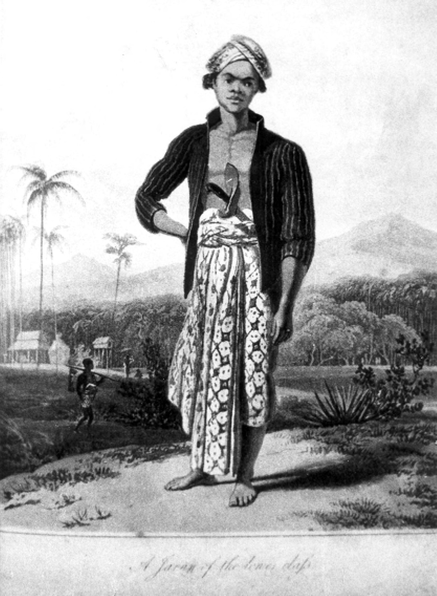
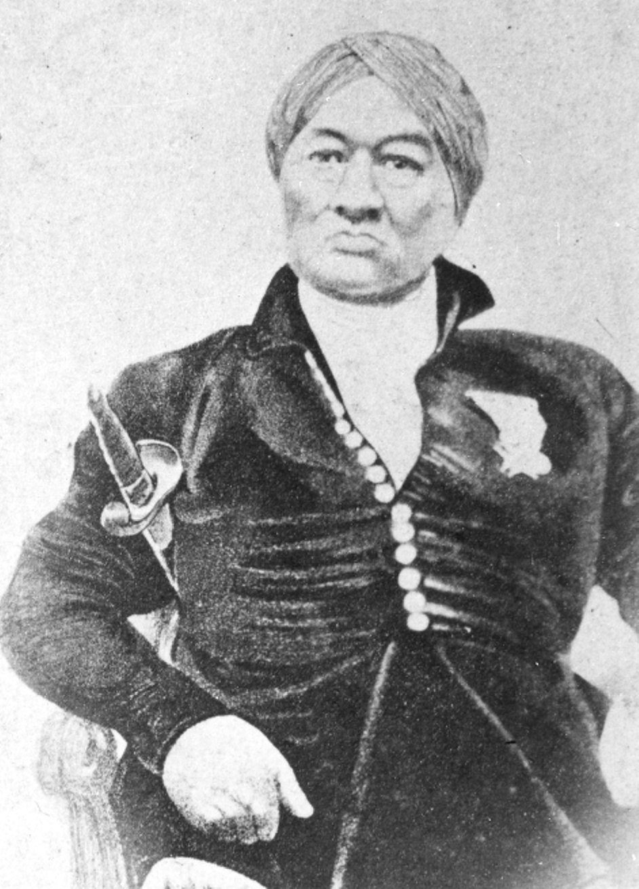
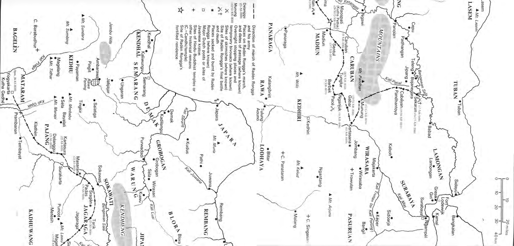
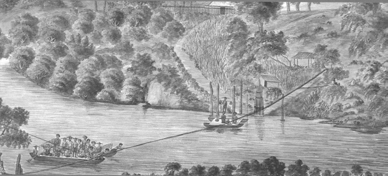
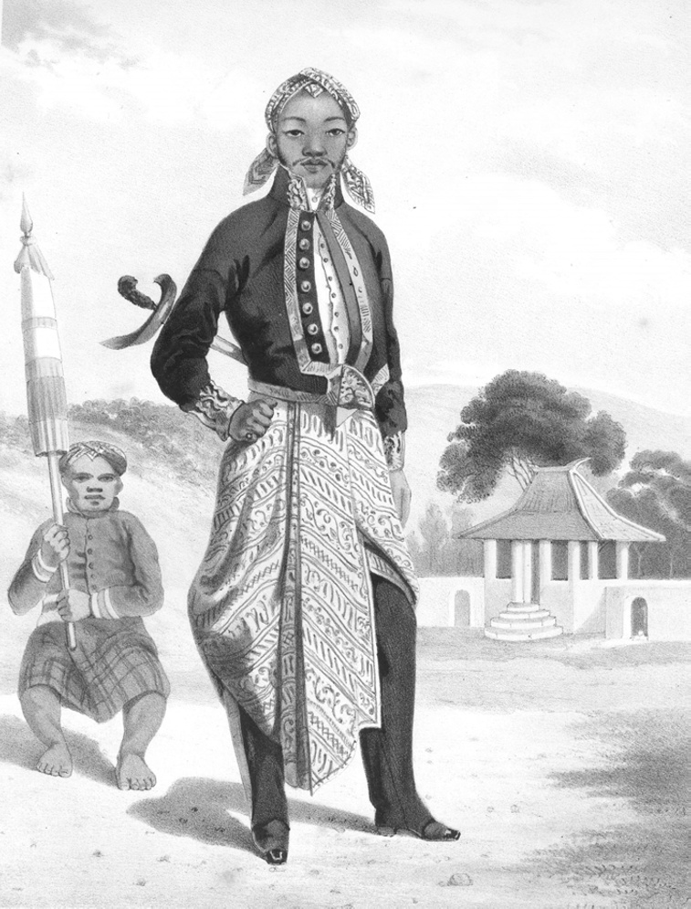

# Chapter VI: The Old Order’s Last Champion: The Origins and Course of Radèn Rongga’s Rebellion, 1809-1810

## The despoliation of Yogya

On 3 December 1808, Gustaf Wilhelm Wiese was installed by Pieter Engelhard as ‘minister’ (Resident) in Yogyakarta a day before the latter’s departure for Batavia.[^1] Although Wiese himself had no previous experience of the south-central Javanese courts, the fifteen months of his Residency saw a continuation of the careful diplomacy of his predecessor. Introduced to the second sultan by Engelhard as a man ‘of soft character and a true heart’,[^2] the Javanese babad concur that during his incumbency matters proceeded ‘calmly’.[^3] But this hardly seems an accurate depiction of the increasingly turbulent relations between the Dutch and the Yogya court as the second year of Daendels’ administration dawned.

One of the first problems was the delicate matter of Daendels’ demand for money from the sultan. On 22 December, Wiese wrote to the Yogya ruler asking him to provide a sum of money ‘as a sign of his attachment to the [Dutch] government’ for the war treasury the governor-general was setting up.[^4] The sultan’s response is not recorded. But we know from other sources that Daendels obtained some 200,000 Spanish dollars from Yogya during the course of his administration, the bulk (196,320 Spanish dollars) of which was taken as an indemnity to pay for his army and his civilian officials in December 1810 after his expedition to Yogya in the wake of Radèn Rongga’s revolt.[^5] According to the Yogya babad, the sultan had already given 50,000 Indies guilders worth of gold ornaments which were sent to Semarang along with various other official presents with the Yogya patih at the time of the joint court delegation to Daendels in late September 1808 when the chief ministers paid their ‘homage’ to him as an incoming governor-general.[^6] Wiese’s predecessor, Engelhard, had apparently arranged this particular gift, but if he did there is nothing in the Dutch sources to confirm it. It may be that the babad writer has confused this with the personal loan of 50,000 Indies guilders which Engelhard received from the sultan to cover his debts during the course of his two incumbencies as Yogya Resident.[^7]

Although the full details elude us, it is clear that Daendels began a process which the British, who must take first prize as asset strippers and looters during their brief five-year administration of Java,[^8] completed, namely, the despoliation of the Yogya treasury. Built up by the second sultan during the first sixteen years of his reign, and reckoned by Matthijs Waterloo to exceed one million Spanish dollars in gold and silver coins by February 1808 not counting ‘a very large sum in diamonds’,[^9] this entire sum was removed from Yogya by force and diplomatic diktat during the course of the next four years (1808-1812). Plunder on this scale gave the lie to Daendels’ protestations in his declaration to the patih in Semarang in early October 1808 that his administration represented the new enlightened government of post-Revolutionary Europe, a government which had the ‘happiness’ of its subjects at its heart. We will see shortly, how the same gap between rhetoric and reality would be the hallmark of the British interregnum (1811-1816). Small wonder that Dipanagara would later insist in the preliminaries to his March 1830 ‘peace negotiations’ with the Dutch at the end of the Java War that the only trade which would henceforth be allowed with Europeans would be one in which they paid the right market prices for Javanese products and the only land leases those in which they paid the right market rents.[^10]

## Military preparations and Daendels’ July 1809 visit

While these negotiations over the Yogya contribution to the marshal’s war chest were proceeding, the issue of the new ceremonial introduced by the 28 July 1808 decree remained deadlocked. Wiese warned the patih that he would not be able to pay the sultan any official visits in the kraton unless a stool were provided for him thus enabling him to sit at the same height as the Yogya ruler. But the monarch remained adamant that he had to remain at a more elevated position than the Resident through the insertion of a low wooden bench under his throne.[^11] This argument over ceremonial would continue right through to the end of Daendels’ administration in May 1811 and beyond into the British period (1811-1816). It would also bedevil the arrangements for the marshal’s own visit to Yogya in late July as we will see shortly.

Meanwhile, the military situation in Yogya was giving the Dutch authorities cause for concern. In late January 1809, news reached the sultan’s capital of an unusually large military exercise in Surakarta. This had apparently been occasioned by the Surakarta ruler’s jealousy of the respect paid by senior Dutch artillery officers to Prangwedana (Mangkunagara II) during a recent inspection visit to the south-central Javanese courts.[^12] The Sunan’s decision to stage his own manoeuvres was thus an attempt to demonstrate his independent military capacity and his position in south-central Java as the senior ruler.[^13] But it was interpreted badly in Yogya. The sultan gave orders for all male inhabitants of Yogya to turn out for a military review and instructions were sent to the eastern mancanagara bupati to hold themselves in readiness.[^14] Wiese hurried to remind the sultan of the warning given the previous year by Daendels that any such manoeuvres would be interpreted as a declaration of war against the Dutch government.[^15] There was also talk of sending Prangwedana’s forces to Klathèn ‘in order to keep the peace in Java’.[^16] This seems to have had the desired effect. But, although the mobilization orders were rescinded, troops continued to pour into the capital. On 1 March, the Yogya Resident was reporting an unusually large turnout for the previous Saturday weekly tournament (Setonan) on the southern alun-alun with over 2,000 cavalry taking part drawn from the contingents of the sultan, the Crown Prince and other Yogya princes.[^17] By early April, large detachments were beginning to arrive from the mancanagara as the eastern bupati made their way to Yogya for the Garebeg Mulud (Celebration of The Prophet’s Birthday) which that year fell on 27 April.[^18] Dipanagara reckoned that by this time there were upwards of 10,000 troops in the city not counting those from the sultan’s own apanage lands. The Yogya babad gives even more inflated figures.[^19] Many of these soldiers were deployed to guard the sultan’s pesanggrahan. At the same time, the eastern bupati, who did not have residences in the capital, were given temporary accommodation in small pavilions constructed of bamboo and palm-leaf.

According to the Yogya chronicle, almost daily exercises took place on the great square to the south of the court and the tensest expectations were aroused when news came through in early April of Daendels’ intention to make an official visit to the south-central Javanese courts later in that dry season.[^20] Many Yogyanese went about dressed permanently in battle array (prajuritan) and Dipanagara describes how he was called upon to take command of the kadipatèn (Crown Prince’s establishment) forces numbering some 1,000 men. Only two of the smaller kadipatèn regiments, the Suranatan and the Trunasmara, the latter comprising panakawan (young unmarried companions) and grooms (gamel) were left under the Crown Prince’s orders.[^21] When the day of Daendels’ arrival (29 July 1809) dawned, Dipanagara summoned two of his father’s military commanders, and together with his two younger brothers, Adinagara and Suryabrangta, rode out to Kalasan as part of the Crown Prince’s delegation tasked with greeting the governor-general, who was attired in the full dress uniform of a Napoleonic marshal.[^22]

Although Dipanagara makes no allusion to this in his babad, it is clear that the protocol for Daendels’ reception caused many problems for the Yogya Resident. A project ceremonial for the five-day visit (29 July-2 August 1809) visit seems to have been sent to Yogya for approval in late May.[^23] But, in early June, Wiese was reporting that the sultan was only prepared to come out as far as Demangan near Kalasan to greet the marshal. This was the same distance as he had travelled the previous November to receive Daendels’ deputy, Rear-Admiral Buyskes, a visit which, as we have seen, occasioned much displeasure.[^24] A compromise was eventually reached when the Yogya ruler agreed to travel somewhat further out to Bantulan near his royal orchard at Jenu (present-day Ambarrukmo) to make his first meeting with the governor-general.[^25] At the same time, the question of seating arrangements in the official receptions in the Residency House and the kraton required much delicate negotiation. The sultan was not prepared to allow the Resident to stand in his presence, but suggested that he should be seated on a stool next to his throne. He also asked that his heir apparent, the Crown Prince, should be allowed to sit in a similar fashion rather than remain on the floor as he normally did in court receptions. These requests were allowed.[^26] The sticking point was reached, however, when the Yogya ruler insisted that he sit higher than Daendels in the kraton reception by having a bench placed under his throne.[^27] It was one thing for the sultan to attempt to sit higher than the Resident at official meetings, quite another when he tried the same protocol with the governor-general himself. It was at this point that Daendels threatened to cancel his visit to Yogya altogether and restrict himself to the Sunan’s court if his project ceremonial was not approved.[^28] The sultan seems to have acquiesced, but it is clear from the Javanese accounts that the visit mortified him deeply.

When Daendels did eventually arrive in Yogya, his presence occasioned much curiosity and interest amongst the local population. It was the first ever visit by a governor-general to Mangkubumi’s capital (Carey 1984b:58), and it raised many expectations as to what it might achieve. The fact that Daendels had brought a sizeable military force with him to the Principalities once again underscored the mailed fist nature of his regime.[^29] But efforts were made to turn the visit into a diplomatic success through the scheduling of various ‘discussions’ between the sultan and Daendels in the kraton and in the throne room at the Residency House. Some of these focussed on cash-crop production and agriculture in the princely territories, others on the sultan’s duties as a ruler.[^30] At the same time, there were the usual official visits to the sultan’s family, tours of four of the royal pesanggrahan (Ngawatreja, Rajawinangun, Purwareja and Wanacatur), a rampog macan (tiger spearing), a firework display organised by the kapitan cina, Tan Jin Sing (in office 1803-1813), on the grounds of the Residency House, serimpi dances and a mock one-hour tournament conducted by forty of the Yogya ruler’s cherished Amazon corps, the prajurit èstri, on the southern alun-alun.[^31] This latter display is said to have especially impressed Daendels who subsequently expressed his amazement that women could ride so adroitly on horseback (Poensen 1905:144). One wonders if the male chauvinist governor-general realised that these viragos were not just for show but had real fighting capacity as the British would later discover when they stormed the Yogya kraton on 20 June 1812 and had their only officer casualty, a Scots lieutenant of a British line regiment, knifed to death by a court lady whom he had unwisely tried to carry away as booty (Carey 1992:414 note 78; p. 349).

Despite the formal compliments and outward display of friendship, no deeper understanding was reached. Dipanagara laconically dismissed the visit in a single sentence in his babad, noting that ‘there was much talk but nothing came of it’.[^32] The other Javanese accounts dwell on the humiliations which the sultan underwent concerning the seating arrangements and the lack of respect paid to him by the governor-general.[^33] At the end of the day, the visit probably confirmed the sultan in his conviction that he should not give an inch on matters of ceremonial.

On 2 August at 4.30 a.m., the early start allowing travel in the cool of the morning and suited to the governor-general’s military routine, Daendels departed for Semarang accompanied as far as Secang in Kedhu by Wiese, Radèn Tumenggung Natadiningrat, and Mas Tumenggung Sindunagara (the future patih, Danureja III, in office 1811-1813). There, according to the Pakualam babad, Daendels made efforts through his interpreter, C.F. Krijgsman, to attach Natadiningrat to the Dutch cause by warning him about what might happen if the Crown Prince succeeded to the sultanate (Poensen 1905:144-5). There is nothing in the Dutch records to bear this out and it seems that far from cultivating relations with Natadiningrat and his father Natakusuma, the future Pakualam I (reigned 1812-1829), Daendels went out of his way to give his full support and interest to Dipanagara’s father, the Crown Prince.[^34] The marshal’s subsequent actions in favour of the Crown Prince against Natakusuma and the sultan bear this out as we shall see later in this chapter.

## The struggle over the teak trade and the crisis in the eastern mancanagara and pasisir

While these events were taking place in Yogya, the situation in the eastern mancanagara and the districts bordering the Dutch territories on the north coast (pasisir) was deteriorating. As we have seen, increasing pressure had been applied on the courts by Daendels from July 1808 onwards to gain access to the eastern outlying region’s timber reserves, particularly in key districts such as Panolan and Padhangan.[^35] Initially, his demands had been limited to hardwood stakes for the construction of his new naval defences at Fort Lodewijk in Surabaya.[^36] But by early 1809, these requirements had broadened out to include a ban on the private sale of teak across the border into the Dutch-held pasisir territories and the establishment of a de facto government timber monopoly. In Blora, for example, the whole of the teak trade was taken out of the hands of the local Surakarta-appointed bupati and turned over to Dutch forestry officials who relied on European and Chinese contractors to extract the hardwood.[^37] Much the same situation prevailed in the Yogya districts of Jipang and Japan (Majakerta) where a consignment of over 500 logs was demanded through contracts negotiated directly with the local bupati by the acting Inspector-General of Coffee Culture Carl von Winckelmann.[^38] This was naturally resented by the mancanagara bupati who stood to lose a very valuable source of revenue from their farming out of the rights to fell timber to local Chinese and Javanese entrepreneurs from the pasisir.[^39] In Jipang and Japan (Majakerta), for example, the 500-log consignment was later prevented from reaching the coast by the local bupati.[^40]

> *Plate 25. A Javanese of the lower class, one of those who suffered directly from the restriction on sales of wood from the eastern mancanagara to the pasisir during Daendels’ administration (1808-1811). Taken from Raffles 1817, I:84 facing. Photograph by courtesy of the Bodleian Library, Oxford.*

When they arrived in Yogya for the Garebeg Mulud festival of 27 April 1809, the eastern bupati explained the situation to the sultan and also alerted him to the desperate plight of the wood-cutter forest population whose entire livelihood depended on their ability to glean wood from the sultan’s forests and sell it across the border.[^41] The effects of the rigid enforcement of the teak monopoly by Daendels were later noted by Raffles and other British officials. The British lieutenant-governor wrote of the ‘size and comfort’ of local houses being ‘very essentially contracted’ by the closure of the teak forests ‘which were formerly open to natives of all classes’ (Raffles 1817, I:81), and the first British Resident of Jipang after its annexation in August 1812 reported a steep drop in population, especially in timber-rich areas like Panolan, with much land lying waste.[^42] The closure of the timber market to the local bupati likewise led to a sharp decline in the level of forest maintenance. Even Prangwedana’s beautifully maintained teak forests at Karangpandhan on the slopes of Mount Lawu felt the impact, his pro-Dutch allegiance affording him no exemption (Hogendorp 1913:167).

In this affair, the sultan apparently took up the cause of the forest inhabitants, stipulating that although the teak forests would be leased to the European government, the common people should still be allowed to sell wood to the pasisir.[^43] Coming from a ruler who had gained such a notorious reputation for his harsh fiscal policies during the first sixteen years of his reign this was a change of heart indeed. But it was a change which seemed to be replicated elsewhere: even the curmudgeonly Residency translator in Surakarta, J.W. Winter, remarked that since Daendels’ arrival, the princes and bupati of the south-central Javanese courts seemed to have discovered a new-found compassion for the wong cilik (little people) (Winter 1902:51).

Despite this high-level solicitude, the situation for the forest-dwelling populations of the eastern mancanagara and the districts close to the north coast was not improved. In desperation, many took to petty crime and there were a number of incursions across the border. Small affrays took place between the inhabitants of the court districts and those in the Dutch-controlled pasi sir. These were regularly reported to Daendels by Dutch officials. As chief administrator of the eastern outlying districts, Radèn Rongga was blamed for many of these incidents. According to Dipanagara, the bupati wedana was constantly singled out by the Dutch as a scapegoat and often summoned to Semarang to answer for the growing number of infringements of government territory. But an open break was avoided:

> XIV. 89 So gradually there was even more talk, yet it was Radèn Rongga who was constantly discussed. So they piled up the affairs of Radèn Rongga [and] he was often invited to Semarang.

> 90 But Radèn Rongga Prawiradirja was wary: he understood in his heart that he was being picked upon by the Dutch, so he was continuously [and] exceedingly cautious of danger.[^44]

The sense of being picked on aroused in Rongga a smouldering resentment which was transformed, as we will see shortly, into a fatalistic resignation following the early death of his beloved consort, Ratu Maduretna, in mid-November.

Difficulties between the sultanate and the Dutch government continued throughout the long dry season (May-October) of 1809. In early September, the Yogya bupati of Grobogan, Radèn Tumenggung Sasrakusuma, was accused of holding up rice supplies to the pasisir and a local kyai (religious leader) in neighbouring Surakarta-controlled Blora, Kyai Haji Minhaj, who had collected a large group of adherents, was reported to be ‘terrorising’ government forestry officials in the area.[^45] The involvement of ‘men of religion’ in these activities and complaints from the Sunan about ‘the many priests who pretend to be descendants of The Prophet, begging and wandering in Surakarta lands’ would lead a year later to a decree by Daendels banning the circulation of ‘priests’ between Surakarta and Dutch-controlled territories unless they carried a government travel pass, as well as those from the Principalities who wished to trade with the north coast. All those ‘priests’ without such a pass would be sent in chains to work at the fortifications in Merak Bay on the Sunda Straits.[^46]

The borders with Tegal and Pekalongan were also the scene of constant tension. A returned Mecca pilgrim, Haji Mustapa, who may have witnessed the British naval build-up in Pulau Pinang and the Melaka Straits during his sea voyage to the Middle East, spread rumours in Pekalongan of an imminent British attack on Java.[^47] At the same time, numbers of pasisir inhabitants fled to the princely territories to avoid being conscripted for labour duties on Daendels’ trans-Java post-road which was just then being laid through the Dutch-held areas of the north coast.[^48] Some 12,000 Javanese, it was later estimated, would lose their lives in the construction of this infamous highway (Thorn 1815:208; Van Polanen 1816:73). In the ensuing confusion a number of small incidents and raids on villages and customs posts in government areas took place.[^49] Some of these were more serious: in September, a major incursion occurred in the government-administered district of Brebes near Tegal involving a bandit group estimated to be between 500 to 700 strong.[^50] The forest of Kadhawung in the small Yogya-administered Kedhu enclave between Pekalongan and Kendhal was reported to be providing cover for numbers of these wong durjana (robbers) who preyed on the north coast highway.[^51]

The rising tensions underlined the fact that the temporary lull brought about by Daendels’ recent official visit was not to last. Sensing that a major showdown with the Dutch government could not long be delayed, the sultan decided to increase his military preparedness. Shortly after the celebration of the Garebeg Puwasa festival marking the end of the fasting month on 13 November 1809, he took advantage of the presence of Radèn Rongga’s workforce from the eastern mancanagara in the royal capital to strengthen the kraton defences. The four main bastions were projected by between fifteen to eighteen feet,[^52] and new cannon cast in Gresik and the royal gun foundries at Kutha Gedhé to defend them.[^53]

The sultan was right to be concerned. On 30 December, Daendels wrote to complain about the repeated incursions and robberies by Yogya inhabitants into Pekalongan. In his view, the Yogya bupati in the area were hand in glove with local bandits and were receiving stolen goods. He had given ‘ample signs of friendship’ by meeting the sultan in person during his recent official visit and by greatly reducing his troop strength in Semarang. Now he expected the Yogya ruler to reciprocate in kind by taking resolute steps against robber bands in the border areas and by handing over the officials responsible to ‘Minister’ Wiese (Carey 1980:72-3). He warned that if another robbery occurred in this enclave, the sultan would be held personally responsible. The marshal’s army in Semarang was in a position to occupy the sultan’s territory within fourteen days, and he intended to annex the Kedhu enclave on the north coast if there was any repeat of the border incursions. But he hoped it would not come to that (Carey 1980:72-5).

In the face of such an ultimatum, the sultan sought to buy time. He replied in emollient terms stating that he had sent out a Yogya mission accompanied by a Dutch officer[^54] to arrest those engaged in criminal activities in the border areas. He also promised that if heads of villages dared to ignore the recently agreed regulations regarding the suppression of criminals,[^55] they would be arrested and handed over to the Resident who could pass them on Daendels if he so wished.[^56] While this exchange was taking place, on 8 January 1810, Daendels gave proof of his determination to enforce his new hard-line policy by dismissing the Surakarta patih, Radèn Adipati Danuningrat (in office 1804-1810), for his dilatoriness in investigating Surakarta official involvement in the Pekalongan disturbances.[^57] He also sought to strengthen the government position in Yogya by appointing a tough new Resident, Johannes Wilhelmus Moorrees (in office 9 March-24 August 1810), to take over from Wiese when the latter was moved back to his old post as inspector-general of Forests in early March.[^58] Moorrees, who as prefect of Banten (November 1808-April 1809), had been severely wounded during an attack on his carriage and forced to flee in the disturbances which had followed Daendels’ abolition of the Banten sultanate,[^59] came to Yogya with a reputation as a bruiser: the Yogya babad refers to him as a ‘minister who exuded forcefulness’,[^60] while the Pakualam account describes him as ‘brawny’ (jarot) (Poensen 1905:147). But forcefulness alone was not going to advance the cause of the European government in the sultan’s capital as Moorrees would discover in the five unhappy months of his residency, a period when all the mistakes of his equally short sojourn in Banten would be repeated.

No sooner had Moorrees settled into his new post in early March than a new attack occurred on the Pekalongan village of Wonodadi.[^61] This was said to involve a ‘well-known robber band’ which was operating out of the Yogya district of Tersana in the above-mentioned Kedhu enclave.[^62] Daendels demanded that the leader be caught. In the margins of the Yogya Resident’s dispatch reporting the incident, he wrote that ‘this affair has become so serious that I am withdrawing my trust in the sultan and the patih […] I will take action if the fugitives are allowed to escape as before’.[^63] When the inevitable happened and the robbers slipped away over the border, the Yogya demang of Tersana, Radèn Tirtawijaya, was summoned to the royal capital to take responsibility. Daendels demanded that the sultan put him to death, but the Yogya ruler was loathe to oblige given that the demang was closely related by marriage to two leading figures at the Yogya court, namely, his favourite consort, Ratu Kencana Wulan, and his former bodyguard commander, Pangéran Dipakusuma (Poensen 1905:149-50; Carey 1980:185). The most he was prepared to do was to send him into exile. But this was not acceptable to Daendels. He continued to demand his head. So the unfortunate official was bound and delivered to the Resident who sent him in chains to Semarang. From there he was taken out on the new postweg and shot at Weleri, his body being left by the side of the road until, according to the Pakualam babad, it was collected by his children and grandchildren for decent Javanese-Islamic burial (Poensen 1905:148-9).

Moorrees reported that the sultan was deeply ‘ashamed’ at having to hand over the demang and he registered his displeasure by refusing to receive the Resident with the new ceremonial at the time of the Garebeg Mulud on 18 April 1810.[^64] The only concession he made was to agree to drink to the health of Moorrees’ wife immediately after the official toasts to the ‘minister’ and the Crown Prince, a concession which infuriated Daendels who declared that ‘women have no place in the drinking of toasts – theirs is entirely a private affair!’. In the same marginal note, he also insisted that Moorrees adhere to the 28 July 1808 ceremonial in all future dealings with the Yogya ruler.[^65]

## The scapegoating of Radèn Rongga

Daendels clearly intended Radèn Tirtawijaya’s miserable end to serve as a warning to all those in Yogya who refused to cooperate with his government. But his tactic of using Moorrees to enforce his strong line against the sultan in terms of the new ceremonial and the punishment of those responsible for cross-border incursions would backfire badly. As far as the Yogya ruler was concerned the time for making concessions to the Dutch government had passed. The governor-general’s pressure only served to coalesce all those groups in Yogya who either out of self-interest or through genuine anti-European sentiments were moving towards a policy of open resistance.

Radèn Rongga was a central figure here. Immediately following his return from the mid-November 1809 Garebeg Puwasa in Yogya, when his workforce had helped to extend the kraton bastions, he had been plunged into inconsolable grief at the sudden death on 16 November of his beloved official wife, Ratu Maduretna.[^66] Said to be the most beautiful of the three daughters of the second sultan by his part Madurese consort, Ratu Kedhaton,[^67] and still in her early thirties at the time of her death, she seems to have been much more than the trophy court princess for her rather younger husband. Certainly, Radèn Rongga’s reaction to her loss as recorded in the Pakualam babad was dramatic: interring her at his family graveyard at Gunung Bancak, which he renamed Giripurna in her honour, a prominent hill overlooking the site of his new residence at Maospati, he is said to have spent day and night at her gravesite. He even gave out that he wished to follow her beyond the grave until his subordinate bupati admonished him to come to his senses (Poensen 1905:154; Adam 1940:333-4). No sooner had Rongga recovered somewhat from this bitter personal loss than he was implicated in a cross-border raid into neighbouring Panaraga on 31 January 1810.[^68] This left two dead, one wounded and the entire population of the Surakarta-administered sub-district of Ngebel close to Madiun[^69] numbering some 181 souls forced to flee their homes. According to Rongga, the inhabitants of this area were notorious criminals who had repeatedly robbed Yogya inhabitants in Madiun. He claimed he had been given permission by his Surakarta opposite number in Panaraga, Radèn Mas Aria Wiryadiningrat, to trace the robber band back into adjacent Surakarta territory.[^70] Acting on this permission, he had sent out a sizeable 800-strong search party, which had tracked them down to the village and sub-district of Sekedok in the Gunung Ngebel area. Finding the village deserted except for a number of cripples, his investigating force had then been ambushed in what he described as an ‘amok attack’ by three of the bandit group and it was during this affray that the two Surakarta assailants had lost their lives and the third had been wounded. The adjacent district of Ngebel had been subsequently ‘ruined’ in retaliation by the investigating party.[^71] He offered to arrange a meeting with the three Panaraga bupati after the Garebeg Mulud of 18 April 1810 to sort out the problem.[^72]

This comparatively small incident would begin a process which would ultimately lead to the bupati wedana’s rebellion the following November. The Surakarta ruler, who had an intense personal antipathy for Rongga, eagerly seized on the affair to make a formal complaint to Daendels.[^73] Wiryadiningrat for his part levelled a number of counter accusations at Rongga, one of the most intriguing being that he had retained a military deserter from Panaraga named Bratasena (also known as Bratasentana), as a bandit leader, whom the Surakarta bupati wedana said was especially admired by Rongga as a descendant of Bathara Katong, the founder of Islam in Panaraga. This man had been appointed a lurah mantri (senior local official), given the title of Radèn Prawirabrata and provided with light cannon from Rongga’s own residence at Maospati which allowed him to operate freely across the border in Panaraga where there was no such ordnance.[^74] He had apparently specialised in capturing sets of Javanese gamelan (orchestras) from the adjacent Surakarta territories for the bupati wedana, no less than five such orchestras having been carried off to Rongga’s residence in the past four years.[^75]

Such activities speak more of cultural kleptomania – of the kind practised by the British between 1811-1816 – rather than the usual round of cross-border plunder, but this weighed not a whit with Daendels for whom a gamelan and a kettle drum were probably one and the same. Moorrees meanwhile had decided to drag out the proceedings and increase pressure on the bupati wedana by refusing to send out the normal commission of enquiry from Yogya.[^76] This reflected the governor-general’s desire to make an end to Rongga’s influence, if necessary by using the same fateful methods as he had applied to the luckless demang of Tersana. ‘I would have hung a European for such vexatiousness!’ he wrote in reply to Moorrees’ dispatch informing him of Rongga’s actions.[^77] He ordered the Resident to deliver a letter to the sultan pointing out that unless Rongga was punished the Yogya ruler risked falling out with both Daendels and Pakubuwana IV at one and the same time. He was also told to cite the marshal’s public hanging of a European in Banten during Moorrees’ previous residency there as proof that he meant business.[^78]

The sultan was incensed. He saw the Surakarta ruler’s actions as a way of putting bad blood between himself and the governor-general, and he recalled the misunderstandings between the sultanate and Daendels during the marshal’s first year in office, misunderstandings which he laid squarely at the door of the Sunan. After hearing Rongga’s report delivered during his stay in Yogya at the time of the Garebeg Mulud, the sultan concluded that the bupati wedana had been well within his rights to strike down three notorious robbers. Until further reports were forthcoming from Surakarta about the affair, he would accept Rongga’s version as substantially correct.[^79] Henceforth, the sultan went out of his way to protect and favour his former son-in-law. Anxious to have him linked once more to his family by marriage, he offered him a new bride, the thirteen-year-old Radèn Ajeng Suratmi, his second daughter by his favourite official wife, Ratu Kencana Wulan.[^80] Although the marriage was never consummated,[^81] Rongga remained close to the sultan. He was not called upon to answer further for the Panaraga incursions, and in other matters too he was shown indulgence. These included the ongoing government investigation into the alleged camp for deserters from Daendels’ army in Japan (Majakerta) and the construction of barges on the Sala River for the transport of teak to the pasisir. In both cases, Rongga adopted a dila tory policy in which he was fully supported by his monarch.[^82] He was also allowed back to Madiun, as we will see shortly, to attend to the one-year commemoration of his wife’s demise during which time preparations were secretly laid for his future rebellion.

## The April-August 1810 crisis in Dutch-Yogya relations

While Rongga’s stock continued to rise at court, Moorrees’ attempts to bring pressure to bear on the Yogya ruler proved increasingly ineffectual. In particular, his refusal to forward the letters from the Sunan and the three Surakarta mancanagara bupati regarding Rongga’s Panaraga incursions until the sultan received him at court with the stipulated ceremonial eventually led to a complete breakdown in Dutch-Yogya relations (Poensen 1905:178). The main point of dispute remained the question of the sultan’s throne and his right to sit higher than the Resident. On this the Yogya ruler would not budge.[^83] All Moorrees’ threats were in vain and the Resident’s forceful policy only undermined the position of the Yogya patih, Danureja II, whose task it was to convey the unpalatable messages to the sultan. Naturally he was seen by those close to the sultan like the bupati wedana and Sumadiningrat as being too closely identified with the Europeans. In fact, Moorrees’ public support for Danureja did him much harm. The Yogya ruler for his part complained bitterly that his patih’s conduct was markedly different from that of his grandfather, Danureja I (in office 1755-1798), who had been able to act in a more even-handed fashion as his father Sultan Mangkubumi’s trusted prime minister.

On 30 April 1810, the sultan went so far as to address a letter to Daendels seeking the governor-general’s permission to dismiss Danureja II, whom he described as still a ‘boy’, and to replace him by the Outer bupati, Mas Tumenggung Sindunagara (post-November 1811, Danureja III, in office 1811-1813).[^84] The ruler’s proposal was rejected out of hand by Daendels who stated that Sindunagara was far too old and lacking in administrative talents for such an important post.[^85] The Surakarta Resident, Jacob Andries van Braam, who had now also been appointed Daendels’ deputy,[^86] was tasked with undertaking a commission to Yogya to effect the full restitution of the patih, who had apparently been restricted in his duties by the sultan in the meantime. But Van Braam’s mediation did little to restore confidence in Danureja II.[^87]

So just what sort of man was Danureja II and why did he so entirely lose the confidence of his monarch? We have already met him in the context of Dipanagara’s circle at Tegalreja where his family’s strong interest in Javanese Islamic mysticism and links with the important religious school and centre for fiqh scholars at Melangi brought them into close contact with the young prince.[^88] Indeed, the patih’s connections with religious teachers in Melangi, in particular Kyai Taptajani (Carey 1974b:272-3), appear to have elicited criticisms in some quarters in Yogya that he was rather too close to the santri in much the same way that Dipanagara would be later ridiculed by critics at the time of the Java War (Carey 1974a:50, 1975:342 note 7). Danureja II’s mystical interests, his friendship with Europeans and his easygoing character made him a natural ally of Dipanagara’s father, the Crown Prince. He would remain a staunch supporter of the Crown Prince’s karajan party[^89] until his death in October 1811. According to Van IJsseldijk, he always passed on information about affairs of state to the Crown Prince,[^90] and the fortunes of the two men became inextricably linked: as the Crown Prince fell from favour in the 1800s so the position of the patih was increasingly jeopardised. Two of his daughters by his royal-born wife, Ratu Anggèr, a daughter of the second sultan and his part-Madurese consort, Ratu Kedhaton,[^91] married sons of the Crown Prince (p. 371; Appendix II), and the close family ties between the Danurejan family and the karajan, subsequently produced considerable support for Dipanagara during the Java War (Appendix VIII).

The patih’s main faults were that he was politically naïve, administratively inexperienced and lacked the strength and decisiveness to stand up to his critics at court. Many of these weaknesses stemmed from his youth: he was barely twenty-eight when he succeeded his grandfather as prime minister. But at heart he was too mild a man to shoulder the responsibilities and burdens of his high office. While he was still assistant to Danureja I in the 1790s, Van IJsseldijk remarked on his ‘blind obedience and great fear of the sultan’, which meant that affairs of state were handled ‘more by the petulant ideas of the ruler than by the rules of equity and justice’.[^92] Second Resident of Yogya Van den Berg likewise observed that Danureja II was a ‘terrible bungler’ as a young administrator, and although he later grew into his position as patih, he remained wanting, in Van den Berg’s view, ‘in that degree of firmness necessary to support his dignity […] he is a man of pleasure in the pursuit of which he frequently neglects his business’.[^93] His heavy drinking bouts at Residency parties and the bad example he set other Yogya officials on such occasions, greatly incensed the sultan who fined him heavily. This kept him poor which was an additional disadvantage when it came to manipulating court patronage.[^94] The Pakualam babad, which is a hostile source, even speaks of him acting as a ‘procurer’ of young girls for the Crown Prince who had a reputation as a womaniser (Carey 1980:86 note 1; Poensen 1905:118). One of these was supposedly ‘carried off’ from the Surakarta kraton, which if true might have been expected to create some sort of diplomatic incident with the Sunan.[^95] But the sources are silent.

He also had powerful enemies at court. One of these was Pangéran Natakusuma, the future Pakualam I (reigned 1812-1829), who lost no opportunity to turn his elder brother, the sultan, against him. He it was who related the supposed incident regarding Danureja II’s kidnapping of the girl from the Surakarta court, which he had originally heard from Radèn Rongga, to the sultan.[^96] Another was the sultan’s third consort, Ratu Kencana Wulan (circa 1776-1859) (Carey and Houben 1987:23, 26), the low-born[^97] former commander of his Amazon corps, whose eldest daughter (born circa 1793) had married Natakusuma’s eldest son, Radèn Tumenggung Natadiningrat, in September 1805.[^98]

> *Plate 26. Daguerrotype photograph of K.G.P.A.A. Pakualam II, born 25 June 1786, reigned 1829-1858), earlier Radèn Tumenggung Natadiningrat, from the G.P. Rouffaer Collection, Leiden. Photograph by courtesy of the KITLV.*

Described as ‘the only female in Java whom Daendels was afraid of’ (Journal 1853-54, 8:241) and by the marshal himself (Daendels 1814:95) as ‘a woman of outstanding beauty and unusual intelligence who had no difficulty in dominating the sultan whose favourite she remained’, the Ratu made no secret of the fact that she hoped to see her son-in-law installed as the new patih following Danureja II’s fall from favour (Louw and De Klerck 1894-1909, I:34; Poensen 1905:166-7). Meanwhile, the birth of a son to Natadiningrat and his bride in 1807 gave rise to prophecies that he would one day have a royal destiny.[^99] All these personal and factional challenges meant that Danureja II was singularly ill-equipped to act as a channel between the European government and the second sultan during a crucial period in the sultanate’s history. We shall see in the next chapter how the additional pressures imposed by the policies of the European government between 1808 and 1812 would later cost him his life.[^100]

Despite Van Braam’s mediation, the restrictions placed on the patih by the sultan in late April were not significantly ameliorated. By October, Engelhard was reporting that Danureja II had been stripped of all responsibilities for internal administration which were now placed in the hands of Natadiningrat.[^101] The Yogya first minister was left with the regulation of affairs in the mancanagara and relations between the Yogya kraton and the Surakarta court and with the European government. But even here his room for manoeuvre was heavily circumscribed because on all visits to the Residency he had to be accompanied by Natadiningrat and Sindunagara who were to act as his deputies.[^102] At the end of August, the sultan appointed another close confidant and former personal retainer, Radèn Tumenggung Purwadipura, to shadow Danureja II as his official assistant, thus further restricting his competence (Carey and Hoadley 2000:78).

Events in the kraton were now moving rapidly in the direction of a consolidation of Natakusuma’s power and there were even rumours that this politically ambitious prince had offered a large bribe to secure his son, Natadiningrat’s, appointment as patih.[^103] It was clear that the Crown Prince and his karajan party were no longer able to exercise any influence over the sultan and it would be only a matter of time before he was finally edged aside. Already at the start of Daendels’ administration, the Crown Prince’s position had been marginal: according to a Dutch source, he had rarely been invited to royal state meetings in the Srimenganti pavilion or to the assemblies of high court officials. When he did make an appearance he was usually dispatched with routine business to the prime minister’s office or just as summarily dismissed according to the caprice of the sultan.[^104] Now his situation was even more precarious. Although he seemed to submit to this cavalier treatment with ostensible patience, an insight into his true state of mind can be ascertained from the admission of a local religious teacher who later confessed that he had been paid a sizeable sum – 7,000 Spanish dollars – by the Crown Prince to ensure the sultan’s speedy demise by poison.[^105]

Meanwhile, the relationship between the sultan and Moorrees was descending into open confrontation. In late June, when the Resident was about to leave for Semarang to confer with Daendels about the vexed issue of the new court ceremonial, his wife was held up in her carriage during an outing to the countryside by an armed band operating under the sultan’s orders and forced to turn back to Yogya.[^106] When Moorrees eventually met the governor-general, he was urged to make no concessions to the sultan. But already relations with the court were in crisis. In May, the Resident had held up the official messenger from the Sunan to the Yogya court announcing the appointment of Radèn Adipati Cakranagara as the new Surakarta patih in place of the recently dismissed Danuningrat. Pakubuwana IV’s letter was dated 9 May (4 Rabingulakir AJ 1737), but by mid-July this had still not been delivered.[^107] Both sides refused to give way: Daendels rejected any idea of compromise over the seating arrangements and the sultan remained adamant, for if he gave ground, as Sumadiningrat pointed out to the Resident, this would constitute too great a blow to his prestige.[^108] In the ensuing deadlock, Moorrees found himself, in the words of the Pakualam babad, ‘like an egg caught between two sharp stones’ (Poensen 1905:178).

Finally, Daendels wrote to the hapless Moorrees ordering him to deliver an ultimatum to the sultan demanding concessions over the question of the height of his throne. If this was not accepted, he should withdraw to Semarang taking the patih with him. Moorrees duly delivered the ultimatum, but the sultan paid it not the slightest attention, departing with Sumadiningrat to his pesanggrahan at Samas on the south coast for three days by the sea.[^109] At the same time, despite considerable pressure on Danureja II, including from Moorrees’ Assistant, Bartholomeus Jacobus Driessen, and his elder brother, Lieutenant Willem Driessen, acting commander of the Yogya garrison, both fluent Javanese speakers,[^110] the patih refused to budge. He needed no reminding that to have accompanied the Resident to Semarang at such a time would have been more than his life was worth. So Moorrees made the journey alone on 13 July.[^111] Daendels had been outfaced by the sultan. Although Moorrees returned briefly to Yogya in early August, his residency was at an end. He was replaced by Pieter Engelhard on 1 September after a week’s interregnum in which affairs were left in the hands of the Driessen brothers.[^112] The marshal had decided to make concessions and the sultan was allowed to receive the new Resident in the Srimenganti hall seated on his throne in the old style (Poensen 1905:184-5). The diplomatic Engelhard was also instructed to calm the sultan’s ruffled feelings.

## The ‘piling up’ of affairs and preparations for Rongga’s rebellion

The lull was very short. On 10 September, a bare ten days after Engelhard’s arrival, news came through of an attack on a Chinese tax-farmer in Demak by a band of Yogya robbers from the village of Gabus in the Grobogan-Wirasari area.[^113] Opium, cash and ornaments worth some 10,000 Spanish dollars had been taken,[^114] and it was suspected that some of the members of this gang were deserters from the Semarang garrison regiment who had earlier gathered in the province of Japan and against whom neither the sultan nor Radèn Rongga had taken any action.[^115] Daendels was exceedingly angry. Writing in his usual ebullient style on 15 September, he instructed Engelhard to press for ‘sensational satisfaction’, the ‘complete return of the stolen goods’ and the arrest of the robbers within fourteen days otherwise he would occupy the Yogya area from which the robbery had originated. The least sign of resistance from the Yogya ruler, the governor-general announced, would be taken as ‘a declaration of war’.[^116]

Engelhard’s reply gives an insight into just how invidious the position of Yogya Resident had now become as an emissary between two such immoveable protagonists, one of whom had perfected the art of procrastination. At 5.30 on the evening of 21 September with Daendels’ letter in hand along with the original report on the robbery from the bailiff (landdrost) of Demak and Semarang, P.A. Goldbach, Engelhard attended the usual state meeting in the Srimenganti pavilion. The Resident asked[^117] for a private meeting with the sultan and the Crown Prince:

> [The sultan] fell silent for a moment and placed his hand behind him on his royal [throne] stool. The bupati wedana [Radèn Rongga] and Inner and Outer regents [Natadiningrat, Sasradiningrat II and Purwadipura] opposite us were summoned to approach him without the sultan answering me anything, so I was obliged to repeat my question whether the sultan wished to deliberate on the [Demak] issue in the presence of the regents. The sultan then spoke to Natadiningrat and the latter relayed what he had said stammeringly to me. I took the letters out of my bag and handed them to the sultan who passed them on immediately to Natadiningrat to read them out loud in the presence of the other regents […]. The sultan heard the governor-general’s letter very calmly and afterwards promised to give me a written reply.[^118]

The Yogya ruler then departed for four days to his pesanggrahan at Pengawatreja, the second such visit out of town since news of the Demak raid had reached him.[^119] Returning briefly to Yogya in mid-week, he left once again for his country estate. In the meantime, nothing was decided about the Demak affair beyond the dispatch of the usual long-winded commission of enquiry which took nearly a month to complete its investigations. Finally, on 30 September, Engelhard was vouchsafed another interview. Again the sultan and Crown Prince were asked whether they wished to hear Daendels’ ultimatum out of earshot of the four court bupati (nayaka). This time the sultan agreed. Calmly listening to the governor-general’s threat to occupy the Yogya villages in Grobogan-Wirasari in the event that a single man involved in the robbery was allowed to escape, the Yogya ruler conferred with his son, the Crown Prince, and then summoned the nayaka to give their views. Eventually, the Resident was told through his secretary, who was interpreting, that the sultan was content with Daendels’ communication, that he would indeed give him ‘satisfaction’, but that he would feel ‘ashamed’ if the governor-general ordered his troops to enter Yogya territory. In any case, nothing could be done until the return of the Yogya commission from Grobogan-Wirasari, at which an exasperated Daendels wrote in the margins of Engelhard’s dispatch: ‘I will await one more post, but then I will await the outcome of this Yogya commission no longer!’[^120] It would be nearly another two weeks and many more posts before the commission returned.[^121]

In the meantime, on the very evening of the kraton meeting, Engelhard was surprised by a night-time visit by Radèn Rongga to his residence. The bupati wedana had come to inform the Resident of his imminent departure for Madiun where he would remain until after the end of the fasting month (Puwasa). Engelhard was suspicious: ‘This seemed to me very strange because usually it is in the Puwasa month [which that year fell from 1-30 October] when the mancanagara regents make their annual return home and they usually come in state to the minister [Resident] to take their leave together’.[^122] Unbeknowns to the Resident, the first steps in Rongga’s rebellion had begun. On his arrival in Madiun, subsequent reports indicate that the still unfinished walls of his kraton-like residence at Maospati were fortified with sharpened bamboo spikes and cannon, and contacts made with Pangéran Prangwedana (Mangkunagara II), a personal friend, who may have given assurances that if his legion was deployed against him, his soldier’s guns would have no live rounds in them.[^123] Rongga also wrote to all his subordinate Madiun bupati informing them that he would probably not appear at court the following Garebeg Mulud in late April 1811 when the eastern mancanagara administrators travelled to the royal capital.[^124]

Although Engelhard attempted to prevent Rongga leaving Yogya by pointing out to Danureja II that it was highly improper for the bupati wedana to absent himself from the royal capital while the official report into the Panaraga incursion of the previous January by the joint Yogyakarta-Surakarta commission was still awaited, none of the patih’s official assistants dared to take the message to the sultan. Rongga was thus allowed to leave unhin dered at midday on 1 October.[^125] He would not return until 8 November by which time preparations for his rebellion were already well advanced.[^126] It seems that he had been warned by Natadiningrat that the official report of the commission, which confirmed that Rongga’s Madiun inhabitants had violated Surakarta territory, was about to be received and that there would be serious consequences for him.[^127] This was prescient. In the margins of Engelhard’s dispatch informing him of Rongga’s departure, Daendels had written that the report, which he had subsequently received from Goldbach, showed Rongga’s guilt in the affair and that he would be demanding that the sultan ‘inflict the necessary punishment’. ‘But the partiality [of the sultan] for Rongga in this case shines through clearly’, the governor-general noted, so other steps would need to be taken including involving Sunan Pakubuwana IV, the aggrieved party in the affair, to cooperate with the European government in ‘bringing pressure to bear’ on Yogya.[^128] Given what had happened to the demang of Tersana and what would soon befall the Yogya bekel of Gabus, who was handed over to the Dutch authorities in Demak in late November and executed by a firing squad for his role in the September raid,[^129] there could be few illusions about what Rongga’s fate would be should he ever be entrusted to the tender mercies of Daendels’ government.

‘So they piled up the affairs of Radèn Rongga’, Dipanagara noted in his babad description of the situation in Yogya at this time. In that month of October as the bupati wedana paid his last peacetime visit to his Maospati residence, the sultan was confronting no less than four separate demands for satisfaction from the European government in the resolution of cross-border issues in the pasisir and mancanagara. In chronological order, they were: Rongga’s Panaraga incursion of 31 January 1810 as evidenced in the recently submitted joint Surakarta-Yogyakarta report,[^130] the extradition of three assistants (patih) to the bupati of Japan (Majakerta) for their supposed role in conniving at the ‘camp for military deserters’ in their mancanagara district, the ‘sensational satisfaction’ involving the surrender of the bekel of Gabus and restitution of 10,000 Spanish dollars worth of stolen goods from the Chinese bandar in Demak following the early September raid. And, as if these were not enough, a demand from the landdrost of Rembang and member of the Forestry Board, Pieter Herbert Baron van Lawick van Pabst, for an enquiry by Radèn Rongga into attacks by another robber band of Yogya provenance on the first government forester of Rembang and a local Surakarta demang in the Blora teak forests in early October.[^131] In vain, the sultan pointed out that there was not even proof that Yogya inhabitants were responsible for the Demak raid, still less that it involved military deserters,[^132] nor yet that the three Japan (Majakerta) patih – one of whom had been in Yogya since the 18 April Garebeg Mulud – had had anything to do with the so-called ‘camp’ for fugitives from the Semarang garrison regiment.[^133] In fact, he steadfastly refused to hand over the three officials, reserving the right to punish them himself if they were found guilty of any misdemeanour by staking them out in the sun each morning on the official meeting place in front of the kraton.[^134]

Small wonder, that by the time of the celebration of the Garebeg Puwasa on 30 October, relations between the Resident and the sultan had reached breaking point. They were not improved when Engelhard refused to fire the customary 21-gun salute from the fort (Daendels had discouraged the firing of such salutes to conserve gunpowder)[^135] when the traditional ‘rice mountain’ offerings (gunungan) were carried in procession from the kraton to the Great Mosque (Mesjid Ageng). The sultan in turn declined to receive the Resident standing up as the new ceremonial demanded.[^136] He also ordered all his troops for the usual Garebeg parade to turn out on horseback (they were normally on foot) to meet the Resident at the paséban and overawe him with their mounted presence.[^137] Following the ceremony, a curt note was delivered to Engelhard stating that the failure to fire the customary salute ‘showed a lack of friendship’ on the part of the Resident and the patih would suffer four days’ house arrest unless the custom was immediately restored. Engelhard refused to receive the communication, summoning Danureja II and his assistants to remind them of their duties to maintain the prestige and honour of the Dutch in the presence of the sultan and the same with regard to the ruler in the presence of the ‘minister’ (Resident). The patih remained silent. His standing at court had already been fatally compromised: he alone amongst the sultan’s family and high officials had just been refused permission to approach the ruler to pay the usual act of obeisance or sungkem on the day of celebration and absolution at the end of the fasting. There could not have been a more public humiliation.[^138]

‘I sense more and more that the sultan is hurrying to his fall’, Daendels minuted on the back of Engelhard’s dispatch relating the humiliations of the recent Garebeg celebrations. But the marshal resolved to give the sultan one last chance by sending his deputy Jacob Andries van Braam to Yogya bearing letters. These would demand satisfaction from the Yogya ruler about the three outstanding cases involving Rongga, the three Japan (Majakerta) patih and the Demak attack, and would warn him about the political ambitions of his brother, Pangéran Natakusuma. In the event that this approach failed, the same marginal minute indicated that the governor-general had made the necessary military preparations: Brigadier-General F.C.P. von Winckelmann, the Semarang divisional commander, had been ordered to march two infantry companies and half an artillery company with six cannon each to Surakarta and Klathèn thus freeing up the Ambonese garrisons to move to Yogya.[^139]

The rise of powerful anti-European sentiments was now evident in the sultan’s capital. Both Javanese and Europeans alike sensed it. In the days immediately preceding the Garebeg, as members of the sultan’s family began to split along pro and anti-government lines, one prince, Pangéran Dipawijaya I,[^140] a son of the first sultan, shaved off his hair and adopted an Islamic name, Muhamad Abubakar, in order to become a ‘priest’ (santri) and thereby remain aloof from the approaching conflict between the Yogya ruler and the Dutch (Carey 1992:400 note 5). The Crown Prince, meanwhile, felt constrained to issue orders to his retainers to avoid giving gratuitous insults to Europeans in public and remonstrated with Sumadiningrat to keep his mouth shut rather than constantly urge the sultan on to ever bolder steps against the government.[^141] But this was not enough for Engelhard who made preparations to send his wife out to Semarang to avoid her suffering the same indignity which had befallen Resident Moorrees’ partner when she was attacked in her carriage four months previously.[^142] News that the sultan had given orders for a general mustering of his troops on the southern alun-alun the day after the Garebeg indicated that an armed confrontation would not long be delayed.[^143]

All eyes were now fixed on the arrival of two individuals on whom the immediate fate of the sultanate seemed to depend: Daendels’ deputy, Van Braam, and the stormy petrel of Madiun, Radèn Rongga, whose return from the eastern mancanagara via Surakarta was daily tracked in the Residency letters from early November onwards.[^144] Rongga slipped into Yogya unobtrusively with a small escort on 8 November just over a day after the one-year commemoration feast for his late wife, Ratu Maduretna, had taken place in the kraton.[^145] Two days later, almost equally without fanfare, Van Braam arrived bearing a letter from Daendels to the sultan, which bristled with demands for ‘sensational reparations’ and eclatante satisfactie (sensational satisfaction) in the three outstanding cases of Panaraga, Japan (Majakerta) and Demak.[^146] But no sooner had Van Braam begun to settle into his three-day commission (10-13 November) than a second letter arrived from the governor-general for the Yogya ruler. This missive dated 3 November – the postal service still took a week from Batavia even with the benefit of Daendels’ post-road – was altogether more politically explosive. Its central message was to warn the sultan against his brother, Pangéran Natakusuma, who was accused of having designs on the sultanate. To this end, the prince, in Daendels’ view, had worked to discredit both the patih and the Crown Prince in the eyes of the ruler and was intriguing to have his son, Natadiningrat, appointed in the latter’s place. The marshal likewise averred that both Radèn Rongga and Ratu Kencana Wulan were involved in this plot. But, according to Daendels, the prince now had it in mind to break the marriage of his son to the Ratu’s daughter on account of her ‘lewd behaviour’[^147] and have him married off to a more appropriate Yogya princess who would bind him closer to the leading families of Mataram and Kedhu where Natakusuma’s principle apanage holdings lay. To back up his accusations, the governor-general included extracts about Natakusuma’s ambitions from the final administrative reports of the previous VOC Residents of Yogya from Jan Matthijs van Rhijn (in office 1773-1786) to Matthijs Waterloo (in office 1803-1808).[^148] Here the sultan could read such choice passages in Javanese translation as Van IJsseldijk’s report, submitted at the time of Sultan Mangkubumi’s death on 24 March 1792, that Natakusuma might withdraw from the capital to lead a rebellion in Kedhu to prevent his brother succeeding to the throne,[^149] or J.G. van den Berg’s well-aimed historical comparison which likened Natakusuma to Pangéran Puger (the future Sunan Pakubuwana I, reigned 1704-1719), the prince whom the VOC had adopted as a more suitable candidate for the Mataram throne than his intransigent nephew, Sunan Amangkurat III (reigned 1703-1708).[^150] But he would have been spared Governor of Java’s Northeast Coast Nicolaus Engelhard’s succinct summation: ‘A wink would be enough to incite this Pangéran and his following, whom I am closely informed is large and powerful, to topple his brother from the throne’ (De Jonge and Van Deventer 1884-88, XIII:142).

Daendels’ aim was to place both Natakusuma and Radèn Rongga ‘out of commission’ by getting them handed over to the European government. Once this had happened, the marshal expected no further opposition from the Yogya court and felt confident that the Crown Prince could be supported as the government’s key ally against all potential enemies, including his father.[^151] He would begin with Rongga. He thus sent instructions with Van Braam that the bupati wedana be placed ‘at the disposal of the government’ and come to his new administrative centre at Buitenzorg (Bogor) to answer for his depredations in Panaraga.[^152] Given the sizeable entourage which Rongga intended to bring with him (2,000 according to Engelhard, half that number according to Dipanagara), these orders were later changed: instead of Bogor where there was nowhere for the bupati wedana and his following to lodge, he would be asked to proceed straight to Batavia.[^153] Since the governor-general had it in mind that the eastern mancanagara administrator would not be long for this world, the size of his entourage and their long-term lodging was hardly going to be a problem.

To get the sultan to cooperate, Daendels suggested that he should be given ‘a large dose of fear’. Regretting that Van Braam had not waited for his second letter detailing his accusations against Natakusuma before leaving on his commission, he suggested that the presence of Von Winckelmann’s troops in Semarang be used to instil a sense of impending threat. Rumours were thus spread – and not denied by Engelhard – that 2,000 Dutch soldiers were on the march and had reached Boyolali.[^154] The sultan himself was said to be convinced that a hostile military force was moving south. It was against this background that Daendels’ letters were handed over to the sultan by the Residency secretary on 10 November.[^155]

According to Danureja II, none of the Yogya bupati and princes in the council of state meeting opposed Rongga’s removal to Bogor. Even Rongga with swollen face and angry demeanour had answered sandika (‘as you order!’) as the decision was taken. Likewise, none of the courtiers had protested at the handover of the three Japan (Majakerta) patih or the bekel of Gabus, although the sultan had made difficulties with allowing the return of the stolen goods. As for Daendels’ 3 November letter detailing the threat posed by Natakusuma, this had been read in a very low voice by the Residency secretary until he reached the passage ‘while the patih has once again fallen into disgrace’. The sultan had then seized the letter and dismissed the secretary, instructing Danureja II to read the passages from the final administrative reports of previous Yogya Residents. But when the name ‘Natakusuma’ appeared, the sultan got up from his throne, took the letter and its enclosures, and accompanied only by the Crown Prince went into his private apartments to peruse them out of sight of the council of state.[^156]

Whether the sultan was genuinely shocked by Daendels’ revelations or just felt it politic to make some concessions we may never know. Engelhard later remarked that the Yogya ruler had ‘become quite another person’ when reading the second letter from the governor-general, although how he came by this information given that the letter and its enclosures were studied in private is hard to fathom.[^157] Certainly, by the time Van Braam met the sultan two days later (12 November) a complete change had taken place. As well as allowing the surrender of Rongga and the Yogya officials, the sultan announced that Danureja II was being reinstated in full in his prime ministerial duties and that Natadiningrat would return to his old position as First Outer bupati. The following day, a date was even set for Rongga’s departure – Monday, 26 November – a day deemed auspicious for the Yogya ruler by the court santri. The royal instruction issued to the four bupati designated to accompany the bupati wedana to Bogor even contained special instructions that if Rongga tried anything on the way they were to force him to continue his journey.[^158] On 14 November, the court gamelan played on the Sitinggil (High Ground) to signify that the differences of opinion between the sultan and the governor-general had been resolved.[^159] As Van Braam rode back to Surakarta, he may have thought that his commission had been an outstanding success. His Yogya colleague was certainly celebrating, signing off his dispatch to the divisional commander in Semarang to stand down his troops with his own epigram concocted from two famous authors of Latin epic: nulla salus bello, pax optima rerum (‘there is no deliverance in war, peace is the best of things’).[^160]

> *Map 4. Central and east Java in 1810 showing the route taken by Radèn Rongga Prawiradirja III on the banks of the Sala River on 17 December 1810. Taken from De Graaf 1971. Redrawn and*

> MADURA

after his flight from Yogyakarta on 20 November 1810 until his final battle and death at Sekaran rearranged by J. Wilbur Wright of Oxford.

## Cleansing Java of defilement: Radèn Rongga’s eastern mancanagara rebellion

At 3.30 in the morning of 21 November, Engelhard was roused from his bed with the news that Radèn Rongga had departed earlier that night for Madiun accompanied by 300 followers. Although he wrote immediately to the Assistant-Resident in Surakarta to ask the Sunan and Prangwedana (Mangkunagara II) to cut off Rongga’s march, it was too late: the bupati wedana had already passed Delanggu.[^161]

> *Plate 27. A ferry crossing in Java similar to that which Radèn Rongga would have used to transport his 300-strong band across the Sala River on 22 November as he made his way from Kartasura to Masaran on the first stage of his journey to Madiun. Watercolour by John Newman, circa 1811-1813. Photograph by courtesy of the British Library, London, WD 953, f.78 (89).*

The following morning the sultan assembled a 1,000-strong expeditionary force under Radèn Tumenggung Purwadipura and sent a circular order to all Yogya mancanagara bupati to cooperate in hunting Rongga down. The royal decree specifically sanctioned Rongga’s death should he refuse to return to Yogya.[^162] This order was subsequently overtaken by a further instruction given to Pangéran Dipakusuma, who was sent to reinforce Purwadipura and the Yogya expeditionary force on 27 November, to the effect that even if Rongga was taken alive he should be immediately killed. According to Danureja II, this was because the sultan did not want the embarrassment of Rongga being brought back to Yogya alive, mindful as he was of the promise made by his father, Sultan Mangkubumi, to Rongga’s grandfather, his army commander during the Giyanti War (1746-1755), that he would never harm any of his descendants or shed their blood, and if they transgressed he would always grant them forgiveness.[^163] The Yogya force was accompanied by a Dutch officer, Lieutenant Thomas Paulus, and a Batavia-born Eurasian NCO, Sergeant Lucas Leberveld, who was serving at the time as the sultan’s coachman. Both were said to be fluent Javanese speakers, with thorough knowledge of the country.[^164] They were to play a critical role in the operations against Rongga over the next four weeks.

Although Rongga had departed hastily from the sultan’s capital, he had clearly prepared his move long in advance. We have already seen how he had used his time in Maospati (Madiun) during the fasting month to strengthen the fortifications of his walled residence, contact his subordinate bupati and supposedly come to an agreement with Prangwedana (Mangkunagara II). On his return to Yogya, he had also taken care to gather the necessary cash and clothing for his troops: 800 Spanish dollars’ worth of garments had been obtained on credit from a French textile merchant in Yogya, Louis Marcus.[^165]

At the same time, he had been loaned a large amount of cash, jewelry and gold ornaments from the very wealthy Ratu Kencana Wulan for his journey to Bogor, which he took with him when he left for Madiun.[^166] Along with the outstanding eastern mancanagara taxes which the bupati wedana still owed the sultan from the previous Garebeg Mulud, Engelhard reckoned that Rongga’s departure had left the Yogya ruler and his favourite consort at least 20,000 ronde real out of pocket.[^167]

He had also written almost identical letters three days before his flight to Natadiningrat and Sumadiningrat laying out his reasons for his rebellion. These letters, which were never delivered to their intended recipients,[^168] give an insight into some of Rongga’s key objectives. The following is that to Natadiningrat:

> Younger brother Tumenggung Natadiningrat, I beg leave to inform you that I now wish to take my leave of you to lead a roving life intending to destroy those who constantly deceive the Javanese. Even though they do this in the name of the [European] government, they too are Javanese. I will indeed pick and choose those who are attempting to bring about my destruction. Indeed, I will certainly destroy them. As for the territories of Surakarta or of the north coast, I will quickly usurp them all so that if possible I will set them against the government and against the forces of Surakarta. Moreover, after my departure, it is you who must watch over the court of Yogyakarta in a proper manner so that if I have succeeded in usurping the territories of the [Dutch] fortress in Yogyakarta, and of the court of Surakarta, they will certainly not dare to disturb the court of Yogyakarta. Furthermore, I am absolutely not rebelling against His Highness [the sultan of Yogyakarta] and will not exceed the royal blessings which I implore, together with the blessings of the

> ancestors who were warrior kings. And don’t let it go so far that it should happen that His Highness entertains the wish to cause me misery. I urgently and deeply beseech this with all my heart and soul. For truly, I earnestly intend to take away the uncleanness from Java and I will thank God all the more if I can do that which will bring good to the court and pleasure to His Highness’ heart.

> This, younger brother Tumenggung Natadiningrat, I entrust you to bring to the knowledge of His Highness.

> Written on Saturday, the twentieth of the month Sawal in the year Wawu [AJ] 1 7 3 7 [AD 17 November 1810].[^169]

Purging ’uncleanness’ and defilement from the land of Java caused by the administration of Marshal Daendels was clearly central here, but it was a purification targeted as much against the Sunan in Surakarta and those Javanese who had taken the side of the European government as against the Dutch. Here one can find echoes of the disembodied voice heard by Dipanagara at Parangkusuma in circa 1805 which spoke of ‘the beginning of the ruin of the Land of Java’, although in Dipanagara’s case, unlike that of Rongga, his call to restore the moral order during his own purifying struggle at the time of the Java War was very much linked to the teachings of Islam with the Dutch and their Javanese allies being dismissed as ‘unbelievers’ (kapir) and ‘apostates’ (kapir murtad) respectively.[^170] Despite his extensive connections with the Javanese-Islamic communities in east Java, the idea of a distinction between the people of Islam and the European kapir or Javanese apostates is wholly missing in Rongga’s rebellion. Instead, the spirit of the Hindu-Javanese shadow play (wayang) and the ghost of Sultan Mangkubumi seem to hover over his enterprise. Van IJsseldijk, who had known Rongga in the mid 1790s when he was still serving as one of the second sultan’s intimate retainers, remarked that he had the conceit that he was Bathara Guru, the supervising deity in the wayang to whom all the other shadow-play puppets are notionally subservient.[^171] The bupati wedana also drew on examples from the Ramayana epic when he came to appoint his troop commanders in Madiun in late November. Thus his leading general was given the name of ‘Dasamuka’, a moniker for the giant-king of Lanka (Ceylon), Rawana, in the Ramayana, and his deputy the nom-de-guerre of Dirgananda.[^172] Much like a ruler in the wayang, Rongga set about turning his family and entourage into a court-ordered hierarchy by bestowing royal titles on his mother, wives and other female relatives, as well as appointing his son, cousins and leading bupati as heir apparent, patih and senior officials respectively of his new kraton at Maospati.[^173]

> *Plate 28. A Javanese regent (bupati) in full dress, drawn between 1830-1850. A dwarflike panakawan (attendant) can be seen in the background holding a payung (state umbrella), the bupati’s symbol of office. Taken from Hardouin and Ritter 1855:121.*

The payung (state parasol) makers in Madiun were worked overtime to turn out the requisite regalia: all gold for the new ruler, green with gold bands for his deputies, and blue for those local officials who rallied to his cause.[^174] Even at the end, when Rongga had been deserted by all but a handful of his followers, he still had with him three payung carriers together with his pennant bearers, drummers and trumpeters.[^175] Indeed, on his penultimate night at his encampment at Cabéyan, a day’s march from Sekaran where he would be cut down in a final skirmish on the banks of the Sala River, Rongga was signing a proclamation as ‘Susuhunan Prabu Ingalaga of the court of the warrior kings at Maospati who is now wandering about to wage war’.[^176] As for the shade of the first sultan, this was evoked by Rongga’s use of such phrases as ‘to lead a roving life’ and his invocation of ‘the blessings of his ancestors who had been warrior kings’. Even the royal title he subsequently adopted, ‘Kangjeng Susuhunan Prabu Ingalaga’ (‘His Highness the king, ruler in war’), and that which he gave to his principal deputy, the bupati of Padhangan, Mas Tumenggung Sumanegara, ‘Panembahan Sénapatiningprang’ (‘The Lord High Commander in battle’)[^177] recall the title taken by Mangkubumi when he first went into rebellion in Sokawati in 1746.[^178] The fact that Sumanegara was a grandson of Mangkubumi’s famous Balinese army commander, Tumenggung Malangnegara, further strengthened this connection with the first sultan.[^179]

There were also practical suggestions contained in Rongga’s letter to Sumadiningrat which showed a strategic grasp of the routes which Daendels might use to move in military reinforcements to attack Yogya and crush his uprising in the east. These included the breaking of the bridges over the Kali Codhé and Winonga in Yogyakarta, and the bridge over the Kali Tuntang on the highway eight kilometres north of Salatiga whose destruction would hold up troops marching from Semarang to the Principalities. Similarly, the bridge at Merbung[^180] five kilometres to the west and slightly south of Klathèn, which Rongga also asked to be broken, was part of the highway from the sultan’s capital to Surakarta across which the Dutch forces would have to move.[^181]

One aspect of Rongga’s rebellion which was markedly different from that of Dipanagara fifteen years later was his appeal to the Chinese communities in east Java and the pasisir. Prior to his uprising, Rongga had enjoyed close relations with these communities principally through his position as the sultan’s chief tollgate-leaser in the Madiun area (Carey 1984a:21-2). As we have seen, he also shared their deep misgivings about the threat posed to their local economic interests especially in the timber trade by the indiscriminate activities of European loggers and entrepreneurs. It was largely on the strength of these shared concerns that Rongga declared himself ‘protector’[^182] of all the Javanese and Chinese who had been ‘mistreated by the [European] government’ and urged them to work together to ‘exterminate’ the Dutch officials who had undermined the prosperity and well-being of Java (Carey 1980:36-8, 1984:22). His appeal was also specifically directed to the wealthy mixed-blood or peranakan Chinese communities on the north coast in places such as Lasem, Tuban and Sidhayu, whose support he hoped to enlist in a series of strikes against the main Dutch garrisons in the area between Rembang and Surabaya. He thus urged the pasisir Chinese to take control of the offices and posts of evicted Europeans and guard them against possible counter-attacks (Carey 1980:37, 1984:22). One of Rongga’s initial objectives was the Dutch shipyard at Teleng which was being laid out at a village on the Sala River just upstream from Bojanegara. Local officials from Blora operating under Rongga’s orders attacked this yard in late November and gutted the Dutch manager’s house with the help of the manager’s assistant, a Lasem-born Chinese.[^183] On 15 December 1810, just two days before the European-officered flying column closed in on him at Sekaran, Rongga made one last desperate plea to the captains of the Chinese of Lasem and Rembang, promising them that once the Europeans had been destroyed, they would enjoy his special protection and their descendants would inherit their official positions (Carey 1980:40 note 1, 1984:22 note 100). Even as he prepared to fight the last battle of his life, twelve Chinese were reported amongst the much depleted band of a hundred or so military retainers who still remained with him (Carey 1984a:22).

Rongga’s appeal to the Chinese showed his shrewd understanding of their economic and social importance in the eastern mancanagara. Indeed, specifically mancanagara grievances against the Dutch played a critical role in generating local support for Rongga’s rebellion. Thus the forest-dwelling people of Tuban, Sidhayu and Lasem, who had suffered most from the government teak monopoly, were amongst the first to rally to him as he made his way to Madiun in the last rainy days of November. Rongga’s demand that the pasisir areas of the north coast should once again be delivered up to the Javanese was also a goal which was very dear to the hearts of the south-central Javanese rulers and was one of their foremost objectives following the collapse of the Franco-Dutch government in mid-September 1811.[^184]

Short-lived though it was, Rongga’s revolt and his continuous attempts to involve the Chinese in his cause stand in marked contrast to the situation which pertained during the Java War. How to explain this contrast? The paucity of Chinese tollgate keepers in the eastern mancanagara when compared to the situation which pertained in south-central Java in the nine years preceding the outbreak of the Java War may partly account for this.[^185] It should also be noted that it was precisely the long-established Chinese Muslim communities on the north coast which gave Dipanagara’s local commanders the most consistent support in his struggle against the Dutch (Louw and De Klerck 1894-1909, III:444-5, 452, 525). The invidious role of the Chinese in south-central Java as the public face of Dutch fiscal oppression through the opium farm, market taxes and tollgates in the post-1816 period certainly changed local Javanese attitudes towards them, particularly at the elite level (Chapter IX). Traditionally, inter-marriage with those of partly Chinese descent had not been seen as a problem.[^186] By 1825, however, this attitude had begun to change and a new perception took its place that relations with the Chinese, particularly those of a sexual nature, brought misfortune in time of war (Louw and De Klerck 1894-1909, III:525; Carey 1984a:2, 32).

Rongga’s revolt also had significant Javanese messianic undertones which again prefigured Dipanagara’s uprising in 1825. Thus the Yogya babad describes how Rongga’s deputy, Mas Tumenggung Sumanegara, received the inspiration that the bupati wedana should rule as Sunan Ingalaga at the kraton of Kutha Pethik in the ‘kingdom’ (praja) of Ketangga.[^187] We know from other sources that Kutha Pethik was another name for Maospati, which had been chosen by astrologers as the most auspicious place for Rongga’s new dalem when he moved from Madiun in the early 1800s (Onghokham 1975:60). This seems to suggest that Rongga may have viewed himself as a Ratu Adil, a Javanese messianic ‘Just King’. In the Jayabaya prophecies ascribed to a legendary twelfth-century king of Kedhiri, the kingdom of the Ratu Adil is usually located at Kutha Pethik near the Ketangga River in the forest of Budhak four kilometres to the south of Ngawi.[^188] Ketangga would remain throughout the nineteenth century a focus for popular gatherings of a pronounced messianic character with particularly large assemblies being reported in 1817, 1819 and 1888.[^189] During the Java War after Dipanagara had proclaimed himself as the Ratu Adil by taking the title of Sultan Èrucakra, fierce fighting also took place around this site involving a close ally of the prince.[^190] The fact that Rongga’s rebellion occurred in the Javanese year Wawu, the seventh year of the eight-year Javanese cycle, which was supposedly the appropriate time for the Ratu Adil to appear – Dipanagara would also take his Èrucakra title at the beginning of a Wawu year (Carey 1981a:261 note 108) – might also have enhanced its popular appeal in the eastern mancanagara and might partly explain why his rebellion made such a deep impression on so many members of the Yogya court, particularly the young Dipanagara.

It seems almost certain that Rongga enjoyed the tacit support of many of the south-central Javanese rulers and princes who hoped to use his rebellion for their own ends. We have seen how in Yogya, both Pangéran Natakusuma and his son, Natadiningrat, had already fallen under suspicion even before Rongga’s flight from Yogya. Pieter Herbert van Lawick van Pabst in Rembang even speculated that Rongga and Natakusuma had come to a prior agreement about the division of Yogyakarta in the event that the bupati wedana’s uprising proved successful.[^191] It was thus no surprise that as soon as news of Rongga’s rebellion reached Engelhard that Natakusuma’s residence was placed under guard,[^192] and orders issued by Daendels for the prince and his son’s arrest.[^193] On 17 December, on the very day of Rongga’s death, they were sent overland to Batavia where they were held in the fort at Meester Cornelis (present-day Jatinegara) and downtown Batavia before being transferred to Cirebon, where Daendels subsequently sought their death.[^194] The position of the sultan was also extremely delicate. He had been very supportive of Rongga and the marshal automatically assumed his complicity in the uprising.[^195] But Daendels’ demand that Engelhard consider arresting the sultan along with his key military adviser, Sumadiningrat, was rejected by the Resident. He was not prepared to execute such drastic measures given the Yogya ruler’s seeming cooperation in the days following Rongga’s flight.[^196] Dipanagara even thought the sultan had turned against his former favourite, accusing him in his babad of giving in too easily to Daendels’ demand that he be sent to Buitenzorg (Bogor). He stated that this was ‘the cause of Yogya’s later destruction’.[^197] Furthermore, he described the sultan’s decision to send an expeditionary force under Purwadipura to track down Rongga as ‘a great sin’.[^198] In fact, far from cooperating with the Dutch, this force achieved little and Purwadipura was later dismissed from his court position for spending his time trading in opium and engaging in currency deals.[^199] In the end Rongga had to be hunted down by a flying column of 150 men commanded by Sergeant Lucas Leberveld. Several years afterwards, however, evidence came to light that far from being innocent in the affair, the sultan had plotted with Sunan Pakubuwana IV to coordinate a general uprising in the Principalities against Daendels in the event of a successful attack by Rongga on the pasisir. This evidence came from a respected local kyai, Kyai Murma Wijaya, who had extensive contacts at both courts as a teacher and religious adviser, and had apparently been employed as a messenger and go-between carrying secret communications between Surakarta and Yogyakarta at this time.[^200] If this source is sound, then it is clear that the Sunan played a duplicitous role because he also wrote to Daendels denouncing the sultan for having been ‘at one’ with Rongga.[^201] Prangwedana (Mangkunagara II) likewise adopted a highly equivocal stance as we have seen. At the start of Rongga’s rebellion, his legion was in Semarang, and although he later marched with 600 of his troops to clear Rongga’s supporters out of Blora, he does not seem to have taken very active measures against the rebel bupati wedana.[^202] One source even alleges that he killed the messengers sent by Lieutenant Paulus from Maospati so that he would not have to coordinate his actions with the Dutch supported expeditionary force.[^203] This general collusion of the rulers of south-central Java, specifically Sunan Pakubuwana IV and the sultan, was to be repeated in the period October 1811 to May 1812 against the British (Carey 1980:54-70; Chapter VII), and underlines the fact that while each hoped to gain from a successful attack on the European power they continued to pursue their own personal political ambitions against their royal rivals.

Rongga’s rebellion did not, however, offer such an opportunity. Daendels moved with considerable speed and firmness to quell the uprising. An expeditionary force of 3,000 infantry was disembarked in Semarang on 2 December and they were followed by two squadrons of cavalry and two companies of horse-drawn artillery – 200 men in all – which left Batavia on 1 December to march overland to central Java. The governor-general followed them by sea on 6 December arriving in Semarang four days later.[^204] Fearing that the sultan might withdraw from Yogya to the mountain fastnesses of Merapi or the twin volcanoes of Sumbing and Sundoro in Kedhu to lead a guerrilla resistance,[^205] the marshal ordered Engelhard to place a corps of the Crown Prince’s troops between Yogyakarta and the Jambu hills to prevent such a retreat. He also instructed the Resident to form a party at court against the sultan consisting of the Crown Prince, Danureja II and the elderly Pangéran Ngabèhi (the elder brother of the sultan).[^206] The Yogya ruler, meanwhile, acquiesced in the appointment of the Crown Prince as temporary commander of the Yogya forces and agreed that Natakusuma and his son should be sent to Semarang for the duration of Rongga’s rebellion as a ‘guarantee of peace’ in south-central Java and to prevent any threat to the sultan’s person.[^207] As a further proof of his willingness to cooperate, he declared his intention to dismiss Purwadipura from his position as head of the Yogya expeditionary force because of his dilatory tactics and appoint new commanders.[^208] Sumadiningrat was, however, cleared of any implication in Rongga’s rebellion and his name was dropped from the group which Daendels had demanded should be delivered up to him in Semarang.[^209]

Meanwhile, Rongga was being relentlessly pursued. After his departure from Yogya on the night of 20-21 November he had made his way under unseasonally heavy rain back to his dalem at Maospati arriving on 28 November (see Map 4). En route, he had burnt various Surakarta villages and tollgate posts including Masaran and Sragèn, and fought a pitched battle at Magetan on 27 November where his troop commander Dasamuka, according to one report, was killed in the capture of the bupati’s residence. The town was then set on fire.[^210] Once Rongga had reached Maospati, he attempted to win over the Yogya mancanagara bupati to his side, but the only one who rallied to him wholeheartedly was Mas Tumenggung Sumanegara, the bupati of Padhangan, who was reported to have been his long-time friend and confidant.[^211] With a few exceptions,[^212] most of the others seem to have tried to distance themselves from the conflict only emerging when Rongga and Sumanegara had been safely dispatched.[^213] The attitude of Dipanagara’s father-in-law, Radèn Tumenggung Natawijaya III of Panolan, is not specifically clarified in the sources. It is known that his district afforded Rongga some military assistance,[^214] but at the same time his immediate superior, the bupati of Jipang-Rajegwesi, Radèn Tumenggung Sasradiningrat, was expecting him to guard the woods and roads of Panolan so that Rongga should not break through to the pasisir.[^215] Just over six months after Rongga’s revolt, however, his son, Radèn Tumenggung Natawijaya IV, was appointed in his place, so it is possible that the older Natawijaya had either died in the intervening time or fallen into disgrace because of his conduct during the bupati wedana’s uprising (Carey and Hoadley 2000:72, 240-4; Chapter VII).

Certainly Rongga’s rebellion seems to have thrown the mancanagara into confusion. We will see in the next chapter how the administration of the eastern outlying districts was changed to prevent another such challenge ever occurring to the south-central Javanese rulers. Although Rongga made a specific appeal for support from the local Chinese communities, many fled to the European-controlled pasisir. The great Chinese-run tollgate (bandar) at Ngawi at the confluence of the Sala and Madiun rivers was deserted as were the Chinese quarters of Maospati and Madiun. Reports reaching the Dutch from these places spoke of the ‘great commotion’ amongst the local Chinese population and the ‘awe and fear’ which Rongga evinced amongst ordinary Javanese inhabitants of the eastern mancanagara.[^216] But these sentiments did not prevent the extensive looting of Rongga’s dalem at Maospati once the bupati wedana had decided to move on. When a Surakarta spy reached the kraton-like residence on 9 December, a week after Rongga’s departure, he found that all the fruit trees had been cut down by robbers and the main mosque looted. The chests containing Rongga’s extensive library of religious texts had been forced open and their contents scattered on the mosque floor, while the incumbent Sundanese ‘priest’, Nuryemangi, with 29 of his pupils was on the road heading back to his village at Sukapura in west Java.[^217]

When Rongga abandoned his plans to attack Panaraga and decided to make for the pasisir, he clearly hoped to avail himself of help from the Chinese communities at Lasem, Tuban and Sidhayu. But he found that this support was not forthcoming. Starting out with a 150-strong escort from Maospati on 2 December, he still had nearly 100 left (including twelve Chinese) when Leberveld’s flying column of some 150 men caught up with him at Sekaran on the night of the 16-17 December. In the final encounter on the morning of 17 December close to the Sala River, most of Rongga’s army slipped away into the adjacent woods, leaving only his deputy, Sumanegara, his patih, Mas Ngabèhi Puspadiwirya, and their pennant and payung carriers on the field of battle. After the first exchange of shots, the bupati of Wirasari, Radèn Tumenggung Yudakusuma, who was accompanying Leberveld’s force, cried out to ask what Rongga wanted. The bupati wedana replied that he intended no harm to the Javanese but wished to kill all those who were being a burden on the Javanese and Chinese in the mancanagara. Thereupon he dismounted and tried to thrust out with his pike. In the ensuing encounter, one of the junior Yogya officials, a magang (aspirant bupati), Sumadiwirya,[^218] managed to wound him in the chest and Leberveld ordered his foot-soldiers to move in and finish him off. Much the same fate befell Rongga’s deputy, Sumanegara, who was shot with a matchlock by the same Yogya bupati of Wirasari and then stabbed to death by the bupati’s armed men. The only one of Rongga’s entourage to escape was his patih who, although wounded, managed to flee with the payung and pennant bearers. The bodies of the two slain rebels were then washed in the Sala River, wrapped in white linen and eventually handed over to Purwadipura for transport to Yogya. Once this sad cargo had reached the royal capital, according to the Javanese sources, the sultan ordered the corpses to be hung in open coffins at the Pangurakan crossroads near the guardhouse on the northern alun-alun, where the bodies of executed criminals were publicly displayed (Poensen 1905:262; Carey 1980:125-6). There they may have been seen by the young Dipanagara on one of his journeys to the court. They were then cut down and interred on 22 December at the traitors’ graveyard at Banyusumurup to the southeast of Imagiri on the abutments of Gunung Kidul.[^219] Soon afterwards, Rongga’s mother, Radèn Ayu Rongga, and two of his younger brothers, Radèn Ngabèhi Prawirapraja and Radèn Ngabèhi Sumaprawira, were brought back to Yogya under armed guard along with the severed head of Rongga’s army commander, Dasamuka.[^220] According to the ‘Chronicle of the fall of Yogyakarta’, a contemporary Javanese source, Rongga’s mother, a younger sister of the second sultan, was particularly badly treated by Purwadipura on her journey from Madiun and this was one of the reason’s for the Radèn Tumenggung’s subsequent exile during the brief regency (January-September 1811) of the future third sultan (Carey 1992:116, 284, 441 note 206a; p. 268).

## Conclusion

Despite the pathos of Radèn Rongga’s end, his rebellion was a major event in the pre-Java War history of the south-central Javanese courts. Prior to 1810, notwithstanding Daendels’ bluster and military threats, the balance of power had not yet swung decisively in favour of the European government. The ability of the sultan to resist the imposition of the new ceremonial and his skill in spinning out the responses to the governor-general’s demands for ‘satisfaction’ in the numerous border disputes involving the sultanate and Daendels’ administration in the three years before Rongga’s uprising showed that there were limits to the government’s power. In south-central Java proper these limits would continue until the time of the British attack on the Yogya kraton on 20 June 1812 when the remaining constraints on the government from the court-based militaries were finally swept aside. The situation in the mancanagara, however, was somewhat different. Here Rongga was indeed the ‘last champion’. His death accelerated the transformation of these eastern outlying districts into an economic zone under the decisive influence of the European government. Daendels’ demands in 1809-1810 for the eastern districts to be opened up for unrestricted – monopoly – supply of timber, rice, and other key commodities to the north coast, as well as European capital investment in the establishment of new shipyards and logging enterprises, were bitterly resisted by Rongga and some of his fellow bupati. Although they couched their resistance in terms of protection for the wong cilik (‘little people’), in particular those who earned their living from the teak forests, the so-called blandhong people, in large part their motivation was to preserve their own economic position. In this they received the tacit support of the sultan, and, if we believe the testimony of figures like Kyai Murma Wijaya, of the Sunan and Prangwedana (Mangkunagara II) as well.

The failure of Rongga’s eastern rebellion marked the point when the balance of power in the territories bordering the Dutch-controlled pasisir swung decisively in favour of the European government. Henceforth, these eastern outlying districts would be pulled inexorably into the European orbit. Within the space of two short decades, the whole of the mancanagara would be annexed by the government, starting with the treaties imposed by Daendels on the courts in January 1811 and followed by those dictated by Raffles in the aftermath of the British attack on Yogya in June 1812. The political significance of all this was not lost on Dipanagara. His admiration for Rongga shines through in his babad. Here was a young Yogya nobleman, who was almost his contemporary, a man like himself who enjoyed strong links with the local Javanese-Islamic communities and who was prepared to go down fighting rather than die miserably as a prisoner of the European power. In many respects, Rongga was the satria, the warrior prince, whom Dipanagara had in mind as an example when he confronted a similar set of economic and political circumstances in the south-central Javanese heartland in the decade before the Java War. With his close family ties to Rongga, ties which were enhanced by his later marriages to the former bupati wedana’s daughter and niece (Appendix III), and a remarkable reliance on his teenage son, Senthot, as his principal cavalry commander, it is hardly surprising that Dipanagara should have made so much of his kinsman as the ‘last champion’ of the Yogya sultanate. When the prince’s turn came to step forward to defend the moral and spiritual integrity of the Javanese old order, he would do so under the much broader banner of Javanese Islam and with a messianic appeal unmatched by that of Rongga. But the ghost of the slain bupati wedana and his evocation of the warrior kings (ratu pinarjurit) of Mataram would still hover over his enterprise just as that of Mangkubumi had over Rongga’s own doomed uprising.

## Notes

[^1]: Dj.Br. 22, Pieter Engelhard and G.W. Wiese (Yogyakarta) to H.W. Daendels (Batavia/Buitenzorg), 4-12-1808.

[^2]: Dj.Br. 41, Hamengkubuwana II (Yogyakarta) to H.W. Daendels (Surakarta), 22 Jumadilakir AJ 1735 (AD 15-6-1808)

[^3]: Poensen 1905:140; B.Ng. I:83, XXIV.3. Both refer to affairs as ‘calm’ (tentrem) under Wiese.

[^4]: Dj.Br. 39, G.W. Wiese (Yogyakarta) to Hamengkubuwana II (Yogyakarta), 4 Dulkangidah AJ 1735 (AD 22-12-1808); Dj.Br. 22, G.W. Wiese (Yogyakarta) to J.A. van Braam (Surakarta), 8-2-1809 (for reference to Daendels’ ‘war treasury’, which he also got leading European officers and citizens in Yogyakarta – for example, the commander of the garrison Lieutenant-Colonel L.B. de Chasteauvieux, the Residency surgeon, Friedrich Willem Baumgarten (born Brunswick circa 1760)  and burgers (‘citizens’) Emanuel Kläring (born Bürenberg circa 1750) and C.H. Klein – to contribute 105,000 ronde realen); AvJ, J.A. van Braam (Semarang) to G.W. Wiese (Yogyakarta), 1-3-1809 reference to  Daendels’ Geheim Besluit of  2-10-1808 decreeing a levy on rich European and Chinese citizens in Java. According to Van Braam, the levy was to be paid in three instalments on 1-4-1809, 1-5-1809 and 1-6-1809, and the Yogya kapitan cina Tan Jin Sing was also a contributor.

[^5]: IOL, Raffles-Minto collection (Xerox copies of holograph letters), IV:76 (reference to 200,000 Spanish dollars); Poensen 1905:135-6; Bataviasche Koloniale Courant 6, 8-2-1811; Daendels 1814: Bijlage 2, additioneele stukken 24 (on 161,260 Spanish dollars taken as an indemnity in January 1811 for his officers and men; and 35,000 Spanish dollars for his civilian officials); Carey 1992:414-5 note 80. See further Chapter VII.

[^6]: B.Ng. I:74-5, XX.16-22; p. 199.

[^7]: Chapter V note 29.

[^8]: IOL, Raffles-Minto collection (Xerox copies of holograph letters), II, T.S. Raffles (Batavia) to Lord Minto (Calcutta), 1-5-1812 (reference to six million Spanish dollars worth of stores captured by British prize agents in Batavia after the British invasion); T.S. Raffles (Semarang) to Lord Minto (Calcutta), 14-7-1812, on the just under 800,000 Spanish dollars taken by the British after the fall of the Yogya kraton. At least half of this was shipped back to Bengal, Carey 1992:414-5 note 80.

[^9]: dK 145, Matthijs Waterloo (Yogyakarta) to Nicolaus Engelhard (Semarang),  21-2-1808. On the collection of diamonds and jewelry owned by Hamengkubuwana II’s third consort Ratu Kencana Wulan, see Carey 1992:403 note 21.

[^10]: Chapter V note 34.

[^11]: Dj.Br. 39, G.W. Wiese (Yogyakarta) to Danureja II (Yogyakarta), 31-1-1809.

[^12]: Dj.Br. 25, ‘Dagregister gehouden der comptoire Djocjocarta betreffende het voorgevallene sedert primo Januari tot ultimo Wintermaand [December] 1809’ (henceforth: ‘Dagregister 1809’), entries of 17-1-1809 to 26-1-1809, referring to visits to Yogya of ‘battle commander’ (commandant van oorlog) Lieutenant-Colonel Baillard and Artillery Captain Rauws. Their visit to Surakarta appears to have taken place earlier in the month immediately before their arrival in Yogya.

[^13]: Dj.Br. 22, G.W. Wiese (Yogyakarta) to H.W. Daendels (Batavia/Buitenzorg), 26-1-1809.

[^14]: Dj.Br. 39, G.W. Wiese (Yogyakarta) to Danureja II (Yogyakarta), 31-1-1809, 5-3-1809; Dj.Br. 22, G.W. Wiese (Yogyakarta) to H.W. Daendels (Batavia/Buitenzorg), 1-2-1809, 2-2-1809.

[^15]: Dj.Br. 39, G.W. Wiese (Yogyakarta) to Danureja II (Yogyakarta), 31-1-1809.

[^16]: AvJ, H.W. Daendels (Batavia/Buitenzorg) to G.W. Wiese (Yogyakarta), 21-1-1809.

[^17]: Dj.Br. 39, G.W. Wiese (Yogyakarta) to Danureja II (Yogyakarta), 13 Sura AJ 1736 (AD 1-3-1808), 26 Sura AJ 1736 (AD 14-3-1809), citing report from the commander of the Yogya garrison, Lieutenant-Colonel L.B. de Chasteauvieux regarding the 25 February 1809 Setonan. On the Saturday tournaments, see Carey 1992:467 note 320.

[^18]: Dj.Br. 39, G.W. Wiese (Yogyakarta) to Danureja II (Yogyakarta), 18-3-1809; Dj.Br. 22, G.W. Wiese (Yogyakarta) to J.A. van Braam (Surakarta), 2-4-1809, 11-4-1809; Dj.Br. 25, ‘Dagregister 1809’, entry of 27-4-1809.

[^19]: BD (Manado) II:131, XIV.97-8; B.Ng. I:87-9, XXIV.39-54.

[^20]: B.Ng. I:88-9, XXIV.49-54; Dj.Br. 39, G.W. Wiese (Yogyakarta) to Hamengkubuwana II (Yogyakarta), 4-4-1808 (announcing Daendels’ plans for a visit).

[^21]: BD (Manado), II:129-30, XIV.91-5. Dipanagara may have exaggerated the kadipatèn troop strength: according to Dutch figures compiled at the time of the 1 June 1808 Rajawinangun review (Chapter V), the total establishment was 600, half armed with pikes and half with muskets, Dj.Br. 23, J.G. Dietrée, ‘Translaat Notitie’, 2-6-1808. On the Suranatan, see p. 89.

[^22]: BD (Manado), II:129-30, XIV.91-5. The two commanders were Radèn Wiryapuspita and Radèn Jayaminarsa. Daendels had travelled to Kalasan after an early breakfast at Prambanan and an inspection of the temple ruins.

[^23]: Dj.Br. 39, G.W. Wiese (Yogyakarta) to Hamengkubuwana II (Yogyakarta), 10-6-1809.

[^24]: Chapter V. Dj.Br. 22, G.W. Wiese (Yogyakarta) to H.W. Daendels (Batavia/Buitenzorg), 2-6-1809. On the location of Demangan, which is the Kenaran sub-district of Kalasan, see Schoel 1931:84.

[^25]: Dj.Br. 22, G.W. Wiese (Yogyakarta) to H.W. Daendels (Batavia/Buitenzorg), 13-6-1809. On the location of Jenu, see Carey 1984a:45 note 4.

[^26]: AvJ, G.W. Wiese (Yogyakarta) to H.W. Daendels (Batavia/Buitenzorg), 10-6-1809; Dj.Br. 22, G.W. Wiese (Yogyakarta) to H.W. Daendels (Batavia/Buitenzorg), 13-6-1809.

[^27]: AvJ, G.W. Wiese (Yogyakarta) to H.W. Daendels (Batavia/Buitenzorg), 10-6-1809.

[^28]: Dj.Br. 39, G.W. Wiese (Yogyakarta) to Hamengkubuwana II (Yogyakarta), 10-6-1809.

[^29]: Mack.Pr. 2, ‘Surakarta sengkala list’, entry for AJ 1736 (AD 1809), refers to Daendels’ bringing with him ‘many gentlemen’ and an army of 600 made up of 300 cavalry and 300 infantry.

[^30]: Dj.Br. 24, Groenhoff van Woortmann, ‘Dagverhaal’, 17-8-1809.

[^31]: Dj.Br. 24, Groenhoff van Woortmann, ‘Dagverhaal’, 17-8-1809 (gives a detailed diary description of the visit). A rampog macan involves the spearing to death of a number of tigers or panthers who are released into a circle of lancers and are then speared when they attempt to break out of the circle, Ricklefs 1974a:275-6; Houben 1994:82; Gericke and Roorda 1901, I:365. The spectacle had a serious military purpose since it tested the courage of the kraton spearmen. On the prajurit èstri and pesanggrahan, see Chapter II note 29 and Appendix VI.

[^32]: BD (Manado), II:130-1, XIV (Sinom) 96. mapan kathah bicara kang nora dadya.

[^33]: B.Ng. I:89-90, XXV 9-16; Poensen 1905:142; Hageman 1855-56:255.

[^34]: Dj.Br. 24, Groenhoff van Woortmann, ‘Dagverhaal’, 17-8-1809; Daendels 1814:95.

[^35]: Chapter V.

[^36]: Chapter V.

[^37]: AvJ, G.W. Wiese (Yogyakarta) to H.W. Daendels (Batavia/Buitenzorg), 17-4-1809; Dj.Br. 22, G.W. Wiese (Yogyakarta) to H.W. Daendels (Semarang), 30-6-1809.

[^38]: Dj.Br. 22, G.W. Wiese (Yogyakarta) to H.W. Daendels (Surakarta), 24-7-1809; Dj.Br. 39, G.W. Wiese (Yogyakarta) to Hamengkubuwana II (Yogyakarta), 31-5-1809, 29-7-1809.

[^39]: AvJ, G.W. Wiese (Yogyakarta) to H.W. Daendels (Batavia/Buitenzorg), 17-4-1809.

[^40]: Dj.Br. 39, G.W. Wiese (Yogyakarta) to Hamengkubuwana II (Yogyakarta), 29-7-1809.

[^41]: Dj.Br. 22, G.W. Wiese (Yogyakarta) to H.W. Daendels (Batavia/Semarang), 14-4-1809, 17-4-1809, 23-5-1809, 10-6-1809, 30-6-1809. On the wood-cutter forest population known in Java as the blandhong people, see further pp. 30, 258.

[^42]: Mack.Pr. 21, Pemberton, ‘Djiepan’, 1-4-1813, 325. The falling population is also noted in S.Br. 127, ‘Oostelijke montjo-negorosche landen’, 1830; and UBL BPL 616, Port. 22 pt. 4, H.G. Nahuys van Burgst, ‘De montjonegorosche-Djokjokartasche landen’, n.y. (? 1826).

[^43]: Dj.Br. 22, G.W. Wiese (Yogyakarta) to H.W. Daendels (Batavia/Buitenzorg), 17-4-1809 (‘the sultan is fixed on the idea that if there is no further logging in his forests the length and breadth of his land this will bring an easing for his subjects’); Poensen 1905:161. Dutch encroachments on the forest reserves of Blora and Jipang had been noted as early as 1803, see Chapter V note 18.

[^44]: BD (Manado), II:128-9, XIV (Sinom) 89-90. mengkana pan lama-lama/ saya kathah bicarèki/ nanging Radèn Ronggèki/ ingkang tansah dados catur/ mengkana tumpa-tumpa/ Dèn Rongga ingkang prekawis/ mapan asring dènundang dhateng Semarang. 90. Dèn Rongga Prawiradirja/ nanging wus prayitna galih/ ingkang tyas pan wus uninga/ lamun dipunpengarahi/ dhumateng ing Kumpni/ dadya tan pegat puniku/ langkung prayitnèng baya.

[^45]: Dj.Br. 22, G.W. Wiese (Yogyakarta) to H.W. Daendels (Batavia/Buitenzorg), 12-9-1809, 29-9-1809.

[^46]: Dj.Br. 41, Danureja II (Yogyakarta) to Pieter Engelhard (Yogyakarta), 14 Sawal AJ 1737 (AD 12-11-1810), reporting receipt of letter from Engelhard of 22-10-1810 enclosing Daendels’ order of 16-9-1810 in which all those crossing into pasisir henceforth would be required to have passes even if they were importing goods for ‘Europeans, Chinese and Moors [? Arabs]’. See further Van der Chijs 1895-97, XVI:404-5, 409. On the banishment of Kyai Muhamad Kastuba from Bagelèn, who pretended that he could fly, see S.Br. 87, A.H. Smissaert (Yogyakarta) to A.M.Th. de Salis (Surakarta), 2-4-1823.

[^47]: UBL BPL 616, Port. 5 pt. 7, D.W. Pinket van Haak (Surakarta) to G.A.G.Ph. van der Capellen (Batavia), 22-1-1817. Mustapa was arrested and sentenced to six years imprisonment in chains (presumably at Merak Bay) by Pinket van Haak, who was then serving as Prefect of Pekalongan (in office 1809-1810).

[^48]: UBL BPL 616, Port. 9 pt. 3, H.G. Nahuys van Burgst, ‘Onlusten op Java’, 1825; AvJ, D.W. Pinket van Haak (Pekalongan) to G.W. Wiese (Yogyakarta), 24-4-1809.

[^49]: AvJ, G.W. Wiese (Yogyakarta) to H.W. Daendels (Batavia/Buitenzorg), 30-11-1809, G.W. Wiese (Yogyakarta) to Hamengkubuwana II (Yogyakarta), 28-12-1809, H.W. Daendels (Batavia/ Buitenzorg) to Hamengkubuwana II (Yogyakarta), 30-12-1809; Dj.Br. 27, G.W. Wiese (Yogyakarta) to H.W. Daendels (Batavia/Buitenzorg), 8-1-1810, H.W. Daendels (Batavia/Buitenzorg) to G.W. Wiese (Yogyakarta), 10-1-1810, G.W. Wiese (Yogyakarta) to H.W. Daendels (Batavia/Buitenzorg), 13-1-1810, G.W. Wiese (Yogyakarta) to D.W. Pinket van Haak (Pekalongan), 23-1-1810, Danureja II (Yogyakarta) to G.W. Wiese (Yogyakarta), 26-1-1810, Hamengkubuwana II (Yogyakarta) to H.W. Daendels (Batavia/Buitenzorg), 5-2-1810, G.W. Wiese (Yogyakarta) to H.W. Daendels (Batavia/ Buitenzorg), 6-2-1810, 12-2-1810.

[^50]: Dj.Br. 39, G.W. Wiese (Yogyakarta) to Danureja II (Yogyakarta), 24-8-1809.

[^51]: Carey 1980:73 note 2; AvJ, H.W. Daendels (Batavia/Buitenzorg) to G.W. Wiese (Yogyakarta), 11-10-1809.

[^52]: AvJ, G.W. Wiese (Yogyakarta) to H.W. Daendels (Batavia/Buitenzorg), 14-11-1809. Wiese reported that Danureja II had told him that Hamengkubuwana II had made the changes to copy the Dutch fort and that Hamengkubuwana I had put up the original kraton wall in less than three months in early 1785. In fact, it had been put up in less than two weeks and Hamengkubuwana II (then Crown Prince) rather than his father had been the driving force behind the fortifications which were seemingly modelled on the Dutch military headquarters in Batavia, which the patih of the kadipatèn, Mas Tumenggung Wiraguna (in office circa 1780-1807), had seen during a visit to Batavia in the early 1780s. Hamengkubuwana II’s former bodyguard commander, Pangéran Dipakusuma, was also in Batavia at that time, Dj.Br. 27,  Pieter Engelhard (Yogyakarta) to J.A. van Braam (Surakarta), 14-11-1810, Ricklefs 1974a:278-83. B.Ng. I:95, XXV.69 gives 2 Sawal AJ 1736 (AD 13-11-1809) as the date when the bastions referred to in the Javanese accounts as the pojok balowerti were extended.

[^53]: Louw and De Klerck 1894-1909, II:283 note 1 (on the capture of an iron cannon from the old kraton at Plérèd on 29-5-1826 during the Java War which bore the sengkala (chronogram) inscription suwaraning dahana sabdanèng ratu, AJ 1737 (AD 6-2-1810 – 25-1-1811); on Hamengkubuwana II’s casting of cannon in Gresik, see Gomperts and Carey 1994:26 note 10. On the 92 iron and brass cannon captured from the Yogya kraton on 20 June 1812, including 8 eighteen-pounders and 7 twelve-pounders, see Thorn 1815:192.

[^54]: This was Lieutenant Willem Driessen (born Yogya circa 1760), a fluent Javanese speaker with experience of participating in such commissions, Dj.Br. 27, G.W. Wiese (Yogyakarta) to H.W. Daendels (Batavia/Buitenzorg), 8-1-1810. See note 110.

[^55]: This was the Angger Gunung of 26-9-1808 agreed jointly by the patih at Klathèn, see Chapter V.

[^56]: Carey 1980:72-5; Dj.Br. 27, G.W. Wiese (Yogyakarta) to H.W. Daendels (Batavia/Buitenzorg), 13-1-1810.

[^57]: Van der Chijs 1895-97, XV:10-4. The Surakarta ngabèhi of Delimas, Jayèngpati, was the official implicated in the cross-border raids and he was later murdered under pressure from Daendels. On the location of Delimas in present-day Limpung sub-district, Batang kabupatèn, Pekalongan, see Schoel 1931:105 sub: ‘Dlimas’.

[^58]: Poensen 1905:147 note 3. Wiese appears to have combined his post as Inspector of Forests with that of Resident of Rembang. He died in Semarang on 7-10-1811 (Dudok van Heel 2002:142), his widow, Catharina Gasparina Beijlon (or Beijlen) (1776-1821), remarried on 19-11-1816, De Haan 1935a:614.

[^59]: Hageman 1864:227; Dj.Br. 39, G.W. Wiese (Yogyakarta) to Hamengkubuwana II (Yogyakarta), 29-4-1809.

[^60]: B.Ng. I:95, XXV.73, referring to Moorrees as the Minister bèr purun.

[^61]: Bandar sub-district, Batang kabupatèn, Pekalongan, see Schoel 1931:444.

[^62]: Dj.Br. 27, J.W. Moorrees (Yogyakarta) to H.W. Daendels (Batavia/Buitenzorg), 18-3-1810, 23-3-1810, 26-3-1810.

[^63]: Dj.Br. 27, J.W. Moorrees (Yogyakarta to H.W. Daendels (Batavia/Buitenzorg), 26-3-1810 (Daendels’ marginal annotation).

[^64]: Dj.Br. 36, J.W. Moorrees (Yogyakarta) to H.W. Daendels (Batavia/Buitenzorg), 18-4-1810.

[^65]: Dj.Br. 36, Daendels’ marginal note on letter of J.W. Moorrees (Yogyakarta) to H.W. Daendels (Batavia/Buitenzorg), 18-4-1810.

[^66]: AvJ, G.W. Wiese (Yogyakarta) to H.W. Daendels (Batavia/Buitenzorg), 20-11-1809; B.Ng. I:95, XXV.71. Ratu Maduretna’s title recalls the residence of Trunajaya – Madu Retna near Pacuran in west Madura –  and may have been chosen by Maduretna’s Madurese mother, Ratu Kedhaton, to recall the great seventeenth-century Madurese rebel, who was also known as Panembahan Maduretna, see De Graaf 1961-62:60, 110, 118-9, 124, 132, 175-9.

[^67]: Van den Broek 1873-77, 20:480. Ratu Kedhaton was the daughter of Hamengkubuwana I’s former army commander and later bupati of Magetan, Radèn Tumenggung Purwadiningrat, who was of Madurese descent from Panembahan Cakradiningrat II of Madura (séda Kamal) (reigned 1680-1707), see Chapter II. Her other daughters, Ratu Bendara and Ratu Anggèr, were married to Radèn Tumenggung Sumadiningrat and Radèn Adipati Danureja II respectively, see Mandoyokusumo 1977:18 no. 5, 19 no. 14.

[^68]: Dj.Br. 46, Report of C.F. Krijgsman (Semarang Residency translator) and E. Diepen (Panaraga) to P.A. Goldbach (Semarang and Demak), 1-10-1810, enclosing statement of Mas Bangsataruna (wounded Surakarta inhabitant of Ngebel), 23-9-1810. The published sources place the attack in February which is too late, Valck 1844:145; Poensen 1905:192.

[^69]: On the location of Ngebel in the Gunung Ngebel sub-district of Pulung, Panaraga, see Schoel 1931:249.

[^70]: Dj.Br. 46, Radèn Rongga Prawiradirja III (Yogyakarta) to Danureja II (Yogyakarta), 29 Jumadilakir AJ 1737 (AD 1-8-1810), referring to the delegation of 40 religious scholars (para ulama) lead by Haji Hasan Besari of the famous pesantrèn of Tegalsari (Panaraga) (Appendix VIIb) whom he had sent to meet with the Surakarta bupati wedana of Panaraga following his letter to Radèn Mas Aria Wiryadiningrat of 29-1-1810. See further Chapter V note 119.

[^71]: Dj.Br. 46, Radèn Rongga Prawiradirja III (Madiun) to Danureja II (Yogyakarta), n.d. (circa 5-4-1810).

[^72]: Dj.Br. 46, Radèn Mas Aria Wiryadiningrat, Radèn Tumenggung Wiradirja, Radèn Tumenggung Bratanegara (Panaraga) to Radèn Adipati Cakranagara (Surakarta), 24 Sura AJ 1737 (AD 1-3-1810); Radèn Rongga Prawiradirja III (Madiun) to Danureja II (Yogyakarta), 26 Sura AJ 1737 (AD 3-3-1810).

[^73]: Dj.Br. 46, Pakubuwana IV (Surakarta) to H.W. Daendels (Batavia/Buitenzorg), 5 Rabingulawal AJ 1737 (AD 12-4-1810).

[^74]: Dj.Br. 37, J.W. Moorrees (Yogyakarta) to W.N. Servatius (Surakarta), 11-3-1810, 22-4-1810, 28-4-1810, J.W. Moorrees (Yogyakarta) to J.A. van Braam (Surakarta), 12-5-1810; Pieter Engelhard (Yogyakarta) to W.N. Servatius (Surakarta), 30-1-1811 (acknowledging news of recent arrest of Bratasentana in Panaraga); B.Ng. I:146, XXXVII.5-6; Daendels 1814:96; Poensen 1905:189; Carey 1980:175 note 2.

[^75]: Dj.Br. 46, Radèn Mas Aria Wiryadiningrat, Radèn Tumenggung Prawiradirja, Radèn Tumenggung Bratanegara (Panaraga) to Radèn Adipati Cakranagara (Surakarta), 20-5-1810.

[^76]: Dj.Br. 46, J.W. Moorrees (Yogyakarta) to W.N. Servatius (Surakarta), 3-4-1810,  W.N. Servatius (Surakarta) to J.W. Moorrees (Yogyakarta), 7-4-1810.

[^77]: Dj.Br. 46, H.W. Daendels (Batavia/Buitenzorg) to J.W. Moorrees (Yogyakarta), 10-4-1810.

[^78]: Dj.Br. 46, J.W. Moorrees (Yogyakarta) to Hamengkubuwana II (Yogyakarta), 22-4-1810.

[^79]: Dj.Br. 46, J.W. Moorrees (Yogyakarta) to H.W. Daendels (Batavia/Buitenzorg), 28-4-1810.

[^80]: Chapter II note 35.

[^81]: Radèn Ajeng Suratmi, later Ratu Anom, would later marry the son of Pangéran Ngabèhi, Radèn Tumenggung Purbakusuma, Poensen 1905:261-2, below note 98; Chapter II note 35.

[^82]: Dj.Br. 27, H.W. Daendels (Semarang) to J.W. Moorrees (Yogyakarta), 20-6-1810, J.W. Moorrees (Yogyakarta) to H.W. Daendels (Semarang), 2-7-1810, 4-7-1810, J.W. Moorrees (Yogyakarta) to Hamengkubuwana II (Yogyakarta), 28 Jumadilawal AJ 1737 (AD 1-7-1810) (on rounding up of deserters from Daendels’ army, who included Madurese, Sumeneppers, Makassarese, Malays, Bugis, Dayak and Balinese, all of whom could be recognised by their short hair  – sampun sami katengaran kapagas); Radèn Rongga Prawiradirja III and Danureja II (Yogyakarta) to J.W. Moorrees (Yogyakarta), 5 Jumadilakir AJ 1737 (AD 8-7-1810) (on Daendels’ demands for laying down shipyards (pegalangan baita) on Sala River for construction of river craft to carry teak from interior to north coast and for pasisir inhabitants, especially Chinese, to be allowed to settle in the mancanagara to provide skilled labour for this process; and on Danureja II and Rongga’s concern that ‘little people’ (tiyang alit) be allowed to continue to sell their wares on the north coast although the sale of teak logs/planks (balok) would be henceforth banned); Danureja II (Yogyakarta) to J.W. Moorrees (Yogyakarta), 6 Jumadilakir AJ 1737 (AD 9-7-1810) (relating that both he and his fellow senior bupati  were too afraid to deliver Moorrees’ letter to Hamengkubuwana II requesting Radèn Rongga’s immediate departure for Japan (Majakerta) to clear up the ‘camp’ of deserters); Poensen 1905:172.

[^83]: Dj.Br. 37, J.W. Moorrees (Yogyakarta) to J.A. van Braam (Surakarta), 12-5-1810, 19-5-1810; Dj.Br. 27, J.W. Moorrees (Yogyakarta) to H.W. Daendels (Semarang), 5-7-1810, stating that Hamengkubuwana II would not agree to abandoning his footstool/bench (voetbankje) which he had taken to placing under his throne, see p. 171.

[^84]: Dj.Br. 27, J.W. Moorrees (Yogyakarta) to H.W. Daendels (Semarang), 4-7-1810; Dj.Br. 22 pt. 4 (‘Correspondentie tusschen den Minister aan het hof van Djokjokarta en den Gouverneur-Generaal in anno 1811’, June-August 1811), Pieter Engelhard (Yogyakarta) to J.W. Janssens (Batavia), circa 6-1811; Louw and De Klerck 1894-1909, I:34-5. Hamengkubuwana II had referred to Danureja by the familiar and rather derogatory Javanese expression, tholé (‘little boy’).

[^85]: Dj.Br. 27 pt. 4, Pieter Engelhard (Yogyakarta) to J.W. Janssens (Batavia), circa 6-1811; dK 145, Waterloo, ‘Memorie van Overgave’, 4-4-1808, described Sindunagara as fifty years of age in 1808 ‘but with the appearance of an eighty year old’. See further Carey 1992:490 note 429.

[^86]: Chapter V note 46.

[^87]: Although Daendels (1814:Bijlage 2, additionele stukken 6; Bataviasche Koloniale Courant 6, 8-2-1811) confirms that Van Braam made two visits (the latter from 10-13 November) to Yogya in 1810 as his commissioner to sort out the political problems at the court, there is some confusion over when exactly he made his first visit: Dj.Br. 22 pt. 4, Pieter Engelhard (Yogyakarta) to J.W. Janssens (Batavia), circa 6-1811, states that he came in July, whereas Dj.Br. 37, J.W. Moorrees (Yogyakarta) to W.N. Servatius (Surakarta), 30-4-1810, indicates that he was due to arrive from Semarang on Friday, 4 May. See further Poensen 1905:178-81. There is nothing in the available Residency letters for May-July 1810 period to confirm this first visit, but I tend to favour Engelhard’s dating.

[^88]: See pp. 99-100.

[^89]: Chapter V note 121.

[^90]: KITLV H  97 (7), Van IJsseldijk, ‘Korte schets’, 31-8-1798. See also Poensen 1905:111-2; B.Ng. I:35, VIII.61-4.

[^91]: Dj.Br. 9A pt. 8, Valck, ‘Overzigt’, 1-8-1833, 101, referred to Danureja II’s marriage to Ratu Anggèr as a ‘love match’. She died on 14 Jumadilakir AJ 1755 (AD 3-1-1828), see Van den Broek 1873-77, 24:12.

[^92]: KITLV H 97 (7), Van IJsseldijk, ‘Korte schets’, 31-8-1798.

[^93]: Dj.Br. 48, J.G. van den Berg (Yogyakarta) to Nicolaus Engelhard (Semarang), 6-12-1801; KITLV H 97 (8),  Van den Berg, ‘Memorie’, 11-8-1803.

[^94]: Dj.Br. 48, J.G. van den Berg (Yogyakarta) to Nicolaus Engelhard (Semarang), 11-1-1802 (on the 2,000 ronde real fine imposed by Hamengkubuwana II on Danureja II and other court officials who had enjoyed the New Year’s eve party in the Residency so much that they had been too drunk to attend the religious feast (slametan) the next day for the recently deceased Ratu Bendara, daughter of Hamengkubuwana I and estranged wife of Mangkunagara I); Dj.Br. 86, Matthijs Waterloo (Yogyakarta) to Nicolaus Engelhard (Semarang), 28-2-1806 (on poverty of Danureja II and heavy fines imposed on him by Hamengkubuwana II); B.Ng. I:100-1, XXVII.1-30; Van Kesteren 1887:1316; Poensen 1905:118, 124.

[^95]: Dj.Br. 46, Pieter Engelhard (Yogyakarta) to H.W. Daendels (Batavia/Buitenzorg), 27-10-1810.

[^96]: Dj.Br. 46, Pieter Engelhard (Yogyakarta) to H.W. Daendels (Batavia/Buitenzorg), 27-10-1810 (referring to Natakusuma as a ‘keen enemy’ of Danureja II whom he hoped to replace by his own son Radèn Tumenggung Natadiningrat); Poensen 1905:117, 124.

[^97]: According to John Crawfurd, British Resident of Yogyakarta (1811-1813, 1814-1816), Ratu Kencana Wulan’s father, a descendant of the famous sixteenth-century Mataram kyai, Ki Gedhé Karang Lo (B.Ng. I49-50, XIII.22-7), had kept a stall in the Yogya market at which she served and where she was noticed by Hamengkubuwana II when he was wandering through the pasar surrounded by his retinue, IOL Mack.Pr. 21 pt. 3, ‘State of the court of Djocjacarta by Mr Craufurd’, 6-12-1811. This tale of Hamengkubuwana II visiting the main Yogya market has a ring of truth to it given Pangéran Natakusuma’s remark to Crawfurd in May 1812 that ‘[the sultan’s] conduct is in all respects like that of a child. He goes in person to look at his market at Gadhing which he has enlarged. He is quickly angry with his people, but readily forgives them on their asking his mercy’, IOL Eur F148/24 (Raffles-Minto collection vol. 24), John Crawfurd (Yogyakarta) to T.S. Raffles (Batavia), 14-5-1812.

[^98]: Dj.Br. 49, Matthijs Waterloo (Yogyakarta) to Nicolaus Engelhard (Semarang), 7-9-1805; Carey and Hoadley 2000:368-80, on the marriage of Natadiningrat to Ratu Anom (born circa 1793), eldest daughter of Ratu Kencana Wulan on 5-9-1805. According to Daendels (1814:Bijlage 2, additionele stukken 6), Ratu Anom was notoriously lascivious (ontuchtig) and he suggested in November 1810 that Natadiningrat was coming under pressure from his father to seek a divorce. The Pakualam babad partially confirms this by speaking of the pressure which Ratu Anom was under at this time to re-marry, but according to this source she would have none of it remaining constant to her husband during this difficult period of his exile when both she and her two children were in the care of Hamengkubuwana II. See also Dj.Br. 46, Pieter Engelhard (Yogyakarta) to W.N. Servatius (Surakarta), 12-12-1810, on Ratu Anom throwing herself at Hamengkubuwana II’s feet and begging his compassion. She was promoted to the more senior title of Ratu Ayu in early 1811, her previous title going to her younger sister Radèn Ajeng Suratmi (born circa 1797), who later married Pangéran Purwanegara (formerly Radèn Tumenggung Purbakusuma), a son of Hamengkubuwana II’s elder brother, Pangéran Ngabèhi, note 81; Poensen 1905:261-2; Mandoyokusumo 1977:23 no. 52. Their daughter became the principal consort of Hamengkubuwana V in circa 1834 with the title Ratu Kencana, Mandoyokusumo 1977:43; B.Ng. III:81, XX.45, III:377-8, LXIII.1-5. Meanwhile, Ratu Ayu, who subsequently bore the title Ratu Pakualam, outlived her husband and saw her fourth son, Pangéran Suryasasraningrat, succeed as Pakualam III in 1858. She died on 14-9-1859, Padmasusastra 1902:308; Rouffaer 1905:603; Mandoyokusumo 1977:24 no. 58; Dj.Br. 1, C.P. Brest van Kempen, ‘Politieke Verslag over de Residentie Djokjokarta voor het jaar 1859’, 24-3-1860.

[^99]: Poensen 1905:140-1; B.Ng. I:84, XXIV.9-13, relate that an Arab sayyid (descendant of The Prophet), a trader from Semarang who was a friend of Danureja II, had prophesied that the child would one day be Crown Prince (patut lunggyèng kadipatèn). In fact, this child, Radèn Mas Mahmud (later Pangéran Suryaputra), does not seem to have succeeded to any royal title, being passed over in favour of the Ratu’s fourth son Pangéran Suryasasraningrat, see note 98.

[^100]: See p. 292.

[^101]: Dj.Br. 46, Pieter Engelhard (Yogyakarta) to H.W. Daendels (Batavia/Buitenzorg), 27-10-1810.

[^102]: Dj.Br. 22 pt. 4, Pieter Engelhard (Yogyakarta) to J.W. Janssens (Batavia), circa 6-1811; Dj.Br. 9A pt. 8, Valck, ‘Overzigt’, 51; Poensen 1905:166-7 (reference to Sindunagara and Natadiningrat acting as Danureja II’s kliwon); Louw and De Klerck 1894-1909, I:34.

[^103]: Dj.Br. 22 pt. 4, Pieter Engelhard (Yogyakarta) to J.W. Janssens (Batavia), circa 6-1811.

[^104]: dK 145, Waterloo, ‘Memorie van Overgave’, 4-4-1808.

[^105]: UBL BPL 616, Port. 5 pt. 2, J.D. Kruseman, ‘Procès-verbaal of Kyai Murma Wijaya’, 13-11-1816. The sum was eventually paid when the Crown Prince temporarily replaced Hamengkubuwana II as Prince Regent in January-September 1811. A further 3,000 Spanish dollars, which made up the total of 10,000 Spanish dollars originally promised to the kyai, was handed over after Hamengkubuwana III’s death in November 1814 by his widow, Ratu Ibu. See further pp. 444-5.

[^106]: Dj.Br. 27, J.W. Moorrees (Yogyakarta) to H.W. Daendels (Semarang), 22-6-1810. The same fate later overtook Moorrees’ successor, Pieter Engelhard, Chapter I note 146.

[^107]: Dj.Br. 37, J.W. Moorrees (Yogyakarta) to W.N. Servatius (Surakarta), circa 23-5-1810 (arrival of Surakarta gandhèk Prayamenggala with Pakubuwana IV’s letter); Hamengkubuwana II (Yogyakarta) to Pakubuwana IV (Surakarta), 16 Jumadilakir AJ 1737 (AD 19-7-1810) (official Yogya reply acknowledging receipt of letter).

[^108]: Dj.Br. 27, J.W. Moorrees (Yogyakarta) to H.W. Daendels (Semarang), 6-7-1810.

[^109]: Dj.Br. 27, J.W. Moorrees (Yogyakarta) to Hamengkubuwana II (Yogyakarta), 6 Jumadilakir AJ 1737 (AD 9-7-1810) (requesting a meeting before Hamengkubuwana II’s departure for Samas), Danureja II (Yogyakarta) to J.W. Moorrees (Yogyakarta), 7 Jumadilakir AJ 1737 (AD 10-7-1810) (conveying Hamengkubuwana II’s refusal to allow Sumadiningrat to meet Moorrees at the Residency given that it was not his business to deal with the issues Moorrees’ had raised, demanding that the Surakarta messenger should be allowed to deliver Pakubuwana IV’s letter according to the old ceremonial, and refusing to negotiate further on the height of his throne: wondéné prakawis palenggahan-Dalem gilang, timbalan-Dalem, inggih boten éwah kados ingkang sampun wangsul-wangsul), Danureja II (Yogyakarta) to Lieutenant Willem Driessen (Yogyakarta), 11 Jumadilakir AJ 1737 (AD 13-7-1810) (complaining of Moorrees’ neglect in answering his letter of 6 Jumadilakir (AD 9-7-1810) before his departure for Semarang regarding the various issues including the delivery of Pakubuwana IV’s letter, Lieutenant Driessen now being left in charge of the Residency: kang dados chulman wonten ing ngriki), Bartholomew Driessen (Yogyakarta) to J.W. Moorrees, 13-7-1810 (referring to Hamengkubuwana II’s return from Samas on 12-7-1810). It is likely that Hamengkubuwana II’s visit to Samas was for his personal pleasure: Dj.Br. 27, Pieter Engelhard (Yogyakarta) to P.A. Goldbach (landdrost of Demak and Semarang), 17-9-1810, referred to Hamengkubuwana II’s departure for Beliga (Bligo) in the Salam district of southern Kedhu at the confluence of the Praga and Kalijengking rivers (Louw and De Klerck 1894-1909, II:339, III:Map Plate 1; Carey 1984:44) for a spot of fishing. See note 205.

[^110]: Bartholomew Driessen (born Yogya, circa 1766) appears to have been a younger brother of Lieutenant Willem Driessen (note 54) and they are both mentioned in an 1819 list of Yogya inhabitants as burger (citizen) and ‘lieutenant’ respectively, MvK 3124, ‘Register der Europese personeel op Java en Madoera, Djokjokarta’, 1-1-1819. He took temporary charge of the Residency office when Moorrees finally departed with his family for Semarang on 24-8-1810, his brother Lieutenant Willem Driessen having overall responsibility for security, Dj.Br. 37, J.W. Moorrees (Yogyakarta) to W.N Servatius (Surakarta), 25-8-1810.

[^111]: Dj.Br. 27, H.W. Daendels (Semarang) to J.W. Moorrees (Yogyakarta), 5-7-1810, J.W. Moorrees (Yogyakarta) to Danureja II (Yogyakarta), 6 Jumadilakir AJ 1737 (AD 8-7-1810), Danureja II (Yogyakarta) to J.W. Moorrees (Yogyakarta), 7 Jumadilakir AJ 1737 (AD 9-7-1810), Bartholomew Driessen (Yogyakarta) to J.W. Moorrees (Yogyakarta), 10-7-1810, J.W. Moorrees (Yogyakarta) to H.W. Daendels (Semarang), 10-7-1810, Danureja II (Yogyakarta) to Lieutenant Commander Willem Driessen. (Yogyakarta), 11 Jumadilakir AJ 1737 (AD 13-7-1810), Bartholomew Driessen (Yogyakarta) to J.W. Moorrees (Yogyakarta), 13-7-1810.

[^112]: Note 109.

[^113]: This was a village in the Kayumas district of Wirasari kabupatèn.

[^114]: The list of stolen property included: 31 kati of opium (1 kati = 0.617 kg), 2,000 Spanish dollars in gold and silver ornaments, 2,700 ronde real in silver, 1,650 ronde real in copper duit (Javanese dhuwit/copper coins [farthings]), 80 ronde real in Japanese red copper coins and 34 ronde real in kèpèng (half duit), Dj.Br. 39, Pieter Engelhard (Yogyakarta) to Danureja II (Yogyakarta), 26-9-1810; Dj.Br. 41, Danureja II (Yogyakarta) to Pieter Engelhard (Yogyakarta), 1 Ramelan AJ 1737 (AD 1-10-1810).

[^115]: Dj.Br. 27, P.A. Goldbach (Semarang and Demak) to Pieter Engelhard (Yogyakarta), 10-9-1810, 15-9-1810, Pieter Engelhard (Yogyakarta) to P.A. Goldbach (Semarang and Demak), 13-9-1810, 14-9-1810, 17-9-1810; Dj.Br. 39, Pieter Engelhard (Yogyakarta) to Hamengkubuwana II (Yogyakarta), 11-9-1810, 12-9-1810, 23-9-1810.

[^116]: Dj.Br. 27, H.W. Daendels (Batavia/Buitenzorg) to Pieter Engelhard (Yogyakarta), 15-9-1810.

[^117]: Engelhard did not have the Residency interpreter Johannes Godlieb Dietrée with him because he had joined the Yogya commission to Grobogan-Wirasari, Dj.Br. 39, Danureja II (Yogyakarta) to Pieter Engelhard (Yogyakarta), 28 Ruwah AJ 1737 (AD 28-9-1810). But it is likely that he brought along his Javanese-speaking secretary, Hendrik Willem Gezelschap, see note 155. Many Residents of the pre-1808 VOC period spoke Javanese, some like J.G. van den Berg (p. 174; Fasseur 1993:66) very fluently.

[^118]: Dj.Br. 27, Pieter Engelhard (Yogyakarta) to H.W. Daendels (Batavia/Buitenzorg), 22-9-1810.

[^119]: Note 109.

[^120]: Dj.Br. 27, Pieter Engelhard (Yogyakarta) to H.W. Daendels (Batavia/Buitenzorg), 30-9-1810. There seems to have been no regular postal service in Java until the eve of the Java War, and then only for official correspondence between the Residencies, see Chapter X note 46.

[^121]: Dj.Br. 39, Pieter Engelhard (Yogyakarta) to Danureja II (Yogyakarta), 13-10-1810. The mission, which comprised the ‘old’ Residency translator, J.G. Dietrée, the bupati of Grobogan-Wirasari, Radèn Tumenggung Sasrakusuma, and Mas Ngabèhi Sindujaya, official assistant (kliwon) of the Keparak Kiwa (treasury) department in the kraton, had departed on 16-9-1810, Dj.Br. 27, Pieter Engelhard (Yogyakarta) to P.A. Goldbach (Semarang and Demak), 13-9-1810. On the establishment of an official postal service in Yogya during the Residency of A.H. Smissaert (1823-1825), see below Chapter X note 46. At this time all posts and dispatches were carried by messengers (oppasser).

[^122]: Dj.Br. 46, Pieter Engelhard (Yogyakarta) to Hamengkubuwana II (Yogyakarta), 1 Ramelan AJ 1737 (AD 30-9-1810), Hamengkubuwana II (Yogyakarta) to Pieter Engelhard (Yogyakarta), 3 Ramelan AJ 1737 (AD 2-10-1810), Pieter Engelhard (Yogyakarta) to H.W. Daendels (Batavia/ Buitenzorg), 2-10-1810.

[^123]: Dj.Br. 46, Pieter Engelhard (Yogyakarta) to W.N. Servatius (Surakarta), 25-11-1810, Radèn Tumenggung Purwadipura (Cemara, Madiun) to Danureja II (Yogyakarta), 25-11-1810, (on Rongga’s contacts with Prangwedana through Radèn Ngabèhi Sumadiwirya (note 218), and Purwadipura’s report that Prangwedana had gone hunting deer near the village of Sarèn in the Sragèn district on the road which Rongga was taking on his way to Madiun after his flight from Yogya, and the two ‘had conveniently not met’ which he surmised was due to their prior agreement, see further Poensen 1905:203-4, Dj.Br 9A, Valck, ‘Overzigt’, 78, who states that Rongga and Prangwedana in fact met at Sarèn); P.H. van Lawick van Pabst (Rembang) to Brigadier-General F.C.P. von Winckelmann (Semarang), 1-12-1810 (on fortifying of Rongga’s dalem at Maospati); S.Br. 37, p. 103, Prangwedana (Surakarta) to Pakubuwana IV (Surakarta), 16-12-1810, 22-12-1810 (Prangwedana’s acknowledgement of Dutch suspicions).

[^124]: Dj.Br. 46, Pieter Engelhard (Yogyakarta) to H.W. Daendels (Batavia/Buitenzorg), 28-11-1810, relaying a report from the bupati of Rawa, Radèn Tumenggung Pringgakusuma, who had met Rongga at Delanggu on his return journey to Yogya from Madiun in early November 1810 when he was coming back to attend the Garebeg Puwasa. On The Garebeg Mulud of 1811, see p. 269.

[^125]: Dj.Br. 46, Pieter Engelhard (Yogyakarta) to H.W. Daendels (Batavia/Buitenzorg), 2-10-1810.

[^126]: Dj.Br. 46, Pieter Engelhard (Yogyakarta) to H.W. Daendels (Batavia/Buitenzorg), 9-11-1810.

[^127]: It was sent to the landdrost of Demak and Semarang, P.A. Goldbach, on the very day Rongga left Yogya, Dj.Br. 46, C.F. Krijgsman (Residency translator Semarang) and E. Diepen (Panaraga) to P.A. Goldbach (Semarang and Demak), 1-10-1810.

[^128]: Dj.Br. 46, Daendels’ marginal notes on letter of Pieter Engelhard (Yogyakarta) to H.W. Daendels (Batavia/Buitenzorg), 2-10-1810.

[^129]: Dj.Br. 46, H.W. Daendels (Batavia/Buitenzorg) to Pieter Engelhard (Yogyakarta), 25-11-1810; Dj.Br. 27, A.H. Smissaert (acting landdrost of Semarang and Demak) to H.W. Daendels (Batavia/ Buitenzorg), 1-12-1810, on the ‘fusillading’ of the bekel of Gabus in Semarang.

[^130]: The Yogya commissioners, Pangéran Dipakusuma and Radèn Tumenggung Jayadipura, had refused to sign this joint report for fear of incurring Hamengkubuwana II’s wrath by implicating Radèn Rongga in the attacks, Dj.Br. 46, C.F. Krijgsman and E. Diepen (Panaraga) to P.A. Goldbach (Semarang and Demak), 1-10-1810.

[^131]: Dj.Br. 39, Pieter Engelhard (Yogyakarta) to Hamengkubuwana II (Yogyakarta), 6 Puwasa AJ 1737 (AD 6-10-1810); Pieter Engelhard (Yogyakarta) to Danureja II (Yogyakarta), 29-10-1810, 6-11-1810.

[^132]: Dj.Br. 41, Hamengkubuwana II (Yogyakarta) to Pieter Engelhard (Yogyakarta), 16 Ramelan AJ 1737 (AD 16-10-1810), stating that the stepmother and brother-in-law of two of the men accused of being military deserters from the district of Kayumas (Grobogan-Wirasari) had travelled to Yogya to vouchsafe their credentials as civilians.

[^133]: Dj.Br. 41, Danureja II (Yogyakarta) to Pieter Engelhard (Yogyakarta), 18 Ruwah AJ 1737 (AD 18-9-1810), Hamengkubuwana II (Yogyakarta) to Pieter Engelhard (Yogyakarta), 23 Ruwah AJ 1737 (AD 23-9-1810), 6 Ramelan AJ 1737 (AD 6-10-1810), Danureja II (Yogyakarta) to Pieter Engelhard (Yogyakarta), 11 Ramelan AJ 1737 (AD 11-10-1810); Dj.Br. 39, Pieter Engelhard (Yogyakarta) to Danureja II (Yogyakarta), 18-9-1810, 26-9-1810, Pieter Engelhard (Yogyakarta) to Hamengkubuwana II (Yogyakarta), 3 Puwasa AJ 1737 (AD 3-10-1810), Pieter Engelhard (Yogyakarta) to Danureja II (Yogyakarta), 11-10-1810, 12-10-1810, 13-10-1810, 16-10-1810.

[^134]: Dj.Br. 41, Hamengkubuwana II (Yogyakarta) to Pieter Engelhard (Yogyakarta), 16 Ramelan AJ 1737 (AD 16-10-1810).

[^135]: Dj.Br. 46, Pieter Engelhard (Yogyakarta) to H.W. Daendels (Batavia/Buitenzorg), 4-12-1810, referring to Daendels’ orders of 19-1-1809 and 21-2-1809 restricting the yearly delivery of gunpowder for the firing of salutes to 500 lbs for Hamengkubuwana II and 100 lbs for the Crown Prince.

[^136]: Dj.Br. 36, Pieter Engelhard (Yogyakarta) to H.W. Daendels (Batavia/Buitenzorg), 30-10-1810. On the symbolic significance of the gunungan, see Lind 1975:33-5.

[^137]: Dj.Br. 36, Pieter Engelhard (Yogyakarta) to H.W. Daendels (Batavia/Buitenzorg), 31-10-1810.

[^138]: Dj.Br. 36, Pieter Engelhard (Yogyakarta) to H.W. Daendels (Batavia/Buitenzorg), 31-10-1810, 2-11-1810, referring to the lebaran puwasa, the day of celebration and forgiveness at the end of Puwasa.

[^139]: Dj.Br. 36, marginal minute of Daendels on Pieter Engelhard (Yogyakarta) to H.W. Daendels (Batavia/Buitenzorg), 31-10-1810. Daendels later ordered the Ambonese troops to Surabaya, and replaced the garrisons at Klathèn and Yogya with 80-90 Javanese troops each, Dj.Br. 46, H.W. Daendels (Batavia/Buitenzorg) to Pieter Engelhard (Yogyakarta), 17-11-1810.

[^140]: Also referred to in the Residency letters as Pangéran Adiwijaya, Dj.Br. 36, Pieter Engelhard (Yogyakarta) to H.W. Daendels (Batavia/Buitenzorg), 3-11-1810. The name Dipawijaya I is given in Mandoyokusumo 1977:13 no. 16.

[^141]: Dj.Br. 36, Pieter Engelhard (Yogyakarta) to H.W. Daendels (Batavia/Buitenzorg), 2-11-1810, 6-11-1810.

[^142]: Dj.Br. 36, Pieter Engelhard (Yogyakarta) to H.W. Daendels (Batavia/Buitenzorg), 31-10-1810, 2-11-1810.

[^143]: Dj.Br. 46, Pieter Engelhard (Yogyakarta) to H.W. Daendels (Batavia/Buitenzorg), 31-10-1810.

[^144]: Dj.Br. 46, J.A. van Braam (Surakarta) to Pieter Engelhard (Yogyakarta), 5-11-1810, Pieter Engelhard (Yogyakarta) to J.A. van Braam (Surakarta), 6-11-1810, J.A. van Braam (Surakarta) to Pieter Engelhard (Yogyakarta), 6-11-1810, Pieter Engelhard (Yogyakarta) to H.W. Daendels (Batavia/Buitenzorg), 9-11-1810 (announcing arrival of Rongga in Yogya on 8-11-1810).

[^145]: Dj.Br. 46, Pieter Engelhard (Yogyakarta) to H.W. Daendels (Batavia/Buitenzorg), 6-11-1810, referring to the sedhekah for Ratu Maduretna. On Rongga’s arrival, see note 144.

[^146]: Text of Daendels’ letter dated Buitenzorg (Bogor) 24-10-1810 in Daendels 1814:Bijlage 2, additionele stukken 5; Poensen 1905:183-4; Valck 1844:156.

[^147]: Note 98, reference to Ratu Anom’s ontuchtig gedrag.

[^148]: ��������������������������������������������������������������������������������������������� Text of Daendels’ letter dated Buitenzorg (Bogor) 3-11-1810 in Daendels 1814:Bijlage 2, additionele stukken 6.

[^149]: KITLV H 97 (7), Van IJsseldijk, ‘Korte schets’, 31-8-1798, remarks also published in De Jonge and Van Deventer 1884-88, XII:245.

[^150]: Dj.Br. 37, J.G. van den Berg (Yogyakarta) to Nicolaus Engelhard (Semarang), 21-11-1801; KITLV H 97 (8), Van den Berg, ‘Memorie’, 11-8-1803.

[^151]: Dj.Br. 46, minute of Daendels in margin of Pieter Engelhard (Yogyakarta) to H.W. Daendels (Batavia/Buitenzorg), 9-11-1810. Text of Daendels’ letter to Hamengkubuwana II of 24-11-1810 in Daendels 1814:Bijlage 2, additionele stukken 9.

[^152]: ������������������������������������������������������������������������������������������ Dj.Br. 46, Pieter Engelhard and J.A. van Braam (Yogyakarta) to H.W. Daendels (Batavia/Buitenzorg), 12-11-1810.

[^153]: Dj.Br. 46, H.W. Daendels (Batavia/Buitenzorg) to Pieter Engelhard (Yogyakarta), 23-11-1810. Rongga’s 1-2,000 entourage is mentioned in Dj.Br. 27, Pieter Engelhard (Yogyakarta) to H.W. Daendels (Batavia/Buitenzorg), 15-11-1810; BD (Manado), II:132, XIV:102.

[^154]: Dj.Br. 46, Pieter Engelhard (Yogyakarta) to H.W. Daendels (Batavia/Buitenzorg), 9-11-1810; J.A. van Braam (Yogyakarta) to H.W. Daendels (Batavia/Buitenzorg), 10-11-1810; marginal minute of Daendels on Van Braam’s letter.

[^155]: Dj.Br. 46, J.A. van Braam (Yogyakarta) to H.W. Daendels (Batavia/Buitenzorg), 11-11-1810, Pieter Engelhard (Yogyakarta) to H.W. Daendels (Batavia/Buitenzorg), 11-11-1810, 12-11-1810, 7-12-1810. Engelhard had feigned illness in order not to suffer the indignity of meeting the sultan under the old-style ceremonial. The letters had been taken in by the Residency secretary, H.W. Gezelschap, who had considerable mastery of Javanese.

[^156]: Dj.Br. 46, Pieter Engelhard (Yogyakarta) to H.W. Daendels (Semarang), 7-12-1810.

[^157]: Dj.Br. 27, Pieter Engelhard (Yogyakarta) to Brigadier-General F.C.P. von Winckelmann (Semarang), 20-11-1810. Engelhard’s main source on the reaction of the sultan and the Yogya Council of State to the receipt of Daendels’ letters was Danureja II, but he was not present in the private apartments when Hamengkubuwana II read Daendels’ second letter and conferred with the Crown Prince. The patih’s report is cited in Dj.Br. 46, Pieter Engelhard (Yogyakarta) to H.W. Daendels (Semarang), 7-12-1810.

[^158]: Dj.Br. 27, J.A. van Braam and Pieter Engelhard (Yogyakarta) to H.W. Daendels (Batavia/ Buitenzorg), 13-11-1810; Dj.Br. 46, Pieter Engelhard (Yogyakarta) to H.W. Daendels (Batavia/ Buitenzorg), 7-12-1810.

[^159]: Dj.Br. 27, Pieter Engelhard (Yogyakarta) to J.A. van Braam (Surakarta), 14-11-1810, J.A. van Braam (Surakarta) to Pieter Engelhard (Yogyakarta), 14-11-1810, 15-11-1810.

[^160]: Dj.Br. 27, Pieter Engelhard (Yogyakarta) to Brigadier-General F.C.P. von Winckelmann (Semarang), 20-11-1810. Engelhard was obviously well versed in Classical literature because his ‘epigram’ is a mélange from two different authors of Latin epic, nulla salus bello is from Virgil’s Aeneid (Book XI line 362), and pax optima rerum from Silius Italicus’ Punica (Book XI line 592). I am grateful to Dr Peter Brown, Fellow and Tutor in Classics at Trinity College, Oxford, for his assistance with this identification.

[^161]: Dj.Br. 27, Pieter Engelhard (Yogyakarta) to W.N. Servatius (Surakarta), 21-11-1810, W.N. Servatius (Surakarta) to Pieter Engelhard (Yogyakarta), 21-11-1810, reporting that Rongga had passed Delanggu at 10 o’clock in the morning with 250 men.

[^162]: Dj.Br. 27, Pieter Engelhard (Yogyakarta) to J.A. van Braam (Surakarta), 21-11-1810, Pieter Engelhard (Yogyakarta) to H.W. Daendels (Batavia/Buitenzorg), 21-11-1810, Hamengkubuwana II (Yogyakarta) order to mancanagara bupati, 23 Sawal AJ 1737 (AD 21-11-1810). The senior officials attached to the Yogya expeditionary force are listed as the wedana (heads) of the Gedhong Tengen department, Radèn Tumenggung Purwadipura and Radèn Ria Sindureja, the Outer bupati, Radèn Tumenggung Wiryanegara and Radèn Tumenggung Mertalaya, the kraton troop commander (wedana prajurit), Radèn Panji Suryèngrana, the wedana of the prajurit kadipatèn (Crown Prince’s forces), Radèn Ngabèhi Jayasentika, and the head of the Yogya police (Tumenggung Tamping), Mas Tumenggung Kertadirja, along with twelve dragoons from the kraton guard, Dj.Br. 27, Danureja II (Yogyakarta) to Radèn Adipati Cakranagara (Surakarta), 23 Sawal AJ 1737 (AD 21-11-1810); Dj.Br. 46, Radèn Adipati Cakranagara (Surakarta) to Danureja II (Yogyakarta), 28 Sawal AJ 1737 (AD 26-11-1810).

[^163]: Dj.Br. 46, Pieter Engelhard (Yogyakarta) to H.W. Daendels (Batavia/Buitenzorg), 28-11-1810.

[^164]: Dj.Br. 27, Pieter Engelhard (Yogyakarta) to Lieutenant Thomas Paulus (Yogyakarta), 21-11-1810; Bataviasche Koloniale Courant 3, 18-1-1811; Lieutenant Paulus, born Dordrecht circa 1773, had come to Java in 1787 and had resided in Yogya since 1803. He was pensioned from military service in July 1817. Nahuys van Burgst later commented on his fluency in Javanese, MvK 3124, ‘Register der Europese personeel op Java en Madoera, Djokjokarta’, 1-1-1819, AN Besluit van den Gouverneur-Generaal, 17-7-1817 no. 14, Dj.Br. 51, H.G. Nahuys van Burgst (Yogyakarta) to J. de Bruijn (Semarang), 19-8-1819. Sergeant Lucas Leberfeld, born Batavia 1757, had been in VOC military service since 1777 and had served as Hamengkubuwana II’s coachman since the early 1800s. He was promoted to officer by Daendels on 7-11-1811 for his role in hunting down and killing Radèn Rongga, Daendels 1814:Bijlage 2, additionele stukken 4 (report on military operations against Rongga). Both Paulus and Leberfeld were referred to in the Dutch sources as taal en land kundig.

[^165]: Dj.Br. 46, Pieter Engelhard (Yogyakarta) to H.W. Daendels (Batavia/Buitenzorg), 25-11-1810. Marcus later also lent money to the commander of the Yogya expeditionary force, Radèn Tumenggung Purwadipura, which was never repaid, Dj.Br. 39, Pieter Engelhard (Yogyakarta) to Danureja II (Yogyakarta), 23-1-1811. Born in Tulle, a well-known textile town in the Corrèze region of southwestern France in circa 1760, Louis Marcus had arrived in Java in 1785 and settled in Yogya in 1809. He gave his occupation as commerçant, MvK 3124, ‘Register der Europese personeel op Java en Madoera, Djokjokarta’, 1-1-1819. It is possible that the clothes obtained by Rongga were of European design for Crawfurd gave a description of the incongruous medley of garments worn by peasants in Kedhu in 1812: ‘one sees in the remotest parts of the country, the most grotesque and extraordinary figures habited in shoes and stockings, small clothes and cocked hats, while the rest of their dress is after the custom of the country’, IOL Mack.Pr. 21, Crawfurd, ‘Report on Cadoe’, 289. See also Raffles 1817:85-6. On the European dress style adopted by the Surakarta court under Pakubuwana IV, see De Jonge and Van Deventer 1884-88, XIII:128. On the use of European clothes in battle during the Java War, Louw and De Klerck 1894-1909, III:80.

[^166]: Dj.Br. 46, Pieter Engelhard (Yogyakarta) to H.W. Daendels (Batavia/Buitenzorg), 25-11-1810, 7-12-1810, related that Ratu Kencana Wulan had declared strongly against Rongga after his flight on account of her substantial losses. On her wealth acquired through trade in opium, gold ornaments and precious stones between Yogya, Kutha Gedhé and Semarang, see Carey 1992:403 note 21.

[^167]: Dj.Br. 46, Pieter Engelhard (Yogyakarta) to H.W. Daendels (Batavia/Buitenzorg), 25-11-1810.

[^168]: Poensen 1905:203-6, states that the letters were found by a young lad in Rongga’s Yogya residence when it was searched on 21 November following his flight and were given to Danureja II who in turn presented them to Hamengkubuwana II to read. The patih then insisted that they should be passed on to Pieter Engelhard. The Resident, however, reported that they were found by Ngabèhi Pusparana, a court mantri attached to the Outer Left (Jaba Kiwa) department (Carey and Hoadley 2000:195, 206-7) in his search of Rongga’s dalem under other ‘dirty and used papers’. They were opened and taken straight to Hamengkubuwana II without being delivered to their intended recipients, Dj.Br. 46, Pieter Engelhard (Yogyakarta) to H.W. Daendels (Batavia/Buitenzorg), 28-11-1810. The originals, together with their envelopes with broken seals which bear the imprint of Rongga’s personal stamp (pratandha Rahadèn Rongga Prawiradireja) in dark purple wax are in Dj.Br. 46 in the Arsip Nasional.

[^169]: Dj.Br. 46, Radèn Rongga Prawiradirja III (Yogyakarta) to Radèn Tumenggung Natadiningrat (Yogyakarta), 20 Sawal AJ 1737 (AD 17-11-1810) (punctuation as in original): Adhi Tumenggung Natadiningrat, kula anyanthèlaken unjuk dhateng adhi yèn sapunika kula nuwun pamit ngumbara, sumedya angrisak dhumateng ingkang tansah adamel kiyanat ing titiyang Jawi amargi saking namaning Gupernemèn sanajan bangsa Jawi, kula inggih amilih-milih, pundi ingkang sumedya adamel karisakan kula, amasthi inggih kula risak, kadosta bawah ing Surakarta, punapa déning bawah pasisir, inggal kula rayut sadaya, ingkang supados kénginga kula aben kalih Gupernemèn, sarta kula aben kalih dedamel ing Surakarta. Wondéning sapengker kula, kraton-Dalem ing Ngayogya, tuwin keraton ing Surakarta, yèn sampun kalampahan sami kula rayut bawahipun, amasthi boten purun anganggu ing kraton-Dalem. Wondéning kula boten pisan-pisan yun baléloha ing sampéyan-Dalem, boten langkung pandonga-Dalem ingkang kula suwun, sarta berkah panjurungipun ing leluhur-Dalem ingkang sami ambeg ratu pinarjurit, nanging sampéyan-Dalem sampun ngantos kelajeng-lajeng gadhah kersa adamel ing kemlaratan kula, sakelangkung atas sanget ing panuwun kula, mila sayektos, kula temen-temen sumedya angrimpili susuker ing Tanah Jawi, sokur malih ing tembé kula saged adamel ingkang dados écanipun ing kraton-Dalem, tuwin suka ing nala-Dalem. Ingkang punika adhi Tumenggung Natadiningrat, kunjukipun kahuningan ing sampéyan-Dalem kula pitajeng dhateng adhi. Sinerat ing dinten Saptu tanggal ping kalih-dasa wulan Sawal ing taun Wawu angkaning warsa 1  7  3  7.

[^170]: Chapter XI.

[^171]: Baud 306, Van IJsseldijk, ‘Nota’, 22-10-1816.

[^172]: S.Br. 37, p. 93, Opgave (report) of Kartakusuma (patih of Radèn Ngabèhi Kartasari of Caruban) to Radèn Adipati Cakranagara (Surakarta), 19-12-1810. ‘Dirgananda’ may be a variant of ‘Durgandana’ (the ‘vile smelling one’), the ruler of Wirata and father-in-law of Abimanyu in the wayang purwa. On similar wayang allusions during the Java War, when the Dutch supreme commander, Lieutenant-General Hendrik Merkus de Kock (1779-1845), was compared by the Javanese to Dasamuka (Rawana), and Major (later Colonel) Bernard Sollewijn (1785-1864), to a red-bearded buta sabrang (overseas ogre), see Louw and De Klerck 1894-1909, III:618 note 1; Van den Broek 1873, 20:535.

[^173]: Carey 1980:38, Radèn Ayu Sepuh (Radèn Ayu Rongga), the widow of Radèn Rongga Prawiradirja II and a daughter of Hamengkubuwana I, became Ratu Ibu, his wives and female relatives became Radèn Ayu with names such as Radèn Ayu Anggèr, Radèn Ayu Gusti and Radèn Ayu Retnawaruju. His brother, Radèn Ngabèhi Prawirapraja, became Radèn Rongga Prawiradiningrat (see Appendix Vb), and his patih, the former low-born Mas Ngabèhi Puspadiwirya, became Radèn Adipati Suryanegara.

[^174]: Dj.Br. 46, Radèn Tumenggung Purwadipura (Cemara) to Danureja II (Yogyakarta), 25-11-1810 (mentioning that the payung of Rongga’s deputies were blue with gold bands); Lieutenant Thomas Paulus (Gabugan, Sragèn) to Pieter Engelhard (Yogyakarta), 26-11-1810 (indicating that these payung were green with gold bands), Sergeant Lucas Leberveld (Sekaran) to Pieter Engelhard (Yogyakarta), 17-12-1810 (on the capture of two pennants, two gold payung and one green payung with gold bands belonging to Radèn Rongga and Mas Tumenggung Sumanegara respectively after their deaths at Sekaran). Senior local officials who rallied to Radèn Rongga were given new names all of which bore the title of ‘Rongga’, Dj.Br. 46, Radèn Tumenggung Purwadipura (Magetan) to Danureja II (Yogyakarta), 1-12-1810.

[^175]: Dj.Br. 46, Sergeant Lucas Leberveld (Sekaran) to Pieter Engelhard (Yogyakarta), 17-12-1810.

[^176]: Dj.Br. 46, Proclamation of Susuhunan Prabu Ngalaga (Radèn Rongga) (Cabéyan) to kapitan cina of Lasem and Rembang, 18 Dulkangidah AJ 1737 (AD 15-12-1810). Dj.Br. 46 only gives this proclamation in Dutch translation, but we can reconstruct the original Javanese text from Rongga’s other extant letters (Carey 1980:37, above note 168) to give: Ingkeng Sinuhun Kangjeng Susuhunan Prabu Ngalaga, ingkeng angrenggani kraton pinarjurit in Maospati, ingkeng angumbara amangun jurit.

[^177]: Dj.Br. 46. Pieter Engelhard (Yogyakarta) to H.W. Daendels (Batavia/Buitenzorg), 24-11-1810 (indicating that Rongga was already styling himself by his new title when he passed through Kartasura on 22-11-1810); Proclamation of Radèn Rongga, 21 Sawal AJ 1737 (AD 18-11-1810) (bestowal of title of ‘Sénapatiningprang’ on four deputies (kalipah) including Sumanegara). See also Carey 1980:38 note 2.

[^178]: On this title, ‘Pangéran Adipati Sukawati Sénapatiningprang Pramuka Jayèngrat’, see Balé Poestaka 1939:32.

[^179]: Carey 1980:38 note 2. Sumanegara’s Balinese connections were the source of much speculation by Engelhard that the large number of Balinese pirate prau (ships) seen coming and going to the Bay of Pacitan in early December might have been an indication that Rongga was receiving reinforcements from Bali. The bupati of Rawa (Tulung Agung), Radèn Tumenggung Pringgakusuma, disabused him saying that no Balinese prau could land presumably because of prevailing sea conditions, Dj.Br. 46, Pieter Engelhard (Yogyakarta) to Lieutenant Thomas Paulus (Maospati/Madiun), 13-12-1810, Lieutenant Thomas Paulus (Maospati/Madiun) to Pieter Engelhard (Yogyakarta), 18-12-1810. See further Chapter I note 58, Chapter V note 20, Chapter XI note 46; Remmelink 1994:21.

[^180]: On Merbung’s location in the Kembangarum sub-district of Klathèn, see Schoel 1931:233.

[^181]: Dj.Br. 46, Radèn Rongga Prawiradirja III (Yogyakarta) to Radèn Tumenggung Sumadiningrat (Yogyakarta), 20 Sawal AJ 1737 (AD 17-11-1810). Rongga also encouraged Sumadiningrat to break any other bridges in south-central Java which might be strategically significant to prevent enemy forces advancing on Yogya (tuwin ing saliyanipun malih, énggal sampéyan bubrahi sedaya, ingkang supados yèn wonten mengsah, sampun ngantos lumebet ing kraton-Dalem). He may have had the bridge over the Kali Elo in Kedhu in mind, Poensen 1905:204.

[^182]: Carey 1980:37, the full Javanese text reads: ingkeng kinuwasakaken angrayud serta angayumi tuwin atutulung ing kasusahaning titiyang bongsa Jawi utawi bongsa Cina.

[^183]: Dj.Br. 27, Pieter Engelhard (Yogyakarta) to Brigadier-General F.C.P. von Winckelmann (Semarang), 1-12-1810; P.H. van Lawick van Pabst (Rembang) to Brigadier-General F.C.P. von Winckelmann (Semarang), 1-12-1810; Dj.Br. 46, Pangéran Raja Suria Adiprakasa (Radèn Rongga) (Cabéyan) to Baba Sun (? Rembang), 18 Dulkangidah AJ 1737 (AD 16-12-1810), asking the Chinese to meet him at Teleng ‘to take council about destroying the Europeans’. The shipyard manager, Verhaagen, was not present at the time of the attack. On Teleng’s location see Map 4.

[^184]: Recognition of royal jurisdiction over the holy graves at Ampèl, Giri, Tuban, Bonang, Kudhus, Kadilangu, Demak and Tegalarum, was specifically demanded by Sunan Pakubuwana IV from the new British administration in late September 1811, IOL Eur F 148/17, ‘Captain Robison, Java 1811’, Pakubuwana IV (Surakarta) to Lord Minto (Batavia), 5 Ramelan AH 1226 (AD 23-9-1811). In previous Javanese history, the mosque at Demak and the long graves at Kadilangu were regarded as the two vital pusaka (heirlooms) of Java, Olthof 1941a, II:301.

[^185]: See pp. 467-8, 617-21.

[^186]: Chapter II note 68 on the possibility that Dipanagara’s first wife, the daughter of the bupati of Panolan, was of partly Chinese descent.

[^187]: B.Ng. I:160-1, XL.32-5. In the Dutch reports there are also references to Rongga preparing to defend himself at ‘Pethik’ in the Madiun area, Dj.Br. 27, Brigadier-General F.C.P. von Winckelmann (Semarang) to Pieter Engelhard (Yogyakarta), 29-11-1810, Wangsadrana (Semarang) to Radèn Panji Natadiningrat (bupati of Semarang), 30-11-1810, W.N. Servatius (Surakarta) to Pieter Engelhard (Yogyakarta), 30-11-18210, Kyai Tumenggung Adimenggala (bupati of Demak) to A.H. Smissaert (acting landdrost of Semarang and Demak), 1-12-1810.

[^188]: Dwijosoegondo (Tjantrik Mataram) 1966:51-2; Sartono Kartodirdjo 1972:96. The following is the description in the Reksapustaka (Surakarta) Serat Centhini, IV:1813, II.7 wedi wilalating Nata/ adil-asih paramarta/ bumi Pethik akukutha/ parek lan Kali Ketangga/ ing sajroning Budhak wana.

[^189]: Dj.Br. 60, H.A. Steijn Parvé (Semarang) to H.G. Nahuys van Burgst (Yogyakarta), 11-7-1817, relaying report from bupati of Grobogan that 4,000 Javanese from all over the eastern mancanagara had gathered in Ketangga ‘because of an old prophecy that a new and mighty ruler would establish himself there’); Dj.Br. 62A, J.C. Ellinghuijsen (Pasuruan) to H.G. Nahuys van Burgst (Yogyakarta), 13-11-1819 (on gathering in Ketangga on the orders of the ‘General above the wind’ (Jéndral diatas angin) from Turkey (Rum) prior to the establishment of a new ruler in Malang who would fall on Pasuruan, Bangil and Surabaya); S.Br. 4, ‘Algemeen Verslag der Residentie Soerakarta over het jaar 1888’, 8-9, on the so-called ‘Sri Katon’ incident involving a mass meeting at Ketangga. See further pp. 484-5, 491-2.

[^190]: dK 183, A.D. Cornets de Groot Sr (Gresik) to G.A.G.Ph. van der Capellen (Batavia/Buitenzorg), 25-11-1825 (on Mas Tumenggung Kertadirja’s abortive attack on Ketangga in November 1825). See also Carey 1974a:28.

[^191]: Chapter V note 123.

[^192]: Dj.Br. 27, Pieter Engelhard (Yogyakarta) to H.W. Daendels (Batavia/Buitenzorg), 21-11-1810.

[^193]: Dj.Br. 27, H.W. Daendels (Batavia/Buitenzorg) to Pieter Engelhard (Yogyakarta), 29-11-1810.

[^194]: Daendels 1814:Bijlage 2, additionele stukken 17; Mack.Pr. 2, ‘Surakarta sengkala list’, 185 (gives Monday, 20 Dulkangidah AJ 1737 as the date of their departure) ; B.Ng. I:183-5, XLV.7-23. On Daendels’ instructions for their assassination, see pp. 277-8.

[^195]: Dj.Br. 27, H.W. Daendels (Batavia/Buitenzorg) to Pieter Engelhard (Yogyakarta), 29-11-1810, Daendels’ marginal note in Pieter Engelhard (Yogyakarta) to H.W. Daendels (Batavia/Buitenzorg), 30-11-1810 stating ‘even before Rongga’s flight his actions were equivocal’.

[^196]: Dj.Br. 27, Pieter Engelhard (Yogyakarta) to H.W. Daendels (Batavia/Buitenzorg), 30-11-1810.

[^197]: BD (Manado), II:132, XIV (Sinom) 102 Kangjeng sultan teka gampil/ pan ika kang dadya marga/ rusaké Ngayogya iki.

[^198]: BD (Manado). II:133, XV (Asmaradana) 4.  kangjeng sultan kang winuwus/ kalangkung ing durakanira.

[^199]: Carey 1980:189-90; great profits could be made at this time in the eastern mancanagara by changing silver ronde real into ducatoons and Chinese merchants employed Javanese women as money changers in many of the local markets, Dj.Br. 39, G.W. Wiese (Yogyakarta) to Danureja II (Yogyakarta), 22-10-1809. Purwadipura and the other Javanese commanders of the Yogya expedition were constantly telling Lieutenant Thomas Paulus to be patient – nanti Litnan (‘later Lieutenant’) – when he tried to urge them on. They had not left Maospati by the time Rongga was killed at Sekaran on 17-12-1810, Dj.Br. 46, Lieutenant Thomas Paulus (Maospati/Madiun) to Pieter Engelhard (Yogyakarta), 18-12-1810.

[^200]: UBL BPL 616, Port. 5 pt. 7, D.W. Pinket van Haak (Surakarta) to G.A.G.Ph. van der Capellen (Batavia/Buitenzorg), 27-11-1816; Dj.Br. 40, J.D. Kruseman (Yogyakarta) to Commissioners-General (Batavia), 13-11-1816, enclosing procès-verbaal (official transcript of interview) with Kyai Murma Wijaya. On the fate of this ulama, see pp. 444-8.

[^201]: S.Br. 37, Radèn Tumenggung Wiriadiningrat (Surakarta) to Radèn Adipati Cakranagara (Surakarta), 5-12-1810.

[^202]: Dj.Br. 27, H.W. Daendels (Batavia/Buitenzorg) to Pieter Engelhard (Yogyakarta), 29-11-1810; S.Br. 37, p. 61, Radèn Tumenggung Mertanegara (bupati Blora) to Radèn Adipati Cakranagara (Surakarta), 7-12-1810. See further Poensen 1905:208-9.

[^203]: Dj.Br. 9A, Valck, ‘Overzigt’, 78.

[^204]: Dj.Br. 46, Brigadier-General F.C.P. von Winckelmann (Semarang) to Pieter Engelhard (Yogyakarta), 6-12-1810.

[^205]: Dj.Br. 27, H.W. Daendels (Batavia/Buitenzorg) to Pieter Engelhard (Yogyakarta), 29-11-1810. There is no evidence that Hamengkubuwana II was contemplating such a move at this time, although later during the British attack on Java in August 1811, the sultan consulted a Bagelèn-based haji, Haji Mukidin, to see what would become of the Yogya kraton if the British prevailed. Mukidin replied that the kraton seemed ‘very dull’ and that it should be transferred to the north-west. Whereupon, Hamengkubuwana II considered retiring to his bodyguard to Beliga (Bligo) in southern Kedhu (note 109) and sending his valuables (heirlooms or pusaka, gold and jewelry) to Mancingan on the south coast in the event that the kraton was taken by the British, IOL Eur F148/24, ‘Translations of secret letters between Surakarta and Yogyakarta’, no. 25, ‘Abstract of letters found in the house of the Radèn Adipati (Cakranagara)’, no. 5, Radèn Tumenggung Sumadiningrat (Yogyakarta) to Radèn Adipati Cakranagara (Surakarta), undated. According to the Javanese babad, such a move was supposedly suspected by the British, Poensen 1905:303-4, B.Ng. I:296, LXXII.24.

[^206]: Besides Pangéran Ngabèhi, Engelhard also expected support from Hamengkubuwana I’s sons Demang, Panular (Adiwijaya I) and Adikusuma, as well as from Hamengkubuwana II’s children, Mangkudiningrat and Adiwinata, Dj.Br. 46, Pieter Engelhard (Yogyakarta) to H.W. Daendels (Semarang), 4-12-1810. On these see further Ricklefs 1974a:352 note 31.

[^207]: Note 194.

[^208]: Poensen 1905:207; Carey 1992:284, 441 note 209; B.Ng. I:166-7, XLI.28-32. Hamengkubuwana II sent up reinforcements to Maospati under Pangéran Dipakusuma, Pangéran Adinagara (a nephew of Hamengkubuwana I), and Radèn Tumenggung Wiryakusuma, an unattached court bupati (bupati miji), whose father was Pangéran Demang, a son of Hamengkubuwana I (Ricklefs 1974a:352) on 27 November. The Yogya mancanagara bupati led by the bupati of Rawa (Tulung Agung), Radèn Tumenggung Pringgakusuma, were also ordered to assist and special clearance arranged for them to pass through Surakarta lands in Pacitan on their way to Madiun, Dj.Br. 27, Danureja II (Yogyakarta) to Radèn Adipati Cakranagara (Surakarta), 26 Sawal AJ 1737 (AD 24-11-1810). They arrived in Maospati around 6 December. Hamengkubuwana II’s plan to send a new expedition commanded by his sons Pangéran Jayakusuma (Ngabèhi) and Pangéran Santawijaya, his son-in-law, Radèn Tumenggung Natadiningrat and his troop commander (wedana prajurit), Radèn Panji Jayèngrana (post-1811, Radèn Tumenggung Ranadiningrat), with Danureja II attached as political counsellor, was rejected on 7-12-1810 by Engelhard as unnecessary and inappropriate given the need to keep the patih in Yogya, Dj.Br. 46, Pieter Engelhard (Yogyakarta) to H.W. Daendels (Batavia/Buitenzorg), 26-11-1810, 7-12-1810.

[^209]: Daendels 1814:Bijlage 2, additionele stukken 15; Poensen 1905:206.

[^210]: Dj.Br. 46, Pieter Engelhard (Yogyakarta) to W.N. Servatius (Surakarta), 26-11-1810; Radèn Tumenggung Purwadipura (Maospati) to Danureja II (Yogyakarta), 4 Dulkangidah AJ 1737 (AD 1-12-1810); S.Br. 37, Radèn Tumenggung Wiriadiningrat (Panaraga) to Radèn Adipati Cakranagara (Surakarta), 5-12-1810. See further note 220.

[^211]: Dj.Br. 46, A.H. Smissaert (acting landdrost of Semarang and Demak) to Pieter Engelhard (Yogyakarta), 3-12-1810.

[^212]: Those who gave support to the Dutch included the following bupati: Radèn Tumenggung Pringgakusuma (Rawa, present-day Tulung Agung), Radèn Tumenggung Yudakusuma (Wirasari), Radèn Tumenggung Mangundirana (Kalangbrèt), and the two Yogya bupati of Grobogan, Radèn Tumenggung Sasrakusuma and Radèn Tumenggung Sasranegara, Dj.Br. 46, A.H. Smissaert (acting landdrost Semarang and Demak) to Pieter Engelhard (Yogyakarta), 3-12-1810, Lieutenant Thomas Paulus (Maospati/Madiun) to Pieter Engelhard (Yogyakarta), 7-12-1810, Relaas of Sergeant Lucas Leberveld in Leberveld (Sekaran) to Pieter Engelhard (Yogyakarta), 17-12-1810.

[^213]: Dj.Br. 46, Relaas of Sergeant Lucas Leberveld in Leberveld (Sekaran) to Pieter Engelhard (Yogyakarta), 17-12-1810, who described how all the Jipang bupati only appeared two hours after Rongga and Sumanegara had been killed and he was still standing by their bodies. These included Radèn Tumenggung Sasradiningrat (Jipang), Radèn Tumenggung Prawirasentika (Bauwerna), Radèn Tumenggung Natadiwiria (Dhuri/Wanaseraya), and Radèn Tumengung Prawirayuda (Pasekaran). Two others, Radèn Tumenggung Sasradipura (Magetan) and Radèn Tumenggung Pringgalaya (Kertasana), had fled from their respective kabupatèn once Rongga’s force arrived.

[^214]: Dj.Br. 46, P.H. van Lawick van Pabst (Rembang) to Brigadier-General F.C.P. von Winckelmann (Semarang), 1-12-1810, referring to ‘200 men under arms’ who were available to Rongga in Panolan.

[^215]: Dj.Br. 46, Lieutenant Thomas Paulus (Maospati/Madiun) to W.N. Servatius (Surakarta), 9-12-1810.

[^216]: Dj.Br. 46, P.H. van Lawick van Pabst (Rembang) to Brigadier-General F.C.P. von Winckelmann (Semarang), 1-12-1810, Lieutenant Thomas Paulus (Maospati/Madiun) to Pieter Engelhard (Yogyakarta), 7-12-1810.

[^217]: S.Br. 37, Relaas of Wangsataruna (Surakarta spy sent to watch Rongga’s movements) (Maospati) to Radèn Adipati Cakranagara (Surakarta), 9-12-1810. Sukapura would appear to be a village in the Singaparna district of Tasikmalaya residency, see Schoel 1931:353.

[^218]: Sumadiwirya appears to have been rewarded for his services during this expedition against Rongga by being appointed to the post of bupati miji (unattached bupati) with 400 cacah of apanage land, some of it derived from the redistributed landholdings of the disgraced Radèn Tumenggung Purwadipura, Carey and Hoadley 2000:182-3. This happened in early 1811. He subsequently (3-7-1812) followed Hamengkubuwana II into exile in Pulau Pinang and Ambon after the sultan’s deposition in the aftermath of the British attack on the Yogya kraton (20-6-1812). His role in the firing of the powder magazine in the fort during the British assault on the Yogya kraton on 20 June 1812 had made him persona non grata with the British, see Carey 1992:438-9 note 201; pp. 335, 337, 363.

[^219]: Dj.Br. 46, Relaas of Sergeant Lucas Leberveld, in Leberveld (Sekaran) to Pieter Engelhard (Yogyakarta), 17-12-1810, gives a detailed account of Rongga’s final hours. See also Daendels 1814: Bijlage 2, additionele stukken 4 (Daendels’ official report on the military operations against Rongga, 7-1-1811), no. 16, Hamengkubuwana II (Yogyakarta) to H.W. Daendels (Semarang), 30 Dulkangidah AJ 1737 (AD 26-12-1810) (reporting details of Rongga’s end based on Leberveld’s relaas. This printed version is incorrectly dated 10 Dulkangidah AJ 1737). On the hanging of the bodies at the Pangurakan and their subsequent interment at Banyusumurup on 22-12-1810, see Van Mook 1972:18; Hageman 1955-56:269-70; B.Ng. I:185-92, XLVI.6-XLVII.7, XLVIII.1-3; LOr 8987 no. 1 (Babad Alit), pt. 21.

[^220]: Dj.Br. 46, Lieutenant Thomas Paulus (Maospati) to Pieter Engelhard (Yogyakarta), 17-12-1810. One report suggests that Dasamuka had been killed in the battle for Magetan on 27 November and his body thrown into a nearby river. If so, it had clearly been fished out by Purwadipura’s expedition and the head cut off as a trophy to bring back to Yogya, Dj.Br. 46, Relaas of Secamenggala (Magetan) to Pieter Engelhard (Yogyakarta), 4-12-1810. Another report states that he was only wounded at Magetan, living on to fight another skirmish at Balong Tjok (Panaraga) where he was defeated (and presumably killed) along with his fellow commander Dirgananda, S.Br. 37, p. 93, Opgave of Kartakusuma (patih of Radèn Ngabèhi Kartasari of Caruban) to Radèn Adipati Cakranagara (Surakarta), n.y. (? 16-12-1810).
