# Chapter VII: The End of the Beginning: The Last Months of the Franco-Dutch Government and the British Rape of Yogyakarta, 1811-1812

## Introduction

In the eighteen months which elapsed between Radèn Rongga’s death on 17 December 1810 and the fall of the Yogya kraton to British-Indian troops on 20 June 1812 ‘the beginning of the ruin of the Land of Java’ prophesied to Dipanagara at Parangkusuma in circa 1805 would reach its fruition. This would see the effective evisceration of the military and political power of the south-central Javanese courts through the imposition of a series of treaties and land annexations which would make it impossible for the rulers ever again to challenge the power of the European government. Although they retained some residual capacity to mount resistance through their patron-client networks, which were part of the traditional Javanese apanage system, by the time of the Java War (1825-1830) the limits of these kraton-based power arrangements would be all too evident. Dipanagara’s struggle would thus have to draw on a much broader social and political base and would use the mobilising force of Javanese-Islam and Javanese national identity in ways unimaginable to his royal-born and noble predecessors, men such as Sultan Mangkubumi, Radèn Mas Said (Mangkunagara I) and Radèn Rongga. This process of evisceration will be the subject of this chapter. It would complete the Parangkusuma prophecy and would bring to Java’s shores a new and far better resourced enemy than the threadbare Franco-Dutch administration of Marshal Daendels and his luckless successor, Lieutenant-General Jan Willem Janssens. The Javanese elite would now experience the full force of Britain at its imperial zenith, what historian C.A. Bayly has termed the island nation’s ‘imperial meridian’ (1780-1830; Bayly 1989). They would also find that they had exchanged one form of colonial tyranny for another, no longer a Napoleonic Marshal this time but a ‘virtual Napoleonic philosopher’ and instinctive authoritarian, Thomas Stamford Raffles, a man ‘who had a strong distrust of the [native] chiefs and a desire to rule autocratically’ (Bastin 1957:xx, quoting C.Th. Elout).

## The reckoning

Even before Rongga’s death, Daendels had decided on a radical alteration to Yogya’s governance. Following his arrival in Semarang on 10 December, he had summoned Pieter Engelhard and Willem Nicolaas Servatius, acting Resident of Surakarta, to a meeting to hear what he had in mind. The patih of both courts were also bidden to Semarang. In Danureja II’s case, he was specifically informed that he should not come as a representative of the sultan but rather in his capacity as an appointee of the European government. He was also ordered to send his large ceremonial retinue back from Ungaran and proceed on to Semarang with only the smallest personal escort.[^1] When the conference eventually took place,[^2] the two chief ministers were informed that the marshal had resolved to force the sultan to resign his throne in favour of the Crown Prince who would henceforth rule as Prince Regent.[^3] On 26 December, Daendels marched on Yogya with a force of 3,200 men. He had already travelled as far as the old Mataram tollgate at Kemlaka between Tempèl and Pisangan on the main Yogya-Magelang highway[^4] when news reached him of Rongga’s death. Although there was now no necessity to continue on with such a large military force to Yogya, especially given the sultan’s cooperation in the period leading up to the killing of the rebellious bupati wedana, the marshal persisted in order to provide substantial prize money for his officers and men from the sultan’s treasury at a time when his army was haemorrhaging at the rate of 70 desertions a day because of lack of pay.[^5] Some of the prize hand-outs were substantial: Daendels’ deputy, Van Braam, for example, received 10,000 Spanish dollars ’to indemnify him for the third visit he had made at his own expense to Yogya’,[^6] while Pieter Engelhard and the former Resident, Inspector-General of Forests Gustaf Wilhelm Wiese, both of whom were tasked along with Van Braam with drawing up the new boundary demarcation between the pasisir and the Principalities, were allocated some 5,000 Spanish dollars each. The senior officer commanding the force, Brigadier-General Hendrik Merkus de Kock, whom we shall meet again below as supremo of Dutch military forces during the Java War,[^7] received a similar sum (Bataviasche Koloniale Courant 6, 8-2-1811). These were not quite as lavish as the moneys distributed by the British prize agents following the storming of the Yogya kraton on 20 June 1812, when the British commander, Colonel Robert Rollo Gillespie, walked away with £15,000 (74,000 Spanish dollars/165,000 guilders; Carey 1980:12 note 4), but they were still substantial. They constituted the first step in the bankrupting of the sultanate and the impoverishment of its elite, both of which would be evident to the eye of former VOC officials who had known Yogya in its heyday when they travelled to the Principalities in the period after the Dutch restoration in August 1816.[^8]

Daendels arrived in Yogya on 28 December and went straight to the Residency House, summoning the sultan to meet him there without paying the customary courtesy visit to the kraton first. Although, he had already warned the Yogya ruler that he would be coming ‘in the strictest incognito’ and that he would be dispensing with all ceremonial,[^9] such a gross breach of etiquette appears to have evinced bitter feelings at court. Dipanagara described in his babad how preparations were made for military resistance and we know from another source that the ever bellicose Sumadiningrat was urging the sultan on towards a more aggressive response.[^10] But, according to Dipanagara, the sultan was too conflicted to act even though his close family and bodyguard were prepared for war.[^11] The most the Yogya ruler was prepared to do was to write to Daendels while the governor-general was still at Kemlaka to express his disquiet at the prospect of such a large troop presence in his capital. To which the marshal replied that his ‘small’ force was only being brought for the ruler’s own protection and that if he had intended hostile operations against Yogya he would have mobilised a much larger army of 15-20,000 men.[^12] Moreover, the force would leave, Daendels assured the sultan, once all the political changes had been agreed and completed.

According to the Yogya babad, this potentially dangerous situation was only resolved by the careful diplomacy of Danureja II, an unlikely tale given the lack of respect the patih commanded at court and his poor record as a negotiator.[^13] In fact, the sultan refused to go in person to the Residency House to confer with Daendels, sending his son, the Crown Prince, as his representative. There, in the presence of Daendels, Van Braam, Wiese and Engelhard, the new political arrangements were agreed. On 31 December, the sultan finally acquiesced to the governor-general’s demands and signed a proclamation giving up the administration of Yogyakarta to the Crown Prince, who was to rule as Prince Regent bearing his previous title of Raja Putra Naréndra Pangéran Adipati Anom Amangkunagara.[^14] Superficially, it seemed that Daendels had effected a political revolution in Yogya, and he immediately boasted that this was the case in a dispatch to the Council of the Indies in Batavia.[^15] In fact, nothing had changed. True, the exile of Pangéran Natakusuma and his son had served to strengthen the party of the Crown Prince and Danureja II. But the Javanese accounts make it quite clear that the Crown Prince was acting with the sultan’s permission when he accepted the position of Prince Regent.[^16] Thus, although he now had control of the sultan’s seal, presided over the council of state with the senior court bupati in the kadipatèn, and sat on the sultan’s right side at the Garebeg ceremonies,[^17] the centre of influence remained with the old sultan who retained control of finances and apanage lands.[^18] He was also allowed to stay on in the kraton. This was a concession accorded by Daendels at the express request of the Crown Prince[^19] and was tantamount to permitting affairs to continue as before given that the heir apparent did not have the character to gainsay his father on any matters of political importance. The old sultan’s favourite consort, Ratu Kencana Wulan, whom Daendels had considered marrying off to ‘some distant désa head’ and who was now heavily pregnant with her third child (a girl, born 29 January 1811), was also permitted to remain in the keputrèn (women’s apartments in the kraton).[^20] In fact, the measures imposed by Daendels changed little of substance politically. Instead, they added hugely to the public humiliation of the sultan. So why did he agree to them? Perhaps the old ruler felt it was necessary to bend before the wind. The presence of 3,200 troops in Yogya must have given him pause. But it was clear that once the opportunity presented itself, such as the disordered period which followed the collapse of the Franco-Dutch government in late September 1811, he would move to take back the trappings of office and seek revenge against all those who had helped the Crown Prince.

The treaties imposed by Daendels on the courts provided for the annexation of areas bordering on the government districts on the north coast.[^21] Some of these contained important grave-sites regularly visited by court-sponsored pilgrimages.[^22] One such area was Séla (also known as Seséla), where both the courts maintained tax-free benefices set aside for religious officials. Known as abdi-Dalem pamutihan magersari, these officials tended the gravesite of Ki Ageng Seséla, the Promethean figure in Javanese mythology who had bound the lightning, and who was also revered as the grandfather of the founder of Mataram, Kyai Ageng Pamenahan (Rouffaer 1905:598; Carey 1980:137; Carey and Hoadley 2000:86, 382). Despite its curious blend of veneration and worldliness – Séla was also renowned as a haunt of gamblers – the prospective loss of this district caused much bitterness at the courts and numerous demands were made by the rulers, including the newly installed Prince Regent, for it to be left out of the land acquisitions. Even when it was eventually taken over following the British annexations in August 1812, these requests and complaints about the alienation of the ‘graves of the ancestors’ remained so persistent that those parts of the district deemed tanah pusaka (‘heirloom’ land) were eventually given back to the courts in the post-Java War territorial settlement of 1830-1831.[^23]

Another point of dispute involved the strandgeld payments, or ‘rent’ for the north coast districts originally part of the Mataram patrimony (Chapter V). These had been fixed at 20,000 Spanish dollars by the 1746 treaty between Pakubuwana II (reigned 1727-1749) and the VOC (Veth 1896-1907, II:163), half of which was paid to Yogyakarta following the 1755 Giyanti settlement (Soekanto 1952:185; Ricklefs 1974a:62). Under the terms of Daendels’ January 1811 treaties, these payments were now ended. This meant that both the Sunan and the sultan lost valuable revenue besides being denied nominal sovereignty over the pasisir with its many important ancestral tombs and pilgrimage sites (Chapter IV note 18). The abolition of the strandgeld removed one of the main incentives for the south-central Javanese courts’ toleration of a European presence in Java and strengthened the resolve of its rulers to regain control of the north coast areas as we will see shortly in this chapter. In order to soften the blow of this loss of land and revenue, Daendels made some territorial concessions to the courts by ceding to Yogya some Dutch-controlled lands around Boyolali in the east and the areas of Galuh and Cauwer Wétan in the west on the borders of Banyumas. At the same time, Surakarta was to receive the districts of Malang and Antang which had earlier been considered as lying within the territory claimed by the VOC (Daendels 1814: Bijlage 2, additionele stukken 27 art. 6; Ricklefs 1974a:106-7; Chapter V note 11). Daendels also agreed to pay the debts of the Sunan to private individuals amounting to the sum of 96,875 silver reals.[^24]

The new land settlement had the effect of making Yogya a more westerly based power and Surakarta a more easterly one by adding territory to their western and eastern mancanagara territories respectively. But, as far as Yogya was concerned, the concessions were not valued. Galuh and Cauwer Wétan were notorious as hideouts of robbers and bandits and the Prince Regent had no wish to accept responsibility for them.[^25] At the same time, the old sultan was aggrieved at the annexation of Jipang and Japan (Majakerta), the latter district being the birthplace of the mother of Ratu Kencana Wulan and an area where many of her family still lived.[^26] The treaties also seemed to bear more heavily on Yogya, which had to cede 1,600 cacah as opposed to the 1,500 cacah relinquished by Surakarta. Since the measures for the final demarcation of the new boundaries had not been finalised before the fall of the Franco-Dutch government in mid-September 1811, however, this difference would in the end prove somewhat academic.[^27]

Although these eastern mancanagara territories were not ceded, major changes were introduced into the administration of Radèn Rongga’s old fiefdom in Madiun. In January 1811, the office of bupati wedana was divided between two new appointees who would henceforth share responsibility as acting bupati wedana (Carey and Hoadley 2000:67-8, 232-6, 244-50). These were Pangéran Dipakusuma, who had distinguished himself in the November-December 1810 campaign and who was married to a daughter of the second Radèn Rongga (Radèn Rongga Mangundirja, in office 1784-1790, 1794-1796), and Radèn Rongga Prawirasentika, an uncle of Radèn Rongga, who was notorious for his stingy and money-grubbing administration (Carey 1980:189). They were to remain in office until the majority of Rongga’s son who would govern as sole bupati wedana from 1826 to 1830 under the name of Pangéran Rongga Prawiradiningrat and from 1830 to 1859 under the more elevated title of Pangéran Adipati Prawiradiningrat (Appendix Vb). At the same time, in order to reduce the previous concentration of power on Maospati/Madiun, the number of kabupatèn in the Madiun area was greatly increased.[^28] New appointments were also made to those districts (Sekaran, Kertasana) where the incumbent bupati had been deemed to act in a disloyal or ineffective fashion at the approach of Rongga’s troops (Carey 1980:41-4; Carey and Hoadley 2000:64-74, 232-72). One of those dismissed at this time for his less than effective leadership during Rongga’s revolt was the commander of the Yogya expeditionary force, Radèn Tumenggung Purwadipura. His closeness to the sultan had afforded him some initial protection, but following the Crown Prince’s elevation as Prince Regent he had been exiled to the woods of Sélamanik near Wanasaba where, according to the report of a Surakarta spy, he was to be murdered.[^29] But the tenacity of Purwadipura’s wife, the youngest daughter of the first sultan, apparently saved his life: according to a Javanese account she refused to let go of his belt until she had received explicit assurances from the Prince Regent’s uncle, Pangéran Panular, that he would not be murdered (Carey 1992:116, 284, 441 notes 207-9). There was also talk of his family being sent to Pacitan where the local bupati was his ‘mortal enemy’ according to Danureja, but even this appears to have been averted.[^30] After a mere seven months of banishment (February-September 1811), Purwadipura was allowed back to Yogya when the old sultan seized back power from his son in late September and reinstated many of his former officials (Carey 1992:441 note 209).

Meanwhile, in Madiun, the new bupati wedana were ordered to obliterate the last vestiges of Radèn Rongga’s royal pretensions. Even while Rongga was still being hunted down, the sultan had sent instructions that his son-in-law’s kraton should be broken up and his recently deceased wife’s gravesite at Gunung Bancak, which had been restyled as Giripurna and smacked too much of a Madiun version of Imagiri (also known as Girilaya),[^31] should revert to its original name.[^32] Under explicit instructions from Yogya, Dipakusuma also moved the seat of the bupati wedana back from Rongga’s ruined residence at Maospati to Madiun where the old dalem of the second Radèn Rongga at Wanasari was restored.[^33] Curiously, amidst all this administrative activity and reform in the eastern mancanagara, Daendels’ proposed annexations under the terms of his January 1811 treaty were effectively ignored. Many of the new appointments made in the January-June 1811 period were to districts like Panolan, Padhangan and Sekaran which were slated for hand-over to the European government.[^34] In order to regularise this situation, Danureja II wrote to Engelhard at the start of the month of Mulud (25 March-23 April 1811) to ask that the mancanagara bupati be still allowed to come to Yogya to pay their usual respects to the Prince Regent and the old sultan when the next Garebeg Mulud was celebrated on 20 April and that they should continue to do so until such time as the new boundaries had been worked out. He likewise suggested that the tax-farmers of those western districts ceded to Yogya – namely, Galuh and Cauwer wétan – should continue to pay their revenues to the European government as before.[^35] Danureja’s proposals were accepted. In fact, on 30 April Engelhard wrote to the Prince Regent informing him that, given the imminent British invasion (based on firm intelligence about their naval and troop build up in Pulau Pinang and Melaka), all further work on the new border demarcation would be suspended until after they had been fought off.[^36]

What could not be ignored, however, was the very large indemnity demanded by Daendels and which he insisted was paid before he withdrew his troops from the sultan’s capital. This was eventually sent in silver coin from the kraton treasury to the fort on 4 January in 66 large chests to be counted. But the Dutch military auditors – perhaps at the marshal’s instigation – made problems about the type of specie in which the indemnity had been paid, demanding an additional sum calculated down to the last quarter dollar to cover the difference.[^37] The Prince Regent agreed to this, but warned that ‘the wantonness and lawlessness’ of Daendels’ forces necessitated their immediate withdrawal from Yogya because any longer stay ‘would cause extreme unpleasantness with the local inhabitants’.[^38] Danureja II, who had direct responsibility for the safe delivery of the indemnity, was later accused of embezzling some 20,000 ronde realen of the moneys taken to the fort, a charge which further intensified the sultan’s bitter hatred of him and contributed to his later murder.[^39]

Daendels’ visit to Yogya thus left the sultan with a triple humiliation: a disastrous treaty, the loss of a fifth of his state treasure and an almost impossible situation at court. The sultan’s jealousy was further aroused when Daendels sent the Prince Regent a letter from King Louis (Lodewijk I) of Holland congratulating him on his new appointment and an order, referred to in Dipanagara’s babad as a bintang (star), which was almost certainly the Orde van de Unie (Order of the Union), which had been created as a new Dutch nobility by King Louis on 14 February 1807. This was set in an eight-pointed gold star studded with diamonds.[^40] A similar honour seems to have been sent to Sunan Pakubuwana IV at the same time.[^41] According to Dipanagara, another of the reasons why the patih was put to death on the Yogya ruler’s orders in October 1811 was because Danureja II had persuaded the Prince Regent to wear this order in public at the celebrations for Napoleon’s birthday on 15 August despite the old sultan’s intense jealousy.[^42]

## Incipient civil war in Yogya

Reports of spies in the pay of Engelhard and Sunan Pakubuwana IV give a deeply troubled picture of the sultanate in the months leading up to the British invasion on 4 August 1811. Already on 17 January, just over two weeks after his appointment as Prince Regent, Engelhard was writing to the former Crown Prince to ask why he had never appeared outside the kadipatèn for the usual Saturday tournaments on the southern alun-alun. He pointed out that as the new de facto ruler he should be presiding over them while his father, the old sultan, should only come ‘as a spectator’: ‘Your subjects will begin to wonder whether you are really the ruler of Yogya if you do not attend these Saturday [tournaments]’, the Resident counselled, ‘You should not be so afraid of your father!’[^43] Wonder they might. If Engelhard had been reading his spies’ reports properly he would have known better than to urge such a foolhardy step on his government’s protégé, who sensibly only attended one such Saturday tournament in the whole of the first six months of his regency.[^44]

In February, these reports were speaking of ‘impending civil war’ in Yogya. An unbridgeable chasm had seemingly opened up between the followers of the Prince Regent and the old sultan. On the one side were Danureja II and his family, who were always in the kadipatèn. On the other were the former ruler’s favourite son, Pangéran Mangkudiningrat, his elder brother Pangéran Ngabèhi and his quirky younger brother, the santri prince Pangéran Muhamad Abubakar (Dipawijaya I), who had special responsibilities for mobilising the Yogya officials in receipt of tax-free benefices[^45] in support of the former monarch. According to the reports, these three were ‘day and night’ in the kraton.[^46] Many were the prakara (issues) between the old ruler and his son, but none were ever cleared up with the result that the Yogya princes were in confusion not knowing which way to turn.[^47] According to a Dutch source, the enmity between the party of the ‘old sultan’ (kasepuhan) and the Prince Regent (karajan) really dates from this time.[^48]

One of these issues concerned the distribution of the goods and chattels of the dead Radèn Rongga, and the three exiled members of the court: Pangéran Natakusuma, his son Natadiningrat, and the recently dismissed Purwadipura.[^49] The old sultan wanted their belongings (and presumably apanage holdings) distributed amongst his children, but the Prince Regent did not wish it.[^50] Both sides apparently refused to make concessions. At the same time, they started recruiting new soldiers (prajurit)[^51] and acquiring new weaponry. The former ruler was reported by Danureja to have placed an order for cannon to defend the walls of the kraton against attack and his ever loyal supporter, Sumadiningrat, was rumoured to be purchasing horses and muskets on his sovereign’s behalf to equip his new cavalry squadrons.[^52] The old monarch was now exercising these recently raised cavalry and infantry formations on the southern alun-alun every Wednesday. On Mondays and Thursdays, if these same confidential reports can be trusted, he was engaged in an altogether more sinister activity, namely attending special prayer meetings and religious meals (sedhekah) in the house of Tuwan Haji Muhammad Idris, the senior Yogya court ‘priest’ and 40 other returned Mecca pilgrims, where prayers were supposedly being said for the ‘taking from this world of those of the sultan’s children who had proven themselves disobedient’, an obvious reference to the Prince Regent and those royal family members who were supporting him.[^53] The old sultan’s assiduity in attending Friday services at the Mesjid Ageng or Great Mosque, something which he had only done extremely rarely during the previous nineteen years of his reign, was also remarked on by the Resident. It seemed to Engelhard that the ruler was up to some ‘plot’ with the court santri.[^54] At the same time, his decision to send a 24-strong party of Yogya ‘priests’ on a court-sponsored pilgrimage to Mecca in early June, despite the obvious difficulties of the British naval blockade of Javanese ports, was seen as highly inappropriate by the Dutch authorities and the party were not allowed to proceed to Semarang.[^55]

For his part, the Prince Regent tried to establish his own administration through the appointment of new court bupati,[^56] but he had no joy when he asked his father to provide them with the necessary ricefields (sawah) to maintain them in their new offices. The old sultan replied that he had no sawah to give them, but that there was plenty of land in Surakarta and in the Dutch-controlled districts of the north coast so his son should ask there for the necessary apanage holdings for his new officials![^57] All seven of the Prince Regent’s bupati appointed at this time would later be stripped of their offices by the old sultan in May 1812 just before the British attack on the kraton. Indeed, there was even speculation in the British reports at the time that the Yogya ruler intended to put them to death.[^58]

By June 1811, there were rumours that the second sultan was preparing to appoint his younger son Mangkudiningrat as his heir apparent in place of the Prince Regent who was considered to have forfeited his previous position. According to Dipanagara, this move was urged on the former ruler by various princes and by two of his consorts: Ratu Kencana Wulan and Mangkudiningrat’s mother, Ratu Mas.[^59] Certain pusaka (heirlooms) belonging to the kadipatèn were demanded back, presumably in preparation for his investiture.[^60] Mangkudiningrat, meanwhile, conducted himself in an outwardly friendly fashion towards the Prince Regent, but it was clear that he secretly coveted the heir apparent’s position regarding it as his by right of birth.[^61] His candidature was also undoubtedly being used by the former monarch as a means of bringing pressure on the Prince Regent, quite apart from the fact that he genuinely hoped that Mangkudiningrat would succeed him on the throne of Yogya as by this time he had become his favourite son. Engelhard, meanwhile, could do little to support the Prince Regent as he was often incapacitated by recurrent fevers which by late September had so seriously undermined his health that he asked the new British administration to be immediately relieved of his post.[^62]

As the royal government descended into disarray in Yogya, the number of robberies and violent attacks in the countryside around the sultan’s capital increased. The old sultan’s hand was thought to be behind many of these. If true, it was an extremely effective way of unsettling his son’s administration.[^63]

Meanwhile, the troubles encountered by the Prince Regent reached the ears of Daendels, who in early May 1811 even threatened to come once again to Yogya with as many troops as he had brought on the previous occasion to sort out the situation, but only after he had ‘dealt with the English’.[^64] This was an idle threat. Daendels was then in the very last days of his administration: he would be replaced by Jan Willem Janssens on 16 May, who owed his promotion to the high favour he enjoyed both with the Emperor Napoleon and his step-daughter, Hortense de Beauharnais (1783-1837), the wife of King Louis of Holland (Stapel 1941:79). As for his motley army of locally raised troops, it would prove no match for the 11,000 seasoned soldiers drawn from British line regiments, Bengal sepoy battalions, and Madras artillery units which were even then being readied in Melaka for the invasion of Java in early August.[^65]

## The collapse of the Franco-Dutch government

While Yogya stood on the cusp of civil war and the threat of invasion grew ever more real, the former Dutch government in Java underwent its final transformation. At seven o’clock in the morning of 27 February the ‘momentous and joyful’ news reached Yogya of the proclamation of the annexation of Holland by France on 9 July 1810.[^66] Daendels’ dispatch with the announcement was brought to the kadipatèn by Danureja II and the following day a brief ceremony was held to mark the event. ‘Minister’ Engelhard and his secretary, Hendrik Willem Gezelschap, in their full dress uniforms accompanied by their mounted dragoon escort processed by coach to the Crown Prince’s residence where all the princes and notables had foregathered to be told of the annexation. One of the royal bodyguard regiments, the Ketanggung, then shot off three salvos of musket shots as a signal to the gunners in the fort to fire their cannon which were promptly answered by the thunder of the sultan’s ordnance from the kraton battlements. As the reverberations died away, the health was drunk of ‘His Majesty, Emperor of the French, King of Italy, Protector of the Rhineland Association, Mediator of the Swiss Confederation’, titles which would have meant as much to the assembled Javanese as Daendels’ previous grandiloquent statements about the ‘mightiest Empire in the world’ and the ‘great Napoleon’ which had so bemused the patih in Semarang in early October 1808 (Chapter V). The Prince Regent then joined Engelhard, Gezelschap and Pangéran Ngabèhi in the Resident’s coach for the short return trip to the fort where thousands of ‘Chinese, Moors (non-Indonesian Asians), Malays and Javanese’ had gathered in the square in front of the main gate to hear the reading of the proclamation. The Dutch flag was lowered and the French tricolour raised as a 45-gun salute boomed forth from the fort (Vink 1892:444-7). Napoleon’s France was now direct ruler of Java. Henceforth all civil and military officials would be required to take an oath of loyalty to the emperor (Nahuys van Burgst 1858:46-7). But it would not be long before another flag flew over Mangkubumi’s capital. As for the reaction of the Dutch inhabitants of Java to the news that their country had been absorbed into la grande nation, the future Yogya Resident, Huibert Gerard Nahuys van Burgst probably caught the mood when he wrote that ‘for the most part it created feelings of great distress and grief’ (Nahuys van Burgst 1858:47).

Two members of the Yogya elite who were not at the flag raising ceremony and for whom a change in political regime could not come soon enough were Pangéran Natakusuma and his son, Natadiningrat. In late December 1810, they had been taken under armed escort from Yogya to Semarang and then overland via Sumedhang and Bogor to Batavia (Poensen 1905:227-31), where they were held first in Daendels’ fortress at Meester Cornelis and then in a private house in the Kantor Baru district of Batavia.[^67] According to Daendels (1814:97 note 1), plans to send them into exile in Makassar – Dipanagara’s later place of banishment – could not be acted upon because of the stringency of the British blockade, so they were sent instead to Cirebon where they were placed in the care of the bailiff, Matthijs Waterloo. As an erstwhile Resident of Yogyakarta, he was well acquainted with the two men from his time in the sultan’s capital.[^68] Government enquiries about whether the prince and his son should be returned to Yogya met with a negative response from the Prince Regent, the patih and members of the karajan party, who did not disguise the fact that they would like to see them dead.[^69] The old sultan, on the contrary, was reported to be fervently hoping that if the British invasion went ahead, Natakusuma and his son would be allowed back to his capital.[^70]

It is possible that the Prince Regent and his party were successful in persuading Daendels that the two prominent Yogyanese should be severely treated. We know from the extant Residency letters, that there was a rumour in late April 1811 that Natadiningrat had returned to Yogya. This had elicited an emphatic denial from Waterloo in Cirebon.[^71] He confirmed that both Natakusuma and his son were still in his care, but since a large amount of writing materials had been found in their baggage, they had been split up and had been placed in stocks in separate cells in the dungeon of Cirebon fort where they had contracted ‘heavy malarial fevers’. Their five female servants (one of whom was Chinese), who had accompanied them from Yogya, had also been separated from them.[^72] According to Waterloo’s friend, Nahuys van Burgst, who was then lodging with the bailiff while he conducted his duties as a member of Daendels’ Forest Administration, Waterloo’s reference to ‘heavy malarial fevers’ was part of a delaying tactic which they had worked out together to prevent his two detainees’ immediate execution. They had calculated that they could buy time by arguing that the sudden deaths of two such prominent members of the Yogya elite would play badly in the sultan’s kraton, so reports should be sent that Natakusuma and Natadiningrat were very sick, then that there was little hope left for them, and finally – if no other options were open to delay further – that they had expired (Nahuys van Burgst 1858:49-52; Van Kesteren 1887:1305 note 1; Louw and De Klerck 1894-1909, I:36 note 1).

All this was to counter Daendels’ secret instruction sent to Cirebon on 20 April and written in his own hand on a small piece of paper and slipped into a letter from his deputy, J.A. van Braam to Waterloo, which read (Van Polanen 1816:264; Poensen 1905:249):

> Notto Coesoemo [Natakusuma] and Notto Diningrat [Natadiningrat] are the sole supporters of Kentjono Woelang [Ratu Kencana Wulan] who rule her. The government cannot openly bring these people to death, but it longs to learn that they are no more.

According to the Pakualam babad, it was Van Braam’s wife who had secured the marshal’s promise that they should be executed due to the personal influence she exercised over the governor-general.[^73] Other reports speak of the advice being received from Engelhard stressing that the two were ‘most extremely dangerous’ for the peace of the Yogya court (Van Polanen 1816:263). Probably Daendels needed no outside persuasion and had already made up his mind to do away with the two Yogya notables before they could be used by the British following a successful invasion. Whatever the case, the situation of the detainees was desperate. Only the delaying tactics of the bailiff supported by his friend Nahuys ensured that their execution was averted until the new governor-general, J.W. Janssens, had replaced Daendels on 16 May.[^74] Neither Natakusuma nor his son would ever forgive the Prince Regent for his role in their year-long exile and near execution. Their implacable animosity would lie at the root of the suspicion which poisoned relations between the Pakualaman and the Yogya court during the Prince Regent’s reign as Hamengkubuwana III (1812-1814) and beyond into the nineteenth century (Carey 1992:458-9 notes 286, 288). The arrival of Janssens led to a significant liberalisation of Daendels’ administration, and his honest character formed a sharp contrast to the brutality of his predecessor.[^75] A Malay text, the Hikayat Mareskalek (‘The marshal’s chronicle’), speaks of him as a ‘gentle ruler and beloved father’ (Van Ronkel 1918:872). During his brief tenure, he took some important initiatives such as the establishment on 20 July 1811 of a new training scheme for young European administrators in Javanese known as the élèves voor het civiele (pupils for the civil service), later to be renamed élèves voor de Javaansche taal (pupils for the Javanese language; Van der Chijs 1895-97, XVI:715-7; Houben 1994:119-22). But such steps had little immediate impact given that he had inherited an insolvent administration from Daendels, and assumed the governor-generalship only in time to preside over the submission of Java to the British, the second occasion in his colonial career when he had been forced to undergo such a humiliation.[^76] Although Daendels had done much to organise the island’s military defences and increase the number of troops, the government’s financial situation was desperate. The supply of silver money had dried up and debased copper coinage produced at Daendels’ new mint at Tawangsari in Surabaya had caused a flight of good coinage from the local markets.[^77] The resulting inflation created great hardship for the local population, particularly in the Principalities where Chinese tax-farmers exported silver specie to the pasisir and allowed devalued coins to reappear in circulation.[^78] Javanese specie traders in Kutha Gedhé also appear to have ‘cashed in’ on the situation by minting coins for export.[^79] At the same time, the British blockade had prevented the sale of coffee, the government’s main export crop, and by July 1811 only 84,000 Spanish dollars remained in the treasury with outstanding debts to local bupati in west Java for the payment of crop contingents totalling well over 300,000 Spanish dollars. Janssens warned Engelhard that he feared widespread insurrection unless these contingents were paid and urged the Resident to secure a loan from the old sultan or the patih for 500,000 Spanish dollars, or at the very least 300,000. ‘Accord the [old] sultan all the privileges you can, but do not allow him to gain too great an influence over affairs of state’ the new governor-general suggested.[^80] How Engelhard was going to arrange such a loan from the former monarch, who still controlled the purse strings in Yogya, without allowing him back into his previous estate as de jure ruler Janssens did not say. But even the suggestion that the new Franco-Dutch government was now dependant on Yogya for the provision of financial assistance in order to survive must have emboldened the old sultan. Not only would Janssens’ administration be unlikely to prevail against a British invasion, the former Yogya ruler would calculate, but the time was not so far distant when he himself would be able to seize back his full royal powers.[^81] He thus had no difficulty in refusing the governor-general’s request.

The sense that great changes were afoot was seemingly mirrored in the natural world on 27 June when the east Java volcano, Mount Kelut, erupted. The heavy earthquake and falls of ash and sand which accompanied the eruption blanketed south-central Java for days on end turning day into night.[^82] Another portent of coming political change were the Malay-language letters dispatched by the future British lieutenant-governor of Java, Thomas Stamford Raffles (in office 1811-1816), from Melaka to the rulers of the Indonesian archipelago, including Surakarta and Yogyakarta.[^83] These announced that the British would be coming to help them make an end of everything associated with the Dutch and the French in Java and the eastern archipelago. As far as the sultan was concerned, Raffles’ letter promised him that he would be restored to his full dignity as monarch in accord with previous contracts thus overturning the changes which the Dutch had made. Moreover, the rulers were urged not to enter into any further treaties or agreements with the Dutch but were to await the arrival of the British in Java.[^84]

Raffles’ correspondence, which reached Surakarta by way of the head of the senior branch of the Cirebon royal house, Sultan Kasepuhan, and the Ngabèhi of Dayeuhluhur, a Surakarta mancanagara district in Banyumas, opened up a secret connection between the south-central Javanese courts which would continue almost until the fall of Yogyakarta in June 1812.[^85] The contacts were maintained through two separate channels: first, through backstairs communications between the Surakarta patih, Radèn Adipati Cakranagara, and the sultan’s confidant, Radèn Tumenggung Sumadiningrat, which were established in late September 1811 when Raffles’ letter of 20 December 1810 was forwarded to Yogya.[^86] Second, through the links which were opened up through a number of court santri, in particular returned Mecca pilgrims, who kept the monarchs closely informed of developments and even carried messages for them to other Indonesian rulers in Bali and the eastern archipelago.[^87] According to Cakranagara’s testimony, the sultan had confided in his secret emissary, Haji Ibrahim, that he proposed not to declare in favour of either the British or the Dutch in the event of a decisive outcome to the British invasion. He adviced the Sunan to do likewise.[^88] It is certain that the old sultan entertained the secret hope that in the event of a collapse of the Franco-Dutch government, he would be able to regain complete control of the Yogya administration. Indeed, he had been encouraged in that expectation by Raffles himself.

Meanwhile, the British invasion took place. On 3 August, their landing fleet of 57 transports and ships-of-the-line appeared off Batavia and by 8 August the town had fallen. Janssens entrenched himself with the bulk of his troops at Meester Cornelis, the great redoubt built by Daendels just outside Weltevreden, but it was clear that resistance would be difficult given that the British had overwhelming military superiority (Thorn 1815:16-32; Stockdale 1812:15-7; Aukes 1935:31-2). News of the British attack was received impas sively in Yogya. ‘The court is very tranquil’, Engelhard wrote, ‘as far as I could judge the appearance of so many English ships made not the slightest impression.’ In fact, the old sultan seemed to be more interested in exercising his Amazon corps on the southern alun-alun than learning anything further about the military situation in Batavia where Janssens was now besieged at Cornelis.[^89] On 15 August, accompanied by a number of Yogya princes and officials, the former ruler attended a party in the Residency House with his son, the Prince Regent, to celebrate the birthday of the Emperor Napoleon. ‘The old gentleman is in extraordinarily good spirits’ (bijzonder wel), Engelhard reported, although, as we have seen, the Prince Regent’s wearing of his new Dutch order of knighthood irked him deeply.[^90] Meanwhile, preparations were made to equip Yogya troops to march to Semarang in case they were needed.

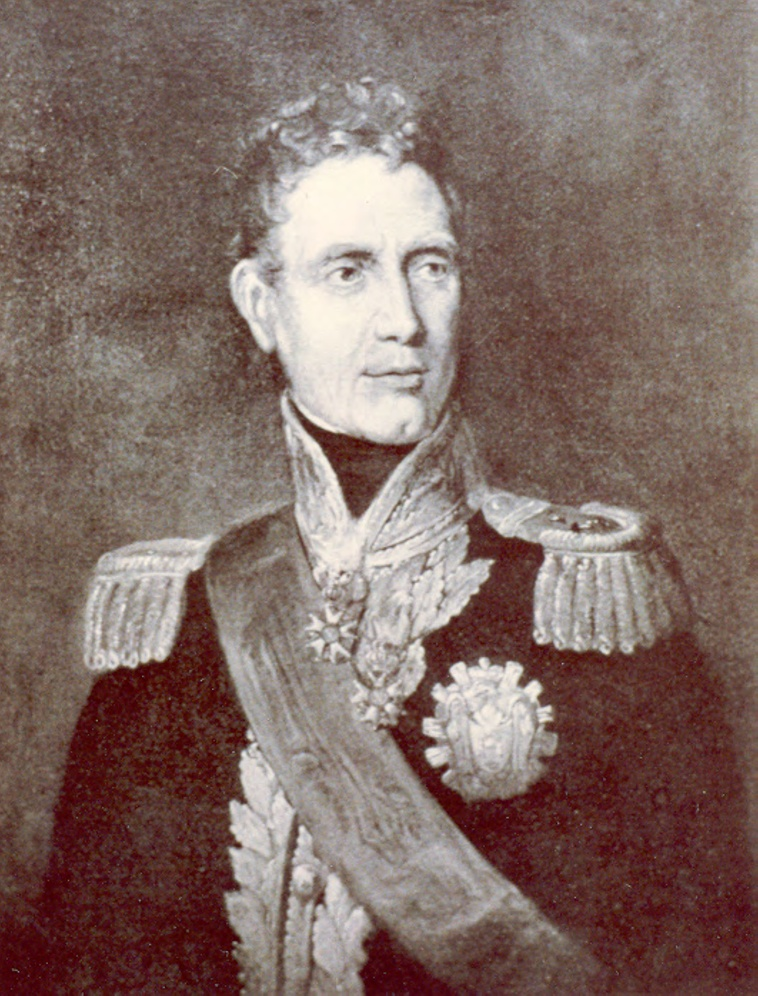

> *Plate 29. Jan-Willem Janssens (1762-1838), governor of Cape Colony (1803-1806) and of Java (May-September 1811). Photograph by courtesy of the Rijksmuseum, Amsterdam.*

News of the fall of Meester Cornelis on 26 August in a bloody battle in which the British suffered over 500 casualties during their destruction of Janssens’ defending force, was relayed to Yogya via the Semarang divisional commander, Brigadier-General F.C.P. von Winckelmann, on 1 September. The same dispatch brought the news that Janssens had moved his seat of government to Semarang.[^91] The death toll on the Franco-Dutch side at Cornelis had been so high – fifty percent amongst their European and Ambonese troops and far higher when it came to their Javanese and Madurese auxiliaries – that the rumour reaching the Principalities at this time was that the victorious British-Indian troops had behaved with extreme brutality, destroying everything in their path and giving no quarter (Aukes 1935:35). On the day of the fall of Cornelis, Lord Minto, the governor-general of India (in office 1807-1813), who had accompanied the expedition to Java, issued a proclamation setting forth the liberal and enlightened principles on which the new British government would be based. In particular, he promised the Javanese an amelioration in their condition:

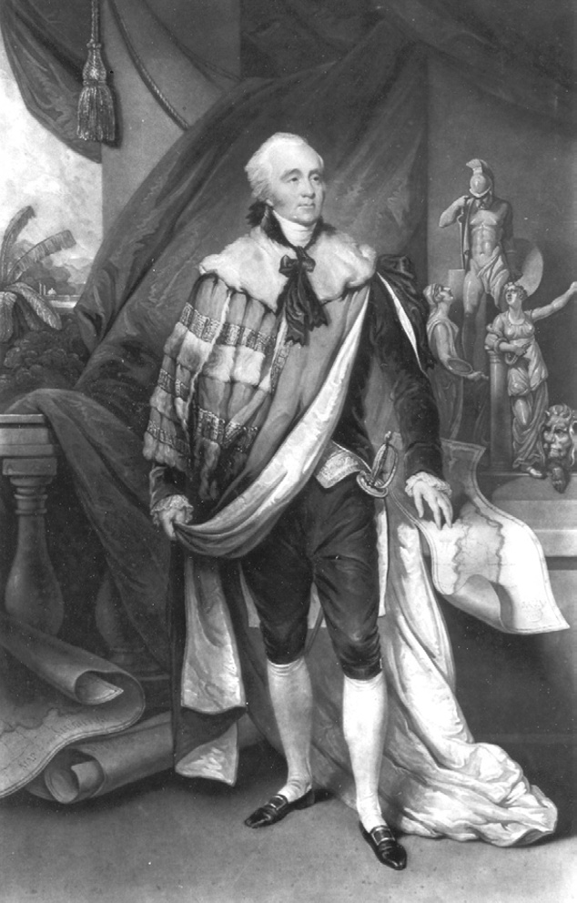

> *Plate 30. Gilbert Elliott, first Lord Minto (1751-1814), governor-general of India (in office July 1807-October 1813), who accompanied the British expedition to Java in 1811. Portrait by George Chinnery (1774-1854) made in Calcutta in late 1811 or 1812, showing him in his earl’s robes with maps of Java, Bourbon and Mauritius. Photograph by courtesy of the National Portrait Gallery, London.*

> The inhabitants of Java now touch the fortunate moment when they will be placed under the protection of a power which will keep the calamities and sufferings of war far from their shores and under the guardianship of a just and beneficent government whose principle it is to combine the interests of the state with the security, prosperity and happiness of every class and denomination of the people. Let the people prove itself worthy of those blessings by a timely display of grateful zeal and obedience.[^92]

This was followed up on 6 September by a further announcement specifically targeted at the south-central Javanese rulers sent by Minto’s aide-de-camp, Captain William Robison, from Cirebon, which spoke of the whole province of Cirebon as well as Jaccatra (Batavia) and west Java now being in the hands of the British. All further resistance by ‘French fugitives’ from the rout at Meester Cornelis would be in vain, the announcement declared, so the rulers should not be deceived by the ‘ministers’ at their courts into providing further assistance to Janssens; rather they should understand that Lord Minto desired good relations with them.[^93] It is doubtful that these proclamations had any effect in swaying the allegiance of the Yogya court. The Prince Regent especially feared that any abrupt political change would undermine still further his already precarious position, and Engelhard remarked on his ‘incomprehensible fear of his father’ at this time. In the deliberations which took place in the kadipatèn about the number of Yogya troops which should be sent to assist Janssens in Semarang, it was clear that the Prince Regent could not decide anything without the approval of his father.[^94]

On 4 September, 2,400 Yogya troops left for Semarang to join the forces of the Sunan and Prangwedana (Mangkunagara II) in Janssens’ second line of defence in central Java.[^95] But the Franco-Dutch position was hopeless; Janssens had lost all his artillery at Meester Cornelis and his attempt to hold the line in central Java had more to do with personal honour than with military realities.[^96] Moves by the old sultan to have his favourite son Mangkudiningrat appointed as the Yogya commander were frustrated by Janssens who rightly judged that this would strengthen his position in the kraton.[^97] At the same time, the presence in Semarang of Pangéran Natakusuma and his son, who had been brought with Janssens as free men from Cirebon on 1 September, made the Prince Regent extremely apprehensive. He urgently besought the governor-general through Engelhard not to let them fall into the hands of the British and he attempted to dispel the favourable impression of the two Yogya nobles entertained in some European circles.[^98] On 11 September, the news of the capture of Sumenep and the promotion of the Panembahan of Sumenep to the title of sultan by the British caused the Prince Regent even greater distress, mainly, so Engelhard noted, because of his close family connections with Madura through his mother (Thorn 1815:93; Chapter II). He refused to believe the news, stating that it was a trick of the British enemy to get the ‘Sumeneppers’ on their side.[^99] In an attempt to bring him round firmly to the cause of the Franco-Dutch government, Engelhard promised that the lands annexed by Daendels in the 10 January treaty would be returned to Yogya.[^100] But the fate of the Prince Regent and his party was already sealed. On 12 September, 1,600 British troops landed at Semarang and four days later at Jati Ngalèh near Serondhol on the heights above Semarang, Janssens and his Javanese allies were comprehensively defeated (Thorn 1815:97-101; Aukes 1935:38-47). Amongst the Javanese troops, only the horse artillery of Prangwedana’s legion and the Surabaya regiment acquitted themselves with any bravery (Thorn 1815:100; Aukes 1935:43-4). Reports on the conduct of the Yogya troops, who had been the first to bear the brunt of the surprise British early morning attack on Janssens’ left flank (Aukes 1935:43), were more mixed. But after their initial pell-mell flight, they appear to have fallen back in some semblance of order to Bojong in Kedhu where the Prince Regent, who was deeply disturbed by news of Janssens’ defeat,[^101] demanded an explicit demobilisation order from the governor-general before he would allow them to return to Yogya.[^102] The rest of the Javanese auxiliaries collapsed in a miserable fashion, turning on their officers and fleeing back to Surakarta (Thorn 1815:100; Hageman 1856, VI:409; De Jonge and Van Deventer 1884-88, XIII:547-8; Poensen 1905:258; Aukes 1935:43).

Following his defeat, Janssens retreated to the eighteenth-century Dutch fort, ‘De Hersteller’,[^103] at Salatiga, but further resistance was pointless. On 18 September, at the bridge at Kali Tuntang, which Radèn Rongga had ordered destroyed at the start of his rebellion on 20-21 November 1810 (Chapter VI) and which the Prince Regent was even now expecting to be broken by the vanquished Janssens, the second and last of the Franco-Dutch governor-generals signed the articles of capitulation. This allowed all civilian officials, who had held office under the Franco-Dutch government, to offer their services to the new British administration, while all those with military commissions became prisoners-of-war (Thorn 1815:101; Soekanto 1952:83-7). The British were now the undisputed masters of Java and its eastern dependencies. It was the start of a five-year interregnum which would witness remarkable changes in colonial policy, but would also see the principles so confidently proclaimed by Minto at Weltevreden on 26 August sacrificed on the altar of political expediency.

## The squaring of accounts

A very confused period now ensued in the wake of the Franco-Dutch government’s collapse. In the countryside, bands of robbers, some no doubt acting on the orders of the south-central Javanese rulers, terrorised travellers and plundered the homes of Europeans. Janssens’ last military headquarters at Salatiga was amongst the places targeted and his cipher correspondence with the minister of the colonies taken (De Jonge and Van Deventer 1884-88, XIII:548). Captain Robison, Lord Minto’s Dutch-speaking aide-de-camp, who undertook an unauthorised mission to the courts from 21-27 September, the coast of Java at Indramayu on 31 July 1811. Engraving by Charles Rosenberg (flourished 1845). Photograph by courtesy of the British Library, London.

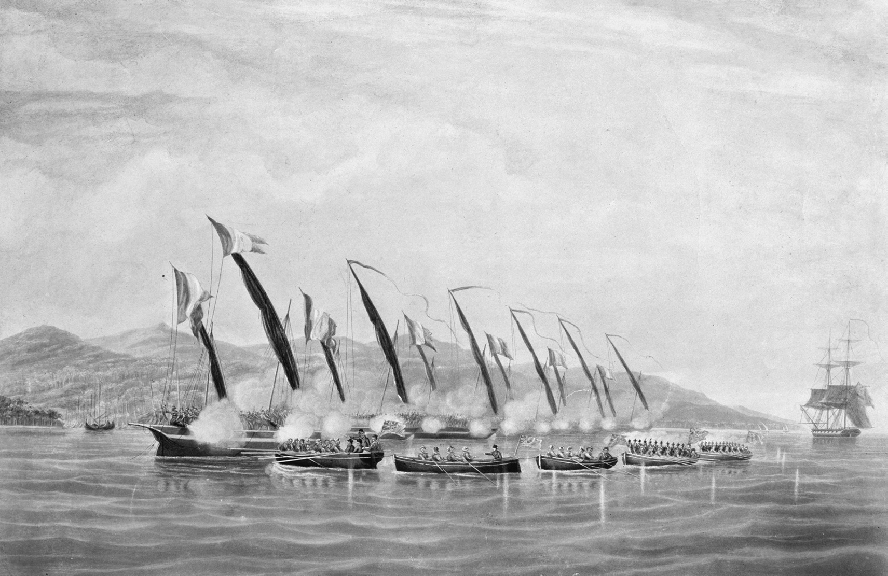

> *Plate 31. Boats of His Majesty's Sloop Procris attacking and capturing six French gunboats off mid-19th century) after a painting by the celebrated naval artist, William John Huggins (1781-*

noticed groups of roving bandits on the road as he set out for Surakarta.[^104] By the time he reached the Sunan’s capital, however, advanced units of the Buckinghamshire regiment (14th Regiment of Foot) were an already visible presence watched by thousands of curious onlookers who crowded the streets for their first glimpse of Java’s new conquerors.[^105]

Robison’s task, given to him by the British commander-in-chief, Sir Samuel Auchmuty, was to assure the Surakarta and Yogyakarta rulers of the friendship of the new British government and to sound out their views.[^106] On 22 September, he had a secret meeting with the Sunan in the house of the Surakarta Resident, J.A. van Braam, in the presence of twelve of his senior court officials. The Surakarta ruler articulated a number of grievances with the former government of Daendels, which give a good indication of the issues which had built up at the courts over the previous three years. In particular, he singled out the marshal’s withdrawal of the strandgeld payments (which he wished to have paid in good copper coin), the despoliation of the most important royal tomb on the north coast, that of Sunan Amangkurat I (reigned 1646-1677), and the change in court ceremonies and etiquette, ‘from which’, according to Robison, ‘His Majesty’s dignity has suffered not a little’. Henceforth, he asked that the pre-July 1808 ceremonial be restored for the reception of the Resident and all other European officials in the kraton.[^107]

Similar demands were made in Yogya by the old sultan and the Prince Regent in a joint audience with Robison, where they especially complained of the suffering of the Yogya inhabitants in areas bordering on the European-controlled pasisir during Daendels’ administration.[^108]

Although the demands made to Robison at the two courts were similar, the infantry captain noticed that the political atmosphere in Surakarta and Yogyakarta was very different. Whereas it would be an easy matter to maintain a good understanding with the Sunan ‘who is well-disposed and pliant’, he reported, the old sultan was a different story. He appeared to Robison both headstrong and difficult to deal with, all the more so because of the indignities heaped on him by Daendels. ‘So jealous is the old sultan of his prerogatives’, he wrote, ‘that he is constantly interfering with the Prince Regent who is too weak and fearful to resist.’ The Regent himself was ‘on the contrary more tractable and, if established beyond the control of the sultan, things should go well enough’.[^109] Robison’s shrewd judgement, based on extensive discussions with Engelhard, foreshadowed Raffles’ later policies. But for the time being, the old sultan had the upper hand. In his babad, Dipanagara described how the former monarch was ‘overjoyed’ that the Dutch had been defeated for he now felt able to carry out his plans.[^110] Thus, he wrote to Lord Minto immediately after his meeting with Robison to request the return of Pangéran Natakusuma and his son from Surabaya where they were being held under British protection.[^111] He also seemed poised to take back full administrative responsibilities from the Prince Regent, although there is no specific reference to this in Engelhard’s letters until 7 November when the Prince Regent reported that the differences between himself and his father had been ‘resolved’.[^112]

In early October, Engelhard began to notice an unusual atmosphere in Yogya. ‘There are strange happenings here’, he wrote, ‘and I do not know what to ascribe them to.’ The patih refused to visit him in the Residency where he lay bedridden with a chronic heart condition and consumptive fever which would later kill him. At the same time, the countryside continued to be disturbed by marauders who appeared below the very walls of the newly built fort at Klathèn where on two successive nights they attacked the house of a retired Dutch sergeant.[^113] Unbeknownst to the Resident, who had fortified his residence and garden with cannon,[^114] the old sultan was preparing to take action against the patih to clear the way for his own re-seizure of power and to avenge the indignities he had suffered. His favourite, Purwadipura, was recalled from his forest exile at Sélamanik and orders were given to his court bupati to have as few dealings with European officials as possible.[^115] Then, on 28 October, Danureja was summoned to a morning meeting in the kraton. On entering the Purwaretna pavilion, the place where the court pusaka (heirlooms) and the eternal flame from Séla were kept (De Graaf and Pigeaud 1974:30), he was seized from behind by seven senior officials led by Radèn Tumenggung Sumadiningrat.[^116] Amongst these were Radèn Tumenggung Mertalaya (the so-called ‘killer’ bupati because of his role in hunting down Radèn Rongga), Purwadipura, Radèn Tumenggung Prawirawinata, a brother of Ratu Kencana Wulan (Carey 1992:413 note 72) and Jaya Ngusman, who is described in the sources as a ‘man of religion’.[^117] An hour later, Danureja was strangled with white cloth – the usual method of execution of members of the Javanese elite because it did not draw blood or leave marks on the body.[^118]

At daybreak the following morning, his body was taken south for interment at the traitor’s graveyard just beyond Imagiri where Radèn Rongga’s hacked corpse had been laid to rest just ten months previously.[^119]

On 31 October, Engelhard received a report from Pangéran Dipakusuma, the joint acting bupati wedana of the eastern mancanagara who was in Yogya for the Garebeg Puwasa, to the effect that Danureja and his father, the gallant but dim Radèn Tumenggung Danukusuma, who had just returned from commanding the Yogya forces at Jati Ngalèh (Serondhol), had been ‘dismissed’.[^120] In fact, Danureja had been dead for three full days and, as we will see shortly, his father would not be long in following him. Danureja’s uncle, Kyai Tumenggung Sindunagara, the prematurely aged Outer bupati had been appointed to take Danureja’s place.[^121] Within an hour of his meeting with Engelhard, Dipakusuma was back at the Residency with a short official letter from the sultan confirming the patih’s ‘dismissal’ and referring to his many defects. These included besmirching the Islamic religion (angresahi agami Islam), demeaning the sultan’s royal dignity, and violating both his injunctions as sovereign and those of the late Sultan Mangkubumi. His father, Danukusuma, had been ‘struck’ (tiwas) by his son’s misfortune (Carey 1980:76-7). Two references in the old sultan’s letter leap off the page: his evocation of Mangkubumi’s legacy underscores once again what a massive and enduring influence the founder of Yogya had on the younger generation who governed his kingdom in the early nineteenth century. Even more significant, however, was the way in which the Islamic religion (agami Islam) appears in the text. It may be that the sultan had the syariah (Islamic law) in mind. We have seen above how the political crisis of the past ten months had led to a greater assiduity on his part in attending the Friday services at the Great Mosque as well as the twice weekly prayer meetings of the court santri. But there is something larger being evoked here: Islam seems to be being used as a shorthand for the Javanese-Islamic moral order in general. Indeed, we will see how this equating of agami Islam with the moral order would become an especially salient feature of Dipanagara’s struggle during the Java War.

Confirmation of Danureja’s death only reached Engelhard on 7 November[^122] and the Resident was later much censured for allowing the sultan to perpetrate his murder (De Haan 1910-12, I pt. 2:98). Certainly, the ruler’s action was in direct contravention of two of the key articles of his contract with the VOC agreed at the time of his accession on 2 April 1792 (Carey 1980:76 note 1). But given Engelhard’s very poor physical health, he was in no position to do anything at the time. Besides, he himself was in some personal danger and was later attacked by a band operating under the second sultan’s orders as he made his way in a sedan chair through the Jambu hills to Semarang after relinquishing his post to Crawfurd in mid-November.[^123] Both in this attack on the Resident and the brutal murder of Danureja six weeks previously, the old sultan was taking revenge for the humiliation of Daendels’ policies during the previous three years.

The position of the Prince Regent was now desperate. With his main supporter murdered and the Resident in such a sickly condition, nothing appeared to stand in the way of his own destruction. Engelhard noticed how at this time, the Regent – who had de facto returned to his previous rank as Crown Prince given the sultan’s re-seizure of power – appeared to be sunk into a state of deep grief for a number of days.[^124] In his babad, Dipanagara also gives a graphic account of his father’s plight, describing how he was summoned from Tegalreja on 1 November to find the great outer doors of his father’s residence, the kadipatèn, bolted and guarded by members of the firm Islamic community and the ‘priestly’ Suranatan regiment.[^125] The prince adds a description of his own mediating role which appears nowhere else in the sources and cannot be verified. His father, he says, informed him of Danureja’s death and asked what he should do in the event that the sultan summoned him to the kraton. Clearly, he feared that he would meet the same fate as the patih. Dipanagara gave him the advice not to go that night. Instead, he, the prince, would accompany his father to the kraton when he was next bidden to an audience with the Yogya ruler. Meanwhile, he told his father that he had thrown away the bolts to the outer doors of the kadipatèn and dismissed his Suranatan bodyguard in order to avoid any misunderstanding with the old sultan.[^126] If we are to believe Dipanagara’s account, he succeeded in mediating a potentially dangerous situation.

Four days later (5 November), the erstwhile Regent (now Crown Prince) made his attendance on the sultan surrounded by all his relations, including the twenty-six-year-old Dipanagara – then still styled Radèn Antawirya – who was now fast emerging, according to his own testimony and that of at least one of his Yogya contemporaries, as his father’s chief political adviser.[^127] The former Regent accepted the sultan’s explanation for the patih’s death and made his peace with him. On 7 November, Engelhard reported that the differences between the Prince Regent and his father had been overcome.[^128] In a secret letter to the Surakarta patih written around this time, Sumadiningrat also mentioned that the ex-Regent, now Crown Prince, was ‘completely obedient’ to the sultan.[^129] Sometime later, the ex-Regent wrote to the sultan formally relinquishing his previous position and was reinstated once again as Crown Prince.[^130] By this action, Dipanagara suggests in his babad, he hoped to forestall any move to appoint Mangkudiningrat in his father’s place and to present a united front against the British. Indeed, Raffles would later remark on the extraordinary ‘filial piety’ of the Crown Prince for his father at this time,[^131] a judgement clearly based on Crawfurd’s own assessment that ‘the Crown Prince’s conduct to his father has been marked by a tenderness and deference not usual under such circumstances as those in which he has been placed’ (Carey 1980:85 note 1). Something of this same deference would also be evident in Dipanagara’s actions at the time of the sultan’s death on 3 January 1828 when he went out of his way to show respect for his late grandfather despite the vicissitudes of war.[^132] But events were soon to undermine the precarious unity of the Yogya court.

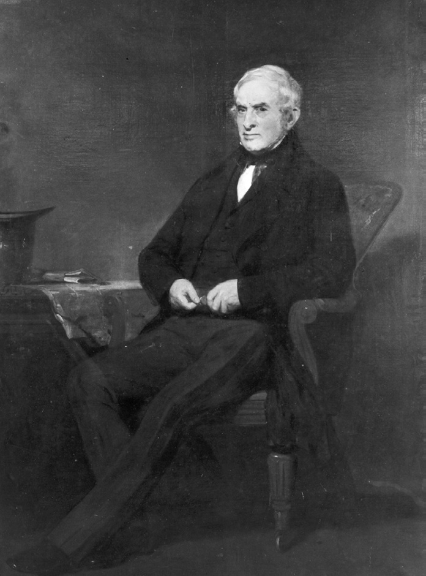

> *Plate 32. Portrait of John Crawfurd (1783-1868), who served as Resident of Yogyakarta with intermissions from November 1811 to August 1816 and was centrally involved with the political arrangements relating to the British attack on Yogyakarta in June 1812. Study in oils painted in Edinburgh by Sir John Watson Gordon, R.A. (1790-1864) at the request of the European inhabitants of Singapore who commissioned the portrait for their new town hall. It was first exhibited at the Royal Academy in London in 1858. Photograph by courtesy of the National Museum, Singapore.*

## The British attempt at compromise and Raffles’ first visit to the courts

On 14 November, the new British Resident,[^133] John Crawfurd, arrived in Yogya with an escort of 300 sepoys drawn from the Bengal Light Infantry Volunteer Battalion then in transit at Semarang. The British-Indian soldiers’ immediate task was to relieve the garrison of 70 Ambonese cavalry,[^134] but during the next four years they would undertake lengthy tours of duty at the courts until their involvement in the sepoy conspiracy of October-November 1815 necessitated their immediate and permanent withdrawal from south-central Java (pp. 415-28). The following day, Engelhard formally handed over the Residency seals to his successor.

Crawfurd was undoubtedly one of the most able officials to serve in the sultan’s capital in the four decades when Dipanagara was living in Yogya before the Java War. As we have seen, the prince would later place him above all the Dutch Residents he met in terms of character and ability (p. 108). He was also by all accounts a rather popular Resident with the local Javanese elite who appreciated his willingness to learn to speak fluent High Javanese and to allow his horses to participate in the English-style horse races in the town (De Haan 1935a:529; Carey 1992:296, 420 note 106, 453-4 note 262, 524 note 617). But he did not start off well in his new post. Within days he had managed to anger not only the sultan, but also his immediate superior, Raffles, and the new commander-in-chief of the army, Colonel Robert Rollo Gillespie, three of the most important men in Java. Crawfurd’s instructions had been to spend time in Semarang and Surakarta before proceeding to Yogya. However, the news he received while in the two central Javanese towns from the Dutch Residents at the courts and from the Sunan about the actions of the Yogya ruler was so grave that he decided to take along a sizeable sepoy escort for his own safety. There were even rumours that he would himself be attacked en route by the sultan’s forces. In direct contravention of Raffles’ and Gillespie’s orders, he also detained the Light Infantry Volunteer Battalion, which was destined for Surabaya, in Semarang in case he needed to call on further troops.[^135] On 18 November, Raffles wrote deprecating Crawfurd’s action for which he had no superior authority.[^136] The irascible Gillespie’s reaction is unrecorded, but it would certainly have been vivid and unprintable. In fact, far from being attacked, the Scotsman was met at Prambanan by the second sultan’s ambassadors who presented him with their ruler’s compliments and went out of their way to show him the customary respect. Once safely arrived in Yogya, however, he ignored Raffles’ explicit instructions that he should not to bring any further disharmony into European government-Yogya relations,[^137] and in particular that he should thoroughly investigate the possibility of restoring the sultan and maintaining the Regent as Crown Prince (Van Deventer 1891:307-8).

The new British Resident seems to have arrived in Yogya with his mind already made up against the old sultan and his supporters. ‘The sultan is a sulking old rogue’, he confided to his Surakarta colleague, Colonel Alexander Adams, on his first full day in office.[^138] A curt note almost calculated to offend was sent that day to the court with the Resident’s official seal at the bottom rather than in the usual place at the top left-hand corner:

> The undersigned elected British Resident to the court of Djocjocarta has learnt with much surprise the unwarranted steps pursued by that court without the knowledge or sanction of the legitimate representative of the British Government, Mr [Pieter] Engelhard.

> The undersigned is in duty bound to enter his solemn protest against all the measures of the court of Djocjocarta since the 31st October and to decline all intercourse with it until he receive the commands of that Government which manages the affairs of the conquerors of Java.

> The British Resident avails himself of this opportunity to assure the royal family of Djocjocarta of his high esteem and consideration.

> Done at the Residency House of Djocjocarta this fifteenth day of November 1811.[^139]

With almost Daendelian brazenness, Crawfurd toyed with the idea of capturing the second sultan by surprise, and re-appointing his son as Prince Regent.[^140] On 17 November, he wrote to Raffles stating that he thought both Hamengkubuwana II and Mangkudiningrat should be exiled from Java.[^141] ‘Fear and not affection are now the tie of the people’, he confided in his survey of the leading figures at the court in early December, ‘for the conduct of the sultan has of late been very oppressive […] fines are levied on the rich on the most trivial pretexts […] [and] sons are seldom allowed to succeed to their fathers’ [estates] without the payment of heavy costs’.[^142] The Regent was, however, ‘a man of good sense and conduct and of mild manners and disposition’.[^143] He also formed a high opinion of the absent Natakusuma, whom he had met before arriving in Yogya, though not of his vindictive son, Natadiningrat, and urged the lieutenant-governor that they might be used as secret and confidential agents of British policy should their services be required.[^144]

Crawfurd declined to meet the sultan in the kraton for nearly two weeks after his arrival.[^145] He also refused to accept Sindunagara as patih because his appointment had been made without official British approval. Indeed, it was not until 22 January 1812 that the acting patih was able to take the official oath of allegiance to the British government.[^146] All the aged Sindunagara’s attempts to get Crawfurd to have an audience with the Yogya ruler were rebuffed. The Yogya monarch for his part was confused. Raffles’ letter of 20 December 1810 from Melaka had spoken of his being ‘restored’ to his full dignity as ruler. He was thus under the impression that the new British government had accepted his political revolution. Indeed, he believed that the relevant dispatches from Minto and Raffles recognising his fait accompli had been intentionally hidden by Engelhard and Danureja II. This was one of the reasons, according to a later Dutch commentator, why the patih had been murdered and the Resident attacked on his journey to Semarang.[^147] Now the new British appointee was formally protesting his actions. What was he to make of all this? In response, he sent a joint letter with the Crown Prince pointing out that Crawfurd, referred to as ‘the minister who appended his seal to the bottom of his letter‘, was not allowed to meddle – literally ’act as a guardian angel for’ (ambaureksa) – in the events which had taken place in the kraton since 1 November (Carey 1980:77-9).

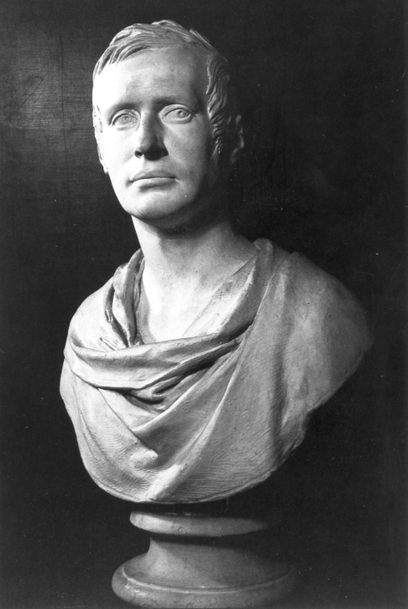

> *Plate 33. Sir Thomas Stamford Raffles (1781-1826), lieutenant-governor of Java (October 1811-March 1816). Copy of a plaster bust made by Sir Francis Legatt Chantrey (1781-1841) in 1817. Photograph by courtesy of the India Office Library and Records, London.*

Meanwhile, Raffles had become seriously alarmed about his subordinate’s actions. He feared that they were leading the newly established British government into a showdown with Yogya just at a time when troops were thinly spread:[^148] the bulk of the invasion force was being withdrawn from Java after completing their operations against the Franco-Dutch forces and those that remained were being readied for deployment elsewhere in the archipelago.[^149] The onset of the rainy season was also a consideration. A campaign in central Java at this time would be particularly difficult.[^150] ‘It must be laid down as a principle in all our dealings with the native courts’, he wrote in a secret dispatch to Crawfurd on 15 December, ‘that in no case must we demand what we cannot enforce in case of refusal’ (Van Deventer 1891:313). In fact, the lieutenant-governor’s demands at this time were quite minimal and in part almost as politically naive as those of his Yogya representative. In late October, he had already assured Minto that the second sultan’s reinstatement seemed ‘practicable […] without endangering the tranquillity of the country’,[^151] and he reiterated this view in another secret dispatch to Crawfurd in early December, adding the condition that the Yogya ruler should write a letter of atonement for his recent actions. Then came a remark of stunning ignorance: if he still proved intractable Yogya should be placed under the administration of the Sunan![^152]

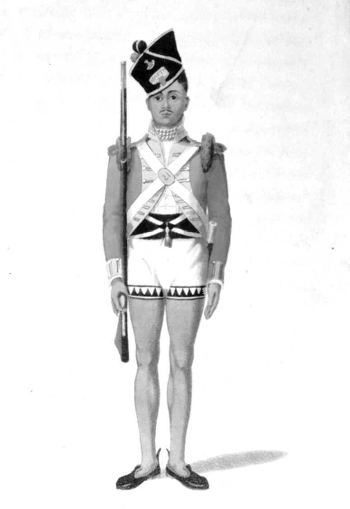

> *Plate 34. Aquatint by William Daniell (1769-1837) of a Light Infantry Volunteer Battalion sepoy who took part in the British attack on the Yogya kraton in June 1812 and the sepoy conspiracy of 1815. Taken from Williams 1817; 331 facing. Photograph by courtesy of the Bodleian Library, Oxford.*

Even before these secret dispatches were written and prior to his own arrival in Semarang, Raffles had instructed Crawfurd to climb down and meet with the sultan and the Crown Prince.[^153] The audience took place on 26 November and seems to have passed off well enough under the circumstances, although the Resident noticed with dismay that instead of sitting next to his father or on a stool, the Crown Prince sat on the floor with the other senior officials, and the second sultan’s throne was once again raised above his own seat by the insertion of a wooden bench.[^154] The Yogya ruler was clearly determined to return to the pre-July 1808 status quo, something which Raffles again appeared to have encouraged in his Melaka dispatch.

Soon after this initial meeting, however, relations between the British Residency and the court came under renewed strain due to a series of incidents involving members of the sepoy garrison. Over a period of six days (29 November-4 December), Yogya inhabitants, particularly those who worked in the main market Pasar Beringharjo, reacted to what they perceived as the offensive habits of the Bengali soldiers by acting in Crawfurd’s words in ‘a publicly insulting fashion’ towards them. In at least one case a knife was drawn, and in another stones were hurled at a sepoy who was visiting the main market (Carey 1980:79-81). A later Dutch source even speaks of a mortal wounding of one of the sepoy guards at the fort, but this is not confirmed in the official correspondence.[^155] Nahuys van Burgst, who had access to the Residency archive during his own six-year tour of duty in the sultan’s capital (1816-1822), subsequently wrote that the ‘immorality’ of the garrison at this time nearly caused a mass local uprising against the Europeans in the sultan’s capital.[^156] Raffles recognised that the ‘habits and manners’ of the sepoys were offensive to the Javanese and ‘often produced disturbances’, but he also stressed that they were ‘of the best service’ because ‘the Javanese stand in great awe of them’.[^157] Since British power in Java was to a large extent based on their Indian – particularly Bengali – soldiery, the sepoys were not easily replaceable with European or Indonesian troops,[^158] especially at a time when intense debate was taking place in the lieutenant-governor’s council about force levels in British-occupied Java and the need to make economies (Thorn 1815:200; De Haan 1935a:553).

Another source of conflict in mid-December had to do with the dispatch of a customary letter of greeting and ambassadorial mission led by the acting patih to Raffles in Semarang as the incoming ‘governor-general’. Since Raffles held the title of lieutenant-governor, this may have confused the Yogya court into thinking that they were dealing with a British version of the defunct governor of Java’s Northeast Coast (Chapter V). It is clear from an extant letter from the sultan and the Crown Prince to Raffles dated 19 December that the lieutenant-governor was being addressed as a ‘good friend’ and ‘brother’ (Carey 1980:86-7) rather than the more customary ‘grandfather’ (éyang) (Ricklefs 1974a:373). Crawfurd had protested that the usual forms of address had not been followed and the letter was not allowed to be sent.[^159] In particular, he objected to the opening phrase in the letter ‘from the sultan holding court in Yogyakarta’ because he felt the Prince Regent was brought into degradation by the expression (Carey 1980:83 note 2). He thus insisted on dictating a revised letter and ordering that a new mission should be sent under the acting patih to present it.[^160] But it seems that both Crawfurd and Raffles, who was then travelling to Surabaya before proceeding on to Surakarta,[^161] expected this ambassadorial mission to meet the lieutenant-governor in the Sunan’s capital rather than at Semarang. This neither the sultan nor the Crown Prince would accept (Carey 1980:83-5). Again Raffles and his representative in Yogya had shown a basic misunderstanding of court politics in south-central Java.[^162] Eventually, Sindunagara was sent to the north coast with the revised letter only to find that Raffles had already departed for Surakarta (20 December) on the first stage of his December visit to the courts (Hageman 1857:416). Sumadiningrat reported at this time to his Surakarta counterpart, Radèn Adipati Cakranagara, through the secret back channel which had now been opened between the two courts, that the Resident’s actions had united the sultan and the Crown Prince ‘as one person’ against the opinionated Scot.[^163]

On 16 December, Natakusuma was returned to Yogya from Surabaya by the British government after deeply impressing Raffles with his understanding of political affairs in the sultan’s capital.[^164] He had an immediate audience with the sultan and told him of the lieutenant-governor’s concerns about the ruler’s slighting of the previous Franco-Dutch government – a reference to the Yogya monarch’s unilateral resumption of his full royal powers – and the appointment of a patih without the approval of the government. Before Raffles arrived in Yogya, Natakusuma informed the sultan, he would have to return political arrangements to what they had been under Marshal Daendels by placing the Crown Prince once more in charge of the kraton as Regent. Then when the lieutenant-governor came, he would formally reinstate Hamengkubuwana II to his previous position as ruler (Carey 1980:66-8, 90-1). We know that while he was still in Surabaya on 15 December, Raffles had instructed Crawfurd that the sultan should formally resign the royal government into the hands of the Crown Prince before he could be reinstated. But what Natakusuma had not told his elder brother was that this would involve the British Resident dictating a letter which would, as Raffles put it, ‘express […] in such words as to adequately answer the purposes of atonement intended. The letter should contain the best excuse for his conduct that can be adduced […] [this] will in my opinion be sufficient […] on the part of the sultan and a justification for my again placing him in power’ (Van Deventer 1891:312-3; Carey 1980:85 note 1).

The intended letter was eventually written on 19 December, although the sultan refused to cleave exactly to Crawfurd’s draft text. In suitably contrite tone, the Yogya ruler begged the forgiveness of the ‘high officers’ of the British government and stated that he had only acted ‘high-handedly’ against the previous Franco-Dutch government because it had lost all authority after the unconditional capitulation of Janssens at Kali Tuntang (18 September). Moreover, the former Prince Regent had not acted unpleasantly towards him, but had always behaved with extreme obedience and respect. It was quite otherwise with the deceased patih, however, who had conducted himself evilly, grieving the sultan’s heart and angering him greatly. He had also behaved badly towards the wives and children of leading Javanese, a reference to Danureja II’s supposed role as a procurer of young girls for the ex-Regent (Chapter VI). The sultan declared himself well pleased to confirm his son once more in control of the affairs of state but craved the ‘justice and fairness’ of those now in charge of the administration of Java – a clear echo here of Minto’s 26 August proclamation from Crawfurd’s pen – and hoped that they would return him to his full royal dignity once again (Carey 1980:86-7, 89).

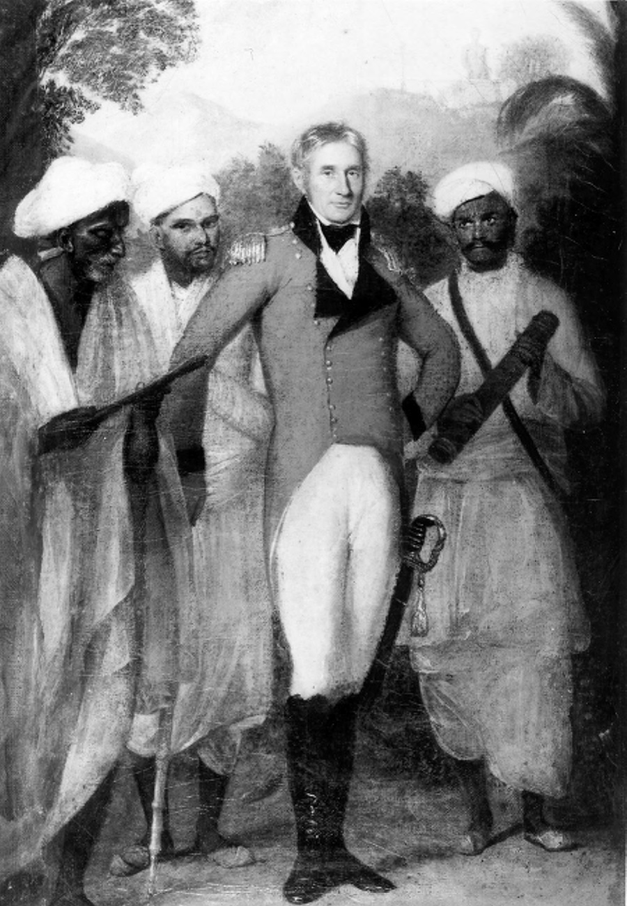

> *Plate 35. Portrait of Colonel Colin Mackenzie (circa 1754-1821), chief engineer to the British Forces in Java, who planned the assault on the Yogyakarta kraton in June 1812, surrounded by his three South Indian pandits who served as his cartographers and language teachers. Painting by Thomas Hickey (1741-1824). Photograph by courtesy of the India Office Library and Records, London.*

At his 16 December audience, the sultan had already told Natakusuma that the Crown Prince and himself were now as one together and stood by their previous actions.[^165] But despite this apparent solidarity, Natakusuma’s return could not have been a pleasant development for the heir apparent who had so recently extricated himself from a perilous political impasse. The sultan’s younger brother had returned to Yogya seething with resentment against his nephew whom he considered as the chief architect of his exile and near assassination. These feelings were undoubtedly heightened when Natakusuma learnt of the plundering of his residence during his absence (Poensen 1905:276-7; Carey 1992:96, 250, 404 note 30). The next six months until the fall of the Yogya kraton to British assault on 20 June 1812, were thus a period of very delicate manoeuvring on the part of the future Pakualam I and the Crown Prince. On the one hand, they needed to protect themselves against the sultan, on the other they had to maintain their good relations with the British government, a difficult combination. In this fine balancing act, the rivalry between the two men was to assume great importance for the prize was nothing less than the throne of Yogya.

Preparations were now set in train for Raffles’ first visit to the sultan’s capital. A three-man commission comprising the lieutenant-governor’s exceptionally able Dutch assistant, Harman Warner Muntinghe, and two Malay-speaking Bengal army officers, Captain L.H. Davy of the 4th Bengal Volunteer Battalion, and Captain W.E. Phillips,[^166] arrived in Yogya on 23 December to make the necessary political arrangements for the visit by entering into pre liminary treaty negotiations with the sultan (Van Deventer 1891:313-4; De Haan 1935a:615; Carey 1980:91). There they liaised closely with Crawfurd who had returned with them from Surakarta where he had conferred with Raffles about the political goals of the visit.[^167] They were also joined by Colonel Colin Mackenzie of the Madras Engineers, Raffles’ chief engineer officer, whose expertise was necessary to provide a detailed assessment of the sultan’s military capacity and the strength of his kraton fortifications should a subsequent British assault be required.[^168]

Crawfurd had apparently pressed his superior to come in person to Yogya with a large military escort to overawe the sultan with British military strength.[^169] But, as we have seen, the lieutenant-governor wished to act extremely cautiously because of the limited number of troops at his disposal. At the time of his first visit to the courts, British forces in central Java numbered just over a thousand men, less than half of whom were Europeans, the rest being Bengal sepoys from the central Javanese garrisons.[^170] Of these Raffles took 400 with him (100 cavalry and 300 infantry) when he arrived in Yogya on 27 December.[^171] On 25 December, he wrote to Crawfurd from Surakarta laying out his views in clear and uncompromising terms. In effect, he reminded his Resident just who was in charge:

> It will be for me to effect by force what may not be managed by negotiation, but I sincerely trust that your influence added to the measures taken by the Commission [of Muntinghe, Davy and Phillips], without whose concurrence you are in no case to act, may supersede the immediate effect of hostilities which under no circumstances short of the most absolute and peremptory necessity can be admitted.[^172]

The issue of the size of the lieutenant-governor’s military escort was also something which greatly exercised the sultan and his eldest son. On 21 December, they sent a joint letter to Crawfurd enquiring whether Raffles would bring a large or a small force with him (Carey 1980:87-8). The Yogya ruler – for it was he who was the principal author of the letter – begged the Resident to tell his superior not to bring a large retinue because this would certainly cause him feelings of unease and unpleasant surprise, feelings which would be shared by the Crown Prince and all the other members of his family. Both the sultan and his heir apparent stressed that they did not want their intimate relations with the British government and its new lieutenant-governor to be sundered or to have to engage in hostilities with them. But if Raffles insisted on bringing a large escort they would interpret this as a sign that he did not trust them, the implication being that this would almost certainly lead eventually to armed confrontation. On 24 December, they reiterated this message in another letter to the Resident (Carey 1980:89). The fact that Raffles insisted on being received in Yogya with the full prerogatives and ceremonial of a visiting governor-general much in the same fashion as Daendels had been during his 29 July-2 August visit of 1809 even though his rank was only that of lieutenant-governor undoubtedly compounded these feelings of unease in Yogya.[^173]

Such preliminaries were hardly an auspicious beginning to Raffles’ arrival in the sultan’s capital on 27 December when he was forced to make his official entrance down the principal avenue (future Jalan Maliabara) with the Yogya ruler’s troops massed on each side bristling with pikes and loaded muskets, as many as 10,000 according to the lieutenant-governor‘s subsequent dispatch to Minto (Chapter 1 note 20). In fact, it was clear that he was negotiating from a position of weakness and his visit was almost marked by tragedy. At the first official meeting between himself and the sultan in the throne room of the Residency, the latter refused to sit on the chair provided for him, insisting instead on using his silver throne under which the inevitable wooden bench had been placed so he could sit higher than the lieutenant-governor. Raffles’ aide-de-camps apparently kicked the bench away with their feet, whereupon some members of the sultan’s entourage drew their krises. British officers then entered the room, which was now so full that if it had come to a fight, weapons could not have been used. Just in time the Crown Prince stepped between the lieutenant-governor and his father and the two men came to their senses.[^174]

The situation was saved, but the incident provided a vivid illustration of the tensions which lay just below the surface, tensions which had been exacerbated on the Javanese side by nearly four years of humiliation and indignity.

On 28 December, a new treaty was signed between Raffles and the sultan. This allowed for the return of all the lands ceded to Daendels under the 10 January treaty except for Grobogan, with its 3,000 cacah and 19,400 Java rupees in annual rents,[^175] which was reserved for Natakusuma. But the strandgeld payments were not reinstated. The tollgate and market taxes were also slated to be taken over by the British government on payment of 80,000 Spanish dollars a year (Van Deventer 1891:318 article 6). This clause, which was not acted upon because of the second sultan’s subsequent opposition in the early months of 1812, later opened the way to much fiscal oppression by the returned post-1816 Dutch administration in the years leading up to the Java War. The cash-strapped Netherlands East Indies government’s attempt to raise as much money as possible from this source regardless of the problems this caused for local trade occasioned much hardship and would be one of the rallying points for popular support for Dipanagara’s rebellion in the Principalities in 1825 (Chapter IX). Meanwhile, Pacitan was annexed to the government, mainly for strategic and commercial reasons, and the sultan was required to lend assistance in the construction of a highway from Yogya to Pacitan Bay:[^176] Raffles wanted access to Pacitan’s harbour and good communications with the interior of Java in the event of a future landing by British-Indian troops on the south coast (Chapter I note 55). A further article attempted to make the Yogya region more accessible to the import of manufactured articles, especially English cotton piece goods.[^177] This carried a stage further the opening up of Java’s interior to the newly industrialising world economy of which Britain was at this time the global leader. It also led to significant developments within Java’s own domestic waxed-dyed fabric (batik) industry designed to counter competition from European textile imports, most notably the greater use of hand block printing (Rouffaer 1904:21-2).

Although Raffles had belatedly abandoned any idea of placing Yogya under Surakarta control, the political clauses in the treaty were not without their problems. In fact, they showed that the lieutenant-governor continued to labour under significant misconceptions with regard to the south-central Javanese court system. Thus, although the Yogya treaty was nearly the same as that concluded with the Sunan on 23 December, it significantly did not include a clause continuing the sultan in his administration such as had been incorporated in the treaty with Pakubuwana IV (Van Deventer 1891:315 note 1 article 2). Instead, the relevant clause of the Yogya treaty envisaged that the Resident, John Crawfurd, would fulfil the role of patih (Van Deventer 1891:317 article 2). Perhaps Raffles hoped that this would keep the sultan in check. But if so, he made a grave blunder. In the Javanese view, it seemed to admit that the Resident was now the servant of the sultan, much in the same fashion as the earlier representatives of the VOC at the courts (Chapter V). Crawfurd must have realised that a cardinal error had been made because shortly after the treaty was concluded the only signed copy ‘disappeared’ from the Residency archive.[^178]

In return for his political advice and assistance, Natakusuma was given an immediate stipend of 6,000 Spanish dollars a year – which was never in fact paid – with a smaller sum of 1,000 Spanish dollars a year being allocated to the Yogya kapitan cina (captain of the Chinese) Tan Jin Sing (in office 1803-1813), who had also provided invaluable services to Crawfurd.[^179] But Raffles later noted that his previous idea of employing Natakusuma as a secret British agent had been sabotaged by Crawfurd’s actions in grooming him as a rival to the sultan and the Prince Regent so that he had already become the object of the greatest jealousy on the part of the court.[^180]

The treaty was destined to be short-lived. Neither side had any intention of abiding by its clauses. According to the Pakualam babad, Raffles had assured Natakusuma that at the onset of the next dry season (May-October) affairs in Yogya would be reconsidered (Poensen 1905:278). In a subsequent dispatch to Lord Minto written after the fall of the Yogya kraton and the subsequent exile of the second sultan to Pulau Pinang in early July 1812, Raffles admitted that ‘the terms [of the 28 December 1811 treaty] were acceptable to me rather as the best, which under the existing circumstances could be procured, rather than […] what I would have wished’.[^181] The sultan immediately set about making preparations for resistance. In Crawfurd’s words:

> The laxity and moderation of British conduct was mistaken for fear […] After the signature of the treaty, an immediate start was made on the collection of troops, the manufacturing of arms and the strengthening of the defences of the cratton [kraton].[^182]

As we have seen, Raffles himself noticed large numbers of troops in the sultan’s capital during his December visit and he remarked on the hostile attitude of the local population towards the British.[^183] Both sides were soon preparing for war. It was evident that a military showdown between the British government and the sultan could not be long delayed.

## Preparations for war

Just as in a Greek tragedy hubris leads on inevitably to nemesis, so it was with the Yogya ruler in the early months of 1812 as he prepared to confront the emerging imperial superpower. Daendels had already written that he sensed that ‘the sultan was hurrying towards his fall’ during the crisis over Radèn Rongga in 1810 (Chapter VI). However, the inherent weaknesses of the Franco-Dutch government and the pressure of world events associated with the Napoleonic Wars, in particular the British invasion of Java in August 1811, had given Hamengkubuwana II a chance to recoup his political position. But once the new Raffles’ administration felt militarily strong enough to confront the Yogya ruler and the dry season allowed more favourable campaigning conditions, the settling of accounts with the sultanate would not be long delayed. Once again, the inability of the Yogya elite to read the runes of world history and adapt to the fast changing international order would lead to disaster.

Soon after Raffles’ departure from Yogya on 29 December 1811, Natadiningrat arrived from Semarang.[^184] His presence doubtless strengthened the position of his father for the Yogya babad remarks on the particularly good relationship which developed between Natakusuma and the sultan at this time.[^185] Raffles too reckoned that Natakusuma was adeptly serving both parties and interests by ingratiating himself with his elder brother, the sultan, while ensuring his links with the European power: ‘It is necessary to keep him loyal to the British government if possible’, he wrote, ‘but not to encourage him in the expectation of the sultanate.’[^186] According to Dipanagara’s autobiography, the sultan’s main enmity was now directed against Dipanagara’s father, for he feared that he had come to a secret understanding with the British.[^187] Moves were thus made against the Crown Prince and his supporters, particularly those who had helped him into power under Daendels. As we shall see shortly, Dipanagara himself was seen as a threat and his life was said to be in danger.

On 15 January, Radèn Tumenggung Danukusuma was sent into exile in Pacitan and strangled in a small wayside prayer house by his kraton escort, his body being interred in a nearby forest before being brought back for ignominious burial at the traitor’s graveyard at Banyusumurup which was now rapidly filling up with the sultan’s victims.[^188] News of the old man’s ‘exile’ had been broken to Crawfurd by Natadiningrat. This announcement and the fact that the event had occurred so soon after the future Pakualam II’s return, caused the Resident to associate the deed with his influence: ‘It has left upon my mind an impression of Natadiningrat less favourable than I was willing to entertain of him’, he wrote to Raffles.[^189] Subsequent Dutch sources also link Natadiningrat to the murder citing his anger at the fact that the aged royal counsellor had been given one of his pusaka (heirloom) krises which had been taken from his residence by Danukusuma’s son, Danureja II, in late December 1810 after Natadiningrat and his father were exiled to Semarang.[^190] Danukusuma’s close family ties to Natakusuma – he was the prince’s brother-in-law – were apparently of no avail in this instance (Mandoyokusumo 1977:12 no. 7, 13 no. 11). After nearly four years of unrelenting political pressure from the European government, feelings were running so high in the kraton that a de facto civil war was now being fought out. Brothers were prepared to kill brothers, and fathers murder sons.

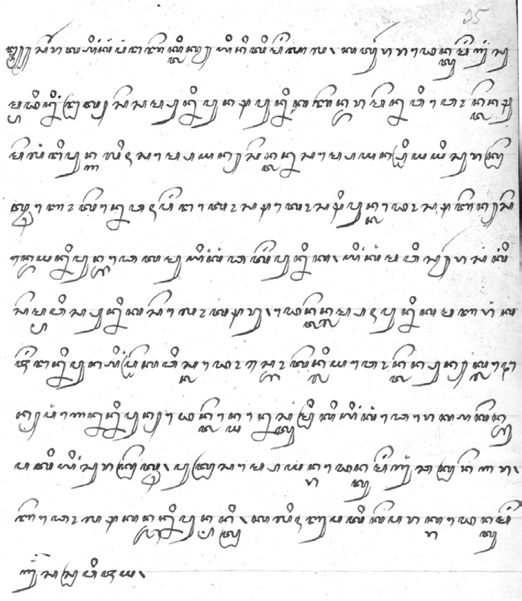

> *Plate 36. BL Add. MS. 12341 f.35r, original note of Kyai Nitimenggala to Radèn Tumenggung Sumadiningrat regarding preparations in Surakarta for the reception of Raffles in December 1811 (Sec. I, pt. 6, doc. VI). Photograph by courtesy of the British Library, London.*

Following the strangulation of Danukusuma, there began a series of moves against the Crown Prince which had as their object his removal and even death. His mother, Ratu Kedhaton, was confined on four separate occasions in the Bangsal Kencana (Golden Hall), a kraton pavilion, because she had protested so strongly against the sultan’s plans to appoint Mangkudiningrat in her son’s stead as Crown Prince (pp. 74-5; Van der Kemp 1896a:321-2). In March, twelve members of the Crown Prince’s entourage, who had been instrumental in effecting the transfer of power in January 1811, were demanded by the sultan to be delivered up to him.[^191] Crawfurd also reported that the Crown Prince’s life was in imminent danger: ‘there is little doubt […] that it is the wish of the Sultan to deprive him of the succession and the shortest mode of accomplishing this will be to take away his life by a dose of poison’.[^192] Crawfurd envisaged that the Crown Prince would soon need to be brought under British protection.[^193]

Throughout this dangerous period, Dipanagara apparently afforded his father constant advice and support, often journeying in from Tegalreja for secret meetings in the kadipatèn. In his babad, he describes how he felt keenly the dilemma of having to choose between his father and his grandfather, counselling the Crown Prince to act with extreme caution.[^194] We know from a subsequent Dutch source that the second sultan was well aware of Dipanagara’s actions in support of his father at this time and intended to have him murdered.[^195] It is striking, however, that Crawfurd in his many dispatches to Raffles during this period never once mentions the Crown Prince’s eldest son. Indeed, nowhere in all of Crawfurd’s voluminous correspondence during his three separate tours of duty in the sultan’s capital (Appendix IX) is there any reference to a Radèn Antawirya (Dipanagara’s pre-July 1812 name) or a Pangéran Dipanagara. This omission is all the more strange given Dipanagara’s boast that the Scotsman had discussed ‘everything in person with his father and himself’ (p. 109) and that he had been charged by his father with responsibility for delicate negotiations with Crawfurd through the Crown Prince’s patih, Radèn Ngabèhi Jayasentika from mid-April 1812 onwards (Louw 1894:36-7). The problem for the historian of the British period in Yogya is that a subsequent Dutch Resident and amateur historian, Frans Valck (in office 1831-1841), who wrote a detailed survey of Yogya history from Giyanti (1755) to the Java War, which was partly published in Tijdschrift voor Nederlandsch-Indië in 1844, used the Residency archive for his research and then appears to have kept many of the letters for his personal collection. A large number of these were apparently from the British period (note 155). We are thus dependant on his testimony and have no means of independently verifying his sources. Valck states unequivocally, however, that according to the Residency archive, Dipanagara was indeed used as a go-between between his father and Crawfurd and was ‘in general very highly regarded by Europeans’ at this time,[^196] a view which was confirmed by a number of Dutch officials at the time of his appointment as a guardian to the child sultan, Hamengkubuwana V, in December 1822 (pp. 509-510). So, until evidence appears to the contrary, we may assume that Dipanagara did play an important role despite his comparatively young age and lack of standing in court councils.[^197]

While these murderous intrigues were moving towards their conclusion, the central Javanese courts came to a secret understanding against the British. The initiative seems to have come from the Sunan who used the back channel which had been kept open between his patih, Radèn Adipati Cakranagara, and Sumadiningrat in Yogya. On 25 March, there is a reference in one of Sumadiningrat’s secret missives to his Surakarta counterpart, quoting the Sunan as writing ‘that he wished to enter into a league and union with his “father” [the sultan] which might descend to their latest posterity’.[^198] The treaty itself took the form of two documents exchanged between the courts. Each document read as follows:[^199]

> The contract of Raden Adipati Cakranagara and Tumenggung Sumadiningrat bearing the royal seal[^200] of His Highness the Susuhunan Pakubuwana IV and also that of His Highness Sultan Hamengkubuwana II and binding upon their posterity. Let this instrument be held by Tumenggung Sumadiningrat in token of the engagement entered into between him and Raden Adipati Cakranagara.

> In the first place, whereas our two sovereigns the Sunan and his father, the Sultan, have now united as one person and exchange expressions of sincerity, it is agreed between them that the country of Java, in the same manner as heretofore possessed by them, shall forever be possessed, viz. one half by His Highness the Susuhunan and the other half by His Highness the Sultan descending to their respective posterity.

> In the second place, it is agreed that should any one of the princes of Surakarta rebel against the sovereign, the same shall be considered an enemy of His Highness the Sultan as well as of His Highness the Susuhunan, and that should in like manner any of the princes of Yogyakarta act disloyally towards His Highness the Sultan, they shall be treated as enemies of His Highness the Susuhunan as well as His Highness the Sultan.

The second clause of the treaty was clearly directed against the Yogya Crown Prince, as Crawfurd later pointed out.[^201] The first, however, seemed to be a reaffirmation of the old division of Java between the courts such as had existed before the changes wrought by Daendels. Pakubuwana IV’s aspirations to be recognised as the senior ruler in Java, which he had put forward in 1790, were also ostensibly abandoned (Chapter V note 16). It thus mirrored the profoundly conservative desire to maintain the division of Java which had been built up so painstakingly since the late eighteenth century (Ricklefs 1974a:339-40). The European government was not specifically mentioned, but the document was clearly aimed against outside interference in the affairs of south-central Java. In a later letter, Sumadiningrat described the recent December treaty with the British in this fashion to his colleague in Surakarta:

> in my opinion, my son, the situation of our sovereigns resembles that of two people secretly engaged in wedlock. Should you consider it in that light then the treaty [with the British] is of no consequence.[^202]

He also adviced Cakranagara that there should be no etiquette of ‘high’ and ‘low’, a reference to the use of the krama (High Javanese) and ngoko (Low Javanese) speech levels, ‘thus all difficulty will be avoided between us two’.[^203]

According to P.H. van Lawick van Pabst, who wrote a subsequent note on the conspiracy during the Java War, the secret agreement involved more than just a mutual aid treaty. Instead, it was specifically targeted against the British with an understanding that, in the event of an attack on Yogya, the Sunan would fall on the British forces from the rear. There were also plans, Van Pabst alleged, for a general massacre of the European inhabitants in the kraton towns, although this is not confirmed elsewhere in the European sources. Preparations for resistance were apparently well advanced by the time the British began to assemble troops for their campaign in late May and early June.[^204] The Sunan used his family connections with Madura to send secret emissaries to the court of his father-in-law, Sultan Sepuh of Madura, the former Panembahan Cakradiningrat IV of Pamekasan (p. 181), as well as to make contacts amongst the north coast bupati who were linked to the court by ties of marriage.[^205] There were even rumours that the Javanese (‘colonial’) corps in Surabaya were preparing to join the uprising.[^206] In the event, Pakubuwana IV left Yogya to its fate. Indeed, once the scale of the conspiracy was fully confirmed following the fall of the Yogya kraton and the capture of its archive,[^207] he ‘drew in his horns’ in Van Pabst’s words and sacrificed his patih, who was exiled to Surabaya. Two other Surakarta officials, the bupati of Blora, Radèn Tumenggung Mertanegara, and a clerk of the Surakarta patih’s office, Radèn Ngabèhi Ranawijaya, who had served as a secret courier, were also briefly imprisoned in Semarang by the British for their part in the affair.[^208]

In his babad, Dipanagara gives a short but rather accurate description of the affair:

> XVI. 23 So His Highness the Sultan was certain to be the enemy of the English. Tumenggung Sumadiningrat was burdened with the task,

> 24 [and] made contact with Surakarta. But His Highness the Sunan trusted in his younger brother Pangéran Mangkubumi and in the patih, Radèn Adipati Cakranagara. So there was an agreement that in future, if it came to battle

> 25 with the English, Surakarta undertook to fall on them from behind. Thus they swore together and exchanged documents with their signatures as an undertaking, indeed for all time. Thus was the agreement.[^209]

Dipanagara’s reference to the key role played by the Sunan’s younger brother, Pangéran Mangkubumi (Chapter V note 42), is fully borne out in the European sources.[^210] Known for his virulently anti-European views and forceful character, the prince was subsequently exiled first to Batavia (1816-1818) and then to Ambon (1818-1824) following his involvement in a second major conspiracy in Surakarta in 1815 linked to the local sepoy garrison (Carey 1977:299, 321 note 104; Chapter VIII). Another of the Sunan’s brothers who played a part in the conspiracy was Pangéran Buminata (Chapter II note 86). As we have seen, both the Sunan and Buminata maintained close links with the religious communities in Surakarta (Chapter II), and these became of increasing concern to the British authorities as the date of their attack neared. On 17 June 1812, the British Resident in Surakarta, Colonel Alexander Adams urged Raffles to caution the Sunan about allowing ‘priests and Arabs’ free access to his kraton, and permitting them to rove the countryside ‘in disguise’ without official passes.[^211] His fears were justified. Not only did court santri carry out important tasks as the secret emissaries between the courts at this time (note 87), but it appears that Pakubuwana IV gave clandestine instructions to his kraton religious hierarchy that in the event of a British attack on Surakarta they were to take to the hills to lead the resistance against the occupying forces.[^212] Public prayers were also said for the safety of the sultan at the Friday service in the Great Mosque.[^213]

Despite the clear evidence of the Sunan’s hostile intentions towards the British, which included the strengthening of his military positions and the stoning of the British cavalry post at the Srimenganti gate by his intimate retainers (panakawan) on 1 June,[^214] he does not seem to have been seriously committed to providing Yogya military help. He flattered the sultan by the use of the title ‘father’ in his letters and urged him on against the British, hoping that this might lead to his own advantage. But, as Raffles pointed out, ‘the Susu[hu]nan has been timid and wavering throughout, anxious to join in anything which could shake the European power, yet afraid to adopt the avowed and open tone of the Sultan’.[^215] From March onwards, soldiers from the eastern mancanagara flooded into the Sunan’s capital until on the eve of the British attack on Yogya some 7,000 troops were available and appeared to ‘await only on instructions from Yogya to commence hostilities’.[^216] But when Colonel Gillespie’s force took up their positions in Yogya on 17 June, the Sunan merely placed a part of his army across their line of communications to Semarang thereby hoping to profit from any military reverse or protracted campaign.[^217] It is uncertain too just how far the sultan placed his trust in the Sunan’s promises. In early May, the Crown Prince remarked to Crawfurd that:

> [There is] little danger to be apprehended from this intended cooperation of the courts, for […] such was the impression the Sultan had of the Emperor’s [Sunan’s] character that [he] placed little reliance on his professions and, as for his part, he conceived that on the first appearance of danger, the Susu[hu]nan would endeavour to recommend himself to the British Government by making a disclosure of the whole circumstances.[^218]

There seems to have been no attempt on the part of the sultan to appeal for help from Surakarta during the actual attack on his kraton. Indeed, after its fall, the author of the Babad bedhah ing Ngayogyakarta (‘Chronicle of the fall of Yogyakarta’), Pangéran Panular, remarked that even with the Sunan’s assistance, Yogya would still not have been able to withstand the British (Carey 1992:107, 267, 433 note 167). According to Dipanagara, immediately after the late March 1812 secret agreement with Surakarta, the sultan was in two minds about whether to implement his plans against the British or to seek a peaceful solution by soliciting their approval for the murder of the Crown Prince and the appointment of his favourite son, Pangéran Mangkudiningrat, in his stead. The prince states in his babad that the Yogya ruler initially decided on the second course of action and tasked Natakusuma with handing over a letter to Crawfurd detailing the sultan’s demands. Unbeknownst to the future Pakualam I, however, the meeting was secretly monitored by the Crown Prince’s patih, Radèn Ngabèhi Jayasentika, who, according to Dipanagara, hid in the spacious attic over the throne room, which a previous Dutch Resident had built for storing the highly valuable birds’ nests,[^219] so he could overhear Natakusuma’s conversation.[^220] The prince was later reported by the British Resident to have said that ‘the main intention of the Sultan is that the Pangeran Adipati [Crown Prince] should not succeed to the throne’.[^221] He also denigrated the Crown Prince by stating that ‘the crimes of the Hereditary Prince are his intrigues’, going on to explain the background of his enmity in the following terms:

> during the lifetime of the late Sultan [Hamengkubuwana I, reigned 1749-1792], the Hereditary Prince loved me as a father, but he has since acted treacherously [towards] me […] My own opinion of him now is that he is at present in fear and difficulty. He will in all respects obey the [lieutenant-]governor, but he is not liked by the prajurit [troops], by the princes or by the nobility […] [his] crimes are his intrigues amongst the women of the chiefs, his breach of the oaths he has taken and his presumptuous behaviour to his father upon whom he has grossly imposed.

But Crawfurd noted that Natakusuma’s opinion was ‘deeply tinctured with prejudice and by his aversion, […] even detestation of the [Crown] Prince’. Moreover, the prince was equally dismissive towards his own elder brother, the sultan, whose attitude towards him, he averred, had also undergone a radical change after the death of Sultan Mangkubumi in March 1792: ‘[all] the accounts are [now] that he is in great trouble. He hardly eats or sleeps. To hide his situation he feigns to employ himself with his troops. His conduct is in all respects like that of a child.’[^222]

In fact, without disclosing anything to Natakusuma, as early as the beginning of April, when evidence of the sultan’s bad faith was plain, Raffles had ordered Crawfurd to open out a secret channel of communication to the Crown Prince. He was told to warn him about the forthcoming concentration of troops at Semarang, a military arrangement which in fact had to be delayed by nearly two months because of the need to mount an expedition against the Sultan of Palembang, Mahmud Badarrudin (reigned 1804-1812, 1813, 1818-1821).[^223] In Raffles’ words:

> The immediate object of assembling so large a force in the neighbourhood of Semarang is […] to impress upon the Sultan an idea of the means we possess for enforcing our demands and thereby effect such a treaty as may be consistent with the interests and dignity of the British Government […] it will therefore be your policy to endeavour by every possible means to attach the Prince Regent [Crown Prince] personally [to our cause] and if practicable [to] separate him from the interests of his father.[^224]

Crawfurd thereupon contacted the Crown Prince, who in turn designated Radèn Ngabèhi Jayasentika as his representative. Of partly Madurese descent, Jayasentika had been one of the junior commanders of the 1,000-strong Yogya force sent to Batavia in October 1793 to help strengthen VOC defences at the time of the outbreak of the war between the French Republic and Holland.[^225] He appears to have spent several months in the colonial capital and this may have given him experience of dealing with Europeans. He had also curiously been one of the Yogya officials involved in facilitating the secret correspondence between the courts (note 86) so he would have been able to inform the British Resident in detail about what had transpired over the period from late September 1811 when the exchanges began. A man of unusual courage, according to Dipanagara, he would later pay for his loyalty to the Crown Prince with his life.[^226]

The first meeting between Jayasentika and Crawfurd took place on the night of 11 April in the house of the retired Residency surgeon, the Brunswick-born Friedrich Willem Baumgarten.[^227] Crawfurd assured the Crown Prince’s patih in general terms of Raffles’ friendship for the Crown Prince and gave him to understand that if the heir apparent’s life was in danger the Residency House would be placed at his disposal. The Crown Prince for his part declared through Jayasentika his willingness to subscribe to any of the terms dictated by the British which would relieve him from his dangerous and irksome situation. The part Madurese official then gave Crawfurd a list of the Crown Prince’s friends and supporters. After looking this through, Crawfurd wrote to Raffles: ‘the general impression of this [list] is that the Prince has many secret but few declared friends, a circumstance which may be readily supposed from the general dread of the Sultan’.[^228] But, unlike Natakusuma, the Crown Prince made no attempt to denigrate either his father or his uncle, even speaking well of the bellicose Sumadiningrat. Only Pangéran Mangkudiningrat and the new joint acting bupati wedana of Madiun, the second sultan’s former army commander, Pangéran Dipakusuma, were described as resolutely inimical to the Crown Prince’s interests. ‘The Prince’s conduct’, declared Crawfurd later, ‘and his greater humanity makes him more generally liked amongst the chiefs than the Sultan, his father’.[^229]

As we have seen, Dipanagara claimed that he was himself entrusted by his father with responsibility for these negotiations with Crawfurd. He did not meet the British Resident in person at this time, according to his babad, but continued to act through Jayasentika and the Yogya kapitan cina, Tan Jin Sing, who served as his interpreter helping him to draw up a letter to Raffles declaring that the Crown Prince was prepared to enter into a contract with the British.[^230] Shortly afterwards, on 1-6 June, Crawfurd travelled to Semarang for a meeting with Raffles ahead of the British attack on the kraton.[^231] According to Dipanagara’s babad, the lieutenant-governor declared his plans at this meeting to depose the sultan, appoint the Crown Prince in his place and recognise Dipanagara as the new Pangéran Adipati (heir apparent). But Dipanagara refused to accept the position, taking an oath before two members of the Suranatan who were his close friends, Kyai Rahmanudin, the future pengulu of Yogya (in office 1812-1823), and Kyai Amad Ngusman, later head of the Suranatan and personal tutor of Dipanagara’s younger brother, Hamengkubuwana IV (reigned 1814-1822) (Appendix VIIb). According to his babad, he spoke as follows:

> XV. 78 Be my witnesses

> 79 if I should forget. I make [you] witnesses of my firmness of heart: let me not be made Pangéran Adipati [Crown Prince]. Even if I were later to be made sultan, even if it were done by my father or grandfather,

> 80 I myself do not wish to have to repent to the Almighty. No matter how long I am upon this earth, I would constantly be sinful.[^232]

Dipanagara thereupon confirmed that the position of Pangéran Adipati (Crown Prince) should pass to his younger brother, Bendara Radèn Mas Sudama (also known as Bendara Radèn Mas Ambiyah and Gusti Radèn Mas Ibnu Jarot; Louw and De Klerck 1894-1909, I:115; Mandoyokusumo 1977:37), who unlike himself had been born from an official wife.[^233] But the prince agreed, according to his own testimony, that if the latter came to the throne when he was still a minor, which in fact happened – the future Hamengkubuwana IV was only ten years old when he ascended the throne on 10 November 1814 – he would assume the responsibilities of state.[^234] Just before the British attack on the kraton, Dipanagara also seems to have received a copy of the 12 June secret treaty authorised by Raffles confirming the British government’s undertaking to remove the second sultan and appoint his father as ruler in return for the payment of a massive indemnity ‘defraying the whole expence [sic] of every description incurred by the British Government’ for its military expedition, and the agreement by the Crown Prince to enter into a new treaty with the British.[^235] This later gave rise to speculation that Dipanagara’s rights to the sultanate had been recognised either by his father or the lieutenant-governor.[^236]

The whole episode as it is related in Dipanagara’s babad and the rumours which later surrounded the affair are deeply baffling. As we have seen, Dipanagara’s supposed role in the correspondence between the British and his father is nowhere acknowledged in the extant letters which passed between Crawfurd and Raffles in this period. We only have Valck’s authority that his contribution was known and appreciated by the British authorities. Besides, according to Matthijs Waterloo, Bendara Radèn Mas Sudama had already been recognised by the Crown Prince as his lawful successor and was very much loved by him.[^237] It would have been quite out of character for Dipanagara to have coveted this position which he knew was not his by right of birth and which he had been specifically warned not to accept by the disembodied voice at Parangkusuma in circa 1805 (Chapter IV). Nor indeed did Dipanagara wish to assume the responsibilities which such a position entailed. The only possible explanation is that either Crawfurd or Raffles misunderstood the Javanese distinction between royal sons by official (garwa padmi) and unofficial (garwa ampéyan or selir) wives. Aware that Dipanagara was the eldest son of the Crown Prince and now an increasingly known quantity in terms of his negotiating skills, they may have automatically assumed that the succession should be secured to him in the event that his father became sultan. Despite Dipanagara’s emphatic rejection of the proposal, rumours thus continued to circulate in the kraton concerning his ambitions which were later to poison relations between the prince and the court during the reign of his younger brother, Hamengkubuwana IV (Van der Kemp 1896a:324; Louw and De Klerck 1894-1909, V:744; Carey 1976:61, 1981a:269 note 134). We will see later how these rumours even convinced some less well-informed Dutch officials at the time of the outbreak of the Java War that the true reason for Dipanagara’s rebellion was thwarted political ambition (p. 645).

Crawfurd’s negotiations with the Crown Prince continued throughout April and May, but it was already evident that action would have to be taken against the sultan. Rumours of the Yogya ruler’s correspondence with the Sunan were known about by Raffles on 23 April and the news was corroborated by both Natakusuma and Jayasentika in the latter’s interview with Crawfurd on 8 May.[^238] At the same time, the Crown Prince’s life seemed in more imminent danger than ever. Early in May, seven senior officials closely associated with the prince were taken into custody and degraded by the sultan. There were even rumours that he intended to have them strangled.[^239] This gave rise to speculation that the Crown Prince himself would be assassinated. Indeed, on Friday, 9 May, when the sultan and his eldest son were attending the Friday service in the Great Mosque, the former pointed at his son and declared to all assembled that matters would not go right in Yogya until he had been done away with.[^240] Although Crawfurd pressed the Crown Prince to take refuge in the Residency House, he refused to contemplate such a step which in his opinion would irritate the sultan beyond all measure.[^241] Instead, he seems to have continued to attend ceremonial occasions in the kraton together with his uncle, Natakusuma, in order to dispel any suspicions the sultan might have had that the two were contemplating going over to the British.

On Sunday, 18 May, a former Dutch official, Jan Izaäk van Sevenhoven, who was at this time temporarily out of favour with the new British administration because of his pro-French views (De Haan 1935a:646) and who was making a private journey from Batavia to the eastern salient (Oosthoek) of Java, had a personal audience with the sultan at which both the Crown Prince and Natakusuma were present. He described the Yogya ruler as already an old man with a very stiff Javanese appearance and a bad facial twitch, who spoke little and then only through his patih, and who was not nearly as friendly as the Sunan. The Crown Prince, however, had an innocent but kind expression, but appeared prematurely aged for his forty-three years.[^242] According to the Pakualam babad, the sultan was lulled by these court appearances on the part of his younger brother and his son into thinking that they were still on his side: ‘Thank goodness’, he is supposed to have exclaimed, ‘my younger brother still has long hair!’ (Poensen 1905:291), a reference to the fact that Natakusuma had not gone over to the Europeans who were distinguishable from the Javanese by their short-cropped hair (Carey 1981a:254 note 79). But not for long: no sooner had Natakusuma and his son, Natadiningrat, taken shelter in the Yogya fort early on the morning of 18 June than their appearance would undergo the sort of sartorial and physical make-over already evident when Pangéran Prangwedana (Mangkunagara II) received his Colonel’s commission from Daendels in July 1808 (pp. 183-4): namely, the donning of a European cavalry officer’s uniform and the close cropping of their flowing Javanese locks (Carey 1992:80, 226, 409 note 57, 462 note 300a). Meanwhile, the sultan continued with his military preparations: additional guns were mounted on the kraton walls, new embrasures cut and his troops drilled silently and regularly on the southern alun-alun.[^243] Raffles was kept in close touch with these developments by Crawfurd, whom he now praised highly for his abilities and discretion.[^244] Although the lieutenant-governor had hoped to march on Yogya in early May, the delay of Colonel Gillespie’s force in Palembang meant that the British expedition could not be concentrated at Semarang before June (see also note 223).

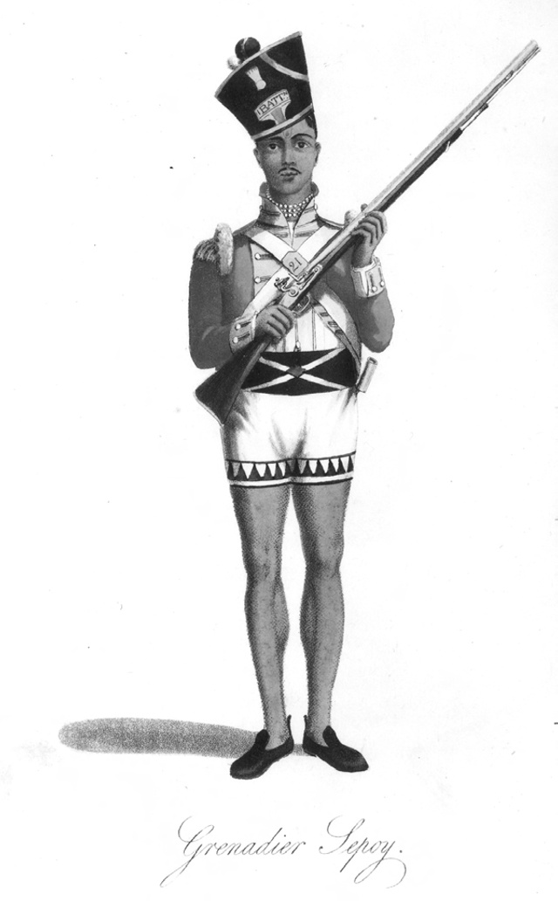

> *Plate 37. Aquatint by William Daniell (1769-1837), of a grenadier sepoy, a member of one of the Bengal volunteer battalions which took part in the British attack on the Yogyakarta kraton in June 1812. From Williams 1817:171 facing. Photograph by courtesy of the Bodleian Library, Oxford.*

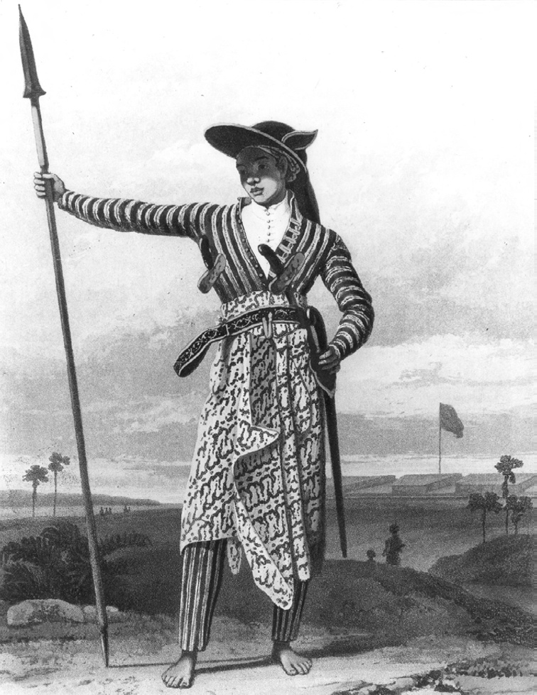

> *Plate 38. A Javanese chief in war dress, taken from Raffles 1817, I:90 facing.*

## The fall of Yogyakarta, 20 June 1812

By early June, the British expeditionary force numbering some 1,000 of their best troops, of which half were Europeans and half sepoys, was already encamped in temporary barracks in Semarang, Ungaran and Salatiga.[^245]

Various advanced parties had been sent down to strengthen the garrisons in Surakarta, Klathèn and Yogya.[^246] By 13 June, the main body was on the march to the sultan’s capital.[^247] They arrived surreptitiously in Yogya in small groups, entering the fort by night. But the sultan’s suspicions were soon aroused. He enquired of Crawfurd the purpose of this massive reinforcement of the Yogya garrison and was given the reply that these were ‘new troops’ who needed experience of the south-central Javanese kraton and that the lieutenant-governor had ordered it.[^248] According to Dipanagara, the sultan still continued to believe in the assurances of his court haji who assured him that the lieutenant-governor was on the march to take the Crown Prince prisoner and banish him from Java.[^249] Indeed, until the very end, the sultan hoped that he could persuade the British to recognise Mangkudiningrat as his successor in place of Dipanagara’s father (Poensen 1905:306; Carey 1992:75, 218). Meanwhile, his own military preparations continued: additional guards were placed on the kraton gates, watch towers were built on the ramparts and sentries posted on the principal avenues leading to the kraton.[^250]

Sumadiningrat was apparently the adviser who pressed the sultan most strongly to resist the British. In Dipanagara’s words, ‘he steadfastly expressed his joy that [at last] it should come to battle’.[^251] The Babad Spèhi (‘Chronicle of the sepoy war’), written by Pangéran Mangkudiningrat while in exile in Pulau Pinang (1812-1816), adds the detail that the Yogya ruler was also encouraged in his actions by various local Dutch and Eurasian residents of Yogya who relished the prospect that the British might suffer a defeat.[^252] This is partly corroborated in the private letter of a British artillery captain who wrote to his father in England that ‘the Dutch [inhabitants] had laboured to persuade the natives that ours were not troops of any great enterprise’.[^253] But the sultan still expected to be able to arrange suitable terms. Thus he dispatched his patih, Sindunagara (post-January 1812, Kyai Adipati Danureja III), to negotiate with Raffles when he arrived in Semarang on 1 June. But the Yogya chief minister halted at Jambu in northern Kedhu, ostensibly to await a similar mission from Surakarta, and missed both the lieutenant-governor during his stay in Semarang (1-16 June) and the beginning of the British attack on the Yogya kraton arriving back in the sultan’s capital just as the court was coming under sustained bombardment from British guns in the fort (Carey 1992:71-2, 75-6, 220, 213, 402-3 note 19a, 405 note 32). On 17 June, Raffles himself arrived in Yogya, and two days later all the British detachments, along with 500 men of Pangéran Prangwedana’s legion commanded by the prince himself, were in the fort.[^254]

Meanwhile, Natakusuma and his family were preparing to go over to the British. The prince refused the sultan’s summons to attend a general meeting in the kraton on the morning of 17 June because he had received word from Crawfurd’s Malay Indian orderly, Encik Ahmad, that he should meet Raffles on his arrival at the Residency. At five o’clock in the morning of 18 June, he thus took refuge in the fort with his wives and children. His followers were thereupon distributed with flashes for their left arms so that they could be easily recognised by the British troops during their forthcoming assault.[^255] At the same time, according to Dipanagara’s account, attempts were made to contact the Crown Prince. Although summoned to the Residency to meet with Crawfurd, Dipanagara refused to go so as not to jeopardise his father’s position. Instead, the faithful Jayasentika was sent and received a copy of the 12 June contract certified by Crawfurd, which had been previously authorized by Jayasentika on the Crown Prince’s behalf.[^256] Despite the Crown Prince’s highly vulnerable position, both the ‘Chronicle of the fall of Yogyakarta’ and Valck’s historical overview make it quite clear that he never intended any treachery towards his father, but stood by in the kadipatèn to afford the sultan assistance in the event of a British attack.[^257]

News of Natakusuma’s defection, however, greatly incensed the sultan who had seemingly placed his trust in his younger brother to the end.[^258] He now gave orders for the further deployment of kraton troops, amongst which were detachments from the western mancanagara districts of Bagelèn, Lowanu and Gagatan, as well as the core region of Pajang. Large numbers of Bugis and Balinese were also mobilised.[^259] The mosque officials and all the ‘men of religion’ from the tax-free areas took up their positions around the Great Mosque and were said by Mangkudiningrat to be ‘preparing for holy war’ (sumedya sabil utama).[^260] The sultan’s santri younger brother, Pangéran Muhamad Abubakar, who was still intending a pilgrimage to Mecca, apparently donned his white haji robes for duty on the kraton battlements, but was soon forced to divest himself of these and renounce his intention of waging ‘holy war’ because his dress made him an all too conspicuous a target for the British gunners in the fort when they began their bombardment on the afternoon of 18 June (Carey 1992:68, 208-9, 400 note 5).

Already, various skirmishes had broken out. Small parties of pikemen, musketeers and cavalry, described as ‘banditti’ in the British sources, were sent out by the sultan to mount ambushes, burn bridges, lay waste the countryside and generally impede the British line of march (Raffles 1830:126). One of the sultan’s ablest commanders, Radèn Aria Sindureja II (circa 1770-circa 1814),[^261] was dispatched to lead such a harassing force. He attempted to cut off Prangwedana’s legion just outside Yogya as they were trying to enter the sultan’s capital by night, but his small troop was worsted in the encounter.[^262] The following day, however, he had his revenge when an advance party of British dragoons, who were clearing the road ahead of Gillespie’s main force, fell into a clever ambush he had laid at the ravine of the Kali Gajahwong at Papringan. The 25-strong squadron suffered heavy losses: five dead (‘mangled most shockingly’ in the words of a British artillery officer who came on the scene)[^263] and thirteen severely wounded including their British officer. The action once again proved the effectiveness of Javanese pikemen operating in disciplined formation using their very long spears to dismount European cavalrymen before they could reload their cumbersome cavalry carbines (Thorn 1815:177-8; Carey 1992:427 note 238; p. 7). Sindureja’s action would not be repeated. If it had, the British assault on Yogya might have taken a rather different course, resulting in the sort of casualty levels (twenty percent of the attacking force) sustained by the British at Meester Cornelis. Instead, the British lost twenty-three killed and seventy-four wounded, including one officer who subsequently died of his wounds, out of a total attacking force of just under 1,000 men. This gives a casualty rate of just under ten percent, small if compared to the many hundreds – ‘dreadful’ losses according to Raffles – who died on the Javanese side (Carey 1992:415 note 95).

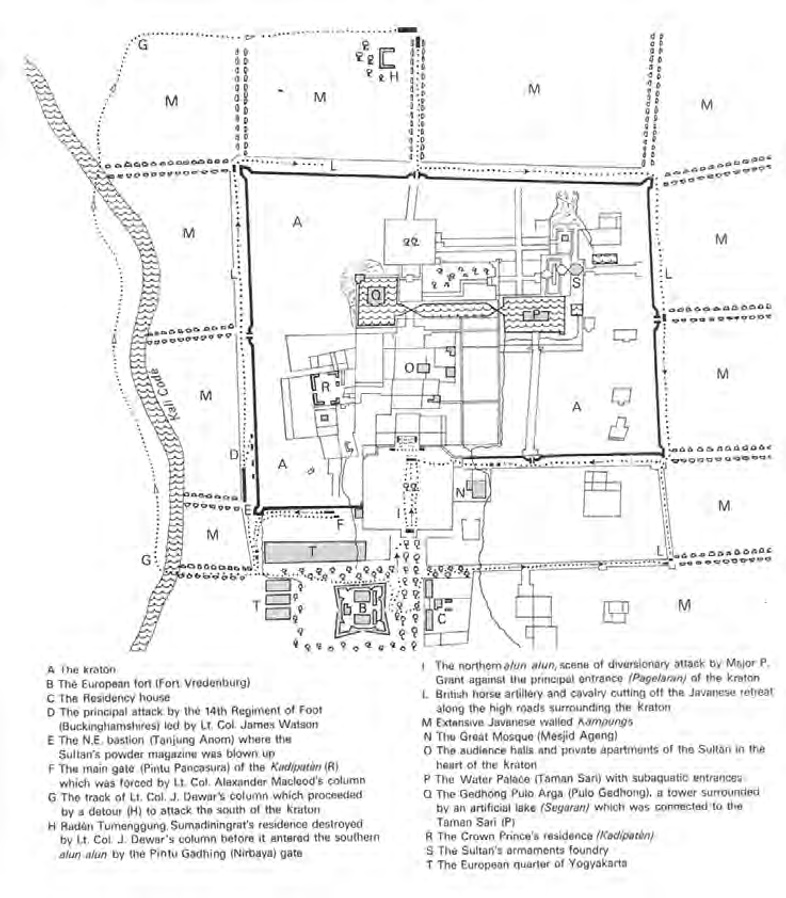

> *Map 5. Sketch of the Yogyakarta kraton at the time of the British assault on the morning of 20 June 1812. Adapted from Thorn 1815:185 facing, Plate XIX ‘Sketch of the fortified cratten of the Sultan of Djocjo Carta taken by assault 20 June 1812 by the British Forces commanded by Major General R.R. Gillespie’, by J. Wilbur Wright of Oxford.*

On the same day that Sindureja laid his successful ambush (Thursday, 18 June) Raffles dispatched the Semarang Residency interpreter, C.F. Krijgsman, who had accompanied him to Yogya, to take in a letter to the sultan giving him an ultimatum: unless he abdicated in the next two hours (the ultimatum was to start at noon) in favour of the Crown Prince the British would begin their artillery bombardment.[^264] Krijgsman was received in the Srimenganti pavilion by the sultan with his relations and senior court officials seated on the floor around him in full battle array. Sumadiningrat was directly opposite. Turning to the Crown Prince, the sultan asked if he was prepared to accede to the demands of the British government.[^265] According to Mangkudiningrat’s account, the Crown Prince resolutely refused to accept them, whereupon the sultan drew up a letter detailing the impossibility of agreeing to Raffles’ demands and asking that Natakusuma should immediately explain why he had gone over to the fort.[^266]

The British artillery bombardment began that afternoon and would continue until late in the night of Friday, 19 June, the eve of the British assault. According to Raffles, the lengthy cannonade had two purposes: to allow time for the main body of the British assault force to reach Yogya, and to afford the sultan space to reconsider his position and negotiate.[^267] Far from being intimidated, however, the sultan appeared set on hostilities and waved aside Mangkudiningrat’s warnings about what had happened at Kartasura when the kraton had been stormed by the Chinese in 1742 during the Chinese War (1741-1743).[^268] According to Valck, he later changed his tune when the British attack proper got under way early on the morning of 20 June and his cowardly behaviour at that time undermined the fighting morale of the kraton defenders.[^269]

The ‘Chronicle of the fall of Yogyakarta’, which takes up the story at the start of the British bombardment, gives a vivid account of the low morale amongst the kraton defenders, especially the Javanese gunners when faced with the accuracy of the British fire. Many of the princes, who were supposed to set an example on the battlements by leading the defence, merely cowered in the shelter of gateways or pretended they were sick (Carey 1992:67-8, 204-6, 208-9). Others slipped away from the kraton over the walls to take refuge in surrounding villages where their wives had close blood relations, a number going with their families to Imagiri, the site of the royal graveyard.[^270] Only a handful of princes and senior officials, amongst them Sumadiningrat and Pangéran Jayakusuma (post-1825, Ngabèhi), Dipanagara’s future cavalry commander (p. 79), led the defence with any resolution. Some of the areas to the north of the kraton, especially the kauman, the vicinity around the Great Mosque where many santri lived, and the Pangurakan and Gladhagan doorless gateways between the fort and the northern alun-alun, were damaged by fires started by stray artillery shots. At the same time, many of the inhabitants of Yogya fled from the town and there was much plundering by the troops of Prangwedana’s legion, the followers of Natakusuma, as well as sepoys. Only to the east of the Kali Codhé, on both sides of Natakusuma’s residence – the future Pakualaman – were the houses left untouched.[^271]

The kadipatèn, to which both Dipanagara and his father had gone after the sultan’s defiant meeting with Krijgsman in the Srimenganti pavilion, was particularly badly damaged by cannon fire as it was positioned in the north-eastern part of the kraton closest to the batteries in the fort (Carey 1992:67, 69, 205, 210). The British also seemed to be preparing for an assault, for the main gate of the kadipatèn was nearly battered down by cannon balls. Twice the Crown Prince sent word to the sultan via his uncle, Pangéran Aria Panular, that reinforcements were urgently needed to prevent the kadipatèn falling to the besiegers. But the sultan remained in one of the pavilions of the inner kraton during the cannonade surrounded by members of his Amazon corps who were always in attendance on him (Thorn 1815:293; Carey 1992:68, 207-8). Twice, he deferred to his son Mangkudiningrat’s advice that there were already enough soldiers in the Crown Prince’s establishment and that only a few gunners and some gunpowder could be spared to stiffen resistance there. Eventually, the Crown Prince’s younger brother, the heavily goitred Pangéran Mangkubumi, was sent over to help but he was deemed too irresolute to be of any use.[^272] The author of the chronicle, Pangéran Panular, however, urged the Crown Prince to stand by his father in life and death despite his seeming lack of cooperation citing the plight of Sunan Amangkurat I (reigned 1646-1677) during the rebellion of the Madurese prince Trunajaya (1649-1680) when his kraton at Plérèd was overrun (1677) by rebel forces and he died as a fugitive on the north coast (Carey 1992:69, 210; Ricklefs 1993a:74-6). Indeed, the situation in the kraton proper was hardly more favourable than in the Crown Prince’s establishment. The same chronicle describes the sultan as being profoundly disturbed: many of his personal retainers and female bodyguard were reciting prayers and incantations (dhikr) (Carey 1992:70, 211). Only the successful firing of the powder magazine in the fort (note 267) by three Bugis soldiers commanded by the same court bupati, Radèn Tumenggung Sumadiwirya, who had struck the first blow at Radèn Rongga at Sekaran (p. 257), caused the sultan to shout for joy and pace the floor excitedly (Thorn 1815:181; Campbell 1915, I:381; Carey 1992:70, 211-2). At nine o’clock in the evening the British guns fell silent. In the kraton, many of the defenders fell asleep, thinking that the fighting had died down. But at three o’clock the following morning, the cannon thundered forth again with redoubled power.[^273] At daybreak (about five o’clock in the morning), parties of British and sepoy troops dispersed around the walls of the kraton together with the followers of Natakusuma (Hageman 1857:424-5; Thorn 1815:184-7; Carey 1992:72, 214). Some bore flimsy bamboo scaling ladders, apparently prepared under the direction of the kapitan cina, Tan Jin Sing, whose Yogya Chinese community were reported to be strongly in support of the British attack, an attitude which fuelled powerful anti-Chinese sentiments in the aftermath of the British operation.[^274] Although Raffles would later report that the assault was made ‘by escalade’,[^275] many of the troops had to stand on each other’s shoulders in order to climb the walls (Thorn 1815:186-7). The kadipatèn seems to have been the first to fall: the Pancasura gate in the northeast bastion was blown up by a unit of the Madras horse artillery[^276] and its battlements were overrun by sepoys who turned the kraton guns on the defenders (Thorn 1815:185, Plate XIX no. F; Carey 1992:72, 214).

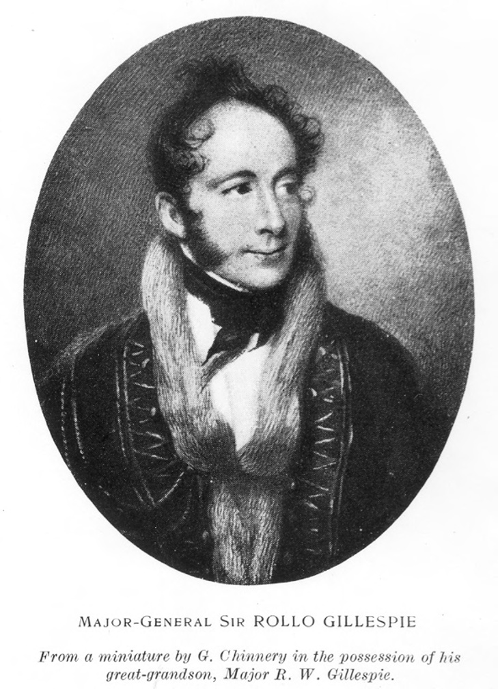

> *Plate 40. Colonel (later Major-General) Sir Robert Rollo Gillespie (1766-1814), who commanded the British forces during the assault on Yogya in June 1812. Miniature by George Chinnery (1774-1854) made in Calcutta in circa 1814, showing him in the dress uniform of his regiment, the 25th Light Dragoons. Taken from Wakeham 1937. Photograph by courtesy of the publisher and the Bodleian Library, Oxford.*

The Crown Prince and his supporters, including his eldest son, Dipanagara, thereupon resolved to flee into the kraton to join the sultan, but at the Srimenganti gate they were refused entrance by Pangéran Jayakusuma, who stated that he was acting on the explicit orders of the Yogya ruler not to allow any armed men into the court.[^277] An altercation took place in which Dipanagara was instructed by his father to unsheath his kris. Sensing that a fight was brewing, the Crown Prince then told his son that they should move on (Carey 1992:73, 215). The party made their way south under continuous musketry fire from sepoys, who were already on the battlements. They tried to enter the kraton by other gates, but to no avail. Eventually, as they were nearing Pasar Ngasem near the Taman Sari, the branches of the tamarind trees lining the street blown into their path by British cannon shots, they were caught up with by a detachment led by the commanding officer of the Bengal Light Infantry Volunteer Battalion, Major Dennis Harman Dalton (Carey 1992:512 note 543), and John Deans, the Malay-speaking secretary of the Yogya Residency (in office 1811-1813).[^278] He asked the Crown Prince to come under armed guard to the Residency. This the Crown Prince agreed to, but his party was first roughly disarmed by Dalton’s sepoys who gave Dipanagara a light bayonet wound as they were relieving him of his kris. Tan Jin Sing, who was with Deans, had to intervene personally to save the party from further humiliation, rescuing three of the Crown Prince’s pusaka (heirloom) pikes and his gold state parasol from being divided as spoil amongst the exultant Bengali soldiery.[^279] Eventually, the Crown Prince and his group reached the Residency where they were received by Raffles and Crawfurd. But Natakusuma treated them icily, hardly deigning to speak with his nephew (Carey 1992:78-9, 224-5). It was half past six in the morning (Hageman 1857:425).

News that the Crown Prince had been taken prisoner by the British was received with feelings of dismay in the kraton. Even the sultan forgot the many differences which had estranged him from his son and began to fear for his safety. The strong resistance which the British had first encountered as they entered the kraton had now begun to fade.[^280] The sultan, meanwhile, continued to take council with his younger brother, Pangéran Demang, who was known for his expertise in Javanese-Islamic mystical lore and cleverness with words (Carey 1992:84, 187-8, 383), but, as the ‘Chronicle of the fall of Yogyakarta’ put it, he was like a wayang puppeteer who had been caught by the morning never knowing when to round off his conversation at the appropriate time (Carey 1992:87, 232-3, 411 note 68).

Meanwhile, the southern alun-alun had already been overrun and Sumadiningrat, deserted by his troops, would shortly be killed in his own residence to the south of the kraton while trying to avoid capture, the third and last of the sultan’s and Ratu Kedhaton’s sons-in-law to die violently within the space of just eighteen months.[^281] With the British now poised to make a frontal assault on the kadhaton (inner court) and realising that further resistance would only result in more bloodshed, the sultan resolved to hoist a white flag, recall his commanders and instruct them to order their troops to lay down their arms (Carey 1992:83, 231-2). He hoped that by this voluntary submission, the kraton proper would be spared by the British (Carey 1992:83, 232). But, on seeing the flag, the British commander Colonel Gillespie immediately entered the kadhaton and according to the Pakualam babad continued to fight fiercely sabreing the kraton defenders to right and left.[^282] There was still some isolated resistance and Gillespie was wounded in the upper left arm by a musket shot fired from the Suranatan mosque to the west of the Srimenganti pavilion where the sultan and his retainers were waiting to make their formal surrender (Raffles 1830:128; Carey 1992:79, 225, 409 note 53).

When the vanguard of the British force reached the Srimenganti pavilion, they found the sultan and his relations dressed in white with many of the chairs also covered with torn strips of white cloth, in a scene which, if the Yogya ruler’s mind had been set on death rather than surrender, might have prefigured the prang puputan (‘final battle/ending wars’) in Lombok and Bali in 1894 and 1906-1908 when some of the rulers, their families and followers met their deaths at the hands of the invading Dutch armies dressed in white with all their ceremonial finery.[^283] In the case of Yogya, the monarch and his entourage made no attempt at such a desperate last stand. Instead, they allowed themselves to be immediately disarmed and their hands held at their sides by their British and sepoy guards. Even the sultan’s person was secured by a British officer, Lieutenant Henry N. Douglas of the 78th Highland Regiment of Foot (Carey 1992:85, 234-5, 412 note 69a). Although he was not forced immediately to surrender his personal kris, his request to bring his pusaka (heirloom) weapons from the kraton was refused and they were taken by Gillespie.[^284] Under these humiliating circumstances, the sultan and his relations were marched to the Residency between a row of British and sepoy soldiers with drawn swords and fixed bayonets. As the party entered the Residency House, the ‘Chronicle of the fall of Yogyakarta’ describes how Raffles noticed with pleasure that only a couple of pangéran tried to get down from their chairs to pay the sultan their customary respects. He motioned these to remain seated. The Crown Prince himself hid his feelings, although he felt acutely the pathos of the moment. In tears, the sultan and his followers were now forced to give up their personal kris and gold ornaments (Carey 1992:86, 236), the sultan’s sword and stabbing dagger later being sent by Raffles to Lord Minto in Calcutta as a symbol of ‘the entire submission’ of the Yogya court to the British.[^285] Even the small diamond buttons of the sultan’s dress jacket were subsequently cut off by his sepoy guards as he lay asleep in his place of detention (Nahuys van Burgst 1835-36, I:131). The Yogya ruler was thereupon led into a small side room of the Residency where he was held prisoner with Mangkudiningrat until their exile from Yogya on 3 July.[^286] It was eight o’clock in the morning.[^287] As far as the sultanate was concerned, the Parangkusuma prophecy had been fulfilled.

## Conclusion

So the kraton of Yogyakarta fell to the British nearly fifty-seven years after it had been first occupied as Mangkubumi’s capital on 6 November 1755 (Ricklefs 1974a:80). As we have seen in previous chapters, it was perhaps the inevitable outcome of the Yogya elite’s inability to come to terms with the reality of the new European colonialism born of the twin revolutions of industrialisation and bourgeoise democracy which had convulsed Europe in the late eighteenth and early nineteenth centuries. The changes had been introduced into Java too rapidly and in too brutal a fashion. In the space of just under four years, the south-central Javanese courts had been forced to accommodate themselves to a new form of centralised colonial government which stood in direct contradiction to their own political philosophy of divided sovereignty in Java. Given time, they might have been able to reshape their political conceptions to legitimize the changed realities, but they could not do it in the quick fire way demanded by Daendels and Raffles. The result was disaster. This was particularly the case for Yogya, which had entered on this period of cataclysmic change with ostensibly the most powerful and prosperous court, but in fact hopelessly divided against itself and ruled by a vain and inflexible man. The rapid germination of intrigues within the kraton literally tore it apart just at the time when it needed its undivided energies to cope with the new challenges posed by a resurgent Europe. Mangkubumi’s kingdom had been founded by the sword, in June 1812 it could be said to have perished by the sword.

For the British colonial government in Java, there was little doubt about the significance of their victory. Muntinghe hailed it as an event of similar significance to Clive’s victory at Plassey on 23 June 1757 which had opened up the whole of northern India to British rule (Carey 1992:60 note 102). Raffles echoed this in a dispatch to his patron, Lord Minto, when he stated that ‘the European power is for the first time paramount in Java. […] we never till this moment could call ourselves masters of the more valuable provinces in the interior, nay, our possessions on the sea coasts would always have been precarious and, had [our] military force been materially reduced, much eventual danger was to be apprehended.’[^288] Although both Yogyakarta and Surakarta would continue as dismembered states after 1812, they were never again capable of posing a threat to the position of the European government. When a new challenge did materialise under Dipanagara’s Javanese-Islamic banner in July 1825, it would owe its inspiration and energies to influences outside the great court traditions. The support given to the prince by the religious communities and the Javanese peasantry, both groups who felt themselves increasingly excluded from the new colonial order, was more important than the traditional foci of court patronage and loyalty. In many ways, June 1812, rather than the end of the Java War, should be seen as the date when the new colonial era dawned in Java. Out of this collapse and the legacy of bitterness which it left, however, a new and more potent combination of elements in Javanese society would emerge. It is with these social, political and economic developments in the thirteen years following the British attack on Yogya that the next three chapters are concerned.

## Notes

[^1]: Dj.Br. 39, H.W. Gezelschap (Yogyakarta) to Kyai Tumenggung Sindunagara (Yogyakarta), 22 Dulkangidah AJ 1737 (AD 20-12-1810).

[^2]: No specific date is available, but the conference appears to have taken place around 22-23 December 1810.

[^3]: Daendels 1814:Bijlage 2, additionele stukken 18-19; Dj.Br. 46, H.W. Daendels (Kemlaka) to Hamengkubuwana II (Yogyakarta), 27-12-1810, Hamengkubuwana II (Yogyakarta) to H.W. Daendels (Yogyakarta), 1 Besar AJ 1737 (AD 28-12-1810).

[^4]: Daendels 1814:Bijlage 2, additionele stukken 17. On the location of Kemlaka, see S.Br. 170, map of old Mataram tollgates; Carey 1984:44; Map 1; and Map 1 in this volume.

[^5]: Bataviasche Koloniale Courant 6, 8-2-1811; Daendels 1814:Bijlage 2, additionele stukken 24, gives the breakdown of the distribution of the 196,320 Spanish dollars; Louw and De Klerck 1894-1909, I:33, reference to desertions amongst Indonesian – especially Javanese – troops on Daendels’ Yogya expedition. See also Chapter VI.

[^6]: Bataviasche Koloniale Courant 6, 8-2-1811. Van Braam had come to Yogya twice on commission in circa July 1810 (Chapter VI note 87) and 10-13 November 1810 (pp. 236-9), so this late December visit with Daendels was his third in under six months.

[^7]: Chapter XI.

[^8]: Baud 306, Van IJsseldijk, ‘Rapport’, 11-12-1816, commented on the ‘greater poverty’ of Yogya which, when compared to Surakarta, was ‘everywhere visible’ amongst the kraton elite. See further Van Deventer 1891:97-8, on the poor quality silver and Chinese clay plates which had replaced the gold platters and beakers in use for Yogya kraton receptions before 1812. On the sale of jewelry and gold ornaments from the court during the fourth sultan’s reign, see Chapter X note 135.

[^9]: Daendels 1814:Bijlage 2, additionele stukken 19, letter of H.W. Daendels (Semarang) to Hamengkubuwana II (Yogyakarta), 23-12-1810.

[^10]: BD (Manado) II:135, XV.10; Dj.Br. 9A, Valck, ‘Overzigt’, 59 (on Sumadiningrat’s bellicose advice).

[^11]: BD (Manado) II:135, XV (Asmaradana) 10. Sampun karsaning Hyang Widi/ Jeng Sultan èwed karsanya.

[^12]: Daendels 1814:Bijlage 2, additionele stukken 16-7 (the date of Hamengkubuwana II’s letter is wrongly given as 10 Dulkangidah in the printed version); Dj.Br. 46, Hamengkubuwana II (Yogyakarta) to H.W. Daendels (Kemlaka), 30 Dulkangidah AJ 1737 (AD 26-12-1810), H.W. Daendels (Kemlaka) to Hamengkubuwana II (Yogyakarta), 1 Besar AJ 1737 (AD 27-12-1810).

[^13]: B.Ng. I:208-9, LII.30-LIII.6.

[^14]: Daendels 1814:Bijlage 2, additionele stukken 20 and 21; De Jonge and Van Deventer 1884-88, XIII:cxvi (gives partial text of Hamengkubuwana II’s proclamation); the original copy is in Dj.Br. 42 pt. 2, ‘Kopij boek van contracten Djokjo, 1755-1812’ (henceforth: ‘Kopij boek contracten’), 101. See also KITLV H 696c ‘Archiefstukken (Vorstenlandse)’, ed. G.P. Rouffaer, no. 82.

[^15]: Daendels 1814: Bijlage 2, additionele stukken 4, H.W. Daendels (Surakarta) to Raad van Indië (Batavia), 7-1-1811.

[^16]: B.Ng. I:209, LIII.18; BD (Manado), II:136, XV.14.

[^17]: Daendels 1814: Bijlage 2, additionele stukken 22; Dj.Br. 46, H.W. Daendels (Yogyakarta) to Hamengkubuwana II (Yogyakarta), 7 Besar AJ 1737 (2-1-1811); Dj.Br. 37, Pieter Engelhard (Yogyakarta) to W.N. Servatius (Surakarta), 17-1-1811. The original copy of the agreement between the European government and the Prince Regent can be found in Dj.Br. 42 pt. 2, ‘Kopij boek contracten’, 96-100, ‘Contract tusschen het Hollandsche Gouvernement […] en den Regent van het rijk van Djokjokarta den Pangerang Adipatti Anom Amangkoe Nagoro’, 10-1-1811.

[^18]: IOL Eur F148/18 (Raffles-Minto collection, vol. 18), Pieter Engelhard (Yogyakarta) to Captain William Robison (Yogyakarta), 27-9-1811, where Engelhard is quoted as saying that: ‘the [old] sultan retains a very great influence in the administration and extorts from his son the most considerable part of the revenues. I am even informed that out of the last half yearly revenues, the latter had only been allowed an amount of 10,000 rix dollars [Spanish dollars]’.

[^19]: Daendels 1814:Bijlage 2, additionele stukken 22; Poensen 1905:234; Dj.Br. 46, H.W. Daendels (Yogyakarta) to Hamengkubuwana II (Yogyakarta), 7 Besar AJ 1737 (AD 2-1-1811).

[^20]: Dj.Br. 9A, Valck, ‘Overzigt’, 74 (on Daendels’ idea of getting Ratu Kencana Wulan married off to a ‘distant désa head’); Daendels 1814:Bijlage 2, additionele stukken 19, H.W. Daendels (Semarang) to Hamengkubuwana II (Yogyakarta), 23-12-1810, warning Hamengkubuwana II about the danger if Ratu Kencana Wulan gave birth to a son; Dj.Br. 37, Pieter Engelhard (Yogyakarta) to W.N. Servatius (Surakarta), 30-1-1811 (referring to Ratu Kencana Wulan giving birth at midday on 4 Sura AJ 1738). This third daughter of Ratu Kencana Wulan, the future Ratu Sasi, married Radèn Adipati Danureja IV (post-1847, Pangéran Kusumayuda; in office as patih 1813-1847), Mandoyokusumo 1977:26 no. 75. See also Chapter VI note 98.

[^21]: The text of the treaties is given in Daendels 1814:Bijlage 2, additionele stukken 27 (treaty with Surakarta, 6-1-1811), 28 (treaty with Yogyakarta, 10-1-1811); Dj.Br. 27, contains a map of the European government’s acquisitions under these January 1811 treaties. These included Japan (Majakerta), Wirasaba, Bauwerna, Dhuri, Rajegwesi (Jipang), Padhangan, Sekaran, Panolan, Wirasari, Blora, Séla, Warung, Grobogan, Sérang, Sima, Gagatan, and the Kedhu enclave on the north coast bounded by Kendhal, Batang and Pekalongan. This last district – also known as Jabarangkah (literally ‘the area outside the [old Mataram] tollgate’) – was annexed to permit a more direct route for Daendels’ post-road (postweg) between Batang and Kendhal through the teak forests of Subah-Weleri rather than along the less direct coast route, see Rouffaer 1905:592; Nagtegaal 1996:169-70.

[^22]: Chapter IV note 18.

[^23]: Dj.Br. 27, Hendrik Veeckens (Batavia) to Pieter Engelhard (Yogyakarta), 15-7-1811, on the Prince Regent’s complaints. On the demands for the return of the gravesites at the end of the Java War, see NA MvK 4220 Exh. 20-9-1830 56k geheim; Dj.Br. 17, Jan Izaäk van Sevenhoven (Surakarta) to Governor-General Johannes van den Bosch (Batavia), 8-11-1831 no. 102; Houben 1994:65. For references to court pilgrimages to Séla, see Musium Nasional (Jakarta), MS 933 DJ, ‘Ir J. Moens Platen Album’ no. 8 (ngintun leluhur-Dalem dhateng Seséla). On Séla’s subsequent history, see Rouffaer 1905:598-9.

[^24]: Daendels 1814:Bijlage 2, additionele stukken 27 art. 3; IOL Eur F148/18 (Raffles-Minto collection vol. 18), Radèn Adipati Cakranagara (Surakarta) to J.A. van Braam (Surakarta), 9-7-1811 (listing Pakubuwana IV’s debts as 25,000 Spanish dollars to Mr Blanck at 250 per month interest, 50,000 to Mr Samuel also at 250 per month interest and 21,000 to the widow of Mr Michaelis at 210 per month interest), J.A. van Braam, ‘Memorial of existing relations between Souracarta and the former [Franco-Dutch] government’, 24-9-1811; UBL BPL 616, Port. 4 pt. 12, J.A. van Braam (Semarang) to T.S. Raffles (Surabaya), 13-12-1811.

[^25]: Dj.Br. 22, Pieter Engelhard (Yogyakarta) to J.W. Janssens (Batavia), 29-7-1811; IOL Eur F148/42, (Raffles-Minto collection vol. 42), ‘Report on the state of Java by Messrs [J.] Knops and [P.H. van Lawick] van Pabst’, Semarang, 29-6-1812, described the situation in Galuh thus: ‘through the invasion of pirates and heavy servitude imposed on the inhabitants, many of them have left the country for that of the princes [namely, the Sunan and sultan]’. A similar situation was noted by Captain Godfrey Phipps Baker in 1815, Baker, ‘Memoir’, 104-7. The first Dutch Resident of Banyumas after the Java War, J.E. de Sturler (in office 1830-1835), wrote of Dayeuh Luhur as a ‘very poor district’ whose 34,396 population ‘had little visible means of subsistence’ and only paid 85 cents per head annual pajak (tax), AN, Kabinet 13-9-1832 no. 1599, J.E. de Sturler (Banyumas) to Johannes van den Bosch (Batavia/Bogor), 5-9-1832.

[^26]: Dj.Br. 22, Pieter Engelhard (Yogyakarta) to J.W. Janssens (Batavia), 29-7-1811, stating that the birthplace of Ratu Kencana Wulan’s mother was in Japan (Majakerta), and various family graves were there. See also Poensen 1905:187; Hageman 1856, V:258.

[^27]: Dj.Br. 22, Pieter Engelhard (Yogyakarta) to J.W. Janssens (Batavia), 29-7-1811; UBL BPL 616, Port. 4 pt. 12, J.A. van Braam (Semarang) to T.S. Raffles (Surabaya), 13-12-1811.

[^28]: Dj.Br. 6, P.H. van Lawick van Pabst (Yogyakarta) to Hendrik MacGillavry (Surakarta), 1-2-1826, who listed seven new kabupatèn in Madiun, including Kutaarja (Panggungan), Tunggul-Wanakerta, Maospati, Purwadadi, Banget, Kenitèn, and Nguning; three each in Rawa (Tulung Agung) and Magetan, and two in Goranggarèng. See further Onghokham 1975:62; Chapter VIII note 89.

[^29]: S.Br. 46, Anonymous Javanese letter (reports by spies about Yogya), 9 Sura AJ 1738 (AD 20-2-1811). Sélamanik appears to have been part of the royal domain lands (bumi pamajegan-Dalem), areas which delivered products exclusively for the ruler’s household, in this case presumably high-quality wood, see Kollmann 1864:361.

[^30]: Dj.Br. 27, Pieter Engelhard (Yogyakarta) to J.W. Janssens (Batavia), 21-6-1811 (on Prince Regent’s consideration of possible exile of family of Purwadipura to Pacitan).

[^31]: S.Br. 37, p. 1091, Radèn Adipati Sasradiningrat II (Surakarta) to Kyai Adipati Danureja III (Yogyakarta), 12-1-1813 (on burning down of mosque at Girilaya (Imagiri) on 25 Besar AJ 1739).

[^32]: Dj.Br. 46, Danureja II (Yogyakarta) to Radèn Tumenggung Purwadipura (Maospati/Madiun), 15 Dulkangidah AJ 1737 (AD 12-12-1810).

[^33]: UBL BPL 616, Port. 22 pt. 4, Nahuys van Burgst, ‘Montjonegorosche-Djokjokartasche landen’, n.y. (1826). See also Adam 1940:336.

[^34]: Carey and Hoadley 2000:64-74; Dj.Br. 41, Danureja II (Yogyakarta) to Pieter Engelhard (Yogyakarta), 1 Mulud AJ 1738 (AD 25-3-1811), relating that the Prince Regent had ordered Radèn Tumenggung Yudakusuma of Grobogan-Wirasari to return to his kabupatèn ‘to place himself at the disposal of the Dutch’.

[^35]: Dj.Br. 41, Danureja II (Yogyakarta) to Pieter Engelhard (Yogyakarta), 1 Mulud AJ 1738 (AD 25-3-1811). The border demarcation was being undertaken from the Yogya side by a joint survey team led by the former Yogya Resident, Gustaf Wilhelm Wiese, and the Yogya bupati, Mas Tumenggung Sindunagara (later Kyai Adipati Danureja III, in office 1811-1813).

[^36]: Dj.Br. 41, Pieter Engelhard (Yogyakarta) to Raja Putra Naréndra (Yogyakarta), 5 Rabingulakir AJ 1738 (AD 30-4-1811), Raja Putra Naréndra (Yogyakarta) to Pieter Engelhard (Yogyakarta), 9 Rabingulakir AJ 1738 (AD 4-5-1811).

[^37]: Since the 196,320 Spanish dollar sum was paid in silver half ducatoons (worth f 1.60) and Java rupees (rupiyah) worth f 1.20, rather than whole silver ronde maaten (Spanish dollars), it was found to be 2,977 and a quarter Spanish dollars short and Daendels insisted that this money should be paid before he removed his army from Yogya, Dj.Br. 39, Pieter Engelhard (Yogyakarta) to Danureja II (Yogyakarta), 11 Besar AJ 1737 (AD 7-1-1811); Dj.Br. 41, Danureja II (Yogyakarta) to Pieter Engelhard (Yogyakarta), 13 Besar AJ 1737 (AD 9-1-1811).

[^38]: Dj.Br. 41, Danureja II (Yogyakarta) to Pieter Engelhard (Yogyakarta), 13 Besar AJ 1737 (AD 9-1-1811).

[^39]: Louw and De Klerck 1894-1909, I:37; Dj.Br. 27, Pieter Engelhard (Yogyakarta) to J.W. Janssens (Batavia), 28-6-1811.

[^40]: According to Van Braam, this order (ridderorde) was delivered to Pakubuwana IV and the Prince Regent sometime in May, presumably along with King Louis’ letter, S.Br. 25, J.A. van Braam (Surakarta) to Pakubuwana IV (Surakarta), 8-5-1811. Dipanagara mentioned that the star was as big as Daendels’ own but did not have any diamonds (18. Jéndral mantuk mring Batawi/ datan lami kintun bintang/ dhumateng jeng rama mangko/ pan sinami agengira/ lan bintangé priyangga/ pan Jéndral Dandles puniku/ namung kantun mawi séla), BD (Manado) II:136-7, XV.18-9. This suggests that the Prince Regent’s was also the Grand Cross (grand croix or grootkruis) which went to men of ministerial rank or Raad van Staat as well as top foreign ministers, princes of the empire and allies like the Prince Regent, personal communication Professor Simon Schama, 22-3-1976. Despite Dipanagara’s testimony, it was in fact set in diamonds, see Groneman 1895:23, who describes the eight-pointed star sent by Daendels which was worn by Hamengkubuwana VII (reigned 1877-1921) at Garebeg celebrations; and Plate 54 (p. 460) on the 1938 depiction of Hamengkubuwana IV with the star in his official portrait.

[^41]: Gericke and Roorda 1901, II:654, S.Br. 25, J.A. van Braam (Surakarta) to Pakubuwana IV (Surakarta), 8-5-1811, on the bintang kadhaton, the gold star set with jewels sent by Daendels to Pakubuwana IV.

[^42]: Knoerle, ‘Journal’, 27, Dj.Br. 22, Pieter Engelhard (Yogyakarta) to J.W. Janssens (Batavia), 29-7-1811 (referring to Hamengkubuwana II’s jealousy over this order); Dj.Br. 24, Pieter Engelhard (Yogyakarta) to J.W. Janssens (Batavia), 16-8-1811, referring to the Prince Regent wearing a ‘brilliant star’ to a Residency party to celebrate Napoleon’s birthday (15-8-1811).

[^43]: Dj.Br. 39, Pieter Engelhard (Yogyakarta) to Raja Putra Naréndra (Yogyakarta), 21 Besar AJ 1737 (AD 17-1-1811).

[^44]: Dj.Br. 41, Danureja II (Yogyakarta) to Pieter Engelhard (Yogyakarta), 28 Sapar AJ 1738 (AD 22-3-1811) (on the ‘party’ on the southern alun-alun at the time of a Monday tournament (Senenan) when Hamengkubuwana II and Raja Putra Naréndra had ridden out together, something which had never happened before in ‘old adat’); Dj.Br. 39, Pieter Engelhard (Yogyakarta) to Danureja II (Yogyakarta), 9 Rabingulakir AJ 1738 (AD 2-5-1811), Pieter Engelhard (Yogyakarta) to Raja Putra Naréndra (Yogyakarta), 20-6-1811, complaint that Prince Regent had only attended one Saturday tournament or Setonan since January.

[^45]: Referred to in the secret report as priyayi pradikan or pethakan, literally the ‘white ones’, namely those who had adopted the white garb of the santri, Dj.Br. 46, Anonymous Javanese letter (reports of spies about Yogya), 9 Sura AJ 1738 (AD 20-2-1811) (copy in S.Br. 37).

[^46]: Dj.Br. 46, Anonymous Javanese letter (reports of spies about Yogya), 9 Sura AJ 1738 (AD 20-2-1811).

[^47]: Dj.Br. 46, Anonymous Javanese letter (reports of spies about Yogya), 9 Sura AJ 1738 (AD 20-2-1811).

[^48]: ���������������������������������������������������������������������������������������� Dj.Br. 18, F.G. Valck, ‘Geheime Memorie behoorende bij het Algemeen Verslag der Residentie Djocjocarta over het jaar 1839’, 31-3-1840. See also Chapter V note 121.

[^49]: Purwadipura’s apanage lands (sabin ingkang ampas saking Purwadipuran) were also retrenched and redistributed at this time, in part to Yogya officials like Radèn Tumenggung Sumadiwirya, who had distinguished themselves in the campaign against Radèn Rongga, see Carey and Hoadley 2000:144-5, 155-7, 182-3, 187-8, 189-90; Chapter VI note 218.

[^50]: Dj.Br. 46, Anonymous Javanese letter (reports of spies about Yogya), 9 Sura AJ 1738 (AD 20-2-1811). See further B.Ng. I:229-30, LVIII.12-15; Poensen 1905:276-7; Carey 1992:210, 219, on the revenge plundering of Pangéran Adikusuma’s dalem by Pakualam forces at the time of the storming of the Yogya kraton by the British on 20 June 1812 because of his role in robbing Natakusuma/Pakualam I’s residence in January 1811.

[^51]: Dj.Br. 46, Anonymous Javanese letter (reports of spies about Yogya), 9 Sura AJ 1738 (AD 20-2-1811), which gives the following new troop numbers enrolled: Hamengkubuwana II (600), Mangkudiningrat (500), Prince Regent (400), Danureja II (200), Sumadiningrat (100). The two brothers of Danureja II, Radèn Tumenggung Mertawijaya (post-June 1812, Danukusuma II) and Radèn Tumenggung Mertadiwirya, were appointed as the Prince Regent’s troop commanders, see further Carey 1992:342, 489 note 424. Hamengkubuwana II was said to have recruited his new prajurit in part from amongst his cousins, grandsons and panakawan (intimate personal retainers) who had no ricefields (sawah) or apanage lands of their own, Dj.Br. 41, Danureja II (Yogyakarta) to Pieter Engelhard (Yogyakarta), 12 Sura AJ 1738 (AD 6-2-1811).

[^52]: Carey 190:20; Carey and Hoadley 2000:Dj.Br. 41, Danureja II (Yogyakarta) to Pieter Engelhard (Yogyakarta), 12 Sura AJ 1738 (AD 6-2-1811). Engelhard recommended that Hamengkubuwana II’s order for ordnance be allowed but the cannon be handed over to the Prince Regent after they had been cast, presumably in the royal gun foundries at Taman Sari and Kutha Gedhé, and in the Chinese and Arab-run foundries in Gresik, see Thorn 1815:185, Plate XIX no. S; Chapter VI note 53.

[^53]: Dj.Br. 46, Anonymous Javanese letter (reports of spies on the situation in Yogya), 9 Sura AJ 1738 (AD 20-2-1811); S.Br. 37, Report of Yogya spy to Radèn Adipati Cakranagara (Surakarta), 25 Sapar AJ 1738 (AD 19-3-1811). These reports were denied by Danureja II who gave out that the Kyai Pengulu of Yogya (head of the religious hierarchy), pradikan priests and santri in receipt of tax-free benefices, as well as court haji, had the duty of praying for the long life of Hamengkubuwana II and the Prince Regent. For a reference to a certain Haji Muhammad Idris, who supposedly brought ‘seditious communications’ from Mecca to the south-central Javanese courts in the 1770s and may have been a pupil of the famous Sumatran teacher in Mecca, ‘Abd al-Samad al-Palimbani, see Ricklefs 1974a:153-4; Drewes 1976:274. See further Chapter IX note 129.

[^54]: Dj.Br. 27, Pieter Engelhard (Yogyakarta) to J.W. Janssens (Batavia), 28-6-1811; Dj.Br. 9A, Valck, ‘Overzigt’, 96. On Hamengkubuwana II’s greater assiduity in attending mosque services during his 1826-1828 restoration to the Yogya throne at the height of the Java War, see Van den Broek 1875, 22:284.

[^55]: Dj.Br. 27, Pieter Engelhard (Yogyakarta) to J.W. Janssens (Batavia), 10-6-1811, 28-6-1811. Chapter II note 71.

[^56]: Dj.Br. 41, Danureja II (Yogyakarta) to Pieter Engelhard (Yogyakarta), 28 Sapar AJ 1738 (AD 22-3-1811). The new court bupati were: Radèn Tumenggung Kusumareja, Raden Tumenggung Natayuda III, Radèn Tumenggung Sumadiwirya (note 49; Chapter VI note 218), and Radèn Tumenggung Wiriadipura, while the unattached bupati (bupati miji) were: Radèn Tumenggung Tirtadiwiria, Radèn Tumenggung Mertawijaya (later Danukusuma II) and Radèn Tumenggung Mangkuwijaya. Two of these (Kusumareja and Mertawijaya) were brothers of Danureja II, while Tirtadiwiria was his uncle, see Appendix II.

[^57]: Dj.Br. 41, Pieter Engelhard (Yogyakarta) to Danureja II (Yogyakarta), 28 Sapar AJ 1738 (AD 25-3-1811), Danureja II (Yogyakarta) to Pieter Engelhard (Yogyakarta), 28 Sapar AJ 1738 (AD 25-3-1811).

[^58]: IOL Eur F148/24 (Raffles-Minto collection vol. 24), John Crawfurd (Yogyakarta) to T.S. Raffles (Rijswijk/Batavia), 8-5-1812 no. 6. Crawfurd’s speculation that they would suffer the death penalty did not in the end prove correct as the old sultan was overthrown before it could happen. One of the bupati, Radèn Tumenggung Sumadiwirya, even accompanied him into exile (Carey 1992:438 note 201). Carey 1992:39 is thus incorrect in his assertion in his May 1812 entry in his ‘List of important dates, 1794-1825’, that ‘Hamengkubuwana II put seven mancanagara officials loyal to the Crown Prince to death’.

[^59]: BD (Manado) II:137-8, XV.20-4; B.Ng. I:214-5, LIV.22-31; Dj.Br. 27, Pieter Engelhard (Yogyakarta) to J.W. Janssens (Batavia), 28-6-1811.

[^60]: B.Ng. I:215, LIV.30, the two pusaka kris in question were Kyai Betha and Kyai Nagakusuma.

[^61]: Dj.Br. 27, Pieter Engelhard (Yogyakarta) to J.W. Janssens, 21-6-1811; Dj.Br. 22, Pieter Engelhard (Yogyakarta) to J.W. Janssens (Batavia), 5-9-1811. Mangkudiningrat felt that his mother, Ratu Mas, had been unjustly deprived of her position as first consort of Hamengkubuwana II at the beginning of his reign in favour of Ratu Kedhaton, the Prince Regent’s mother, see further Van der Kemp 1896a:321; Chapter V.

[^62]: De Haan 1935a:543; Dj.Br. 27, Pieter Engelhard (Yogyakarta) to J.W. Janssens (Batavia), 21-6-1811; IOL Eur F148/18 (Raffles-Minto collection vol. 18), Captain William Robison (Yogyakarta) to Lord Minto (Batavia), 26-9-1811, described him as ‘consumptive’. He appears to have died early in 1812.

[^63]: Dj.Br. 41, Danureja II (Yogyakarta) to Pieter Engelhard (Yogyakarta), 28 Sapar AJ 1738 (AD 25-3-1811) (acknowledgement of increase in number of robberies since January 1811 in the Mataram core region and dispatch of a Yogya bupati, Radèn Tumenggung Cakradiwirya II to investigate); Raja Putra Naréndra (Yogyakarta) to Pieter Engelhard (Yogyakarta), 9 Rabingulakir AJ 1738 (AD 4-5-1811) (denying his father’s involvement in the robberies); Baud 306, W.H. van IJsseldijk (Yogyakarta) to H.G. Nahuys van Burgst (Yogyakarta), 22-10-1816 (on the great rise in robberies since 1811-1812 ‘under the walls of Semarang and in the smoke of the courts’).

[^64]: Dj.Br. 41, Raja Putra Naréndra (Yogyakarta) to Pieter Engelhard (Yogyakarta), 9 Rabingulakir AJ 1738 (AD 4-5-1811).

[^65]: Poensen 1905:255; Abdullah 1970:86-7; Stockdale 1812:2-3, 6, who relates that the First Division of the British expeditionary force under Colonel Robert Rollo Gillespie had sailed from Madras on 18 April and had docked at Pinang on 18 May on their way to Malaka which they reached on 1 June 1811. The Bengal troops had landed in Malaka ‘six weeks previously’, namely on 20 April. Troop numbers are given in Thorn 1815:17, which lists 5,344 European and 5,777 ‘native’ troops with 839 pioneers or lascar, giving a grand total of 11,960 of whom 1,200 had fallen sick in Malaka and another 1,500 on landing in Java, thus leaving approximately 9,000 to fight the campaign.

[^66]: Vink 1892:444. The news – referred to in Daendels’ letter as the gewigtige en heuchelijke tijding – was contained in a letter from the marshal to the Prince Regent dated 20-2-1811. Vink’s description is based on Pieter Engelhard’s letter of 2 March 1811 to Daendels which is no longer in the Residency archive.

[^67]: Poensen 1905:231; Dj.Br. 27, Pieter Engelhard (Yogyakarta) to J.W. Janssens (Batavia), 21-6-1811.

[^68]: Poensen 1905:238-42; B.Ng. I:218, LV.24-9.

[^69]: Dj.Br. 22, Pieter Engelhard (Yogyakarta) to J.W. Janssens (Semarang), 11-9-1811.

[^70]: Dj.Br. 41, Raja Putra Naréndra (Yogyakarta) to Pieter Engelhard (Yogyakarta), 10 Rabingulakir AJ 1738 (AD 4-5-1811).

[^71]: Dj.Br. 39, Pieter Engelhard (Yogyakarta) to Danureja II (Yogyakarta), 12 Rabingulakir AJ 1738 (AD 5-5-1811); Dj.Br. 41, Danureja II (Yogyakarta) to Pieter Engelhard (Yogyakarta), 13 Rabingulakir AJ 1738 (AD 6-5-1811) referring to Matthijs Waterloo’s dispatch from Cirebon of 30-4-1811.

[^72]: Dj.Br. 41, Danureja II (Yogyakarta) to Pieter Engelhard (Yogyakarta), 13 Rabingulakir AJ 1738 (AD 6-6-1811) had strongly urged that they should not be sent back to Yogya but kept under close watch in Cirebon.

[^73]: Poensen 1905:239, 242-52; Chapter V note 141.

[^74]: When news of Daendels’ imminent replacement had reached Java in late April, Waterloo had written to enquire whether the marshal’s order still stood. ‘Absolutely’, stated Daendels in another handwritten note sent by Van Braam in a letter of 3 May, ‘the execution is still awaited, while the circumstances [of Janssens’ arrival] have changed nothing in this matter’ (Van Polanen 1816:256). Janssens landed in east Java sometime in the second week of May and took over from Daendels on 16 May, Nahuys van Burgst 1858:50-2; Stapel 1941:79.

[^75]: NA, G.K. van Hogendorp private collection 147b, ‘Memorie van Dirk van Hogendorp over de geschiktheid van Generaal Janssens; Redeerende memorie te onderzoeken of de Generaal Janssens geschikt is om also gouverneur-generaal naar Oost-Indiën gezonden te worden’ (henceforth: Dirk Van Hogendorp, ‘Memorie’), n.y. (circa 1814). Despite acknowledging Janssens’ eerlijkheid (honesty), Van Hogendorp argued that he was totally unfit to be sent back as governor-general in 1816: 1. as an officer’s son he had had no education; 2. he was a weak character and lacked firmness in carrying out his plans; 3. if criticised he could be passionate and hot-tempered (driftig); 4. he spoke no Indonesian languages and had no knowledge of local customs; 5. he had no judgement of men and wanted for the cold-bloodedness necessary to govern a large colony (unlike Daendels!).

[^76]: Janssens had been forced to hand over Cape Colony to the British on 23 January 1806 when, according to Van Hogendorp, ‘he had lost his head’ even though the military aspects were well planned, Dirk van Hogendorp, ‘Memorie’, n.y. (circa 1814); Stapel 1941:79.

[^77]: De Haan 1910-12, I-2:97, Ong Tae-hae 1849:20; Dj.Br. 3, F.G. Valck, ‘Algemeen Verslag der Residentie Djokjokarta over het jaar 1833’, 30-11-1834 (on refusal of local population in Yogya to accept copper duit minted under Daendels at his new mint in Surabaya because of debasement of coinage in 1808-1811 period). See further IOL Eur F148/4 (Raffles-Minto collection vol. 4), 173-4, T.S. Raffles, ‘Memorandum on currency and coin [in the Indies]’, Melaka, January-February 1811; Netscher and Van der Chijs 1864:225-6; Louw and De Klerck 1904, III:600 (on refusal of local population in Principalities to accept new copper coins minted in Holland during the Java War); Crawfurd 1971:286; Carey 1980:199-200.

[^78]: Thorn 1815:204-5; Dj.Br.3, F.G. Valck, ‘Algemeen Verslag der Residentie Djokjokarta over het jaar 1836’, 31-3-1837 (on export of copper and silver coins from Yogya). See further Chapter IX note 90.

[^79]: Dj.Br. 27, J.W. Janssens (Batavia) to Pieter Engelhard (Yogyakarta), 30-6-1811; Pieter Engelhard (Yogyakarta) to J.W. Janssens (Batavia), 12-7-1811. On the royal mint at Kutha Gedhé, see AN, Exh. 17-2-1841 no. 16; and on seventeenth- and eighteenth-century Javanese coinage, see Netscher and Van der Chijs 1864:141-7.

[^80]: Dj.Br. 22, J.W. Janssens (Batavia) to Pieter Engelhard (Yogyakarta), 15-7-1811, Pieter Engelhard (Yogyakarta) to J.W. Janssens (Batavia), 22-7-1811. Tea and sugar were also important export crops at this time.

[^81]: Dirk van Hogendorp, ‘Memorie’, n.y. (circa 1814).

[^82]: Dj.Br. 27, Pieter Engelhard (Yogyakarta) to J.W. Janssens (Batavia), 28-6-1811; IOL Mack. Pr. 2, ‘Surakarta sengkala list’, 186, 4 Jumadilakir AJ 1738 (AD 6-7-1811) on the rain of ashes from Gunung Kelut falling on Surakarta.

[^83]: Raffles 1830:31-2; Boulger 1892:90-1; Adam 1971:xii, 62; Carey 1980:201-2; UBL BPL 616, Port. 4 pt. 10, C.F. Krijgsman (translator), ‘Het geheim verhandelde in de bijeenkomst van eenige rijksgrooten’ (henceforth: Krijgsman, ‘Het geheime verhandelde’), Surakarta, 23-9-1811; BL Add MS 45272 (Raffles secret correspondence with Lord Minto, January-March 1812), T.S. Raffles (Rijswijk/Batavia) to Lord Minto (Calcutta), 21-1-1812.

[^84]: Carey 1980:201-2, the relevant parts of the Malay text reads: dengan pertolongan Kompeni Inggris akan menbuangkan sekali-sekali segala Holandis dan Perangsis yang didalam Tanah Jawa sekaliannya dan segala negeri timur, karena beta hendak memulangkan segala martabat kebesaran sahabat beta dan kelabaan seperti ngadat yang dahulu-dahulu dan tiada beta membuat bagaimana sekali seperti ngadat Holandis itu […] dan apabila sahabat beta telah mendapat ini melainkan janganlah sehabat beta membuat surat perjanjian lagi dengan Holandis sekedar sahabat beta bernantikan orang Inggris datang ke Jawa.

[^85]: Dj.Br. 9A,Valck, ‘Overzigt’, 111-2, 124; IOL, Java Separate Consultations, G21/39, 8-3-1814, Extract of the Proceedings of the Governor-General in Council, 2-10-1813, 174, 183 (on the commencement of the secret correspondence in August 1811 and its origination with Pakubuwana IV).

[^86]: The correspondence is contained in IOL, Eur F148/24 (Raffles-Minto collection vol. 24), pts. A-E, ‘Translations of secret correspondence’ (henceforth: ‘Secret correspondence’). See further Carey 1980:54-70. The genesis of the contact is mentioned in pt. G, no. 23, ‘Information given to Mr [Herman Warner] Muntinghe by Raden Tjokro Negoro, the late prime minister of Surakarta (n.y., circa 18-7-1812) (henceforth: ‘Information given to Mr Muntinghe’), and no. 25, ‘Abstract of letters found in the house of the Raden Dipati [Radèn Adipati Cakranagara]’, no. 8, Radèn Tumenggung Sumadiningrat (Yogyakarta) to Radèn Adipati Cakranagara (Surakarta), n.y.; Carey 1980:55-6, where Cakranagara related that he had chosen Sumadiningrat as the recipient because he was the only Yogya bupati he had met and because he was in a position to report affairs quickly to the sultan. The physical transport of the letters was entrusted to lower ranking court officials: Ngabèhi Ranawijaya from the Surakarta kepatihan, and Sumadiningrat’s subordinates, Kyai Nitimenggala and Ngabèhi Kertaleksana, as well as the patih of the kadipatèn, Ngabèhi Jayasentika. S.Br. 55, P.H. van Lawick van Pabst, ‘Nota betreffende de conspiratie van de hoven van Soerakarta en Djokjokarta tegen de Britsche Gouvernment in 1812’ (henceforth: Van Pabst, ‘Nota betreffende de conspiratie’), 13-6-1827, mentions that two of the messengers were from the désa of Dèrèsan, which was part of Sumadiningrat’s apanage to the south of Yogya. These were the aforementioned Kertaleksana, a panèwu Keparak (who died before the Java War) and Ngabèhi Gunasemita, an officer (lurah) of the Ketanggung regiment, who was a trusted intimate of Hamengkubuwana II when he was still Crown Prince before 2 April 1792.

[^87]: Carey 1981a:262 note 110 (on Kyai Maja’s carrying of letters from Pakubuwana IV to the Raja of Bali Buleleng); Carey 1980:55 note 1; Chapter II note 27 (on Haji Ngali Ibrahim, a Yogya court pradikan, a man of religion in receipt of a pension from the court, who served as one of Hamengkubuwana II’s secret emissaries to Surakarta and who later had contacts with the sultans of Bima (Sumbawa) and Tidore); IOL, Eur F148/24, ‘Secret correspondence’, pt. E, Radèn Tumenggung Sumadiningrat (Yogyakarta) to Radèn Adipati Cakranagara (Surakarta), 28 Dulkangidah AJ 1738 (AD 14-12-1811) (reference to a second Yogya court santri, Haji Muhamad Salèh, who acted as a messenger). See also S.Br. 55, Van Pabst, ‘Nota betreffende de conspiratie’, 13-6-1827, who mentions Haji Ibrahim who hailed from the kampung Pringgodani in Yogya and was the son of Haji Slèman (Suleiman) from the village of Wanasari, see further S.Br. 87, ‘Relaas gegeven door den Raden Brongtakusuma’, Yogyakarta, 13-5-1823. He was trusted by both rulers and had personal access to them. Carey 1980:18-9, on Kyai Abdulsalam who brought Hamengkubuwana II news of political developments in Cirebon after the 1802 uprising.

[^88]: IOL, Eur F148/24, pt. G no. 23, ‘Information given to Mr Muntinghe’.

[^89]: Dj.Br. 24, (Pieter Engelhard (Yogyakarta) to J.W. Janssens (Meester Cornelis), 12-8-1811.

[^90]: Note 40. After the 9 July 1810 annexation of Holland to France, this order was renamed as the ‘Orde van de Reunie’ (‘Order of the Reunion’).

[^91]: Dj.Br. 24, Pieter Engelhard (Yogyakarta) to J.W. Janssens (Semarang), 1-9-1811. The 550 British dead and wounded included 48 officers and represented a fifth of their total invasion force; the losses on Janssens’ side were considerably greater: 6,000 prisoners were taken amongst them 250 officers of whom two were generals; 280 pieces of artillery were captured (1,500 overall during the campaign), Thorn 1815:41-63, 108; Aukes 1935:33. On the very high casualties on the Franco-Dutch side, see Nahuys van Burgst 1858:60-1; Dj.Br. 19¹¹, De Stuers, ‘Inleiding’, n.y. who gives the figures for those killed in the entire campaign as 9,600 Europeans and Ambonese (out of 21,500 mobilised), 1,715 Javanese and Madurese (out of 2,296 mobilised) and 609 auxiliaries from the courts (out of 12,577 mobilised). The majority of the two former categories died at Meester Cornelis, a very high casualty rate comprising nearly 50 and 80 percent of those mobilised. They were forever after remembered in the name given to that area of Batavia near Meester Cornelis: Rawabangké (the swamp of the corpses; Schoel 1931:313) so called because of the mass graves in which the Franco-Dutch and Indonesian dead were hurriedly buried, personal communication, Ibu Paramita Abdurrachman, Jakarta, October 1976. The site is today the location of the Universitas Indonesia at Rawa Mangun.

[^92]: IOL, Eur E105 (Raffles collection vol. 3), 301, Proclamation of Lord Minto, Weltevreden, 26-8-1811.

[^93]: IOL Eur F148/17, Proclamation of Captain William Robison to the rulers of Surakarta and Yogyakarta, Cirebon, 6-9-1811.

[^94]: Dj.Br. 24, Pieter Engelhard (Yogyakarta) to J.W. Janssens (Cirebon), 31-8-1811.

[^95]: Dj.Br. 22, Pieter Engelhard (Yogyakarta) to J.W. Janssens (Semarang), 5-9-1811. The size of the 2,400-strong Yogya contingent and the names of the commander (Radèn Tumenggung Danukusuma I) and the other senior court and mancanagara bupati who led it are given in Dj.Br. 24, Hamengkubuwana II and Raja Putra Naréndra (Yogyakarta) to J.W. Janssens (Semarang), 17 Ruwah AJ 1738 (AD 6-9-1811) in reply to Janssens’ request of 1-9-1811.

[^96]: Napoleon had warned Janssens that there should be no repetition of his loss of Cape Colony to the British in January 1806: ‘souvenez-vous monsieur qu’un génèral français ne se laisse pas prendre pour une deuxième fois!’ (‘Remember Sir that a French general does not allow himself to be taken a second time!’), Thorn 1815:103. He had thus rejected Lord Minto’s summons to him to surrender after the fall of Meester Cornelis on 26 August with the words: ‘Tell Lord Minto that he has not more than a tenth of the island [of Java] in his possession and that I shall continue to defend it and I will not enter into negotiations with him as long as I can field a single soldier against him’, Aukes 1935:33.

[^97]: Dj.Br. 24, Pieter Engelhard (Yogyakarta) to J.W. Janssens (Semarang), 5-9-1811 (second letter of Engelhard on 5-9-1811). Danureja II’s father Radèn Tumengung Danukusuma I, appears to have served as Yogya commander.

[^98]: Dj.Br. 24, Pieter Engelhard (Yogyakarta) to J.W. Janssens (Semarang), 4-9-1811, 5-9-1811.

[^99]: Dj.Br. 24, Pieter Engelhard (Yogyakarta) to J.W. Janssens (Semarang), 11-9-1811, referring to the Prince Regent’s use of the term akal (trick). The Panembahan later became a close friend and scholarly collaborator of Raffles.

[^100]: Dj.Br. 24, Pieter Engelhard (Yogyakarta) to J.W. Janssens (Semarang), 11-9-1811.

[^101]: Dj.Br. 46, Pieter Engelhard (Yogyakarta) to J.W. Janssens (Salatiga), 18-9-1811, 19-9-1811, reporting that the news of Janssens’ negotiations with the British for a capitulation affected the Prince Regent deeply as he had pinned his hopes on Franco-Dutch success at Jati Ngalèh and wanted to remain with the Franco-Dutch government. The prospect of an agreement with the British was unpleasant for him.

[^102]: Dj.Br. 9A, Valck. ‘Overzigt, 97 (on the praise of the Dutch colonel, Kiverlijn, who was attached to the Yogya contingent, for the conduct of the Yogya troops); Aukes 1935:38 (on desertions amongst Yogya and Sala troops many of whom had brought their wives with them); J.W. Janssens (Batavia) to Minister of the Colonies (Paris), 5-10-1811, in De Jonge and Van Deventer 1884-88, XIII:547-8 (on the complete collapse of the Javanese troops and the horrors committed by them, including the murder of their European officers); Dj.Br. 46, Pieter Engelhard (Yogyakarta) to J.W. Janssens (Salatiga), 18-9-1811, 19-9-1811 (on insistence of the Prince Regent for written orders from Janssens to the Yogya commander, Radèn Tumenggung Danukusuma, before Yogya troops allowed back from Bojong, in absence of these orders he was shown a copy of the 18 September articles of capitulation of Kali Tuntang). See also BD (Manado) II:138-9, XV.25-30.

[^103]: Built in the mid-eighteenth century and named in honour of Governor-General Baron van Imhoff (in office 1743-1750), whose flagship ‘De Hersteller’ (‘The Repairer’) inspired his own sobriquet, Stapel 1941:59.

[^104]: IOL, Eur F148/17 (Raffles-Minto collection, vol. 17), Captain William Robison (Yogyakarta) to Lord Minto (Batavia), 26-9-1811. On his gebrekkig soort Nederlandsch (‘imperfect sort of Dutch’) which he had acquired through marriage to a Cape Dutch woman, see De Haan 1935a:630-1. He also mentioned that he could speak ‘poor Malay’ and was eager to learn both Dutch and Malay properly. During his mission, he used an interpreter, IOL Eur F148/17, Captain William Robison (Cirebon) to Lord Minto (Batavia), 6-9-1811.

[^105]: IOL Eur F148/17 (Raffles-Minto collection, vol. 17), Captain William Robison (Yogyakarta) to Lord Minto (Batavia), 26-9-1811.

[^106]: Robison’s explicit instruction from Auchmuty was to ‘carry tidings of the armistice [with the Franco-Dutch government] to Surakarta and Yogyakarta’ and to communicate Lord Minto’s desire to continue the same relationship with the courts that the previous (pre-1808) Dutch government had enjoyed, IOL Eur F148/17, Captain William Robison (Ungaran) to Lord Minto (Batavia), 20-9-1811. Raffles later wrote that ‘Auchmutty’s [sic] authority could not extend to the places in question [namely, Yogyakarta and Surakarta]’ and that ‘the only instruction Robison had received from Lord Minto on leaving Batavia was to render assistance in the Dutch language on further instructions from the senior officer Colonel Wood’. Robison’s agreements with the Sunan were thus repudiated by the lieutenant-governor, IOL, Mack.Pr. 2, 32, T.S. Raffles (Semarang) to Colonel Alexander Adams (Surakarta), 6-12-1811. See further De Haan 1935a:630. Pakubuwana IV’s reply to Auchmuty’s letter of 17 September can be found in Dj.Br. 24, Pakubuwana IV (Surakarta) to Sir Samuel Auchmuty (Semarang), 2 Ramelan AJ 1738 (AD 21-9-1811).

[^107]: UBL BPL 616 Port. 4 pt. 1, Krijgsman, ‘Het geheime verhandelde’, 23-9-1811; IOL Eur F148/17, Captain William Robison (Yogyakarta) to Lord Minto (Batavia), 26-9-1811. Daendels had apparently cleared some ground around the grave of Sunan Amangkurat I at Tegalarum for a park, IOL Eur F148/18 (Raffles-Minto collection, vol. 18), Raja Putra Naréndra and Hamengkubuwana II (Yogyakarta) to Lord Minto (Batavia), 7 Ramelan AH 1226 (AD 26-9-1811). The other demands voiced by Pakubuwana IV were: 1. the return of burial grounds, kramat (holy places) and jurukunci (keepers of the keys of royal gravesites) of Ampèl (Surabaya), Giri, Tuban, Batang, Kudhus, Kadilangu; 2. the placing of the Surakarta Chinese once more under his authority so that the ‘inconvenience of a separate jurisdiction (established by Daendels’ in October 1809) could be abolished’; 3. the return of birds’ nests revenues usurped by Van Braam; 4. the immediate replacement of Daendels’ appointees, Van Braam (Resident) and W.N. Servatius (secretary), in Surakarta; 5. the immediate return of Prangwedana from Batavia/Bogor so he could be placed under Pakubuwana IV’s authority; 6. the investigation of complaints against Pakubuwana IV’s subjects by the Sunan first before the European government became involved; 7. the return of all Surakarta inhabitants taken to neighbouring European-controlled provinces – namely, the kalang (wood-cutters, carpenters), pinggir people and postweg workers (p.186) to be placed again under Pakubuwana IV’s jurisdiction, see S.Br. 37, p. 973, Pakubuwana IV (Surakarta) to Lord Minto (Batavia), 5 Ramelan AH 1226 (AD 24-9-1811). On Raffles’ decisions on these requests, see IOL, Mack. Pr. 2, Remarks on Lieutenant-Colonel Alexander Adams’ secret memoir, Semarang, 6-12-1811, 18-25, 30-7.

[^108]: IOL Eur F148/18 (Raffles-Minto collection, vol. 18), Raja Putra Naréndra and Hamengkubuwana II (Yogyakarta) to Lord Minto (Batavia), 7 Ramelan AH 1226 (AD 26-9-1811).

[^109]: IOL Eur F148/17 (Raffles-Minto collection, vol. 17), Captain William Robison (Yogyakarta) to Lord Minto (Batavia), 26-9-1811.

[^110]: BD (Manado) II:139, XV (Asmaradana) 29. kangjeng sultan geng tyasipun/ déné Walanda wus sirna. 30. mapan sampun salin Inggris/ pan samana kangjeng sultan/ lajeng arsa datengaké/ ingkang dadya teleng ing tyas.

[^111]: IOL Eur F148/18 (Raffles-Minto collection, vol. 18), Hamengkubuwana II (Yogyakarta) to Lord Minto (Batavia), 6 Ramelan AH 1226 (AD 25-9-1811). There is a copy of this letter in S.Br. 37. See further Poensen 1905:259-60.

[^112]: Dj.Br. 24, Pieter Engelhard (Yogyakarta) to T.S. Raffles (Rijswijk/Batavia), 7-11-1811; B.Ng. I:232, LVIII.34-6, gives 20 Ramelan AJ 1738 (AD 7-10-1811) as the date for the hand-over of power, which is also mentioned in the Pakualam babad as occurring immediately after Robison’s departure from Yogya on 26 September, see Poensen 1905:264. Dipanagara places the event after Danureja II’s murder on 31 October, see BD (Manado), II:156-7, XV.100-2.

[^113]: Dj.Br. 24, Pieter Engelhard (Yogyakarta) to Captain William Robison (Semarang/Batavia), 14-10-1811.

[^114]: Dj.Br. 24, Pieter Engelhard (Yogyakarta) to Lieve Willem Meijer (Batavia), 18-11-1811, the arming of the Residency House and garden with cannon had been ordered by Janssens’ besluit of 7-9-1811.

[^115]: Dj.Br. 24, Pieter Engelhard (Yogyakarta) to T.S. Raffles (Rijswijk/Batavia), 31-10-1811; LOr 11089 (II), ‘Patih séda kadhaton, anggitanipoen J.B. Tjiptawinata’, 9.

[^116]: Dj.Br. 9A, Valck, ‘Overzigt’, 103.

[^117]: This may be Kyai Amad Ngusman, later head (lurah) of the Suranatan corps, see Appendix VIIb. But since this man is listed as a retainer of the kadipatèn, his presence in the group ordered to murder the Crown Prince’s staunch ally, Danureja II, does not really fit.

[^118]: Dj.Br. 48, J.G. van den Berg (Yogyakarta) to Nicolaus Engelhard (Semarang), 25-5-1803, 31-5-1803, on the strangulation of the Mataram bupati, Radèn Tumenggung Cakradiwirya I, with white thread on the orders of Hamengkubuwana II; AN, Besluit van den gouverneur-generaal, 19-3-1822 no. 11, on the commutation of the death sentence by strangulation passed against Hamengkubuwana I’s son, Pangéran Dipasana, for leading a rebellion in Kedhu in February 1822. See further Chapter IX.

[^119]: There are a number of accounts of Danureja II’s death and those that took part in it. I have followed John Crawfurd’s description given in IOL, Mack.Pr. 21, ‘State of the court of Djocjacarta’, 6-12-1811, 47. Both LOr 11089 (I), ‘Lelampahanipoen Kangdjeng Pangeran Arja Djoeroe R.M.P. Santadilaga Lempoejangan (Djokjokarta)’, 1, and B.Ng. I:236, LIX.53-4 give 13 Sawal AJ 1738 (AD 1-11-1811) and 14 Sawal AJ 1738 (AD 2-11-1811) as the dates of his death and burial. His body was later disinterred from Banyusumurup and moved to the family graveyard at Melangi (see Chapter III) during the reign of Hamengkubuwana VI (1855-1877), Carey 1992:430 note 151. The inscription on Danureja II’s grave at the family graveyard at Melangi reads: sumaré ing ngriki saking Banyusumurup 14 Besar [AJ] 1 7 9 3 (‘interred here from Banyusumurup on 11 May 1865’), personal visit to the dhusun perdikan of Melangi, Yogyakarta, 14-5-1977. Danureja II was just 39 when he was murdered.

[^120]: Dj.Br. 24, Pieter Engelhard (Yogyakarta) to T.S. Raffles (Rijswijk/Batavia), 31-10-1811; Louw and De Klerck 1894-1909, I:38.

[^121]: Dj.Br. 24, Pieter Engelhard (Yogyakarta) to T.S. Raffles (Rijswijk/Batavia), 31-10-1811. It is clear from Hamengkubuwana II and the Crown Prince (future Hamengkubuwana III’s) joint letter to Pakubuwana IV of 14 Besar AJ 1738 (AD 30-12-1811) that Sindunagara was officially invested as patih on 19 Sawal AJ 1738 (AD 7-11-1811); Pakubuwana IV’s reply dated 18 Besar AJ 1738 (AD 3-1-1812) to this letter is in S.Br. 37, p. 1025. According to Dipanagara (BD (Manado) II:158-9, XV.107-12), Sindunagara was invested on Monday, 12 November in the presence of the Residency Interpreter, J.G. Dietrée, and the Commander of the Fort, Lieutenant Willem Driessen, but he was never officially recognised by the British government as a legitimate patih (Appendix Va) and only bore the title of Kyai Adipati Danureja, see further Rouffaer 1905:608, on the ‘hillbilly’ – berg Javaan – title of ‘Kyai Adipati’. On the willingness of the British to accept his allegiance without officially recognising his status, see IOL Eur E105/3 (Raffles collection, vol. 3), John Crawfurd (Yogyakarta) to T.S. Raffles (Rijswijk/Batavia), 22-1-1812.

[^122]: Dj.Br. 24, Pieter Engelhard (Yogyakarta) to T.S. Raffles (Bogor), 7-11-1811.

[^123]: Hageman 1857:414; Dj.Br. 9A, Valck, ‘Overzigt’, 106, who suggests that there was no intention of murdering Engelhard, arguing that the attack was intended to shake him up and bring home to him the sultan’s anger at the his role in the ruler’s recent political humiliation. No attempt was made to investigate the attack, according to Valck, because more weighty political events intervened. The attack is confirmed in BL Add MS 45272 (Raffles’ secret correspondence with Lord Minto, January-March 1812), T.S. Raffles (Rijswijk/Batavia) to Lord Minto (Calcutta), 21-1-1812.

[^124]: Dj.Br. 24, Pieter Engelhard (Yogyakarta) to T.S. Raffles (Rijswijk/Batavia), 31-10-1811.

[^125]: BD (Manado) II: 140, XV.33-34. Dipanagara refers to kaum which I have translated as ‘firm Islamic community’.

[^126]: BD (Manado) II:146, XV.53.

[^127]: BD (Manado) II:147-9, XV.57-69. The first independent reference to Dipanagara’s crucial role as his father’s political adviser comes in Pangéran Panular’s babad of the British occupation of Yogya, when in circa August 1812 he is described as the ‘one who is made foremost’ (ingkang kinarya pangarsa) by his father, see Carey 1992:119, 290, 450 note 244; Chapter VIII.

[^128]: Dj.Br. 24, Pieter Engelhard (Yogyakarta) to T.S. Raffles (Batavia), 7-11-1811.

[^129]: IOL Eur F148/24, pt. A, ‘Secret correspondence’, Radèn Tumenggung Sumadiningrat (Yogyakarta) to Radèn Adipati Cakranagara (Surakarta), n.y. (circa early November 1811).

[^130]: ����������������������������������������������������������������������������������������� BD (Manado) II:55-57, XV.98-101; Van der Kemp 1896a:414-5. ������������������������������ Dipanagara’s testimony is partially confirmed by Valck who says that the former Prince Regent later told John Crawfurd that he had ‘abdicated’ voluntarily, Dj.Br. 9A, ‘Overzigt’, 113.

[^131]: IOL, G21/65, Raffles, ‘Memorandum respecting Java’, 1813, 36.

[^132]: Louw and De Klerck 1894-1909, III:532; B.Ng. III:201, XXIX.9-11, on Dipanagara’s order to his followers to recite the salat gaib (prayer for the dead) at the passing of Hamengkubuwana II on 3 January 1828, and his instruction to his younger brother Pangéran Suryawijaya (Basah Ngabdulsamsu), who was commanding his forces to the south of Yogya, to get his troops to line the route to Imagiri when his funeral cortège passed. Because of the security situation, Hamengkubuwana II ended up being buried in Kutha Gedhé instead. See Chapter XI.

[^133]: The title of ‘minister’ had been abolished by the British. Henceforth all the senior official representatives at the south-central Javanese courts until the late 1920s (when they were given the title of ‘governor’) would be known as ‘Resident’ and their deputies as ‘Assistant-Residents’ (post-1824, ‘secretaries’).

[^134]: Hageman 1857:414; Dj.Br. 9A, Valck, ‘Overzigt’, 108; IOL Eur F148/17 (Raffles-Minto collection, vol. 17), Captain William Robison, ‘Note of Temporary arrangements made by […] at Souracarta and Djocjocarta’, Semarang, 27-9-1811 (on the Ambonese cavalry garrison); S.Br. 14B, Colonel Alexander Adams (Surakarta) to T.S. Raffles (Rijswijk/Batavia), 12-5-1812 (on the strength of the sepoy garrisons in south-central Java in May 1812: 597 ‘rank-and-file’ in Surakarta, 400 in Yogya, where Crawfurd also retained members of the 22nd Dragoon Regiment in the fort).

[^135]: IOL, Raffles-Minto collection (Xerox copies of holograph letters), vol. 2, T.S. Raffles (Rijswijk/ Batavia) to Lord Minto (Weltevreden/Batavia), 19-9-1811 (on the embarkation of the Light Infantry Volunteer Battalion for central Java).

[^136]: Dj.Br. 9A, Valck, ‘Overzigt’, 108; IOL, Eur E105 (Raffles collection, vol. 3), T.S. Raffles (Rijswijk/Batavia) to John Crawfurd (Yogyakarta), 18-11-1811.

[^137]: Dj.Br. 9A, Valck, ‘Overzigt’, 108.

[^138]: S.Br. 24, John Crawfurd (Yogyakarta) to Colonel Alexander Adams (Surakarta), 15-11-1811.

[^139]: S.Br. 24, John Crawfurd (Yogyakarta) to Hamengkubuwana II (Yogyakarta), 15-11-1811.

[^140]: Dj.Br. 9A, Valck, ‘Overzigt’, 110-1.

[^141]: AvJ, John Crawfurd (Yogyakarta) to T.S. Raffles (Rijswijk/Batavia), 17-11-1811, quoted in A.H. Smissaert (Yogyakarta) to G.A.G.Ph. van der Capellen (Batavia/Bogor), 5-8-1824. See also Hageman 1857:415.

[^142]: IOL, Mack.Pr. 21, Crawfurd, ‘State of the court of Djocjacarta’, 6-12-1811, 41. Crawfurd appears to have drawn heavily on his conversations with Engelhard before the latter’s 18 November departure from Yogya and on a perusal of the memorie van overgave (final administrative reports) of the previous Dutch Residents such as W.H. van IJsseldijk (in office 1786-1798), J.G. van den Berg (1798-1803) and Matthijs Waterloo (1803-1808), copies of which were available in the Residency archive, before writing his report.

[^143]: IOL, Mack.Pr. 21, Crawfurd, ‘State of the court of Djocjacarta’, 6-12-1811, 44.

[^144]: IOL, Mack.Pr. 21, Crawfurd, ‘State of the court of Djocjacarta’, 6-12-1811, 43; Van Deventer 1891:309, John Crawfurd (Yogyakarta) to T.S. Raffles (Semarang), 6-12-1811.

[^145]: Dj.Br. 9A, Valck, ‘Overzigt’, 110-1.

[^146]: IOL Eur E105 (Raffles collection, vol. 3), John Crawfurd (Yogyakarta) to T.S. Raffles (Rijswijk/Batavia), 22-1-1812, on Kyai Adipati Danureja III’s taking of the oath of allegiance to the British government. See also Dj.Br. 9A, Valck, ‘Overzigt’, 119.

[^147]: Dj.Br. 9A, Valck, ‘Overzigt’, 111.

[^148]: Dj.Br. 9A, Valck, ‘Overzigt’, 117.

[^149]: On troop levels and withdrawals, Thorn 1815:123-4, 200; IOL, G21/65, Raffles, ‘Memorandum respecting Java’, 1813, 43, citing Gillespie’s concern that the attack on Yogya should occur as early as possible because European regiments were about to be withdrawn to Bengal. On the need to mount an expedition, comprising 750 European troops and 375 sepoys, against the Sultan of Palembang, which eventually sailed on 20 March 1812, see Thorn 1815:127-73; Raffles, ‘Memorandum respecting Java’, 1813, 41; IOL, Eur F148/24 (Raffles-Minto collection, vol. 24), T.S. Raffles (Bogor) to Hugh Hope (Surakarta), 2-4-1812.

[^150]: IOL G21/65, Raffles, ‘Memorandum respecting Java’, 1813, 37; Van Deventer 1891:313-4.

[^151]: IOL, Raffles-Minto collection (Xerox copies of holograph letters), vol. 2, T.S. Raffles (Rijswijk/ Batavia) to Lord Minto (Calcutta), 28-10-1811.

[^152]: AvJ, T.S. Raffles (Semarang) to John Crawfurd (Yogyakarta), 6-12-1811, Secret; Van Deventer 1891:312. See also Louw and De Klerck 1894-1909, I:37 note 3, 39; Valck 1844:28.

[^153]: Dj.Br. 9A, Valck, ‘Overzigt’, 112.

[^154]: Dj.Br. 9A, Valck, ‘Overzigt’, 112-3.

[^155]: Dj.Br. 9A, Valck, ‘Overzigt’, 113. One of the problems with confirming anything in the official Residency archive of the British period is that Valck appears to have used the official letters for his major survey of Yogya history from 1755 to the Java War (partly published in Tijdschrift voor Nederlandsch-Indië in 1844), but then kept them for his own personal collection, see Carey 1978:119, 119 note 15. The result is that the Residency letters for the period November 1811 to August 1816 are extremely sparse. In fact, the only three bundles available (Dj.Br. 28-30) were put together by François de Haan (landsarchivaris – government archivist of the Netherlands East Indies archive in Batavia – 1905-1922) when he was researching his major article on the personalities of the British administration, De Haan 1935a:477-681. In 1817, Nahuys van Burgst reported that all the incoming letters from the British government to John Crawfurd as Resident of Yogya (1811-1814, 1816) for the period 29-5-1812 – 26-8-1812, during the immediate build up to the British attack of 20 June 1812 and its aftermath, were missing from the Residency archive; and in 1823, the then Yogya Resident, A.H. Smissaert, mentioned that the Residency archives were in great disorder and vital files – for example on Haji Ibrahim (note 87) – could not be found, S.Br. 87, A.H. Smissaert (Yogyakarta) to A.M.Th. de Salis (Surakarta), 2-4-1823.

[^156]: Dj.Br. 52C, H.G. Nahuys van Burgst (Yogyakarta) to G.A.G.Ph. van der Capellen, 13-3-1821, reference to the zedeloosheid of the sepoy garrison in Yogya.

[^157]: IOL, G21/65, Raffles, ‘Memorandum respecting Java’, 1813, 141. ‘From the fear entertained of them by the Javanese’, he wrote to Lord Minto, ‘[the sepoys] are hardly in any respects inferior to the Europeans’, IOL, Eur F148/23 (Raffles-Minto collection, vol. 23), T.S. Raffles (Salatiga) to Lord Minto (Calcutta), 6-8-1812. See also Carey 1977:296.

[^158]: British line regiments were expensive and by late 1812 only the 14th Regiment of Foot (Buckinghamshires), 59th Regiment of Foot (2nd Nottinghamshires), 22nd Dragoon Regiment and two companies of the 78th Regiment of Foot (Ross-shire Buffs) were still in Java. As for Indonesian troops, Raffles disposed of two ‘colonial corps’, one of Javanese and one of Ambonese, with only the latter in the lieutenant-governor’s view being serviceable, IOL, G21/65, Raffles, ‘Memorandum respecting Java’, 1813, 141.

[^159]: Carey 1980:83 note 2; Dj.Br. 9A, Valck, ‘Overzigt’, 112.

[^160]: IOL, Eur F148/24, ‘Secret correspondence’, pt. E no. 3, Radèn Tumenggung Sumadiningrat (Yogyakarta) to Radèn Adipati Cakranagara (Surakarta), n.y. (? 19-12-1811). See further Hageman 1857:416, who stated that sultan used the expression saudara (‘friend’) in his letter.

[^161]: IOL, Mack.Pr. 2, 29, T.S. Raffles (Semarang) to Colonel Alexander Adams (Surakarta), 6-12-1811, refers to Raffles’ travel plans for mid-December which involved the following itinerary: 11-13 December: in Surabaya, 14 December: back to Semarang, 15-17 December: in Surakarta and 18-19 December: in Yogyakarta. But this appears to have been delayed by a week.

[^162]: Dj.Br. 9A, Valck, ‘Overzigt’, 114.

[^163]: IOL, Eur F148/24, ‘Secret correspondence’, pt. E no. 3, Radèn Tumenggung Sumadiningrat (Yogyakarta) to Radèn Adipati Cakranagara (Surakarta), n.y. (? 15-12-1811).

[^164]: Dj.Br. 9A, Valck, ‘Overzigt’, 116; IOL, Eur F148/24, ‘Secret correspondence’, pt. F no. 12, Radèn Tumenggung Sumadiningrat (Yogyakarta) to Radèn Adipati Cakranagara (Surakarta), n.y. (? 19-12-1811) (both give Monday, 16 December as the date of Natakusuma’s return); AvJ, T.S. Raffles (Surabaya) to John Crawfurd (Yogyakarta), 14-12-1811, Secret (on Raffles’ view of Natakusuma’s political acumen).

[^165]: IOL, Eur F148/24, ‘Secret correspondence’, pt. F no. 12, ‘Radèn Tumengung Sumadiningrat (Yogyakarta) to Radèn Adipati Cakranagara (Surakarta), n.y. (? 19-12-1811), reference to Natakusuma and Hamengkubuwana II feeling as one salira kalih dados satunggil.

[^166]: Dj.Br. 9A, Valck, ‘Overzigt’, 117; and for biographical sketches of Davy and Muntinghe, see De Haan 1935a:533-4, 614-7; Dudok van Heel 2002:161 (who indicates that Muntinghe’s first name is a Groningen version of ‘Herman’); and on Phillips, who later developed special interests in Malay literature and wrote a report on the native states of Boné and Gowa in South Sulawesi, see Blagden 1916:91; Ricklefs and Voorhoeve 1977:120, 124.

[^167]: Dj.Br. 9A, Valck, ‘Overzigt’, 116.

[^168]: Van Deventer 1891:313; De Haan 1935a:600; Mackenzie’s detailed survey of the Yogya kraton fortifications was eventually made on 16-19 June 1812 just before the British assault. He then remained in Yogya until 14 July to finalise his report, leaving with the last detachment of troops on 15 July 1812 for Semarang, see IOL, Mack.Pr. 14, Lieutenant-Colonel Colin Mackenzie, ‘Report and journal of Lieutenant Colonel C. Mackenzie’s proceedings on the island of Java from 1st October 1811 to 7th June 1813 transmitted to the commander in chief at Fort St. George’ (henceforth: Mackenzie, ‘Report’), Batavia, 7-6-1813, 252-3. Key maps of the Yogya kraton and Yogya territories were taken out of the Residency Archive by Crawfurd and sent to the Marine Academy/Military School in Semarang prior to the British assault so that detailed plans could be drawn up for the campaign, AvJ, A.H. Smissaert (Yogyakarta) to G.A.G.Ph. van der Capellen (Batavia/Bogor), 19-4-1823; A.H. Smissaert (Yogyakarta) to Director of Military School (Semarang), 26-10-1823. See further Chapter X note 48.

[^169]: Dj.Br. 9A, Valck, ‘Overzigt’, 116.

[^170]: Thorn 1815:123. On the available European troops, see above note 158.

[^171]: AvJ, T.S. Raffles (Surakarta) to John Crawfurd (Yogyakarta), 25-12-1811.

[^172]: AvJ, T.S. Raffles (Surakarta) to John Crawfurd (Yogyakarta), 25-12-1811.

[^173]: AN, Kabinet, 2-3-1838 no. 30, F.G. Valck (Yogyakarta) to Algemene Secretarie (Batavia), 18-2-1837, on the historical precedents for the ceremonial arrangements for Governor-General Dominique Jacques de Eerens’ (in office 1836-1840) visit to the Yogya in 1838. See further Houben 1994:81-2. On Daendels’ 1809 visit, see pp. 208-11.

[^174]: There are various descriptions of this incident in the European and Javanese sources. Amongst the European sources I have used: Dj.Br. 9A, Valck, ‘Overzigt’, 118 (the most complete account); UBL BPL 616, Port. 5 pt. 5, H.G. Nahuys van Burgst (Yogyakarta) to Commissioners-General (Batavia), 14-9-1816 (who states that Raffles himself kicked the sultan’s wooden bench away with his foot); BL Add MS 45272 (Raffles’ secret correspondence with Lord Minto, January-March 1812), T.S. Raffles (Rijswijk/Batavia) to Lord Minto (Calcutta), 21-1-1812 (Raffles own account of his visit); Raffles 1830:125 (Lady Raffles’ memoir stating that if the order had been given to Hamengkubuwana II’s entourage to use their drawn krises ‘given the manner in which the English were surrounded not a man would have escaped’); Veth 1896-1907, II:303. The Javanese sources are: BD (Manado), II:172-3, XVI.6-10 (who stresses key role of the Crown Prince); B.Ng. I:254-5, LXIII.1-13.

[^175]: Grobogan’s 3,000 cacah (productive peasant family) capacity is listed in the Serat Ebuk Anyar (New Book) of 1773, see Dj.Br. 43, ‘Register der landen van den Sultan opgemaakt te Semarang Aº 1773’, 2-11-1773; its 19,200 Java rupee annual rental assessment is mentioned in S.Br. 23, Hugh Hope (Surakarta) to T.S. Raffles (Buitenzorg), 9-5-1813. 1 Java rupee was worth f 1.20 or 24 pence in contemporary English currency, Carey 1980:199-200; Appendix XVI.

[^176]: Van Deventer 1891:319 articles 8-9; UBL BPL 616, Port. 5 pt. 11, H.G. Nahuys van Burgst, ‘Rapport over de residentie Djokjokarta’, 6-2-1817. See further pp. 164-5.

[^177]: Van Deventer 1891:319 article 10. This sought to abolish the sumptuary laws (awisan-Dalem) on the wearing of certain types of batik cloth which had been earlier reserved to the ruler and his close family. One of these was the parang rusak pattern, which was very much sought after in Yogya. Crawfurd later had examples of this and other batik patterns sent to British textile manufacturers in Paisley (Glasgow) and Lancashire so they could produce piece goods for the Yogya market, see Chapter I note 75. On the awisan-Dalem in Yogya in the period 1755-1812, see further Carey 1980:177-82; Carey and Hoadley 2000:85-6, 94-5; IOL, Mack.Pr. 79, Johan Knops, ‘Description of the city of Samarang [Semarang] of its campongs [kampung], of its environs & of its population’, 280-5. See further Chapter VIII note 99.

[^178]: Van Deventer 1891:317 note 1, 319-20 note 2, called this clause a ‘gigantic blunder’ (een reusachtige blunder) and speculated that this may have been one of the reasons why the signed copy of the treaty had been removed the Yogya Residency archive.

[^179]: Van Deventer 1891:xv note 1; AvJ, T.S. Raffles (Yogyakarta) to John Crawfurd (Yogyakarta), 28-12-1811, who stated that the payments were to be made out of the secret service fund. According to Van Deventer 1891:102, they were never paid.

[^180]: BL Add MS. 45272 (Raffles’ secret correspondence with Lord Minto, January-March 1812), T.S. Raffles (Rijswijk/Batavia) to Lord Minto (Calcutta), 21-1-1812. Raffles’ judgement was coloured by his prejudice against Crawfurd. It is clear that Natakusuma still enjoyed the confidence of the sultan.

[^181]: IOL, Eur F148/23 (Raffles-Minto collection, vol. 23), T.S. Raffles (Salatiga) to Lord Minto (Calcutta), 6-8-1812. IOL, G21/65, Raffles, ‘Memorandum respecting Java’, 1813, 38, where the treaty was described as ‘merely [a] temporary arrangement calculated to promote the immediate effect of tranquillizing the country but without providing effectively against any hostile views which the Sultan might supposed to entertain against the European power in Java’.

[^182]: IOL, Eur F148/24 (Raffles-Minto collection, vol. 24), John Crawfurd (Yogyakarta) to T.S. Raffles (Bogor), 21-3-1813. See also IOL, G21/65. Raffles, ‘Memorandum respecting Java’, 1813, 38, where the lieutenant-governor remarked that he was by no means satisfied with the Yogya ruler despite his outwardly friendly demeanour; IOL, G21/39, Java Separate Consultations, 8-3-1814, 177-9, Fort William (Calcutta) to T.S. Raffles (Bogor), 2-10-1813, on Hamengkubuwana II’s attitude towards Crawfurd and pretensions of establishing himself as an independent power through armed resistance.

[^183]: BL Add MS. 45272 (Raffles’ secret correspondence with Lord Minto, January-March 1812), T.S. Raffles (Rijswijk/Batavia) to Lord Minto (Calcutta), 21-1-1812, 30-1-1812.

[^184]: IOL, Eur F148/24 (Raffles-Minto collection, vol. 24), John Crawfurd (Yogyakarta) to T.S. Raffles (Rijswijk/Batavia), 15-1-1812. See further Poensen 1905:278-9, who states that he first went to pay his respects to Crawfurd and then had an audience with the sultan, who allowed him to take his wife, now Ratu Ayu (see Chapter VI note 98), back from the kraton to his plundered residence.

[^185]: B.Ng. I:259-60, LXIV.3-9.

[^186]: IOL, Eur F148/24 (Raffles-Minto collection, vol. 24), T.S. Raffles (Bogor) to John Crawfurd (Yogyakarta), 2-4-1812.

[^187]: BD (Manado), II:76, XVI.21-2.

[^188]: Carey 1980:77 note 2, 1992:430 note 151 (on Danukusuma’s murder in a wayside langgar). On Danukusuma’s burial at Banyusumurup, see Van Pabst, ‘Nota’, 26-8-1826. His corpse was later disinterred and buried at the family graveyard at Melangi on 27 November 1812 on the orders of Hamengkubuwana III, B.Ng. I:338, LXXXIII.22-3.

[^189]: IOL, Eur F148/24 (Raffles-Minto collection, vol. 24), John Crawfurd (Yogyakarta) to T.S. Raffles (Rijswijk/Batavia), 15-1-1812. See further Poensen 1905:279.

[^190]: Dj.Br. 9A, Valck, ‘Overzigt’, 120; Nahuys van Burgst 1835, I:22; Louw and De Klerck 1894-1909, I:39.

[^191]: Dj.Br. 9A, Valck, ‘Overzigt’, 119-20; IOL, Raffles-Minto collection (Xerox copies of Holograph letters), vol. 2, T.S. Raffles (Bogor) to Lord Minto (Calcutta), 21-3-1812 (who reported ‘I believe four were immediately strangled and the remainder will no doubt share in the same fate’). See also note 56 on the original appointment of these bupati in March 1811.

[^192]: IOL, Eur F148/24 (Raffles-Minto collection, vol. 24), John Crawfurd (Yogyakarta) to T.S. Raffles (Bogor), 6-3-1812. See also Dj.Br. 9A, Valck, ‘Overzigt’, 120.

[^193]: IOL, Eur F148/24 (Raffles Minto collection, vol. 24), John Crawfurd (Yogyakarta) to T.S. Raffles (Bogor), 6-3-1812.

[^194]: BD (Manado), II:163, XV.129-31. See further Van der Kemp 1896a:322-33.

[^195]: Jan Izaäk van Sevenhoven, ‘Nota eerbiedig aangeboden aan de hooge commissie, die benoemd is om den oud-Sultan van Jogjakarta in zijn waardigheid te herstellen’, 23-8-1826, quoted Louw and De Klerck 1894-1909, II:422.

[^196]: Dj.Br. 9A, Valck, ‘Overzigt’, 123; Valck 1844, 6-4:37.

[^197]: Dipanagara was 26 in European years and 27 in Javanese years in April 1812. Since the age of legal majority in Java at this time was 16 Javanese years, then Dipanagara’s age was perhaps not so young. Even in Europe at this time there were instances of very young men assuming positions of considerable importance in their respective countries when they were still in their mid-twenties, one thinks here of William Pitt ‘the Younger’ (1759-1806), who became British prime minister in 1783 at the age of 24, and Louis Antoine de St. Just (1767-1794), who became a member of the Committee of Public Safety (1793-1794) and was executed before his 27th birthday.

[^198]: IOL, Eur F148/24, ‘Secret correspondence’, pt. C, Radèn Tumenggung Sumadiningrat (Yogyakarta) to Radèn Adipati Cakranagara (Surakarta), 10 Rabingulakir AJ 1739 (AD 25-3-1812); John Crawfurd (Yogyakarta) to T.S. Raffles (Rijswijk/Batavia), 8-5-1812.

[^199]: A recension of the original treaty in English translation is in IOL, Eur F148/24 (Raffles-Minto collection, vol. 24), pt. F. See also IOL, G21/39, Java Separate Consultations, 8-3-1814, 171, Fort William (Calcutta) to T.S. Raffles (Bogor), 2-10-1813. The quotation given here is from the official English translation of the sultan’s copy of the treaty made by G.P. Rouffaer in AvJ, ‘Secret contract established in the beginning of 1812 between the Sunan and the Sultan’ (henceforth: ‘Secret contract’), n.y. (? March 1812).

[^200]: Neither of the treaties was ever sealed by the rulers. Apparently neither the Sunan nor the sultan wished to be the first to append their seals to the document. They would also not entrust their seals to a subordinate so the sealing could be done simultaneously, S.Br. 55, Van Pabst, ‘Nota betreffende de conspiratie’, 13-6-1827.

[^201]: AvJ, ‘Secret contract’, includes the note by Crawfurd, ‘the last article is levelled at the Hereditary Prince [Crown Prince] and the European power which vested him with the Regency, and is meant to secure to the Sultan, without reference to the European Government, the power which he had recently usurped’.

[^202]: IOL, Eur F148/24, ‘Secret correspondence’, pt. C no. 5, Radèn Tumenggung Sumadiningrat (Yogyakarta) to Radèn Adipati Cakranagara (Surakarta), 10 Rabingulakir AJ 1739 (AD 25-3-1812). Pakubuwana IV had apparently been particularly worried about article 9 of his 23 December 1811 treaty with the British which reiterated the provision in previous Dutch/VOC treaties forbidding correspondence with foreign and domestic powers without the express permission of the government, IOL, G21/39, Java Separate Consultations, 8-3-1814, 169, Fort William (Calcutta) to T.S. Raffles (Bogor), 2-10-1813; Van Deventer 1891:316 article 9.

[^203]: IOL, Eur F148/24, ‘Secret correspondence’, pt. C no. 5, Radèn Tumenggung Sumadiningrat (Yogyakarta) to Radèn Adipati Cakranagara (Surakarta), 10 Rabingulakir AJ 1739 (AD 25-3-1812).

[^204]: ����������������������������������������������������������������������������������������������� S.Br. 55, Van Pabst, ‘Nota betreffende de conspiratie’, 13-6-1827. ���������������������������� On Raffles’ arrival in Semarang on 1 June 1812, where he was joined by the 600-strong force under Colonel Gillespie seven days later, see IOL, Raffles-Minto collection (Xerox copies of holograph letters), vol. 3, T.S. Raffles (Cipanas) to Lord Minto (Calcutta), 22-5-1812; T.S. Raffles (Semarang) to Lord Minto (Calcutta), 2-6-1812, 15-6-1812.

[^205]: IOL, Raffles-Minto collection (Xerox copies of holograph letters), vol. 3, T.S. Raffles (Semarang) to Lord Minto (Calcutta), 2-6-1812. On the marriage links between Surakarta and the pasisir bupati, see Chapter V note 12.

[^206]: Thorn 1815:184-5; Gerlach 1859:211. Raffles spoke with contempt of this corps: ‘they do not even make a return of their numbers: they are one day reported to be near 800 strong and the next they appear by the general return only 200. The men who have been enlisted are of the most worthless cast and I fear will never be good for anything. The Jayeng Sekar [Jayèng Sekar: marechaussée; mounted police] and Col[onial] Corps must rather be considered in the light of an armed police than as soldiers’, IOL, Raffles-Minto collection (Xerox copies of holograph letters), vol. 3, T.S. Raffles (Bogor) to Lord Minto (Calcutta), 22-9-12.

[^207]: It appears that Raffles was already aware of the secret correspondence between the courts and the breach of article 9 of his 23 December 1811 treaty with the British in late April (note 238), but the full extent of the conspiracy and Pakubuwana IV’s involvement in it only became clear after the capture of Yogya archive (20-6-1812). Corroborating evidence was found in the house of the Surakarta patih, Radèn Adipati Cakranagara, in late July, S.Br. 23, Charles Assey (Batavia) to Hugh Hope (Surakarta), 4-8-1812.

[^208]: S.Br. 23, Hugh Hope (Surakarta) to T.S. Raffles (Rijswijk/Batavia), 10-8-1812. When the goods and chattels of these three men were sold at public auction in Surakarta in late July 1812, the previous British Resident was shocked to discover a very large quantity of arms (pikes, muskets, carbines and swords) amongst their personal effects, S.Br. 14B, Colonel Alexander Adams (Surakarta) to T.S. Raffles (Semarang), 22-7-1812.

[^209]: BD (Manado) II:176-7, XVI (Pangkur) 23-5. mengkana Kangjeng Sultan/ mapan nemah mengsah lawan Inggris iku/ Dèn Menggung Sumadiningrat/ ingkang binobot ing kardi. 24. atepang lan Surakarta/ nging Jeng Sunan pitajeng mring kang rayi/ Pangran Mangkubumi iku/ lawan ingkang Papatya/ Dèn Dipati Cakranagara puniku/ mapan lajeng prajangjèyan/ ing bénjing kalamun jurit. 25. lawan Inggris Surakarta/ mapan sagah anyabet saking wuri/ apan samya sumpah sampun/ kang sarta liru patra/ tondha nama wus dadya ubayanipun/ mapan ing samongsa-mongsa/ mangkana ingkang ubanggi. In 1946, when Muhammad Yamin (1903-1962) was preparing his biography of Dipanagara (Yamin 1950), a romanised copy of the Rusche text edition of Dipanagara’s babad was prepared for him by Kangjeng Radèn Mas Tumenggung Tirtodiningrat in Surakarta, but the whole section dealing with Surakarta’s treachery was omitted from his transliteration. The relevant sections are Rusche 1908-09, I:32-3, XVI.23-38 (LOr 6547b, 176-81). This is an interesting case of the past as present reality, and may have reflected the conflicted loyalties of the Surakarta kraton in that first turbulent year of the Indonesian Revolution (1945-1949), see Anderson 1972:351-64. The two-volume romanised copy was given to the present author by the late Professor C.C. Berg in Leiden in 1971. Muhammad Yamin had originally asked Professor Berg for his assistance with his Dipanagara biography.

[^210]: AN, Kabinet Missive 17-5-1846 no. 134, ‘Troonsopvolging in het rijk van Soerakarta’, Baron W.R. van Hoëvell (Surakarta) to Governor-General J.J. van Rochussen (Batavia), 4-3-1846, pencil note in margin of report on key role played by Mangkubumi in the secret correspondence of 1812.

[^211]: S.Br. 14B, Colonel Alexander Adams (Surakarta) to T.S. Raffles (Yogyakarta), 17-6-1812. On Daendels’ institution of passes for travelling priests and men of religion on 16 September 1810, see Chapter VI note 46.

[^212]: IOL Eur F148/24 (Raffles-Minto collection, vol. 24), Colonel Alexander Adams (Surakarta) to T.S. Raffles (Yogyakarta), 17-6-1812.

[^213]: IOL, Raffles-Minto collection (Xerox copies of holograph letters), vol. 3, T.S. Raffles (Bogor) to Lord Minto (Calcutta), 20-4-1813.

[^214]: IOL, Raffles-Minto collection (Xerox copies of holograph letters), vol. 3, T.S. Raffles (Bogor) to Lord Minto (Calcutta), 23-4-1813; S.Br. 25, Colonel Alexander Adams (Surakarta) to Pakubuwana IV (Surakarta), 1-6-1812 (on the Srimenganti gate incident).

[^215]: IOL, Eur F148/24 (Raffles-Minto collection, vol. 24), T.S. Raffles (Bogor) to Lord Minto (Calcutta), 18-4-1813.

[^216]: IOL, Eur F148/24 (Raffles-Minto collection, vol. 24), Colonel Alexander Adams (Surakarta) to T.S. Raffles (Semarang), 15-6-1812; Hugh Hope (Surakarta) to T.S. Raffles (Rijswijk/Batavia), 2-4-1813. On the Sunan’s military preparations, see also IOL, G21/39, Java Separate Consultations, 8-3-1814, 182.

[^217]: IOL, Eur F148/23 (Raffles-Minto collection, vol. 23), T.S. Raffles (Semarang) to Lord Minto (Calcutta), 12-8-1812.

[^218]: IOL, Eur F148/24 (Raffles-Minto collection, vol. 24), John Crawfurd (Yogyakarta) to T.S. Raffles (Rijswijk/Batavia), 8-5-1812.

[^219]: The attic was built by Resident Jan Lapro (in office 1764-1773) specifically for storing birds’ nests, AvJ, A.H. Smissaert (Yogyakarta) to G.A.G.Ph., van der Capellen, 2-5-1823. On the importance of income from this source as a supplement to the previous Dutch Residents’ modest salaries, see Chapter V notes 29-30. According to Pieter Engelhard, half the profits of approximately 30,000 ronde realen (silver reals) from the birds’ nests in Yogya were kept by the Resident (thus doubling his official salary) and the rest went to Daendels, IOL, Eur F148/18 (Raffles-Minto collection, vol. 18), Pieter Engelhard (Yogyakarta) to Captain William Robison (Yogyakarta), 27-9-1811. Raffles took the decision to take over the entire income from this source for the government (IOL, Mack.Pr. 2, Raffles’ remarks on Colonel Alexander Adams’ secret memoir, Semarang, 6-12-1811, 20) and post-1816, special government inspectors of the birds’ nest rocks, opziener der vogelnestklippen, were appointed, see KITLV H 263, P.D. Portier, ‘Verklaring’, Surakarta, 1826.

[^220]: BD (Manado) II:177-80, XVI.26-35.

[^221]: IOL, Eur F148/24 (Raffles-Minto collection, vol. 24), John Crawfurd (Yogyakarta) to T.S. Raffles (Rijswijk/Batavia), 14-5-1812. Natakusuma’s report was received by Crawfurd on 13-5-1811.

[^222]: IOL, Eur F148/24 (Raffles-Minto collection, vol. 24), John Crawfurd (Yogyakarta) to T.S. Raffles (Rijswijk/Batavia), 14-5-1812.

[^223]: This sailed on 20 March 1812 and did not return until 1 June, Thorn 1815:127-73; Raffles 1830:126; IOL, Eur F148/24 (Raffles-Minto collection, vol. 24), T.S. Raffles (Bogor) to John Crawfurd (Yogyakarta), 2-4-1812, no. 15. The troops assembled for the Yogya expedition numbered some 600 infantry (‘firelocks’) with a small number of cavalry and artillery in support. 1,400 further troops, mainly sepoys, were held in reserve, IOL, Raffles-Minto collection (Xerox copies of holograph letters), vol. 3, T.S. Raffles (Yogyakarta) to Lord Minto (Calcutta), 19-6-1812; S.Br. 29, Colonel Alexander Adams (Surakarta) to Hugh Hope (Semarang), 10-4-1812; IOL, G21/65, Raffles, ‘Memorandum respecting Java’, 1813, 41.

[^224]: IOL, Eur F148/24 (Raffles-Minto collection, vol. 24), T.S. Raffles (Bogor) to John Crawfurd (Yogyakarta), 2-4-1812, no. 15.

[^225]: ��������������������������������������������������������������������������������������������� AvJ, W.H. van IJsseldijk (Yogyakarta) to J.G. van Overstraten (Semarang), 4-11-1793. �������� Jayasentika appears to have been a member of the Katanggel kraton infantry regiment in the pre-April 1792 period, see Carey and Hoadley 2000:214.

[^226]: BD (Manado) II:142, XV (Asmaradana) 41. nenggih Radèn Jayasentika/ kaduk purun kéwala.

[^227]: Dj.Br. 9A, Valck, ‘Overzigt’, 120. On F.W. Baumgarten, see Chapter 1 note 160, Chapter VI note 4.

[^228]: IOL, Eur F148/24 (Raffles-Minto collection, vol. 24), John Crawfurd (Yogyakarta) to T.S. Raffles (Rijswijk/Batavia), 12-4-1812.

[^229]: IOL, Eur F148/24 (Raffles-Minto collection, vol. 24), John Crawfurd (Yogyakarta) to T.S. Raffles (Rijswijk/Batavia), 14-5-1812.

[^230]: BD (Manado) II:180-2, XVI.39-82; Knoerle, ‘Journal’, 22, where he mentions Dipanagara’s description of Tan Jin Sing as his ‘interpreter’ during this period. See further Van der Kemp 1896a:323.

[^231]: IOL, Raffles-Minto collection (Xerox copies of holograph letters), vol. 3, T.S. Raffles (Semarang) to Lord Minto (Calcutta), 2-6-1812, mentions Raffles’ meeting with Crawfurd and Colonel Alexander Adams, the British Resident in Surakarta, in Semarang on 2 June. Crawfurd returned to Yogya on 6 June and it is possible that he had the Yogya kapitan cina, Tan Jin Sing, with him, IOL, Eur F148/24 (Raffles-Minto collection, vol. 24), John Crawfurd (Yogyakarta) to T.S. Raffles (Semarang), 8-6-1812, no. 15.

[^232]: BD (Manado) II:191, XVI (Pangkur) 78-80. padha seksènana mami. 79. menawi lali ta ingwang/ pan sun karya éling ugering ati/ aja tan kinarya ingsun/ iya Pangran Dipatya/ nadyan silih sun banjur kinarya ratu/ lamun karya kangjeng rama/ utawa Jeng éyang mami.* 80. sun dhéwé mapan tan nedya/ tobat marang Pangéran Ingkang Luwih/ pira lawas nèng donyèku/ tan wurung mapan dosa. * I have followed the Rusche edition here (1908-09, I:39), LOr 6547b has utawa kangjeng yang mami. It is useful to compare this with the remark made by Dipanagara to Major F.V.H.A. de Stuers after his capture at Magelang on 28 March 1830: ‘On another occasion he [Dipanagara] recounted how, during the period of the British administration, it was left up to his choice whether he wished to be raised to the sultanate, but he did not wish to take upon himself that status for too many worldly preoccupations were attached to it’, Louw and De Klerck 1894-1909, V:744. See further Van der Kemp 1896a:324.

[^233]: This was the daughter of the deceased Yogya bupati of Jipang-Rajengwesi, Radèn Tumenggung Sasradiningrat I (in office 1794-1807), who was married to a daughter of Hamengkubuwana I, Mandoyokusumo 1977:12 no. 8, 29. Known as Ratu Kencana (post-3-11-1814, Ratu Ibu), she was apparently Hamengkubuwana III’s favourite wife, Dj.Br. 21, Matthijs Waterloo (Yogyakarta) to Nicolaus Engelhard (Semarang), 5-9-1807; dK 145, Waterloo, ‘Memorie van Overgave’, 4-4-1808.

[^234]: B.Ng. I:323-4, LXXIX.1-9; BD (Manado), II:187-8, XVI.65-7; Knoerle, ‘Journal’, 18.

[^235]: BD (Manado), II:194-5, XVI.93-6. The treaty, which contained just three articles (Carey 1980:95-6), was drawn up on one side in English and on the other in Javanese, the latter composed by Tan Jin Sing (post-December 1813, Radèn Tumenggung Secadiningrat). A copy was later kept by Dipanagara in his archive in Tegalreja (BD (Manado), II:288-9, XIX.41-2), but he also appears to have looked for the original in the kraton archive in September 1823, but without success given the state of the archive at the time, see Chapter I note 182; p. 545.

[^236]: According to P.H. van Lawick van Pabst, who had it from Pangéran Adiwinata II at the time of Van Pabst’s interim period as Resident of Yogyakarta (March-October 1827) during the Java War, Hamengkubuwana III had written a letter to Dipanagara recognising him as his successor, see dK 165, ‘Translaat-verhaal Adiwinotto’, n.y. (? 8-1827). See further Van Pabst, ‘Nota betreffende de aan den Pangeran Diepo Negoro geopende vooruitzichten op den troon van Jogjakarta’, Yogyakarta, 29-6-1827, in Louw and De Klerck 1894-1909, I:116-9. See further p. 645.

[^237]: dK 145, Waterloo, ‘Memorie van overgave’, 4-4-1808.

[^238]: ��������������������������������������������������������������������������������������������� IOL, Eur F148/24 (Raffles-Minto collection, vol. 24), John Crawfurd (Yogyakarta) to T.S. Raffles (Rijswijk/Batavia), 8-5-1812, 14-5-1812; T.S. Raffles (Bogor) to Lord Minto (Calcutta), 18-4-1813; S.Br. 14B, John Crawfurd (Yogyakarta) to T.S. Raffles (Rijswijk/Batavia), 12-5-1812.

[^239]: IOL, Eur F148/24, John Crawfurd (Yogyakarta) to T.S. Raffles (Rijswijk/Batavia), 8-5-1812, 12-5-1812; Dj.Br. 9A, Valck, ‘Overzigt’, 120. Later, in his proclamation of 22 June 1812 recognising the Crown Prince (Hamengkubuwana III) as ruler of Yogya, Raffles announced that all seven had been executed, Java Government Gazette, 4-7-1812, 3 no. 5. Poensen 1905:279, however, states that six of the seven, who were of the rank of lurah (chief) and hailed from the Crown Prince’s personal ‘priestly’ regiment, the Suranatan, were later released with only one being killed.

[^240]: IOL, Eur F148/24 (Raffles-Minto collection, vol. 24), John Crawfurd (Yogyakarta) to T.S. Raffles (Rijswijk/Batavia), 12-5-1812.

[^241]: IOL, Eur F148/24 (Raffles-Minto collection, vol. 24), John Crawfurd (Yogyakarta) to T.S. Raffles (Rijswijk/Batavia), 14-5-1812. See also Louw and De Klerck 1894-1909, I:113-4, on the refusal of Dipanagara to contemplate taking refuge in the Yogya fort.

[^242]: KITLV H 503, Van Sevenhoven, ‘Aanteekeningen’, 111-2, referring to Hamengkubuwana II having slechte trekken in zijn gezicht, and the Crown Prince as being reeds bejaard. See also Thorn 1815:291, who described the future Hamengkubuwana III as ‘tall and stout, but without having anything prepossessing or dignified in his manner’.

[^243]: IOL, Eur F148/24 (Raffles-Minto collection, vol. 24), John Crawfurd (Yogyakarta) to T.S. Raffles (Rijswijk/Batavia), 12-5-1812, 14-5-1812. According to reports made to Raffles by Crawfurd and used by Valck, Hamengkubuwana II assembled 8,380 troops of which 1,180 were kraton ‘regulars’, namely members of the elite bodyguard regiments. Only these last offered any real resistance to the British, Dj.Br. 9A, Valck, ‘Overzigt’, 125.

[^244]: IOL, Raffles-Minto collection (Xerox copies of holograph letters), vol. 3, T.S. Raffles (Semarang) to Lord Minto (Calcutta), 2-6-1812, ‘I have the highest opinion of Mr Crawfurd’s abilities and place the utmost confidence in his discretion.’

[^245]: Dj.Br. 9A, Valck, ‘Overzigt’, 125, states that the British had ‘1,200’ of their ‘best troops’ and 800 (in fact, 500) men of Prangwedana’s ‘legion’ (now referred to as a ‘corps’). IOL, G21/65, Raffles, ‘Memorandum respecting Java’, 1813, 47, states that there were only 1,000, see note 223. For a full breakdown of the units involved and the names of their commanding officers, see Carey 1992:432-3 note 163.

[^246]: IOL, Eur F148/24 (Raffles-Minto collection, vol. 24), John Crawfurd (Yogyakarta) to T.S. Raffles (Semarang), 8-6-1812.

[^247]: IOL, Mack.Pr. 14, Mackenzie, ‘Report’, 7-6-1813, 252.

[^248]: IOL, Eur F148/24 (Raffles-Minto collection, vol. 24), John Crawfurd (Yogyakarta) to T.S. Raffles (Semarang), 8-6-1812; B.Ng. I:279, LXVIII.41-2; Carey 1992:72, 213.

[^249]: BD (Manado), II:192, XVI.82.

[^250]: IOL, Eur F148/24 (Raffles-Minto collection, vol. 24), John Crawfurd (Yogyakarta) to T.S. Raffles (Semarang), 8-6-1812.

[^251]: BD (Manado), II:191, XVI (Pangkur) 81. Dèn Tumenggung Sumadiningrat puniku / ingkang kekah aturira/ kang remen dadosing jurit.

[^252]: LOr 6791 (3) (Babad Spèhi):103, I.17-8.

[^253]: Royal Artillery Institution, London, MD/143, Captain William Colebrooke (Yogyakarta) to his father (henceforth: ‘Colebrooke letter’), 8-7-1812.

[^254]: Hageman 1857:422-3; Colebrooke letter, 8-7-1812 stating that his Royal Artillery detachment was one of the last to arrive at nine o’clock on the morning of 19 June.

[^255]: BD (Manado), II:194, XVI.92-3; Poensen 1905:298.

[^256]: BD (Manado), II:194-5, XVI.92-6. The copy which Jayasentika was given appears to have had the date changed to 18 June to reflect the time of his meeting with the Resident, Carey 1980:95-6.

[^257]: Carey 1992:67-78, 204-23; Dj.Br. 9A, Valck, ‘Overzigt’, 126.

[^258]: LOr 6791 (3) (Babad Spèhi):110, I.44-5; BD (Manado), II:194, XVI.92.

[^259]: LOr 6791 (3) (Babad Spèhi):106, I.30-1, 108, I:37.

[^260]: LOr 6791 (3) (Babad Spèhi):111, I.49, sagung ing pamutihan […] sumedya prang sabil. On the understanding of the meaning of ‘holy war’ (prang sabil) at this time in south-central Java, see Carey 1981a:241 note 30.

[^261]: A son of Hamengkubuwana I, Sindureja II was a court bupati (nayaka) renowned for his skill and astuteness, Carey 1980:191.

[^262]: B.Ng. I:288-9, LXXI.6-9.

[^263]: Colebrooke letter, 8-7-1812. Raffles later mentioned that 18 dragoons had been killed by ambush before the assault, IOL, Raffles-Minto collection (Xerox copy of holograph letters), T.S. Raffles (Semarang) to Lord Minto (Calcutta), 25-6-1812.

[^264]: IOL G21/65, Raffles, ‘Memorandum respecting Java’, 1813, 44.

[^265]: LOr 6791 (3) (Babad Spèhi):113-5, I.57-66; BD (Manado) II:195-7, XVI.98-102; B.Ng. I:291-2, LXXI.24-40.

[^266]: LOr 6791 (3): 114-5, I.63-6.

[^267]: IOL. G21/65, Raffles, ‘Memorandum respecting Java’, 1813, 45. The main body of the British assault force under Lieutenant-Colonel Alexander Macleod (C.O. 59th Regiment of Foot, 2nd Nottinghamshires) only reached Yogya on 19 June. Colebrooke letter, 8-7-1812, gives a description of the cannonade: ‘the 19th was taken up in bombarding and cannonading with a view to annoying and distracting their attention which we kept up during the night [of 19/20 June]. The enemy returned it but so feebly that the loss was very trivial. Many were, however, severely hurt by an unlucky explosion in our battery’.

[^268]: LOr 6791 (3) (Babad Spèhi):105, I.25-6, reference to prang pacinan. See further Remmelink 1994:180-1.

[^269]: Dj.Br. 9A, Valck, ‘Overzigt’, 126.

[^270]: Carey 1992:75, 76-7, 219-20, 221; Colebrooke letter, 8-7-1812 also mentions the escape of the kraton defenders.

[^271]: LOr 6791 (3) (Babad Spèhi):119, II.19, 120, II.23; Carey 1992:69, 210, 401 note 15; Mackenzie, ‘Report’, 7-6-1813, 252, stated that all the Javanese workmen and artificers fled the town on 20 June. The fact that Natakusuma’s residence and neighbourhood was left untouched was certainly due to his position as an ally of the British.

[^272]: LOr 6791 (3) (Babad Spèhi):118, II.16; Carey 1992:71, 212-3. The same view of Mangkubumi was evident during the Java War when Dipanagara gave him the task of looking after the women and children at the village of Rejasa in Kulon Praga. He characterised him as a ‘coward’ (ingkang kuwatos kemawon), Knoerle, ‘Journal’, 15. Brumund (1854:192) called him Dipanagara’s ‘great eunuch’. Mangkubumi’s huge goitre, which made him instantly recognisable, is mentioned in Lettres de Java 1829:96. See further Carey 1981a:286 note 213.

[^273]: LOr 6791 (3) (Babad Spèhi):113, I.60; Carey 1992:71-2, 213-4.

[^274]: Mackenzie, ‘Report’, 7-6-1813, 252, mentioned that he had ordered local Javanese artificers to make these on 19 June; Dj.Br. 9A, Valck, ‘Overzigt’, 135, Hageman 1857:424; Meinsma 1876:132, refer to Tan Jin Sing’s role which included providing rice and supplies for the British troops for which he was subsequently rewarded by being given the title of Radèn Tumenggung Secadiningrat, see Chapter VIII; Dj.Br. 29, John Crawfurd (Yogyakarta) to George Augustus Addison (Bogor), 18-8-1814, reported that the Chinese community actively supported the British attack. On the growth of anti-Chinese sentiments at this time and the burning of the Chinese tollgate post and quarter at Prambanan, see Carey 1984:22-4. The reference in Panular’s chronicle to Tan Jin Sing as ‘Jisim’, the same word used in Javanese for a corpse, is hardly accidental, Carey 1992:243.

[^275]: IOL, Raffles-Minto collection (Xerox copies of holograph letters), vol. 3, T.S. Raffles (Yogyakarta) to Lord Minto (Calcutta), 25-6-1812.

[^276]: Colebrooke letter, 8-7-1812.

[^277]: BD (Manado), II:204-5, XVI.129-31; Carey 1992:72-3, 215. Jayakusuma was at this time a staunch supporter of the sultan’s party (kasepuhan) and had also taken part in the secret correspondence with Surakarta.

[^278]: Later founder of the Semarang-based firm, Deans, Scott & Co, and a close associate of Crawfurd who called him ‘my acute and intelligent friend’, see De Haan 1935a:534-5.

[^279]: BD (Manado) II:206-10, XVII.1-13; Thorn 1815:188; Louw and De Klerck 1894-1909, V:765; Campbell 1915, I:390; Carey 1992:77-8, 222-4.

[^280]: Colebrooke letter, 8-7-1812, speaks of the centre of the kraton putting up the fiercest resistance; Raffles 1830:128 (on wounding of the British commander, Gillespie in the inner kraton); IOL, Raffles-Minto collection (Xerox copies of holograph letters), vol. 3, T.S. Raffles (Semarang) to Lord Minto (Calcutta), 25-6-1812, commenting on the ‘steadiness with which the enemy received our attack’.

[^281]: The others had been Radèn Rongga (p. 257) and Danureja II (p. 292). Accounts of Sumadiningrat’s death vary: Thorn 1815:187; Campbell 1915, I:385, both mention that he was killed by Lieutenant Colonel James Dewar’s (commanding officer 3rd Bengal Volunteer Battalion) troops near the southern alun-alun before the main assault on the kraton, but Carey 1992:90-1, 242-3, 418-9 note 94; Serat salasilah para leloehoer ing Kadanoerejan, n.y., 207, both state that he was killed in his residence by the combined forces of Prangwedana’s legion and sepoys commanded by John Deans and I have accepted these. According to the last accounts, his body was stripped of its clothes and mutilated, subsequently being buried at the Sumadiningrat family graveyard at Jejeran, two kilometres to the south of Yogya near the Kali Codhé at 10 p.m. His residence was thoroughly looted and burnt. No folk memory of the site of his residence survives at the present time, personal visit to location of former Sumadiningratan, Yogya, April 1978.

[^282]: Poensen 1905:310. Raffles 1830:128, described Gillespie as being ‘himself’, namely, showing his usual dash and bravery. See further Carey 1992:409 note 53.

[^283]: Carey 1992:234, VIII (Pangkur) 13-4. kang kursi samya tinata/ lawon putih dènsuwèki. 14. sadaya kang nèng jru pura/ nganggé pethak delasan peryayi stri/ Sang Nata angawé gupuh/ kacu putih kinarya. 13. ‘the chairs were covered/ with torn strips of white cotton. 14. Everyone in the inner kraton/ wore white even the female bodyguard./ The sultan was hurriedly/ having white squares of cloth made’. On the prang puputan in Lombok and Bali, see Covarrubias 1972:32-6; Van der Kraan 1980:97; Creese 2006:1-38.

[^284]: Carey 1992:85, 234-5; Campbell 1915, I:390, mention that Hamengkubuwana II was forced to leave behind the following pusaka kris: Kyai Paningset, Kyai Sangkelat, Kyai Urub, and Kyai Jingga. B.Ng. I:320-1, LXXXVIII.11-13, Carey 1992:105, 264, state that these kris, together with Kyai Gupita, Kyai Jaka Piturun, and Kyai Mesèm, were taken by Colonel Gillespie but later returned at Hamengkubuwana III’s coronation ceremony on 28 June 1812. See also KITLV H 76, ‘Boedel van [Sultan] Hamengkoe Boewana IV’ n.y. (circa 1823-1826), which refers to many these kris in 1823-1826.

[^285]: IOL, Raffles-Minto collection (Xerox copies of holograph letters), vol. 3, T.S. Raffles (Semarang) to Lord Minto (Calcutta), 16-7-1812, where Raffles added the following postscriptum to his dispatch to Lord Minto stating that he presents ‘by Captain Elliott […] the sword of the late Sultan of Djocjocarta delivered to me by Colonel Gillespie with two krises [kris] which according to the custom and usage of these Eastern Isles are intended to represent the entire submission of the courts of Surakarta and Djojcocarta’.

[^286]: LOr 6791 (3) (Babad Spèhi):141, II.46; Carey 1992:86-7, 236.

[^287]: There are conflicting times given: Thorn 1815:189, states the sultan was captured at seven o’clock in the morning which seems too early; Raffles gives nine o’clock for the completion of the operation against the court, IOL, Raffles-Minto collection (Xerox copy of holograph letters), vol. 3, T.S. Raffles (Semarang) to Lord Minto (Calcutta), 25-6-1812. I have followed the ‘Chronicle of the fall of Yogyakarta’, Carey 1992:87, 237.

[^288]: IOL, Raffles-Minto collection (Xerox copies of holograph letters), vol. 3, p. 129, T.S. Raffles (Semarang) to Lord Minto (Calcutta), 25-6-1812.
