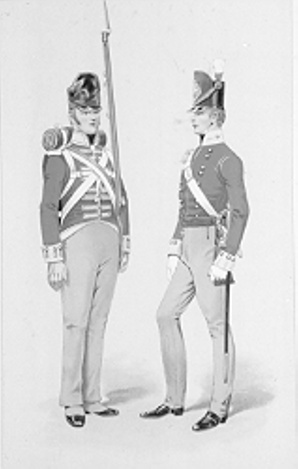
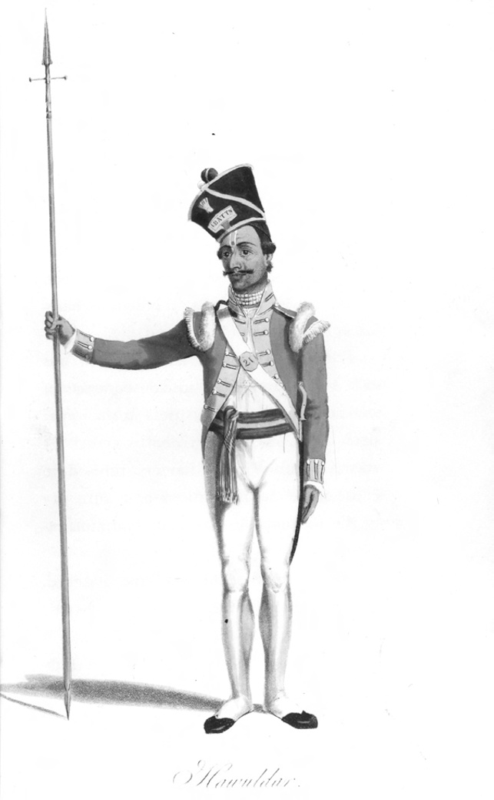
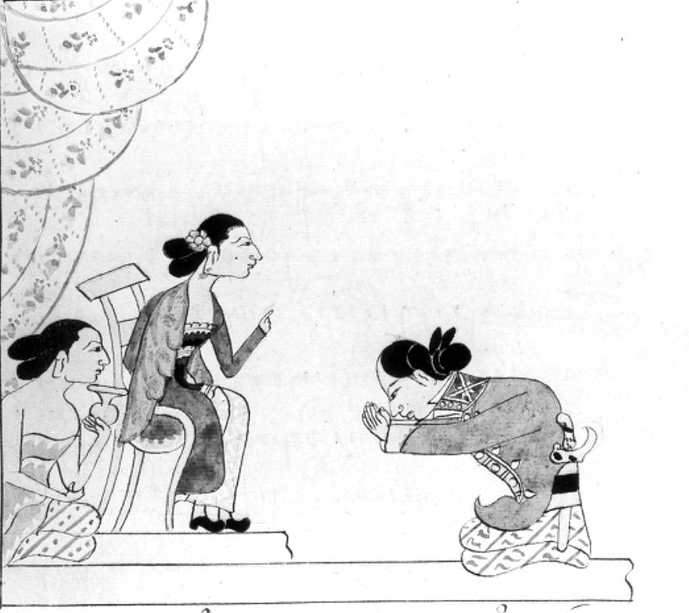
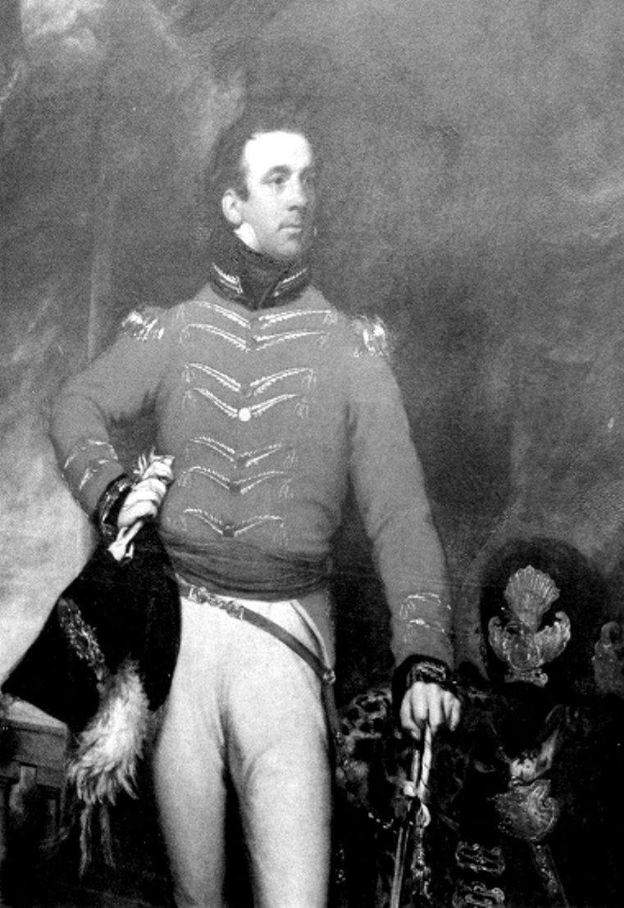
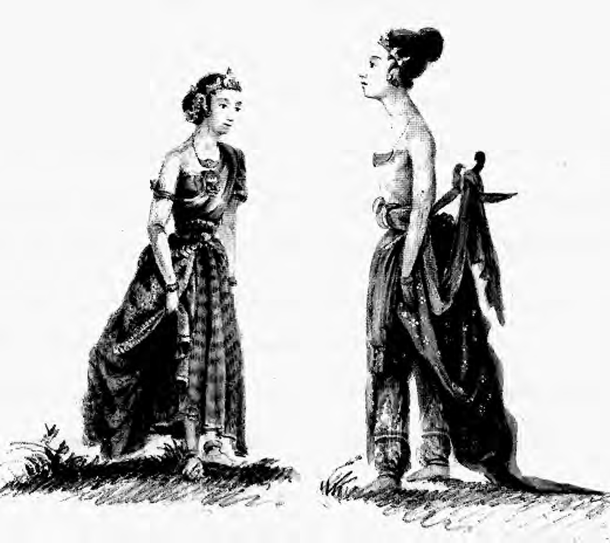
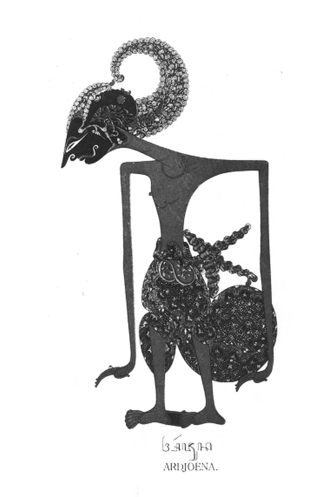
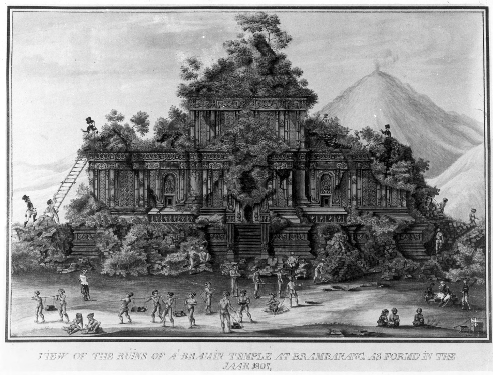
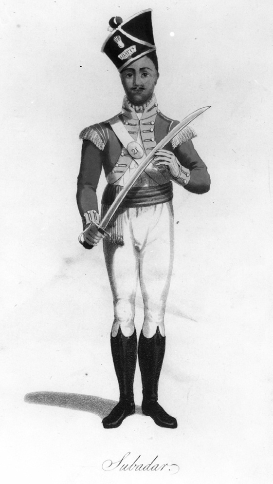

# Chapter VIII: Into a New Era: The British Interregnum, 1812-1816

## Lineaments of a new order

The four years which followed the British storming of the Yogya kraton ushered in a new era in the relationship between the south-central Javanese courts and the European government. The balance of force had now shifted decisively in favour of the colonial state. Never again would a governor-general have to fear the countervailing military power of the independent rulers, still less their combined forces which the sorry episode of the un-ratified March 1812 secret treaty had been shown to be a chimera. The treaties imposed by Raffles on the courts in the aftermath of the Yogya attack would strip them forever of their independent military capacity through the imposition of limits on their court bodyguard regiments. At the same time, the annexation of the key central apanage province of Kedhu and parts of their respective mancanagara territories would also end forever their potential for calling up military levies to augment their court-based military establishments. Indeed, so secure did Raffles feel following the 20 June operation and the speedy submission of the Yogya chiefs that he did not even consider it necessary to order the destruction of the Yogya kraton fortifications, although the gun batteries were demolished with the approval of the third sultan.[^1] The city wall around Batavia was also allowed to fall into ruin during this decade, and some of the stone from Daendels’ fortress at Meester Cornelis was shipped off to build the new defences at Muntok on the island of Bangka which guarded the sea approaches to Palembang along the Musi River.[^2]

This fundamental shift in the balance of power is reflected in the extant Residency letters which are now full of the minutiae of colonial administration rather than the urgent litany of threat and procrastination which characterised the Daendels’ era (1808-1811). Although the Residents themselves would still retain an important political role, their official responsibilities were now increasingly bureaucratic and predictable, a world away from the complex – and at times dangerous – ambassadorial functions of their pre-June 1812 predecessors. No longer would there be any question that the demands of the European government in Batavia would trump the expectations of the sovereigns to whom the Residents were accredited. At the same time, there were important changes in the economic field: just as the collapse of Radèn Rongga’s rebellion in December 1810 had swept aside the last barriers to the economic exploitation of the eastern outlying provinces so now the Principalities themselves were opened out to western capital. This was evident in the small beginnings made during the British interregnum in the leasing of landed estates by European entrepreneurs for the production of cash crops such as indigo and coffee, leases which would become a source of considerable political friction during the post-1816 Dutch restoration regime of Governor-General G.A.G.Ph. van der Capellen (in office 1816-1826). In this process of land lease, the Residents led the way, in particular, Crawfurd and his Dutch successor in Yogya, H.G. Nahuys van Burgst (in office 1816-1822), both of whom leased lands and had other business interests in the Principalities.[^3]

The present chapter will assess the impact of this shift in the balance of power on the politics and economic life of the south-central Javanese courts. It will also attempt to reconstruct the history of the four years of the British interregnum from the fragmentary Residency archive of Yogyakarta whose contemporary letters were purloined by a subsequent Dutch Resident (Chapter VII note 155).

## The plunder of the Yogya kraton

Before the new era could dawn, Colonel R.R. Gillespie’s force took the Yogya kraton apart in a wholesale looting of the court and its contents. In India, booty was one of the major perquisites of East India Company officers and the British army in India had fought for the right to keep everything in fortresses, courts and strong points taken by assault. Yogya was no exception. Raffles referred briefly to this process in a dispatch to Lord Minto written soon after the fall of the kraton:

> The whole of the tangible property of Djocjocarta fell to the captors […] but in the immediate distribution they took more upon themselves than was justifiable. […] I had no reason to expect so hasty and hurried a measure on their part, but the mischief being once done, it was useless to object or condemn. […] The universal opinion [has been] that in places carried by assault, the army was entitled to make an immediate distribution of treasure and jewels, and the authority of Lord Cornwallis [governor-general of India 1786-1793, 1805] as well as the precedent of Lord Lake [commander-in-chief of the Indian Army and conqueror of Scindia during the Second Mahratta War, 1803-1805] were considered decisive.[^4]

In vain, did the lieutenant-governor cite the example of Lord Wellesley (governor-general of India 1797-1805), who had tried – but failed – to prevent the army helping itself to the massive booty from the treasure of Tipu Sultan of Mysore (reigned 1782-1799), when his fortified capital at Seringapatam was stormed in 1799 at the end of the Fourth Anglo-Mysore War (1798-1799). Gillespie refused to heed his warnings and proceeded to an immediate division of the estimated 800,000 Spanish dollars worth of prize money.[^5] As we have seen (p. 263), he helped himself to close on £ 15,000 (74,000 Spanish dollars/ f 165,000) of this sum, and his fellow officers acquired windfalls greatly in excess of their annual salaries: a captain left Yogya £ 1,250 (5,000 Spanish dollars/ f 12,000) richer and a subaltern took away £ 750 (3,200 Spanish dollars/ f 8,250).[^6] Much of this money was remitted in mid-July from Semarang to Bengal so that officers could draw bills of exchange for the support of their families in India.[^7] At the same time, 7,000 Spanish dollars was given to Pangéran Prangwedana (Mangkunagara II) out of the Yogya prize money in recognition of the services of his legion during the attack.[^8]

Meanwhile, Raffles’ hopes, as expressed in the second clause of his 12 June secret treaty with the Crown Prince (post-21 June, Hamengkubuwana III), that he would be able to defray the whole cost of the expedition were disappointed. Indeed, when he came to ask Pakubuwana IV and the newly appointed third sultan to make a contribution of 200,000 Spanish dollars each, both pleaded poverty, the sultan stating that the only wealth that was now left to him was his personal collection of jewellery.[^9] Faced with this situation, Raffles made the best case possible to Minto:

> The Craton [kraton] having fallen by assault, it was impracticable to make any provision for Government to [re]cover the expences [sic] of the undertaking; consequently, the whole plunder became Prize to the Army. It is considerable, but it could not have fallen into better hands. They richly deserved what they got. I cannot speak too highly of the conduct of the Army in its relation with Government: every officer has behaved like a gentleman. Majors [Archibald] Campbell and [Jeremiah Martin] Johnson accompanied me and will both improve their fortunes considerably. They are appointed Prize Agents.[^10]

He then went on to some special pleading intended to soothe Minto’s fears that the army had got above itself:

> in the present instance [the army] has a special claim to indulgence, it is on the score of the moderation and forbearance evinced by all classes [? ranks] and the earnest desire that was evident in all to render the effects of victory as little disgusting and ruinous to the vanquished as possible.[^11]

As little disgusting and ruinous to the vanquished as possible? All officers behaving like gentlemen? Did this reflect the reality on the ground in the kraton proper? The ‘Chronicle of the fall of Yogyakarta’, the only contemporary Javanese source we have, takes up the tale. According to this account, the British and sepoy troops went roughly to work plundering the court. Many of the princes were forced to hand over their personal jewel encrusted kris and were sent under armed guard to the Residency. Even the aged Pangéran Ngabèhi, the seventy-four-year old elder brother of the second sultan, who was then suffering from dysentery, was forced to leave the inner court, being transported to the Residency in a chair by his retainers. Still dressed in their white robes of surrender, the crowds of captured junior kraton officials looked like so many herons as they gathered at the fort (Carey 1992:89, 240).

Meanwhile, the ladies of the court were handled roughly and robbed of their valuables, even though the chronicle noted that it was not like the fall of the kraton at Plérèd (1677) and Kartasura (1742) during the Trunajaya rebellion (1675-1680) and the Chinese War (1740-1743) when the younger and more beautiful women and female servants were raped before being carried off as war booty (Carey 1992:88, 238, 415 note 84; Ricklefs 1993b:41). This is to some extent confirmed in the account of Major William Thorn, who served as quartermaster-general to the British forces at the time of the assault. He remarked on the ‘great forbearance’ of the British and sepoy troops in the women’s apartments (Thorn 1815:190). But it is clear that some violence was involved. This can be seen from the fate of the one British officer to die of wounds sustained during the attack: Lieutenant Hector Maclean of the Buckinghamshire Regiment, who expired on 25 June and was buried in Yogya, was apparently fatally stabbed by one of the court ladies whom he rashly tried to pick up and carry away as booty after finding her alone in the female quarters (Carey 1992:414 note 78). Another kraton female who was roughly handled at this time was Radèn Ayu Wandhan, an official wife of the Crown Prince and a daughter of Radèn Tumenggung Yudakusuma of Grobogan-Wirasari. She was stripped of all her official ornaments (upacara) and state clothes by British and sepoy looters and later cut a pitiable figure when she was eventually brought back to the kadipatèn on the evening of 21 June following the Crown Prince’s return as the newly appointed Sultan Hamengkubuwana III.[^12]

According to the chronicle, a rigorous search was conducted for articles of jewellery. Ratu Kencana Wulan was particularly singled out as she was rumoured to be inordinately rich, disposing of large amounts of gems and having in her possession one diamond the size of a big toe. The ratu vigorously denied it, but, on being threatened, she not only handed over her pouch belt filled with precious stones, but also a large diamond ring, which had been hidden down a well. The finder was later supposedly paid 500 Spanish dollars by Raffles himself.[^13] Tan Jin Sing’s arrival from the Residency shortly after nine o’clock on the morning of 20 June with the news that the Crown Prince was to be raised as sultan, seems to have helped to calm the fears of the court women and most were eventually escorted to safety in the Residency with their children in palanquins (Carey 1992:92, 244). Others, such as Ratu Kencana Wulan and the members of the former ruler’s Amazon corps, apparently found temporary accommodation in the residence of Pangéran Natakusuma, soon to be known as the Pakualaman (Carey 1992:113, 278). A few, however, were left behind as we have seen with the case of the unknown court lady whose encounter with the Scots lieutenant proved so fatal for the latter.

The plundering of the kraton continued, according to the chronicle, for more than four whole days, an unending stream of booty being carried to the Residency on ox-carts and on the backs of porters. Many of the old sultan’s retainers and members of his elite bodyguard regiments were forced to act as common kuli. No heed was paid to rank or status: even the former ruler’s brothers-in-law, Radèn Tumenggung Prawirawinata and Radèn Prawiradiwirya, younger siblings of Ratu Kencana Wulan, who had attempted to take refuge in the women’s quarters after the fall of the kraton, were forced to participate in transporting the heavy chests normally used for storing the court heirlooms to the Residency (Van den Broek 1875:69; Carey 1992:94, 248, 421 note 111). Amongst the major items taken were most of the kraton ordnance, sets of shadow-play puppets, all the court gamelan (Javanese orchestras) and the court archives and manuscripts (with the exception of a solitary Qur’ān) (Java Government Gazette 5, 4-7-1812; Thorn 1815:192; Carey 1980:12-3 notes 1-5, 1992:94, 248). The manuscripts included literary works such as babad (Javanese chronicles), as well as land registers detailing the apanage holdings of the members of the sultan’s family and officials in the core regions. Crawfurd and C.F. Krijgsman, the official Javanese interpreter from Semarang, had the task of going through the manuscripts in the Residency office (Carey 1980:12 note 3; Ricklefs and Voorhoeve 1977:62). In this work, they were helped by Natakusuma, who explained to them that one particularly beautiful babad, bound in gold leaf and set with jewels, which listed all the rulers of Java, had originally been drawn up on his orders but had been seized by the old sultan from his residence when Daendels had exiled him and his son from Yogya in December 1810 (pp. 276-8; Carey 1992:96, 250-1, 421-2 note 115). The chronicle adds the detail that Raffles himself was especially delighted and intrigued by Natakusuma’s literary knowledge. As a token of his esteem for him, he is said to have returned the manuscript to the prince (Carey 1992:96, 251). This episode in which the future Pakualam I helped Crawfurd sort through the kraton library and supposedly impressed the lieutenant-governor with his literary knowledge is intriguing. We cannot confirm it in the European accounts, but we know from independent sources that a special friendship did indeed grow up between Natakusuma/Pakualam I and the British Resident. This was based on common literary interests and later resulted in the loan of various manuscripts to the Scotsman from the Pakualaman (Ricklefs 1969:241-2; Ricklefs and Voorhoeve 1977:52). When the time came for Crawfurd to leave Yogya on 10 August 1816, he was unstinting in his praise of his Javanese friend to his Dutch successor, Nahuys van Burgst: ‘Pakualam is for a Javanese a man of superior mind. He has a comprehensiveness of understanding to which among the natives there is no parallel.’ [^14]

Another such relationship of mutual literary and scholarly esteem can be seen in the friendship of both Crawfurd and Raffles for the family of Kyai Adipati Sura-adimanggala IV (died 1827), who served as bupati of Semarang between 1809 and 1822, and whose two sons were sent to Calcutta (Durrumtollah Academy) in July 1812 for two years ‘to become Englishmen’ (Raffles 1817, I:273 note; Crawfurd 1820, I:48-9; De Haan 1935a:636-9; Soekanto 1951b:30-2; Carey 1992:438 note 201). However, although such friendships were based on shared literary and scholarly interests, they also had their exploitative side. The expertise of men such as Natakusuma/Pakualam I, Sura-adimanggala and the Panembahan of Sumenep (p. 286 note 99), enabled scholar administrators like Raffles and Crawfurd to draw on local sources for their histories. All too often, however, the acknowledgement they received in their published texts was not commensurate with their contribution. In Sura-adimanggala’s case this was considerable, particularly in the field of Javanese law (De Haan 1935a:635-6 note 1; Raffles 1817, II:61, 82). As for the Yogya kraton manuscripts, almost none were returned to their original royal owners as seems to have happened with the Pakualaman text. Indeed, it is clear that a number were taken as booty by British officers and prize agents.[^15] The foundation of Crawfurd’s own private collection of Indonesian manuscripts appears to have been laid at this time with a personal haul of at least 45 Javanese MSS from the kraton library, most of which he subsequently sold to the British Museum in 1842 (Ricklefs and Voorhoeve 1977:48; Carey 1980:2, 13 note 17). A slightly larger group of 55 manuscripts was claimed by Raffles for the British government. These were sent to him in Bogor in November 1814[^16] and formed the core of his own personal collection of Javanese and Indonesian MSS, the bulk of which were presented by Lady Raffles to the Royal Asiatic Society in 1830 after his death (Ricklefs and Voorhoeve 1977:xxvii-xxviii). In this fashion, the private and public archives of Great Britain were swelled by the plunder of its soldiers and colonial administrators; intellectual booty capitalism in its purest form, invaluable for subsequent Western scholars, but deeply impoverishing for those non-European societies who fell victim to its depredations. The present volume owes much to that imperial grand larceny.

## The appointment of Hamengkubuwana III and kasepuhan-karajan rivalries

The rapid humiliation of the old sultan and the preparations for the appointment of the Crown Prince as Hamengkubuwana III seem to have intensified the feelings of bitterness amongst the party of the former ruler, the kasepuhan. The exile of the old sultan and his principal supporters by the British government on 3 July (Carey 1992:438 note 201) did not spell the end of the kasepuhan. Indeed, when Nahuys van Burgst became Resident in August 1816, he was so aware of this rivalry that he attempted to bring about some sort of reconciliation by inviting supporters from each faction in pairs to a series of private dinner parties which he held at his country estate at Bedhaya on the flanks of Mount Merapi.[^17] But these parties in themselves do not seem to have made much of a lasting impact. During the Java War it was noticeable that there were many more princes of the party which supported the third sultan – the karajan – than those from the kasepuhan who rallied to Dipanagara’s cause or afforded him support at some point during the conflict.[^18] Even after the end of the war, during the reign of the second sultan’s great-grandson, Hamengkubwana V (reigned 1822-1826, 1828-1855), kasepuhan and karajan loyalties continued to be detected amongst the younger generations of Yogya princes and officials.[^19]

Prominent amongst the old sultan’s supporters was, of course, his favourite son, Pangéran Mangkudiningrat. He had apparently asked the British for a 3,000 cacah apanage and the title of Pangéran Adipati, which, if accorded, would have put him on a par with the Crown Prince.[^20] The official British government view is unknown, but it is unlikely to have been favourable. The granting of such elevated status to a known rival of their ally would have been political folly. As for Mangkudiningrat, it is clear that he was not prepared to accept his sudden loss of political influence at court and seems to have cast around for ways to revenge himself on the Crown Prince. His hand was soon thought to have been behind a grievous incident which occurred at the house of the Yogya captain of the Chinese (kapitan cina) on the night following the fall of the kraton.[^21] Crawfurd gives a succinct account of this in his History of the Indian Archipelago (Crawfurd 1820, I:69):

> In the year 1812, [on] the very day on which the fortified palace of the Sultan […] was stormed, a certain petty chief, a favourite of the dethroned Sultan, was one of the first to come over to the conquerors and was active in the course of the day [20 June] in […] the pacification of the country. At night, he was with many other Javanese hospitably received into the spacious house of the Chief of the Chinese [kapitan cina] and appeared perfectly satisfied with the new order of things. The house was protected by a strong guard of Sepoys. At night without any warning, but starting from his sleep, he commenced havock [sic], and before he had lost his own life, he killed and wounded a great number of persons chiefly his countrymen, who were sleeping in the same apartment with him. I arrived on the spot a few seconds after this tragic affair […] and found it as usual on such occasions a very difficult matter to obtain a true account of.

The ‘petty chief’ in question was Mas Ngabèhi Gandadiwirya, one of Mangkudiningrat’s panakawan (intimate confidants; retainers). According to Dipanagara, the last straw for Mangkudiningrat had been Crawfurd’s announcement at a party in the Residency House on the evening of the day of the fall of the kraton (20 June) that the part Madurese patih of the kadipatèn, Radèn Ngabèhi Jayasentika, who had played such a key role as an intermediary during the negotiations between the British and the Crown Prince (pp. 323-4), would shortly be appointed Yogya chief minister. Mangkudiningrat had left the party at that point and instructed Gandadiwirya to carry out the attack.[^22] There is nothing in the other sources to confirm this, although the ‘Chronicle of the fall of Yogyakarta’ indicates that the prince’s movements on the night of 20-21 June were suspicious (Carey 1992:98-101, 256-8, 424 note 126). Crawfurd (1820, I:69) for his part goes some way to confirm this by stating that opium and strong drink had been served by Tan Jin Sing during the evening, and that Gandadiwirya, who was at the party, had taken deep offence at some of the remarks made by supporters of the Crown Prince regarding the kasepuhan. He had controlled his anger at the time, but during the night, when most of the Crown Prince’s party had left, he had run amok with his pike and stabbed to death Jayasentika and another of the prince’s senior officials.[^23] Despite the presence of a strong sepoy guard at the house, several others had been seriously wounded, among them Tan Jin Sing, who received stab wounds in the arm and the side before Gandadiwirya could be overpowered and killed (Carey 1992:424 note 126).

We know of the superhuman strength which can possess men and women in such an amok state (De Zoete and Spies 1973:67, 262-71). But certainly in this case, the attack was not blind. Gandadiwirya’s targets were very specific. We have seen how the kapitan cina and the wider Yogya Chinese community, over whom the captain of the Chinese exercised authority, had made themselves the butt of ethnic Javanese resentment because of their strong support for the British during their operations against the kraton (Chapter VII). We will see shortly how Tan Jin Sing would become even more of a bête noire amongst local Javanese when he was elevated as a bupati with the title of Radèn Tumenggung Secadiningrat under pressure from the British in December 1813. At the same time, threats to his life continued. Indeed, so fearful was the kapitan cina after Gandadiwirya’s amok assault that a sepoy guard had to be permanently stationed at his house to prevent any further attack on him.[^24] It is clear that both Jayasentika and his kadipatèn colleague were targeted because they were thought to be destined to play important roles in the future third sultan’s administration. In the longer term, Jayasentika’s death was a tragedy for Yogya for if he had lived and been appointed to the chief ministerial position, the later quarrel between Dipanagara and the man who did eventually become patih in December 1813, the part Balinese, part east Javanese bupati of Japan (Majakerta), Mas Tumenggung Sumadipura, might never have happened (Chapters IX and X). In view of Jayasentika’s importance, it is thus hard to escape the conclusion that he was specifically singled out by Gandadiwirya as his principal victim. On the other hand, the rather hasty implication of Mangkudiningrat in the affair could have been engineered by the third sultan to do away with his most serious rival. This was certainly the gloss that the exiled pangéran put on it in his own babad.[^25]

The episode of Gandadiwirya’s murderous attack serves to underscore the very delicate political situation in Yogya after the fall of the kraton in which various sons of the old sultan acted in a hostile fashion towards his British-sponsored successor. This hostility was apparently very much in evidence during the third sultan’s appointment ceremony at half past four in the afternoon on Sunday, 21 June.[^26] According to the chronicle, during the official banquet which followed the ceremony, many of the older princes merely gazed in a bored fashion out of the windows and took not the slightest notice of the new sultan despite the efforts of the chronicle’s author, Pangéran Panular, one of Hamengkubuwana III’s strongest supporters, to arouse their attention (Carey 1992:109, 269, 434 note 172).

The ceremony itself, however, seems to have taken place without mishap in the presence of the sultan’s relations, leading court officials, and senior British officers (Java Government Gazette 19, 4-7-1812:3; Carey 1992:103-4, 261-5). Natakusuma and Prangwedana (Mangkunagara II) were also seated in prominent positions amongst the assembled company. Captain William Colebrooke of the Royal Artillery described the proceedings as ‘extremely impressive’.[^27] Raffles’ official proclamation, which had been drawn up on 18 June before the British attack and posted up around Yogya after the fall of the kraton, was read out (Carey 1992:89, 241). This contained the official notification of the government’s intention to appoint the Crown Prince as ruler and had already been announced by public declamation at nine o’clock that same morning at the Residency House (Carey 1992:416 note 91). The full text was now read out by the official Javanese interpreter, C.F. Krijgsman. First came the statement of the British government’s grounds for action against the second sultan, who ‘by his crimes and violation of [the 28 December 1811] treaty [has] shown himself unworthy of the confidence of the British Government and unfit to be further entrusted with the administration delegated to him’ (Carey 1992:416 note 92); second followed the shorter section whereby the government in the person of ‘the Honourable the Lieutenant-Governor of the whole island of Java and its dependencies’ formally ‘reassumed’ control over the ‘one half of the high lands of Java known by the name of the kingdom of Mataram’ and then ‘delegated’ the same to the ‘Pangéran Adipati’ [Crown Prince] who was ‘hereby proclaimed Sultan of Mataram under the title of Hamengkubuwana III’. Then came a warning to the members of the kasepuhan and would-be supporters of the old sultan: ‘all who presume to abet the dethroned Prince in his pretensions to government will be considered as traitors to their country and dealt with accordingly’ (Carey 1992:417 note 92).

For perhaps the first time since Sunan Pakubuwana II’s reign (1726-1749) formal cession of his kingdom to the Dutch East Indies Company by his treaty of 11 December 1749 a European government was in place in Java which could give de facto substance to the claim that they were ‘sovereigns’ over Mataram. As Ricklefs has pointed out in his study of Sultan Mangkubumi’s reign (1749-1792): ‘only men and gunpowder could accomplish that and of these commodities the Dutch supply was inadequate until the nineteenth century’ (Ricklefs 1974a:52). The British with their Indian army victorious on land and their navy unchallenged on the high seas could now announce that they were ‘delegating’ half the high lands of Java and had the military muscle to make that delegation real. The third sultan was a client sovereign in fact as well as name. Those who opposed him were traitors not just to Yogya but also to the British government. This was a changed world indeed.

After the proclamation had been read out in Javanese and English, Dipanagara’s younger brother, Bendara Radèn Mas Sudama was proclaimed as Crown Prince, whereupon the appointments were acclaimed by all those present and the lieutenant-governor came forward to bestow his greetings and kiss on the new sultan. According to the author of the chronicle, this kiss looked more like the fighting of quails with their beaks – a reference to the contests between quail hens which were very popular amongst the ladies of the Javanese courts at this time – rather than a warm embrace (Carey 1992:105, 264, 431 note 155). The official ornaments of state were handed over together with some of the court heirlooms, which intriguingly did not include any of the great regalia or pusaka ageng which had not been found during the plundering of the kraton (Carey 1992:105, 264, 431 note 156-57a). A nineteen-gun salute then boomed forth from the fort and the military band of the sultan’s Eurasian and Ambonese dragoon guards struck up, after which those Javanese nobles and senior court officials present came forward to pay their respects led by Natakusuma and Prangwedana (Mangkunagara II), the last greeting the new ruler by shaking his hand European-style a further sign – along with his short-cropped hair and European military uniform – that he was now a ‘Company’ (European government) prince (Carey 1992:105, 264, 432 note 159). At this point, according to the chronicle, some unpleasantness occurred when two of the older princes, who had favoured the former sultan, gave Raffles and the new ruler the usual two-handed Muslim greeting rather than the full act of homage by kissing their feet. As uncles of the third sultan, their greeting was in fact the correct one, and as for paying respects to a governor, the full act of homage was unheard of. But, according to the chronicle, when they appeared unwilling to make this obeisance to the lieutenant-governor, Crawfurd seized their necks and forced their heads down arousing in them feelings of acute embarrassment (Carey 1992:105, 264-5, 432 note 159a). We have nothing in the European sources to confirm this, but if true, the epi sode is a vivid one and was another reflection of the changed political world in which the princes of Yogya were now living.

The official ceremonies in the Residency over and the sun just about to set, Raffles invited the sultan and his party to come outside and inspect the British and sepoy troops, who were drawn up in fifteen long rows in the front square between the Residency and the fort (Carey 1992:106-8, 265-8, 429 note 146). We have both Javanese and Dutch accounts to corroborate the description of the show of massed force put on by Gillespie’s army ostensibly to celebrate the third sultan’s appointment, but also to underscore the military capacity of the new British government in the event that any in Yogya might contemplate a return to the sort of confrontational politics which had been the hallmark of the old sultan’s reign.[^28] In front were troops of the three king’s line (infantry) regiments which had taken part in the assault: the 14th (Buckinghamshires), 59th (2nd Nottinghamshires), and the two rifle companies of the 78th Highland Regiment of Foot (Ross-shire Buffs), one of whose officers had secured the person of the sultan at the time of the surrender of the kraton (p. 341).

Dressed in red jackets, green cotton trousers and knobbled helmets with circlets of gold, the three-faced blade of their bayonets glinted in the light of the setting sun as they presented arms. Behind them were the sepoy troops with green jackets and breeches, white camisoles, silver-braided shoulder bands and epaulettes, and fez-like mob caps. Many were heavily bearded and, according to both Raffles and the chronicle, they created a terrifying impression amongst the watching Javanese.[^29] Indeed, all the British and sepoy troops, including the detachment of HM 22nd Dragoons with their red-plumed cavalry shakos, who performed elaborate manoeuvres on horseback and were described as appearing like mounted demons, deeply impressed the author of the chronicle. In his view, it was fitting that Yogya had been conquered by such warlike enemies and that even with the help of Surakarta, the Javanese would not have been able to withstand them. The Yogyanese, in his estimation, had been at odds with each other and the ulama (Javanese-Islamic religious scholars), who should have been setting an example by devoting themselves to mystical sciences, had been motivated more by the pursuit of greed and material gain like merchants (Carey 1992:267, 434 note 168). Amongst the common Javanese there were some men of mettle, but it was as though they had not been fired up or given any proper direction by the Yogya men of rank, who had done much wrong. All had been responsible for the debacle for they had not cooperated or worked together (Carey 1992:107-8, 266-8).

> *Plate 41. An officer and private of the 14th Regiment of Foot (Buckinghamshire Regiment) who took part in the attack on the Yogyakarta kraton in June 1812. Taken from Captain H. O’Donnell (ed.), Historical records of the 14th Regiment (Devonport, 1893):104 facing.*

It was not only the Javanese who experienced this shock in contemplating the new military power in their midst. The Dutch inhabitants of Java too had registered its impact as we have seen from the behaviour of the Indo-European ‘Free Burghers’ who longed to see the British humiliated by the Yogyanese at the time of the 20 June attack (Chapter VII; Carey 1992:404-5 note 31, 449 note 239). The memoirs of the future Yogya Resident, Nahuys van Burgst, are also interesting here. As a prisoner of the British after the fall of Meester Cornelis on 26 August 1811 (De Haan 1935a:620), he had observed: ‘how much greater and more impressive was the alteration I saw in that place [Meester Cornelis]. […] Instead of our small, weak, native soldiers, the repudiated stepchildren of the god of war, my eye met everywhere the gigantic Saxon warriors in their red uniforms whose proud bearing announced the Rajaput [Rajput], the lawful progeny of Mars’ (Nahuys van Burgst 1858:60).

These impressions are all the more striking for only fifteen years earlier, the Governor of Java’s Northeast Coast Pieter Gerardus van Overstraten (in office 1791-1796), had referred to the VOC’s Madurese auxiliaries as ‘even bet ter troops than the famed sepoys’,[^30] and in some kraton circles the Madurese remained the very epitome of indigenous military prowess, their presence a barometer of the seriousness with which the post-1816 Dutch government viewed a particular revolt. Thus in August 1825, Pakualam I was supposed to have observed that ‘if the Sampang [West Madurese] troops come to Yogya then Dipanagara’s revolt is a revolt of importance, if not then it is insignificant’ (Van den Broek 1873, 20:489-90).

The British military also left a lasting impact on the cultural life of the post-1812 south-central Javanese courts. The Scottish sword dance, for example, was introduced by some of the many Scots officers then serving in British line regiments in Java (in particular the 78th Highland Regiment). It was then choreographed and adapted at both the Mangkunagaran and Pakualaman (Carey 1992:460-1 note 297, 524 note 619). At the same time, both at the Pakualaman, where the princes of the court took to wearing British cavalry uniforms (Travers 1960:70-1), and at the Mangkunagaran, where the dress of the post-1812 legion was fashioned according to that worn by English East India Company troops (Carey 1992:418 note 93), British military models were closely emulated as a way of distancing these minor courts from their more culturally traditional senior counterparts in the main Yogyakarta and Surakarta kraton.

## Creation of the Pakualaman, exile of the old sultan and the disposal of kraton plunder

Before Raffles left Yogya early on the morning of 23 June to make the thirteen-hour journey on horseback to Semarang via Kartasura,[^31] he appears to have presided over three other important ceremonies. The first was the formal invitation made to the third sultan to ‘repossess’ the kraton. This occurred immediately after the ‘coronation’ banquet in the Residency House on the evening of 21 June. Bidden godspeed by the lieutenant-governor on the steps of the Residency House, the new ruler set out for the court in the same carriage with Crawfurd and the newly appointed Crown Prince. He was accompanied by a large British mounted escort and a torch-lit procession which included the court princesses and the young female state regalia bearers transported in palanquins (Carey 1992:109, 268-9). But this was something of a sham ‘repossession’. The plundering of the court was still in full swing so Raffles designated the kadipatèn as the third sultan’s temporary royal residence (Carey 1992:109, 269). It was not until the evening of 24 June, four full days after the British assault, that the thoroughly looted and partially burnt kraton could be reoccupied (Java Government Gazette 15, 4-7-1812:3; Carey 1992:111, 272).

> *Plate 42. Aquatint by William Daniell (1769-1837) of a sepoy havildar (sergeant), a non-commissioned officer of one of the Bengal volunteer battalions which took part in the British attack on Yogya on 20 June 1812 and the sepoy conspiracy of 1815. Taken from Williams 1817:178 facing.*

The second ceremony took place on the afternoon of 22 June when Hamengkubuwana III met Raffles and Crawfurd in one of the still intact court pavilions, the Bangsal Kencana, along with senior British officers and the ruler’s uncles and younger brothers. During this meeting, in which the lieutenant-governor gave formal notice of the annexation of Kedhu and a third of the Yogya mancanagara by way of repayment for recent British operations – the kraton treasure having been taken by the army – he announced the appointment of Natakusuma as an independent prince with the title of Pangéran Pakualam.[^32] The prince’s two eldest sons, Radèn Tumenggung Natadiningrat and Radèn Mas Salya, were also given the new names of Pangéran Suryaningrat and Pangéran Suryaningprang at this time (Carey 1992:112, 274). The details of Pakualam’s apanage holdings were not worked out until much later, partly owing to the difficulties in drawing up the boundaries with the sultan’s lands and partly due to the fact that most of the prince’s previous apanage lands had been in Kedhu which was now in the process of being taken over by the British.[^33]

Natakusuma’s promotion was both a reward for his services to the British during the previous nine months, in particular during the attack on the kraton, and a token of Raffles’ own feelings of personal friendship towards him.[^34] The creation of the Pakualaman marked an important stage in the political division of Yogyakarta and served as another tangible sign of the sultanate’s defeat. The first Pakualam now owed his allegiance exclusively to the European government, a fact which was registered clearly in the Javanese sources where he is referred to alternatively as a miji (directly subordinate of ficial) of the Europeans,[^35] or as a ‘servant’ of the British government[^36] or as a ‘Government person’ (wong Gupermèn).[^37] Although the prince was sometimes critical of the policies of the European government, especially in the period immediately preceding the Java War, he remained throughout essentially loyal to the government realising that his own interests were best served by such a course of action. At the same time, his relations with the sultanate continued on a distinctly cool and uneasy level, a state of affairs which, as we will see shortly, was greatly exacerbated by his conduct as regent during the minority of the fourth sultan from December 1814 to January 1820 (Carey 1992:517-9 note 577). In Crawfurd’s words:

> [The prince has] a clear insight into the character and resources of the European government and it enables him to calculate upon the probable result of any contest between it and the natives. This is the best antidote to a large share of ambition which he no doubt possesses, but it is not the only one. For if I am not mistaken, he is not possessed of that hardihood and intrepidity which would make ambition dangerous. Those qualities in a word to which his father [Sultan Mangkubumi] owed his success and which plunged the country for years into so much misery.[^38]

And not just Sultan Mangkubumi: if Crawfurd’s briefings by his predecessor Pieter Engelhard had been more complete and he had been given the opportunity to extend his stay in Java by another decade, he might have added two more names to place alongside that of the first sultan when he considered Javanese noblemen in whom hardihood and intrepidity were rendered fatal by a large dose of personal ambition: Radèn Rongga and Dipanagara.

The third and final public event ordered by Raffles before his departure appears to have been an oath-taking ceremony. This involved the public swearing of allegiance to the British government and the Yogya ruler by the sultan’s relations and members of his court administration at a function attended by the lieutenant-governor, the Resident and senior British officers (Carey 1992:114, 281). The evident reluctance of the old sultan’s supporters to accept the new monarch and the continuing rift between kasepuhan and karajan may have inspired this initiative. But it did not in itself change the political realities in a deeply divided and now suddenly impoverished sultanate.

On 3 July, at the same time as the departure of the main body of British troops with the treasure from the kraton,[^39] the old sultan and his two sons, Pangéran Mangkudiningrat and Pangéran Mertasana, were taken to Semarang on the first stage of their journey into exile in Pulau Pinang. They were accompanied by the former mancanagara bupati, Radèn Tumenggung Sumadiwirya, who had been responsible for firing the powder magazine in the fort during the British attack (p. 335 note 267, and p. 337). According to the chronicle, they were carried in Chinese-style palanquins with dried palm-leaf rooves, except for Sumadiwirya who was forced to follow on foot (Carey 1992:115, 282-3). They cut pitiable figures. As we have seen, Mangkudiningrat had been forced to share his father’s exile because of his supposed involvement in Jayasentika’s murder, but the two others apparently went voluntarily out of love and respect for the old ruler. Neither Sumadiwirya nor Mangkudiningrat would ever return to Yogya. Both died in Ambon in circa 1822 and 13 March 1824 respectively. As for Mertasana, his own homecoming would be tragically brief: barely nine months after his return in late October 1825, just after he had taken Dipanagara’s place as a guardian of the child sultan, Hamengkubuwana V, he was cut down in a Java War ambush along with many of his princely relatives at Nglèngkong in the Slèman area on 30 July 1826 (Carey 1992:438-9 note 201).

As for the old sultan, he appears to have withstood both his journey into exile and his initial period of banishment in Pulau Pinang with fortitude. According to the Malay translator to the Pulau Pinang government, both the exiled ruler and his party conducted themselves with ‘the greatest propriety and consistency’ (Carey 1992:438 note 201). Indeed, he would live long enough to be reinstalled on the Yogya throne in August 1826 during the darkest period of the Java War. By then, however, he had lost much of his fierce energy. According to P.J.F. Louw, fourteen years of sorrow and humiliation had taken their toll (Louw and De Klerck 1894-1909, II:435). Ruling as a Dutch ally until his death on 3 January 1828, his last period as ruler would not be a happy one for the sultanate. Nevertheless, his presence both in exile and in Java, would remain a living inspiration for his religious and royal supporters in the kasepuhan party who flocked to see him in Batavia and Surabaya between his return from Pinang in April 1815 and his re-exile to Ambon in January 1817 (Carey 1992:438 note 201). Raffles reported that when he met the deposed Yogya monarch again in Semarang after his arrival on 4 July, and appraised him of his more lenient sentence of temporary banishment in Pulau Pinang, he reacted with unfeigned relief:

> even the unfortunate Sultan has been considered of late comparatively happy, for on his first apprehension he certainly expected to have been put to death. That

> fear removed, transportation to Banda for life appeared inevitable and as bad as a second death. On his arrival here [in Semarang] this has since been mitigated to Pinang with a promise that if all things remain quiet, he shall in a few years be permitted to return and end his days in the land of his forefathers [Java].[^40]

The former ruler eventually sailed for Pinang on 16 July on a fast frigate bound for Calcutta under command of Lord Minto’s son, the Honourable George Elliott. Also on board were the bupati of Semarang, Sura-adimanggala IV’s, two sons, Salèh (born circa 1800) and Sukur (born circa 1802), who, as we have seen, were being sent to Calcutta for their education (Carey 1992:438 note 201). Part of the frigate’s cargo consisted of some 68 chests containing 408,414 Spanish dollars in silver coin from the plundered Yogya treasury which was now being sent to Bengal as prize money for the credit of the officers and men of the victorious British expeditionary force (Carey 1992:414-5 note 79). In this fashion, much of the wealth extorted by the sultan through his harsh fiscal policies of the first eighteen years of his reign travelled with him into exile. But it would not be his to enjoy. The blood and sweat of a nameless generation of south-central Javanese peasants was now the spoil of a foreign conqueror. As for Salèh and Sukur, they represented Java’s conflicted future. As members of the first cohort of the nineteenth-century Javanese elite to receive a European education, their prospects seemed bright. Salèh, in particular, who had won prizes in geometry, algebra and drawing, was made assistant bupati of Semarang when he was still only fifteen years old and took his father’s place for a period in May-August 1816 during a dispute between Sura-adimanggala and the British Resident, William Boggie. But both his career and that of his brother were blighted by the Java War and the pull of their identity as Javanese Muslims. Sukur’s trenchant report on the immiserisation of the Javanese peasantry in Kedhu in the immediate pre-war period (Chapter IX notes 82-3), his decision to rally to Dipanagara early in the conflict in late August 1825 and his adoption of a new Muslim name – Radèn Hasan Mahmud – implicated his whole immediate family who suffered degradation, imprisonment and exile (De Haan 1935a:641; Carey 1988:139 note 239). The same torn loyalties would be evident in the career of their first cousin, the celebrated painter Radèn Salèh Syarif Bustaman (circa 1811-1880), whose personal life and artistic oeuvre would intersect in interesting ways with that of the exiled prince during his last years in Makassar (Kraus 2005:278-88; p. 742). Significantly, Prangwedana (Mangkunagara II) specifically forbade his sons to study in Europe, even though urged to by Raffles and the post-1816 Dutch administration, because he feared that they would return neither as Europeans nor Javanese (Büchler 1888, II:15).

On the day before the old sultan sailed for Pinang, the last British military detachments left Yogya and an uneasy calm descended on the ravaged city.[^41] According to the Javanese accounts, most of those who had fled from the town before the British attack returned within two months from the outlying villages: traders once again began to visit the capital and the santri came back to their partially burnt homes in the kauman (firm Islamic community) near the Great Mosque (Carey 1992:118, 288-9, 448 note 237). In the Yogya market, the price of rice returned to its pre-June level (Appendix X) and copper-smiths, iron-workers, makers of gamelan instruments and forgers of weapons began to make a prosperous living again. This was especially the case with the kris makers who apparently had a busy time replacing the numerous pusaka (personal heirloom) daggers which had been confiscated and sold by the British and sepoy troops as part of their prize money following the fall of the kraton.[^42]

So many jewels, fine clothes, weapons and other valuables looted from the court or seized from its defenders could now be purchased cheaply at the market outside the fort, that quick profits were made according to the chronicle by those skilled at trading on commission. Prominent amongst these were the better-off local European and Indo-European ‘Free Burghers’ who bought directly from the British and sepoy soldiers. For more than a month these commercial opportunities continued and many became rich overnight on account of this unexpected benefaction from the state, so much so that special ritual offerings were made in honour of the exiled sultan by those who had been beneficiaries of his windfall gifts (Carey 1992:118, 289).

## The third sultan’s new order and Dipanagara’s role

In Javanese history, a new reign offered the opportunity for a major reordering of the administrative personnel of the court as well as the distribution of titles and offices to the new ruler’s blood relations. Brief though it proved to be and sadly diminished in terms of its financial resources, the third sultan’s two-and-a-half-year rule opened with the same wholesale recasting of the kraton hierarchy. His mother, the sixty-five-year-old Ratu Kedhaton, who had suffered so much at the hands of her exiled husband, was appointed as Ratu Ageng (senior dowager queen), a title which had been vacant since the death of Dipanagara’s great-grandmother in October 1803 (Chapter II). She was given charge of the kadipatèn with special duties as carer for the young Crown Prince who was to live with her until shortly after his appointment as sultan in November 1814 (Carey 1992:113, 277). Crawfurd noted that she was treated with great attention and respect, the Crown Prince showing her particular honour.[^43]

> *Plate 43. Ratu Ibu (?1780-1826; pre-1816 Ratu Kencana, widow of Sultan Hamengkubuwana III, reigned 1812-1814, and mother of the boy-ruler Sultan Hamengkubuwana IV, reigned 1814-1822) conferring with Radèn Adipati Danureja IV (in office 1813-1847) in the Yogya kraton. A female servant (nyai keparak) holding a spittoon (tempolong) looks on. Taken from KITLV Or 13 (Buku Kedhung Kebo), f.66v. Photograph by courtesy of the KITLV, Leiden.*

Two of the sultan’s official wives were also raised in rank: the mother of the Crown Prince was appointed Ratu Kencana (post-1816, Ratu Ibu), and the sultan’s second wife, the childless daughter of Radèn Rongga Prawiradirja I of Madiun (in office circa 1760-1784), received the title of Ratu Mas (Carey 1992:113, 277). Crawfurd later commented that the latter was the favourite wife of Hamengkubuwana III, but was less ‘respectable’ than Ratu Kencana, who was a plain woman with considerable influence over the mind of her son. The Belgian artist, Antoine Auguste Joseph Payen (1792-1853), who met Ratu Kencana (then Ratu Ageng) in Yogya at the time of the outbreak of the Java War, described her as a person of great dignity (Carey 1981a:265 note 120, 1988:58), a view echoed in the chronicle which thought she acted ‘like a man’, both at the time of the British attack when she had been lightly wounded in the foot by sepoy sniper fire as she accompanied her husband in his flight from the kadipatèn (Carey 1992:77, 222), and on the occasion of his final illness and death in November 1814 (Carey 1992:187, 382). During the minority (1814-1820) of her son, the fourth sultan (reigned 1814-1822), she came to exercise an important sway over kraton politics deciding most of the significant issues with her key advisers. Crawfurd thought highly of her: ‘[Ratu Kencana’s] moderation and discretion renders this power very safe in her hands’.[^44] But this was not the view of her stepson, Dipanagara. He came to despise her loose morals – she apparently had an affair with a court dancer who specialised in masked dance (topèng) performances (Hageman 1856:39) – and her close association with two of his bitterest enemies within the kraton administration. These were the patih, Danureja IV (in office 1813-1847), and the commander of the sultan’s bodyguard, Radèn Tumenggung Major Wiranagara, with whom the ratu was also romantically linked (Chapter III).

The latter, known in his youth by his santri name of Mas Mukidin, was a descendant of the late seventeenth-century Balinese adventurer, Untung Surapati (died 1706), and a son of the former patih of the kadipatèn, Mas Tumenggung Wiraguna (died 1807; Appendix VIIb). He was married for a time to one of the prince’s younger sisters, Radèn Ayu Gusti (Mandoyokusumo 1977:30 no. 8), and rose high in the court of Ratu Kencana’s son, Hamengkubuwana IV, because of his gift for making jokes and acting the court jester, skills which Dipanagara despised.[^45] Appointed royal bodyguard commander in 1819, he took the Dutch side during the Java War despite having promised Dipanagara that he would join him and bring the child sultan, Hamengkubuwana V, over to the prince’s Selarong headquarters in late July 1825. Cursed by the prince for breaking his word (Louw and De Klerck 1894-1909, VI:251), he was richly rewarded by the Dutch at the end of the war with the title of Pangéran Adipati Prabuningrat and a quasi-independent landholding in the Nanggulon area of Kulon Praga (Rouffaer 1905:597-8; Carey 1981a:245 note 41, 278 note 178). But his fall was equally swift: ambitious to get his wife recognised as a ratu (royal consort) and constantly intriguing against the fifth sultan and his younger brother, the Crown Prince (the future sixth sultan, reigned 1855-1877), he was exiled to Banda in 1832 where he ended his days (Sartono Kartodirdjo 1971:57 note 16). Yogya contemporaries attributed his misfortune to Dipanagara’s curse, the prince being renowned for the power of his maledictions (Louw and De Klerck 1894-1909, VI:251). Ratu Ageng would also have an unhappy end, dying in the second year of the war (20 June 1826) of an illness brought on by what the Yogya babad describes as deep emotional affliction at the misfortunes which had overwhelmed the sultanate.[^46] In a famous article, the Dutch historian, P.H. van der Kemp, compared Dipanagara to the Shakespearean tragic hero, Hamlet, and based an important strand of his argument on this enmity-filled relationship between the prince and his stepmother with her politically ambitious younger lover fulfilling the role of the usurping king of Denmark (Van der Kemp 1896a:310-3).

At the same time as the new titles were accorded the sultan’s female relatives, the older male offspring of the ruler also received new names and ranks. Three of Dipanagara’s younger brothers were appointed as pangéran (princes)[^47] and his uncle, Pangéran Panengah, was accorded the new name of Pangéran Dipawiyana. Both the Javanese accounts and contemporary Residency letters mention that the latter became one of the third sultan’s most trusted advisers and was a great favourite in the meetings of the nayaka.[^48] Dipanagara himself later commented that ‘the Pangéran was very much attached to the rule of the British […] [and] was a philosopher who followed all the commands of The Prophet and died as a wali [apostle of Islam]’.[^49]

Dipawiyana’s son, was married to one of Dipanagara’s sisters and both later accompanied the prince into exile in Manado remaining with him for the first two years of his banishment (Appendix XII).

Shortly after his father’s appointment, Dipanagara (then still styled Radèn Antawirya) received his new princely title of Bendara Pangéran Aria Dipanagara (Carey 1992:116, 284, 442 note 211). As we have seen, his previous name devolved on his eldest son, the future Pangéran Dipanagara II, who had been born of a secondary wife at Tegalreja (Chapter III). The elder Dipanagara also received an enhanced 500 cacah apanage at this time with a personal stipend of 700 Spanish dollars a year from the court paid out of the annual gratuity of 100,000 Spanish dollars given to the Yogya kraton by the British government for the tax-farm of the tollgates and markets in the sultan’s territory under the terms of the soon to be signed 1 August 1812 treaty (Van Deventer 1891:322-3; Appendix VIII). Many of the lands in his July 1812 apanage grant appear to have been situated to the south of Yogya, particularly in the Kulon Praga and Bantul districts (Van der Kemp 1896a:405; Louw and De Klerck 1894-1909, I:432, V:745; Carey 1981a:238 note 20; Chapter III). Amongst these may have been the area around Selarong immediately to the west of Bantul where the prince created his personal retreat. This had earlier belonged to the slain Radèn Tumenggung Sumadiningrat, the second sultan’s army commander, who had been the guardian of Dipanagara’s younger brother, Pangéran Adinagara (Chapter II note 25; Carey 1981a:238 note 20). Others were situated in Bagelèn, Banyumas and Sokawati. They replaced lands which Dipanagara had previously held in Kedhu and which had now been annexed to the British government (Louw and De Klerck 1894-1909, V:745). By the time of the outbreak of the Java War, the prince’s landholdings had apparently doubled to 1,000 cacah all of which were given to his uncle, Pangéran Panular, who replaced him as a guardian of the child sultan, Hamengkubuwana V, in August 1825.[^50]

Given the fame – or rather notoriety if one takes the view of the south-central Javanese kraton – that the name ‘Dipanagara’ would later acquire following the Java War (no Javanese prince since that time has ever been given that title), it is worth recalling that it was not such an unusual moniker for a Javanese prince in the eighteenth and early nineteenth centuries. One of Sunan Pakubuwana I’s (reigned 1703-1719) sons, who had been involved on the rebel side in the Second Javanese War of Succession (1719-1723; Ricklefs 1993a:87), had borne this epithet, as had the second husband of Sultan Mangkubumi’s daughter, Ratu Bendara (circa 1750-1786), who had died in July 1787.[^51] The same title had also been held by a younger brother of Pakubuwana IV (reigned 1788-1820), who passed away in April 1811.[^52] It was the norm at the south-central Javanese courts that only one prince at a time would bear a particular name, but since the title had been vacant in Yogya since 1787 and the former bearer had been held in high regard by the first sultan (note 51), the third sultan may have deemed it an appropriate style for his eldest son. Later, on his journey into exile, when he had passed his princely title to his own eldest child (Chapter III), Dipanagara gave an interesting etymological analysis of his name to the German officer, Second Lieutenant Julius Heinrich Knoerle, who accompanied him to Manado. In Knoerle’s words:

> ‘Dipa’ [from the Sanskrit ‘dīpa’] means someone who spreads enlightenment or who possesses life and force. It was in this sense that Dipanagara understood his name. ‘Nagara’ means a country or a province and ‘Dipanagara’ is thus a man who gives enlightenment, power and prosperity to a country.[^53]

The prince went on to stress that the particular etymological explanation was unique to his name and not to that of his cousin and brother-in-law, Radèn Tumenggung Dipawiyana, who was travelling with him.[^54] This indicates that he may have been linking his new moniker with his grandfather Sultan Mangkubumi’s prophecy about his future historical significance as the descendant who would rise against the Dutch and cause them even more destruction than he had done during the Giyanti War (1746-1755) but that only the Almighty knew the outcome (p. 71).

Other changes mainly affected the sultan’s officials. The former ruler’s pengulu (head of the Yogya religious establishment), Muhamad Sapingi, an ulama of Sundanese origin, who had fled back to west Java at the time of the British attack, was replaced by Dipanagara’s friend, Kyai Rahmanudin, a member of the Suranatan corps (Carey 1992:118, 284, 441-2 note 210). Meanwhile, Sumadiningrat’s old position of patih jero (First Inner bupati) was filled by Radèn Tumenggung Pringgakusuma (circa 1750-1815), the former bupati of Rawa (Tulung-Agung) and brother-in-law of the third sultan,[^55] whose services during Radèn Rongga’s rebellion in leading the loyal mancanagara bupati had been particularly appreciated by the court (Chapter VI notes 208, 212). He was given the new title of Radèn Tumenggung Pringgadiningrat and remained until his death in May 1815 an important counsellor of both Hamengkubuwana III and his son. Indeed, he was even put forward as a replacement for the acting Yogya patih, Mas Tumenggung Sindunagara (Kyai Adipati Danureja III), when the latter was forcibly retired in December 1813 (Carey 1992:116, 285, 442-3 note 213, 490 note 429).

Many of the new appointments involved those who had afforded the third sultan the most support during his turbulent last months as Crown Prince. Prominent amongst these were, of course, the members of the Danurejan family. Two in particular were singled out for special favour: the first was Radèn Tumenggung Mertawijaya, Dipanagara’s brother-in-law (Appendix II), who replaced his father, the murdered Radèn Tumenggung Danukusuma I, as one of the Outer bupati or nayaka with the title of Radèn Tumenggung Danukusuma II. The other was Radèn Ria Mandura (post-1813, Radèn Tumenggung Sindunagara II), the acting patih, Sindunagara I’s son, who was appointed as head of the porters’ guild.[^56] Crawfurd remarked that although good men, neither had any real qualifications for their new positions other than their ancestry, adding caustically ‘but such is the dearth of talent for business amongst the Javanese chiefs, that I am not sure that Djocjocarta [Yogyakarta] would afford from their class men who would fill these positions better’.[^57] The chronicle is even more disparaging, speaking of Danukusuma II’s younger brothers as idle lay-abouts who spent their time smoking opium and sleeping, giving their mother, Radèn Ayu Danukusuma, an avid reader of Javanese-Islamic mystical literature or sastra pégon (pp. 99-100), no support in her penurious widowhood (Carey 1992:157, 343).

Important new links between the third sultan’s immediate family and the Danurejan were also established through the marriage of two of Danureja II’s orphaned daughters to the new monarch’s sons: the eldest, Radèn Ajeng Kapilah (born circa 1800) was betrothed on 28 June 1813 to Pangéran Suryabrangta (post-1830, Pangéran Purwadiningrat) and the second (post-1816, Ratu Kencana, born circa 1802), became the consort of the ruler’s heir, Hamengkubuwana IV, on 13 May 1816 (Carey 1992:163-4, 199-201, 352, 396-8, 493 note 452, 504-5 note 509, 526 note 627; Appendix II). The latter marriage effectively set the seal on the rehabilitation of the Danurejan family fortunes after the vicissitudes of the second sultan’s reign. The return of Radèn Tumenggung Danukusuma I’s body from the traitor’s plot at Banyusumurup to the family graveyard at Melangi on 27 November 1812 (Chapter VII note 188), although curiously not that of his son,[^58] also helped to efface the previous stigma of treachery. Ties between the two families thus continued on a cordial and intimate level and would result in substantial support from the Danurejan for Dipanagara during the Java War (Chapters III, VI, and XI).

Amongst the eastern mancanagara officials, both Pangéran Dipakusuma and Radèn Rongga Prawirasentika were continued as acting bupati wedana. The former had earlier been denounced to Crawfurd as one of the third sultan’s principal opponents (Chapter VII), but he seems to have quickly established better relations with the new ruler resulting in the marriage of one of his sons with a daughter of Hamengkubuwana III on 28 June 1813 (Carey 1992:493 note 452). Both the chronicle (Carey 1992:113, 277, 402 note 18a) and Crawfurd confirm his role as one of the monarch’s trusted confidants, the Resident observing that:

> [he] is an experienced chief well acquainted with the whole history of the relation [of Yogyakarta] with the European power. He is a man of good understanding, and although I had once imbibed an unfavourable opinion of him, I am now convinced of his fidelity and discretion.[^59]

Later Dutch officials were more cautious. W.H. van IJsseldijk, who served as ambassador extraordinary (buitengewoon gezant) to the courts in August-October 1816, was concerned that Dipakusuma should be kept in Yogya rather than be allowed to spend too much time in Madiun. The combination of his administrative talents and high birth – his grandmother had been a sister of Radèn Mas Garendi, the ‘Yellow Sunan’ (Sunan Kuning), so-called because he was installed on the Kartasura throne during the Chinese war (1740-1743; Remmelink 1994:176), and his father had been a direct descendant of Sunan Amangkurat III (reigned 1703-1708) – meant, in Van IJsseldijk’s view, that he ‘could do much harm’. He noted that some of Dipakusuma’s relatives, like himself born in Ceylonese banishment, had been brought back to Madura by the British, and speculated that the proximity of Dipakusuma in Madiun and his recently returned relatives in Madura could be the nexus of a new eastern mancanagara rebellion.[^60] But this was far-fetched. The days of Radèn Rongga were over. The pangéran would remain scrupulously loyal to the European government until his death in 1822, even leading the fourth sultan’s dele gation to greet the incoming Dutch commissioners-general in Batavia at the time of the hand-over of the colony in August 1816.[^61]

Within a few months of the third sultan’s accession most of the important changes in the kraton had been made. In his babad, Dipanagara describes how, shortly after Raffles’ departure on 23 June, he had begged his father to allow him to return to Tegalreja, but his request had been refused. Instead, he was lodged in the kraton at one of the pavilions called the Gedhong Kuning (Yellow Building). A few weeks later in mid-July, he again approached the sultan about granting him permission to return to his estate because he felt distinctly ill at ease in the court environment. But his father, fearing that if he moved back to his residence he would be too far away to help him with the conduct of daily affairs, assigned him a small lodging at Mijèn on the western outskirts of Yogya half way to Tegalreja.[^62] It is unclear how long he remained there. Certainly, by late 1813, he had moved back to Tegalreja because he describes in his babad how Tan Jin Sing was sent out to him with a shortlist of two names from which to select the new patih in early December 1813 (p. 396). The prince also mentions how he still came to Yogya for the thrice yearly Javanese-Islamic Garebeg festivals (pp. 87-8), as well as making special journeys when matters of particular importance had to be discussed. According to Dipanagara, the third sultan likewise journeyed out to Tegalreja from time to time to talk over minor affairs with his eldest son.[^63] The prince’s claim that he acted as one of his father’s closest advisers during this period is confirmed in the chronicle, which gives the following description of him in these months immediately after the third sultan’s appointment (Carey 1992:290):

> XXIV. 21 Of the sultan’s sons, the one who was made foremost was Pangéran Dipanagara, for he was the eldest, [and] his heart was at one with his father. 22 He was shrewd, generous [and] of a lively and spirited manner, not afraid in front of the multitudes. He spoke easily [and] sweetly with a friendly countenance, [and] took pains with all the people of the kingdom, for he was invested by his father. Great [and] small, young [and] old, all were under his authority.

> 23 He took charge of affairs with the Residency: on each Monday [and] Thursday the Pangéran visited the Residency accompanied by Pangéran Dipawiyana, The younger brother of the sultan.

The fact that Dipanagara took charge of the negotiations with the Residency is also mentioned in the prince’s babad where he relates that he was particularly tasked with discussing the terms of the new treaty between Yogyakarta and the British government. This does not seem to have involved him going to the Residency in person. This was the job of Pangéran Dipakusuma and the acting patih, Mas Tumenggung Sindunagara (Kyai Adipati Danureja III).[^64] But, according to the prince’s testimony, every time Sindunagara had met with Crawfurd, he, Dipanagara, would see him in the Kemandhungan pavilion in the kraton to talk over any outstanding matters in the company of the nayaka.[^65] The third sultan himself was also involved as we know from Crawfurd’s report that he had personally approved the article in the draft treaty abolishing torture, mutilation (the chopping off of arms under Islamic law) and the pitting of criminals against tigers and other wild beasts (Carey 1980:99; note 101). He was said to have observed at that time that torture was ‘certain injustice to the innocent and a double punishment even to the guilty’, at which Crawfurd noted,

> His Highness is possessed by a degree of humanity [which is] not a usual concomitant of the Javanese character. During the reigns of the last two sultans [Hamengkubuwana I, 1749-1792, and Hamengkubuwana II, 1792-1810, 1811-1812] torture and mutilation were constantly practised and the combat of criminals with tigers and other animals often occurred [in] circumstances of aggravated horror.[^66]

Discussions over the treaties occupied slightly over two weeks and on 14 July, Raffles submitted a draft to Lord Minto which was to serve as the basis for negotiation with the courts. The final treaties were concluded a fortnight later (1 August 1812),[^67] eventually being ratified by the governor-general of India in council on 2 October 1813.[^68] We will return to the political significance of these contracts shortly. But first we need to consider the trustworthiness of Dipanagara’s account of his key role in these treaty negotiations. We have already seen (pp. 315-6) that nowhere in Crawfurd’s extant letters is there any mention of the prince’s contribution as a plenipotentiary on behalf of his father prior to the British attack on the kraton. Given that Valck retained many of the Residency letters from this period for his own private collection, his statement that the prince was indeed used as a go-between has been accepted for this earlier period. But for the subsequent treaty negotiations there is a problem: if Dipanagara did indeed enjoy the close and cordial relationship with Crawfurd which the prince later boasted about to Knoerle (p. 109), why did the Scotsman make no mention at all of Dipanagara to his successor, Nahuys van Burgst, when he drew up his list of the main personalities at the Yogya court a day before his departure from the sultan’s capital on 10 August 1816?[^69] Since Dipanagara had returned to Tegalreja by this time and rarely visited the court, it is possible that Crawfurd overlooked him. But on one particular detail, it can be proved beyond a shadow of doubt that the influence, which the prince claimed he had with Crawfurd, had no basis in reality. This was the matter of the appointment of the Scotsman’s Dutch successor. According to Dipanagara, on apprehending that Java would be handed back to the Dutch in August 1816, he expressed his concern to the British Resident over the character of his replacement. Crawfurd was then supposed to have asked the prince what sort of Dutch Resident he would prefer: one who had already served in Java under the Dutch East Indies Company (VOC), namely before Daendels’ arrival in January 1808, or one more recently arrived from Europe? Dipanagara had opted for the latter, whereupon Crawfurd was reported to have said that he had a good acquaintance in Batavia by the name of ‘Major Nahuys [van Burgst]’, and that he would try to get him as his replacement. Soon afterwards Nahuys did indeed arrive in Yogya which confirmed Dipanagara’s view of the power and influence of the British.[^70]

But this does not accord with the Dutch sources. According to P.H. van der Kemp (1911:223), Jan Tiedeman, an experienced administrator and landowner, who was a close friend and business partner of Daendels’ Secretary-General Hendrik Veeckens (De Haan 1935a:654) was appointed by the returned Dutch government as Resident designate of Yogya. But at the last moment he asked to be excused from the post for pressing family reasons. The incoming Dutch governor-general, G.A.G.Ph. van der Capellen, then sought a replacement and Nahuys van Burgst was eventually appointed by executive decision of 22 July 1816. The choice of Nahuys also had much to do with the help he had given to Pakualam I (then Pangéran Natakusuma) and his son, Natadiningrat, when they were in danger of their lives in Cirebon in early May 1811 (Chapter VII). As C.Th. Elout, one of the Dutch commissioner-generals charged with overseeing the takeover of the Netherlands-Indies in 1816-1819 observed, Nahuys’ residence at the court of Jogjakarta [Yogyakarta] seemed very promising: ‘[he will be] extremely useful [to us] not only for his well-known and much to be praised diligence and attachment to his king [William I, reigned 1813-1840] and fatherland, but particularly for the serendipitous service which he was able [to provide] earlier to the regent [Pakualam I]’ (Louw and De Klerck 1894-1909, I:36 note 1). Pakualam himself was naturally delighted at the decision, and relieved that the former Daendelian, Tiedeman, had not taken up the post (Van der Kemp 1913:321).

Fortunate though Nahuys’ appointment may have been for some members of the Yogya elite, Dipanagara’s unsubstantiated claim that he was in some way responsible for his selection indicates that he may have greatly exaggerated his friendship with Crawfurd. His role as his father’s principal link with the Residency at the time of the treaty negotiations must also be questioned. Perhaps this exaggeration may have been prompted by the prince’s later difficulties as a guardian of the fifth sultan during the two years before the Java War. Indeed, when he came to dictate his autobiographical babad in exile in Manado in 1831-1832, he may have looked back on the British interregnum as something of a golden age when he had enjoyed a prominent and privileged position as his father, the third sultan’s, principal confidant.

Although he may not have been as close to Crawfurd as he later pretended, this does not gainsay the fact that he clearly appreciated the Scotsman’s style and abilities. As we have seen in the previous chapter (pp. 297-303), after a difficult start, Crawfurd turned into a remarkably successful Resident of Yogyakarta far outshining his Dutch predecessors and immediate successors in the scope of his scholarly activities and the incisiveness of his administrative skills. His rather dour and parsimonious character (Abdullah 1970:223-4; pp. 109, 437) appear to have made him especially well suited to the stiff charm of the Yogyanese, amongst whom was the young Dipanagara whose ‘sombre and intense’ personality was noted by Dutch contemporaries (Van Hogendorp 1913:146). Certainly Crawfurd’s own persona stood in sharp contrast to that of his ebullient Dutch successor as can be judged from a brief comparison of their very different styles as dinner party hosts (p. 437). But even Nahuys, who was as different from Crawfurd as chalk from cheese, noted on the first day of his incumbency as Resident that his predecessor had come to be ‘very much loved and esteemed at the [Yogya] court’ (Van der Kemp 1911:248, 1913:320-1), a judgement later echoed by the Dutch historian, François de Haan (1935a:529). His willingness to allow his horses to take part in races sponsored by the Yogya court undoubtedly endeared him to the inhabitants of Yogya, especially Dipanagara and his father who both shared the usual kra ton love of equestrian pursuits and admiration for English bloodstock.[^71] The literary and historical knowledge of the third sultan (p. 70) and Dipanagara’s own familiarity with Javanese-Islamic texts (pp. 103-4, 743-5) may well have formed common ground for friendship with the British Resident, although direct references to this are lacking. Crawfurd’s presence in Yogya throughout most of the period of British rule (Appendix IX) undoubtedly contributed to the restoration of good relations between the Yogya court and the European government after the twin traumas of Daendels’ December 1810 treaty and the British attack on the kraton.

## The 1 August 1812 treaties and their implications

The treaties signed between the British government and the courts on 1 August 1812 gave legal title to the radically altered political environment in which the south-central Javanese kraton were now forced to exist.[^72] In his letter of 6 August 1812 to Lord Minto, Raffles gave a useful summary of the treaties as they appeared in their final form.[^73] He remarked first that he had all along regarded the 28 December 1811 treaty with Yogya as a temporary measure forced on him by his disadvantageous political and military position at the time (p. 301). The new treaties, the lieutenant-governor averred, would place the south-central Javanese courts ‘on such a footing as might no longer endanger the tranquillity of the country’ and would open up their administrations to significant liberalisation and reform. Despite the manifest treachery of the Sunan in cutting the British lines of communication with Semarang during the British attack on Yogya and the discovery of the secret correspondence in which the distinctive handwriting of Pakubuwana IV was clearly visible,[^74] Raffles had not thought it necessary to mount an expedition against Surakarta. Instead, he had sought to place the Sunan on the same level as the third sultan by the terms of the new treaty, ‘a measure essential for the welfare and stability of the country’. In order to ensure the Surakarta ruler’s agreement he had remained in Semarang throughout the month of July with a sufficiently large military force at his disposal to give the impression that he was prepared to march on Surakarta at a moment’s notice.[^75] At the same time, he reckoned that if the Sunan’s personal vanity was flattered by the attentions of the Resident, he would remain content.[^76] The Surakarta patih, Radèn Adipati Cakranagara (in office 1810-1812), who had played such a prominent role in the secret correspondence with Yogya (p. 319), was, however, dismissed from his post and banished to Surabaya where he had family connections.[^77]

Regarding the detailed clauses of the treaties, Raffles made a number of interesting observations to Minto. The second article, which forbade the rulers to maintain any military forces except for that permitted by the British government ‘to protect their persons and territories’, was particularly directed against Yogya. According to the lieutenant-governor, the second sultan had kept up a considerable military establishment of 8-9,000 men, some paid in land and appropriations (pp. 5-9), others in cash stipends. Many of these had been permanently based in the royal capital. They had never, in Raffles’ view, been used for maintaining peace in the countryside or in police duties in Yogya, and the individuals composing the force ‘were the most idle, profligate and worthless part of the community’. Once they had been disbanded, he suggested, it would only be necessary for the government to maintain half a battalion of sepoys in the Yogya garrison to ensure security (Chapter VII note 157). The Sunan, however, was specifically allowed to retain 1,000 men as a guard of honour for the Surakarta troops, in Raffles’ estimation, ‘were more suited for the purposes of state than for hostilities and did not pose the same threat as those in Djocjo [Yogya]’.[^78] The disbandment of the major part of the sultan’s bodyguard almost certainly caused hardship to many families in Yogya. As late as December 1813, the Assistant-Resident of Yogya wrote that most of the ex-members of the kraton regiments could find no suitable employment ‘work not being a fashionable employment at this place’. He suggested that they should be sent to Semarang rather than remain in Yogya to cause trouble.[^79] Crawfurd also remarked on the large number of Bugis and Balinese who had lost their livelihood as soldiers of fortune. At Raffles’ instigation, his governing Council in Batavia ordered that these men should be sent to Banjarmasin (south Kalimantan) to work in the estates of the lieutenant-governor’s friend, Alexander Hare, whose vaulting ambition to carve out a personal colonial fiefdom in eastern Borneo ultimately met with disappointment.[^80] But many seem to have remained in the sultan’s capital, engaging in small-time banditry and robbery and later affording Dipanagara substantial support during the early stages of the Java War (Carey 1981a:243-4 note 36, 252-3 note 72; pp. 623-6).

The third article of the treaties provided for the annexation of various mancanagara and core region territories. These included Japan (Majakerta), Jipang[^81] and Grobogan from Yogya; Blora and Wirasaba (Maja-agung) from Surakarta; and Kedhu and Pacitan which were held jointly by both courts.

Raffles wrote that Kedhu was without doubt the finest province in Java producing upwards of 150,000 Spanish dollars each year in tax returns and occupying a strategic position with regard to the north coast.[^82] In the immediate post-Java War period, it was referred to as the ‘corn granary’ of the Principalities,[^83] and traditional Javanese cosmology held that the small hillock to the south of Magelang, Gunung Tidhar, was the ‘navel of Java’ (pusering Jawa) whose destruction would lead to the whole island breaking into two and sinking into the sea (Carey 1992:454 note 263). More importantly, Kedhu’s acquisition rounded out government territory in central Java and ended the threat to security which had always been posed by rebels who had used the province as their base, a problem already identified in the Daendels’ period (p. 216; Chapter VII note 21). Dipanagara noted in his babad, probably on the basis of his conversations with the acting patih, Kyai Adipati Danureja III, that the province had been annexed primarily to pay for the costs of the recent military operations against Yogya. Once these had been met, its return to the south-central Javanese courts might be considered.[^84] This was, however, a vain hope; what the European government took it did not intend to return. Dipanagara also stated that in his negotiations with Crawfurd, he had stipulated that the taxes and dues in the annexed areas should continue to be paid to the previous landowners, a stipulation accepted by the British Resident.[^85] Again, this seems of dubious validity, although it may just have reflected Crawfurd’s own thinking on the introduction of Raffles’ flawed land-rent scheme.[^86]

Continuing with his survey of the annexed outlying districts, Raffles described Pacitan as a small fertile province important for its harbour which exported rice, salt, cotton, indigo and pepper. Its port facilities could also be used to prevent smuggling and piracy (Chapter V note 20). The other mancanagara provinces were all of economic interest because of their extensive teak forests and the easy transport afforded by the rivers, especially the Bengawan Sala which passed through the length of Jipang. The distance of these provinces from the courts had meant, according to Raffles, that they had been allowed to fall into decay. Because of this they contained much less cultivated land than they had done sixty years’ previously in the aftermath of the Giyanti settlement (p. 51). By 1812, their total yearly revenue was a mere 57,000 Spanish dollars and the extensive uninhabited regions and mountainous areas had become the haunt of bandits who subsisted by plundering local villages and engaging in the smuggling of opium.[^87] During the Java War, the population of Jipang in particular was noted for their disaffected attitude towards the Dutch government. Their long-held desire to return to Yogya administration (Louw and De Klerck 1894-1909, III:360) was one of the reasons for the overwhelming popular support for the rebellion of Dipanagara’s brother-in-law, Radèn Tumenggung Aria Sasradilaga, a son of the former Yogya bupati of Jipang and captain of the sultan’s bodyguard, who brought the whole of Rembang and Jipang into the war against the Dutch in 1827-1828 (Louw and De Klerck 1894-1909, III:490; Chapter XI).

The annexation of these eastern outlying provinces, many of which had earlier been demanded by Daendels, meant that numerous – but not all – Yogya and Surakarta bupati lost their positions and livelihood, for the British government only wanted to retain officials from the rank of sub-district head (demang, mantri désa) downwards.[^88] Most of these bupati returned to the kraton where they eked out an impoverished existence (Carey 1992:122, 296, 454-5 note 264). Only a few from the eastern mancanagara, were reassigned to newly created – and much smaller – kabupatèn in Madiun.[^89] The grievances of these prematurely dismissed bupati, the so-called bupati dhongkol, encouraged many to join Dipanagara in 1825 (Carey 1981a:240 note 28, 244-5 note 39). At the same time, the loss of Kedhu, the richest apanage area for the court princes and officials was, in many respects, even more serious since it affected a greater number of people and led to considerable difficulties over the redistribution of apanage lands in the remaining provinces (Rouffaer 1905:593; Van Deventer 1891:100). This was especially the case in Surakarta where even the British government’s close ally, Pangéran Prangwedana (Mangkunagara II), was forced to relinquish his 28 cacah landholding.[^90] Curiously, it appears that Crawfurd later leased these lands from Prangwedana and derived a handsome annual income of 150 ducats (just over £147 in contemporary money) from the annual crop yield. This was the equivalent of over half a month of his salary as Resident.[^91] Whether he used the opportunity of his September-December 1812 land survey of Kedhu to obtain the lease (Blagden 1916:109; Carey 1992:440-1 note 205) or struck some sort of personal bargain with Prangwedana is unclear. What is certain is that grievances over the loss of the province and hopes for its return would emerge as one of the key reasons for the Surakarta court’s support for the sepoy conspiracy of October-November 1815 as we will see shortly (Van der Kemp 1913:324-5; Carey 1977:322 note 120).

In Yogyakarta too there were problems. Pakualam I, who had substantial landholdings in Kedhu in the pre-August 1812 period, was said to have been planning a show of force against the Residency and the Chinese quarter.[^92] This was because of the loss of his apanage in the rich nagara agung district and his disappointment at his indemnification with poor quality ricefields in Bagelèn (Carey 1992:127-30, 308-10, 458 note 286, 459-60 note 292). The bitterness over Kedhu’s takeover remained raw for years afterwards: W.H. van IJsseldijk was struck by this during his commission as ambassador extraordinary to the courts in August-October 1816: in an interview with the second sultan’s elder brother, Pangéran Ngabèhi, then in his late seventies, complained that ‘as a sentana or prince of the old lineage, he had lost much of his means of subsistence because of the annexation of Kedhu’ (Van Deventer 1891:100). We also know from the official records and witness statements of the robberies which took place in Yogya in the period leading up to the Java War that at least one was carried out by a prematurely pensioned official from the annexed districts.[^93]

The introduction of Raffles’ land tax scheme into these annexed regions and the lieutenant-governor’s over-optimistic view of their productive capacity – Kedhu in particular – resulted in great hardship for the local population. Not only were the tax demands pitched too high, but the population – particularly those with dry fields – were also forced to pay in cash – preferably silver – rather than in kind. This forced them into the hands of Chinese moneylenders who charged extortionate interest.[^94] At the same time, many of the previous dues and personal services expected by the local Javanese officials remained in force.[^95] Indirectly, Raffles’ land annexations in August 1812 exacerbated social problems at the courts and in Javanese society more widely. These would later manifest in the breadth of local support for Dipanagara at the time of the outbreak of the Java War (Carey 1981a:260 note 106). We will return to this issue of the land tax and its consequences during the post-1816 Dutch administration in the next chapter (Chapter IX).

The fourth article of the treaties dealt with the vexed question of the cession of the tollgates and markets in return for an annual payment of 100,000 Spanish dollars by the British government. This had already been allowed for in the December 1811 treaties (Chapter VII), but the clause had been the bone of much contention between Crawfurd and the second sultan, the latter refusing to negotiate their surrender to the British in the early months of 1812.[^96] In Yogya at this time, there were some thirty-four tollgates, with another four in the eastern mancanagara.[^97] In addition, there were four markets on which taxes were levied in the environs of the royal capital (Rajawinangun, Kuncèn, Gadhing and Pasar Beringharjo) together with others in Pacitan, Kutha Gedhé, Imagiri and Klathèn, the last attached to the porters’ guild. Of these only those in Yogya and Pacitan were taken over.[^98] Finally, there were two tobacco warehouses at Gunung Tawang and Sibebek (see Map 1 on p. 26) where dues were levied on the export of tobacco from Kedhu and Bagelèn to the north coast areas. These last would later be abolished during the period of the returned Dutch administration (Appendix XV). According to Raffles, the main duties at the tollgates were levied on rice, cotton and piece goods destined for the pasisir, and salt, oil and indigo which were traded internally. In his letter to Minto, the lieutenant-governor stressed the ‘injurious and arbitrary’ duties levied by the courts and suggested that these should be rationalised: grain should not be taxed, but trade in Javanese cloth should be discouraged by high ad valorem duties in order to facilitate the import of textiles from Bengal and England.[^99] Raffles’ attempts to encourage foreign cotton imports met with only limited success in the short term, mainly because early imports of Javanese batik patterns manufactured in Britain were found not to be dye-fast (p. 25). But the period of British rule did see a revival of trade in foreign piece goods, many of them from Bengal, which had fallen off so drastically during the British naval blockade (1795-1811). In the longer term, Raffles’ measure struck a blow at the local Javanese cotton industry which had been enjoying a decade and a half of unprecedented expansion due to the absence of foreign competition. By 1817, the Dutch Resident of Yogya, Nahuys van Burgst, noted that most of the indigo being grown in the sultanate and in Pacitan, which was reported to be of exceptionally high quality, was sold abroad. Since indigo was a primary dye ingredient in making Javanese batik and colouring other cloth such as lurik, the export of the crop as dry indigo cake may well have indicated a falling off in the Javanese trade in locally produced piece goods.[^100]

Raffles’ declared aim in taking over the markets and tollgates was to ensure a regular supply of provisions in central Java. But yet again the lieutenant-governor’s laudable intentions were compromised by his insatiable need for revenue: far from rationalising the scale of duties levied on the tollgates in the Principalities, both the British and the post-1816 returned Dutch government raised revenue from the tollgates out of all proportion to the realities of local commerce (Appendix XV). Even the British government’s decision to abolish excise posts along the Sala River in February 1814 in order to facilitate commerce between south-central Java and the pasisir rebounded. Pressure on the tollgate keepers to raise their annual lease payments led to an increase in the number of tollgates on the access roads leading to the river.[^101] By the eve of the Java War rice prices in the eastern mancanagara had climbed steeply.[^102] The fact that most of the tollgate keepers (bandar) were Chinese also exacerbated ethnic tensions. The system of leasing the tax farms to the highest bidder meant that the bandar were under pressure to extract the greatest profit from the farms under their control. During the British period the tax farm receipts showed significant yearly increases, but the restored Dutch government’s attempt to milk the system after 1816 caused catastrophe in the pre-Java War years as we will see shortly (Chapter IX, Appendix XV). Local commerce was affected and strong anti-Chinese feelings were aroused as Javanese traders and farmers were forced to meet the increasingly arbitrary demands of the Chinese bandar. The origins of the later social and economic difficulties in south-central and east Java can thus be traced back directly to Raffles’ 1812 treaties, which opened the Principalities to direct European governmental interference in local commerce and taxation.

If all this was not enough, there was one further clause in the treaties which bore even harder on the local population of the princely states. This was article eight, which stipulated that all foreigners and Javanese born outside the Principalities should henceforth fall directly under European government jurisdiction and be tried according to government law.[^103] Raffles stressed that the article was specifically designed to afford protection to the Chinese and to ensure that they received their legal rights.[^104] But this seemingly innocuous provision had far-reaching consequences for the inhabitants of south-central Java. After February 1814, when the Resident’s courts were established, all litigation between these inhabitants and the Chinese, as well as foreigners or subjects born outside the territories of the south-central Javanese kraton, was tried under government law and not under Javanese-Islamic law.[^105] This meant that Javanese plaintiffs and defendants hailing from the sultan’s and Sunan’s dominions, who became involved in litigation with non-Javanese or those Javanese born in government territories, were forced to have their cases tried under legal norms – the trial by jury system for example – and under law codes of which they had no personal knowledge or understanding. Moreover, after 1817, all cases concerning tollgate disputes were referred to the regional criminal court (Raad van Justitie) in Semarang, necessitating a costly journey and a long period of waiting for the case to be heard. This was usually well outside the means and capacity of most Javanese farmers.[^106] And it must be remembered that such cases involving locally-born Javanese from the Principalities and foreigners, especially Chinese, were numerous at the time because of the large number of suits which arose out of the corrupt and oppressive administration of the tollgates (Carey 1976:67). Long absences from agricultural duties were disastrous for Javanese cultivators and Dutch officials were frequently constrained to settle cases out of court to avoid unnecessary hardship (Carey 1987:298 note 66).

Raffles may have been building on previous contractual precedent. As early as 1677, in a treaty signed with the VOC, Sunan Amangkurat II (reigned 1677-1703) had allowed the principle of European jurisdiction over foreigners and non-Javanese Muslims in areas under Mataram rule (De Graaf 1971:16-7) and the same terms had been confirmed in the second sultan’s ‘coronation’ contract with the Dutch on 2 April 1792.[^107] But until 1812, the stipulation had been largely ignored by the Javanese rulers. Hamengkubuwana II, for example, was reported to have refused to allow his subjects to journey to Semarang to have their cases heard or reviewed by the Raad van Justitie, and in Surakarta, Pakubuwana IV had constantly pressed to have the Chinese communities placed once more under his jurisdiction, complaining about the trouble and expense which cases between Surakarta inhabitants and foreigners entailed (Carey 1987:298 note 65; Chapter VII note 107). While the Javanese rulers resented the restrictions on their judicial authority, particularly their right to order the death penalty, and Javanese farmers struggled with an increasingly alien judicial system, the religious communities were outraged by the fact that the surambi, the religious court presided over by the pengulu, later known as the rad agama (Bezemer 1921:443), no longer had sole judgement in criminal cases (Carey 1987:298-9 note 67). Dipanagara, who prided himself on his knowledge of Javanese-Islamic law, later remarked that:

> The [European] authority in Java was a great misfortune for the Javanese people for they had been taken away from the Holy Law of The Prophet and been subjected to European laws.[^108]

He also pointed out that every ulama in Java who could read the Qur’ān was deeply disturbed by the abolition of the penalties of Islamic law.[^109] The importance which both Kyai Maja and Dipanagara attached to this point can be seen during the abortive peace negotiations initiated by Commissioner-General Leonard du Bus de Gisignies (in office 1826-1830) and brokered by the Javanese-speaking Scots landrenter William Stavers in late September 1827. On that occasion, Maja explained to the Scotsman that Dipanagara’s demand to be recognised as the ‘regulator of religion’ (panatagama) also included the right to pass judgement in all cases involving Javanese and Europeans according to Javanese-Islamic law, although as a special concession he was prepared to allow the governor-general to regulate disputes between Europeans according to government law (Louw and De Klerck 1894-1904, III:263). The former governor of Java’s Northeast Coast, Nicolaus Engelhard, then approaching the end of his life but with his faculties undimmed, also warned the Dutch commander-in-chief, Lieutenant-General Hendrik Merkus de Kock, in March 1829 that the prince would only reopen peace negotiations if the criminal law which had existed before the arrival of the British was restored (De Haan 1910-12, IV:855; Ball 1982:153). ‘People know that I long to have authority over criminal law’, Dipanagara later remarked to the two Dutch officers who accompanied him from Magelang to Semarang following his arrest on 28 March 1830, ‘by which he meant’, the latter explained, ‘that he wanted to have the right to appoint one “priest” [pengulu] in Djocjo [Yogya] and [one in] Solo, who could enforce the criminal law according to the Koran [Qur’ān] and not according to our [European] laws’ (Louw and De Klerck 1894-1909, V:744; Carey 1987:300 note 72).

Raffles’ 1812 treaty, his subsequent legal reforms and the question of the sovereignty of Javanese-Islamic law in criminal cases thus proved highly significant in the later context of the Java War. Unlike the issue of Islamic religious practice which tended to divide Dipanagara’s kraton and santri supporters, the former favouring a rather less strict observance than the latter, British moves against the competence of the royal and religious courts in criminal cases united these two groups. Javanese law codes, derived from Indic traditions, such as the Serat Raja Kapa-Kapa, Jugul Mudha, and Surya Ngalam (Pigeaud 1967-80, I:308-10; Carey 1987:300-1; Chapter III note 27), had long been used side by side with Islamic fiqh in the Javanese law courts and over the years an effective symbiosis between Indic and Islamic legal traditions appears to have taken place imbuing the legal culture of south-central Java with a syncretic character accepted by the court elite and men of religion alike. In this sense, Dipanagara’s demands to be recognised as the regulator of religion with special competence over issues of criminal justice had widespread resonance.

The 1812 treaties were a disaster for the south-central Javanese courts. Not only did they involve a significant reduction in their territory, but they also left a potentially dangerous long-term social and economic legacy, especially in Yogya. Here the combination of the fall of the kraton, the plundering of its treasury, artefacts and archives, and the imposition of Raffles’ treaty, all dealt a shattering blow to the prestige and charisma of the court. Besides the financial and territorial losses, the looting of the kraton was undoubtedly felt at a very deep psychological level by most Yogyanese. In previous Javanese history, such an event had usually signified that the court had been irredeemably defiled. The loss of magical power, which such a defilement entailed, usually necessitated the removal of the court site to another place. This had happened after the fall of Plérèd in June 1677 and Kartasura in June 1742 (De Graaf 1949:225, 259; Soepomo Poedjosoedarmo and Ricklefs 1967:88-108; Ricklefs 1974a:20, 39; Remmelink 1994:240). But there seems to have been no attempt to move the Yogya kraton after June 1812, a seemingly fateful month for the fall of Javanese courts. Besides, the sultanate did not have the financial resources even if it had wished it. The sense of shame and disappointment at the events of 1812 persisted however. There are references in the Javanese sources that even before the British attack some held the view that the lustre (cahya) of the kraton had been so tarnished that a move was essential (Chapter VI note 205). In his babad, Dipanagara also wrote that the court’s cahya had been very much dimmed.[^110] Meanwhile, his father is described in the Javanese chronicles as having felt especially keenly the humiliation undergone by the sultanate at the hands of the British.[^111] The aged Pangéran Ngabèhi, elder brother of the exiled second sultan, probably spoke for many when he referred to the surrender of his personal kris (stabbing dagger) at the time of the British assault as a form of castration.[^112]

Later, following the second sultan’s restoration (17 August 1826) and return to the kraton (21 September 1826) during the Java War, some of the letters written to him by Yogya princes, who had joined Dipanagara, dwelt on the sense of shame they had experienced in witnessing his treatment at the hands of the British and the humiliation of the plunder of the kraton.[^113] These feelings of humiliation and bitterness towards the Europeans were to deepen during the fourth sultan’s reign when the political and economic influence of the European government in the princely territories became ever more pronounced. They put in perspective the attempts by Dipanagara early in the war to bring about the final destruction of the Yogya kraton and to establish a new undefiled kraton at another site, initially at Selarong (Carey 1981a:241 note 29, 282 note 197). ‘All Java knows this’, Willem van Hogendorp would later write, ‘how the Dutch allowed the kraton [of Yogya] to be turned into a brothel and how Dipanagara has sworn to destroy it to the last stone and expel the [European] landowners who have driven out the Javanese officials.’[^114] The yearning for moral regeneration under the banner of Islam and the restoration of the sultanate’s prestige became significant themes in the years preceding the Java War and go far to explain why so many members of the Yogya court rallied to Dipanagara in 1825.

## Positive developments during the third sultan’s reign

Despite the great difficulties with which the third sultan began his reign, his brief twenty-nine-month rule was one of peace and modest prosperity for Yogya. In terms of the royal administration, significant improvements seem to have been made over the costly and burdensome rule of his predecessor. The latter’s extensive construction of rural hunting lodges and country pavilions was halted,[^115] and stiff economies imposed on court expenditure in order to replenish the looted treasury. By the time of Hamengkubuwana III’s death in November 1814, some 60,000 Spanish dollars had been accumulated in the kraton coffers and the pensions of the sultan’s family amounting to an annual sum of 50,999 Spanish dollars were being paid regularly at Mulud and Puwasa.[^116] In ensuring the regularity of these payments, the fixed annual grant of 100,000 Spanish dollars from the British government to the sultan for the annual rent of the markets and tollgates proved to be a critical resource.

Plans were also laid to curb the activities of the country tax-collectors and rural police (gunung). The establishment of a ‘regular and permanent system of police’ had been stipulated under article 7 of the 1812 treaties (Rouffaer 1905:644-5), and in his babad, Dipanagara described how he had asked his father that all the gunung should be dismissed because of the burden they imposed on the common people. He suggested that money payments previously demanded by the second sultan should be commuted to corvée labour and the costs of the court entirely covered by the British government’s annual market and tollgate rent.[^117] Furthermore, the prince envisaged that the village administration (paréntah désa) should return to what it had been under the first sultan,[^118] a suggestion which his father apparently agreed to provided that one year was allowed to elapse before the changes were implemented in order to restore kraton finances. Unfortunately, he died on 3 November 1814 before this administrative reorganisation could be put into effect.[^119] Again, one has to wonder whether the prince was investing himself with rather too much influence over his father’s administration and whether these initiatives to return to the practices of Sultan Mangkubumi’s reign were really all his idea. Just three years earlier in February 1811, the third sultan, then Prince Regent, had already issued an administrative order instructing that all labour services on royal apanage lands should return to what they had been under Sultan Mangkubumi (Carey 1980:21), so it is unclear what exactly Dipanagara himself contributed. This is especially relevant when we consider the detailed nature of his father’s previous instruction which stated that the unpaid levy of building materials (stones, whitewash, teak roofing tiles), previously demanded by the second sultan, was to cease, and that if building materials were required by the court they would be paid for out of general corvée mo neys. The order even dealt with military service requirements stipulating that they should revert to their former levels, another reference to the first sultan’s reign.[^120]

Confirmation that the third sultan’s reign marked a change from that of his fiscally rapacious predecessor was given by Captain Robert Clement Garnham, John Crawfurd’s replacement as Resident of Yogya in 1814-1815, who wrote of a ‘new epoch’ in the administration of the sultanate after June 1812,[^121] a view echoed by Captain Godfrey Phipps Baker during his survey of the western mancanagara and south coast during the dry season (May-September) of 1815.[^122] Garnham stated that the second sultan’s pancas land measurement revisions of 1802 and circa 1808-1811 (pp. 60-6) had been so oppressive that many Javanese farmers had been ruined and the personal bodyguards of the Yogya bupati had caused serious depredations in the countryside.[^123] This insecurity had reached a peak in 1811 (p. 274) and the state of the sultanate had remained very troubled until Hamengkubuwana II’s deposition in June 1812. Since that time, there had been far fewer large-scale robberies an outcome perhaps of the ending of royal sponsorship of criminal gangs (Chapter I). This was, however, later contradicted by Van IJsseldijk when he came on commission to the courts in August-October 1816 (Chapter VII note 63), and by reports from Kedhiri in March-April 1813 of a local uprising led by a Surakarta official, Radèn Panji Suradiningrat, who seems to have been protesting the surrender of Surakarta mancanagara territory to the British.[^124] But Garnham glossed over these inconvenient facts. The harsh sentences passed on anyone molesting the property of the sultan, in his estimation, had served as a deterrent. At the same time, the British government’s ban on gaming and cockfighting in July 1813 had also contributed to the peace of the countryside.[^125] True, there had been some administrative disasters such as Crawfurd’s ill-advised (and later abandoned) attempt to create a government monopoly on south sea salt,[^126] but this was the exception that proved the rule. In Garnham’s view, the combination of enlightened British laws and the sagacious administration of the third sultan had combined to improve the condition of the people.[^127]

> *Plate 44. Captain (later Lieutenant-Colonel) Robert Clement Garnham (1782-1827), aide-de-camp and confidant of Raffles, who served as Resident of Yogyakarta from 20 September 1814 to 31 August 1815. Portrait by Samuel Lane (1780-1859), first exhibited at the Royal Academy (London) in 1818, showing him dressed in his personally designed aide-de-camp’s uniform with his head turned to one side to hide the large birth mark which covered his left cheek. The kris presented to him by the Yogya court at the time of his departure in 1815, can be seen to his right. Photograph by courtesy of Mrs. Patricia Gadsby, a direct descendant of Garnham.*

Two other measures taken by the British government shortly after the third sultan’s death in November 1814, promised long-term amelioration of the physical health and social situation of a number of inhabitants of Java. These were the government’s decision to introduce more widespread small-pox vaccination and the banning of the slave trade under the terms of the British abolition legislation of 1807 and article 131 of the Treaty of Vienna.[^128] Neither measure had any immediate effect: the level of smallpox vaccination remained low until after the Java War (Chapter I note 121), and neither the handful of government slaves, nor the very much larger number belonging to private individuals[^129] would achieve emancipation in their lifetimes. We know from the annual general report of the Yogya Resident for 1846 that there were still some slaves in Yogya some thirty years after Vienna.[^130]

Perhaps nature rather than human agency was more important in the short-term in leading to tangible benefits for the local population in the Principalities. The massive eruption of the Gunung Tambora stratovolcano in Sumbawa between April and July 1815, the most powerful in recorded history (four times greater than Krakatau in 1883), which left 92,000 people dead and turned 1816 into ‘the year without a summer’ in the northern hemisphere, ap-parently had remarkable short-term beneficial effects on the 1815 rice harvest in south-central Java. Unlike the June 1811 eruption of Gunung Kelut (Chapter VII), which led to cattle murrain, the full force of the Tambora eruption was experienced late in the growing cycle and helped to bring on a bumper harvest. In Surakarta, the Resident, Major Jeremiah Martin Johnson, spoke of ‘such a season of abundance as the present has not been known for many years […] by the many persons conversant with the grain [harvest]’.[^131] Indeed, the short-term effect on the climate seems to have been dramatic with mean temperatures falling by some five to seven degrees Fahrenheit in the immediate aftermath of the eruption.[^132]

## Political and administrative changes

In the second half of the third sultan’s reign, further political and administrative changes occurred which were to be of consequence for the future. On 17 March 1813, the Pakualam land settlement was finally concluded. This recognised that the independent prince and his family were ‘under the immediate protection’ of the government and that they would pay Pakualam ‘during his lifetime and while he conducts himself to their satisfaction’ a monthly stipend of 750 Spanish dollars (Van Deventer 1891:334). The government also undertook to make arrangements with the sultan whereby the prince would be ‘placed in possession of lands to the full amount of 4,000 cacah, to be in like manner held during his lifetime and good behaviour, and to descend to his eldest son, the prince Suryaningrat, to be held on similar terms and conditions’ (Van Deventer 1891:334). The phrase ‘the full amount’ in connection with the cacah meant that Pakualam received the land according to the old land measurement re-valued by the first sultan in circa 1790-1791 rather than the devalued measurements introduced by Hamengkubuwana II in 1802 and in the 1808-1811 period (pp. 60-6). The area was also to be held as hereditary landholding and not as an apanage from the senior court like the lands of the Mangkunagaran in Surakarta.[^133] Most of the landholdings given to Pakualam at this time were scattered throughout Bagelèn and Mataram, and were of very poor quality.[^134] Both the Residency letters and the Javanese sources relate how this haphazard allocation of marginal land caused some bitter affrays between the Pakualaman and the sultanate.[^135] Moreover, the prince’s record as a stingy landlord made him a figure of hate and loathing amongst the local Javanese peasantry causing the Dutch many difficulties during the Java War (Louw and De Klerck 1894-1909, II:411). As we have seen (Chapter I), it was only in the aftermath of the war, that his landholdings were grouped together in the Adikarta area of southern Kulon Praga. The original British sponsored land grant was also given with conditions attached. One of these was that the prince ‘support and maintain for the British government a corps of one hundred horses’ which would be ‘armed and clothed by the British government in such manner as they may deem the most expedient, the prince on his part supplying horses, accoutrements and necessaries’. Another was that he would pay the monthly salaries of the privates and non-commissioned officers (Van Deventer 1891:335). This corps later assisted the European government in putting down local uprisings in the Yogya area and played a part as government auxiliaries against Dipanagara during the Java War. But it never assumed the importance of the Mangkunagaran legion. Described by a wartime Flemish officer as ‘only good as showpieces as long as there is nothing more exacting to do than to keep the coolies together’ (Louw and De Klerck 1894-1909, II:402; Carey 1988:110 note 114), it became during the course of the nineteenth century, in Rouffaer’s words, ‘little more than a troop of salaried opium smokers’. In 1892, it was ignominiously disbanded (Rouffaer 1905:606). In terms of short-term prestige, however, it was undoubtedly of some importance in the immediate post-1813 period as another outward sign of Pakualam’s new-found independence from the sultanate.

Another significant administrative change was the appointment of a new patih.[^136] The background to this appointment lay in the increasingly urgent need to replace the acting patih, Mas Tumenggung Sindunagara (Kyai Adipati Danureja III) who was in his dotage and often made mistakes in discussing affairs with the Resident.[^137] According to Dipanagara, Crawfurd urged the sultan to change his chief minister and two names were considered by the prince and his father: the first, Pangéran Dipakusuma, was supported by Dipanagara but rejected by the third sultan because of Dipakusuma’s earlier opposition to him and his advanced age (he was then in his mid-sixties and only had a few more years to live), the second, Crawfurd’s own choice, Radèn Tumenggung Pringgadiningrat, the patih jero, was not accepted by the prince.[^138] There matters rested until Crawfurd began to grow impatient and the sultan dispatched the kapitan cina, Tan Jin Sing, to Tegalreja with a shortlist of two names for Dipanagara to make his final decision. The two proposed were Pringgadiningrat and Mas Tumenggung Sumadipura, the erstwhile bupati of Japan (Majakerta), who had lost his position during the British annexations of 1812 (Carey 1992:454-5 note 264). The prince chose the latter much to the astonishment of his father who pointed out that the bupati was still young and was of common birth. Moreover, he had little experience of giving orders to the senior priyayi and when he spoke his east Javanese accent marked him out as a provincial (Carey 1992:173, 368, 500 note 492). But Dipanagara stuck by his decision and Sumadipura was appointed as Radèn Adipati Danureja IV on 2 December 1813.[^139] He was to remain in office for the next thirty-four years (Pigeaud 1931-32, II:130; Appendix Va).

Such is the description in Dipanagara’s babad and there is nothing in the Residency letters to confirm it, although another Javanese source states explicitly that Sumadipura became patih through the good offices of the prince and that the latter’s patronage later aroused the new chief minister’s intense resentment.[^140] In many respects, it is understandable why Sumadipura was chosen for there were no suitable candidates from within the Danurejan family to fill the post.[^141] Furthermore, the bupati of Japan was undoubtedly well known to both Dipanagara and his father because he was the son of a previous head of the Crown Prince’s establishment (kadipatèn), Mas Tumenggung Sumadirja (in office circa 1807-circa 1810; Appendix Vb), and was closely related to the third sultan’s mother, Ratu Kedhaton, through the family of the Yogya bupati of Magetan.[^142] This blood link with the sultanate was strengthened by Sumadipura’s own mar riage to a daughter of the second sultan by his favourite consort, Ratu Kencana Wulan, shortly after his appointment as patih (Mandoyokusumo 1977:26 no. 75). It is also understandable that Hamengkubuwana III wished to reward him, along with other members of the karajan, following his accession to the throne as a long-time supporter of his faction.[^143]

Despite the notorious reputation which Sumadipura (Danureja IV) later acquired (Louw and De Klerck 1894-1909, III:493-4; Carey 1992:499 note 486), it seems that he was initially a well liked and capable official. The ‘Chronicle of the fall of Yogyakarta’, for example, refers to the excellent impression he made at the time of his official inauguration (Carey 1992:172-3, 368), and Crawfurd wrote of him in rather positive terms to his successor, Nahuys:

> I can safely recommend him both as a good and an intelligent man peculiarly fitted for the office he holds. You will receive from him candid and impartial opinions, for I never knew him to say anything with the intention to mislead. His greatest defect is one which, as it is all too universal, I need not dwell upon – a share of indolence more consistent with the national [Javanese] character than with that activity which ought to belong to his important office.[^144]

His ‘unbounded attachment to the British’ was noted by Captain Baker during his May-September 1815 survey of the south coast,[^145] and his Surakarta colleague, Radèn Adipati Sasradiningrat II (in office 1812-1846), spoke of him as ‘a clever man who, as well as being acquainted with the Javanese laws, customs and habits, was also mindful of the needs of the […] Government and his prince’ (Carey 1981a:257 note 97). His appearance also seems to have been rather striking: General Hendrik Merkus de Kock wrote of him in the last year of the Java War as ‘a fine Javanese, who dresses well, rides magnificent horses, has beautiful women and is attached to the opium pipe’.[^146]

Over time, however, these self-indulgent qualities began to have a corrosive effect: in November 1825, some four months after the outbreak of the Java War, Van Sevenhoven remarked that the patih’s addiction to opium had caused the use of the drug to become ever more widespread amongst senior officials and members of the Yogya social elite ‘from which further immorality follows’.[^147] By the fourth sultan’s reign (1814-1822), he was already being described by Yogya contemporaries as a man with ‘an unclean heart’.[^148] His fondness for pleasure and unscrupulous personal ambition led him to abuse his position to demand sexual favours and cases decided in his court at the kepatihan were always open to extensive bribery (Louw and De Klerck 1894-1909, I:85-7). As his political influence grew, so his capacity for extortion and corruption increased. His control of key royal monopolies such as the limestone ovens at Gunung Gamping, which he seized from Dipanagara during the latter’s period (1822-1825) as guardian of the child sultan Hamengkubuwana V, as well as the Gunung Kidul teak forests, combined with his heavy financial demands on new apanage holders for sealing their title deeds, and his own property deals in Yogya, turned him into an exceedingly wealthy man (Carey 1992:499 note 486). But his behaviour had disastrous consequences: the Yogya administration began to operate fitfully and discord amongst senior officials became rife: one contemporary Javanese text even referred to him as a ‘devil in human clothes’ who ‘robbed people while sitting down’.[^149]

One problem was that despite his close connections with the kadipatèn and the family of the third sultan, the new patih was something of an outsider in Yogya court circles. Indeed, he was not even of full Javanese blood since both his parents were of Balinese ancestry: his father was a fourth-generation descendant of the late-seventeenth century Balinese bupati of Surabaya, Tumenggung Jangrana (Kyai Anggawangsa), and his mother a similar generation scion of the famous Balinese adventurer, Untung Surapati (died 1706; Pigeaud 1931-32, I:130, II:39; Carey 1992:498 note 486). Furthermore, Sumadipura also had close Chinese connections through one of his aunts on his mother’s side who had married a rich Chinese businessman in east Java, Bah Co, the manager of extensive cubeb pepper estates and provider of loans to the British government to meet the wages of local sepoy troops. This combination of Balinese ancestry, east Javanese provenance and wealthy Chinese business links accentuated Sumadipura’s separateness from other high Yogya officials. It also perhaps made him more willing to cooperate with the European government for the advancement of his own career, a course facilitated by the fact that he was in office for long periods during the minority of under-age rulers.[^150] Indeed, during the reign of the fourth sultan, an influential clique would establish itself at the court around the patih, his sister-in-law, Ratu Kencana (post-1816, Ratu Ibu; post-1820, Ratu Ageng), and the commander of the sultan’s bodyguard, Major Wiranagara, Sumadipura’s third cousin and like himself a descendant of Surapati. This group would ally itself strongly with European estate interests in Yogya and would gravely exacerbate political tensions at the Yogya court on the eve of the Java War, thus helping to precipitate Dipanagara’s rebellion in July 1825.

Four days after Sumadipura’s inauguration as patih, another official elevation took place which was to have consequences for the future. This was the appointment of the kapitan cina, Tan Jin Sing, as Radèn Tumenggung Secadiningrat with an apanage of 800 cacah,[^151] much of it in Lowanu and other parts of eastern Bagelèn. This included Jana with its important Chinese weaving centre (Chapter I). This was given to him and his family ‘in perpetuity’ by the sultan (Rouffaer 1905:594; Carey 1992:483-5 note 399). The letter of appointment from the sultan was signed by Crawfurd on 6 December 1813 and stated specifically that Tan Jin Sing had been given the title and apanage as a reward for his services to the British government and the third sultan in 1812 (Carey 1992:484 note 399). The grant also included valuable urban property within Yogya itself, including a stretch of land to the north of the kraton which Tan Jin Sing leased out to other Chinese for building purposes.[^152] Yet the appointment was clearly only made by the third sultan under duress. For a Chinese to be given such a prominent title and extensive apanage at the Yogya court was unheard of. Although there had been cases of Chinese tax-farmers administering north coast administrative districts on behalf of the Mataram empire in the seventeenth and early eighteenth centuries (Remmelink 1994:25), this had not been repeated in the post-Giyanti period. Indeed, Sultan Mangkubumi appears to have taken a strong line on not allowing Chinese to have too close a relationship with the royal family, stating that this would be a prescription for internal discord within the kraton (Carey 1992:462 note 304). Moreover, as we have seen, anti-Chinese feelings had run high in Yogya during the British attack in June 1812 (Chapter VII note 274) and would again play an important role in the early stages of the Java War. So Tan Jin Sing’s appointment as a Yogya bupati miji (official under direct orders of the sultan) attached to the department of the head of the tollgates and markets, Kyai Tumenggung Reksanegara, did not come at a very favourable time in Sino-Javanese relations.

The kapitan cina hailed from a well-established Hokkien family of Amoy extraction but long settled in the Banyumas area, who had earlier served the sultanate with distinction as tax-farmers in Kedhu.[^153] Although he had em braced Islam – namely professed the articles of The Faith and was circumcised – he was resented both in conservative court circles and by the Chinese communities in south-central Java (Carey 1992:485 note 399). The latter shunned him because of his unique political position and his abandonment of Chinese customs, whereas the former resented his arrogation of special privileges such as the keeping of female bedhaya dancers in his house, sitting on a chair with senior princes at court receptions, styling his wife, a low-born Javanese,[^154] as a Radèn Ayu (princess), and insisting that kraton messengers perform the sembah (gesture of kneeling respect with hands placed together in greeting) to him (Carey 1992:485 note 399). The former kapitan cina’s strange position suspended uneasily between three worlds – the Chinese, the European and the Javanese – was well summed up by the clever Yogya ditty ‘no longer a Chinese, not yet a Dutchman, a half-baked Javanese’ (cina wurung, londa durung, jawa tanggung) to describe his chameleon state at this time (Meinsma 1876:132; Carey 1984:30-1). He thus had to live on his wits of which he was richly endowed. Reported ‘to know everything that goes on at the courts and in the countryside’,[^155] he was far too closely identified with the European government ever to be accepted in Yogya court circles. Dipanagara described him as having been favoured by the British ‘only with the intention of keeping a better eye on the activities of the Yogya court [and this] had done much harm to the trust which [the court] placed in the Government’.[^156] Crawfurd inadvertently substantiated this claim when he introduced Tan Jin Sing to Nahuys in August 1816:

> There is an individual at this place, Tan Jin Sing, late Captain of the Chinese, whose intelligence and experience will materially aid you. With much of the acuteness of his countrymen, he possesses all the local knowledge of a native, and I may safely refer you to him as the very best source of information and advice which this place affords. His very existence depends on that of the European power whatever it be and it may be assured of his zealous support. In return I venture to recommend him to the generosity and protection of the new administration.[^157]

Nahuys for his part made great use of Tan Jin Sing as his informant and later took him with him when he served as commissioner to the coast of Borneo (21 November 1818-5 May 1819) charged with sorting out the problems of the Chinese miners and praised him ‘for his industry and readiness to give information on which much of the succession of [my] mission depended’.[^158] Despite his anomalous position as a trusted informant of successive Yogya Residents, Tan Jin Sing managed to remain on rather good terms with Dipanagara, whose personal bodyguard he helped to maintain in the years immediately preceding the Java War (Carey 1981a:253 note 73). He also seems to have adopted a neutral attitude to the court intrigues which so plagued the sultanate during this period, although he was a strong advocate of the policy of renting land to Europeans in the princely territories which became such an issue in the 1816-1822 period.[^159] His appointment must have been viewed by many in Yogya as yet another facet of the decline of the sultanate’s prestige and independence in the years following June 1812.[^160]

## Dipanagara’s second marriage and the death of the third sultan

Sometime before the third sultan’s death in November 1814,[^161] Dipanagara married again, this time to the orphaned daughter of his hero, Radèn Rongga Prawiradirja III and his consort, Ratu Maduretna (died 1809; p. 219; Appendix IV). The description of the prince’s betrothal and marriage marks a charming interlude in his babad and affords an insight into the very deep affection which Dipanagara felt for his second official wife. In his account, he described how his father had constantly pressed him to marry again but that he had always refused. Eventually he was summoned to the kraton and instructed by the third sultan to ask for the hand of Ratu Bendara, the childless widow of the slain Radèn Tumenggung Sumadiningrat. The prince thereupon made his way to the keputrèn (female quarters) in the kraton to meet the ratu, a dutiful son making the next step in what might have seemed would be a politically expedient but loveless second marriage. Then Cupid shot his arrow: as Dipanagara was passing the entrance to the religious retreat area (panepèn) in the kraton he describes how he caught sight of Ratu Maduretna’s daughter framed in the doorway and immediately evinced an overpowering physical attraction for her.[^162] This chance encounter and the prince’s reaction to it, was immediately reported to the sultan by the two nyai keparak (personal female retainers of the ruler) who had accompanied him to the keputrèn. Once Ratu Bendara had confirmed that she was not minded to remarry, a betrothal between Dipanagara and the Radèn Ayu, who had taken her mother’s name of Maduretna, was arranged. The marriage ceremony took place in the kraton. A feast and all-night wayang performance followed at Tegalreja (Chapter II note 57). We do not know the particular lakon (wayang plot) chosen, but in his babad Dipanagara makes an interesting comparison of his marriage with that of Wisnu and Déwi Sri, with his father as Bathara Guru and the sultan’s consorts as the heavenly nymphs Ratih, Supraba and Tilottamā.[^163]

> *Plate 45. Sketch by A.A.J. Payen of a Javanese bride and bridegroom in full marital attire. Inv. E/2 of the Payen drawing collection (Leiden). Photograph by courtesy of the Rijksmuseum voor Volkenkunde, Leiden.*

The prince’s evocation of Wisnu can be read at a number of levels: as Ricklefs (1974a:81) has suggested, the Hindu god was especially connected in Java with the warrior class (satria). His eighth incarnation as Kresna epitomised this satria ideal and was very familiar to Javanese from the wayang theatre. Wisnu’s role as a saviour of the world in troubled times was also well known and in Modern Javanese babad literature Wisnu is often depicted as the first ruler of the island. Perhaps in Dipanagara’s case, the figure of Arjuna, another of Wisnu’s reincarnations, may have had more resonance.

We have already seen how he drew a close parallel between himself and the handsome wayang hero when receiving the dagger Sarutama during his final meditation at Parangkusuma on his pilgrimage to the south coast in circa 1805 (Chapter IV). This analogy was also taken up after his exile in his eldest son, Pangéran Dipanagara II’s mystical allegorical babad, which deals with the elder Dipanagara’s life, the Babad Dipanagaran Surya Ngalam, where the lakon Dora Weca (‘The mendacious prophecy’) is specifically mentioned with the prince cast in the role of Cekel Amongraga (Arjuna) and his father as Prabu Indrapuri (Indra; Pigeaud 1967-80, II:383, III:208; Carey 1974a:12 note 37). This comparison between the prince and Arjuna would be further elaborated during the last months of the Java War when Dipanagara was wandering nearly alone in the jungles of Bagelèn, Banyumas and southern Kedhu (November 1829-January 1830) accompanied only by his two panakawan (intimate retainers), Banthèngwarèng and Rata, the first of whom he described as a mischievous young rogue and a dwarf.[^164] This description recalls the deformed servitors of Arjuna and the other Pandhawa brothers, who also followed their masters off into the jungles after Yudistira had lost the kingdom of Ngastina to the Kurawa in a game of dice. The analogy is made even clearer in Dipanagara’s babad when the names of Semar, Garèng and Petruk were given to three local bekel (village tax-collectors/heads) from the surrounding area who had temporarily attached themselves to the prince’s party. Dipanagara adds the detail that the names suited the physical appearance of the bekel and the latter found them good.[^165]

> *Plate 46. Arjuna, the third and most handsome of the five Pandhawa brothers in the Mahabharata cycle of wayang plays, with whom Dipanagara appears to have identified himself in his autobiographical babad (Babad Dipanagara, Manado version). Taken from Kats 1923:268 facing. Photograph by courtesy of the KITLV, Leiden.*

At the practical level, it is clear that Dipanagara’s marriage gave him a sensitive and sympathetic partner in whom to confide in the troubled years which followed his father’s demise and who gave him her full support right up to the time of her death in February 1828 in the penultimate year of the Java War. Of all the prince’s wives, Radèn Ayu Maduretna was the only one whom Dipanagara mentioned often in his babad with real warmth and affection. His marriage to her also sealed his family link with Radèn Rongga which even before 1814 had been close: as we have seen, his guardian, the formidable Ratu Ageng Tegalreja, had been a younger sister of the third Radèn Rongga’s grandfather, the founder of the line of Madiun bupati wedana (p. 190) and there were many other blood ties between the Yogya ruling house and the Prawiradirjan (Appendix III). But his marriage brought him even closer to the family of the famous rebel of 1810, whom he viewed as the ‘last champion’ of Yogya (Chapter V note 106). The fact that two of Radèn Rongga’s sons would become his most trusted commanders during the Java War was of a piece with this family relationship (note 162), although curiously when questioned by Knoerle during his voyage into exile he sought to deny his kinship with Rongga perhaps to protect the latter’s son, Pangéran Rongga Prawiradiningrat, who was then serving as bupati wedana in Madiun (in office 1822-1859).[^166]

In October 1814, the sultan contracted a cold which, according to Dipanagara, lasted for a month.[^167] A similar condition is mentioned in the Buku Kedhung Kebo (‘Chronicle of the buffaloes’ watering hole’) although in this account death followed almost immediately.[^168] The sultan had never enjoyed good health and the intrigues of the latter part of his father’s reign, in particular the events leading up to the storming of the Yogya kraton in June 1812, had doubtless take their toll on his weak physique. As we have seen (p. 329), Jan Isaäk van Sevenhoven, while on a private visit to the Yogya court in May 1812, had noticed how old and drawn the future third sultan had looked for his forty-three years. Despite his illness, the sultan continued to go out for tours of the kraton battlements, but as November dawned, it was clear that his final sickness had begun. The ‘Chronicle of the fall of Yogyakarta’ gives a vivid description of the deathbed scene in the ruler’s private apartments in the kraton where dhukun (herbalists, traditional medical practitioners) were called to administer potions while healing incantations followed one after the other and some of the older princes intoned dhikr (short repetitive phrases from the Qur’ān; Carey 1992:186-7, 383). Interestingly, the author of the chronicle noted that Dipanagara took particular exception to the special lustration ceremony performed by his great-uncle, Pangéran Demang, over the sultan’s dying body. This involved Demang exposing the sultan’s navel and licking it in order to facilitate the exit of the life force while magical incantations were intoned. Dipanagara apparently stepped forward at this point to replace the coverlet firmly over his father’s body and force his embarrassed great-uncle to desist his ministrations (Carey 1992:187-8, 383). This is a telling vignette, which indicates that although in many respects a typical Javanese-Islamic mystic the prince did not hold with some of the more arcane aspects of the magico-religious lore of his day.[^169]

Meanwhile, the British Resident, Captain Garnham, and the Residency doctor, Dr Harvey Thomson (1790-1837),[^170] were roused from their sleep and sped to the kraton to render assistance (Carey 1992:186-7, 381). But it was all to no avail. At six o’clock in the morning of 3 November after a reign of just 865 days, the third sultan died.[^171] According to the chronicle, Garnham immediately ordered the sepoy garrison commander and Residency staff to remain on the highest alert, and oversaw the sealing and padlocking of the royal treasure chambers in preparation for the new reign (Carey 1992:187-8, 382, 384). The babad accounts suggest that the third sultan’s sudden demise caused considerable anxiety in the kraton: Ratu Ageng, the mother of the late sultan, feared that her grandson (the future fourth sultan), who was still a minor, would not be able to rule and Dipanagara stated that no one in Yogya had expected the sultan to die so young. Garnham himself, who had recently arrived in Yogya to take up his post (20 September 1814), is also described as having been visibly moved and upset during the deathbed scene in the kraton.[^172] In his official correspondence with Raffles, however, Garnham made no mention of this sense of unease, speaking instead of the ‘great tranquillity’ which prevailed in Yogya after the sultan’s death.[^173] Raffles for his part determined to mark the Yogya ruler’s passing with due respect, ordering all the Union flags to be flown at half-mast at the main military stations in Java and the minute guns at each fort to be fired forty-five times to indicate the late sultan’s age at the time of his demise.[^174] Meanwhile, the body of the sultan was washed and laid out in the Bangsal Kencana pavilion so that the members of the royal family could take their leave before its removal on the afternoon following his death to the royal graveyard at Imagiri and interment besides the grave of the late ruler’s beloved grandfather, Sultan Mangkubumi.[^175]

## Accession, regency and marriage of the boy sultan, Hamengkubuwana IV

In many ways the third sultan’s untimely passing augured ill for the future of Yogya, coming as it did just as hopes were growing that the fortunes of the sultanate might be restored after the disasters of the second sultan’s reign. The fact that Yogya was now to be ruled by a minor opened up further possibilities of intrigue and corruption in the kraton. Such fears for the future of the sultanate are mirrored in the chronicle where the text’s author, Pangéran Panular, is described as having had a dream of four half moons engaging in a fierce battle with a large full moon. The half moons shone with a very pale light and the explanation of the dream given in the babad was of the coming eclipse of the kingdom due to ambition amongst the sultan’s leading advisers which would create a situation whereby the state would be ‘dismembered and torn to shreds’.[^176]

Such premonitions were not, however, justified by the immediate circumstances of the fourth sultan’s accession which took place amidst general rejoicing on 9 November after Garnham’s prior announcement of his elevation three days earlier.[^177] A brilliant firework display laid on by the former kapitan cina, Tan Jin Sing (now Radèn Tumenggung Secadiningrat), and a dinner in the Residency House opened by a seventeen-gun salute from the fort concluded the accession festivities. The regency council established by Garnham after consultation with the sultan’s family also found widespread approval in the kraton. Danureja IV, the aged First Inner bupati or patih jero, Radèn Tumenggung Pringgadiningrat, and two of the senior court bupati (nayaka), Radèn Tumenggung Ranadiningrat and Radèn Tumenggung Mertanagara, were appointed, the last two being tasked with touring Pajang and Bagelèn respectively to distribute copies of Garnham’s proclamation and apprise the populace of the change of ruler.[^178] Meanwhile, it seemed that the third sultan’s style of administration would be continued for when the eastern mancanagara bupati arrived in the royal capital for the Garebeg Besar on 25 November 1814, shortly after the fourth sultan’s inauguration, the two acting bupati wedana (Appendix Vb) were instructed by the boy ruler to continue as before.[^179] Unfortunately, Garnham’s choice of regency council was not accepted by Raffles who sent back instructions that his friend Pakualam should be appointed as sole regent. The independent prince was officially installed on 17 December.[^180] The lieutenant-governor’s decision caused consternation in Yogya. Garnham wrote back to his superior stating that he had received the order ‘with much anxiety and apprehension’, hoping that the measure might be a provisional one (Louw and De Klerck 1894-1909, I:43 note 1):

> The Pangeran is a man of ability and acquirement, but devoid of sincerity and principle: his ambition is great and if personal timidity did not restrain his passion he would most assuredly endeavour to give it full scope […] the people also report this Pangeran to be avaricious and […] those under his immediate authority must boast the protection of the Resident to prevent exactions and unjust practices.

But Raffles stood by his decision stating that ‘although part of the character given him by the late Resident [John Crawfurd] may no doubt be correct, it is on the other hand to be recollected that this Pangeran also has claims on the Government not only for the fidelity which he showed to our cause at the time of the war against the ex-sultan […] but also on account of the promises then held out to him’ (Louw and De Klerck 1894, I:43 note 1).

Raffles last phrase is enigmatic. What were these promises? Pakualam was already an independent prince answerable directly to the British government. What more did he expect? The sultanate? This was certainly the gloss put on the lieutenant-governor’s decision in Yogya where it seemed that Raffles might even be contemplating a new division of the kingdom which would leave the sultanate even weaker than before. Moreover, the suspicions concerning Pakualam’s avaricious character were amply borne out when he began to misuse his position as regent to buy up lands on his own account and lead a more extravagant life style in his Pakualaman residence (Carey 1992:519 note 577). At the same time, many smaller actions aroused resentment and underscored Pakualam’s overweening political ambitions: thus he demanded to be styled Pangéran Adipati, a title refused him previously by the British government, and asked for the line of succession to be determined in the event of the fourth sultan’s sudden death expecting that the government would confirm him as the heir apparent. Instead, he was chagrined to find that the boy ruler’s mild-mannered uncle, Pangéran Mangkubumi, was designated instead.[^181] He also insisted on greeting the sultan ‘in European fashion’ with a handshake on those few occasions when he met him in the kraton in the company of the Resident. As for the meetings of the council of state, he held these in his own residence rather than at the paséban or meeting place at the kraton as he was required to do under the terms of the regency (Carey 1992:519 note 577).

It soon became apparent that he could not be allowed to continue to exercise authority over court finances and sometime before the Dutch restoration in August 1816, the queen mother, Ratu Ibu (former Ratu Kencana), assisted by the patih, Danureja IV, took over all his duties. Only the great seal (cap ageng) remained in Pakualam’s hands until he formally relinquished the regency on 27 January 1820 when the fourth sultan reached his age of majority (sixteen Javanese years). At that time, Pakualam was paid a gratuity of 3,000 Spanish dollars by the Dutch government in official recognition of his ‘services’, the only official payment he received for his regency which left a legacy of bitterness in the Yogya kraton which took years to dissipate (Carey 1992:519 note 577).

Meanwhile, the private education of the sultan remained throughout in the hands of his mother, Ratu Ibu, who exercised great influence over him.[^182] She chose Dipanagara’s friend, Kyai Amad Ngusman, the head of the Suranatan, as his tutor in Arabic and Qur’ān studies. The latter instructed his pupil each morning in the Gedhong Kuning pavilion in the kraton and gave him special guidance in the reading of the Qur’ān.[^183] Since it proved impossible to identify a Malay tutor of the right calibre in Yogya, Garnham asked the British government to send one down from Batavia or Semarang. Eventually a sepoy officer by the name of Lieutenant Abbas, who had served as official Malay interpreter at the time of the Sambas expedition in May-June 1813, was chosen for the post and he gave the sultan lessons in Malay literature and language.[^184] Dipanagara also seems to have taken an active interest in his younger brother’s education: according to the Buku Kedhung Kebo he often came over from Tegalreja to the kraton to tell him edifying stories from the Fatāh al-Muluk (‘The victory of kings’) dealing with the exploits of the legendary rulers of Syria (Ajam) and Arabia.[^185] The Yogya babad confirms this and relates how the prince recommended certain texts for his brother’s reading amongst which were the Serat Ambiya, Taj as-Salātīn, Hikayat Makutha Raja (‘Mirror of princes’), Serat Ménak, Babad Kraton, Arjuna Sasrabahu, Serat Bratayuda and Rama Badra,[^186] at least one of which, the Serat Bratayuda, Dipanagara would also ask to be copied by the Dutch government when he was educating his own children in Makassar in the 1840s (Carey 1981a:lxiii note 112; p. 743). The same Javanese chronicle adds that in his attitude towards the boy sultan, Dipanagara was like Kresna giving advice to Arjuna.[^187] Sometimes, the young ruler also visited Tegalreja and on the occasion of his circumcision of 22 March 1815, it was Dipanagara who held his hands over his brother’s eyes when the ceremonial operation took place.[^188]

Despite the educational advantages which the fourth sultan enjoyed he does not seem to have been a very diligent student. Nine months after the appointment of Abbas as his private tutor, he could still not string together enough words in Malay to respond to Raffles when the latter paid a brief official visit to Yogya from 12-14 January 1816 (Carey 1992:198, 394, 524 note 617). The Yogya babad also describes how he was more interested in the martial arts, and in riding and listening to the court gamelan than in reading Javanese literature.[^189] The celebration of his marriage to the eldest daughter of the murdered patih, Danureja II, on 13 May 1816 was a magnificent affair with three full-length shadow play performances held in the kraton together with other forms of entertainment,[^190] and the inevitable firework display arranged by the former kapitan cina on the northern alun-alun. Shortly afterwards when Crawfurd was penning his final political summary for Nahuys van Burgst, he contrived to give a rather favourable impression of the young sultan’s character and capabilities:

> the sultan is now about thirteen years of age but has the appearance and I think the understanding of a youth of three or four years beyond it. His disposition as far as it has yet shown itself is unexceptional, and his understanding promises to be sound and respectable. He has displayed no ambition which can interfere with the European interest and in short he is likely to turn out a prince as well suited to the relations in which he is placed as could be desired.[^191]

His marriage had been a useful political match. According to the chronicle, it had been urged by Raffles during his previous official visit to Yogya with his late wife, Olivia Mariamne (1771-1814), from 8-12 December 1813, when the lieutenant-governor had pointed out that having a rather older partner was no bar to a successful union.[^192] This seems a bit far-fetched. As Crawfurd pointed out the marriage had long been in the mind of the third sultan and the British ‘stood pledged to its taking place for which reason it was solemnized a few months ago notwithstanding the tender age of His Highness’. As for the young ruler’s bride, now styled Ratu Kencana, Crawfurd described her as ‘an interesting pretty young woman from which circumstance and her superiority of age […] [note 192] she is likely to have considerable influence over the mind of His Highness’ (Carey 1992:504 note 509). She would later, however, suffer severe psychosis, which in one instance manifested in the stabbing of one of her husband’s former unofficial wives, following the young ruler’s sudden death in December 1822 (Van den Broek 1873, 20:480; Carey 1992:504-5 note 509).

Later, after the return of the Dutch administration in August 1816, less sympathetic accounts were given of the fourth sultan by European officials. Thus the acting Resident of Yogyakarta, Johan Diederich Kruseman (in office 1816-1817), related rumours that despite his young age the sultan had been encouraged by his mother to have sexual congress with some of his father’s and even some of his grandfather’s and great-grandfather Sultan Mangkubumi’s unofficial wives, something that was strictly forbidden under Javanese royal custom (Carey 1992:463 note 309, 505 note 509). Similar stories are related in the Javanese accounts which describe how the ruler’s mother, Ratu Ibu, had ordered his nurse, Radèn Ayu Puspitawati, a former unofficial wife of the third sultan (Mandoyokusumo 1977:32 no. 22), to instruct him in sexual matters by sleeping with him when he was barely thirteen years old and how this action had caused Dipanagara to write a stern letter of rebuke to the ratu.[^193] Following his first official visit to Yogya from 24-26 August 1817, Governor-General G.A.G.Ph. van der Capellen (in office 1816-1826) wrote in deprecating terms about the Yogya ruler:

> The sultan is seventeen years old [sic, thirteen] and very stupid. He is ruled by his mother [Ratu Ibu] and stepmother [Ratu Mas], the wife of the banished sultan [Hamengkubuwana II] […] some time ago his wife presented him with a son.[^194]

This unfavourable impression was later echoed by Adriaan David Cornets de Groot Junior (1804-1829), at that time élève in de Javaansche taal (pupil for the Javanese language) in Surakarta, who remarked after a visit to Yogya in the company of Nahuys van Burgst in October 1819 that the sultan was ‘like a country lad: tall, fat, thick-headed and very ungainly and unmannered. In fact, toute bête [completely stupid] […] the very opposite of the Sunan [Pakubuwana IV] who is so urbane’.[^195]

It is possible that these post-1816 Dutch accounts of the fourth sultan were rather overdrawn. When the Dutch historian Jan Hageman later interviewed surviving members of the Yogya kraton for his history of the Java War, these all stated that although the sultan had become very corpulent at a young age, he was also an extremely lively person and very facetious (Hageman 1856:29). Likewise, Frans Valck in his ‘Overview of the principal events in the Yogya kingdom from 1755 to the end of the war with Dipanagara’, saw the fourth sultan as a ‘good and virtuous ruler generally well respected by his subjects’, although he had the drawback of being too pro-Dutch and too besotted with European military uniforms.[^196] It is no coincidence that his official kraton portrait shows him on horseback attired in the full-dress uniform of a Dutch general with the eight-pointed diamond-studded star of the Order of the Union, given to his father by Daendels in 1811, on his chest (Chapter VII note 40; Mandoyokusumo 1977:35; Carey 1992:Plate 27). This equestrian portrait could serve as an icon of the new European-dominated age in south-central Java following the British attack.

Although the fourth sultan may have had some positive personal qualities, he lacked the intelligence and application to govern Yogya effectively.[^197] He was thus easily led both by his mother, who doted on him and gave in to all his wishes, and by her supporters in the kraton. The post-1816 Dutch administration in the person of the new Resident, Nahuys van Burgst, compounded this situation by taking advantage of the sultan’s youth and inexperience to further his own plans for European economic influence in the Principalities (Chapter IX). The roots of the sultanate’s descent into the mo ral abyss, which Van Hogendorp later referred in his telling reference to the Dutch transformation of the Yogya kraton into a brothel, can be traced to this period. So too can Dipanagara’s implacable conviction that Yogya needed to be destroyed and the Javanese apostate rulers stripped of their political power along with their unbeliever (kapir) European patrons in order for a new moral order based on the precepts of Islam and traditional Javanese values to be established. In many ways the lack of a firm and experienced ruler proved disastrous for the sultanate in this period just as it had been at the time of the second sultan’s confrontation with Daendels and Raffles between January 1808 and June 1812.

## The Sayyid Kramat disturbance in Madiun and the sepoy plot of 1815

As British rule drew to a close, various local disturbances and plots troubled the surface political calm of south-central Java. The first incident involved a local millenarian movement in Madiun which came to a head during the absence of the Yogya mancanagara bupati in Yogya during the fourth sultan’s accession ceremony and the celebration of the Garebeg Besar in November 1814. A certain Sayyid Muhammad, who may have been an Hadhrami Arab, attempted to win the support of the local population for an uprising against the sultanate’s provincial officials. This Sayyid had apparently fled from Mecca during the disturbances which followed from the capture of the city by the Wahhābī in 1803 and had settled in Aceh.[^198] From there he had passed through Pulau Pinang, where he had met the exiled second sultan and had talked with his sons, Pangéran Mangkudiningrat and Pangéran Mertasana about the post-Wahhābī situation in Arabia and the coming of the Javanese ‘Just King’ (Ratu Adil).[^199] He had then arrived in Surabaya on a fishing boat and had begged his way to Gresik and Madiun where he had set himself up in the village of Gedhung Putri. There, he took over the village administration from the local tax-collector, Tirtawangsa, and built a mosque. He then urged the local inhabitants to refuse to obey any further orders from the Yogya-appointed priyayi. Amongst the local inhabitants, Sayyid Muhammad became known as Sayyid Kramat, the ‘holy Sayyid’ or ‘the Sayyid with magical powers’, and he informed them that he would go to Magetan to get a large mosque drum (bedhug) to call the faithful to prayer and that he would cleanse the village from ‘all Javanese impurities’, a reference to the pre-Islamic syncretic accretions of Hindu-Buddhism and Javanese animism on con temporary Islamic practice. Once the village had been purified, he stated that it would be immediately transported to Mecca and would become ‘as great as Majapahit’, the east Java-based empire which had flourished between the thirteenth and the fifteenth centuries. Soon afterwards, following his attempt to hoist two white flags as a symbol of revolt, the Sayyid was captured by one of the joint acting bupati wedana, Radèn Rongga Prawirasentika.[^200] The whole affair created no more than a temporary disturbance, but it serves as an interesting illustration of contemporary millenarian expectations in the Javanese countryside in the decade before the Java War.[^201] It also shows just how fragile the royal provincial administration had become in the mancanagara areas in the aftermath of the British annexations. The same combination of millenarian hopes and anti-priyayi sentiments would be seen again in the Umar Mahdi movement in Bagelèn in January 1817 (Chapter IX).

Exactly a year later, in November 1815, a much more serious and far-reaching affair was uncovered in Yogyakarta which involved the Surakarta court and the local sepoy garrison. According to reports which reached Raffles in November and December 1815, a plot had been hatched between the Sunan, Pakubuwana IV, and members of the Light Infantry Volunteer Battalion who had been involved in garrison duties in south-central Java since November 1811 (Chapter VII). The aim of the plot was to massacre all the Europeans in Java and destroy the court of Yogya. In return for the help afforded by the sepoys, one sepoy junior commissioned officer (JCO), a subadar (captain), was to be appointed as the new lieutenant-governor and the administration of west Java and the north coast districts would probably have been entrusted to the care of the British-Indian troops.[^202] Valck even reported that the Sunan was prepared to give one of his daughters in marriage to this sepoy captain.[^203] Since the implications of the plot were potentially so serious for the safety of the European community in Java – this being a time of great uncertainty as the British prepared to relinquish control of the island to the newly liberated Dutch[^204] – there seems to have been an active attempt on the part of the European government to shroud the affair in secrecy (Carey 1977:295). Thus Dr Thomas Horsfield (1773-1859), the American naturalist who was resident in Surakarta at this time (De Haan 1935a:583), later wrote that (Levyssohn Norman 1857:79-80):

> of this mysterious event the European inhabitants [of Java] remained almost totally unapprised, although their existence probably depended on the prompt decision of a moment which under Providence was displayed by the British officers in the garrison of Djocjocarta [Yogyakarta].

Despite this official silence, however, it is still possible to recount the main features of the plot. The conspiracy against the British government and the court of Yogya seems to have originated with the Sunan whose penchant for intrigues of this nature had already manifested itself during the crisis of 1788-1790 (Chapter V note 16) and the secret correspondence with the second sultan in 1811-1812 (Chapter VII). Within the Surakarta court, there were also others who seized on the affair as a means of working out their personal animosities and ambitions. Principal amongst the Surakarta nobles involved in the plot was Pangéran Mangkubumi, the Sunan’s younger brother, whose hatred of Europeans was well-known (Chapter V note 42, Chapter VII). He was intriguing with the Sunan’s principal consort, Ratu Kencana, to exclude the Surakarta Crown Prince, the future Sunan Pakubuwana V (reigned 1820-1823), as heir apparent and have him replaced by Pangéran Purbaya (p. 181). This last, described alternatively in later Dutch reports as a man with a gentle disposition bordering on the naive and as impotent,[^205] was the son of the ratu in question and a son-in-law of Mangkubumi. He would later succeed to the Surakarta throne as Pakubuwana VII (reigned 1830-1858). According to Raffles, Mangkubumi had (Van Deventer 1891:59):

> for a long time been in a state of honourable restraint within the Palace and, marked for his turbulent character, is in fact a madman [who] appears to be the native chief with whom the leaders of the conspiracy in the Light Infantry Battalion were chiefly in concert.

But although Mangkubumi was later made the scapegoat and exiled for six years to Ambon (1818-1824; Carey 1977:321 note 104), it is almost certain that the Sunan was throughout directly involved in the affair. Thus, Lieutenant Richard Hart, the Assistant-Resident of Surakarta, who helped to investigate the plot on behalf of his superior, Major Jeremiah Martin Johnson (in office 1813-1816), wrote a rather breathless account of the Surakarta ruler’s meetings with the sepoys in early November 1815 (Van Deventer 1891:58 note 1; Carey 1977:302, 317 note 60):

> Several meetings have been held by the men of Light [Infantry Volunteer] Battalion, determined not to leave this island [italics in original], and have received large presents from the Emperor [Sunan]. The Emperor [Sunan] had been received in the Fort three times. The first visit, some months ago [mid-1815], I can get no regular account of; the second visit was to see a religious ceremony; the last time was very lately […] the sepoys were [also] in the Craton [kraton] with the Emperor [Sunan], even in his most secret apartments. No exception from the native officers down to the bheesty [Persian bihishtī, domestic servant who fetches and carries water] Hindoos [Hindus] talked to him of their Hindoo [Hindu] forefathers, and the Musulmen of their Prophet. In gold, diamonds and money, the amount is incredible what they have received from him.

This fascination on the part of the Sunan for Hindu ceremonial was later stressed by Raffles as having been one of the main reasons why such close initial contacts were made between the Surakarta court and the sepoys.[^206] In a letter to the governor-general of India, Lord Moira (in office 1813-1823), he pointed out that most of the conspirators were Hindus of the higher castes who ‘appear to have been gratified at discovering relics of their ancient religion and faith [in Java] and to have received without dislike a country in which they found themselves so much at home’.[^207] Although Raffles’ idea that the success of the sepoy conspiracy might have led to the immediate re-conversion of the Javanese to Hinduism was fanciful, the existence of extensive Hindu remains in south-central Java and the influence of Indic traditions on Javanese court culture probably contributed directly to the early intimacy between Pakubuwana IV and the sepoys. Indeed, the sepoy conspirators in Surakarta were at pains to emphasise to the Sunan that Java had a special Hindu heritage which in their view should be once again revitalised.[^208] Thus in conversations with the Surakarta ruler, ‘the sepoys always pointed out that Java was the land of Brama. This they would say was the country in which their gods took delight; this must be the country described in their sacred supervising the cleaning and restoration of the main temple at the Candi India Office Library and Records, London.

> *Plate 47. Sketch by Engineer Major H.C. Cornelius (1774-1833) of Dutch engineers Sèwu complex to the north of Prambanan in 1807. Photograph by courtesy of the*

> *Plate 48. Aquatint by William Daniell (1769-1837) of a sepoy subadar (captain), a junior commissioned officer (JCO) of one of the Bengal Volunteer Battalions which took part in the British assault on Yogya in June 1812 and the sepoy conspiracy of 1815. Taken from Williams 1817, frontispiece. Photograph by courtesy of the Bodleian Library, Oxford.*

books and not Hindustan, which, if ever the abode of the gods must have since been strangely altered, and that it was a sin and a shame that the land of Brama should remain in the hands of infidels [Europeans].’[^209]

The fact that many of the Hindu temples and archaeological remains of Java’s Hindu-Buddhist past were in the process of being cleaned and surveyed by the British government at the time may have also served to awaken an interest amongst the south-central Javanese nobility in their Indic inheritance (De Haan 1935a:492; Carey 1977:301, 316 note 54, 316-7 note 55, 1992:470-1 note 336). In Yogyakarta, for example, there is evidence that Dipanagara and other princes took statuary away from the Hindu and Buddhist temples such as Kalasan, Prambanan and Candhi Sèwu to the east of the city to decorate their residences.[^210] But when the sepoy conspirators in Yogya later tried to capitalise on this interest to win the fourth sultan over to their cause they met with a rebuff. According to the testimony of a spy, a sepoy officer had visited the kraton to speak – presumably in Malay – with the boy ruler and had told him that ‘the images [from the Hindu temples] in Java were the same as those worshipped by [our] forefathers in India, consequently we must be from the same stock. Thus, if you feel uneasy under the British let me know and I will settle the matter for you.’ But the sultan had immediately reported the matter to his mother, Ratu Ibu, who had in turn informed the Resident, Captain Garnham (Carey 1977:317 note 56). Although the sepoys made no headway with the Yogya court, many British-Indian soldiers appear to have deserted in the sultan’s capital where they married into Javanese families. Some took service in the court as mahouts (drivers) for the royal elephants or as members of the sultan’s bodyguard regiments, others based themselves in Kedhu and Boyolali where they kept dairy cattle and produced milk and ghee for consumption in the court cities (note 75; Carey 1977:302, 310, 317 note 57), still others became involved in the cloth trade[^211] or hired themselves out as bodyguards to wealthy Eurasian landrenters like J.A. Dezentjé (Chapter I note 159).

In Surakarta, however, the Sunan immediately responded to the sepoys’ overtures by lending them Hindu images from the court collections and by providing money for the decoration of the statues and to light up the ghāt (platforms) on which they were placed. He also attended various ceremonies inside the fort, usually alone and dressed as a common Javanese, but some times also accompanied by members of his family when he would arrive by carriage (Carey 1977:302). In return, the Sunan welcomed leading sepoy conspirators into his court, sitting with them in the evenings at the Randingan, the place set aside for archery practice in the kraton, where he would interrogate them on the manner and customs of India and watch their gymnastic displays (Carey 1977:303, 317 note 61). The sepoys also told him about the history of Bengal, the strength of the British army in India and their victories there, stressing that the power of the farang (British) was entirely dependant on their British-Indian troops (Carey 1977:303, 317 note 62).

During the early period of their contacts in 1813-1814, neither the Sunan nor the sepoys appear to have devised any firm plans for a conspiracy against the British or the Yogya court. The most that the Sunan appeared to hope for at this stage was to be able to retain some sepoys in his service in the event that the British handed Java back to the Dutch, and to build up a connection with the inhabitants of British India with the intention of perhaps using these connections to further the existing intrigues in the Surakarta court for the elevation of Pangéran Purbaya as Crown Prince (Carey 1977:303, 317 note 65). The Sunan’s cautious and non-commital attitude can be gauged from a conversation which took place between him and the subadar (captain), later designated as the potential sepoy governor. On asking about news from Bengal, the Surakarta ruler had been told that the ‘Hindus’ were opposing the British there and that unless the British allowed the subadar and his battalion to return home, ‘he would make a start with them in Java’. Whereupon the Sunan replied that he was now a child of the English and that those who wished to oppose them could do so, but that he wanted no say in the matter (Carey 1977:303, 317 note 66).

The sepoys for their part were not interested in the Surakarta kraton family intrigue. Instead, they seem to have hoped to secure for themselves positions and material advancement in the event of a successful rising against the Europeans in Java. They were also probably motivated by anti-European sentiments brought on by long tours of duty in south-central Java (Van Deventer 1891:62-3). Unlike their fellow sepoys in the Madras and Bombay presidencies, they were not allowed to take their family with them while on active service, having to rely instead on remitting a substantial part of their pay to support their relatives (Kaye 1880, I:333-4). Colonel N. Burslem, the commander of the eastern military division of Java, who later investigated the plot, pointed out that the Light Infantry Volunteer Battalion had remained at the courts for the best part of four years and the lack of European officers[^212] had led to a signi ficant breakdown in discipline (Van Deventer 1891:58 note 1). Dissatisfaction had begun to manifest as early as July 1813, when the Java Light Cavalry, which had only recently arrived from Bengal, was withdrawn from garrison duty after a very short posting in south-central Java (Carey 1977:297, 314 note 22). The Light Infantry Battalion sepoys, then garrisoned in the court towns for over twenty months, began to declare openly their annoyance at having been passed over in their tour of garrison duty and at having been parted from their families for so long. The considerable difficulties they experienced in making cash remittances to Bengal compounded these feelings (Carey 1977:297). Connections with the Surakarta court began at this time, but serious plans had not been laid until mid-1815 when the 59th infantry regiment (2nd Notts), a European regiment, had been withdrawn. The general running down of the British military presence in Java at this time in preparation for the Dutch arrival may have encouraged the sepoys into thinking that they could defy the authority of the British government with impunity. Rumours also spread amongst the British-Indian troops that the kings of England and Holland had negotiated a marriage between their children and Java was to be given as a dowry to the Dutch ruler, King William I (reigned 1813-1840). These reports reawakened all the old fears amongst the sepoys that their battalions were about to be sold to the Dutch and the idea grew that preventive steps should be taken. Some of the conspirators suggested that the European officers should be seized and forced to take the sepoys back with them to Bengal. Others put forward more ambitious plans for murdering their British superiors and replacing the European administration in Java with a sepoy one. In connection with this latter plan, the Surakarta conspirators proposed to build a residence for the subadar designated as governor on the heights overlooking the Sunan’s capital – presumably Mount Lawu. Some even appear to have expected help to be forthcoming from the French, news of Napoleon’s escape from Elba (26 February 1815) just having reached Java (Carey 1977:304). We will see in the next chapter how a similarly garbled account of European politics in the aftermath of the Congress of Vienna (1815) was circulated in Surakarta one year later by a certain Radèn Kaap (‘the nobleman from the Cape’), a great-grandson of the exiled Pangéran Arya Mangkunagara.[^213]

Contacts were made between one of the sepoy plotters in Yogya and the sepoy garrisons in Weltevreden (Batavia) and Surabaya to coordinate plans in the event of a successful uprising in south-central Java. Close links were also maintained with the British Indian troops in the garrisons at Klathèn and Magelang, as well as the numerous sepoy deserters in Kedhu. Another sepoy captain promised that he would use his influence to win over the Malay battalions in Batavia and secure the capital for the conspirators. In the same month, September 1815, reports were received from members of the Fourth Volunteer Battalion, who had deserted in south Sulawesi, that the Raja of Boné had taken them on as mercenaries in his campaign against the British and had given them command of a separate battalion with the pay of 500 Java rupees a month (Carey 1977:304). These reports were relayed to the Sunan with the words ‘now will you believe that sepoys are fit to command armies? Give [us] money and men and leave the rest to us!’ (Carey 1977:305). The Sunan was asked for 400 of his bodyguard troops and 4,000 Spanish dollars in cash to indemnify the sepoys involved in the conspiracy for their pay which still remained unremitted in the government treasury in Batavia. The Sunan agreed, provided that Purbaya was placed on the throne of Yogya. At the same time, Pangéran Mangkubumi gave the sepoys an undertaking that their monthly pay would be guaranteed until such time as they wished to return to Bengal after destroying the British administration in Java. From late September onwards, frequent meetings began to be held between the leading conspirators in Purbaya’s residence, which were mainly attended by Mangkubumi. The Sunan also circulated letters to his kinsman, Sultan Sepuh of Madura (p. 181), and the bupati of Semarang and Surabaya informing them that the European officers in the Yogya garrison were about to be murdered (Carey 1977:305, 318-9 note 77).

The Surakarta ruler’s motives for implicating himself in this fashion in the plot are difficult to decipher. It is clear that he was unhappy with the sepoy plans for massacring their British officers just as in 1812 he had been reluctant to participate openly in an attack on the British when Raffles moved against Yogya (Chapter VII) and had given specific instructions that there ‘should be no murder and the spilling of blood’ (Carey 1977:319 note 78, 1980:69). But he may have been overruled by his younger brother, Mangkubumi. Furthermore, the latter played on his fears that when the Dutch returned to Java they might suspend the 1812 treaty and end the payments for the tollgates and markets which constituted such an important source of revenue for the Surakarta court (Carey 1977:305, 319 note 79). Rumours were also circulating at this time that Marshal Daendels was about to return as the new Dutch governor-general and this must have caused the Sunan deep concern.[^214] On the other hand, the Sunan seems to have entertained the hope that a successful sepoy uprising in Yogya would not only place the sultanate under his control but also win him back the rich apanage lands in Kedhu which had been annexed in August 1812. The prospect of establishing Surakarta supremacy once again in south-central Java was probably so enticing that the Sunan was prepared to sanction any means to achieve this end.

What the relationship would have been between the Sunan and the sepoys after the destruction of the British administration in Java was never clarified. It is possible that Pakubuwana IV expected them to return to Bengal eventually or at the most establish themselves along the north coast or in west Java, which had always constituted a foreign kingdom in the view of the Javanese (p. 166-8). But it seems that the sepoys intended to settle in south-central Java and their plan to build a governor’s residence in the vicinity of Surakarta points to this fact. Indeed, as the intrigue progressed, the Surakarta court began to assume an increasingly subordinate role in the eyes of the sepoy conspirators and had their uprising been a success they would probably have had little compunction about ridding themselves of the Surakarta ruler. As one conspirator was overheard to remark: ‘Never mind about that now, he may be of use of us on the present occasion […] when we have established ourselves we can easily settle that point. One house does not make a bazaar!’ (Carey 1977:306). The Sunan for his part was thought to have been contemplating his own double-dealing by betraying the sepoys to the British and cooperating with them in putting down their uprising in return for territorial concessions, in particular in Kedhu (Van der Kemp 1913:324-5).

The discovery of the conspiracy was not quite the fortuitous event which later commentators like P.H. van Lawick van Pabst have made out.[^215] Although the main plans were laid in Surakarta, the actual uprising was to take place in Yogya where a series of meetings took place between the conspirators from 12 October onwards, one of which involved 29 sepoy officers and men and took place in the Taman Sari. As the day of the uprising approached, constant postponements were asked for by the leaders in order to be sure of more support. Eventually, news of what was afoot reached the ears of the acting commanding officer, Lieutenant Steel, who paraded the battalion and warned that anyone involved in the plot would be blown away from the mouth of cannon, a usual punishment for mutineers in the Indian army at this time.[^216] Two of the leading conspirators took fright at this threat and tried to make their way to Surakarta to confer with the court, but to no avail. On the hasty return of the battalion commander from Semarang, an immediate commission of enquiry was instituted (9-16 November 1815) during which members of the battalion gave evidence against the conspirators. The ringleaders were thereupon arrested along with about twenty others and sent under armed guard to the British military post at Serondhol above Semarang to await the convening of a general court-martial in January 1816. Further arrests were made in Surakarta. Following the court martial, 17 were shot by firing squad at Semarang and about 50 shipped back in irons to Bengal (Van der Kemp 1911:45; Carey 1977:321-2 note 112). Although the prompt action taken by the British officers in Yogya appears to have been entirely successful in scotching the intrigue, Surakarta remained unsettled for some time afterwards. It took the Surakarta Resident, Major Jeremiah Martin Johnson, nearly two months to make a full enquiry into the extent of the court’s involvement with the conspirators. The fact that he had been an absentee Resident in the last half of 1815, either on sick-leave at the Surakarta hill station at Séla on the saddle between the twin volcanoes of Mount Merapi and Mount Merbabu, or in Batavia on civilian assignments, inter alia as deputy paymaster-general, meant that he was woefully out of touch with developments in Surakarta. It was not until the end of December that he was able to submit his report to Raffles. During this time the Surakarta court was in a state of turmoil, fearful that the lieutenant-governor would proceed with military measures against the Sunan and making half-hearted attempts at resistance. Thus the Sunan sent around to all villages under Surakarta control in the Mataram area to order the mustering of muskets and men. Spies were also posted around the Surakarta fort to give the court advance warning of the approach of any loyal sepoy and European troops. Meanwhile, various Surakarta princes and officials were said to have entered into an agreement to go to the rescue of Pangéran Mangkubumi in the event that the British government attempted to exile him (Carey 1977:308).

Mangkubumi was inevitably at the centre of these preparations and was in close contact with the Surakarta bupati of Banyumas, Radèn Tumenggung Yudanegara (Chapter I). This official was tasked with coordinating resistance in the western mancanagara and preparing a base for him should he be forced to slip away from Surakarta. In connection with these arrangements, two local santri, Muhamad Ali and Mahdi Sayyid, who styled themselves Pangéran Jayakusuma and Pangéran Anom, gathered some 200 followers and ‘kept a royal state’ in the words of the Surakarta Assistant-Resident with a large train of armed followers. Prangwedana (Mangkunagara II) was also said to have been gathering his retainers from Karangpandhan on the slopes of Mount Lawu under the pretext of adjusting rents, moves which were almost certainly aimed at self-defense in the event of a clash between the Sunan and the British. While these events were taking place, Raffles came to a swift decision in early January 1816, based on Johnson’s reports, not to proceed to an attack on Surakarta but to pardon the Sunan on condition that he surrender his younger brother and put an end to further intrigues against the Crown Prince. Raffles’ decision may have been prompted by an awareness of his disadvantageous military position at the time (shades of December 1811, p. 301), but as it turned out he had judged the Sunan correctly and the latter made no at tempt to prevent his younger brother being handed over to him in Semarang on 7 January 1816. Two days later Raffles travelled to Surakarta for a series of talks with the Sunan and the patih during which he issued strong warnings against any further intrigues and insisted that the Surakarta ruler should ‘retire’ and hand over the day-to-day running of kraton affairs to his heir apparent (Pakubuwana V). At the same time, he gave the Sunan promises that the Dutch would not tamper with any existing treaty arrangements when they arrived to assume the government from the British the following August under the terms of the Convention of London and the Treaty of Vienna to which we will return shortly. Similar promises were also extended to the fourth sultan and the regent, Pakualam, when Raffles visited Yogya on his return journey (Van Deventer 1891:61-2; Carey 1977:309, 1992:197-8, 394).

Although the evidence given by the sepoys at the Serondhol court martial in mid-January implicated the Sunan even more heavily in the conspiracy than Raffles had at first supposed, he did not go back on his decision. Moves were nevertheless taken to tighten up security arrangements in south-central Java. In Yogya, a new corps of 25 mounted troops was formed to guard the kraton and to keep an eye on the activities of the court, much in the same fashion as the small dragoon detachment which was maintained by the Sunan in Surakarta (Carey 1977:309, 321 note 109). These troops were recruited from Dutch and German residents in the court towns who had Javanese mothers, and were commanded by a European officer seconded from the local garrison. There were also some Ambonese soldiers seconded to the corps to give it an additional Indonesian presence. Most of these men spoke Malay and some even a little Javanese so that they were in a position to report back any developments in the kraton to the Resident. Every day six of these troops under a brigadier (NCO) and a sergeant did sentry duty in the kraton with two soldiers guarding the door of the sultan’s private apartments (Carey 1977:321 note 110). Meanwhile, the ineffectual British Resident of Yogya, Dr Daniel Ainslie (in office 1815-1816), was required by Raffles to hand over his post on 22 January to the much more experienced John Crawfurd who returned for his fourth and last tour of duty as Resident at the sultan’s court.

This was not, however, quite the last which was heard of the sepoys in south-central Java. Ironicially, the Light Infantry Volunteer Battalion, which had proved so unreliable in 1815 and which Raffles had demanded should be immediately sent back to Bengal, was one of the last British units to leave the island because of the acute shortage of troops during the British transfer of Java to the Dutch.[^217] Furthermore, a detachment of about 100 Bengal lancers was ta ken on by the new Dutch government as Jayèng Sekar (mounted constabulary; Bataviasche Courant 31, 12-5-1827) and later proved mutinous when the Dutch tried to use them against Dipanagara in 1825.[^218] The number of deserters who had settled in south-central Java also caused the Dutch government concern: in 1817, Nahuys van Burgst warned Batavia about ‘the presence of some many of these inhabitants of Bengal in the interior of Java, which must be regarded as a danger to the local inhabitants […] for their greater intelligence and ambition sets them above the Javanese as leaders’ (Carey 1977:310, 322 note 118). His warnings appeared justified when in February 1822, a Bengali, Dul (Abdul) Gang Singh, played a role in the revolt of the fourth sultan’s great-great-uncle, Pangéran Dipasana (p. 498), and during the Java War, a man by the name of Nurngali, described in Dipanagara’s babad as a dhukun Benggala (Bengali physician and herbalist) served as the prince’s personal physician and fought with him against the Dutch.[^219] In the same period, the great banking house of Palmer & Company in Calcutta, which had arranged a six million Sicca rupee loan to Governor-General G.A.G.Ph. van der Capellen’s cash-strapped government before the Java War and had demanded as collateral an option over all the Dutch possessions in the Indies (De Prins 2002:108), even offered to send sepoys to help turn the tide of battle in favour of the Dutch. Although the British had no desire to see the Dutch driven out of Java, the proposal was eventually vetoed by the British foreign minister, George Canning (in office 1822-1827), as being an inappropriate use of the military resources of the Bengal Presidency (Hogendorp 1913:182-3). A similar demand for 3,000 British-Indian troops was contemplated by the Dutch commander-in-chief, Hendrik Merkus de Kock, in May 1826, but the memory of the 1815 events seems to have caused him hurriedly to reconsider his proposal (Louw and De Klerck 1894-1909, III:134). ‘Beware of the Greeks bearing gifts’ was Van Hogendorp’s prescient epitaph for this abortive offer by the Calcutta bankers. Over a century later in 1945-1946, the British would again find that using Indian troops in Java against nationalist forces would have its drawbacks (Thorne 1988:117-8).

## Conclusion

The sepoy plot of 1815 was the last important event to mark the period of British rule in Java. In five short years it had effected remarkable changes in the political balance of power in south-central Java. Its legacy would live on in the leading British agency houses in Java, particularly Jessen, Trail & Co (agents for the Ganges Insurance Company of Calcutta and the English East India Company, 1820-1825), Deans, Scott & Co (agents for Calcutta Insurance Company and Lloyds, until 1823), Macquoid, Davidson & Co,[^220] Thompson, Robert & Co (operators of the first steamship, the ‘Van der Capellen’, linking Batavia with Semarang, on which Dipanagara would travel on the first stage of his journey into exile in April 1830, page 701), and most prominent of all, Paine, Stricker & Co. Founded by former officials in Raffles’ administration,[^221] they flourished briefly in the subsequent two decades (De Haan 1935a:534-5, 607-8, 643-4, 647-8; Broeze 1979:262; Enk 1999:119-86), but the British government itself would not reap the benefits. In May 1815, the final decision had been taken by the British foreign minister, Lord Castlereagh, and the administration of Lord Liverpool (in office 1812-1827) to evacuate Java under the terms of the Treaty of Vienna and the 13 August 1814 Convention of London, which had agreed the return of all the former Dutch colonies (with the exception of Cape Colony and Demarara) captured by the British since 1803. This decision formed part of a wider British policy of rebuilding Dutch strength to counter-balance the possible threat of a resurgent France in the aftermath of the Revolutionary and Napoleonic Wars. Napoleon’s Hundred Days, which ended with his 18 June 1815 defeat at Waterloo, caused this order to be postponed for six months. But on 27 October 1815, the Dutch commissioners-general – Mr C.Th. Elout, Vice-Admiral A.A. Buyskes and G.A.G.Ph. van der Capellen, the last invested as the new Dutch governor-general designate and travelling on two different vessels to ensure that all three would not be lost in the event of shipwreck – set sail from Texel for Java where they arrived on 27 April and 11 May 1816 respectively. The official ceremony of the rendition of the island took place in Batavia on 19 August 1816. With their constitutional regulation (regeerings-reglement) of January 1818, the commissioners-general would jointly preside over the birth of a new colonial entity: the Netherlands Indies. This marked the beginning of the modern era of Dutch colonialism.

In Yogyakarta, Crawfurd’s replacement, Nahuys van Burgst, had arrived on 9 August and the Dutch tricolour had flown again again over the court cities on the fourteenth of that month (Van der Kemp 1911:248). Crawfurd assured Nahuys that:

> The European ascendancy at this place [Yogya] is surrendered to our successors unimpaired and in as complete an exercise as the existing arrangements can admit of. […] The country [likewise] enjoys as much tranquillity and prosperity as under the present frame of society can reasonably be hoped for. The vigour and character of the European Government counter-balance the usual weakness of a minority, while the latter is favourable to that moderation and freedom which encourage industry and prosperity. A thorough and favourable revolution has taken place in the relations of the European and Native governments within the last five years which render the former […] indisputably paramount.[^222]

Although Nahuys acknowledged that Crawfurd had handed over the Residency ‘in the greatest peace’, it remained to be seen whether the principles of economic liberalism referred to by Crawfurd would sit comfortably with a returned Dutch government fixated on securing immediate profits from their erstwhile colony. Once again, the years ahead would prove troubling and testing ones for Dutch and Javanese alike. Far from being the doorway to a new era of industry and prosperity, the conflicted period of the Dutch restoration would open a high road to war in south-central Java. This time the destruction of Java referred to in the Parangkusuma prophecy would encompass more than the ruined sultanate of Yogya.

## Notes

[^1]: IOL, G21/65, Raffles, ‘Memorandum respecting Java’, 1813, 48. On Colonel Mackenzie’s survey of the fortifications in the aftermath of the British attack, see Chapter VII note 168.

[^2]: IOL, Raffles-Minto collection (Xerox copies of holograph letters), vol. 3, T.S. Raffles (Salatiga) to Lord Minto (Calcutta), 5-8-1812. The sudden and unexpected outbreak of the Java War in July 1825 would, however, lead to a hurried revision of this policy of neglect, new defences being thrown up to protect the colonial capital as the tide of war lapped at Dutch-controlled cities along the north coast, see Louw and De Klerck 1894-1909, I:177.

[^3]: For Crawfurd’s interests in opening the Yogya market to the import of British textiles, for which he received a commission, see Chapter I note 75; Chapter VII note 177. Nahuys’ business interests so greatly augmented his official salary that an official enquiry was made into his conduct, see Houben 1994:104-6.

[^4]: IOL, Raffles-Minto collection (Xerox copies of holograph letters), vol. 3, T.S. Raffles (Semarang) to Lord Minto (Calcutta), 14-7-1812.

[^5]: IOL, Raffles-Minto collection (Xerox copies of holograph letters), vol. 3, T.S. Raffles (Semarang) to Lord Minto (Calcutta), 14-7-1812. Tipu Sultan’s treasure was estimated at between eight to ten crores (1 crore = 10 million) of rupees (1 Surat rupee = f 1.20). Raffles had hoped to find 1.5 million Spanish dollars in the sultan’s treasury, so the 800,000 Spanish dollars (in fact it was slightly less) was a disappointment.

[^6]: Carey 1980:12 note 4. See also Colebrooke letter, 8-7-1812, who mentions that as a captain he received 5,000 Spanish dollars in prize money.

[^7]: The fall of the kraton and the distribution of prize money led to a great amount of specie being thrown into circulation in Java causing in Raffles words ‘much distress’ amongst officers of the army since existing restrictions on the export of bullion prevented them from remitting money to Bengal. He thus relaxed this rule and allowed some of the kraton treasure to be sent from Semarang for Calcutta when Lord Minto’s son, the Honourable George Elliott, sailed as captain of the fast frigate HMS Modeste on 16 July 1812, IOL, Eur F148/19 (Raffles-Minto collection, vol. 19), T.S. Raffles (Semarang) to Lord Minto (Calcutta), 4-7-1812.

[^8]: UBL, BPL 616, Port. 7 pt. 6, H.G. Nahuys van Burgst (Yogyakarta) to A.M.Th. de Salis (Surakarta), 22-4-1822.

[^9]: IOL, Mack.Pr. 2, 78-9, Hugh Hope (Surakarta) to T.S. Raffles (Semarang), 12-7-1812; S.Br. 23, Hugh Hope (Surakarta) to T.S. Raffles (Salatiga), 1-8-1812; IOL, G21/65, Raffles, ‘Memorandum respecting Java’, 1813, 48. Pakubuwana IV was forced to agree to the annexation of the Surakarta parts of Pacitan in lieu of the 200,000 Spanish dollar indemnity.

[^10]: IOL, Raffles-Minto collection (Xerox copies of holograph letters), vol. 3, T.S. Raffles (Semarang) to Lord Minto (Calcutta), 25-6-1812. Majors Archibald Campbell and J.M. Johnson were both serving as aide-de-camp to Raffles at the time of the assault on Yogya.

[^11]: IOL, Raffles-Minto collection (Xerox copies of holograph letters), vol. 3, T.S. Raffles (Semarang) to Lord Minto (Calcutta), 14-7-1812.

[^12]: Carey 1992:103, 111, 261, 272, 428 note 142. For a list of the upacara of one of the daughters of Hamengkubuwana II, which came to 488 ronde realen, see Carey 1980:150-2. It is possible that Radèn Ayu Wandhan was the court lady responsible for Lieutenant Maclean’s fatal stab wounds, although D’Almeida (1864, II:136-7) indicates she was a daughter of Hamengkubuwana II. There is nothing in the Javanese and European sources to confirm either suggestion. On the carrying of women as war booty in pre-colonial Java, see Creese 2004:53.

[^13]: Carey 1992:88, 237-8, 415 note 83. It is likely that Raffles’ prize agent, Major Jeremiah Martin Johnson, rather than the lieutenant-governor himself was the recipient of this diamond ring because there was an advertisement placed by Johnson in the Java Government Gazette of 22 August 1812 for the sale of a string of large diamonds, De Haan 1935a:588.

[^14]: UBL, BPL 616, Port. 5 pt. 5, John Crawfurd (Yogyakarta) to H.G. Nahuys van Burgst (Yogyakarta), 9-8-1816; Van der Kemp 1911:248.

[^15]: This can be seen from the names which appear on some of the Yogya MSS where there are references to Dr Studzee, Swedish surgeon who served with the British expedition, Lieutenant Colonel James Watson, commander officer of the 14th Regiment of Foot (Buckinghamshires), and Major J.M. Johnson, one of the prize agents, Ricklefs and Voorhoeve 1977:58 (IOL Jav. 7), 71 (IOL Jav. 92), 60 (IOL Jav. 19), 64 (IOL Jav. 45), 67 (IOL Jav. 54). See further Colebrooke letter, 8-7-1812 (on Studzee). The largest single collection owned by a British officer was that of Colonel Colin Mackenzie, Blagden 1916:vii-xii. The bulk of this collection, which had been brought back to Bengal with him in July 1813 and which was subsequently known as the Mackenzie Private Collection, was purchased from his estate in 1822 by the East India Company through its government in Calcutta and deposited in its archive in London. At least 66 of these MSS are in Javanese.

[^16]: Dj.Br. 29, John Crawfurd (Yogyakarta) to James Dupuy (Batavia), 20-9-1814; Captain R.C. Garnham (Yogyakarta) to George Augustus Addison (Bogor), 11-11-1814, ‘List of the records of the Djocjocarta Residency delivered to Captain Garnham by John Crawfurd Esquire, on making over charge of the Residency’, 20-9-1814, lists a. ‘notes of hand, 1-29, granted by sundry persons to the late sultan’ (a reference to kraton archival materials from Hamengkubuwana II’s reign); b. ‘Papers delivered to J. Crawfurd by Paku Alam’.

[^17]: UBL, BPL 616, Port. 5 pt. 5, H.G. Nahuys van Burgst (Yogyakarta) to G.A.G.Ph. van der Capellen (Batavia/Bogor), 17-4-1817.

[^18]: See Appendix VIII. Out of 19 sons of Hamengkubuwana II who were still living in 1825, only seven (Bintara, Jayakusuma [post-July 1825, Ngabèhi], Mangkubumi, Natadipura, Purwakusuma, Singasari, and Wiramenggala [also known as Pangéran Prabu]) joined Dipanagara. Of these, only Jayakusuma (Ngabèhi), who became an important military commander (Chapter II), and Wiramenggala (Prabu), followed him throughout the war. They both lost their lives in battle: the first died from a Dutch hussar’s sabre thrust in a skirmish at Singir in the Kelir mountains on 21-9-1829, and the second lost his left leg from a cannon shot on 17-9-1829 during the battle of Siluk and was later killed, Knoerle, ‘Journal’, 16; dK 158, ‘Lyst der personen welke zich als muitelingen hebben opgeworpen’, 12-1829 (with marginal entries by H.M. de Kock); Chapter XII, notes 2 and 4.

[^19]: Dj.Br. 18, Valck, ‘Geheime memorie’, 31-3-1840; Houben 1994:133.

[^20]: LOr 6791 (3) (Babad Spèhi):111, I.50-1; AvJ, A.H. Smissaert (Yogyakarta) to G.A.G.Ph. van der Capellen (Batavia), 5-8-1824. For a discussion of the Pangéran Adipati title which appears to have fallen into disuse after the Kartasura War (1740-1743), see Meinsma 1876:126-33.

[^21]: UBL, BPL 616, Port. 5 pt. 5, J.D. Kruseman (Yogyakarta) to G.A.G.Ph. van der Capellen (Batavia/Bogor), 22-11-1816, in which Kruseman warned against allowing Mangkudiningrat back to Yogya because he had made an attempt on the life of the kapitan cina, Tan Jin Sing. On Mangkudiningrat’s exile with Hamengkubuwana II in Pulau Pinang (1812-1815), Batavia/Surabaya (1815-1816), and Ambon (1817-1824), where he became a locally renowned dhukun (medical herbalist and healer) under the name of Panji Angon Asmara and died on 13 Rejeb AH 1239 (AD 13-3-1824), see Carey 1992:438-9 note 201. His body was later brought back to Java for reinterment at Imagiri in 1827.

[^22]: BD (Manado) II:219-21, XVII.60-8.

[^23]: This was Radèn Tumenggung Citradiwirya, see Carey 1992:425 note 128.

[^24]: Baud 306, Van IJsseldijk, ‘Rapport’, 11-12-1816.

[^25]: LOr 6791 (3) (Babad Spèhi):148-50, III.68-78. Mangkudiningrat was sent into exile in Pulau Pinang along with the old sultan on 3 July 1812, Carey 1992:438 note 201.

[^26]: On the confusion over the dates and time of Hamengkubuwana III’s elevation as sultan in the Dutch secondary sources, see Carey 1992:430 note 147 referring to Levyssohn Norman 1857:72; Veth 1896-1907, II:305; Rouffaer 1905:599.

[^27]: Colebrooke letter, 8-7-1812.

[^28]: Carey 1992:429 note 146. The Javanese source is Pangéran Panular’s ‘Chronicle of the fall of Yogyakarta’ (Carey 1992); the Dutch source is the official interpreter, C.F. Krijgsman’s, report in Dj.Br. 60, C.F. Krijgsman (Semarang) to H.G. Nahuys van Burgst (Yogyakarta), 16-10-1817.

[^29]: Carey 1992:106-8, 265-8. On Raffles’ remark on the fear of the Javanese for the sepoys, see Chapter VII note 157. For contemporary aquatints by William Daniell (1769-1837) of Bengal sepoys in service with the British at this time, see Plates 34, 37, 42, 48.

[^30]: NOK 1, Van Overstraten, ‘Memorie’, 13-10-1796, 41-2.

[^31]: Raffles took this route in order to have the chance to confer at Kartasura with the British Resident in Surakarta, Colonel Alexander Adams, about the appropriate steps to be taken with regard to Pakubuwana IV, his role in the secret correspondence and the March secret treaty having been recently confirmed following the capture of the Yogya court archive, S.Br. 23, William Robinson (Yogyakarta) to Colonel Alexander Adams (Surakarta), 22-6-1812; Carey 1992:437 note 198.

[^32]: Carey 1992:112, 274, 435-6 note 181; Van Deventer 1891:101; Poensen 1905:310 (which gives the wrong date); KITLV Or 188 (Babad Pakualaman), leaf no. 1, on the official government proclamation (tulis ingkang Parintah) read out by C.F. Krijgsman in the presence of Raffles. Although he arrogated himself the title of Pangéran Adipati, he was not in fact confirmed in that title until 7-3-1822 by the returned Dutch government and the title was not allowed to devolve on any of his sons or later successors until they had reached the age of forty, Rouffaer 1905:603. The same arrangement had been made with the Mangkunagaran in the previous year, Rouffaer 1905:602.

[^33]: Van Deventer 1891:333 note 1, 334; Carey 1992:458 note 286; Rouffaer 1905:603. Several eminent Dutch secondary sources (Levyssohn Norman 1857:76-7; Veth 1896-1907, II:307 note 3 citing Van Deventer; Rouffaer 1905:603) have confused the 17 March 1813 British contract with Pakualam, which stipulated the size of his apanage holdings and the establishment of his 100-strong cavalry corps, as the date when he was officially appointed as an independent prince. It is clear from the Javanese sources that this occurred soon after the fall of the kraton, most probably on 22 June 1812.

[^34]: Carey 1980:1, 1992:435 note 181. Raffles’ friendship for Pakualam influenced his decision to appoint him Regent on the death of Hamengkubuwana III in November 1814 despite the opposition of the British Resident, Captain R.C. Garnham, and the entire court, see below pp. 408-10.

[^35]: Carey 1992:125, 304, 458 note 280. The title miji usually referred to an official under the direct orders of the sultan, see p. 62.

[^36]: Carey 1980:97, where the phrase: sampun lumebet dados rencangé Gupernemèn Inggris occurs in an undated letter (? mid-July 1812) from Hamengkubuwana III to John Crawfurd on the terms of the 1 August 1812 treaty with the British.

[^37]: Louw and De Klerck 1894-1909, II:425, reference to Pakualam referring to himself as Gupernemèn punya orang; BD (Manado) II:222, XVII.72, where Dipanagara states that Pakualam and his family had become ‘British Government people’ (dadi wongnya Gupermèn Inggris).

[^38]: UBL, BPL 616, Port. 5 pt. 5, John Crawfurd (Yogyakarta) to H.G. Nahuys van Burgst (Yogyakarta), 9-8-1816.

[^39]: Dj.Br. 29, ‘Letters from British period collected by F. de Haan’, Testimony of Busserage Singh, sepoy, 2-7-1814, stating that he had escorted five boxes of treasure to Semarang in early July 1812.

[^40]: IOL, Raffles-Minto collection (Xerox copies of holograph letters), vol. 3, T.S. Raffles (Semarang) to Lord Minto (Calcutta), 16-7-1812; Carey 1992:438 note 201.

[^41]: IOL Mack.Pr. 14, Mackenzie, ‘Report’, 7-6-1813, 253.

[^42]: Carey 1992:118, 288-9; BD (Manado) II:222-3, XVII.75, 227, XVII.96. On the importance of kris making, which, along with batik manufacture, were the two most important indigenous industries in Yogya in the mid-nineteenth century, see Dj.Br. 4, A.H.W. de Kock, ‘Algemeen Verslag der Residentie Djokjokarta over het jaar 1850’, 3-1851. On the royal smiths (abdi-Dalem pandhé) who were employed by the court, see Carey and Hoadley 2000:30-1, 119, 166-7, 219, 289, 338, 382.

[^43]: UBL, BPL 616, Port. 5 pt. 5, John Crawfurd (Yogyakarta) to H.G. Nahuys van Burgst (Yogyakarta), 9-8-1816.

[^44]: UBL, BPL 616, Port. 5 pt. 5, John Crawfurd (Yogyakarta) to H.G. Nahuys van Burgst (Yogyakarta), 9-8-1816.

[^45]: Dj.Br. 19¹, A.H.W. de Kock, ‘Memorie van overgave’, Yogya, 17-5-1851.

[^46]: B.Ng. III:48, XV.1-2. Jeng Ratu Ageng tansah/ sungkawa ing kalbu/ kétang sewaya Naréndra/ maksih timur rusaking praja ngranuhi/ ginagas saya krasa. 2. cipta ngenes kapepes sru atis/ kunus ing tyas temah nandhang gerah/ lestari tumekèng layon. The Yogya babad states that she died shortly before 10 Sura, Jimakir AJ 1754 (AD 14-8-1826) as the date of her death, which is not confirmed in the Yogya Residency archive giving the date as 20-6-1826, Dj.Br. 6, ‘Vergadering van den raad uitmakende het bestuur van het rijk van Djokjokarta’, 20-6-1826.

[^47]: These appear to have been Pangéran Adinagara (post-1825, Pangéran Suryèngalaga; born circa 1788), Pangéran Suryabrangta (post-1830, Pangéran Purwadiningrat; born circa 1789), Pangéran Adisurya (circa 1803-1829), see Appendix VIII; Schneither 111, ‘Naamlijst van de in de maand October 1823 nog in leven zijnde prinsen en princessen van de vorstelijke bloed in het ryk van Mataram’. A.H.W. de Kock described Adinagara (Suryèngalaga), subsequently Hamengkubuwana V’s father-in-law, as ‘a great supporter of Dipanagara’ and ‘not an honest man, but peaceful, stupid and fanatical’, whereas Suryabrangta (Purwadiningrat), who served as ‘treasurer’ to Hamengkubuwana V (reigned 1822-1826, 1828-1855) after the Java War, was ‘peaceful, stupid and simple’ and ‘a man of little influence’, Dj.Br. 19¹, ‘Memorie van overgave’, Yogya, 17-5-1851. Pangéran Adisurya, who shared Dipanagara’s interest in Javanese-Islamic mysticism (Chapter III), died during a period of solitary retreat on Mount Sirnabaya (Bagelèn) in 1829 during the Java War and achieved a moksa (remainderless) death according to Dipanagara, Carey 1974b:273; BD (Manado) IV:209, XXXVIII.44-6. See further p. 663 note 22.

[^48]: Carey 1992:113, 116, 277, 285, 442 note 212; Dj.Br. 29, R.C. Garnham (Yogyakarta) to Charles Assey (Batavia/Bogor), 24-1-1815.

[^49]: Knoerle, ‘Journal’, 17-8.

[^50]: Dj.Br. 6, ‘Vergadering bij den raad uitmakende het bestuur over het rijk van Djocjakarta, 1825-1826’, entry for 19-11-1825.

[^51]: This prince was a son of Pangéran Ngabèhi Saloringpasar and grandson of Sunan Amangkurat IV (reigned 1719-1726), who had joined Sultan Mangkubumi during the Third Javanese War of Succession/Giyanti War (1746-1755), see Ricklefs 1974a:117-8, 296; Carey and Hoadley 2000:145.

[^52]: Padmasusastra 1902:158 no. 40; Dj.Br. 37, Hamengkubuwana II and Raja Putra Naréndra (Yogyakarta) to Pakubuwana IV (Surakarta), 2-5-1811 (official Yogya commiserations on death of Pakubuwana IV’s younger brother).

[^53]: Knoerle, ‘Journal’, 10. Sanskrit ‘dīpa’ literally means ‘light’, ‘lantern’, hence Sanskrit ‘nāgara dīpa’, ‘the country’s lantern’.

[^54]: In the case of his cousin, Radèn Tumenggung Dipawiyana, Dipanagara held that the epithet ‘Dipa’ meant an elephant rather than someone who spreads enlightenment, Knoerle, ‘Journal’, 10.

[^55]: Mandoyokusumo 1977:18 no. 3. Pringgakusuma’s wife was a daughter of Hamengkubuwana II by his favourite unofficial wife, Bendara Radèn Ayu Sepuh, and almost the direct contemporary of Hamengkubuwana III (born 20-2-1769).

[^56]: UBL, BPL 616 Port. 5 pt. 5, John Crawfurd (Yogyakarta) to H.G. Nahuys van Burgst (Yogyakarta), 9-8-1816; Carey 1992:285, 443 notes 214-5. Van IJsseldijk suggests that another of Sindunagara’s sons, Radèn Tumenggung Jaganagara, had become head of the porters’ guild (wedana gladhag), but that his addiction to opium rendered him unsuitable for the post, Baud 306, Van IJsseldijk, ‘Rapport’, 11-12-1816.

[^57]: UBL, BPL 616 Port. 5 pt. 5, John Crawfurd (Yogyakarta) to H.G. Nahuys van Burgst (Yogyakarta), 9-8-1816; Louw and De Klerck 1894-1909, II:422.

[^58]: Danureja II’s body remained at Banyusumurup until Hamengkubuwana VI’s reign (1855-1877), see Chapter VII note 119. It is unclear why Hamengkubuwana III moved Danukusuma’s body but not that of his politically more significant son.

[^59]: UBL, BPL 616 Port. 5 pt. 5, John Crawfurd (Yogyakarta) to H.G. Nahuys van Burgst (Yogyakarta), 9-8-1816.

[^60]: Baud 306, Van IJsseldijk, ‘Rapport’, 11-12-1816. The British had seized control of Ceylon from the Dutch in 1795-1796 and had made it a crown colony in 1802. Some of the high-born Javanese exiles, whom the Dutch had transported there during the course of the eighteenth century for political reasons, were allowed back to Java at the time of the British occupation (1811-1816).

[^61]: UBL, BPL 616, Port. 5 pt. 2, H.G. Nahuys van Burgst (Yogyakarta) to Commissioners-General (Batavia), 13-8-1816; B.Ng. I:406, C. 1-3, states that Dipakusuma departed on 5 Ruwah AJ 1743 (AD 1-7-1816) accompanied by four Yogya bupati.

[^62]: BD (Manado) II:223, XVII.76-80, reference to Dipanagara’s feelings of ‘great unease’ (sanget rikuh) in the kraton.

[^63]: BD (Manado) II:228, XVII.99-101.

[^64]: D.Br. 14B, John Crawfurd (Yogyakarta) to T.S. Raffles (Semarang), 15-7-1812. For an interesting reference by Dipanagara to the administration of justice during Hamengkubuwana III’s reign, see Knoerle, ‘Journal’, 30, ‘Dipanagara spoke about the way he and his father [Hamengkubuwana III] had always tried to bestow justice on the Javanese […] starting on the principle that no one should be punished who was not clearly convicted [found guilty] of committing a crime.’

[^65]: BD (Manado) II:224, XVII.80-3.

[^66]: S.Br. 14B, John Crawfurd (Yogyakarta) to T.S. Raffles (Semarang), 15-7-1812.

[^67]: IOL, Raffles-Minto collection (Xerox copies of holograph letters), vol. 3, T.S. Raffles (Salatiga) to Lord Minto (Calcutta), 5-8-1812; Eur F148/23 (Raffles-Minto collection, vol. 23), T.S. Raffles (Salatiga) to Lord Minto (Calcutta), 6-8-1812, Secret & Political no. 8; Van Deventer 1891:12, 326 note 1; Carey 1980:97-9.

[^68]: IOL, G21/39, Java Separate Consultations, 8-3-1814.

[^69]: UBL, BPL 616 Port. 5 pt. 5, John Crawfurd (Yogyakarta) to H.G. Nahuys van Burgst (Yogyakarta), 9-8-1816.

[^70]: Knoerle, ‘Journal’, 28-9.

[^71]: On the Javanese nobility and royalty’s admiration for English bloodstock, see IOL Mack. Pr. 21 pt. 4, Crawfurd, ‘Sultan’s country’, 91; Dj.Br. 49, Matthijs Waterloo (Yogyakarta) to Nicolaus Engelhard (Semarang), 15-9-1803 (on Hamengkubuwana II’s love of English horses); Winter 1902:43 (on the practice of riding instruction from the age of twelve as de rigueur for Javanese courtiers); D’Almeida 1864, II:57; Carey 1992:418 note 93 (on Raffles’ gift of fine English horses to Mangkunagara II); dK 161, Van Nes, ‘Korte Verhandeling’, 28-1-1830 (on the gift of a 700 Spanish dollar horse to John Deans, secretary of the Yogya Residency (in office 1811-1813), from Hamengkubuwana III for facilitating his accession); Carey 1981a:247 note 45, 277 note 172, 278 note 175, 280 note 187 (on Dipanagara’s horsemanship and mounts during the Java War); Knoerle, ‘Journal’, 11 (on Dipanagara’s bitterness at the way the thoroughbred horses which had been presented to him by various Dutch officers had been taken from him at Magelang after his 28-3-1830 arrest), 21-2 (on the 60 grooms Dipanagara maintained at Tegalreja to look after his horses). Two large stone drinking troughs, which were used to water Dipanagara’s horses at Tegalreja, were still visible in 1971-1973 when I was doing my fieldwork research in Yogya.

[^72]: Javanese originals of the treaties with Dutch and English translations are in Dj.Br. 42 (i). Published versions based on these English translations are in Van Deventer 1891:321-31. See also IOL, Eur F148/23 (Raffles-Minto collection, vol. 23), T.S. Raffles (Semarang) to Hamengkubuwana III (Yogyakarta), 1-8-1812.

[^73]: IOL, Eur F148/23 (Raffles-Minto collection, vol. 23), T.S. Raffles (Salatiga) to Lord Minto (Calcutta), 6-8-1812.

[^74]: AN, Kabinet Missive 17-5-1846 no. 134, ‘Troonsopvolging in het rijk van Soerakarta’, Baron W.R. van Hoëvell (Surakarta) to J.J. van Rochussen (Batavia), 4-3-1846 (on the very distinctive handwriting of Pakubuwana IV); IOL Eur F148/24 (Raffles-Minto collection, vol. 24), Hugh Hope (Surakarta) to T.S. Raffles (Bogor), 2-4-1813, remarked that amongst the papers found in the Yogya kraton were the originals of the secret correspondence and Pakubuwana IV’s handwriting had been immediately recognised.

[^75]: IOL, Mack.Pr. 2, 73-81, Hugh Hope, ‘Minutes of a conversation with His Highness the Soosoohoonan [Susuhunan]’, 10-7-1812; Hugh Hope (Surakarta) to T.S. Raffles (Semarang), 12-7-1812, on the pressure exerted on Pakubuwana IV and his agreement to cede Blora, Wirasaba, and the Surakarta areas of Kedhu and Pacitan in lieu of the 200,000 Spanish dollar bill which Raffles had presented him as the cost of preparing an expedition against Surakarta.

[^76]: BL Additional MS 45272, T.S. Raffles (Rijswijk/Batavia) to Lord Minto (Calcutta), 21-1-1812; Dj.Br. 29, Major Jeremiah Martin Johnson (Surakarta) to T.S. Raffles (Rijswijk/Batavia), 1-1-1814, relating that one of the most important duties of the Resident at the Surakarta court was to supply the Sunan every day with food from the Residency kitchen at his own expense. Fresh bread, milk, butter and cheese were provided together with strong drink, mainly port, Madeira, claret, beer and spirits, at an annual cost of 1,128 Spanish dollars. Earlier, Colonel Alexander Adams (in office 1811-1812) had tried to put a stop to the practice declaring bitterly that ‘he was no restaurant keeper’, but it had led to much bad feeling and was one of the reasons for Adams’ removal, De Haan 1935a:483-5; IOL, Raffles-Minto collection (Xerox copy of holograph letters), vol. 3, T.S. Raffles (Semarang) to Lord Minto (Calcutta), 16-7-1812, where he observed: ‘Colonel Adams, altho’ a very ready man with the pen and a man of very general observation and ready comprehension, managed to completely bungle matters at the court’.

[^77]: Dj.Br. 29, Lieutenant Richard Hart (Surakarta) to T.S. Raffles (Bogor), circa 15-8-1813; Rouffaer 1905:607. On Cakranagara’s family connections in Surabaya, see Hageman 1855-56:260. The British Resident at Surakarta, Hugh Hope, later wrote to Raffles that Cakranagara should remain in his Surabaya exile and even mooted the thought of sending him further afield to Banda, IOL, G21/38, Java Separate Consultations, 1-11-1813, Hugh Hope (Semarang) to T.S. Raffles (Bogor), 4-10-1813.

[^78]: See further IOL, Mack.Pr. 2, ‘Miscellaneous memoranda & notes [made] at the court of Solo or Souracarta [Surakarta] on the Susuhunan’s family, establishments, civil & military forces, revenues &c &c and customs of the court and people’, 1813-16, 209 (on Pakubuwana IV’s honour guard post-August 1812).

[^79]: Dj.Br. 29, Lieutenant Richard Hart (Yogyakarta) to T.S. Raffles (Batavia/Bogor), 9-12-1813.

[^80]: Dj.Br. 29, John Crawfurd (Yogyakarta) to Charles Assey (Batavia/Bogor), 21-3-1813; S.Br. 23, Charles Assey (Batavia/Bogor) to Hugh Hope (Surakarta), 13-3-1813. On Hare’s grandiose but ultimately unsuccessful scheme in eastern Borneo, see De Haan 1935a:562-5. Hare served as Resident of Banjarmasin (1812-1816) and political commissioner for the Native States of Borneo (1815-1816) during the British interregnum. See further note 124.

[^81]: These included Jipang’s six component districts, namely Panolan, Padhangan, Rajegwesi, Sekaran, Dhuri (Wanaseraya) and Bauwerna, Carey 1992:455 note 265. On these annexations more generally, see Bastin 1954:94-104.

[^82]: Thorn 1815:291, put the net landed income from Kedhu even higher at 600,000 Java rupees (300,000+ Spanish dollars). See further the figures in Raffles 1817, II:266-7. The land tax in Kedhu was fixed at 112,000 Spanish dollars in the first three half-yearly collections after its introduction in late 1812, see Bastin 1954:101.

[^83]: NA, MvK 3054, ‘Beschrijving en statistieke rapport betreffende de Residentie Kadoe’, 1836, 19.

[^84]: BD (Manado) II:226, XVII.89-90.

[^85]: BD (Manado) II:225, XVII.86-9.

[^86]: On this, see IOL, Mack.Pr. 21, Crawfurd, ‘Landed tenures’, 245-8, 293-4; Day 1972:171-80. In opposition to Raffles, Crawfurd advocated that the bekel (village tax collectors), but not the demang (p. 15), should be considered as the permanent landowners and settlements made directly with them. In his view, if the Javanese official class were set aside, they would become drones and vagabonds. But the lieutenant-governor overruled him.

[^87]: IOL, Eur F148/23 (Raffles-Minto collection, vol. 23), T.S. Raffles (Salatiga) to Lord Minto (Calcutta), 6-8-1812. In 1813, Hugh Hope, then serving as British Resident of Surakarta, estimated the likely government revenues (in Java rupees) from the annexed districts as follows: Grobogan (19,400), Jipang (19,300), and a combined revenue of 19,300 for Japan (Majakerta) and Wirasaba, S.Br. 23, Hugh Hope (Surakarta) to T.S. Raffles (Bogor), 9-5-1813.

[^88]: IOL, Mack.Pr. 21 pt. 8, Crawfurd, ‘Report on Cadoe’, 308, mentioned that three Yogya bupati in charge of police duties had been allowed to remain in post in Kedhu because they had no political influence. On the newly appointed British bupati of Kedhu, Radèn Tumenggung Danuningrat I (in office 1813-1825), who had earlier served as the demang of Bojong in Kedhu (in office 1810-1811) and was killed in battle outside Magelang in September 1825 by Dipanagara’s forces, see Carey 1992:439-40 note 203; Sutherland 1974:5-6. On the impact of the annexation on Yogya and Sala apanage holders and their respective senior bupati, the bupati bumija (Yogya) and bupati bumi (Sala), see Rouffaer 1905:593, 612, 620.

[^89]: Dj.Br. 6, P.H. van Lawick van Pabst (Yogyakarta) to Hendrik MacGillavry (Surakarta), 1-2-1826, on the creation of new kabupatèn in Purwadadi, Kenitèn and Goranggarèng, for the prematurely dismissed bupati (bupati dhongkol) of Jipang, Japan (Majakerta), Grobogan and Wirasari. On the earlier creation of these new kabupatèn in Madiun in the aftermath of Radèn Rongga’s revolt in November-December 1810, see Chapter VII note 28. Since Daendels’ annexations had not been carried out because of the British invasion, it was only in the post-1 August 1812 that these new districts came into being as separate kabupatèn. See further Louw and De Klerck 1894-1909, I:520; Carey 1981a:244-5 note 39.

[^90]: S.Br. 23, Hugh Hope (Surakarta) to T.S. Raffles (Bogor), 3-5-1813, explained that the lands held by Mangkunagara II had originally belonged to Ratu Bendara I, a daughter of Hamengkubuwana I and divorced wife of Mangkunagara I (Chapter II note 25). They brought him 700 Spanish dollars a year paid in two instalments at Mulud and Puwasa.

[^91]: Houben 1994:104. On the value of the Dutch/Venetian gold ducat coin which circulated in Java at this time and which is variously given as f 5.76, f 4.32 and f 11, see Appendix XVI. I have used the highest value (f 11) to calculate Crawfurd’s additional income. His initial monthly salary of 750 Spanish dollars with a further 250 Spanish dollars as commission from revenue collection during his period as Resident of Yogya is given in De Haan 1935a:527.

[^92]: The attacks were supposed to have been planned for October-November 1812. The pacinan was targeted because it was the home of the Yogya kapitan cina, Tan Jin Sing, against whom Pakualam I bore a particular personal hatred, Carey 1992:462 note 304.

[^93]: This was the case with the January 1819 attack on the home of the widow of the former Residency surgeon, Friederich Willem Baumgarten, which was led by a demang dhongkol (prematurely pensioned demang), by the name of Jowanto, who had lost his post (? in Kedhu) in 1813, S.Br. 131, ‘Verbalen Solo’, 8-2-1819. See further Chapter 1 note 160.

[^94]: IOL, Mack.Pr. 21 pt. 8, Crawfurd, ‘Report on Cadoe’, 304; Bastin 1954:101.

[^95]: KITLV H 788, ‘Verzameling van documenten, meest brieven aan Jos. Donatien Boutet, particulier te Jogjakarta e.e.’ (henceforth ‘Boutet correspondence’), Joseph Donatien Boutet (Surakarta) to Lucien Boutet (Nantes), n.y. (circa 1831). See Chapter IX note 80.

[^96]: IOL, Eur F148/24 (Raffles-Minto collection, vol. 24), John Crawfurd (Yogyakarta) to T.S. Raffles (Rijswijk/Batavia), 6-2-1812, 14-2-1812, 20-2-1812, 9-3-1812.

[^97]: IOL, Eur F148/23 (Raffles-Minto collection, vol. 23), T.S. Raffles (Salatiga) to Lord Minto (Calcutta), 6-8-1812, referred to 70-80 tollgates in the sultan’s lands but this is an exaggeration, see Appendix XV. AvJ, H.G. Nahuys van Burgst (Yogyakarta) to Director of Finances (Batavia), 12-7-1820, lists 34 tollgates in the Yogya territories before the Java War.

[^98]: AvJ, H.G. Nahuys van Burgst (Yogyakarta) to Director of Finances (Batavia), 12-7-1820; A.H. Smissaert (Yogyakarta) to G.A.G.Ph. van der Capellen (Batavia/Bogor), 30-6-1824.

[^99]: The eleventh article of the treaties which forbade the imposition of sumptuary laws by the courts was also an obvious attempt to open out the Javanese market to the import of cotton goods from Bengal and Europe, Van Deventer 1891:324. See further Chapter I note 75; Chapter VII note 177.

[^100]: UBL, BPL 616 Port. 5 pt. 7, H.G. Nahuys van Burgst (Yogyakarta) to Commissioners-General (Batavia), 6-2-1817; Raffles 1817, I:216-7; Nagtegaal 1996:167-71. On the high quality of Yogya indigo, see Thorn 1815:214; Van Enk 1990:24.

[^101]: IOL, G21/69, Java Public Consultations, 11-2-1814; Dj.Br. 29, Major Jeremiah Martin Johnson (Surakarta) to T.S. Raffles (Rijswijk/Batavia), 21-2-1814 (refer to the abolition of tollgates on the Sala River/Bengawan); KITLV H 395, Chevallier, ‘Rapport’, 15-6-1824 (reference to increase in tollgates on access roads).

[^102]: S.Br. 170, A.M.Th. de Salis (Surakarta) to Director of Finances (Batavia), 8-8-1822 (on impact of reimposition of tollgates on Sala River by Dutch government in 1818 on rice prices in mancanagara); S.Br. 88¹¹, A.H. Smissaert (Yogyakarta) to H.M. MacGillavry (Surakarta), 18-12-1823 (on tollgates on Sala, Madiun and Kedhiri [Brantas] rivers). On rice prices in Yogya and throughout Java in the years leading up to the Java War, see Appendix X.

[^103]: G.J. Resink defined ‘government law’ as a mixture of adat (customary) law and Dutch colonial law, personal communication, G.J. Resink, Jakarta, 18-10-1976. Raffles in a letter to the chairman of the East India Company (IOL, G21/67, 19-3-1812) defined colonial law as ‘the laws of the Dutch States General and the statutes passed in Holland and Batavia with particular application to Java’. He considered the use of this colonial law as more practical than introducing British common law. The only modifications he made were with regard to the abolition of torture and the death sentence in minor cases.

[^104]: IOL, Eur F148/23 (Raffles-Minto collection, vol. 23), T.S. Raffles (Salatiga) to Lord Minto (Calcutta), 6-8-1812.

[^105]: The Residency courts had been set up under Raffles’ regulation of 11-2-1814, IOL, G21/69, Java Public Consultations, ‘Regulation passed by the Hon. Lieutenant Governor in Council on 11 February 1814 for the more effectual administration of justice in the provincial courts of Java’. Earlier, Raffles had placed the regional criminal courts (Raad van Justitie) in Semarang and Surabaya on nearly the same footing as the supreme court in Batavia, and introduced the trial by jury system. The former Dutch sheriffs (landdrost) were relegated to police duties, IOL, G21/65, Raffles, ‘Memorandum respecting Java’, 1813, 137-9 (section on ‘Judicature and police’); Raffles 1830:293 (Lady Sophia Raffles’ comment on the purpose of Raffles’ reforms, which were ‘for examining and revising the judicial proceedings and for affording to the native inhabitants that facility of appeal’); UBL BPL 616, Port. 5 pt. 2, J.D. Kruseman (Yogyakarta) to Commissioners-General (Batavia), 24-12-1816 (report on Resident’s court to returned Dutch government). See further Ball 1982:143-54 (on reforms of the provincial courts); Thorn 1815:226-31 (on the British judicial system as applied in Java). On the origins of the Islamic court system in Indonesia, see Lev 1972.

[^106]: MvK 2439, Besluit van den Gouverneur-Generaal buiten rade, 14-9-1817 no. 9; UBL BPL 616 Port. 7 pt. 6, H.G. Nahuys van Burgst (Yogyakarta) to A.M.Th. de Salis (Surakarta), 12-4-1822.

[^107]: De Jonge and Van Deventer 1884-88, XII:251-2 (English translation in IOL, Eur F148/18, Raffles-Minto collection, vol. 18). Articles 12-13 of this contract stipulated that besides non-Javanese inhabitants, Javanese born in areas controlled by the government were also to remain under European jurisdiction even though temporarily domiciled in the Principalities. See further Nagtegaal 1996:215-6, who describes how death by hanging was especially resented by the Javanese.

[^108]: Knoerle, ‘Journal’, 30.

[^109]: NA, Geheim en Kabinets Archief, 20-9-1830 no. 58k, Johannes van den Bosch (Batavia/ Bogor) to Pieter Merkus (Surakarta), 19-4-1830. See further p. 706.

[^110]: BD (Manado) II:164, XV (Asmaradana) 133. mapan nagari Ngayogya/ kalangkung surem cahyané.

[^111]: LOr 6791 (3) (Babad Spèhi):207, VI.9-11; KITLV Or 13 (Buku Kedhung Kebo):9v-10r, II.1-3.

[^112]: Carey 1992:90, 241 (Ngabèhi’s reference to abedhogolan; Gericke and Roorda 1901, II:372 sub: dhogol, ‘male member’). The British confiscation of all the kris of the senior Yogya priyayi (officials) and princes in the aftermath of the fall of the kraton would certainly have been experienced as a form of unmanning given the special symbolic importance of the kris in Javanese culture, where the weapon can represent the presence of its male owner at a wedding.

[^113]: NA, MvK 4192, Geheim en Kabinets Archief no. 243k, 30-10-1826, Pangéran Ngabèhi (pre-August 1825, Pangéran Jayakusuma) (Sambirata, Kulon Progo) to Hamengkubuwana II (Yogyakarta), 3 Mulud, Jimakir AJ 1754 (AD 11-10-1826); Pangéran Mangkubumi (Panembahan Ngabdulraup) (Rejasa, Kulon Progo) to Hamengkubuwana II (Yogyakarta), 7 Mulud, Jimakir, AJ 1754 (AD 15-10-1826); 21 Mulud, Jimakir, AJ 1754 (AD 26-10-1826), in Louw and De Klerck 1894-1909, II:685-7, where the Javanese date is given wrongly.

[^114]: Baud 177, Willem van Hogendorp, ‘Extract rapport betreffende de Residentie Kedoe’, 1827, 40, 143. See further Van der Kemp 1896a:308 quoting Nicolaus Engelhard. On the burning of the dalem (residences) of the Yogya princes and senior officials before they joined Dipanagara in late July/early August 1825, see Van Hogendorp 1913:173-4; Carey 1981a:291 note 233; Payen 1988:56, 105 note 95.

[^115]: See Appendix VI; KITLV H 97 pt. 7, Van IJsseldijk, ‘Korte schets’, 31-8-1798, related that even when Hamengkubuwana III was still Crown Prince, he declined to follow his father’s example in indulging in large-scale building projects. This drew from Hamengkubuwana II the sarcastic remark that ‘his son wished to make himself beloved by the inhabitants of his kingdom’. See further Van Nes 1844:131; Van der Kemp 1896a:359, who commented that pretenders to the throne were always seen as lighteners of fiscal burdens by the general population.

[^116]: Dj.Br. 29, Captain Robert Clement Garnham (Yogyakarta) to Charles Assey (Batavia/Bogor), 1-12-1814, 25-2-1815; R.C. Garnham, ‘Statement of annual expenditure in the cratton by the late sultan – Hamengkubuana the 3rd’, 1-12-1814. See further Appendix VIII. Rouffaer noted that the payment of court pensions increased the influence of the bupati in charge of the treasury department, the so-called bupati gedhong, Rouffaer 1905:613, 620 (on pension payments).

[^117]: BD (Manado) II:275-6, XIX.2-3.

[^118]: BD (Manado) II:275-6, XIX.2-3.

[^119]: BD (Manado) II:276, XIX.3.

[^120]: Despite the changes, apanage holders were still expected to produce soldiers for military exercises (geladhi), for the Garebeg ceremonies and to take part in expeditions ordered by the Prince Regent, the last provision presumably now made redundant by the military restrictions placed on the courts by the 1 August 1812 treaties, Carey 1980:21.

[^121]: Dj.Br. 29, Captain R.C. Garnham (Yogyakarta) to T.S. Raffles (Batavia/Bogor), 22-6-1815.

[^122]: Baker, ‘Memoir’, 94, referred to the Principalities as ‘much more prosperous than Government territories since 1812’; and the British period as ‘the happiest era in their [Javanese] recorded history’. See further Chapter I.

[^123]: Dj.Br. 29, R.C. Garnham (Yogyakarta) to T.S. Raffles (Batavia/Bogor), 22-6-1815.

[^124]: On this revolt, which resulted in Radèn Panji Suradiningrat’s exile to Bangka and the forced transfer of eight of his followers to Kalimantan to work in Alexander Hare’s estates in Banjarmasin (note 80), see S.Br. 24, John Crawfurd (Yogyakarta) to Cornet Ernst (commanding Hamengkubuwana III’s bodyguard detachment in Kedhiri), 31-3-1814; John Crawfurd (Yogyakarta) to Hugh Hope (Surakarta), 1-4-1812, 2-4-1812, 4-4-1812; Hugh Hope (Surakarta) to T.S. Raffles (Bogor), 6-10-1813, on the exile of Suradiningrat and transfer of his followers to Kalimantan.

[^125]: S.Br. 23, Hugh Hope (Surakarta) to T.S. Raffles (Bogor), 5-7-1813; John Crawfurd (Yogyakarta) to Charles Assey (Batavia/Bogor), 30-7-1813 (on abolition of gaming and cockfighting); Charles Assey (Batavia/Bogor) to Major J.M. Johnson (Surakarta), 7-11-1815 (on absence of capital crimes committed in the nineteenth months following the July 1813 abolition). See further Crawfurd 1971:113, sub ‘cock’. On cockfighting as a royal prerogative see Stutterheim 1948. In the Yogya kraton cockfights had traditionally taken place in the Srimenganti pavilion.

[^126]: S.Br. 23, George Augustus Addison (Bogor) to John Crawfurd (Yogyakarta), 5-8-1814; IOL, Eur E107 (Raffles collection vol. 5), 219-28. Report of J.J.A.G. Bauer (accountant-general and auditor), George Augustus Addison (assistant-secretary to Government in Revenue Department), and William Ainslie (postmaster-general) (Yogyakarta) to T.S. Raffles (Bogor), 6-8-1814 on working of government salt monopoly and Crawfurd’s failed attempt to force south coast salt producers to sell to the government at a purchase price 40 stuiver for sale by government at 99 stuiver per 100 pound pikul. The high expense involved, poor quality of south coast salt compared to better north coast variety, problems for south coast producers and complaints from Surakarta led to the abrogation of the scheme, see further Chapter I note 126.

[^127]: Dj.Br. 29, R.C. Garnham (Yogyakarta) to T.S. Raffles (Batavia/Bogor), 22-6-1815.

[^128]: Dj.Br. 29, R.C. Garnham (Yogyakarta) to T.S. Raffles (Batavia/Bogor), 19-6-1815; Dj.Br. 30, Major J.M. Johnson (Surakarta) to T.S. Raffles (Batavia/Bogor), 25-10-1815 (both refer to the measure to expand availability of smallpox vaccination in the Principalities); Dj.Br. 86, 1-10-1815, regulation on slaves and smallpox vaccination. See further above Chapter 1 note 121.

[^129]: IOL, G21/65, Raffles, ‘Memorandum respecting Java’, 1813, 157, lists the number of slaves in 1815 as 281 government slaves and 27,142 belonging to private individuals in Java. The accuracy of the latter statistic must be in doubt. On the emancipation of slaves, see further Raffles 1830:227-8.

[^130]: Dj.Br. 3, R. de Fillietaz Bousquet, ‘Algemeen Verslag der residentie Djokjokarta over het jaar 1846’, 4-1847, stating that although most slaves had died since the 1815 abolition, there were still some surviving slaves in Yogya.

[^131]: IOL, Mack.Pr. 2, Major J.M. Johnson (Surakarta) reply to, ‘Points of Enquiry – Circular of the Hon’ble [T.S. Raffles], the lieutenant-governor of Java [on the circumstances and consequences of the eruption of Mount Tambora]’ (henceforth: Johnson, ‘Points of Enquiry’), 198.

[^132]: Johnson, ‘Points of Enquiry’, 195, relating that the temperature fell to 75° Fahrenheit on 12-4-1815 in the aftermath of the initial eruption from 5-4-1815 to 11-4-1815.

[^133]: Rouffaer 1905:590, 603, 605. The Mangkunagaran rulers were technically pangéran miji, princes under the direct orders of the Sunan, until 1896 when they were recognised as pangéran amardhika, independent princes from the Kasunanan, but still pangéran miji of the Dutch. This was never the case with the Pakualam who from the first were pangéran amardhika from the sultanate, although always pangéran miji with regard to the government.

[^134]: Carey 1980:30 note 3, 1992:153, 306-8, 463 note 308; Rouffaer 1905:594, who also mentions Pakualam landholdings in Pajang at this time.

[^135]: AvJ, John Crawfurd (Yogyakarta) to T.S. Raffles (Bogor), 15-4-1813; Van Deventer 1891:333 note 1; Carey 1980:30 note 3, 1992:153, 306-8, 458 note 286, 483 note 397.

[^136]: AvJ, Lieutenant Arthur Aston Homer (Yoyyakarta) to T.S. Raffles (Semarang), 2-12-1813.

[^137]: BD (Manado) II:228, XVII.101-2. Crawfurd had earlier referred to Sindunagara/Danureja III as over seventy in December 1811 and ‘age having blunted his faculties’, this rendered him ‘at present unfit for the transaction of business’, Carey 1992:490 note 429.

[^138]: BD (Manado) II:228-9, XVII.102-3.

[^139]: BD (Manado) II:228-33, XVII.102-24; Appendix Va. The old patih, Mas Tumengung Sindunagara, was given the title of Kyai Adipati Adipurwa and a 1,000 cacah apanage in Rèma (Karanganyar), but he did not live long to enjoy it, dying within the year (1814) at the age of seventy, B.Ng. I:344, LXXXV.9-12; Serat salasilah para leloehoer ing Kadanoerejan, n.y.:480.

[^140]: KITLV Or 13 (Buku Kedhung Kebo): 40r, III.69. Dipanagara also confirmed his role in Sumadipura’s appointment in his conversations with Knoerle, ‘Journal’, 21. On Sumadipura (Danureja IV’s) hatred for Dipanagara, see Louw and De Klerck 1894-1901, II:429.

[^141]: Baud 306, Van IJsseldijk, ‘Nota voor den Provisioneele Resident te Majoor Nahuys to Djocjocarta’, 22-10-1816, who noted that the third sultan mooted the possibility of appointing the outgoing patih’s son, Radèn Ria Mandura, but was overruled by Crawfurd who pointed out the latter’s complete lack of administrative skill.

[^142]: Pigeaud 1931-32, II:39, gives a family tree indicating that Mas Tumenggung Sumadirja (referred to as ‘T[umenggung] Soemadipoera (Soemadirdjan) Djapan’), who had served as bupati of Japan from 25-2-1796 to 30-4-1807 (Carey and Hoadley 2000:64-5), was a brother of the mother of Ratu Kedhaton (referred to erroneously by Pigeaud as ‘K[angjeng] R[atu] Kentjana’), Nyai Adipati Purwadiningrat of Magetan.

[^143]: Dj.Br. 18, Valck, ‘Geheime memorie’, 31-3-1840, reference to Sumadipura (Danureja IV) still remaining loyal to the karajan faction in the 1830s.

[^144]: UBL, BPL 616 Port. 5 pt. 5, John Crawfurd (Yogyakarta) to H.G. Nahuys van Burgst (Yogyakarta), 9-8-1816.

[^145]: Baker, ‘Memoir’, 93.

[^146]: dK 111, De Kock, ‘Over het karakter van den Soesoehoenan, den sultan van Djokjokarta en de prinsen en rijksgrooten’, Magelang, 10-12-1829.

[^147]: J.I. van Sevenhoven (Yogyakarta) to General H.M. de Kock (Surakarta), 10-11-1825, quoted Louw and De Klerck 1894-1909, I:450. On elite opium addiction in Yogya at this time, see Carey 1984:33-5; Chapter III.

[^148]: Baud 306, Van IJsseldijk, ‘Rapport’, 11-12-1816.

[^149]: UBL, Nederlands Bijbelgenootschap MS 37 (Babad Dipanagaran, Jayabaya version):5-6, I.2-3, I.7-9, referring to Danureja IV as a sétan kulambi manungsa who robbed while seated (angècu sarwi lenggah). See further pp. 547-8.

[^150]: These included Hamengkubuwana IV (reigned 1814-1822), who ruled under the regency of Pakualam I from 9-11-1814 to 27-1-1820, and Hamengkubuwana V (reigned 1822-1826, 1828-1855), whose minority encompassed nearly half his reign, 19-12-1822 – 17-8-1826, 3-1-1828 – 2-1-1836).

[^151]: His grant letter stated that this was equivalent to 1,000 cacah urip: ‘living’, namely cultivated, cacah.

[^152]: AvJ, A.H. Smissaert (Yogyakarta) to G.A.G.Ph. van der Capellen (Batavia/Bogor), 24-4-1823.

[^153]: AvJ, Matthijs Waterloo (Yogyakarta) to Nicolaus Engelhard (Semarang), 27-9-1803 (on Tan Jin Sing’s appointment as Yogya kapitan cina after serving for many years in the same capacity in Kedhu); Veth 1896-1907, II:307; Interview with Kangjeng Radèn Tumenggung Tirtodiningrat, lineal descendant of Tan Jin Sing (Secadiningrat), Yogyakarta, 13-6-1972.

[^154]: Purwosugiyanto (Yogyakarta), personal communication enclosing ‘Silsilah R.T. Secodiningrat (Tan Jin Sing)’, 15-9-1985, states that Tan Jin Sing/Secadiningrat’s wife was a daughter of Danureja I (in office 1755-1799), but this is not confirmed elsewhere. Indeed, Purwosugiyanto 1985:10, states more plausibly that he had two wives: a Chinese who bore the title Nyonya Kapitan, and a Javanese known only as Radèn Ngantèn Secadiningrat, who presumably was the low-born wife whom he wished to see appointed as a Radèn Ayu.

[^155]: Baud 306, Van IJsseldijk, ‘Rapport’, 11-12-1816.

[^156]: Knoerle, ‘Journal’, 22. Dipanagara’s views on Tan Jin Sing/Secadiningrat’s role are partly confirmed by NA, Ministerie van Koloniën 4497, Besluit van den Gouverneur-Generaal geheim, 18-10-1816 no. A.

[^157]: UBL, BPL 616 Port. 5 pt. 5, John Crawfurd (Yogyakarta) to H.G. Nahuys van Burgst (Yogyakarta), 9-8-1816.

[^158]: NA, Ministerie van Koloniën 2447, Besluit van den Gouverneur-Generaal buiten rade, 18-5-1819 no. 11; Ministerie van Koloniën 2454, Besluit van den Gouverneur-Generaal buiten rade, 13-5-1820 no. 33; Winter 1902:124 note 1.

[^159]: Dj.Br.9A, Valck, ‘Overzigt’, 147.

[^160]: Baud 306, Van IJsseldijk, ‘Rapport’, 11-12-1816, referred to the hatred evinced by many Yogya bupati towards Tan Jin Sing when he visited Yogya in September 1816.

[^161]: The date of Dipanagara’s marriage is obscure: B.Ng. I:356, LXXXVII.34-6, gives 11 Sawal, Jimawal, AJ 1741 (AD 28-9-1814). Dipanagara himself, however, stated (BD [Manado] II:243, XVIII.2) that it took place in the month Besar (wulan haji). As his father attended, this could only mean that the wedding occurred sometime in Besar AJ 1740 (AD 25-11-1813 – 24-12-1813) rather than Besar AJ 1741 (AD 16-11-1814 – 14-12-1814), when his father was already dead. Yet the chronology in Dipanagara’s babad suggests strongly that he was married right at the end of the third sultan’s reign (BD [Manado] II:234, XVII.125) because he referred to his father’s final illness afterwards (BD [Manado] II:263, XVIII.94, see further note 167), so the date given in the Yogya babad is probably correct. On the importance of the months of Besar and Jumadilakir as ‘marriage months’ for the Javanese, see Winter 1902:66.

[^162]: BD (Manado) II:235, XVII.131-3. It is not known how old Ratu Maduretna’s daughter was when Dipanagara married her. According to the Serat salasilah para leloehoer ing Kadanoerejan n.y.:130, she was the third of the Ratu’s four daughters – her elder sister later married Dipanagara’s younger brother, Pangéran Adinagara, post-1825, Pangéran Suryèngalaga. If the reference to the female child, whose request for a young goat had led to Radèn Rongga’s bloody affray in Delanggu in July 1802 (Chapter V note 111), is to her and we assume that her age at that time was between four or five then she would have been sixteen or seventeen when Dipanagara first saw her in the kraton in circa September 1814. Her younger brother, Radèn Tumenggung Natadirja (post-1825, Iman Muhamad Ngabdul Kamil Ali Basah), became one of Dipanagara’s most prominent army commanders during the war (Appendix IV), along with one of her half-brothers, Senthot, born of an unofficial wife (Chapter II note 35). On love at first sight in pre-colonial Java, see Creese 2004:186.

[^163]: BD (Manado) II:249, XVIII.28-34; Carey 1974a:11 note 33.

[^164]: BD (Manado) IV:229, XXXVIII (Mijil) 150. Laré bajang apan kang satunggil/ sanget beleringon/ pinaring nama Banthèngwarèng/ kang satunggil pun Rata namèki.

[^165]: BD (Manado) IV:229-30, XXXVIII.153-4. See further Carey 1974a:13.

[^166]: Knoerle, ‘Journal’, 11; Appendix Vb.

[^167]: BD (Manado) II:263, XVIII (Kinanthi) 94. kangjeng sultan kang winarni/ pan sampun karsaning Suksma/ agerah celeb puniki/ pan sampun angsal sacandra.

[^168]: KITLV Or 13 (Buku Kedhung Kebo) 11r-v:II.8-9.

[^169]: Carey 1992:513-4 note 555. This can be compared to Dipanagara’s reluctance to attend the Garebeg ceremonies (pp. 87-8), although it is worth noting that in his Makassar MS Book II, there are numerous references to dhikr and daérah (diagrams for regulating breathing during prayer [sujud]) although most of these seem to have been based on the Qur’ān and other Islamic texts. On the use of dhikr in south-central Java at this time, see further Winter 1902:65. Dipanagara may have objected to the mantra chanted in the kraton at the time of his father’s death because they were not drawn from the Qur’ān.

[^170]: For a biography of Thomson, see Van Enk 1990, 1999, neither of which refer to Thomson’s position as Residency doctor in Yogya at this time. He is mentioned in this capacity in Dj.Br. 9B, ‘Geheime stukken van 1836’, ‘Ceremonieel in acht genomen bij gelegenheid der plegtige installatie van Z.H. den Sultan Hamangkuboewono der vierde te Djocjokarta den 9 Nov. 1814 opgemaakt door den Heere Resident R.C. Garnham’ (henceforth: Garnham, ‘Ceremonieel’), 9-11-1814. He had previously been assistant surgeon to the British expeditionary force, see S.Br. 14B, Colonel Alexander Adams (Surakarta) to Military Secretary of Commander of Forces (Colonel R.R. Gillespie), 10-12-1811. Nahuys van Burgst described him as having been ‘already four years’ settled in the princely territories in September 1822, S.Br. 122, H.G. Nahuys van Burgst (Yogyakarta) to G.A.G.Ph. van der Capellen (Batavia/Bogor), 29-9-1822; and we know from the list of European inhabitants in Yogya in 1819 that he had been settled in Yogya since November 1817 and started his lease of the royal lands at Rajawinangun in March 1818 (p. 456), Ministerie van Koloniën 3124, ‘Register van het Europese personeel op Java en Madoera (Djokjokarta)’, 1-1-1819. See also Van Enk 1990:8; 1999:161.

[^171]: Dj.Br.29, Captain R.C. Garnham (Yogyakarta) to Colonel Alexander Adams (Semarang), 3-11-1814; BD (Manado) II:268, XVIIII.119; Carey 1992:188-9, 383-4; B.Ng. I:356-7, LXXXXVII.44-8. All the babad accounts and Mandoyokusumo 1977:29, give the day of the sultan’s death as Kemis Paing (Thursday Paing), although the dates vary between 19 and 20 Dulkangidah and the years vary between AJ 1741 (which is correct) and AJ 1743, Carey 1992:515 note 563.

[^172]: BD (Manado) II:268-9, XVIIII.119-20; Carey 1992:186, 382, where Garnham is described as not being able to bear to watch the administration of medicines and chanting of incantations at the sultan’s deathbed (LVI [Asmaradana] 8-9. usadèng montra matumpa. 9. Mestèr tan saged ningali).

[^173]: Dj.Br. 29, Captain R.C. Garnham (Yogyakarta) to T.S. Raffles (Batavia/Bogor), 8-11-1814, 14-11-1814, 1-12-1814.

[^174]: IOL, G21/70, General Orders of the Lieutenant-Governor in Council, Batavia, 14-11-1814.

[^175]: BD (Manado) II:269, XVIII.120-1; Carey 1992:189, 384, 514-5 note 560.

[^176]: Carey 1992:166-7, 355 (Javanese text: kapethal jinuwing sinuwir), 494 note 462a. On a rather similar dream of two eagles fighting in the sky over Surabaya, see Thorn 1815:184.

[^177]: Dj.Br.9B, Garnham, ‘Ceremonieel’, 9-11-1814.

[^178]: Dj.Br.29, Captain R.C. Garnham (Yogyakarta) to Charles Assey) (Batavia/Bogor), 23-11-1814; IOL, G21/42, Java Separate and Political Consultations, 6-1-1815, Captain R.C. Garnham (Yogyakarta) to T.S. Raffles (Batavia/Bogor), 17-12-1814; Carey 1992:190, 385. 517 note 575; Louw and De Klerck 1894-1909, I:42-3.

[^179]: Dj.Br.29, Captain R.C. Garnham (Yogyakarta) to Charles Assey (Batavia/Bogor), 23-11-1814, 24-11-1814, 26-11-1814, 4-12-1814; UBL, BPL 616, J.D. Kruseman (Yogyakarta) to Commissioners-General (Batavia/Bogor), 24-12-1816; Louw and De Klerck 1894-1909, I:43 note 1.

[^180]: IOL, G21/42, Java Separate and Political Consultations, 22-3-1815, 6-1-1815, Captain R.C. Garnham (Yogyakarta) to T.S. Raffles (Batavia/Bogor), 17-12-1814; Van Deventer 1891:344-5; Carey 1992:198, 385-6, 517 note 575, 517-8 note 577.

[^181]: IOL, G21/42, Java Separate and Political Consultations, 22-3-1815, Captain R.C. Garnham (Yogyakarta) to T.S. Raffles (Batavia/Bogor), 1-3-1815.

[^182]: IOL, G21/42, Java Separate and Political Consultations, 12-2-1815, Captain R.C. Garnham (Yogyakarta) to Charles Assey (Batavia/Bogor), 19-12-1814, stating that the education of Hamengkubuwana IV was entirely in the hands of Ratu Kencana (post-1816, Ratu Ibu).

[^183]: Dj.Br.29, Captain R.C. Garnham (Yogyakarta) to Charles Assey (Batavia/Bogor), 1-12-1814; B.Ng. I:383, XCIV.12.

[^184]: Dj.Br.29, Captain R.C. Garnham (Yogyakarta) to Charles Assey (Batavia/Bogor), 1-12-1814, Captain R.C. Garnham (Yogyakarta) to T.S. Raffles (Batavia/Bogor), 20-3-1815; B.Ng. I:383, XCIV.13. Sang Ministèr anyaosi mistir/ bangsa encik nama Litnan Abas/ mulang basa Lumajuné.

[^185]: KITLV Or 13 (Buku Kedhung Kebo): 21-4, II.47-55; on Dipanagara’s own study of the Fatāh al-Muluk, see Chapter III.

[^186]: B.Ng. I:388, XCV.26-7. The Babad Kraton referred to may be a later recension of BL Add MS 12320, dated 1777-1778, which was plundered from the Yogya kraton in June 1812. This babad covers legends and history from the time of Adam to the fall of Kartasura in 1742, Ricklefs 1974a: xxiii, 212-9.

[^187]: B.Ng. I:388, XCV.31.

[^188]: Carey 1992:195, 391-2, 521-2 note 597 (on Garnham’s central role in the circumcision proceedings and inappropriate reactions); BD (Manado) II:270, XVIII.123-4; Dj.Br.19¹¹, F.G. Valck, ‘Onderschillen stukken gedient hebbende om der geschiedenis van Djokjokarta optemaken’, ‘Summary of Yogya letters, 1814-25’, entries for 15-3-1815, 20-3-1815, 23-3-1815; Mack.Pr. 2, ‘Surakarta sengkala list’, gives 10 Rabingulakir AJ 1742 (AD 23-3-1815), which is one day out; Winter 1902:60, for a description of circumcision ceremonies in the kraton at this time which involved one close relative holding the arms of the young prince from behind and one covering his eyes.

[^189]: B.Ng. I:383, XCIV.11.

[^190]: B.Ng. I:401-2, XCVIII.36-42; Carey 1974a:9 note 25 on the other types of wayang performance staged at this time which included: gedhog (Panji cycle), krucil (Damar Wulan cycle using flat wooden puppets), jemblung (Ménak cycle), topèng (masked dances), jenggi (Chinese masquerades), and gambyong (round wooden puppet brought forward by a female dancer at the end of a wayang performance).

[^191]: UBL, BPL 616 Port. 5 pt. 5, John Crawfurd (Yogyakarta) to H.G. Nahuys van Burgst (Yogyakarta), 9-8-1816.

[^192]: Carey 1992:177, 373, 504-5 notes 509-10. In fact, there was a ten-year age gap between Raffles and his much older first wife, as compared to a mere two-year age gap between Hamengkubuwana IV and his bride.

[^193]: Van der Kemp 1896a:311, 1911:268-9. This was the same selir who was attacked by Hamengkubuwana IV’s consort, Ratu Kencana, after his death.

[^194]: G.A.G.Ph. van der Capellen (Batavia) to Johannes Goldberg (Minister of the Colonies, The Hague), 15-10-1817, quoted in Van der Kemp 1911:261-2. The son mentioned here was born on 8 September 1817 but died at 15 weeks, Mandoyokusumo 1977:37 no. 1; Van der Kemp 1911:262 note 2; Dwidjosoegondo and Adisoetrisno 1941:104; UBL, BPL 616, Port. 5 pt. 11, H.G. Nahuys van Burgst (Yogyakarta) to Commissioners-General (Batavia/Bogor), 8-9-1817. Another son, born on circa 25 January 1820, succeeded as Hamengkubuwana V in 1822, see Mandoyokusumo 1977:43 (which gives 24-1-1820 as date of birth); Kota Jogjakarta 200 tahun:153 (which gives 25-1-1820); and Ministerie van Koloniën 2452, Besluit van den Gouverneur-Generaal buiten rade, 4-2-1820 no. 15 (which seems to give 27-1-1820).

[^195]: KB, A.D. Cornets de Groot private papers, IXe, 72/8/F (box 12), pt. 2:25, A.D. Cornets de Groot Jr (Surakarta) to A.D. Cornets de Groot Sr (Gresik), 5-10-1819, reference to Hamengkubuwana IV as a bobbekop. For a much more unfavourable impression of Pakubuwana IV’s character, see above p. 173 note 42 and Winter 1902:38-9, who wrote that Pakubuwana IV ‘had little learning and was extremely fickle, apprehensive and credulous, because of which everyone duped and feared him’.

[^196]: Dj.Br.9A, Valck, ‘Overzigt’, 152. See further Chapter IX.

[^197]: Baud 306, Van IJsseldijk, ‘Rapport’, 11-12-1816, remarked that Hamengkubuwana IV was too inexperienced to stand up for himself.

[^198]: LOr 6791 (3) (Babad Spèhi):221, VII.1-2. On the Wahhābī and their conquest of Mecca and Medina in 1803-1804, see Chapter III note 59. On the importance of Arab immigrants from the Hadhramaut in Java at this time, see Van den Berg 1886:111-29, 192-229.

[^199]: LOr 6791 (3) (Babad Spèhi):221-3, VII.3-21.

[^200]: Dj.Br. 29, Lieutenant Edward Taylor, ‘Interview with Sayyid Muhammad’, 23-24-12-1814; IOL, G21/42, Java Separate and Political Consultations, 11-1-1815, Captain R.C. Garnham (Yogyakarta) to Charles Assey (Batavia/Bogor), 24-12-1814.

[^201]: On the Ratu Adil expectations associated with Radèn Rongga’s November-December 1810 uprising in Madiun, see Chapter VI, and on similar expectations in Madiun in 1817 and 1819, see Chapter VI note 189.

[^202]: Van Deventer 1891:58-60, T.S. Raffles (Batavia/Bogor) to Lord Moira (Calcutta), 8-12-1815; Van Pabst, ‘Nota’, 26-8-1826; Carey 1977:294-322.

[^203]: Dj.Br. 9A, Valck, ‘Overzigt’, 144.

[^204]: Napoleon’s defeat at the Battle of Leipzig (15-19 October 1813), the so-called ‘Battle of the Nations’, had opened the way for Holland’s liberation from direct French rule (1810-1813), and the restoration of Dutch sovereignty under a new monarch, the son of the former stadhouder (head of state), Prince William V (Preface note 5), who ruled as King William I (1813-1840).

[^205]: AN, Kabinet Missive, 17-5-1846 no. 134 (on Pakubuwana VII’s naiveté), 15-4-1847 no. 106 (on Pakubuwana VII’s later impotence). Padmasusastra 1902:163-5 no. 23 indicates that although he had two official consorts, he had no children by his first wife, Ratu Pakubuwana, from Madura; and only three children, who all died young, from his second, Ratu Kencana (pre-1830, Radèn Ayu Dipati Purubaya), the daughter of Pangéran Mangkubumi. His only surviving child, Radèn Ayu Pangéran Panji Suryaningrat, was by a selir (unofficial wife), Radèn Retnadiluwih. By the late 1840s, when the Dutch report was written, he was no longer sexually active.

[^206]: Raffles 1817, II:5: ‘The intimacy between this prince [Pakubuwana IV] and the Sepoys first commenced from his attending ceremonies of their religious worship, which was Hindu, and assisting them with several idols of that worship which had been preserved in his family. The conspirators availing themselves of the predilection of the prince for the religion of his ancestors, flattered him by addressing him as a descendant of the great Ráma [Rama], and a deliberate plan was formed, the object of which was to place the European provinces once more under a Hindu power. Had this plan been attended with success, it would probably have been followed by the almost immediate and general reconversion of the Javanese themselves to the Hindu faith.’

[^207]: T.S. Raffles (Batavia/Bogor) to Lord Moira (Calcutta), 8-2-1816, quoted Carey 1977:301, 316 note 51.

[^208]: T.S. Raffles (Semarang) to Colonel N. Burslem (Batavia), 16-1-1816, quoted Carey 1977:301, 316 note 52.

[^209]: T.S. Raffles (Semarang) to Colonel N. Burslem (Batavia), 16-1-1816, quoted Carey 1977:301, 316 note 53.

[^210]: Chapter II note 60. The third sultan also instructed one of his uncles to make sketches of the standing image of Lara Jonggrang and all the adjacent statues, temple reliefs, gateways and ruined temple buildings during a visit to Prambanan in the company of John Crawfurd in December 1812, Carey 1992:136-8, 320-2.

[^211]: Dj.Br. 60, H. F. Lippe (Surakarta) to H.G. Nahuys van Burgst (Yogyakarta), 9-6-1817, on three deserters of the Light Infantry Volunteer Battalion who ‘pretended to be engaged in the cloth trade’.

[^212]: In theory each Bengal infantry battalion numbering 800 sepoys was supposed to have seven European officers, Kaye 1880, I:212. The Light Infantry Volunteer Battalion had at the most five officers present who had to divide their duties between both courts. Two of these were subsequently withdrawn for other tasks, Carey 1977:297, 314 note 25.

[^213]: Pangéran Arya Mangkunagara was the younger brother of Sultan Mangkubumi and Pakubuwana II, and father of Radèn Mas Said (Mangkunagara I). He had been banished to the Cape of Good Hope via Ceylon in the mid-eighteenth century, Van der Kemp 1913:231 note 2; De Graaf 1949:249-50; Ricklefs 1974a:38, 109. See further p. 500.

[^214]: Van der Kemp 1911:44. In fact, in October 1815 Daendels had been appointed Governor-General of the Netherlands colonies on the Guinea Coast (Nederlandsche Bezittingen aan de kust van Guinee) (west Africa), where he died on 2 May 1818, Stapel 1941:77. Health conditions, in particular endemic yellow fever, were so bad that it was said in the early nineteenth century that the Dutch needed three governor-generals of the Guinea (Gold) Coast: one being buried, one in post, and one sailing from Texel to take his place in the event of his imminent death.

[^215]: Van Pabst, ‘Nota’, 26-8-1826.

[^216]: Kaye 1880, I:206, it had earlier been a Mughal practice.

[^217]: Although Raffles later assured the Dutch that the number of British troops had never fallen below 7,000 men, C.Th. Elout, one of the Dutch Comissioners-General (in office 1816-1819), reckoned that there were only 3,000 soldiers on the island at the time of the transfer, of whom only 1,200 were Europeans, Van der Kemp 1910:195-6, 369.

[^218]: Louw and De Klerck 1894-1909, I:176, 501-2. Some, however, later showed their courage on the battlefield: one of the officers, Captain (later Lieutenant-Colonel) Johan Jacob Roeps (1805-1840), who was later present at Dipanagara’s arrest in Magelang on 28 March 1830 and would accompany the prince on the first stage of his journey into exile, owed his life to the personal bravery of his Bengali troop sergeant in a skirmish on 4-5-1827 near Klathèn, Louw and De Klerck 1894-1909, III:80.

[^219]: BD (Manado) IV:22-3, XXXII.147, XXXII,153-7; 28-9, XXXII.195-9; 31, XXXII.216; Chapter XI.

[^220]: Founded by Raffles’ close friend, the Irish-born Thomas Macquoid, who went bankrupt in Batavia in 1826, his firm going into liqidation the following year, De Haan 1935a:607; Broeze 1979:262.

[^221]: Others, which were involved in both shipping and trade, included Skelton & Co, Maclaine Watson & Co, founded by the former Surakarta landrenter, Gillean Maclaine (died 1840), Thornton West & Co (until 1836), and Miln Haswell & Co (until 1837), see further Broeze 1979:262.

[^222]: UBL, BPL 616 Port. 5 pt. 5, John Crawfurd (Yogyakarta) to H.G. Nahuys van Burgst (Yogyakarta), 9-8-1816.
