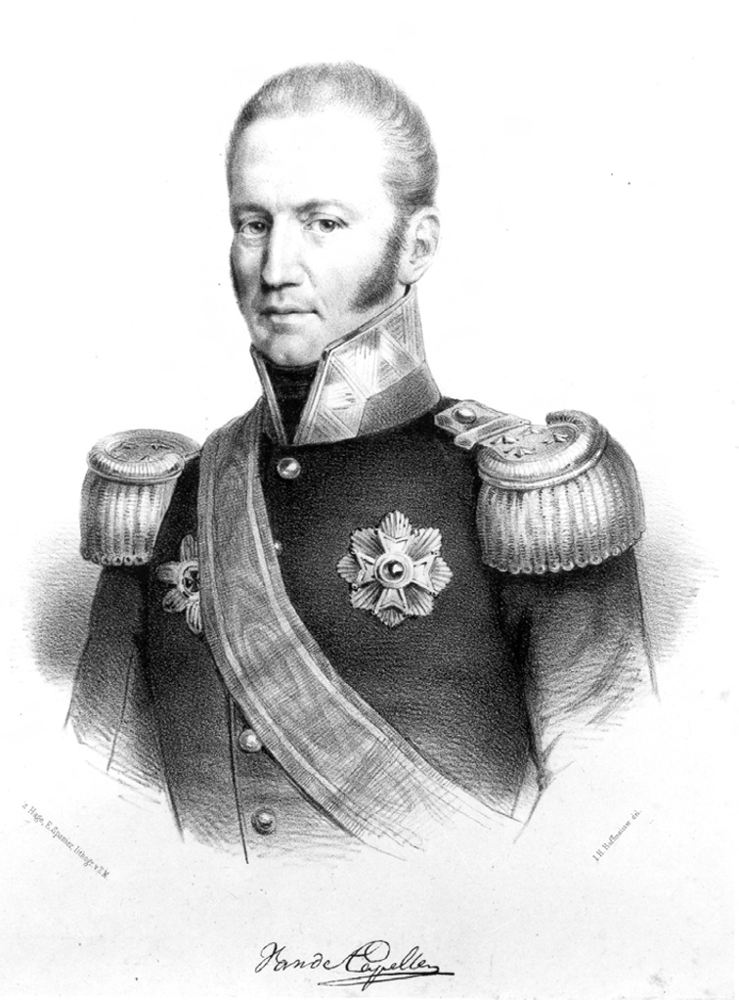
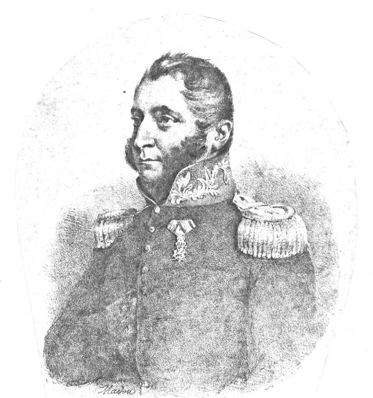
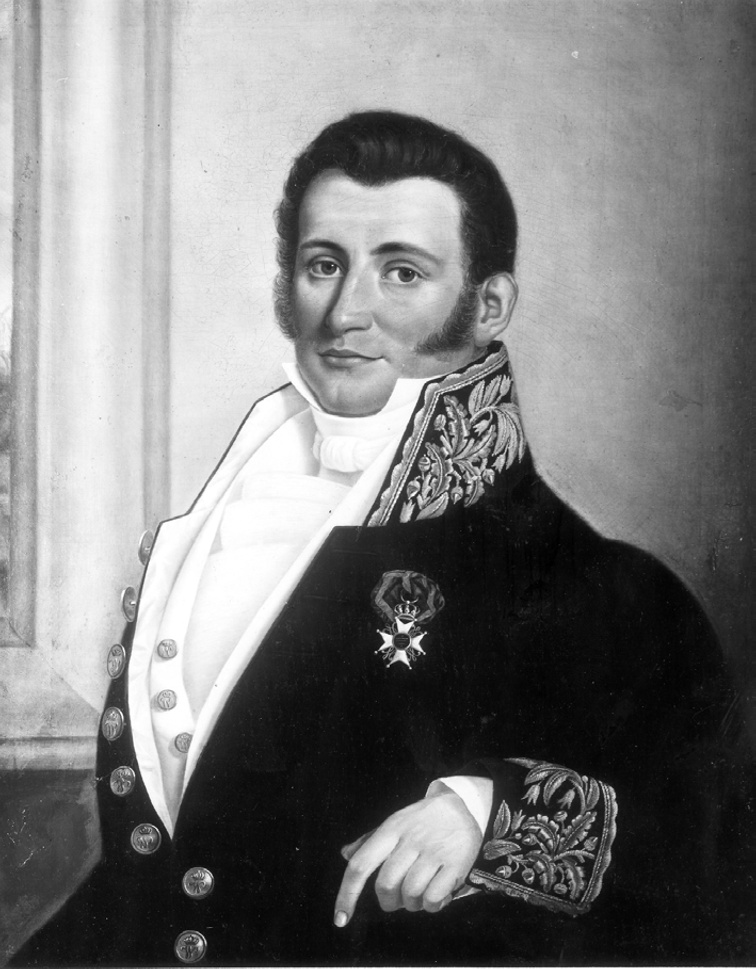
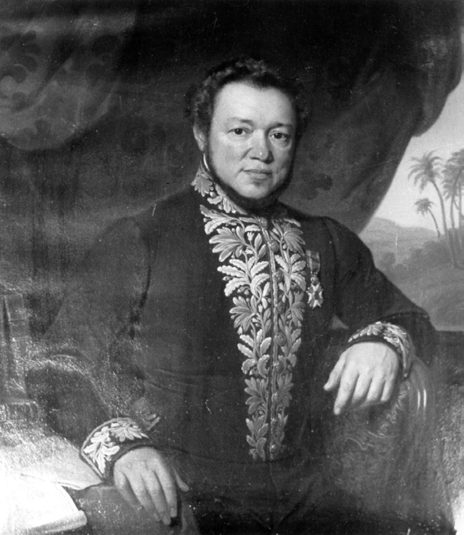
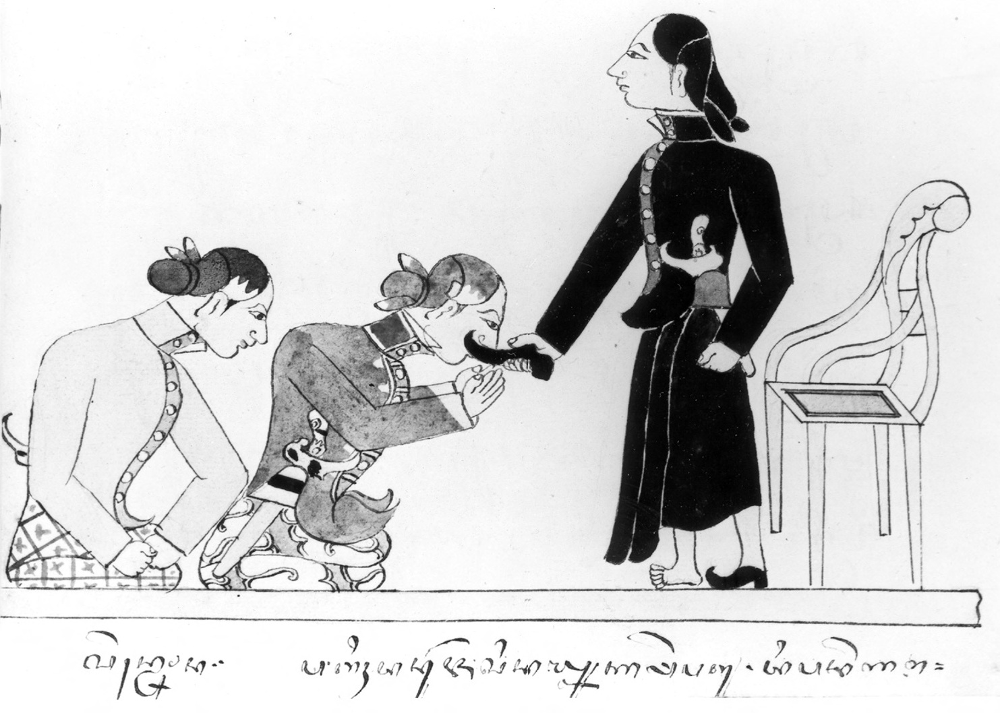
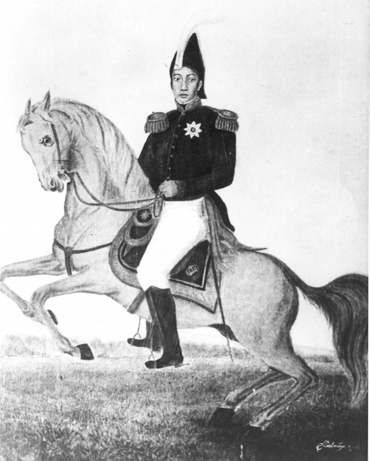
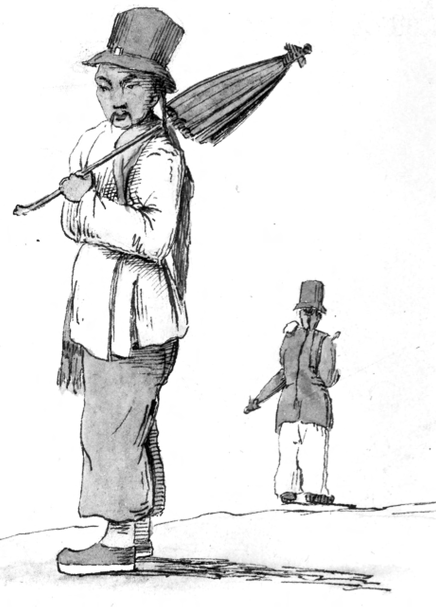
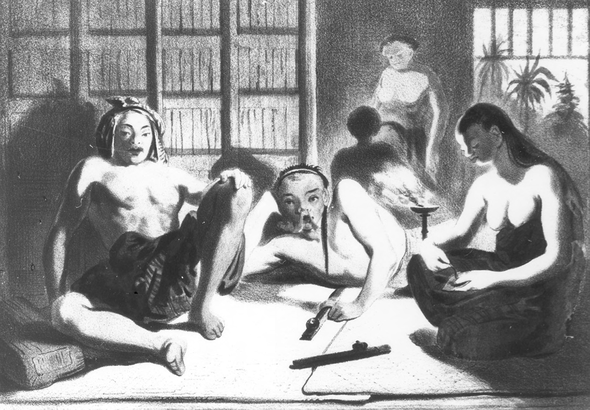

# Chapter IX: Binding on the Iron Yoke: The Returned Dutch Administration, the Impoverishment of the Peasantry and Rise of Millenarian Expectations, 1816-1822

## Squaring the circle

The period which followed the formal British handover of Java and its dependencies on 19 August 1816 saw a doomed attempt by the returned Dutch administration to square the circle between the demands of economic liberalism and the interests of the local population. The new governor-general, G.A.G.Ph. van der Capellen (in office 1816-1826), took the task of protecting the indigenous inhabitants from foreign exploitation particularly to heart. During a voyage to Maluku in 1824, he noted in his diary that Dutch colonialism ‘could no longer go forward solely with an eye to making profit, but should secure the welfare of the people and uplift them from [their] state of degradation and contempt’ (De Prins 2002:140, citing Nieuwenhuys 1973:82). These were words which might have passed the lips of any early twentieth-century Dutch ‘ethical’ official inspired by the notion of Holland’s ‘Debt of Honour’ in which the wealth drawn from the Indies was to be repaid by giving primacy to the local population in colonial policy (Ricklefs 1993:151). The problem for Van der Capellen was that he was almost a century before his time. And he recognised this fact. In the same year in which he was committing his private thoughts to his diary, he burst out in a lament to the Dutch Minister of the Colonies, his former commissioner-general colleague (1816-1819), C.Th. Elout, that ‘whenever I see that in the Netherlands people understand liberalism to mean the protection of European landowners at the cost of the native population, and that the latter, who are so dear to me, are completely lost from view in order that a few [European] speculators and adventurers can succeed in their plans, then I must declare myself an ultra anti-liberal’ (De Prins 2002:140, citing Mijer 1878:190). Even Nahuys, diametrically opposed as he was to Van der Capellen in so many areas of economic policy, acknowledged the genuiness of his intentions, writing that he was ‘an enlightened and virtuous governor-general […] who more than any other […] I have known between 1806 and 1839 […], devoted all his time from early dawn until late at night with very little intermission to the duties of his high station’ (Nahuys van Burgst 1852:103).

> *Plate 49. Godert Alexander Gerard Philip baron van der Capellen, 1778-1848. Painting by E. Spanier after Hoffmeister. Photograph courtesy Stichting Iconografisch Bureau, The Hague.*

In the years leading up to the outbreak of the Java War the balance between speculators and adventurers on the one hand, and Dutch ethici avant la lettre like Van der Capellen on the other, was firmly weighted in favour of the former. Indeed, the lead came from the very top as Raffles himself noted after a conversation with the new Dutch monarch in Brussels in July 1817: ‘the King himself [William I, reigned 1813-1840] and his leading minister [Secretary of State Anton Reinhard Falck, in office 1813-1818] seem to mean well, [but] they have too great a hankering after profit, and immediate profit, for any liberal policy to thrive under them’ (Raffles 1830:235). Dipanagara’s seemingly apocryphal conversation with Crawfurd about the type of Dutch Resident he might favour as the British official’s replacement – namely one who had served the VOC or a newcomer from Europe (Chapter VIII) – pointed to an all too present reality: the unstoppable tide of former Napoleonic War soldiers and fortune seekers of all sorts ‘whose former vocations no one had the slightest inkling of’ who now descended on Java to make a career for themselves (Van den Doel 1994:49). Well over half of those who made their way to Java at this time claimed to have special recommendations from the new governor-general (Van den Broek 1893:3). As a keen-eyed traveller, who visited Java shortly after the handover, wrote, Van der Capellen was literally overwhelmed with whole boat loads of ‘aged paterfamilias who, instead of knowledge of Indies affairs, only brought over with them a numerous and needy progeny, and who had no other intention […] than to restore in the shortest possible time […] their dilapidated affairs in the mother country so that, without having to trouble themselves further with the Indies, they could return home with their nests nicely feathered’ (Van den Doel 1994:49, citing Olivier 1830, III:425). Baroe datang (‘one who has just arrived’) would soon become a veritable refrain amongst the great Portuguese-Indies-Dutch mixed race families in Batavia as they contemplated this unwelcome tide of newcomers whose arrival heralded the transformation of Dutch colonial society into a tropical beambtenstaat (bureaucratic state; Taylor 1983:116). A telling example of the degree of hopeless disorder which accompanied the sending of officials to Java at this time and the utter ignorance of the new government in The Hague of the colony which had now been restored to them, was that no one knew enough Malay even to translate the inscription on the new Java rupee banknotes which were being printed in 1815 in the government mint prior to the handover of the colony from the British (Van der Kemp 1907:1400-1, 1914:178).

> *Plate 50. Huibert Gerard baron Nahuys van Burgst (1782-1858), the ‘bigwig with a pair of big thick epaulettes’, who served as Resident of Yogyakarta between 1816 and 1822 (a post which he combined with that of acting Resident of Surakarta between 1820 and 1822). Dipanagara described him in his autobiographical babad (that is, the Babad Dipanagara, Manado version) as a resident who ‘enjoyed eating and drinking and the spreading of Dutch ways’ (karemannya mangan minum/lan anjrah cara Welandi). Lithograph by Jean-Baptiste Ambroise Marcelin Jobard (1792-1861) based on a painting by the Belgian artist J.B. Madou made in circa 1831 when Nahuys was back in Holland on leave after the end of the Java War. Photograph by courtesy of the late W.G.I.C. Rissink of Leiden, a descendant of Nahuys.*

## A Resident who enjoyed eating and drinking and the spreading of Dutch ways

Although the new Dutch Resident of Yogyakarta, Nahuys van Burgst (in office 1816-1822), was no stranger to Java – he had spent a year (1806-1807) there during the governor-generalship of A.H. Wiese (in office 1805-1808) and returned to serve a two-year stint as a member of Daendels’ Forest Administration in 1809-1811 (p. 277; De Haan 1935a:620) – he belonged in his political affiliations and outlook to the post-1816 generation of Dutch officials. François de Haan described him with some justification as a gambler who had come out to Java secure in the knowledge that he enjoyed the favour of the Dutch king through the political influence of his brother-in-law, Rutger Jan Schimmelpenninck (1761-1825), erstwhile Grand Pensionary of Holland (1805-1806).[^1] Like his monarch, Nahuys also had very definite views about the appropriate economic policies which should be pursued in the Indies. He was himself a persuasive advocate of the opening up of the Javanese hinterland to western capital. In particular, he advocated an increase in the number of privately owned western estates and land leases in the Principalities as a method of bringing Java’s feudal society into the modern world. In this respect, Nahuys was a ‘liberal’ and stood in opposition to ‘conservatives’ such as Nicolaus Engelhard, Van der Capellen and his close adviser, H.J. van de Graaff (1782-1827) – the ‘scourge of the colony’ (Van Hogendorp 1913:29) – who were for more government control of the economy.[^2] Nahuys’ strong views on this question, in which his own financial interests were later directly involved, was to be of great significance for his period as Resident. Although some of his contemporaries found him both honourable and impressive,[^3] most censured him for making private profit out of his position.[^4] He was also, as we will see later in this chapter, not above plagiarising the work of his subordinates and publishing it as his own (note 170). The judgement of the Dutch historians of the Java War, P.J.F. Louw and E.S. de Klerck, is damning in this respect (Louw and De Klerck 1894-1909, I:58):

> In everything we have read from his hand […] there arises in our imagination the image of a man who was at heart an autocrat. [A person] who was able to demand from the native princes a very salutary respect and assure himself of their friendship, in which endeavours he was aided by the ample experience and the great knowledge he possessed of the Javanese courts. [But] he was [also] extremely pleased with himself and did not really know how to value the services of others. Skilful with his pen, he advanced fine theories, but in practice he did things which a more fastidious person would have omitted, actions which make us doubt the inner worth of his motto, non sibi sed patria [not for himself but for his country].

Nahuys’ personality certainly set him apart from his predecessor, Crawfurd. If the latter had been retiring and austere, Nahuys was bluff and supremely self-confident. He shared none of Crawfurd’s scholarly attributes and had little interest in Javanese culture, but he made up for this by his boldness, energy and administrative capabilities. In many ways a product of Holland’s Patriot Revolution, he placed great faith in the importance of the individual and in European superiority. But perhaps like Julien Sorel in Stendhal’s Le rouge et le noir (1830), he believed more in the idea of equality for all but distinction for himself. Characterised by another historian (and veteran) of the Java War, F.V.H.A. Ridder de Stuers, as a ‘pseudo military man’ (De Stuers 1833:19), his one attempt at leading troops in the field during Radèn Tumenggung Sasradilaga’s uprising in Rembang in December 1827 ended in ignominious failure when he was put to flight during a skirmish on the Panolan-Padhangan road. The sight of a Tuwan Besar met een paar dikke epauletten, ‘a bigwig with a pair of thick epaulettes’ in De Stuers’s telling phrase, fleeing from the field of battle before a band of Javanese rebels, no doubt did wonders for the morale of Sasradilaga’s troops but hardly reflected well on the wisdom of the Dutch high command in using uniformed civilians and pantomime officers like Nahuys in battle against a resolute foe (Louw and De Klerck 1894-1909, III:386-7, 386 note 1). On a social level, however, ‘Major’ Nahuys did seem to get on famously with members of the Javanese nobility, especially in Surakarta where H.M. de Kock noted how ‘puzzlingly well loved’ the Resident was with the princes.[^5] Nahuys’ reputation as a bon vivant was well known (Louw and De Klerck 1894-1909, III:572) and during his travels through south-central Java at the time of the Java War, Willem van Hogendorp would memorably record the Resident’s behaviour at a dinner party which he gave for some fifty members of the Sunan’s family and senior court officials (Van Hogendorp 1913:165-6):

> I had this opportunity to observe Nahuys in his full glory and I could perceive what a great talent he has for getting on with the natives [Javanese]. For three hours at a stretch he kept the assembled company roaring with laughter and each toast he proposed was taken up and drunk amidst enthusiastic cheers.

The contrast with his abstemious predecessor could not have been more marked. Although there is no record of any dinner party given by Crawfurd during his time in Yogya, he subsequently achieved a notorious reputation for his parsimony during his three years as Resident of Singapore (1823-1826) where his dinners were the talk of the town. Here is the diary entry of one of the Scotsman’s particularly disgruntled guests:

> Description of a dinner given by John Crawfurd, Resident, to all Europeans in the settlement. Began to assemble at 7 p.m., all sat down, no conversation or sparkle […] Once Mr Crawfurd amused us not a little: he requested us to fill our glasses as he was about to propose a toast. At the smaller table we made shift by frugality to get so much as served and were sitting all ready to hear the coming toast, silent as usual, and at last we waited so long we were beginning to whisper that the Resident had drunk too much and forgot himself. But the truth came out by his turning to the person next to him at our table and requesting the loan of a bottle of claret as theirs was all done. The quiz and wink passed from one to another around the table at the ill-timed frugality of the Resident. It is the same on private and public occasions […] It is the talk of everyone and serves to promote a laugh when other subject is scarce.[^6]

When it came to ebullience and abstemiousness, the choice was easily made as far as Dipanagara was concerned. He would later, as we have seen (p. 108), compare Nahuys unfavourably with Crawfurd and would dismiss the former laconically in his babad as a Resident ‘who [merely] enjoyed eating and drinking and the spreading of Dutch ways’. He also noticed with displeasure how the younger members of the sultan’s family followed Nahuys’ example, forgetting the prohibitions of Islam.[^7] Dutch contemporaries noted that the Resident and his Eurasian deputy-cum-business partner, Robbert Nicolaas Christiaan d’Abo, were as one when it came to developing a culture of gambling and hard drinking amongst the Yogya elite.[^8] Although a taste for the bottle was nothing new in the Principalities[^9] – even Dipanagara indulged occasionally[^10] – the behaviour of the post-1816 Dutch representatives at the courts appears to have been quite remarkably bibulous and dissolute: in one of the last of the grand VOC-style corruption scandals, both the Surakarta Resident, Rijck van Prehn (in office 1818-1819) and the Residency translator, Johannes Wilhelmus Winter (in office 1806-1820), were dismissed from their posts and banished from central Java in 1820 for making large sums of money out of ensuring that certain Javanese received appointments to high office at the Sala court (Winter 1902:18-20; Houben 1994:104). Even when they were not engaging in wholesale embezzlement, the social behaviour of Dutch officials left much to be desired. Nahuys may have kept his Surakarta guests laughing, but was this really what well-born Javanese expected of their social encounters with Europeans? Willem van Hogendorp, who had been so struck by Nahuys’ skills at the dinner table, was not so sure (Van Hogendorp 1913:179-80):

> The Javanese are always reserved never giving themselves up to exuberant laughter and jokes […] but they have seen us drinking every day, laughing all shyness aside and asking our conversation – every word of which is utter nonsense – to be interpreted to them. […] We have played around the Pangerans in their state clothes like [so many] spoilt children.

The sexual mores of senior Dutch officials also became a source of comment in the Principalities. Nowhere more so than in Yogya where Dipanagara and his kraton contemporaries were shocked by the behaviour of the new Resident in particular. Although the prince later admitted to a certain attachment for Nahuys, he immediately qualified this by pointing out his puzzlement at the curious ménage à trois in which the Resident and his deputy appeared to be sharing the same woman in common.[^11] He was alluding here to Nahuys’ rather public affair with D’Abo’s wife, née Anna Louisa van den Berg, whom he would later marry (Chapter III note 79). In December 1822, she would return to Padang in west Sumatra as divorce proceedings were commenced by her estranged husband of seventeen years (Chapter III note 79; Van Hogendorp 1913:149). He may also have been aware of the Resident’s penchant for liaisons with professional women (Houben 1994:108), although Nahuys never quite reached the level of his opposite number in Surakarta, Diederik Willem Pinket van Haak (in office 1816-1817), a strong supporter of the former Franco-Dutch regime, who went through a whole series of relationships with Eurasian mistresses,[^12] and left behind a bankrupt estate and ten illegitimate children by the time of his death in Surabaya in 1840 (De Haan 1935a:558-9).

Eurasian mistresses and dalliances with the wives of junior officials were one thing, seducing and appropriating the womenfolk of well-born Javanese quite another. Yet this appears to have been increasingly the norm amongst Dutch officials in central Java in the years leading up to the Java War. In Van Hogendorp’s words, ‘the hatred and contempt’ which the Javanese felt for Europeans in these years ‘were certainly quickened by what both senior and junior officials permitted themselves with regard to native women: a number of Residents known [to me] by name[^13] forced the [Javanese] chiefs under their authority to surrender their legal wives [and daughters] to them’ (Van Hogendorp 1913:40). We will see in the following chapter how the sexual conduct of the Yogya Resident, Anthonië Hendrik Smissaert (in office 1823-1825), his Assistant-Resident (‘secretary’), Pierre Frederic Henri Chevallier (in office 1823-1825), and the official Residency translator, Johannes Godlieb Dietrée (in office 1796-1825), would contribute directly to the breakdown of relations with Dipanagara.[^14] So much so that it would be cited by one of the prince’s relatives, the chief pengulu (senior religious official) of Rembang, as amongst the four key issues which the Dutch needed to address before the Java War could be brought to an end (Louw and De Klerck 1894-1909, III:494). In the view of the later Dutch Resident of Yogya, Frans Valck (Appendix IX), the decline in morals amongst the women of the Yogya court could be dated back to the British conquest of June 1812. Although none of the Yogya Residents during the British interregnum itself (Appendix IX) appear to have taken advantage of their position to have such liaisons,[^15] after 1816 a moral rot seems to have set in. The influence of the fourth sultan’s mother, Ratu Ibu (Chapter VIII), and her lover, Major Tumenggung Wiranagara, who acted as a ‘procurer’ of court women for European officials, like Chevallier and Dietrée, clearly contributed to this. Valck’s comments are interesting given the recent work on gender, sexuality and race by feminist anthropologists like Ann Stoler who have argued that sexual control was fundamental to the way in which colonial policies operated in the high colonial period (Stoler 2002:78). In Valck’s case this would also involve him using his own position as Resident of Yogya in the post-Java War period to force the fifth sultan to part with his favourite unofficial wife (selir) whom he made his new mistress (Houben 1994:109) and, according to one hostile source, even to impose one of his former mistresses on the sultan as his consort (Houben 1994:199-200).

In the utterly altered epoch in which elite Javanese were now living after June 1812, such sexual exploitation of their womenfolk by powerful Europeans may have seemed yet another humiliating aspect of their colonial status. But they might have reflected on the changes which had occurred since the eighteenth century when relationships between well-born Javanese and senior European officials had been altogether more equal. One thinks here of the passage in the ‘Chronicle of the fall of Yogyakarta’ in which the text’s princely author relates how his mother, a woman of Balambangan origin from the eastern salient of Java, came to Sultan Mangkubumi’s court as one of the ruler’s wives. She had apparently been given to the first sultan by the Javanese-speaking governor of Java’s Northeast Coast, Nicolaas Hartingh (in office 1754-1761) (Remmelink 1994:273), in return for Mangkubumi’s personal gift of his own favourite unofficial wife, Radèn Ayu Sepuh, whom the Yogya monarch had presented in recognition of the governor’s skill in brokering the Giyanti treaty (13 February 1755; Carey 1992:5-6). This had paved the way for the foundation of Mangkubumi’s kingdom, hence the first sultan’s gratitude. Whatever one may think of the use of women as pawns in an elaborate system of exchange between powerful eighteenth-century men, at least in this case a degree of respect appears to have existed between Mangkubumi and the Semarang governor. In the years preceding the Java War there were no such feelings. The relationship between Europeans and Javanese was now one of exploitation: the raiding of kraton treasuries and archives now had its counterpart in the raiding of the bodies of the radèn ayu (court princesses).

## The early challenges of Nahuys’ Residency

Two matters complicated Nahuys’ assumption of his new post as Resident of Yogya in August 1816. The first was the arrival in Batavia of the exiled second sultan, who had been returned from Pulau Pinang by the British in order to be handed over to Dutch keeping.[^16] Rather unwisely, the British seem to have allowed some of the former ruler’s wives – including Ratu Kencana Wulan (now styled Ratu Wétan) – to join him. But this measure only encouraged others to profit from the opportunity of the former ruler’s stay in the colonial capital to make their way there to pay him their respects. The new Dutch administration soon became alarmed by the number of kasepuhan supporters and ‘priests’, presumably Yogya kraton santri, who started turning up in Batavia (Carey 1992:438 note 201). The old monarch’s presence in Java was deemed to pose a threat to stability. When enquiries in Yogya as to whether he should be returned there met with a resolutely negative response on the part of Pakualam and the other Yogya princes (Van der Kemp 1911:269), the commissioners-general decided to banish him again, this time to Ambon where he remained until March 1824 (Carey 1992:438-9 note 201). In all these consultations between the European government and the Yogya court, both Nahuys and the Dutch ambassador extraordinary to the courts, W.H. van IJsseldijk (in office August-October 1816), played a central role.

The second matter threatened to have even more serious consequences for the prestige of the returned Dutch government. This was the dispatch by the fourth sultan of Pangéran Dipakusuma, the joint acting bupati wedana of the eastern mancanagara, to greet the new Dutch governor-general and to take secret messages to his great-grandfather, the second sultan, in the colonial capital.[^17] As we have seen (Chapter V), the question of sending an emissary to convey the sultan’s compliments to an incoming governor-general had long been a point of conflict between Yogya and the European government. By 1816, this conflict had been mitigated to some extent by the changed reality of the relationship between Batavia and the south-central Javanese courts. But it is significant that the new Dutch administration felt strongly enough about it to try to prevent Dipakusuma from even sailing from Semarang. The commissioners-general pointed out that they had nominated the former Yogya Resident, W.H. van IJsseldijk, to act as ambassador extraordinary at the courts after the official handover of the colony on 19 August 1816, and that it was not necessary for any envoys to be sent from the kraton to Batavia.[^18]

> *Plate 52. Portrait of Hendrik Mauritz MacGillivray (1797-1835), who served as acting Resident and Resident of Surakarta (with intermissions) from 1823 to 1827 and 1830 to 1834, and later attempted to have Dipanagara and his uncle, Pangéran Mangkubumi, murdered in July 1825 (page 595). Photograph by courtesy of the Stichting Iconografisch Bureau, The Hague.*

The affair provided a clear indication that, despite the revolution in political relationships wrought by Daendels and Raffles between 1808 and 1812, the Yogya court still fostered the hope that the old ideal of the division of Java between the Dutch and the Javanese still had some relevance. And Yogya was not alone. As we have seen, the Sunan, Pakubuwana IV, had counted on attaining similar objectives during the abortive sepoy conspiracy of 1815 (Chapter VIII). Both episodes thus highlighted the continuing unwillingness or inability of the south-central Javanese rulers to accommodate themselves to their changed political status. The old Javanese concept of the political division of Java between the foreign kingdom of west Java and the Javanese heartland (kejawèn) died hard. It may explain too why so many members of the Yogya court rallied to Dipanagara in 1825. He seems to have held out the hope for them that their conservative aspirations for a return to the idealized pre-Daendelian political order might be realized. This was a concept which Dipanagara himself would hark back to in his February to March 1830 peace negotiations with the Dutch (pp. 663-4; Carey 1974b:285-8).

Meanwhile, Dipanagara himself appears to have begun to feel himself increasingly isolated in the new political alignments which had developed at the Yogya court after his father’s death. The passing of the late sultan’s closest adviser, Pangéran Dipawiyana, in January 1815 (Chapter VIII note 49) and the demise of the aged patih jero, Radèn Tumenggung Pringgadiningrat, five months later (25 May 1815; Carey 1992:522 note 600), deprived him of the administrative and personal support which he had enjoyed during his father’s brief reign. Two events occurred which may have contributed to the prince’s increasing hostility towards the returned Dutch administration and their kraton allies, in particular the clique around the queen mother. The first was the sudden arrest and banishment in November 1816 of Kyai Murma Wijaya, a rich and respected religious teacher who lived in the village of Kepundhung in the Pajang area.[^19] The second was a dispute over the appointment of coun try tax-collectors and police officials (gunung) between Dipanagara and certain members of the Yogya court.

As we have seen, Murma had earlier played an important role in relaying messages between the sultan and the Sunan during Radèn Rongga’s rebellion in November-December 1810 (p. 253). The kyai was a typical example of the sort of rural religious teacher who was held in high favour by the south-central Javanese courts as well as being revered by the local populace. The latter seem to have regarded him with special awe and considered that he possessed magical powers given that he had such ready access both to the Yogya court and the sultan’s funds.[^20] Born in the pradikan (tax-free) village of Maja, home to Dipanagara’s religious adviser, Kyai Maja, Murma had moved at a young age to Kepundhung. The exact location of this village is unclear because there are at least two such villages in the Yogya area which had tax-free status as religious centres. It is likely to have been the one near Delanggu close to the Surakarta-Yogya highway. According to Dipanagara, it was amongst the richest pradikan villages in Yogyakarta. As the birth place of the first sultan’s mother, Mas Ayu Téjawati, it had been freed of all labour services and taxes by the Yogya court.[^21] Given this connection with the first sultan’s family, it is possible that Kyai Murma might have been one of the religious teachers whom Dipanagara’s great-grandmother, Ratu Ageng, invited to visit her at Tegalreja while he was growing up and studying Islam under her care in the mid- to late 1790s (Chapter II). It is known that Murma had close ties with Dipanagara’s father for in 1809 he had been promised a sizeable sum (Chapter VI note 105) to pray for the swift demise of the future third sultan’s own father, Hamengkubuwana II. For over two years (1814-1816) following her husband, the third sultan’s, death, Ratu Ibu was said to have continued to maintain connections with Murma, paying him sums of money and lending him state clothes in order that he should devise ways – both material and spiritual – to lessen the power of the European government and place it on the same footing that it had been before Daendels’ arrival in January 1808.[^22] Other religious teachers and local leaders were similarly employed by the Yogya court at this time with Ratu Ibu using some of the funds provided by the British for the annual rent of the tollgates and markets to pay for their services.[^23]

Murma’s connections with Surakarta were also of very long standing. They dated back to about 1792 when Pakubuwana IV had lost a court heirloom, a pusaka kris by the name of Kangjeng Kyai Birawa, said to have been of Majapahit vintage. Murma had been instructed to pray for its return and when this was achieved after four years, he was rewarded with a 2,000 Spanish dollar gift. This appears to have been a down payment for the original 10,000 Spanish dollars promised by the Sunan. Relationships between the kyai and the chief ministers of the Surakarta kingdom (Appendix Va) as well as the Sunan’s younger brother, Pangéran Buminata, a great patron of men of religion (pp. 93-4), became particularly close and at various stages Murma had received further financial gifts from the Surakarta court. In early 1812, just before the British attack on Yogya, Murma had been visited by a certain Sèh Abubakar, a Sumatran from Palembang, who had been sent by the Sunan to ask Murma to pray for his success against the British in June 1812 (pp. 316-21, 377-8). Murma is reported to have replied with the words that ‘Allah and the [British] government are too great to undertake such a thing’. Despite this refusal, the kyai’s Surakarta court connections appear to have been maintained right up until his arrest in October 1816. Pakubuwana IV had consulted with him shortly after the special envoy, W.H. van IJsseldijk’s, visit to the courts in September 1816. At that time, he had apparently paid for the construction of Murma’s house.[^24]

Murma was thus a figure intimately connected with the internal political and spiritual life of the south-central Javanese kraton. So much so, that his arrest may well have been precipitated by court rivalries. Ratu Ibu, for example, suspected that a Surakarta prince, perhaps Pangéran Buminata, had used the affair to bring discredit on Yogya.[^25] But it seems that the Assistant-Resident of Yogya, Johan Diederik Kruseman (in office 1816-1817), who was covering for Nahuys during his absence on sick leave in Batavia (7 October 1816-23 January 1817), first heard about the expected ‘revolt’ of Murma from sources in the Yogya kraton hostile to the queen mother and her son, the fourth sultan. Prominent amongst these was the regent, Pakualam I. Later during his journey into exile, Dipanagara would express his bitterness about the affair stating that Murma had been exiled ‘only in order that [the Dutch] could make themselves masters of [his] treasure and plunder the désa of Kepundhung’, and that ‘Pakualam had set the Government against Murma to bring [them] and the princes of Yogyakarta into discord’.[^26] On his return to Yogya, Nahuys broadly confirmed this view, pointing out that the seizure of Murma’s property had created a very bad impression in the Yogya kraton and suggesting that Pakualam was largely to blame for precipitating the kyai’s arrest.[^27]

> *Plate 52. Johan Diederik Kruseman, 1794-1861. Painting by E. Spanier after Hoffmeister. Photograph by courtesy of the Stichting Iconografisch Bureau, The Hague.*

In his report to the commissioners-general in Batavia, however, Kruseman justified his armed attack on Kepundhung on the morning of 6 November 1816 by pointing out that a quantity of arms had been found in Murma’s house (10 pikes and 10 rifles) and that Murma’s brother, Abdullah, had offered armed resistance in the Kepundhung mosque with fifteen men.[^28] Given the insecurity of the Javanese countryside at this time and the amount of valuables which Murma had acquired over the years from the court princes and officials, valuables which included fine heirloom kris, state clothes and jewellery, it is hardly surprising that he had weapons in his désa for self-protection. The Dutch government compounded their violent action by selling most of the valuables at public auction and keeping the proceeds. Only a few were returned to the kyai before he was exiled to Ambon in 1818.[^29] Furthermore, the treatment of the aged religious teacher seems to have been unduly severe. Although the case against him – that he had engaged in political intrigues with the courts against the European government – rested on hearsay evidence and referred back to the British period, he was still charged with a criminal offence. His personal rebuttal of the charges in the Yogya Resident’s court availed him little. Indeed, during the kyai’s absence in the sultan’s capital for the trial proceedings, the Dutch authorities took the opportunity to impound his house and seize his remaining valuables, even attacking his relations in the local mosque when they tried to resist (Carey 1987:294). His sentence of banishment and the six years he spent in Ambon at his advanced age (he appears to have been in his late sixties) were reported to have brought on severe psychological problems. By the time he was allowed back to Semarang in September 1824 he was in the last stages of a chronic mental illness (senile dementia). He died soon afterwards without ever returning to his village or seeing his family again.[^30]

Nahuys’ reports from south-central Java in the pre-Java War period indicate that the treatment meted out to Kyai Murma was far from being unusual. He even boasted to his superiors about his ‘strong-arm’ tactics in ordering an ulama to be seized while giving a lesson in his religious school. Similar actions were taken against ‘recalcitrant’ religious teachers in Salatiga by the Assistant-Resident there with ‘excellent results’ according to Nahuys.[^31] Contemporary Residency reports are peppered with the phrase ‘sly priest’, an interesting reflection on the way in which Nahuys’ attitudes and those of his Dutch contemporaries were shaped by Calvinist hatred of Roman Catholicism. Indeed, it seems that Islam came to be seen in the mind of many early nineteenth-century Dutch colonial officials as a hierarchical religion. Like Roman Catholicism, it was thought to owe its authority to a central figure – be it the Ottoman sultan or the Sherif (chief religious authority) of Mecca – who functioned as a sort of pope (Carey 1987:292 note 51). These attitudes hardened still further following the outbreak of the Java War. ‘Santri’ – pious Muslims and students of religion – then became a term of abuse (Payen 1988:120 note 260). Those suspected of harbouring santri – namely pro-Dipanagara – sympathies were singled out for special treatment as the Belgian painter, Antoine Auguste Joseph Payen (1792-1853), noticed during the siege of Yogya in August-September 1825 (Payen 1988:65):

> This morning [18 August 1825] various vagabonds suspected of being bandits [brandhal, namely followers of Dipanagara] were brought in. They were put in chains. The white soldiers were allowed to have their fun: I saw an officer hit one of these men, said to be a santri, as hard as possible. Another, who remained in the hands of the soldiers, was mistreated in the most cruel way. Trampled under foot, he was taken away dying, blood pouring from his mouth. What I have written, I have seen.’

The Murma affair and the government’s subsequent actions seem to have marked an important stage in the deterioration of Dipanagara’s relationship with the new Dutch administration. The exile and subsequent death of such an influential and well-respected kyai, who may perhaps have been one of the prince’s religious mentors in his youth, was undoubtedly felt at a deep personal level. It may have convinced him that the new breed of post-1816 Dutch officials and European estate leasers were completely lacking in sensitivity and understanding towards Islam. As Knoerle later noted in his conversations with Dipanagara during his journey to Manado:

> [The prince] was especially incensed that Europeans in the Principalities were without any religious feelings and always ridiculed the religion [of The Prophet]: he said that drunken soldiers [? sepoys] had defiled the temple of Muhammad in Klathèn. He was so fired up with rage that I could not follow the swiftness of his words.[^32]

Dipanagara’s view that Europeans were devoid of religious feelings was not unusual. The post-Java War Dutch Assistant-Resident of Pacitan, J.T. Canter-visscher (in office 1838-1842), related how a revered local official, the seventy-year old pensioned bupati, Kyai Tumenggung Jagakarya, an erstwhile modin (mosque official) renowned for his devotion to Islam, had only begun to show signs of friendship towards his family when he observed one of Canter Visscher’s sons saying a Christian grace before a meal. The aged former bupati had remarked that up to that moment he had thought all Europeans were entirely without religion (Carey 1987:291 note 48).

Sometime after the arrest of Murma, a serious administrative issue arose in Yogya concerning the appointment of rural police officials or gunung[^33] who also had tax-raising powers. This was not a new problem because, as we have seen (Chapter VIII), the role of the gunung and their impact on village society had already been discussed between Dipanagara and his father, the third sultan, during the early part of his reign. The incident of the post-1816 appointment of more police officials by the patih, Danureja IV, and the commander of the sultan’s bodyguard, Major Tumenggung Wiranagara, is only related in the prince’s babad, but later Dutch and Malay reports dwell on the misuse of powers by the gunung acting under the chief minister’s orders so it is likely the incident is well founded.[^34] Dipanagara had originally put for a slipper by Dipanagara as a result of an argument. A sentana (member of the (Leiden), Oriental MS 13 (Buku Kedhung Kebo), f.55v. Photograph by courtesy ward the plan to abolish the police officials entirely in order to alleviate the tax burden in country areas, but nothing came of this because of his father’s early death. It is possible that the activities of the gunung were supervised more stringently in the interests of just government during the early period of the fourth sultan’s minority. But shortly after 1816, forty more of these police officials were appointed under the command of two lurah (chiefs). They drew their salaries directly from the royal tax moneys and had the special task of collecting the pacumplèng – a door tax levied at ten to twenty cents per house entrance (Gericke and Roorda 1901, I:297)[^35] – in the villages at half-yearly intervals, namely at Mulud and Puwasa.[^36] When not engaged in this fashion, the gunung apparently gathered at the kepatihan (the chief minister’s residence and office), serving as messengers and police officials for Danureja IV much in the same fashion as the members of the Macanan (‘tiger’ corps) described so vividly in the Surakarta version of the Babad Dipanagara (pp. 53-5).

> *Plate 53. Radèn Adipati Danureja IV (in office, 1813-1847) being hit over the face with Sultan’s family) looks on. From Koninklijk Instituut voor Taal-, Land- en Volkenkunde of the KITLV.*

In his chronicle, Dipanagara describes how the appointment of these police officials was made without his approval or prior knowledge and how he was only informed about it in a roundabout way through some of the older members of the sultan’s family and senior court bupati.[^37] The prince then confronted his younger brother, the fourth sultan, with a choice: either accept his advice that the gunung constituted a serious tax burden on the country districts and withdraw the royal letter of appointment or allow the letter to remain in force and thereby side openly with the prince’s two major court adversaries, Danureja IV and Wiranagara. The sultan apparently decided to rescind the letter but an angry scene then occurred between Dipanagara and Wiranagara in which the latter defended his actions and argued strongly against the annulment.[^38] When Ratu Ibu heard that the appointment of the gunung had been withdrawn, Dipanagara related how she chided her son in his presence:

> XIX. 16 ‘Sultan, I tell you in truth that the person who rules the state of Yogyakarta is in reality your elder brother Dipanagara, 17 for I was already ordered by your father [Hamengkubuwana III] earlier when he was still in the kadipatèn. Thus was his instruction: “Radèn Ayu, I tell you

> do not hope too much for your son, for the one my heart is fixed on is in truth my eldest son [Dipanagara].” I replied: “As you wish”.’

> 18 The sultan showed embarrassment because many people [now] knew [of this]. Thus was his speech: ’Your tale is already known to me [for I am aware of] my father’s instructions to me.’ Pangéran [Dipanagara] smiled [and] spoke calmly: ‘Ratu Ibu is like a child, My Lord,

> 19 in telling this secret so that many people know of it.’[^39]

The whole incident of appointment of the gunung, Dipanagara’s intervention and Ratu Ibu’s reaction to it, provides a striking illustration of the growth of the tacit rivalry between the prince and the court clique around the queen mother which began to split the kraton during the fourth sultan’s reign. On the one hand, Ratu Ibu and her supporters entertained deep suspicions of Dipanagara and his motives. On the other, the prince felt that he was being increasingly excluded from a say in affairs of state to which he felt entitled as a senior member of the sultan’s family. The final break did not come until much later during the initial years of the minority of the fifth sultan (1822-1836; Chapter X), but the rivalries and suspicions which were later to erupt into such poisonous and open hostility were already coming to the surface. As for the gunung, Dipanagara’s intervention seems to have availed little because there were still complaints about their fiscal oppression and misuse of their powers just two years before the Java War.[^40]

## Nahuys’ land-rent initiative in the Principalities and its problems

The arrest of Kyai Murma and the dispute over the gunung were events which signalled growing tensions between Dipanagara and the European government as well as the pro-European court faction in Yogya. They were soon overshadowed, however, by the question of the land-rent and Nahuys’ proactive role in its implementation. The situation in the Principalities regarding the renting of land to Europeans and Chinese was as follows. Before 1816, in particular during the period of the Dutch East Indies Company (VOC), but also during the administrations of Daendels (1808-1811) and Raffles (1811-1816), only very small plots of land had been rented out to Europeans as vegetable plots and country retreats and then only for strictly limited periods of time (Van der Kemp 1897:16; Louw and De Klerck 1894-1909, I:49; Carey and Hoadley 2000:317-20). The Dutch Residents at the courts, for example, had access to certain properties, but these were held directly from the rulers themselves much in the same fashion as the apanage land bestowed on the princes and priyayi. Furthermore, all land grants were closely supervised by the rulers and no large-scale rents or long-term leases were allowed.[^41] Apart from such senior officials, all Europeans domiciled in the Principalities were restricted to the court towns.[^42] Both Daendels and Raffles had sought to continue these restrictions on the settlement of Europeans in the Javanese interior, the first by his decree of 18 June 1808 forbidding the renting out of villages to Europeans (Van der Chijs 1895-97, XIV:803) and the second by his proclamation of 21 April 1815 requiring all Europeans to seek prior permission from the lieutenant-governor before entering into land leases. This last proclamation had been reconfirmed by the commissioners-general in 1818.[^43] Daendels’ legislation did not cover the Principalities and Raffles’ constant revenue requirements had led to the alienation of extensive government lands, most notoriously in the case of the extensive Ciasem and Pamanukan estates in Krawang in west Java (Levyssohn Norman 1857:293-300; Bastin 1954:80-6). After mid-August 1816, however, the situation in Yogyakarta and Surakarta began to change (note 53). There were two reasons for this. First, and most important was Nahuys’ personal influence as Resident of Yogya, an office which he later combined briefly with that of Surakarta (Appendix IX; pp. 501, 517 note 40). Second, European planters and estate owners were actively looking for land to lease in the Principalities as a way of escaping the restrictions imposed by the European government on the extension of private landholdings and the registration of new leases in lands under their direct administration (Day 1972:231-7). As we have seen, both Governor-General Van der Capellen (in office 1816-1826) and his principal adviser, Hendrik Jan van de Graaff, took an increasingly tough line on this issue, considering the indiscriminate leasing of land to European and Chinese landowners detrimental to the interests of Javanese cultivators.[^44] In De Graaff’s view, the Cirebon disturbances of 1803-1806, had been largely precipitated by the settlement of Chinese in the villages of the interior,[^45] and he blamed the more recent agrarian unrest in Krawang on the extortionate practices of the European landowners in taking more than their usual fifth of the rice harvest (Levyssohn Norman 1857:297). As the President of the Board of Finances Harman Warner Muntinghe (1773-1827) explained in a letter to Nahuys in July 1817, the government had fears that:

> If [Western] planters were allowed a completely free hand in agriculture in the Principalities, the Javanese would be brought under a new yoke, which will weigh on them even harder than all the bribery and corruption of the Javanese [royal] administrations. We think […] that a steady decline in the welfare of the Javanese peasant and a fall in his personal wealth will be the inevitable outcome of such a policy.[^46]

Nahuys’ return in late January 1817 from Batavia, where he had been on leave for four months to restore his health, marked the beginning of his efforts to broaden the scope of the land rent in Yogya. On 1 May 1817, he wrote to the commissioners-general pointing out the poor state of the old pepper plantations laid out by the VOC in Pacitan and Lowanu (Bagelèn), which in the 1790s had been producing some 300,000 avoirdupois pounds from 37,000 pepper bushes. Given high global prices for cash crops like pepper, coffee and indigo, he wished to encourage the extension of cultivation of these crops in south-central Java.[^47] In particular, Nahuys asserted that an increase in the land-rent would help ‘the many poor princes and priyayi [high officials]’ in Yogya and that corruption by village officials and the sale of local offices would decline if European estate managers took up residence in the Javanese interior.[^48] He even cited the passage in Adam Smith’s Wealth of nations (1776), where ‘feudal government’ is blamed for the miserable state of the occupiers of the land in ancien régime Europe.[^49]

The following July, he led the way by persuading the young sultan to grant him the hereditary lease of Bedhaya, an open area high on the flanks of Mount Merapi with four adjoining villages to provide labour for the cultivation of coffee (Lettres de Java 1829:100; Louw and De Klerck 1894-1909, I:602-3; Payen 1988:46). In September 1817, Nahuys again wrote to the commissioners-general refuting Muntinghe’s arguments that the renting of land would harm the local inhabitants and pressing the case for the lease of a large area of Pacitan to a Dutch resident, Carl Hendrik Coster, for the extension of the old pepper gardens.[^50] During the course of the following year (1818), large numbers of other grants were organised in Yogya, some negotiated directly by Nahuys with the sultan. This was the case with the 40 jung of royal land at the second sultan’s former country estate of Rajawinangun (also known as Arjawinangun) to the east of Yogya (Chapter V; Appendix VI), which were rented out to Nahuys’ friend, Dr Harvey Thomson, the former Yogya Residency doctor for whom the Javanese would coin the punning name ‘Tuan Tom’ (‘Mr Indigo’) for his zeal as a dyestuff producer.[^51] Further leases of royal and princely land were entered into by Chinese and European land-renters in the period 1818-1819. Indeed, by the time Nahuys retired in April 1822 from his joint office of Resident in Yogya and Surakarta no less than 115 separate plots of lands and villages (with their inhabitants) had been rented out in the sultanate and a further 189 in the territory of the Sunan.[^52] A comparison of the various years in which these properties were leased and Nahuys’ incumbency as Resident first in Yogya (1816-1820) and then jointly in both Yogya and Surakarta (1820-1822; Appendix IX), clearly indicate that his presence was critical in securing the contracts.[^53] Many of the Europeans who rented lands in the Principalities at this time were personal acquaintances or business associates of the Resident.[^54] Indeed, in a political tract penned in the Netherlands in 1826, he referred to them patronisingly as ‘my planters’.[^55] He also boasted that he lent them money out of his own pocket to encourage them in their undertakings (Louw and De Klerck 1894-1909, I:53). Despite his criticism of the government’s economic policies, Nahuys appears to have had influence in Batavia, managing to have his Batavian business partner, D’Abo, appointed as Assistant-Resident in Yogya (in office 1817-1823) when his former deputy, J.D. Kruseman, was transferred to Batavia early in 1817 to await posting to a new appointment as Resident of Ai and Run in the Moluccas. This was the same business partner through whom Nahuys arranged the rent of an entire district – Blitar – in east Java, an action which was specifically singled out for censure by Governor-General Van der Capellen before his abolition of the land-rent in May 1823.[^56]

Such a rapid extension of the land rent had important consequences for the Javanese not all of which were as advantageous as Nahuys chose to make out. Although the princes and priyayi renting land benefited from higher cash incomes and were relieved of some of the duties of personally administering their estates through their often fractious local tax collectors (bekel, demang; pp. 14-9), the old paternalistic link between the Javanese apanage holder and his rayat (peasant cultivators, retainers) was broken. According to Rouffaer, the Javanese agrarian law code, the Angger Sepuluh, was even modified in October 1818, seemingly under Nahuys’ influence, to facilitate this increase in land rent and give the European and Chinese land renters the same rights as the previous Javanese fief holders. Village tax collectors (bekel) and Javanese cultivators alike were affected (Winter 1902:123-8, 172; Rouffaer 1905:627-8). Indeed, European and Chinese land-renters now began to adopt Javanese names. They also decided which cash crops were planted on which ricefields (sawah). At harvest time, they reaped the main profits leaving the peasant cultivators to shoulder the burden of the tribute payments. In the event that a cash-crop harvest could not be gathered in before the Mulud and Puwasa half-yearly tribute payments, the land-renters were still not left out of pocket according to Nahuys’ successor, A.M.Th. de Salis (Louw and De Klerck 1894-1909, I:60-1). De Salis also pointed out that few land-renters had any knowledge of Javanese agriculture, profit being their sole motive (Louw and De Klerck 1894-1909, I:61). Smissaert, who replaced De Salis in Yogya, agreed. He stated that the peasant cultivators on the estates always regarded the Europeans as ‘domineering foreigners’,[^57] sentiments which were echoed by Javanese contemporaries. Haji Ngisa, one of Dipanagara’s principal religious advisers (Appendix VIIb) and an exceedingly able man according to the Dutch commissioners tasked with enquiring into the causes of the Java War, complained that foreign land-renters had acted too much the Tuwan Besar (European lord and master). This had caused great difficulties for the local population and put the renters at odds with the local police officials.[^58] Similar concerns were expressed by Dipanagara’s uncle, Pangéran Mangkubumi and his nephew, Pangéran Mangkudiningrat II. ‘Better be bitten by a Javanese cat than a foreign tom cat’ was Mangkubumi’s view.[^59] The fact that few European land renters spoke Javanese and most could only manage broken Malay – despite the figment of their adopted Javanese names – added to their problems of communication with their tenants.[^60]

Another key consideration was that Javanese much preferred land to money. Indeed, their impoverished state meant that they could not handle the influx of ready cash which suddenly came their way from the land-rent payments.[^61] All too often, this money was used by the fief holders not for capital improvements but for the purchase of luxury goods imported from Europe. Although the available evidence is hard to evaluate, it seems that not only did the consumption of alcohol increase at the courts in the years after August 1816 (note 8; Carey 1981a:269 note 137), but that the use of European furniture, carriages and card games amongst the kraton elite also rose.[^62] In this respect, the Yogya nobility probably remained more traditional in their tastes than their Surakarta counterparts (Van Hogendorp 1913:91; Carey and Houben 1987:30 note 26), yet even here there were changes in style. Thus, the fourth sultan, perhaps at Nahuys’ instigation, equipped new companies of kraton troops with European military uniforms. He also enjoyed wearing the outfit of a Dutch major-general on sorties outside the court (Plate 54).[^63] Indeed, it was said that the young ruler was so attached to this uniform that had he not been dissuaded by his closest advisers he would have worn it when presiding over those most quintessential of Javanese-Islamic court festivals, the Garebeg (Van Nes 1844:164).

Dipanagara’s reaction to the land-rent issue was predictably hostile. He did not himself rent out any of his apanage holdings, although some of his brothers did. Moreover, unlike most of his kraton contemporaries, he was renowned for his careful administration, his close ties with his peasant cultivators and his land improvements, which made him at this time one of the richest landow ners in the sultanate.[^64] But both Valck’s historical survey of events in Yogya from Giyanti (1755) to the Java War and a near contemporary Javanese source indicate that the prince was profoundly disturbed by the developments instigated by Nahuys. Valck referred to him ‘often remonstrating’ with his younger brother, the fourth sultan, about the inappropriateness of renting land to Europeans.[^65] The Buku Kedhung Kebo, meanwhile, relates how shortly before the death of his grandmother, Ratu Ageng (pre-1812, Ratu Kedhaton), at the time of the Garebeg Puwasa of 12 July 1820,[^66] Dipanagara publicly rebuked the chief minister, Danureja IV, in the kraton for allowing the renting out of the royal sawah (ricefields) at Rajawinangun. When the chief minister answered the charges frivolously, the prince took off his slipper and struck him hard across the face.[^67] The affair is reminiscent of Dipanagara’s contretemps with Wiranagara over the appointment of the royal police officials and may well have been apocryphal. But it was certainly symbolic of his hostile attitude and the widening gap between himself and the court clique around his stepmother, Ratu Ibu. This split is likely to have become even more pronounced after his grandmother, Ratu Ageng’s, passing. Her stubborn Madurese character and religious piety had commanded widespread respect and obedience amongst different members of the sultan’s family, not least from the young sultan for whom she had acted as principle guardian prior to his elevation to the throne in November 1814 (pp. 365-6). Significantly, one of Dipanagara’s first actions as a guardian (wakil-Dalem) of the child sultan, Hamengkubuwana V (1822-1826, 1828-1855), in early 1823 just before Van der Capellen’s 6 May decree abolishing the land-rent (p. 529), was to launch an attack on the whole policy. ‘Must we continue to burden our people, who suffer so much’, he is supposed to have said in a meeting of the Yogya regency council,[^68] ‘with the renting out of their lands [while we] acquiesce with those who rent them?’ (Van Nes 1844:147).

> *Plate 54. Equestrian portrait of Sultan Hamengkubuwana IV (reigned 1814-1822) of Yogyakarta showing him dressed in his Dutch major-general’s uniform and wearing the eight-pointed star set with diamonds of the Order of the Union (Orde van de Unie) given to his father, Hamengkubuwana III (reigned 1812-1814), by Daendels in May 1811 after he was appointed Regent of Yogyakarta. Portrait by the Javanese artist, Soebardjo, based on an original oil painting and completed in February 1938. Photograph by courtesy of the Musium Karaton Ngayogyakarta.*

Dipanagara’s first cousin, Mangkudiningrat II, would later report that one of the principal causes of support for the prince after the outbreak of the Java War was the dislike of ordinary Javanese at seeing lands rented out to Chinese:

> Amongst the village people who gave assistance to Dipanagara, there were those who had nothing to eat, and those whose means of livelihood were crime, robbery and theft. These assisted him out of their own evil designs. As for those who were not engaged in criminal activities, such as village officials and village tax-collectors, [most followed him] because of their grievances against the Chinese whose behaviour was very different from what it had been previously. They now expected people to make a sembah of humble greeting to them and they sat high up [namely on chairs] while the village officials had to sit cross-legged on the floor in front of them.[^69]

Mangkudiningrat’s observation underscores the fact that the impact of the land-rent on the village communities was even more important than the changes it wrought on kraton lifestyles or the reaction it provoked from the disapproving Dipanagara. The renting of land not only entailed the alienation of property but also in most instances the local population. In the case of coffee, which was usually grown at high altitude (3-6,000 feet), villagers were often constrained to work as day labourers in remote mountain and elevated plateau locations.[^70] Although some may have welcomed the opportunity to earn money as hired hands, most resented the intrusion into their customary village life. This was the case, for example, with the eighteen Javanese families who were uprooted from their villages to work on Nahuys’ coffee estate at Bedhaya.[^71] They apparently agreed to the move under duress and although they did not dare to complain openly to the Yogya court, they conveyed their misgivings about their future to their friends and relations (Van Nes 1844:142). They were not alone. Other reports stressed the resentment of the local Javanese at the heavy labour demands of European land-renters. Roads, irrigation systems, drying sheds, processing factories and coffee gardens all had to be laid out and maintained.[^72] And all this was on top of the fourth sultan’s own mania for road building which caused the destruction of many kampung (urban quarters) and the flight of population in the immediate vicinity of Yogya (Carey 1992:506-7 note 516). Indigo was especially hated. We know from post-Java War reports that its forced cultivation under the Cultivation System (1830-1870) caused population movements in Bagelèn and other districts.[^73] Not only did the indigo plant exhaust the soil, necessitating the opening up of new land further from established villages, but the preparation of the dye in small factories involved an unpleasant fermentation process. This required workers to wade and slosh in the vats, resulting in long-term discoloration of their skin (Van Niel 1992:76). The wages paid to the workers on the estates were also not particularly generous even by the low standards of the day.[^74] Finally, the juxtaposition of cash crops with the sawah of neighbouring villages caused problems of irrigation control. This was particularly the case with Dr Thomson’s indigo plantations at Rajawinangun.[^75] There were also fears amongst the local population that too much land was being taken away from rice cultivation thus jeopardising food supply. Post-war Dutch reports on the land-rent suggested that, given the choice, Javanese peasant cultivators would plant all their fields to rice and abandon cash crops altogether. Only pressure from the Resident forced them to turn sawah over to indigo or sugar, and even then particular problems would arise when the indigo harvest failed, as it appears to have done in 1819 and 1821,[^76] or sugar prices collapsed and mills closed down as they did in Kedhu and Bagelèn in the latter year as we will see shortly. Significantly, one of the most prosperous post-war landholdings in the Yogya area was that of Pakualam II in the Adikarta district of southern Kulon Praga – not a particularly fertile region – which went from strength to strength according to a later Dutch Resident’s report because the independent prince set his face against renting any part of it to Europeans.[^77]

As conditions deteriorated in south-central Java in the years leading up to the Java War, so popular resentment of the land-rent deepened, resulting in a growing number of attacks on isolated estates in which local estate workers, vagrants and professional bandits (wong durjana) took part (pp. 535-6).

## Raffles’ land tax, coffee plantations and the situation in Kedhu

The problems associated with the land-rent were mirrored in the newly annexed territories. Here the impact of the land tax introduced by Raffles in 1812-1813 was principally to blame (Bastin 1954:93-112). In theory, this taxation system was designed to work to the advantage of the local population by relieving them of labour services and forced dues in return for the payment of a single land tax. This in turn was supposed to be levied fairly on the productive value of individual landholdings thus enabling Javanese farmers freedom of cultivation and an incentive to raise production (Van Deventer 1891, I:cxvi; Burger 1939:62; Day 1972:172-6). In practice, as we have seen (p. 383), the land tax was often raised unfairly and unevenly on the local population because of the absence of detailed cadastral surveys and trained revenue collectors. Furthermore, Raffles’ original expectation that the tax could be paid in cash rather than in kind, particularly by farmers who produced maize from dry fields (tegal), betrayed an inadequate understanding of the local Javanese peasant economy which was based extensively on the barter system.[^78] His tax demands thus drove the Javanese peasant even further into the clutches of the local Chinese money-lenders (Bastin 1954:101). At the same time, the abuses of the old Javanese fiscal and administrative systems were unwittingly maintained. How could it have been otherwise? The land tax itself was nearly always collected by Javanese officials (demang, bekel) – many of them former members of the royal administrations – who insisted on traditional services and forced deliveries (Levyssohn Norman 1857:192; Bastin 1954:179).

Nowhere was this more apparent than in Kedhu, once one of the most prosperous apanage districts of the south-central Javanese courts (Chapter VIII). In a report on the region in 1816, the new Dutch Resident of the joint residencies of Kedhu and Pekalongan, A.M.Th. de Salis (in office 1816-1817, 1825-1826), asserted that the hurried introduction of the land tax had resul ted in a decline in production and even in population.[^79] This observation was confirmed some years later by a French estate owner who visited both Kedhu and Pekalongan and commented on the very difficult conditions of the peasantry in those residencies. He described how they were forced to sell tobacco, their principal cash crop, to pay the land tax and how they lived on a meagre maize diet:

> Any excess profit is very rare for the Javanese peasant for besides the high land tax, the Javanese tax-collector plagues him and his greatest problem is his own Javanese chief […] and he is lucky if he only has one.[^80]

He noticed too that although the Javanese bupati were supposedly salaried by the European government, they still made use of the peasantry to squeeze extra profits from them. Some of these officials were brought to trial in the years before the Java War, but for the most part the Frenchman lamented that ‘God is very high and the king is far’.[^81] In years in which plagues of mice and rats attacked the rice crop (1819, 1822) or the tobacco harvest failed (1823), the local population were reduced to eating leaves and weeds according to Radèn Sukur, the younger son of the bupati of Semarang, Sura-adimanggala IV, who later joined Dipanagara.[^82]

In addition to the burden of the land tax, as Sukur pointed out, the local population also had to contend with heavy labour demands associated with coffee production.[^83] After 1816, coffee plantations were introduced over a wide area of the Kedhu plateau and by 1827 these apparently covered between two-fifths and three-fifths of all the cultivated high altitude land in the province, producing over one million guilders each year for the Netherlands Indies government.[^84] Travelling through south-central Java in 1827, Willem van Hogendorp was particularly struck by the extreme hatred evinced by peasant cultivators in Kedhu for the heavy labour services demanded by the Dutch planters on the coffee estates. These corvée demands, in his opinion, were one of the principal reasons for the widespread local support for Dipanagara in Kedhu during the early years of the Java War. Indeed, he rec koned that the province was three times more heavily burdened with tax and labour services than adjacent districts. So invasive had been the impact of coffee cultivation on village commons that Van Hogendorp worried that the Dutch ‘had overthrown [in a decade] the principle of common village ownership which has been evolved over centuries’.[^85] Hardly surprising then that the coffee estates were one of the first targets for attack by Dipanagara’s supporters during the Java War with many coffee bushes being uprooted.[^86] In fact, Radèn Sukur had given a clear warning in 1822 of the serious agrarian disturbances which he felt were imminent if nothing was done to alleviate the plight of the ordinary Javanese. This materialized in July 1825 when the inhabitants of the southern Kedhu district of Prabalingga, which had a population of around 35,000, rose en masse after a major failure of the tobacco harvest and news of Dipanagara’s own rebellion in the sultanate (Carey 1981a:266 note 123). As with the destruction of the coffee estates in central and northern Kedhu, so the main targets for popular vengeance in the south showed the intense hatred of the local population for alien economic domination and fiscal oppression. Thus the first attacks were made on land tax posts, tollgates, the houses of European land tax inspectors and estate overseers, and on the resident Chinese community, most of whom fled for their lives to the provincial capital of Magelang or the north coast (Carey 1981a:260 note 106).

## The working of the tollgates

The plight of the Chinese in southern Kedhu in July 1825 was due in large measure to another aspect of the post-1816 European administration which had contributed so materially to the rising unrest in the south-central Javanese countryside prior to the Java War. This was the working of the tollgates (bandar). In the space of just twelve years (1812-1824), following the British take-over in August 1812, the revenue received by the European government from the bandar in the Yogya territories alone nearly quadrupled (Appendix XV). Before dealing with the post-1816 situation in greater detail, we need to turn aside for a moment to consider how the tollgates and their Chinese keepers came to be so ubiquitous in the south-central Javanese countryside in the years before the British annexation.

The original tollgates had apparently grown up at wayside stopping places and overnight shelters (pesanggrahan) for travellers on the principal highways of seventeenth and early eighteenth-century Mataram and the pasisir (Nagtegaal 1996:167. These stopping places, which were positioned a day’s journey on foot from each other, were frequented by Chinese merchants, some of whom had bought the right from the local captain of the Chinese or kapitan cina to levy tolls from other travellers for looking after their goods and belongings overnight. Over time, a fully fledged bandar would be established run by a Chinese tollgate keeper. Sometimes a market would also develop from the wayside stalls (warung) serving the overnight shelter. Then, as the Chinese bandar became more familiar with the surrounding countryside and greater pressure was put on him by his kapitan cina to pay higher rents, smaller tollgates (rangkah) would be set up on adjacent country lanes. Observation posts (salaran) were also constructed on the borders of the customs’ districts controlled by the separate bandar to check that the requisite taxes had been paid before traders passed into a new zone. These developments were accelerated by the rise of regional trade in the seventy years of peace which followed the Giyanti treaty of the mid-eighteenth century. So much so that just before the outbreak of the Java War, in the words of the Dutch commissioners charged with enquiring into the administration of the Principalities, ‘there was a tollgate at the entrance of nearly every village and hamlet’.[^87]

Beginning with the thirty-four established bandar in 1812 (pp. 383-5; Appendix XV), an additional 106 rangkah, 45 rangkah-cum-pasar and 187 smaller markets were counted in Yogya alone by 1821.[^88] In addition, there were two tobacco warehouses (gedhong tembakau) in recently annexed Kedhu, where tobacco consignments were weighed, inspected and assessed for customs’ duties prior to their export to the north coast (p. 383). Other monopolies and indirect taxes administered by the bandar were also established: in the court towns every gamelan (Javanese orchestra) was taxed and failure to meet such payments could result in arbitrary imprisonment. As we have seen (Chapter I), many bandar maintained their own prisons and stocks.[^89] Copper coins imported from Surabaya and the north coast also paid heavy duty with the result that specie in the Principalities was more costly than in other areas.[^90] Indeed, such high tax was paid on north coast salt that this essential commodity was said to be virtually unobtainable in some parts of the eastern mancanagara on the eve of the Java War.[^91]

In theory, the tollgate system worked according to certain rules. Thus full dues were levied on certain products at the bandar which would then be exempt from all but a token payment – wang peniti (literally ‘pin money’) – at adjacent rangkah. If, however, a load was only going a short distance and merely needed to pass through a subordinate tollgate or rangkah, then half the toll was charged. The receipts of the toll payments were stamped on the hands of the Javanese traders and peasant cultivators in slow-fading blue indigo dye and these were inspected at the observation posts (salaran) before the loads were allowed to pass through to the next customs’ area.[^92] One problem was that a main tollgate and its subordinate rangkah might sometimes be sub-farmed by two different Chinese who would each levy full dues instead of the usual wang peniti of two cents a horse load.[^93] Tariffs were fixed on the main trade goods from the Principalities. These included rice, raw cotton (kapas), cotton thread, piece goods, tobacco, peanut oil, and indigo, all of which were exported to the north coast. At the same time, imports of iron, gambir (catechu),[^94] ginger, beeswax for the batik industry, benzoin (a fragrant gum resin used in the manufacture of perfumes and incense), spices, opium, silks and foreign cloths were imported from the north coast and the eastern outlying provinces. These were also liable to tax. So too were special products from the craft centres in the Principalities, such as the finely woven mats or klasa pesantrèn from the tax-free villages of Pesantrèn and Bendha in southern Kedhu, and Javanese tree-bark paper or dluwang from the famous religious school of Tegalsari in Panaraga in east Java.[^95]

The rates on all these goods were determined by the sub-farmers of the individual bandar in consultation with the principal tax-farmer in the area and the European Resident. The amount of tax was based on the status of the tollgate and the general level of prosperity in the district. Thus a pikul (62 kilograms) of rice paid a toll of 44 cents at the old established Mataram era tollgate of Ampèl on the Surakarta-Salatiga road, 15 cents at the bandar of Panaraga, eight cents in Pacitan town and a mere two cents at the sub-tollgate (rangkah) of Pager Watu in the same south coast district.[^96] However, tariff rates were hardly ever properly displayed. Indeed, as most Javanese were illiterate, they would not have been able to read them anyway.[^97] Chinese merchants were supposed to pay three times more duty on their merchandise than Javanese. In practice, they were often able to get by with only token payments because of preferential treatment from their countrymen.[^98]

Besides such invidious ethnic preferences, the greatest problem faced by the ordinary Javanese peasant cultivator was that there were no fixed duties on common foodstuffs and agricultural produce. These included the fruit and vegetables grown in his orchard or garden which were frequently sold in the local market. The level of tax levied on those goods was left at the discretion of the tollgate keeper who raised a percentage levy. In effect, this meant that he took as much money as possible. Indeed, the bandar were often constrained to act harshly because they themselves had sub-rented the tollgate from various intermediaries and needed to recoup their cash outlay as soon as possible.[^99]

Van Sevenhoven, who considered the tollgates along with the porters’ guilds as the two greatest evils of pre-war Javanese peasant society, gave a depressing account of the sort of scene which became an all too familiar occurrence at tollgates throughout south-central Java in this period. He described how a Javanese on the way to market would be forced to wait for hours in a queue before his load was inspected. If his buffaloes grazed on the tollgate keeper’s land during this time, he was fined and if this fine was not paid his draught animals were impounded so that at harvest time it was not uncommon for a Javanese farmer to surrender the bulk of his profits to cover the rent of his own animals from the local bandar.[^100] When the peasant cultivator’s turn came for his load to be inspected, the tollgate keeper would browbeat him and demand that he hand over a large percentage payment on his goods for right of passage. The peasant cultivator would then throw himself at the tollgate keeper’s mercy: ‘Ampun tuwan [‘Have mercy, Sir!’], my family is poor!’. But if he refused payment, he ran the risk of having his entire load confiscated. During the long hours of waiting, the farmer would often be tempted to take opium which was readily available at the bandar and usually retailed by the keeper as an additional income source. In the event of an overnight stay, there would be the added beguilement of ronggèng (dancing girls, prostitutes) and gambling parties which would further eat into the farmer’s meagre savings. If he had serious ill-luck at cards, the farmer would often be forced to part with his clothes and even the money, which many Javanese traders and peasant cultivators borrowed from their village heads to cover the cost of the toll dues. In such a situation, it was not uncommon for a peasant cultivator to take to a roving life as a bandit or porter on the roads rather than face the ignominy of returning empty-handed to his village.[^101]

## The impact of the tollgates on internal trade and Sino-Javanese relations

Appeals to local Javanese officials about abuses of power by the tollgate keepers were usually unavailing because the officials themselves were given cash gifts (wang pesangan) to ensure they overlooked extortionate practices. In addition, a journey to the court towns to put a case before the Residency court was usually beyond the means of the average farmer (p. 386). The only way a ‘little man’ (wong cilik) could revenge himself on a tollgate keeper would be by enlisting the help of local bandits and getting them to plunder the bandar or burn it to the ground. Such cases of burglary and arson occurred with increasing frequency in the years before the Java War as can be seen from the rising value of goods stolen from the tollgates.[^102] Many Chinese tollgate keepers also lost their lives. This situation became desperate following the outbreak of the war when all the tollgates in the vicinity of Yogya were burnt to the ground.[^103] But popular retribution such as this often spelled disaster for the inhabitants of neighbouring villages, which, under the terms of the Javanese criminal codes, were liable to pay an indemnity amounting to two-thirds of the value of any stolen goods or a ‘blood price’ (diyat) – which was double the amount for a dead Chinese than for a Javanese – to the family of the murdered man if the crime could not be resolved satisfactorily (Soeripto 1929:88, 268; Carey 1980:126-8, 130 note 1). Faced with the threat of constant attack, the tollgate keepers began to organize their own ‘private armies’ of bodyguards and thugs, some of them recruited from former sepoys (p. 421), thus adding another twist to the spiral of violence in country areas as the Java War loomed (Carey 1981a:243 note 36; Chapter I). Even when Van Sevenhoven was first writing just before the British take-over of the tollgates in August 1812, the potential that they might develop into a serious impediment to trade in south-central Java was already evident. Twelve years later, when he served as commissioner enquiring into the administration of the Principalities, the bandar had become so effectively sited that nothing could be transported on the roads without going through one. If a Javanese tried to evade a tollgate by taking a cross-country route, the tollgate keeper’s spies would usually report his action resulting in the forfeiture of his goods.[^104] The increase in customs’ posts had a significant effect on the price of foodstuffs in south-central Java. Nowhere was this more evident than in Yogya where prices of rice and other necessities were nearly double those in Surakarta, which benefited from cheap transport costs for bulk goods along the Sala River (Plate 22; p. 193 note 122; Appendix X).

> *Plate 55. Sketch by A.A.J. Payen of Chinese inhabitants of Java in the early nineteenth century showing them in their distinctive clothes with top-hats, umbrellas and long pigtails. Inv. nr. E/71 of the A.A.J. Payen drawing collection (Leiden). Photograph by courtesy of the Rijksmuseum voor Volkenkunde, Leiden.*

In 1812, Crawfurd had written that ‘the abundance and cheapness of Cadoe [Kedhu] rice is such that it will bear a journey of 100 miles and heavy imposts at the tollgates without becoming too expensive’.[^105] But this was fanciful. Eight years earlier, the Yogya Resident, Matthijs Waterloo, had worked out that a journey from the main rice market at Pasar Payaman in northern Kedhu to Yogya would add at least forty percent to the cost of rice retailed in the sultan’s capital. He cited the case of a local trader who purchased a horse load of rice weighing 240 kati (148 kilograms) for f 6 in Kedhu and sold the same amount for f 9.60 in the main market in Yogya (Chapter I note 7) after the market taxes (58 cents), tollgate dues (98 cents) and the hire of the horse (f 1.60) had been paid for. The trader himself would barely retain a 34 cent profit – a miserable three percent on his original outlay – for himself after a gruelling eleven-hour day travelling over wretched roads in constant fear of bandit attacks.[^106] It was for this reason that rice imports from other productive areas such as Banyumas, Bagelèn, Rèma and Ledhok were rarely undertaken. Indeed, the price of rice would become an important barometer of political discontent with times of high prices coinciding with periods of dearth and agrarian unrest, especially in 1821-1822 and 1824-1825 (pp. 475, 493-4). The fact that Yogya was so dependant on rice imports made it especially vulnerable in this respect.

The European government was perfectly aware of the harmful effects of the tollgates and it made some moves to restrict their influence before 1825. As we have seen (p. 384), the British abolished the bandar along the Sala River in February 1814 and the Dutch followed suit in Kedhu in 1824, a move which led to an immediate increase in the number of markets and the level of trade in the province.[^107] In the same year, Van der Capellen appointed a three-man team of commissioners headed by the Residents of Yogyakarta and Surakarta and including Van Sevenhoven, soon to take over as Resident of Surakarta (in office 1825-1827), to enquire into the working of the tollgates in the Principalities. The team reported back in October 1824 unequivocally recommending the abolition of all internal customs posts and suggesting that the European government should indemnify itself for the lost revenue – estimated at about a million Indies guilders – by annexing the western outlying provinces of Bagelèn and Banyumas (p. 562). They also urged that all Chinese resident in villages and hamlets should be ordered to move to the royal capitals, that every unmarried Chinese who had been in the Principalities for less than two years should be expelled forthwith, along with those who were unemployed or guilty of extortion, and that no new Chinese immigration should be allowed.[^108] As one of the commissioners, Hendrik Mauritz MacGillivray, later put it:

> The Chinese are our work tools and although each year we rejoice over the increased [tax revenues] which are ascribed to [increased] prosperity and welfare, we bind the iron yoke more firmly on the shoulders [of the Javanese] […]. For a million guilders a year worth of taxes we compromise the welfare and happiness of almost two million inhabitants who are not immediately under our protection […] but whose interests are so clearly linked to ours.[^109]

Only the ‘good nature and peacefulness’ of the Javanese, in the commissioners’ opinion,[^110] had enabled the oppression of the tollgate system to continue for so long. They ended with a fearful prophecy:

> We hope they [the Javanese] will not be awoken out of their slumbering state, for we reckon it as a certainty that if the tollgates are permitted to continue, the time is not far distant when the Javanese will be aroused in a terrible fashion.[^111]

Despite the dire warnings of imminent agrarian unrest from nearly every official who studied the problem, the post-1816 Dutch administration felt it could not forego the lucrative tollgate revenues from the Principalities (Van der Kemp 1896b:44-5). The nearly threefold rise in annual profits from the tollgate farms in Yogya between 1816 and 1824 seems to have made the senior officials in the Finance Department in Batavia blind to the fact that the bandar were inexorably paralysing trade. Writing in November 1824, a mere two months after taking over the once profitable tollgates of Bantul and Jatinom to the south of Yogya, the local Chinese tollgate keeper reported that he had become bankrupt.[^112] A prolonged and severe drought since the beginning of the year had destroyed the cotton crop and basic foodstuffs such as castor-oil plants, soy beans and maize were in short supply. Rice prices were soaring (Appendix X) but little trade was being carried on in the local markets because commerce had effectively collapsed.

We will see in the next chapter (Chapter X), how in these terrible months before the Java War, the south-central Javanese countryside became a place of suspicion and terror. Armed gangs operated with virtual impunity, murders were rife and the daily activities of the local peasant cultivators took place under the ever-watchful eyes of the tollgate keepers’ spies who were positioned on every village and country road to prevent the evasion of toll dues. Even the dead on their way to burial were liable for imposts, and mere passage through a tollgate even without dutiable goods, would expose the traveller to what the Javanese sarcastically came to refer to as the ‘bottom tax’ (pajak bokong).[^113] Neither were high-placed Javanese officials exempt. Chevallier remarked how the grey-haired bupati of Nganjuk, a district in the Surakarta eastern mancanagara, remarked wrily that he was less fearful of the tigers infesting the teak forests on his cross-country journeys to the Sunan’s capital to attend the Garebeg festivals than he was of the bare-faced thugs who manned and Ritter 1853:27 facing. Photograph by courtesy of the KITLV, Leiden.

> *Plate 56. An opium den in Java in the early nineteenth century. Taken from Hardouin*

the tollgates on the Nganjuk-Surakarta highway (Chapter I note 35). Other Javanese officials spoke with scarcely concealed contempt of the obscene way in which their wives and daughters were physically searched for items of jewellery by Chinese bandar newly arrived from the maritime provinces of China who were barely conversant in Malay.[^114]

The Dutch now began to refer to the Chinese as ‘a race of customs house keepers’ in their reports echoing the common Javanese expression for them as ‘tollgate people’.[^115] Nahuys, meanwhile, noted that barely one Chinese in twenty who came to Java from China ever returned to the place of their birth so rich were the pickings in the Indies.[^116] Yet not all Chinese were by nature oppressors. Before the post-1816 Dutch administration had ratcheted up its fiscal demands to intolerable levels, there were a number of favourable reports of the behaviour of Chinese tax-farmers. During the British period (1811-1816), the principal Chinese land-renter in Wirasaba in east Java, Lib Sing, who controlled over 200 villages, was reported to have been ‘a kind and indulgent master’ under whom the wong cilik or common people liked to take service because ‘the lands and villages in his area were better looked after than elsewhere’.[^117] Similar reports were made of the Chinese land-renters of Ulujami near Pekalongan on the north coast, the ‘rice granary’ of Semarang (Ong Tae-hae 1849:13; Carey 1984:17 note 76). Even Chinese tollgate keepers were praised. In May 1812 during his journey across Java, Jan Izaäk van Sevenhoven noted that the Chinese bandar at the ferry crossing at Kreteg on the Opak River to the south of Yogya ‘seemed the very best sort of tollgate keeper’, whose subordinates ‘appeared healthy and robust’.[^118] What had changed in the post-1816 period was not the character of the Chinese but the character of the fiscal regime they served. And for this the post-1816 Dutch administration must take full responsibility.

## The effects of the opium monopoly

Although Van der Capellen’s government was principally responsible for the sharp rise in tollgate and market revenues after 1816, the British were the midwives to another equally disastrous development – the rapid extension of the opium retail trade. The greater ease of opium imports from Bengal following the lifting of the British blockade of the Archipelago in August-September 1811 and the financial pressures on Raffles’ government were the key reasons (Hasselman 1858:18-37). Once again, the Chinese came to assume a prominent and invidious role as farmers and retailers, opium retail and tollgate farming often going hand in hand.

The statistics for official opium sales in the Principalities reflect the sharp increase in opium consumption which began in the British period. Between 1802 and 1814 sales doubled from 40 chests of 148 avoirdupois pounds to 80, by which time the wholesale value of a chest had increased twofold due to the effects of inflation, the tightness of the British naval blockade (1804-1811), and the more stringent British enforcement of the opium monopoly after they assumed control of Java in August 1811 (Appendix XV note 7). During the 1814-1824 decade, revenue from the Yogya opium farm multiplied five times. As we have seen (note 88), by 1820 there were 372 separate places licensed to retail opium in the sultan’s territories, namely, nearly every major tollgate, sub-tollgate and market in the sultanate. The exact number of opium addicts is difficult to ascertain. On the basis of consumption figures compiled in the late nineteenth century, a Dutch official estimated that some sixteen percent of the 20-million strong Javanese population took opium (Wiselius 1886:6). But if one counts all those who inhaled and digested ‘poor men’s’ varieties of the drug, such as opium-soaked cigarettes, opium-seasoned coffee, and opium-laced betelnut, the incidence of narcotic consumption was almost certainly very much higher (Rush 1977:20). Raffles, for example, distinguished between the crude opium or manta ‘eaten’ by people in the interior of Java, particularly in the Principalities, and the prepared opium, referred to as madat/candu, smoked extensively along the north coast (Raffles 1817, I:102-3). During his journey through south-central Java in May 1812, Van Sevenhoven remarked on the widespread use of opium amongst the members of the porters’ guilds and unemployed labourers in the court towns. He also noted how the tollgate opium outlets had spread the habit amongst Javanese in the countryside.[^119] As he passed through the usually bustling market of Klathèn one morning, he noticed how full the opium dens were and how threadbare their inhabitants: some were barely clothed, others were dressed in worn-out kain (wrap-arounds).[^120] One and a half cents was enough, on average, to purchase a small wad of opium-soaked tobacco, containing at the most 76 milligrams of opium, which represented about 15 percent of a porter’s daily wage at this time (Carey 1984:35 note 160). For many it offered the only release from a life of unrelieved toil and hardship. In Pacitan, in the immediate post-Java War period, a huge religious feast would be held to celebrate the end of the coffee harvest when crop payments would go on ‘opium eating’ (Kern 1908:163). The drug was also used widely as a stimulant and as a valued part of the Javanese pharmacopoeia for treating various ailments (Rush 1977:25). During the Java War, there were reports that many of Dipanagara’s troops had ‘fallen sick’ for want of opium, and Chinese peddlers did a brisk trade behind the prince’s lines when the violent sinophobe sentiments of the first months of the war had abated somewhat (pp. 610, 617; Louw and De Klerck 1897-1909, II:215-6; Payen 1988:68, 123-4 note 179). As we have seen (Chapter III note 89; Chapter VIII), several Yogya princes and high officials also acquired a taste for the opium pipe, and princely addicts were noticed amongst Dipanagara’s followers at his headquarters at Selarong in late July and early August 1825.

A pastime for the rich, opium addiction was a disaster for the poor. Even the slightest predilection for the drug would exhaust the scarce savings of the Javanese peasant and made his already difficult economic position even more precarious. The road to social degradation and crime was ever present as Nahuys recognised during the Java War when he called for the rounding up of the thousands of landless labourers and footloose vagrants in south-central Java, ‘men with no ricefields whose [thin] shoulders and smooth hands bear no marks of labour and whose eyes, lips and colour betray the habitual use of narcotics’.[^121] The social consequences of opium addiction and the increasingly salient role played by the Chinese as retailers were yet another strand in the rapidly deteriorating socio-economic conditions in south-central Java in the post-1816 period. Along with the tollgates, the opium farm lay at the heart of the rise in anti-Chinese sentiments amongst the Javanese population in the decade before the Java War. Attacks on Chinese tollgate keepers and merchants would become an increasingly prominent feature of popular movements in south-central Java as the war neared. This will be dealt with in the next section.

## Popular millenarian movements and prophecies in south-central Java

The gathering socio-economic crisis in south-central Java was reflected in the increasingly turbulent situation in country areas. In contrast with the last four years of the British administration, when few events of significance had troubled the surface calm of the Javanese countryside (Chapter VIII), the post-1816 period witnessed a number of millenarian movements and an elite-led revolt in Kedhu in February 1822. These were all portents for the future. In January 1817, the so-called Umar Mahdi affair occurred in eastern Bagelèn. Named after an inhabitant from the Yogya village of Sambirata in the Nanggulon district of southern Kulon Praga (Dumont 1931:321), which would later serve as a base for Dipanagara and a number of his leading supporters during the Java War and which was mentioned in Javanese millenarian prophecies as the place where a new kraton would be founded,[^122] this man took the title of Radèn Mas Umar Mahdi and proclaimed that he was the coming Ratu Adil (‘Just King’). He came to the notice of the Yogya authorities when he summoned a meeting of some fifty of his followers, including four women, armed with pikes, short sabres and kris. The meeting appears to have taken place at the village of Sanèpa near Tanggung in the Karanganyar regency just to the east of Purwareja in Bagelèn on 2 January 1817. All those attending were reported to have been dressed in white tabards (jubah) with different coloured turbans.[^123] Prior to the meeting, Mahdi had written to a sub-district official in Tanggung – a Yogya administered area (Karanganjar 1931:6) – ordering him to construct overnight lodgings and a meeting place or paséban. Flattering him with the title of ‘Tumenggung’, he asked him to attend the gathering in person bringing with him as many of his followers as possible, all mounted on horseback.[^124] Ten white banners, referred to in the reports as umbul-umbul – long vertical pennants attached to bamboo poles – were erected at the local mosque. Mahdi then announced to his supporters that Mas Tumenggung Sawunggaling, the local Yogya bupati of eastern Bagelèn (Chapter I), would be asked to lay down his authority. The Javanese date 18 Sapar AJ 1744 (AD Thursday, 9 January 1817) was fixed as the day on which he would proclaim himself as the Ratu Adil and all the Javanese and Chinese inhabitants of Bagelèn ‘would be brought to obedience’.[^125] A later report by the acting Yogya Resident, J.D. Kruseman suggests, however, that Mahdi issued more sinister orders. These were supposed to have instructed his followers to make for the weaving centre of Jana further to the west, where there was a sizeable Chinese population of traders and cloth merchants (p. 24). All the ‘rich Chinese’ found there were to be murdered. His followers were then to proceed across the Menorèh mountains to Magelang from whence they were to make their way to Yogya to demand the fourth sultan’s abdication.[^126] In a private report submitted by a local religious official in Tanggung who had met Umar Mahdi, the future Ratu Adil was described as having declared himself to be a soldier of the Ottoman sultan, whom he referred to as Sultan Rum.[^127] He gave out that the sultan had ordered him to guard Sambirata since he would shortly be arriving there accompanied by Sèh Sayidina Muhamad, Sèh Rahman Waliyullah (alias Umar Mahdi) and thirty other sheikhs (sèh), all coming out of Arab lands. The aim of the sultan was to appoint Sèh Rahman Waliyullah (Umar Mahdi) as the new ruler of Java, an appointment which would be made in the Javanese month of Sapar (22 December 1816-20 January 1817).[^128] He would be assisted by one of the previous apostles of Islam (wali) in Java, Sunan Bonang, who would set himself up as a ‘field marshal’ in Semarang. Another follower of the Ottoman sultan, Umar Maya, would do likewise in Kedhu. Both would then assist in the purification of Java. Announcements were also be sent to the previous Javanese rulers along the following lines,

> Order from me the Ratu Adil to Tuwan Haji Idris instructing all the haji under him to be gathered together and told that those who had lived in Mecca should return there and likewise those who had lived in Medina. For gold should become gold again, and silver silver.[^129]

Shortly after this meeting, Umar Mahdi was taken prisoner along with 36 of his followers. After being cross-questioned by the acting Yogya Resident, Umar Mahdi was declared not to be able to speak a word of Arabic, only Javanese with a thick Yogya accent.[^130] Initially condemned to death, his sentence was later commuted to exile to Ambon for life on account of his ‘madness’.[^131] His followers were punished by flogging.

The Umar Mahdi affair is striking in that many of the key themes of his movement can be traced through to Dipanagara’s great rebellion of 1825-1830. First, the juxtaposition of Javanese traditions and messianic expectations is especially noticeable. Thus, the names Umar Mahdi and Umar Maya seem to have been taken from the great Javanese-Islamic epic, Ménak Amir Hamza, which relates the fantastic legends of the uncle of The Prophet Muhammad,[^132] in which the hero’s intimate retainers or panakawan bear the same monikers (Pigeaud 1950:235-40, 1967-80, I:212-6, III:420; Carey 1992:487 note 414). In a Surakarta version of the Jayabaya prophecies, the predictions ascribed to the eponymous twelfth-century ruler of Kedhiri (pp. 69-70), Umar Maya in particular occupied an important place as the warrior who would defend Medina against the attacks of the false prophets of the last hour, Jamajuda and Dabatul Arli.[^133] As we have seen, the reference to Sultan Rum (or Ngrum) arriving in Java with sèh from Arab lands can be traced back to the traditions of the Aji Saka tales and Jayabaya prophecies which held that the Ottoman sultan had organised the peopling and civilizing of Java (p. 153). Indeed, in the next chapter the reader will note references that the Ratu Adil himself was thought to have originated in Arab lands (p. 588). The return of the haji to the holy cities may also have had a connection with the tradition that the Javanese Just King should have two kraton, one in Java and one in Arabia (Wiselius 1892:188). The use of Sunan Bonang’s name was a direct allusion to the famous Sino-Javanese apostle of Islam or wali of the Demak period in the late fifteenth and early sixteenth centuries who was considered to have played a crucial role in the spreading of Islam to central and east Java (Solichin Salam 1963:35-8; De Graaf and Pigeaud 1974:48-50). Furthermore, the traditions concerning the wali had close links with the Ratu Adil; in one version of the Jayabaya prophecies the latter is described as ‘a descendant of the wali’ who would be raised as a priest-king, and in another as a waliyullah, a messenger of Allah (Brandes 1889:386-7; Wiselius 1892:188).

Second, in its practical aspects the Umar Mahdi affair seemed to be a microcosm of the events of Dipanagara’s rebellion. In both cases, an attack on Chinese merchants and tollgate keepers was regarded as a preliminary to the ‘purification’ of Java before the just rule of the Ratu Adil could be established. Moreover, the white tabards and multi-coloured turbans adopted by Dipanagara and his troops during the Java War (Carey 1981a:276-7 note 169) were also evident in the earlier movement. It is interesting too that the use of Javanese titles such as Radèn Mas alongside Umar Mahdi’s millenarian name was not considered incongruous. The same juxtaposition of aristocratic titles and Arabic holy war names was common during the Java War. The only significant difference was the timing. In 1825, most Javanese accounts state that the Ratu Adil was traditionally expected to declare himself in Sura, the first month of the Javanese year, rather than in Sapar, the second month, as was the case in Umar Mahdi’s uprising (Carey 1981a:261 note 108; Payen 1988:65, 120 note 161). The Javanese year was also different; Dipanagara announced his Just King title in the spiritually significant seventh year – Wawu – of the Javanese eight-year Windu cycle (Appendix XIV), supposedly on the instructions of his spiritual adviser, Kyai Taptajani (p. 90), whereas Umar Mahdi made his pronouncement in the previous Bé year.

The Umar Mahdi affair was not the only millenarian movement to occur in Java in 1817. In July of that year, Nahuys received news from his colleague, the acting Resident of Semarang, H.A. Steijn Parvé (in office 1816-1819), to the effect that 4,000 Javanese had gathered at the Yogya village of Ketangga in the Madiun area, a place renowned in Javanese literature as the site where the Javanese Just King would establish himself. Coming from Madiun and other eastern outlying districts, including adjacent north coast territories (Chapter VI note 189), they had brought unhusked rice (padi) from the recent harvest and congregated at the village ‘because of an old prophecy that a new and mighty ruler would establish himself there’, a clear reference to the Ratu Adil. Although enquiries by Nahuys turned up no evidence that such a gathering had taken place, it seems hard to imagine that the bupati of Grobogan, who was the original source of the acting Resident’s report, could have conjured the event out of his imagination.

Two years’ later, a similar gathering was reported by the Resident of Pasuruan,[^134] J.C. Ellinghuijsen (in office 1818-1826), this time in the ‘forest of Ketangga’. This involved people from adjacent Yogya and Surakarta outlying districts, in particular Japan (Majakerta), Rawa (Tulung Agung) and Malang. They were said to have been summoned ‘to undertake a great work’ (gawé gedhé) – what the Dutch reports refer to in Malay as a pekerjaan besar – namely the establishment of a new ruler in Malang who would attack the adjacent north coast districts of Surabaya, Bangil and Pasuruan, presumably to clear out the local Chinese and Europeans. As with the Umar Mahdi affair, the orders were said to emanate from the Ottoman sultan, who bore the title of ‘General above the wind’ (Jéndral ing atas angin) and who resided in Rum (Turkey). Ellinghuijsen reported that the main Chinese tollgate keeper in Kedhiri was sufficiently alarmed by the presence of an 80-strong band in neighbouring Rawa that he had taken the precaution of arming himself and his assistants. Although orders were said to have been given to the local Javanese officials to support the movement, none had done so. According to members of the Rawa group, who had made their way to Malang, Kyai Sidul Aku, a Gresik-based religious teacher was the chief instigator of the movement. He was said to reside in one of the kauman (firm Islamic communities)[^135] and specialised in instructing the local population in dhikr (short prayers for the glorification of Allah which are repeated in ritual order),[^136] practices which may have been linked to one of the mystical brotherhoods (tarekat) like the Nāqshabāndīyya and Shattārīyya which were popular in early nineteenth-century Java (pp. 111-4). But the sources are silent about his fate and whether or not he was ever apprehended by the Dutch authorities.[^137]

A remarkable glimpse into the mental world of two contemporary Javanese mystics can be seen in reports from the Surakarta Residency archive dating from 1819 and 1822. The first, which appears in the translations and legal proceedings of the Surakarta civil (pradata) and religious (surambi) courts for 17 February 1819, is the translation of the prophetic utterances of a certain Kyai Iman Sampurna – ‘the sage of perfect faith’ – who lived in a former Brahmin temple which he had turned into a mosque in the forest of Lodhaya, a place situated in the Surakarta mancanagara district of Sréngat to the south of Kedhiri. Known, along with the Tengger highlands further to the east, as ‘heathen’ territory at this time with many of the local inhabitants still practising pre-Islamic religions (agama Buda) and belief systems (Winter 1902:35, 102 note 15), Lodhaya was an unusual area. Directly administered by the Sunan as part of his royal domain land (Rouffaer 1905:614 note 1), it was linked with various mystical beliefs, one of which was the appearance of men in the form of tigers.[^138] We will see how Kyai Iman Sampurna’s instruction made direct reference to these practitioners of the agama Buda when he refers to the wong jahil, idol-worshippers and people without a revealed religion (note 144).

According to the Resident of Kedhu who arranged for the sage’s instruction to be translated by the Arabic-speaking bupati of Kedhu (note 140), Iman Sampurna hailed originally from the village of Ampèl in Surabaya.[^139] He seems to have undertaken extensive pilgrimages to holy sites for the Resident described how he had often slept on Mount Lawu, home to the ‘king’ of the Javanese spirit world, Sunan Lawu. During one of his meditations on the mountainside he had received his instruction and had then gone to the forest of Lodhaya where he had turned a former Brahmin temple (sanggar) into a mosque. This became his overnight resting place. He also found a Javanese gamelan orchestra and a set of shadow-play puppets there – both usually regarded as quintessential symbols of pre-Islamic Javanese culture. He meditated, prayed and held religious ceremonies (sedhekah) at which consecrated food would be distributed to the local villagers, all of whom were supposed to be able to turn themselves into tigers (note 138). His temple residence was held in high reverence by these people, who believed that by means of offerings they could achieve riches and high official positions. None, however, dared approach the place alone for fear of being devoured by the tigers which guarded it. Sampurna was eventually inspired to make his instruction public giving orders to the locals to make copies on pain of being devoured by the same man-eaters which patrolled his residence. He seems to have been helped at this stage by various men of influence in Sréngat, most notably the local Surakarta joint bupati, Radèn Tumenggung Mertadiningrat, the district pengulu (senior religious official), Muhamad Besari, his son Kyai Soljak, and another respected teacher, Ajar Rawana alias Imanreja. All were found to have hidden copies of Sampurna’s instruction in their houses. After hearing news of the sage’s activities for several weeks, the Surakarta authorities in the person of the aged Sunan, Pakubuwana IV, and the Dutch Resident, Rijck van Prehn, decided to act. In mid-February, they ordered his arrest and that of the other men of religion. Mertadiningrat was dismissed. After being interrogated by the Resident, Iman Sampurna was handed over to the Surakarta pengulu who gave him to his son, a mosque official (ketib), for further intense questioning.[^140] Considered highly dangerous, the authorities petitioned the governor-general to banish Iman Sampurna from Java and he was sent to Batavia to await a decision on his ultimate destination. At the same time, the Sunan gave orders to all senior court officials, village heads and members of the Surakarta religious establishment that whoever believed in Iman Sampurna’s prophecies or were found to have copies of his instruction in their houses would suffer the same punishment as the sage.[^141]

The second document in the Surakarta archive was the deposition of a wandering ascetic who had links with Lodhaya, Sunan Waliyullah (He who is made Lord, The Messenger of Allah), which, as we have seen, was another of the names of the Just King. His testimony, which is dated 15 February 1822, gives an insight into the peregrinations (lelana; p. 127) of a Javanese mystic just a few years after the Serat Centhini, the great compendium of Javanese history, prophetic lore and manners was completed in Surakarta.[^142] Arrested by the Surakarta bupati wedana of Kedhiri after he had been discovered gathering disciples around him during his journey through the eastern mancanagara, he was brought down to Surakarta along with four of his followers for cross-questioning.[^143] Idiosyncratic, inspired, and richly allusive all at once, Sunan Waliyullah’s testimony, along with Kyai Iman Sampurna’s instruction, provide yet another window on the millenarian expectations and sense of foreboding in the Javanese countryside on the eve of the Java War.

The fragment of the Javanese original of Sampurna’s instruction which has been preserved in the Surakarta archive opens as follows:

> From °O° – This is a letter of proclamation from the sage of former times Iman Sampurna.

> In the coming Javanese year Alip (AD 21 October 1819-8 October 1820), there will be a very great epidemic in Java from the place of the spirit Taragnyana. This is the instruction from the sage Iman Sampurna.

> In the coming Javanese year Alip, there will be a very great epidemic from the western part. The army of the spirit Taragnyana will be like a mist; the forms will be various, some in the shape of poisonous millipedes, scorpions, snakes and tigers, all of whom will be venomous. The plague from the east will be brought by Nyai Rara Kidul and her army, Sunan Lawu and his army and all the spirits of Java. Various sorts of weapons will come from the east; some with weapons such as bodkins and augers, pikes, muskets, barbed pitch forks [and] halters. That is to say they will deal with everyone acocording to his kind, just as the heathen struck by the tahlil [confession of faith], arrogant people [will be] speared by pikes, for gamblers dice will be thrown by the spirits, arrogant people will be clawed by the spirits, greedy people will be destroyed by the spirits. After the epidemic has come, Java will become a sea of blood with drifting corpses. That which will be the [protector] charm of people who observe the five daily prayers and people who pray using dhikr; they both should have religious feasts [sedhekah] with balls of rice and count the helpers. He who is praised is the King of Religion. The meat must be chicken meat, the soup must be made from small grains of rice, the prayer must be one for warding off catastrophe and at the end of the religious feast, the plates must be covered by a yellow cloth. And, moreover, they must know the confession of the faith of the King of Religion. If they know it, every night it must be read 44 times. This is the inner knowledge: ‘I know of the confession of the faith of the Maintainer and Regulator of Religion; he who has the “spirit of relation”, who is in the centre of the heart, who is the kernel of life, who is the outer aspect of God, who faces towards God, whose shadow is [The Prophet] Muhammad, really a man in perfect form, blessed in this world and in the hereafter, Ya ‘Hu’ Ya Allah.’ That is the true instruction. Furthermore, the men and women of Java absolutely must observe the instruction of the religious scholars from the Kitab Musarar [the text of the prophecies of King Jayabaya]: ‘I seek the protection of Allah, the All-Seeing, the All-Knowing, from the cursed Satan. The pleasure of the world is nothing but vanity. Who calls besides Allah another god of whom he has no proof, he is accountable to his Lord; the unbelievers will not flourish. Say: “My Lord, forgive and have mercy, thou art the best of the merciful.”’[^144]

Despite being one year out, the Iman Sampurna’s prophecies seemed to foretell in graphic detail the coming of the first great Asiatic cholera epidemic of May 1821 which reached Java from the west, namely from India by way of Pulau Pinang and Melaka. He suggested ways whereby those who practised the true faith as Javanese Muslims could ward it off. Written in pégon script – the unvocalised Arabic script favoured by those steeped in Javanese-Islamic literature (Chapter III) or who espoused the world view of the santri – the proclamation contains much that would have resonated with members of the Javanese mystical brotherhoods and with the community of religious scholars. One thinks particularly here of the kyai’s reference to the need to hold religious ceremonies at which food would be distributed (sedhekah), to recite dhikr (litanies)[^145] and prayers, as well as to observe the prophetic beliefs associated with the Kitab Musarar text ascribed to the real life twelfth-century king of Kedhiri, Prabu Jayabaya (Chapter II note 4). The same amalgam can be seen in Dipanagara’s own Makassar manuscripts, in particular his reference to the ‘perfect man’ (insan kamil; Chapter III), which looms so large in the last part of Iman Sampurna’s instruction. We also know from a Dutch report written just a year after the outbreak of the Java War that belief in the Jayabaya prophecies was widespread and unshakeable both at the courts and amongst the wider network of men of religion of which Iman Sampurna was a part (Carey 1981a:lxiv note 122):

> At the courts a prophecy exists […] from a certain ruler Jayabaya that […] a Javanese kraton cannot stand for longer than a hundred years. The rulers, courtiers, scholars and men of religion all have a deep respect and belief in this prophecy and are of the firm opinion that the term of the Yogyakarta court has been fulfilled and that of Surakarta will soon be ended. They are all the more confirmed in this conviction because, so they say, the prophecies have never failed.

We will return to the belief in the hundred year cycle later (p. 516). There is, however, an interesting link which Iman Sampurna made in his deposition to the Surakarta authorities (note 144) which has relevance to Dipanagara. He connected the coming of the Just King with the establishment of a monarch who would be a [Ratu] Paneteg Panatagama, a ‘Maintainer and Regulator of Religion’. This person, he stated, would be a ‘most winning personality, a true Mataram man’. Both these observations seem to suggest that Iman Sampurna might have had someone very much like Dipanagara in mind. Not only was he a prince of the royal Mataram line by virtue of his birth as the eldest son of the third sultan, but he also saw himself as a ‘Maintainer and Regulator of Religion’. This was a central aspect of his calling as a Just King as we will discover shortly (Carey 1974a:29; Chapter X).

Just three years after Iman Sampurna’s instruction came into the hands of the Surakarta authorities, a twenty-three year-old inhabitant of the Yogya village of Karangnangka in Sokawati, who styled himself Sunan Waliyullah, turned up in Madiun. After wandering for three days in open fields around the capital of Yogya’s eastern mancanagara, he set off for the southern districts of Rawa (Tulung-Agung) and Kalangbrèt, passing through Lodhaya en route. There he stole some clothes from the local mosque, the same place where Iman Sampurna had taken up residence. These garments, he later gave out, belonged to him as a descendant of the former ruling dynasty of Majapahit, shades again of the Serat Centhini epic whose scabrous heroes are depicted in similar guise as scions of the great east Javanese imperial house (Pigeaud 1933:189). One of the four followers whom Sunan Waliyullah gathered on his wanderings, reported that the young Sokawati-born Javanese had instructed him to read the Qur’ān and had promised him that he would make him invulnerable to sickness – the great cholera epidemic of May 1821 having just occurred. But after ten days, his period of instruction was cut short by Sunan Waliyullah’s arrest in Kedhiri by the bodyguards of the Surakarta bupati wedana. His succinct deposition, drawn up in Surakarta on 15 February by the same mancanagara head, is only available in Dutch translation. It reads as follows:

> Name? Waliyullah. Dwelling? In heaven. Father? Nabi [The prophet] Adam. Mother? Eve. Grandfather? Sunan Gresik [one of the apostles of Islam in east Java]. Born? Surakarta area. Village? Karangnangka. Under which court? Yogyakarta. Where did you go when you left your parents’ house? To Banjarsari [the famous religious school near Madiun in east Java which was under the authority of the Yogya court]. How long were you there? One year. Then where to? To Surabaya. What for? To wander about to get blessings (tirakat). Where did you live? The house of Radèn Tirtakrama. How long for? Two years. What for? To purify my body. Then where to? To Gresik. Where did you live? Nowhere, still purifying my body. How long did that take? 36 days. Then where to? To Tuban, to purify my body. Then where to? To Telaga Mandiri. What for? To meet the Prophet Kilir. Then where to? To Mount Jatisari. In which village? Padang Panolan. Then where to? Mount Jatibungkus. What to do? To see the making/beginning of the world. Then where to? Ketangga. What to do? To see God’s work. Then where to? Majapitu (Sokawati). What to do? To see the kraton. Which one? The one that God has made. Then where to? To Wanakerta. What to do? To see the black smith (empu). Who is he? My grandfather. What does he do? He makes pikes and kris. His name? Kyai Modin [the kyai who calls to prayer]. Then where to? To Butug. What to do? To see Kyai Jagabadalan and to meet Jangul Manik. Then where to? To Pinggir. What to do? To wait for a sign. Then where to? To Maospati. What to do? To see the workers and peasants. What did you see? The pondhok [small pavilion] of the ratu [perhaps a reference to the gravesite of Ratu Maduretna, Chapter VI]. Where did you sleep? In the pengulu of Maospati’s house. Then where to? To Mount Lawu. To hear what? A voice. Then where to? To Cempurung. What to do? To see the flying horse Sembrani [the golden mount of Baron Kasendher, Ricklefs 1974a:412]. Then where to? Arja Kencana. What to do? To wait for Almighty God. How long for? Five months. Then where to? To Pasar Alam. What to do? To meet Dèwi Kantiwati. For how long? 36 days. Then where to? To Tumbak (Lodhaya). What to do? To ask for my grandfather’s heirlooms (pusaka) [from the mosque]. Then where to? To Wringin Pitu [on the Brantas River 30 kilometres northeast of Majapahit]. What to do? To pray. Then where to? To Kedhiri. What to do? To fly. What is your aim? To be named king over all the land east of Mount Lawu. By whose authority? The God of the True Religion.

Space does not permit a lengthy consideration of all the references in Sunan Waliyullah’s enigmatic deposition, which bears interesting comparison with that of Iman Sampurna.[^146] But certain themes stand out. First, there are his long periods of bodily purification or tirakat. Besides meditation and prayer, he would probably have lived on water and white rice, a practice known in Java as amutih (existing on a ‘white’ food fast) or patigeni (asceticism). This was often embarked on by Javanese mystics who wished to acquire supernatural powers such as the ability to fly. Second, there are what may have been real life periods of study at the great religious school of Banjarsari in east Java, and his meetings with men of spiritual power in Javanese society such as the kris maker/blacksmith (empu) at Wanakerta – presumably a village in his home district of Sokawati – whom he refers to as his ‘grandfather’. Linked to these is his intriguing reference to his desire to see – and presumably meet with – Javanese workers and peasants. One thinks here of Dipanagara and his comment that he always helped to cut and plant padi (rice) as a way of popularising the ‘chiefs with the people’ (Chapter II). Sunan Waliyullah was no chief like Dipanagara, but his desire to get close to the Javanese wong cilik (‘little people’) stands out in its social concern. Third, there are the professed encounters with the Javanese spirit world, in particular the ‘king of the spirits’ Sunan Lawu, whom Iman Sampurna had also sought out and been inspired by. A wind god of terrifying size whose voice was said to be like thunder, he usually manifested in gales and tempestuous storms (Ricklefs 2006:134). Fourth, there are the visits to places of historic importance, like the small pavilion (pondhok) of the ratu, possibly a reference to the grave site of Radèn Rongga’s beloved consort, Ratu Maduretna, at Gunung Bancak, earlier styled Giripurna (p. 219), and Ketangga, which we have seen was closely linked with Javanese millenarian expectations of the Just King. Finally, his quest to be named as ruler over all the lands east of Mount Lawu harked back to an older Javanese concept of the division of the island between central and east Java. This was already evident in the rebellion (1718-1723) of Dipanagara’s early eighteenth-century namesake, the Kartasura Prince Dipanagara who took the ‘Èrucakra’ title[^147] of the Javanese messianic Just King and proclaimed himself ruler over all the lands east of Mount Lawu (Brandes 1889:371, 380; Olthof 1941b, II:332-3; Ricklefs 1993:180, 2006:92). According to the Babad Tanah Jawi (‘Chronicle of the Land of Java’), he later ‘disappeared’ at Lumajang in east Java[^148] when the tide of battle turned against him in order to wait for a more appropriate moment for his task as Just King to be fulfilled (Brandes 1889:386-7; Olthof 1941b, II:360). Just over a century later, Pangéran Dipanagara of Yogyakarta would take up the Kartasura prince’s mantle.

## The crisis in the Javanese countryside, the cholera epidemic of 1821 and Pangéran Dipasana’s revolt

During the five years which elapsed between the Umar Mahdi affair of January 1817, and the arrest of Sunan Waliyullah in Kedhiri in February 1822, agrarian conditions in south-central Java appear to have deteriorated rapidly. Some of the evidence for this we have already considered in connection with the impact of the tollgates and problems in Kedhu, to which we will return shortly in connection with Pangéran Dipasana’s abortive February 1822 revolt. Conditions were compounded by a run of poor rice harvests and a crisis in the indigenous sugar industry. Writing in 1820, Nahuys pointed out that although commerce and cultivation seemed to have been increasing with more woodland being converted into wet-rice fields, the state of the Javanese sugar industry had precipitated a short-term production crisis. In his view, the industry was too old-fashioned, particularly in Yogya, relying as it did on charcoal furnaces and wooden cylinders for boiling sugar, as well as power from draught animals rather than water.[^149] In the rush to capitalise on high international prices for sugar in 1819-1820, too much land had been converted from sawah to sugar production with the result that when sugar prices collapsed in 1821-1822,[^150] the price of rice – which had been climbing since 1818 – did not come down (Appendix X).

Although the temporary difficulties in the sugar industry were eventually overcome by the introduction of more modern equipment and the use of water power, rice prices remained stubbornly high (Appendix X). The situation was exacerbated in 1821 when the harvest failed in many areas due to an unusually long drought in the early months of the year. Farmers were encouraged to plant potatoes and other root crops, but it was hardly realistic to expect that this would bring a solution to the crisis in rice production.[^151] Writing in April 1821 after nearly four months without a drop of rain, the local Dutch overseer (opziener) of cultivations in southern Pacitan reported that his district was ‘a very dismal sight’ with many ricefields unworkable for lack of water and those that had been planted drying out quickly under the parching wind from the sea (Kern 1908:162, 173-4; Carey 1986:123 note 237). In June 1821, the first Asiatic cholera epidemic struck Pacitan causing many fatalities amongst the already weakened population; every day farmers had to be pulled from the pepper and coffee estates dead from exhaustion and fever (Carey 1986:123 note 238). By November of the same year, the overseer was writing of the ‘total demoralization’ of the local work force, many of whom, especially those without access to irrigated rice lands and most at risk from famine and disease, were eking out a miserable existence on roots and leaves (Carey 1986:123 note 239). Neither bribes nor physical coercion, such as the whip lashes to the face and buttocks administered to recalcitrant village officials who reneged on their labour obligations, could keep sufficient workers in the estate fields. Whole villages moved to adjacent areas controlled by the courts to avoid such forced labour, and the population of government lands declined by nearly ten percent in the space of just two years (1819-1821; Kern 1908:166, 173; Carey 1981a:293 note 243, 1986:124 note 240). Little revival took place before the end of the Java War.

When it came, the Asiatic cholera epidemic of April-August 1821 was every bit as terrible as Kyai Iman Sampurna had predicted in his February 1819 instruction. In Java, it struck a ‘virgin population’ who had no inbuilt immunity to the disease (Boomgaard 1983:13). Nahuys, at the time acting Resident of Surakarta, recalled the lethal virulence of the cholera attacks with many people succumbing in the Sunan’s capital after only a few hours and some even falling dead on the spot as though felled by an apoplectic fit (Nahuys van Burgst 1858:123-4). Brought by sailors from Pulau Pinang and Melaka, where it had broken out in late 1819, the epidemic first manifested itself in the Malay kampung (urban quarter) of Torbaya in Semarang. In the last week of April 1821, 1,225 people died (Muller 1832:2-3). By early May, the disease had spread along the entire north coast of Java with the most devastating attacks occurring in the colonial capital, Batavia (156 reported deaths a day at the height of the epidemic) and Surabaya (76 reported deaths a day in mid-June; Muller 1832:3). The main wave of the disease appears to have spent itself by early August, but in some parts of east Java, serious outbreaks persisted until the end of the year, especially in Surabaya, Madura, and the eastern salient (Oosthoek), where a total of 110,000 people or seven percent of the population are estimated to have succumbed (Carey 1986:133 note 288). The number of fatalities in inland districts appear to have been slightly lower, although in Surakarta during the worst phase of the epidemic in late June about seventy deaths a day were reported (Muller 1832:4; Nahuys van Burgst 1858:123; Carey 1986:133 note 289). The situation was exacerbated by the exceptionally dry weather and prolonged drought, the scarcity and expense of all foodstuffs, and the fact that the epidemic was at its height during the fasting month (Puwasa; 23 May-22 June 1821) when resistance to disease on the part of the population at large was probably lower. Nahuys as acting Resident of Surakarta even issued a letter of instruction to the local inhabitants not to fast because of the cholera epidemic (Carey 1986:133 note 290), but whether it was heeded is unclear. We know that the newly installed Sunan, Pakubuwana V (reigned 1820-1823), took his own precautions by dispatching a group of Surakarta court santri to the north coast to clean the graves of the ancestors and spiritual guardians of the Mataram dynasty and its south-central Javanese successor states, and to pray for their intercession.[^152]

For the lucky ones who survived, the memory of those terrible hot months of 1821 must have been profoundly disturbing. The virulence of the disease and its manifestation at one of the holiest and most religiously intense periods of the year must have betokened to many an upheaval in the natural order, a time of cosmic disturbance, what in the Javanese shadow-play is known as the gara-gara (commotion in nature) and in Javanese millenarian literature as the ‘time of wrath’ – the jaman kala-bendu. This would inevitably precede the coming of the Just King who would institute an age of justice and plenty and whose coming would be heralded by natural portents and disasters (Brandes 1889:374; Carey 1986:131 note 279). We will see in the next chapter how the famine and cholera pandemic of 1821 would be followed just a year later by the massive eruption of Mount Merapi, the volcano overlooking Yogyakarta, which many in the sultanate saw as a potent omen of coming change.

It was against the background of these events that a series of local uprisings occurred in south-central Java in late January and February 1822. The instigator of these movements was a son of the first sultan, Pangéran Dipasana, who, according to Dipanagara, was a small, crippled man who had suffered from a form of mental sickness since childhood and whose heart was set on evil.[^153] Apparently skilled at augury and well versed in primbon (divination manual) literature, he attempted to use his contacts in the spirit world to further his aims against the Dutch and the Chinese, and to replace the fourth sultan on the throne of Yogya.[^154] Through the intermediary of a Surakarta adventurer named Jakamulya, who later took the title of Bendara Radèn Mas Sinduratmaja, he recruited the help of various robber chiefs in Kedhu and a wandering female dhukun (clairvoyant, magic practitioner), Embok Kajèn (alias Embok Kertamenggala), who styled herself as Radèn Ayu Guru.[^155] Her daughter became Sinduratmaja’s partner.[^156] Two simultaneous uprisings were planned: one in southern Kedhu around Bendha, a tax-free village set aside for religious scholars (ulama) renowned for its finely woven mats, and another to the south of Yogya at Gadhing Temahan and Lipura, the latter being a place of considerable historical significance for would-be pretenders to the throne of Mataram and its successors (pp. 154-5). Dipasana’s plan was to draw troops away from Yogya by the initial uprising in Kedhu, and then fall on the sultan’s capital (Nahuys van Burgst 1852:134). But his strategy failed. Support from local officials was limited[^157] and the Dutch were able to overcome Sinduratmaja’s 27-28 January 1822 movement without recourse to reinforcements from Yogya. Sinduratmaja’s followers had begun by massing at the village of Warayu near Bojong in the Temanggung district of northern Kedhu and breaking the bridge over the Kali Elo to prevent reinforcements being brought in from Semarang to defend the district capital, Magelang. They attacked local Chinese merchants and European officials, murdering a Chinese tollgate keeper at Brayut and killing the acting Dutch secretary of the Kedhu Residency, Schnetz, whom they had ambushed. A European estate overseer was also severely wounded. But the Resident of Kedhu, Pieter le Clercq, moved quickly using his own 150-strong mounted constabulary (Jayèng Sekar; Chapter I) and summoning a squadron of European hussars from Semarang who arrived in Kedhu on 28 January. This was enough to turn the tide. With the assistance of Nahuys and members of his Residency bodyguard and Javanese dragoons, the ringleaders were captured at the village of Menayu near the great Hindu-Buddhist temple complex of Barabadur and Mendhut after being betrayed by one of their circle. The rest were put to flight.[^158] Some of those who escaped made their way over the Menorèh mountain passes into eastern Bagelèn. There they continued to harass Chinese tollgate keepers and cloth traders in the weaving settlements of Wedhi, Jana and Ungaran, killing a Chinese merchant in the last place and forcing the rest to barricade themselves in their houses. Despite heavy rains, Nahuys, still accompanied by his small force and now assisted by two European landrenters, William Stavers and Joseph Donatiën Boutet (notes 54, 60 and 80), the first a former sepoy officer with extensive military experience, was able to follow up this remnant of Sinduratmaja’s group. Their ringleader, Sudik Iman, was captured and hanged at Ungaran on 20 February.[^159] After this, Dipasana’s own uprising in Yogya collapsed quickly around Lipura in early February. He was brought to Yogya to suffer the usual death penalty reserved for members of the ruling family, namely garrotting by white cotton cloth (Chapter VII note 118). But the fourth sultan did not want his aged uncle done to death in his capital and asked that the sentence be carried out elsewhere. Nahuys suggested the prince be sent to Magelang to face a firing squad. After all, in Nahuys’ view, his rebellion had broken out there and his public execution would serve as a ‘lesson for the Javanese chiefs in this valuable Residency’, but he was overruled by Governor-General Van der Capellen who, out of consideration for the great loyalty and services of the sultan, commuted his sentence to banishment for life in Ambon.[^160] This commutation was also extended to his twenty-three followers, one of whom, Dul (Abdul) Gang Singh, appears to have been a Bengali sepoy deserter (p. 429). Their death sentences were set aside. Instead, they were ordered to be branded, put in chains and exiled to Bangka for terms of hard labour ranging from ten to twenty years.[^161] Sinduratmaja, who was given a ten-year sentence, appears to have escaped his captors, for he is described being picked up with Radèn Ayu Guru’s daughter in the Yogya area in June 1825 (note 156).

The events of January-February 1822 were the most serious disturbances to trouble the reign of the fourth sultan. In many respects, they could be classified as a traditional revolt by a member of the sultan’s family against the royal authority. As we have seen (Chapters I and III), the use of local bandit leaders and criminal elements was a typical way of gathering support for members of the kraton elite. The assumption of titles of nobility such as Bendara Radèn Mas and Radèn Ayu by the low-born Sinduratmaja and his mother-in-law, Bok Kajèn (Radèn Ayu Guru), were also part of this tradition as noted above in connection with the Umar Mahdi movement of January 1817. Yet, despite these traditional elements, the strength of popular hatred against the Chinese and Europeans was a portent of the times. Indeed, according to the Yogya chronicle, Jayabaya style prophecies foretelling the end of European rule in Java even played some part in the affair.[^162] Again, it can be said that Dipasana’s revolt constituted an important forerunner of Dipanagara’s own great rebellion three years later. It was certainly no coincidence that in July 1825, a massive popular uprising took place against the Europeans and the Chinese in southern Kedhu, precisely the area which had been at the epicentre of Sinduratmaja’s uprising three years previously (Van der Kemp 1896a:388; Carey 1981a:266-7 note 123). Despite his reservations about Dipasana’s character, Dipanagara also appears to have gone out of his way to honour members of the exiled prince’s family by investing a number of his brothers with the title of Pangéran in the first few months of the war and giving them military commands close to the southern Kedhu border in December 1825 (Louw and De Klerck 1894-1909, I:487).

## Events at the courts in the last years of Pakubuwana IV and Hamengkubuwana IV’s reigns

Whilst these events were taking place in the south-central Javanese countryside, life in the kraton had not stood still. On Sunday, 4 October 1818, the revision and renewed codification of four of the most important Javanese law codes in the princely territories was completed when the chief ministers of the two courts met in Klathèn for their ratification (Winter 1902:123-5; Rouffaer 1905:637-43; Soeripto 1929:121-6). The law codes in question were the Angger Ageng (‘Great Law Code’), regulating relations between Surakarta and Yogya subjects, the Angger Arubiru (‘Law on Disturbing the Peace’), covering land claims between the courts (Ricklefs 1974a:161-5), and two codes which affected Surakarta alone: the Angger Sepuluh (‘Agrarian Law Code’) and Nawala Pradata (regulation of the law courts). Although the Angger Sepuluh had been partially codified in 1771, it was not until 1818 that it received its great enlargement as an agrarian law code (Rouffaer 1905:627, 638). As we have seen, it was also modified at this time – perhaps under Nahuys’ influence – to facilitate the increase in land-rent and to give the European and Chinese renters the same rights as Javanese apanage holders. But these developments were soon overshadowed in Surakarta by various plots and administrative scandals. Since Pinket van Haak, the beau garçon Resident with his serial mistresses, had been transferred to Pekalongan in April 1817 following a quarrel with the commander of the Surakarta garrison, Lieutenant-Colonel Le Sueur (Van der Kemp 1913:231-2), the situation in Surakarta had been very fluid. Van Haak had been succeeded by the sixty-one year old Wouter Hendrik van IJsseldijk who died in post scarcely a month after taking up his appointment in May 1817.[^163] For nearly a year after this the Residency was left in the hands of the Assistant-Resident, Hendrik Ferdinand Lippe (1783-1822), and the official translator, J.W. Winter. In January 1818, Daendels’ former military adjutant, Rijck van Prehn (1779-1843) (De Josselin de Jong 1945:219-33), was appointed as Resident, but, as we have seen, he proved himself quite outstandingly corrupt even by the lax official standards of the day and on 3 March 1820 he was dismissed along with the Residency translator for sitting on cases in the Sunan’s court in which he had a pecuniary interest. Even though the Dutch East Indies Company had long ceased to exist, this could be seen as the last ancien régime trial in the style of the old VOC involving as it did former Company personnel such as Winter (Winter 1902:17-20).

The absence of a responsible Resident for a long period and the very public humiliation of Van Prehn created an uneasy and unfavourable atmosphere in the Sunan’s capital. Partly as a result of this, a number of intrigues continued to flourish in the aftermath of the 1815 sepoy conspiracy (Chapter VIII). One such incident centred around the somewhat curious figure of Radèn Singgunkara, who styled himself as ‘Radèn Kaap’ – the nobleman from the Cape – because as a great-grandson of the exiled Pangéran Arya Mangkunagara (Chapter VIII note 213) he had been brought up in the former Dutch colony of the Cape of Good Hope.[^164] In 1816, with the Cape colony now a decade under British rule, he had returned to Java speaking fluent Cape Dutch and giving out that because of political developments in Europe, Java would shortly be taken back by the British.[^165] He seems to have enjoyed great influence in the kraton and developed close contacts with the Surakarta garrison commander, Lieutenant-Colonel Le Sueur, whom he befriended through taking service as his cook.[^166] It was this same officer who was at loggerheads with the Resident, Pinket van Haak, and intriguing to have himself appointed in his place (Van der Kemp 1913:30, 230-1, 231 note 2).

The uncertain aftermath of the Van Prehn affair may have convinced Pakubuwana IV that he should take the opportunity to repudiate the treaty he had previously signed with the British government in August 1812 (Chapter VIII). The fact that the returned Dutch government had made it quite clear to the court that its provisions would remain in force was conveniently ignored (Chapter X note 151). He did this soon after he learnt of Van Prehn’s exile from Surakarta on 11 February 1820 when his case was still being heard in the Dutch supreme court sitting exceptionally in Semarang, sending his chief minister to tell the astonished Assistant-Resident that the governor-general had allowed him to take back all the rights he had previously enjoyed under the VOC before the end of the Batavian Republic (1795-1806). This was an imaginative interpretation of a letter recently received from Van der Capellen, the translation of which had been conveniently ‘disappeared’ from the Residency archive.[^167] If we can believe the ever boastful Nahuys, it was only his sudden appearance as acting Resident of Surakarta in early March which caused the Sunan to rescind his order (Nahuys van Burgst 1835-6, I:24-30, 1852:93-6; Louw and De Klerck 1894-1909, I:73). But the affair provided yet another indication that the Surakarta court – or at least the incorrigible Pakubuwana IV – had never given up the hope that the political structure of the pre-Daendels period could be re-established (Chapters VII and VIII). It was, however, the Sunan’s last political act. On 1 October 1820, after suffering from a severe bout of diarrhoea,[^168] he died. He was fifty-four. Sensing that his life was at an end, he had apparently refused all Nahuys’ offers of medical assistance from the Residency doctor until he was on his deathbed (Nahuys 1821:298). According to Javanese tradition, his passing had been foretold over a year earlier by the invisible bird malar munga, whose piercing night-time cry, heard at the royal graveyard at Imagiri, presaged the demise of Javanese rulers.[^169] He left behind fifty-six children by two official and twenty-six unofficial wives, and 146 grandchildren (Padmasusastra 1902:159-68). His eldest son, who had a reputation as a great lover of women, money, horses and Javanese literature – probably in that order – succeeded him on 10 October.[^170]

Meanwhile, in Yogya the period after Dipasana’s abortive revolt in February 1822 witnessed a revival of the old intrigues and quarrelling which had so poisoned relations between Dipanagara and the court. In his babad, Dipanagara remarked that these caused him deep pain, but one incident in particular raised tensions to breaking point. This involved the document, mentioned earlier (Chapter VII note 236), written by Dipanagara’s father, the third sultan, which may have recognised his eldest son’s rights to the Yogya throne and which had already been the subject of an altercation between the prince and his stepmother at the time of the dispute over the appointment of new police officials. According to the prince, the fourth sultan came out to Tegalreja sometime in late 1822 to ask for this document which Dipanagara had preserved in his personal archive together with all the other political agreements relating to the British period, including the 12 June 1812 secret treaty (Chapter VII note 235).[^171] The document was apparently handed over to the sultan by Dipanagara under the strict injunction that it should be kept safely. According to various accounts, however, the young ruler burnt it shortly afterwards to destroy any evidence which could be compromising to his own position.[^172] The prince did not find out about this until nine months after the sultan’s death in December 1822, when he wrote to the queen mother – then styled Ratu Ageng – to ask for the document as a guideline for the guardians of the child sultan, Hamengkubuwana V, of which he was one (Van der Kemp 1896a:335-7; pp. 62, 545). The prince’s reaction was said to have been one of extreme anger which later precipitated his refusal to continue to perform his guardianship duties and led to his complete break with the kraton.[^173] Thus, one of the last acts of the fourth sultan’s reign had disastrous consequences for the future.

Shortly afterwards, on 6 December 1822 in the mid-afternoon the young monarch died after returning to the kraton from a tour of one of his country estates (pesanggrahan).[^174] The manner of his death was extremely violent – he appears to have succumbed to a sudden fit while eating – and his body immediately swelled up, an indication, some contemporaries thought, that he had been poisoned.[^175] But there is nothing in the sources to confirm this. In fact, it seems that his corpulence, love of highly spiced food and excessive exertions in the saddle had brought on a heart attack at the remarkably young age of eighteen.[^176] His indulgent lifestyle – encouraged by the likes of Nahuys and his assistant, R.C.N. d’Abo – had brought him to an early grave. He could be seen as the first royal victim of the inexorable westernising tide which had swept over the south-central Javanese courts in the aftermath of the Dutch restoration in 1816. And he would not be alone. The fourth sultan’s own son, who reigned as Hamengkubuwana V (1822-1826, 1828-1855), was already a syphilitic wreck in his twenties due to over-indulgences in alcohol and women in part encouraged by unscrupulous European merchants and suppliers in Yogya (Houben 1994:154, 200-2).

## Conclusion

So ended the reign of Dipanagara’s younger brother. It closed a lamentable chapter in Yogya’s history. Within the kraton, the incipient rivalry between Dipanagara and the group around the queen mother was rapidly hardening into open conflict. A complete rift was only months away. Meanwhile, the return of the Dutch in August 1816 had greatly accelerated the processes begun by the British. One of the most important of these was the integration of Java into the global market and the opening of the island’s interior to western private capital. The arguments over the land-rent reflected deep doubts on the part of Van der Capellen’s administration over the long-term benefits of the latter. This would result in his decision to prohibit the leasing of land to private European and Chinese investors in May 1823. But in the short term, as we will see in the next chapter, this would create more problems than it solved. At the same time, his administration’s insatiable demand for revenue, coupled with what Raffles had correctly surmised as a ‘hankering af ter immediate profit’ on the part of the royal government in The Hague and Brussels, meant that those in charge of colonial policy were becoming increasingly oblivious to the plight of the Javanese peasantry. In July 1825, Van der Capellen would report that the news of Dipanagara’s rebellion had reached him ‘completely unexpectedly’ (Capellen 1860:363; Carey 1981a:283 note 201). Yet only the most inveterate optimist could have possibly put such a gloss on events. The ever more urgent reports of Dutch officials regarding the crisis in the Javanese countryside in the early 1820s all pointed to one conclusion – a major popular uprising was imminent. Only the timing and leadership were unclear. The combination of the land tax, poor harvests, the 1821 cholera epidemic, the tollgates and the renting of estates to Europeans had turned south-central Java into a powder keg. The popular disturbances of 1817-1822 with their quirky millenarian hopes were a symptom of this deepening despair. In Yogya, in particular, many were united in a powerful sense of humiliation at the outcome of the events of 1812, a humiliation made all the more acute by the events of the fourth sultan’s reign. The desire for regeneration and the re-establishment of the old political order governing relations with the European government had begun to fuse with messianic expectations of a golden age of justice and plenty. What was now required was for a leader of sufficient stature to proclaim himself and bind the discontented to his cause.

## Notes

[^1]: Biographical details on Nahuys can be found in De Haan 1935a:620-1; Handelingen en geschriften van het Indisch Genootschap 1859, VI:91-110; Genealogie Nahuys 2000-1:38-9. He was not styled ‘van Burgst’ until after he was ennobled as baron in 1836.

[^2]: vAE (aanwinsten 1941) 20, H.J. van de Graaff (Batavia) to Mr J. Fabius (Holland), 26-7-1823; Day 1972:203-42; Nieuwenhuys 1973:76-87.

[^3]: Recommending him to Lord Minto, Raffles remarked on the great kindness shown by Nahuys to British prisoners of war formerly held in Semarang (?prior to the collapse of the Franco-Dutch government on 18-9-1811) and stated that ‘he bears a very high character among his countrymen for honour and uprightness’, IOL, Eur F148/29 (Raffles-Minto collection vol. 29), T.S. Raffles (Bogor) to Lord Minto (Calcutta), 8-4-1813. Willem van Hogendorp thought him one of the most remarkable personages he had encountered during his four-year stay in Java (1826-1830) writing of him as a ‘decided calm man [whose] features denoted a person of action and ambition’, Van Hogendorp 1913:142.

[^4]: Dj.Br. 9A, Valck, ‘Overzigt’, 148; dK 23, Johannes van den Bosch (Batavia/Bogor) to H.M. de Kock (Batavia), 29-4-1830 (commenting on Nahuys’ lack of delicatesse and stating that he possessed great qualities of spirit which were not always ruled by greatness of soul). See further Louw and De Klerck 1894-1909, I:56 (on his personal enrichment), 621-4 (on the profits made by Nahuys from his estate at Kalitan near Surakarta which he rented from the Surakarta patih, Sasradiningrat II).

[^5]: NA, G.K. van Hogendorp private collection 91, H.M. de Kock (Surakarta) to L.P.J. du Bus de Gisignies (Batavia), 31-8-1827, referring to Nahuys as onbegrijpelig bemind in Surakarta. Prominent amongst the Surakarta princes whom Nahuys struck up a friendship with were Pangéran Prangwedana (Mangkunagara II; note 10) and Pangéran Buminata, Kyai Maja’s court patron (Chapter II).

[^6]: Singapore 1883:4-5 (entry of 6-2-1824 on the [annual] celebration of the hoisting of the British flag). I am grateful to Professor John Bastin for this reference.

[^7]: BD (Manado) II:271, XVIII.130.

[^8]: Dj.Br. 9A, Valck, ‘Overzigt’, 119 (on D’Abo’s role); S.Br. 170, A.M.Th. de Salis (Surakarta) to Director of Finances (Batavia), 8-8-1822 (on large imports over European alcoholic beverages, especially jenever [Dutch gin], into the Principalities); Van Hogendorp 1913:152; Van der Kemp 1896a:308-9, quoting Nicolaus Engelhard and J.I. van Sevenhoven. On the consumption of alcohol amongst the Madiun bupati during the Java War, and the kelder (cellar) of Dutch gin used by Lieutenant-Colonel Bernard Sollewijn to retain Pangéran Adipati Natapraja’s loyalty following his defection from Dipanagara’s side in June 1827, see Louw and De Klerck 1894-1909, II:220 note 3, III:576.

[^9]: IOL, Mack.Pr. 21, Crawfurd, ‘Sultan’s country’, 114, noted how Javanese nobles drank wine during the British period. On the absence of alcohol at traditional Javanese festivities, where cool water drunk from earthenware kendhi (water carafe with pouring spout) would be the usual refreshment, see Winter 1902:47.

[^10]: On Dipanagara’s consumption of wine, see Louw and De Klerck 1894-1909, V:743; Chapter III note 86; p. 524. Van Hogendorp 1913:162 noted that in Surakarta many of the princes ‘drank like Templars’. The one major exception was the teetotal Pangéran Prangwedana (Mangkunagara II) who, according to Van Hogendorp, was ‘Nahuys’ greatest friend and a handsome man who, whenever he sits opposite our Commissioner-General [L.P.J. du Bus de Gisignies] at table, in tone and manner completely puts him in the shade’.

[^11]: Knoerle, ‘Journal’, 5-6. See further p. 510. Nahuys’ first wife, Aleyda Johanna Catharina Geertruy de Vries (1782-1821), whom he had met and married during his legal studies in Harderwijk, had died on 8-8-1821, see Genealogie Nahuys 2000-1:39.

[^12]: Naber 1938:45: ‘Mr Pinket van Haak was a tall handsome man of about 30 years of age. He was unmarried, but had various Eurasian mistresses of whom there was always one sitting on a sofa in the rear gallery [of the Residency]’.

[^13]: Amongst the Residents Van Hogendorp seems to have had in mind were P.H. van Lawick van Pabst (Provisional Resident of Surabaya, 1817, and Resident successively of Rembang, 1823-7; Yogyakarta, 1827; and Semarang, 1828; Civiel Gezaghebber of Banyumas, 1828-1830 (post-1829, Bagelèn and Banyumas), and Commissioner for the annexed districts [of the Principalities], 1830-1833), and H.J. Domis (acting Resident of Semarang, 1820-1822; and Resident successively of Semarang, 1822-1827; Pasuruan, 1828-1831; and Surabaya, 1831-1834), see Baud 177, Willem van Hogendorp, ‘Extract-Rapport […] over den toestand van Java, den particuliere eigendommen aldaar en den staat der zaken in de Residentie Kadoe’, 1827 (original in G.K. van Hogendorp 153). For a description of Van Pabst at this time, see Van den Broek 1873-77, 22:288, referring to him as ‘big, broad and strong […] one wouldn’t say looking at him that he had a quick understanding, but it would be difficult indeed to find a Resident who equalled [him] in skill’.

[^14]: See pp. 548-51; Van Hogendorp 1913:40: ‘All Java knows that what happened at the Yogya court can never see the light of day and has rightly provoked Dipanagara’s just rage’.

[^15]: Dj.Br. 9A, Valck, ‘Overzigt’, 166; Van Hogendorp 1913:40, who remarked that with regard to such sexual relationships the ‘British administration gives a completely different picture’. On the apparent practice in the pre-colonial Javanese and Balinese kraton of allowing Chinese and European visitors access to lower-ranking court women who functioned as prostitutes, see Creese 2004:70; Andaya 1998:16.’

[^16]: LOr 6791 (3) (Babad Spèhi):335, XI.22; Carey 1992:328 note 201.

[^17]: UBL, BPL 616, Port. 5 pt. 2, H.G. Nahuys van Burgst (Yogyakarta) to Commissioners-General (Batavia), 13-8-1816; B.Ng. I:406, C.1-3, states that Dipakusuma departed on 5 Ruwah AJ 1743 (AD 1-7-1816) and that he was accompanied by four bupati.

[^18]: UBL, BPL 616, Port. 5 pt. 2, H.G. Nahuys van Burgst (Yogyakarta) to Commissioners-General (Batavia), 13-8-1816; S.Br. 23, Major J.M. Johnson (Surakarta) to Charles Assey (Batavia/Bogor), 22-7-1816, note of Assey telling Johnson to inform Pakubuwana IV that the Dutch commissioners-general had nominated W.H. van IJsseldijk to go as ambassador extraordinary to the courts after the formal handover on 19-8-1816 and that it was not necessary for Pakubuwana IV’s envoys to go to Batavia.

[^19]: The exact location of Kepundhung is unclear: it may have been situated to the north of the royal graveyard of Imagiri, see Dj.Br. 12, ‘Notulen van de raad uitmakende het bestuur van Djocjocarta, 1830-31’, 15-12-1830, ‘Opgave der Solosche landen tot onderhoud der graven te Imagiri, Giriloyo, Banyusumurup en tot onderhoud dienende van de Raden Wirakusuma met zijn onderhebbende grafbewakers en welke landen gelegen zijn bezuiden de rivier Opak en beoosten dezelve en benoorden de rivier Ojo’, where it is cited as a Surakarta royal gravesite on the abutments of Gunung Kidul; or it may have been near Delanggu, see Dj.Br. 63A, H.G. Nahuys van Burgst (Yogyakarta) to H.F. Lippe (Surakarta), translation of a Javanese letter referring to the village of Kepundhung near Delanggu, 8-3-1820. I have opted for the latter given the kyai’s wealth and influence at the courts, which would have been more difficult to sustain if he had lived in the more remote Gunung Kidul location. See further Soebardi 1975:4; Carey and Hoadley 2000:8, 10, where Kepundhung is mentioned in Yogya apanage grants.

[^20]: UBL, BPL 616, Port. 5 pt. 2, J.D. Kruseman (Yogyakarta) to Commissioners-General (Batavia), 8-11-1816.

[^21]: Knoerle, ‘Journal’, 6, states that Dipanagara described the village as the birthplace of the ‘wife’ of Hamengkubuwana I; Mandoyokusumo 1977:15, however, indicates that Kyai Cibkakak, the great-grandfather of Hamengkubuwana I’s mother, Mas Ayu Téjawati, lived there, so it may be that Knoerle misheard stri (wife) for bibi (low-born mother/aunt) in his conversation with the prince. This is indeed how she is described in Mandoyokusumo: Sarasilahipun Mas Ayu Tejowati ingkang bibi ngarsadalem sampeyandalem Sinuhun Kangjeng Sultan Hamengku Buwono I. It is significant that Kepundhung does not occur in the list of Yogya pradikan villages (Appendix VIIa), but in those pertaining to Surakarta (note 19), so Dipanagara may have been wrong to ascribe its tax-free status to Hamengkubuwana I’s initiative. Instead, it would have been originally allocated as a pradikan désa by the Kartasura court given that Mas Ayu Téjawati was a wife of Sunan Amangkurat IV (reigned 1719-1726). Its administration would have been taken over by the Surakarta court after the move from Kartasura in 1745, although it is clear from the acting Resident of Yogya, J.D. Kruseman’s report (note 22), that by 1816 Kepundhung was a village in the Yogya nagara agung (core apanage region) in Pajang. On Kepundhung’s location, see note 19.

[^22]: UBL, BPL 616 Port. 5 pt. 2, J.D. Kruseman (Yogyakarta) to Commissioners-General (Batavia), 8-11-1816; Van der Kemp 1911:127, 271 note 1. Since Kruseman’s source was Pakualam I, who had his own reasons for casting Ratu Ibu in a bad light, the testimony may be suspect. Nahuys’ subsequent report to the Commissioners-General suggests that Ratu Ibu was not so involved with Murma, AN, Besluit van den Commissarissen-Generaal, 25-2-1817, La A, H.G. Nahuys van Burgst (Yogyakarta) to Commissioners-General (Batavia), 14-2-1817.

[^23]: UBL, BPL 616 Port. 5 pt. 2, J.D. Kruseman (Yogyakarta) to Commissioners-General (Batavia), 8-11-1816.

[^24]: UBL, BPL 616 Port. 5 pt. 2, J.D. Kruseman (Yogyakarta) to Commissioners-General (Batavia), 8-11-1816, J.D. Kruseman, proces-verbaal of Kyai Murma, 13-11-1816; S.Br. 37:1229-31, Surakarta reports on Murma’s arrest.

[^25]: UBL, BPL 616, Port. 5 pt. 2, J.D. Kruseman (Yogyakarta) to Commissioners-General (Batavia), 8-11-1816; S.Br. 37:1231, Surakarta reports on Murma’s arrest.

[^26]: Knoerle, ‘Journal’, 6.

[^27]: AN, Besluit van den Commissarrissen Generaal, 1-5-1817 no. 1; Knoerle, ‘Journal’, p. 6 (on Dipanagara’s view).

[^28]: UBL, BPL 616 Port. 5 pt. 2, J.D. Kruseman (Yogyakarta) to Commissioners-General (Batavia), 8-11-1816, 12-11-1816. Kruseman took with him a troop of 80 dragoons drawn from Pakualam’s corps and the 25-strong mounted contingent from the Yogya kraton. He was unable to arrest Murma immediately because he appears to have escaped into adjacent Surakarta territory and was apprehended later in the Sunan’s capital.

[^29]: UBL, BPL 616 Port. 5 pt. 11, H.G. Nahuys van Burgst (Yogyakarta) to Commissioners-General (Batavia), 14-2-1817; AN, Besluit van den Commissarissen Generaal, 25-2-1817 La A; AN, Besluit van den Secretaris van Staat der Gouverneur-Generaal, 14-3-1818 no. 6; AvJ, H.G. Nahuys van Burgst (Yogyakarta) to Commissioners-General (Batavia), 1-6-1818.

[^30]: AN, Besluit van den Secretaris van Staat der Gouverneur-Generaal, 18-4-1818 no. 5 (on Murma’s exile); AN, Besluit van den Gouverneur-Generaal, 10-4-1824 no. 10 (decision to allow Murma back to Java); Dj.Br. 81, A.H. Smissaert (Yogyakarta) to Danureja IV (Yogyakarta), 15-9-1824 (reporting Murma’s return from Ambon to Semarang); Knoerle, ‘Journal’, 6 (on Murma’s death soon after his arrival).

[^31]: UBL, BPL 616 Port. 9 pt. 3, Nahuys van Burgst, ‘Onlusten op Java’, Maastricht, 1826; Carey 1987:294-5.

[^32]: Knoerle, ‘Journal’, 14.

[^33]: Also known as tamping in Yogya, the term gunung was more common in Surakarta and appears to have derived from their role in bearing the gunungan (rice mountain) offerings at the time of the Garebeg ceremonies at the courts, AN, Besluit van den Gouverneur-Generaal, 17-2-1841 no. 16; Rouffaer 1905:614.

[^34]: Dj.Br. 52, A.H. Smissaert (Yogyakarta) to Algemeen Secretaris (J. Bousquet) (Batavia/Bogor), 18-3-1823; Van Nes 1844:139; AN, Geheim Kommissorial, 16-9-1846 La N6, ‘Bevinding van Soeracarta in de maand Juli van het jaar 1846’ (on tax-raising powers of gunung and their oppression in Sala); Radèn Adipati Jayadiningrat, ‘Schetsen over den oorlog van Java 1825-30’ (henceforth: Jayadiningrat, ‘Schetsen’), 2-2-1857, 8-9; Carey 1981a:249 note 55; Winter 1902:33, 107 note 47, 153. On the murder of one of Danureja’s gunung by Dipanagara’s supporters during the early stages of the Java War, see Carey 1981a:289 note 226.

[^35]: Also a tax of four skeins of cotton yarn and 40 cents per jung. See further pp. 56-7.

[^36]: BD (Manado) II:274-5, XVIIII.144-XIX.1.

[^37]: BD (Manado) II:272, XVIII.134; Van der Kemp 1896a:359.

[^38]: BD (Manado) II:275-80, XIX.1-15; Van der Kemp 1896a:359-61.

[^39]: BD (Manado) II:280-1, XIX (Sinom) 16-19. sultan sun pajar satuhu/ ingkang duwé nagara/ ing Ngayogya iki yekti/ raka dika Pangéran Dipanagara. 17. mapan sun wus dhinawuhan/ mring rama dika ing nguni/ duk meksih kadipatènnya/ mengkéné timbalnèki/ Dèn Ayu sun pajari/ [wiya]* ngarep-arep anakmu/ ingkang dadi tyas ingwang/ nak ingsun kula tuwa yekti/ atur kula mring rama dika sumongga. 18. èsmu lingsem kangjeng sultan/ sabab kathah tiyang uning/ mengkana ingkang aturira/ sampun apa dika werti/ kula sampun udani/ kangjeng rama welingipun/ inggih dhateng kawula/ Jeng Pangran mèsem nabda ris/ Ibu Ratu pan kados raré paduka. 19. ngandika wados punika/ pan kathah tiyang udani. MS. ‘ja’, as there is a consonant missing in the line I have followed Rusche 1908, I:84.

[^40]: Dj.Br. 52, A.H. Smissaert (Yogyakarta) to G.A.G.Ph. van der Capellen (Batavia/Bogor), 18-3-1823.

[^41]: Louw and De Klerck 1894-1909, I:61 (quoting A.M.Th. de Salis who stated that three-year leases were the maximum); LOr 2168, Pakubuwana IV (Surakarta) to Colonel Alexander Adams (Surakarta), 6 Sapar AJ 1739 (AD 14-2-1812; on the renting of lands at Ampèl, Klèca, and Séla on the high saddle between Gunung Merapi and Gunung Merbabu, as country retreats and kitchen gardens by the Surakarta Residents); Dj.Br. 29, John Crawfurd (Yogyakarta) to T.S. Raffles (Surabaya), 4-1-1814 (on the Yogya Resident’s estates at Melathèn worth 1,100 Spanish dollars in rents a year – about half his monthly salary – Karang Bolong on the south coast where the annual birds’ nests harvest was collected (pp. 17-8) and at Sana Pakis, which all remained the property of the sultan); KITLV H 503, Van Sevenhoven, ‘Aanteekeningen’, 115 (on Hamengkubuwana II sometimes leasing land but never selling it). See further De Haan 1935a:576-7; Carey 1980:91 note 2.

[^42]: S.Br.122, H.J. van de Graaff (Batavia) to G.A.G.Ph. van der Capellen (Batavia), 23-3-1822.

[^43]: NA, Besluit van den Commissarissen-Generaal, 28-8-1818.

[^44]: ���������������������������������������������������������������������������������������� UBL, BPL 616, Port. 5 pt. 11, H.G. Nahuys van Burgst (Yogyakarta) to Commissioners-General (Batavia), 15-9-1817; vAE (aanwinsten 1941) 20, H.J. van de Graaff (Batavia) to J. Fabius (Holland), 26-7-1823.

[^45]: S.Br. 122, H.J. van de Graaff (Batavia) to G.A.G.Ph. van der Capellen (Batavia), 23-3-1822.

[^46]: Quoted in UBL, BPL 616, Port. 5 pt. 11, H.G. Nahuys van Burgst (Yogyakarta) to Commissioners-General (Batavia), 19-9-1817. See further Van Deventer 1865-66, I:344-9.

[^47]: UBL, BPL 616, Port. 5 pt. 11, H.G. Nahuys van Burgst (Yogyakarta) to Commissioners-General (Batavia), 1-5-1817. See Van der Kemp 1913:24-5 (for text of Nahuys’ original letter of 14-4-1817 on land rent). On the productive capacity of the VOC pepper gardens in Pacitan and Lowanu (Bagelèn) in the early 1790s, see Dj.Br. 45, W.H. van IJsseldijk, ‘Eerbeidige bericht aangaande de landen van Z.H. den Sulthan van Djocjocarta’, in W.H. van IJsseldijk (Yogyakarta) to P.G. van Overstraten (Semarang), 15-1-1793.

[^48]: UBL, BPL 616, H.G. Nahuys van Burgst (Yogyakarta) to Commissioners-General (Batavia), 1-5-1817.

[^49]: S.Br. 122, H.G. Nahuys van Burgst (Yogyakarta) to G.A.A.G.Ph. van der Capellen (Batavia), 2-12-1821, citing Adam Smith, An enquiry into the nature and causes of the wealth of nations (London, 1776), Book III, Chapter 3 (‘Of the accumulation of capital, or of productive and unproductive labour’).

[^50]: UBL, BPL 616, Port. 5 pt. 11, H.G. Nahuys van Burgst (Yogyakarta) to Commissioners-General (Batavia), 19-9-1817; AN, Besluit van den Gouverneur-Generaal, 10-1-1817 no. 55 (original government rejection of Pacitan land lease); Van Deventer 1865-66, I:347, Herman Warner Muntinghe (president of Board of Finances) to Commissioners-General (Batavia), 14-7-1817, rejecting the request for the fifteen-year lease of land in Pacitan by two Yogya inhabitants, G.J. Koops and C.H. Coster, but allowing them to make contracts with the local inhabitants for the delivery of pepper. Coster appears to have died of cholera in Magelang on 30-5-1821, Dj.Br. 64, F.E. Hardy (Magelang) to H.G. Nahuys van Burgst (Yogyakarta), 30-5-1821.

[^51]: On Harvey Thomson, who had served as assistant surgeon to the British expeditionary force and Residency doctor in Yogya during the latter half of the British period, see Chapter VIII note 170; Van Enk 1999:137-8. His epithet ‘Tuan Tom’ is mentioned in B.Ng. II:63, XIV.22. See also Raffles 1817, I:38 (on the Javanese word for indigo). Although only 40 jung were declared in the contract for the lease of Rajawinangun, it seems that Thomson had access to over 100 jung, see Dj.Br. 60, Dr Harvey Thomson (Yogyakarta) to H.G. Nahuys van Burgst (Yogyakarta), 25-10-1817 (notification that lands in vicinity of Yogya suitable for indigo production and requesting clarification whether private individuals could rent lands on indefinite term lease from the sultan); Dj.Br. 62, Dr Harvey Thomson (Rajawinangun) to R.C.N. d’Abo (Yogyakarta), 26-5-1819 (on leasing of local sawah around his estate). See further Van Enk 1990:8, who cites Thomson’s letter and Nahuys’ reply.

[^52]: Louw and De Klerck 1894-1909, I:59 (Nahuys had given a total of 166 leases but this was 23 short as his successor in Surakarta, A.M.Th. de Salis, pointed out).

[^53]: The numbers of estates and the dates they were rented out are as follows: A. Yogyakarta: 1814: 1; 1815: 3; 1816: 20; 1817: 30; 1818: 55; 1819: 1; 1820: 1; B. Surakarta: 1816: 6; 1817: 6; 1818: 9; 1819: 16; 1820: 52; 1821: 75. The figures are taken from Louw and De Klerck 1894-1909, I:604-14, but note the caveats entered by Veth on the reliability of Louw’s figures, Veth 1896-1907, II:349 note 2.

[^54]: In a letter to Governor-General Van der Capellen in 1822, Nahuys reported that out of the 32 ‘Christians’ (Dutch, Eurasian and other Europeans), two-thirds had been born in Java or were Dutchmen or Eurasians of part Dutch parentage who had settled a long time in Surakarta. Only three were of foreign birth and nationality: Joseph Donatiën Boutet (born Nantes, circa 1790), William Stavers (born Scotland) and James Shand (born Aberdeen, died Yogya, 28 June 1824). In Yogyakarta, he cited only Dr Harvey Thomson (born Aberdeen, 11-1790, died Batavia, 17-1-1837) and the Frenchman J.M. Tissot (born Marseilles circa 1784), S.Br. 122, H.G. Nahuys van Burgst (Yogyakarta) to G.A.G.Ph. van der Capellen (Batavia/Bogor), 29-9-1822. But he was either misinformed or being deliberately misleading because there were many other non-Dutch Europeans who rented land in the Principalities at this time, see Louw and De Klerck 1894-1909, I:604-14; Van Enk 1999:257.

[^55]: UBL, BPL 616, Port. 9 pt. 3, H.G. Nahuys van Burgst, ‘Onlusten op Java’, Maastricht, 4-1826.

[^56]: S.Br. 122, H.G. Nahuys van Burgst (Yogyakarta) to G.A.G.Ph. van der Capellen (Batavia/ Bogor), 29-9-1822 (referring to letter of complaint about this lease from A.M.Th. de Salis to Van der Capellen, 22-4-1822, just prior to his assumption of the Residency of Surakarta from Nahuys on 29-4-1822); Dj.Br. 81, G.A.G.Ph. van der Capellen (Batavia/Bogor) to Guardians (Pangéran Dipanagara and Pangéran Mangkubumi) of Hamengkubuwana V (Yogyakarta), 14-1-1823, Van der Capellen’s statement of his opposition to the long leases (5-20 years) of lands in the Principalities to Chinese and Europeans.

[^57]: vAE (aanwinsten 1941) 28, A.H. Smissaert (The Hague) to King William I (The Hague/Brussels), n.y. (? 1828), referring to the European and Chinese land-renters as overheerschende vreemdelingen. See further Van Enk 1990:9.

[^58]: GKA, Exhibitum 28-9-1830 no. 56k, geheim verbaal, Haji Ngisoh [Ngisa] interview, Yogyakarta, 21-4-1830. See further S.Br. 55, J.I. van Sevenhoven, ‘Nota over de landverhuringen aan partikulieren in de vorstenlanden’, 16-3-1837.

[^59]: ������������������������������������������������������������������������������������ GKA, Exhibitum 28-9-1830 no. 56k, geheim verbaal, Pangéran Mangkudiningrat II interview, Yogyakarta, 17-4-1830; Pangéran Mangkubumi interview, Yogyakarta, 19-4-1830.

[^60]: Van Hogendorp 1913:160. A striking exception here, according to Van Hogendorp, was the ‘English’ (sic, he was in fact Scots) land renter, Captain William Stavers, a former sepoy officer and fluent Javanese speaker, a language he had acquired through his marriage to a Eurasian woman of part Javanese parentage, S.Br. 122, H.G. Nahuys van Burgst (Yogyakarta) to G.A.G.Ph. van der Capellen (Batavia/Bogor), 29-9-1822. He served as aide-de-camp (ordonnans) to Pangéran Prangwedana (Mangkunagara II) and helped to broker the September 1827 Salatiga meeting between Commissioner-General L.P.J. du Bus de Gisignies and Kyai Maja, see pp. 387, 644. He was then serving (1826-1830) as Captain Adjutant (aide-de-camp) to Du Bus. On Dipanagara’s view of Malay as ‘the language of chickens (basa pitik) which no ruler in Java wished to hear’, see p. 109.

[^61]: Dj.Br. 19¹¹, De Stuers, ‘Inleiding’; A.H. Smissaert, J.I. van Sevenhoven, H. MacGillivray, ‘Rapport omtrent de landverhuringen’, 7-1825.

[^62]: UBL, BPL 616, Port. 6 pt. 14, will of Pangéran Purbanegara (Kedhiri), 31-3-1821 (listing two carriages, one four-wheeled, the other an open two-wheeled brougham); Journal 1853-54, 8:18; Van der Kemp 1896a:308; Van Hogendorp 1913:169.

[^63]: Ministerie van Koloniën 4207, GKA 208L geheim, 11-10-1828, A.M.Th. de Salis, ‘Pro Memorie over de Javasche vorstenlanden’ (henceforth: De Salis, ‘Pro Memorie’), The Hague, 8-5-1828; KITLV Or 13 (Buku Kedhung Kebo):15-19, II.29-37; Van Nes 1844:164.

[^64]: Chapter II. On Dipanagara’s careful financial administration, which the Dutch labelled ‘avariciousness’, see Van der Kemp 1896a:331; Kielstra 1885:409, 411 (on improvements to his estates); Knoerle, ‘Journal’, 4; Louw and De Klerck 1894-1909, V:743; Carey 1981a:282 note 198 (on the f 3,000 in ready money and large amounts of unhusked rice [padi] from the Puwasa taxes of 21 May 1825 which he had to leave behind in his residence at Tegalreja at the time of his flight on 20 July 1825); AN, Exhibitum 2-7-1831 no. 15, J.P.C. Cambier (acting Resident Manado) to Johannes van den Bosch (Batavia/Bogor), 22-4-1831 (on the estimated f 4,000 which Dipanagara had saved from his initial government allowance of f 600 in Manado). See further p. 726 note 212.

[^65]: Dj.Br. 9A, Valck, ‘Overzigt’, 153.

[^66]: AN, Besluit van den Gouverneur-Generaal, 21-7-1820 no. 13, states that Ratu Ageng’s death occurred on 14 July 1820.

[^67]: KITLV Or 13 (Buku Kedhung Kebo), 52-56:IV.69-75. Hageman 1856:45 relates a similar incident. See further Van der Kemp 1896a:308, 313-4, 362; Plate 53. On the royal ricefields at Rajawinangun which were rented out through the intermediary of Danureja IV, see KITLV H 696g (Archiefstukken [diverse] over de Vorstenlanden):75; Carey and Hoadley 2000:301-2.

[^68]: This was known as the ‘Raad uitmakende het bestuur over den rijk van Djokjo’ and functioned as the supreme governing council of Yogya during Hamengkubuwana V’s minority, see further Dj.Br. 6 pt. 18.

[^69]: dK 131, Pangéran Aria Mangkudiningrat II (Yogyakarta) to F.G. Valck (Magelang), n.y. (1828). See further Carey 1984:40-1.

[^70]: S.Br. 122, H.G. Nahuys van Burgst (Surakarta) to G.A.G.Ph. van der Capellen (Batavia/ Bogor), 29-9-1822, stating that most coffee plantations in the Surakarta area were looked after by day labourers. See further note 74.

[^71]: Dj.Br. 52, Pangéran Dipanagara and Pangéran Mangkubumi (Selarong) to A.H. Smissaert (Yogyakarta), 25-7-1825, referred to the problems of the villages attached to Bedhaya.

[^72]: Dj.Br.19¹¹, De Stuers, ‘Inleiding’; Rouffaer 1905:626, 631; KITLV Or 13 (Buku Kedhung Kebo):17-18, II.31-36 (on Hamengkubuwana IV’s road building mania in the immediate environs of Yogya).

[^73]: Dj.Br. 3, F.G. Valck, ‘Algemeen verslag der residentie Djokjokarta over het jaar 1840’, 3-1841.

[^74]: Van Nes 1844:149, mentioned that the eighteen families who worked on Nahuys’ Bedhaya estate were paid f 15 a day in total. On the conservative estimate that there were two able-bodied workers per family, this would have worked out at 42 cents a day each, but some of this money would have been taken by the overseers (mandur). The wage structure on P.M.M. Bouwens van den Boyen’s coffee estate at Kembangarum on the flanks of Mount Merapi in the Slèman district of Yogya can be seen in the report of Carl von Winckelmann, the inspector of Coffee Culture, in April 1825. This stated that the workers were a mix of local villagers and day labourers. They were paid 10 duit (13 cents) for every 100 trees cleaned and weeded (there were 105,000 coffee trees on the estate) with two free meals of rice a day. The mandur were paid 30 duit (40 cents) a day. Local villagers from Kembangarum were also required to do labour services (kerigan) two days a week, the first paid and the second unpaid. The usual payment for a day’s kerigan was 6 duit (8 cents) for villagers and double that for mandur, see S.Br. 19¹, Carl von Winckelmann (Semarang) to H.M. MacGillivray (Surakarta), 22-4-1825; Louw and De Klerck 1894-1909, II:269-74. For comparative wages for day labourers in central Java at this time, see Chapter I note 124; Van Enk 1990:16-7 (on Dezentjé’s estate at Ampèl and Thomson’s at Rajawinangun, where workers received 15 cents a day). On Bouwens and Kembangarum, see further Chapter X note 99.

[^75]: Carey 1986:129 note 268, quoting Thomson as stating that ‘those lands [at Rajawinangun], which were given to me in rent for the cultivation of indigo, are so intermixed with those of other Javanese [farmers] that my indigo crops have been injured by the cultivation of their fields lying contiguous to mine’. See further KITLV H 699 (Archiefstukken over de Vorstenlanden, 1820-1889):76-8l; Van Enk 1990:14; 1999:155.

[^76]: Dj.Br. 3, A.A. Buyskes ‘Algemeen verslag der residentie Djokjokarta over het jaar 1841’, 3-1842; Van Enk 1990:9, 12-3 (on the effects of heavy rainfall on the 1819 indigo harvest); KITLV H 699 (Archiefstukken over de Vorstenlanden, 1820-1869):78 (on the failure of the 1821 indigo harvest).

[^77]: Dj.Br. 19¹, A.H.W. Baron de Kock, ‘Memorie van Overgave’, Yogyakarta, 17-5-1851.

[^78]: IOL, Mack.Pr. 21, Crawfurd, ‘Report on Cadoe’, 304; Chapter I. Much local trade appears to have been done by barter, especially in areas where wet-rice (sawah) cultivation was less developed, Carey 1986:100. Curiously, it was the sinophobic Crawfurd who had persuaded Raffles that the land tax should be collected in money rather than in kind in Kedhu, Bastin 1954:101.

[^79]: Day 1972:208 note 1; MvK 3054, ‘Statistieke beschrijving der residentie Kedoe’ (1836), 6, indicates that the population continued to decline by nearly 14 percent between 1819 and 1821, when there was a brief revival prior to the Java War, see note 80.

[^80]: KITLV H 788 (‘Boutet correspondence’), Joseph Donatiën Boutet (Surakarta) to Lucien Boutet (Nantes), n.y. The date of this letter is unclear. Boutet, a wine merchant had left his native Nantes on 13 April 1818 and had arrived in Java via Mauritius (Île de France) on 4 September 1818 after trying to reach land in a sloop launched from the French brig ‘La Legère’, which was attempting to reach Surabaya via Bali. He was washed up on a beach in the Urutsèwu district of eastern Bagelèn together with three other Frenchmen Louis, Berceau and Salaun, the last two of whom died, Dj.Br. 83, H.G. Nahuys van Burgst (Yogyakarta) to G.A.G.Ph. van der Capellen (Batavia/ Bogor), 10-9-1818. He arrived in the south-central Java in circa 1820 and rented land in Surakarta in 1821 (Louw and De Klerck 1894-1909, I:613 no. 162). He was a friend of his fellow land-renter, Dr Harvey Thomson of Aberdeen. The letter was apparently written during a visit to Thomson in the period when the Scotsman was working at the Karangjati indigo factory in Pekalongan (1828-1834). See further Enk 1999:236-9. Boutet’s remarks about the diet of the Kedhu peasantry directly contradict Willem van Hogendorp’s comments (Chapter I note 127) and may reflect the post-war situation, which we know was especially difficult, MvK 3054, ‘Statistieke beschrijving der residentie Kedoe’ (1836), 6, which shows a dramatic fall in the population in 1829 to 281,261 compared to 333,584 in 1824, the last year in which statistics are available before the war. On tobacco production in Kedhu, see IOL, Mack.Pr. 21, Crawfurd, ‘Sultan’s country’, 81-2. It was one of the few cash crops – the other was sugar – grown in any quantity in Java by the local population as it could be rotated with rice (two years of rice harvests to one year of tobacco). In Kedhu, a variety known as Pinang tobacco was grown and the annual harvest in the mid-1800s was 2 million ponden (1 pond = 453.6 grams) or just over 900,000 kilograms. Most of this was sold on the north coast, see Dj.Br. 38, Matthijs Waterloo (Yogyakarta) to Nicolaus Engelhard (Semarang), 31-1-1806.

[^81]: KITLV H 788, Joseph Donatiën Boutet (Surakarta) to Lucien Boutet (Nantes), n.y. (? 1831). Boutet’s quote – Dieu est bien haut [..] et le roi est loin – seems to be drawn from Le Clerc 1783, I:45, which, in the section on Russian proverbs, gives the phrase Dieu est bien haut, et le Czar est loin. Denis Diderot had also used this proverb in his Mélanges II, ‘Au Roi de Prusse’, section entitled, Sur la civilisation de la Russie. I am grateful to Dr Ursula Haskins Gonthier, Lecturer in French Studies at the University of Birmingham, UK, for these references.

[^82]: Sukur’s report, which seems to have been referring to the situation in Kedhu at the time of Pangéran Dipasana’s February 1822 uprising, reads: de beklagenswaardige toestand van den gemeenen Javaan, die thans zoo arm en ellendig was, dat hij zijnen honger met bladeren en onkruid moet stillen, ‘the pitiable state of the common Javanese, who at present is so poor and miserable that he must still his hunger with leaves and weeds’, is cited in Soekanto 1951b:29. Sukur’s clandestine disappearance from his father’s house in Semarang in 1822-1823 to meditate at Gunung Prau on the Dieng plateau on the border between Semarang and Kedhu, may have a connection with this report and his knowledge of the living conditions of ordinary Javanese in the Kedhu area, see vAE (aanwinsten 1941), ‘Stukken Smissaert’, A.H. Smissaert (The Hague) to King William I (The Hague/Brussels), n.y. (? 9-1828), mentions that the government tracked him down to his hiding place, but the affair was not treated very seriously, which in Smissaert’s view was a mistake given that Sukur was an ‘extremely dangerous man’, all the more so because of his education in Bengal (1812-1814) and his fluency in English, see further p. 364. The consumption of root crops by the local Yogya population when the price of rice was too high is cited in Dj.Br. 3, A.H.W. Baron de Kock, ‘Algemeen verslag der residentie Djokjokarta over het jaar 1850’, 31-3-1851. On the failure of the 1823 tobacco harvest because of heavy rains which followed the 28 December 1822 eruption of Mount Merapi and the lava flows which directly damaged tobacco fields in Prabalingga district, see Baud 91, Pieter le Clercq, ‘Copie-verslag over de residentie Kadoe’, 30-3-1824, 39; Residentie Kadoe 1871:97. On attacks on the rice harvest by rats and mice in 1819 and 1822, see Residentie Kadoe 1871:89.

[^83]: Den Javaan [die men] hout [liet] kappen en slepen en koffij planten op het tydstip dat hij zijn rijstvelden moest bewerken om voor het bestaan van hem en zijn huisgezin te zorgen; dat men gevoeglijk ook eerlang al om oproer zoude uitbreken, ‘the Javanese who is expected to fell and haul timber and plant coffee just at the time when he should be working his ricefields in order to provide for his own and his family’s upkeep; [and] who might well before too long burst into insurrection’, Soekanto 1951b:29.

[^84]: Baud 177, Willem van Hogendorp, ‘Extract rapport betreffende Kedoe’, 1827. This can be compared to the 150,000 Spanish dollars (f 400,000+) which Raffles’ estimated as the province’s tax return in 1812 (Chapter VIII note 82), and the 7-800,000 which the former Resident, A.M.Th. de Salis, reckoned as the profits from the province in 1825-1826, De Salis, ‘Pro Memorie’, 8-5-1828. For statistics on the growth of coffee cultivation in Kedhu between 1820-1824, see Residentie Kadoe 1871:109, which indicates that just over two million coffee trees were planted in that four-year period. Kedhu has extensive areas of high ground (over 3,000 feet) on the flanks of the Merapi-Merbabu volcanic range to the east, Sumbing-Sundoro to the west and Gunung Prau and the Jambu hills to the north bordering Pekalongan and Semarang residencies, Atlas 1990:15a-b.

[^85]: ��������������������������������������������������������������������������������������� Baud 177, Van Hogendorp, ‘Extract rapport betreffende Kedoe’, 1827. On the village commons or sawah kongsèn, see Onghokham 1977:186.

[^86]: Dj.Br. 3, F.G. Valck, ‘Algemeen verslag der residentie Djokjokarta over het jaar 1833’, 3-1834; MvK 3054, ‘Beschrijving en statistieke rapport betreffende de Residentie Kedoe’ (henceforth: ‘Beschrijving der Residentie Kedoe’), 1836:25-6, on the uprooting of coffee bushes during Java War: an estimated 755,000 coffee bushes out of a pre-war total of 2 million were destroyed.

[^87]: S.Br. 170, J.I. van Sevenhoven, H. MacGillivray and A.H. Smissaert (Commissarissen belast met het onderzoek in de regering der tolpoorten, de administratie der vogelnestjes en het oprigten eenen landraad in de Residentiën Soerakarta en Jogjokarta’, henceforth: ‘Commissioners’) (Yogyakarta/Surakarta) to G.A.G.Ph. van der Capellen (Batavia/Bogor), 24-10-1824.

[^88]: Dj.Br. 64, ‘Extract uit den algemeenen staat der amfioen kitten behoorende bij de resolutie van den 29 Juli 1820 no. 11, aantoonende de plaatsen alwaar in deze Residentie [Yogyakarta] door den amfioen pachter in het klein zal mogen worden verkocht met aanwijzing van het aantal kitten op elke plaats’, 1821, list showing tollgates and pasar in Yogya where opium could be retailed. See also Appendix XV.

[^89]: KITLV H 395, Chevallier, ‘Rapport’, 13-6-1824. On taxing of wayang which dated back at least to the British period, see IOL, G21/26, Java Public Consultations, Report of Willem Jacob Cranssen, 21-12-1814.

[^90]: Dj.Br. 60, Besluit van den Commissarissen-Generaal, 20-4-1818 (on import of copper coins from the Tawangsari mint in Surabaya); vAE (aanwinsten 1900), 283, Hendrik Mauritz MacGillivray (Surakarta) to Director of Finances (Batavia), 1-5-1825. Smissaert later noted that opium tax-farmers in particular made vast profits out of exporting silver money from Yogya and changing it for government notes in Semarang or Kedhu, vAE (aanwinsten 1941) 28, A.H. Smissaert (Yogyakarta) to G.A.G.Ph. van der Capellen (Batavia/Bogor), 7-1-1824. See further pp. 278-9 (on export of silver specie from Principalities in 1811); Van den Broek 1893:14-6 (on minting of copper coins during Van der Capellen’s administration, 1816-26).

[^91]: KITLV H 395, Chevallier, ‘Rapport’, 13-6-1824. See further Chapter I note 125, Chapter VIII.

[^92]: S.Br. 170, Commissioners (Yogyakarta/Surakarta) to G.A.G.Ph. van der Capellen (Batavia/ Bogor), 24-10-1824; S.Br. 170, H.G. Nahuys van Burgst (Surakarta), Report on the working of the tollgates (henceforth: Van Burgst, ‘Report’), 29-5-1830.

[^93]: AvJ, G.A.G.Ph. van der Capellen (Batavia/Bogor) to A.H. Smissaert (Yogyakarta), 9-5-1824. A horse load varied between 100 to 150 kilograms: Smissaert reckoned such a load at 180 ponden (or 82 kilograms; 1 pond = 453 grams), but we know from other sources that it could weigh nearly double that, see page 473.

[^94]: See Sastroamidjojo 1967:150-1. Catechu was often used to treat dysentery and other stomach ailments.

[^95]: Dj.Br. 48, J.G. van den Berg (Yogyakarta), Report on tollgate regulations, 10-2-1802 (on trade in klasa pesantrèn mats by Chinese and Javanese merchants between Kedhu and Semarang); MvK 3054, ‘Beschrijving der Residentie Kedoe’, 1836:34, 38 (on export of mats); Raffles 1817, I:166-7; Crawfurd 1971:327-8; Raffles 1817, I:175; Kooijman 1963:58-60; S.Br. 170, Panaraga and Madiun tollgate rates, 1830, on trade in dluwang.

[^96]: S.Br. 170, Van Burgst, ‘Report’, 29-5-1830.

[^97]: KITLV H 395, Chevallier, ‘Rapport’, 15-6-1824.

[^98]: S.Br. 170, Van Burgst, ‘Report’, 29-5-1830.

[^99]: KITLV H 503, Van Sevenhoven, ‘Aanteekeningen’, 70-1; AvJ, G.A.G.Ph. van der Capellen (Batavia/Bogor) to A.H. Smissaert (Yogyakarta), 9-5-1824.

[^100]: This detail was pointed out by Van Sevenhoven’s colleague as commissioner, Hendrik Mauritz MacGillivray, who served as acting Resident of Surakarta (1823-1824) just before Van Sevenhoven’s one-year incumbency (1824-1825), see MvK 4132, MacGillivray, ‘Nota omtrent den staat der Javasche vorstenlanden, de thans bestaande onlusten en de middelen welke tot herstel en verzekering der rust kunnen worden aangewend’ (henceforth: MacGillivray, ‘Nota’), Surakarta, 13-5-1826. MacGillivray’s report was later published, Van Kesteren 1892:973-96.

[^101]: KITLV H 503, Van Sevenhoven, ‘Aanteekeningen’, 77; AvJ, G.A.G.Ph. van der Capellen (Batavia/Bogor) to A.H. Smissaert (Yogyakarta), 9-5-1824.

[^102]: MvK 4132, MacGillivray, ‘Nota’, 13-5-1826, gives the following figures for the value of goods stolen from the bandar in the period 1817-1824: 1817: f 2,278; 1818: f 3,005; 1819: f 2,442; 1820: f 4,240; 1821: f 8,791; 1822: f 15,623; 1823: f 15,660; 1824: f 32,100 (estimate).

[^103]: dK 197, A.H. Smissaert (Yogyakarta) to H.M. de Kock (Surakarta), 30-7-1825. On the situation in the eastern mancanagara, see further Carey 1984:1-2.

[^104]: S.Br. 170, Commissioners (Yogyakarta/Surakarta) to G.A.G.Ph. van der Capellen (Batavia/ Bogor), 24-10-1824.

[^105]: IOL, Mack.Pr. 21, Crawfurd, ‘Report on Cadoe’, 287.

[^106]: Dj.Br. 49, Matthijs Waterloo (Yogyakarta) to Nicolaus Engelhard (Semarang), 29-12-1804.

[^107]: Schneither 92, Pieter le Clercq, ‘Algemeen verslag der Residentie Kadoe over het jaar 1824’, 30-5-1825. The bandar along the Brantas and Madiun rivers were also abolished in December 1823, KITLV H 395, Chevallier, ‘Rapport’, 13-6-1824. On the importance of river networks in east Java for trade, see Raffles 1817, I:196; p. 193 note 122.

[^108]: S.Br. 170, Commissioners (Yogyakarta/Surakarta) to G.A.G.Ph. van der Capellen (Batavia/ Bogor), 24-10-1824.

[^109]: MvK 4132, MacGillivray, ‘Nota’, 13-5-1826. See further Louw and De Klerck 1894-1909, I:13; Van der Kemp 1896a:386.

[^110]: The commissioners’ remarks about the ‘good-natured and peaceful Javanese’, who were liable to run amok if aroused, constitute a classic expression of the widespread and self-deluding Dutch colonial view of de Javaan als het zachtste volk ter aarde (the Javanese as the gentlest people in the world). See Carey and Houben 1987:13.

[^111]: S.Br. 170, Commissioners (Yogyakarta/Surakarta) to G.A.G.Ph. van der Capellen (Batavia/ Bogor), 24-10-1824.

[^112]: Dj.Br. 59, Gan Hiang Sing (Bantul) to A.H. Smissaert (Yogyakarta), 9-11-1824.

[^113]: KITLV H 395, Chevallier, ‘Rapport’, 13-6-1824.

[^114]: KITLV H 395, Chevallier, ‘Rapport’, 13-6-1825.

[^115]: S.Br. 170, Commissioners (Yogyakarta/Surakarta) to G.A.G.Ph. van der Capellen (Batavia/ Bogor), 24-10-1824. The expression in the Dutch original was linie van douanen. The Javanese phrase was bangsa bandar.

[^116]: S.Br. 122, H.G. Nahuys van Burgst (Yogyakarta) to G.A.G.Ph. van der Capellen (Batavia/ Bogor), 29-9-1822.

[^117]: IOL, Mack.Pr. 21 pt. 10, Lieutenant H.G. Jourdan, ‘Report on Japan and Wirosobo’, 28-4-1813, 361.

[^118]: KITLV H 503, Van Sevenhoven, ‘Aanteekeningen’, 135-6.

[^119]: KITLV H 503, Van Sevenhoven, ‘Aanteekeningen’, 73.

[^120]: KITLV H 503, Van Sevenhoven, ‘Aanteekeningen’, 79-80.

[^121]: UBL, BPL 616 Port. 9 pt. 3, H.G. Nahuys van Burgst, ‘Onlusten op Java’, Maastricht, 1826.

[^122]: ������������������������������������������������������������������������������������ dK 158, ‘Lyst der personen welke zich als muitelingen hebben opgeworpen’ (with annotations by H.M. de Kock), Magelang, 12-1829. Besides Dipanagara himself and one of his sons, the list gives the following names of figures on Dipanagara’s side who took refuge in Sambirata at some stage during the Java War: Pangéran Jayakusuma (Ngabèhi) and his son, Radèn Mas Sadikin (Pangéran Jayakusuma II), Pangéran Adinagara, Pangéran Purbaya and Pangéran Suryadi (sons of Hamengkubuwana III), Pangéran Natadipura and Pangéran Suryadipura (sons of Hamengkubuwana II), Kyai Maja, Kyai Hasan Besari, Haji Badarudin and a certain ‘Kyai Guru’ (possibly Muhamad Pekih, Kyai Guru of Melangi, a leading religious advisers of Dipanagara, see Appendix VIIb), as well as fourteen former Yogya bupati. See further Appendix VIII. Sambirata was also close to Karangwuni where Dipanagara’s mother and daughter were captured in October 1829, Chapter II note 17. On the millenarian prophecies associated with Sambirata, see Houben 1994:22, citing Van Deventer 1865-66, II:424.

[^123]: Dj.Br. 60, D.W. Pinket van Haak (Yogyakarta) to H.G. Nahuys van Burgst (Semarang), 9-1-1817; UBL, BPL 616 Port. 5 pt. 7, D.W. Pinket van Haak (Yogyakarta) to Commissioners-General (Batavia), 10-1-1817, including a translated Javanese report of Ibnu Iman, religious official (pengulu) of the Yogya district head of Tanggung, Mas Ngabèhi Sumatirta, 11 Sapar, Bé, AJ 1744 (AD 31-12-1816), translated by J.W. Winter. There is a brief reference to this affair in Tijdschrift van Nederlandsch Indië 23 (1861):298. Sanèpa is also sometimes referred to as Snèpa in the reports.

[^124]: AN, Geheim Besluit van den Commissarissen Generaal, 21-1-1817 no. 1, Umar Mahdi (Sambirata) to Mas Tumenggung (sic) Sumatirta (Tanggung), n.y. (? 31-12-1816). According to Karanganjar 1931:6, there were four Yogya officials in the eastern Bagelèn kabupatèn of Karanganyar before the Java War who were entitled to bear the title of Tumenggung and Sumatirta was not one of them. They were: 1. Radèn Tumenggung Sawunggaling (Semawung district, 8,000 cacah); 2. Radèn Tumenggung Tirtanegara (Tanggung district, 6,000 cacah); and 3. the district heads of Batusapi and Bapangan districts (each with 3,000 cacah). In addition, there was the Surakarta tumenggung of Kutawinangun (6,000 cacah), Radèn Tumenggung Arung-Binang (‘the lord of the red pikes’, see p. 9).

[^125]: UBL, BPL 616 Port. 5 pt. 7, Mas Ngabèhi Sumatirta (Tanggung) to Mas Ngabèhi Kertareja (Surakarta), n.y. (? January 1817); Dj.Br. 40, J.D. Kruseman (Yogyakarta) to Secretaris van Staat (Batavia), 9-1-1817.

[^126]: UBL, BPL 616, Port. 5 pt. 11, J.D. Kruseman (Yogyakarta) to Secretaris van Staat (Batavia), 14-1-1817.

[^127]: UBL, BPL 616 Port 5 pt. 7, Report of Ibnu Iman (Tanggung), n.y. (? January 1817), where Mahdi is described as a prajurit of the Ottoman sultan. On the Javanese view of the Turkish ruler as Sultan Rum (Sultan of [Eastern] Rome), see p. 153.

[^128]: This was the month in which the ‘king of Mecca’ was expected to make his appearance in Java in 1788, Ricklefs 1974a:293.

[^129]: AN, Geheim Besluit van den Commissarissen Generaal, 21-1-1817 no. 1. The reference to Haji Idris appears to be to the head of the Yogya court haji during Hamengkubuwana II’s reign, see further Chapter VII note 53.

[^130]: UBL, BPL 616 Port. 5 pt. 11, J.D. Kruseman (Yogyakarta) to Secretaris van Staat (Batavia), 14-1-1817.

[^131]: AN, Besluit van den Secretaris van Staat der Gouverneur-Generaal, 14-3-1818 no. 6.

[^132]: Because of strictures against representing The Prophet Muhammad, the legends of Amir Hamza are used in Java as surrogate tales about The Prophet himself, see further Petersen 1994:268, who points out that ‘Hamza legends in one form or another can be found in almost every culture that has had contact with Islam [and] their popularity is […] due to their capacity to incorporate local myths thereby making Islam more familiar and accessible’.

[^133]: KITLV H 486, ‘Verbeterde Djoijo Bojo (trans. J.W. Winter)’, Surakarta, 4-1812; Van Praag 1947:228-34; Sartono Kartodirdjo 1972:92, 97. On the origins of messianic expectations in Java as reflected in Javanese-Islamic eschatological literature, see Pigeaud 1947:270.

[^134]: The Resident of Pasuruan in the period 1816-1861 also had charge of the adjacent districts of Malang and Bangil, see Hageman 1864:253.

[^135]: Kyai Sidul Aku was said to have had two places of residence: désa Blawi in the sub-district/ district of Karangbinangun (Dumont 1931:63) and désa Selempit in the Benawan Jero district, Dj.Br. 62A, J.C. Ellinghuijsen (Pasuruan) to H.G. Nahuys van Burgst (Yogyakarta), 13-11-1819.

[^136]: Kyai Sidul Aku’s dhikr included four described as panatagama (‘regulator of faith’), slamet bener (‘true safety’), kawin bathin (‘the marriage of the inner’) and dhikr sir (‘the wish dhikr’), Dj.Br. 62A, J.C. Ellinghuijsen (Pasuruan) to H.G. Nahuys van Burgst (Yogyakarta), 13-11-1819.

[^137]: The only report on these events is in Dj.Br. 62A, J.C. Ellinghuijsen (Pasuruan) to H.G. Nahuys van Burgst (Yogyakarta), 13-11-1819.

[^138]: On this so-called macan gadhungan (‘were-tiger’) phenomenon in which tigers are thought to harbour the souls of men at night, see Winter 1902:85, who also suggested that the belief was occasioned by the sheer number of tigers in the area some of which became man-eaters. But in Javanese belief systems the tiger is also seen as a mystical animal linked with those adept in meditation and ascetic practices. See further Chapter II note 64; and Ricklefs 1993:60 on the many tigers in the Lodhaya area in the late seventeenth century.

[^139]: S.Br. 131, F.E. Hardy, ‘Eenige berigten wegens de uitgever van dit geschrift [Iman Sampurna]’ (henceforth: Hardy, ‘Eenige berigten’), Magelang, 11-2-1819, in ‘Translaten en verbalen van den jaar 1816 tot 1819’ (henceforth: ‘Translaten en verbalen’), entry of 17-2-1819, states that Iman Sampurna had said that if anyone asked where he was from, they should ask at the house of Kyai Abdul Rahman of the village of Ampèl in Surabaya. This is likely to have been situated in the Nyamplungan sub-district of Surabaya, Dumont 1931:32.

[^140]: S.Br. 131, ‘Eenige berigten’, 11-2-1819. Hardy appears to have obtained a translation from the pégon original from the bupati of Kedhu, Radèn Tumenggung Danuningrat (also known as Sayyid Alwi; in office 1813-1825), who, as the son a sayyid (descendant of The Prophet; Carey 1992:439-40 note 203), was well versed in Javanese-Islamic literature and could read Arabic. He made a Malay translation which was then rendered into Dutch by Secretary of the Kedhu Residency F.G. Valck.

[^141]: Dj.Br. 4, H.F. Lippe, ’Dagregister van den Res. Sourakarta 1819’, entries of 5-1-1819, 26-1-1819, 15-2-1819, 17-2-1819, 19-2-1819, 20-2-1819, 22-2-1819, 4-3-1819, 7-3-1819, 8-3-1819, 11-3-1819, 24-3-1819, 4-5-1819 (reporting Sampurna’s arrival in Batavia); S.Br. 131, ‘Translaten en verbalen van den jaar 1816 tot 1819’, entry of 21-2-1819. See also AN, Besluit van den Gouverneur-Generaal, 27-2-1819 no. 15, requesting further information on Sampurna.

[^142]: On the probable reworking of the Serat Centhini, and Serat Cabolang, the part of the Centhini which originated in the pasisir, written by carik Sutrasna and which deals with the pralambang or prophecies of Jayabaya, in AJ 1742 (AD 1814-1815) in Surakarta in the circle around the Surakarta Crown Prince, the future Pakubuwana V (reigned 1820-1823), see Pigeaud 1933:1-2.

[^143]: UBL, BPL 616, Port. 22 pt. 4, H.G. Nahuys van Burgst (Surakarta) to G.A.G.Ph. van der Capellen (Batavia/Bogor), 18-2-1822, containing a report and proces verbaal of ‘Sunan Waliyullah’, from Pangéran Aria Cakradiningrat (Kedhiri) to H.G. Nahuys van Burgst (Surakarta), 15-2-1822. Cakradiningrat was an older cousin of Sunan Pakubuwana V (reigned 1820-1823), see S.Br. 129, ‘Naamlijst der bij Z.H. den Soesoehoenan [Pakubuwana V] dienst doende regenten en kliwons te Soerakarta’, 1820-23.

[^144]: S.Br. 131, ‘Translaten en verbalen’, entry of 21-2-1819, proclamation of Iman Sampurna, 1819: Saking °O° punika layang pituduh saking pandhita kang dhihin-dhihin Iman Sampurna. Ba bésuk in taun Alip Tanah Jawa pageblug luwih gedhé saking anggèné aran dhemit Taragnyana punika pituduh saking pandhita Iman Sampurna. Bésuk ing taun Alip Tanah Jawa pageblug luwih gedhé saking kilènan aran dhemit Teragnyana balané kaya pedhut warna-warna rupané sawenèh ana rupa kaya kelabang, kala-jengking, ula lan macan, iku padha ana dhuwèni upas sedaya. Anadéné pageblug kang saking wétan Nyai Roro Kidul sabalané, Sunan Lawu sabalané miwah dhemit Tanah Jawa sedaya. Warna-warna gegamané kang saking wétan sawenèh ana gaman kaya uncek lan kaya jara, tumbak, bedhil, canggah, dhadhung, iku padha amadha sedaya maring wong jahil* padha katahil, wong ladak padha katumbak, wong botoh padha kabotoh déning dhemit, wong dir padha kacakir déning dhemit, wong murka padha sirna déning dhemit. Sangartané** pageblug pulo Tanah Jawa dadi segara getih, sarah mayit. Déné ingkang dadi tumbalé wong salat limang wektu lan wong muji dikir kalih wong padha sedhekaha segogolong ngétung batur kang dènmulé Ratu Agama, ana déné iwaké iwak pitik, janganané jangan menir, dongané tulak bilahi, wekasan slamet, kalih malih ambengé ditutupi serbèt kuning, kalih malih wajib angaweruhana ing sahadaté Ratu Agama, lamun weruh ing sahadat iku saben-saben wengi dènwacaa kaping patang-puluh papat, ikilah ilmuné: “Ingsun angaweruhi ing sahadat Paneteg Panatagama, iya jumeneng roh idlafi*** kang ana telengé ati, kang dadi panceré urip, kang dadi layaring Allah, kang madhep maring Allah, wewayangané Mohamad, sajatiné manungsa iku wujud kang sampurna, selamet dunya selamet akérat, Ya Hu Ya Allah.” Iku pituduh kang nyata. Poma manèh wong Tanah Jawa lanang wadon padha angimanana pituduh ing para ngulama lan saking Kitab Musarar: “a`ūdu billahi s-sami`i al-`alīm min aš-shayţān ar-rajīm, wa-mā `l-hayāt al-dunyā illā matā `al-ghurūr wa-man yad`ū ma`a-allah ilāhan akhara lā burhān lahu bīhī innahu fa-innamā hisābuhu `inda rabbihi innahu yuflihu al-kāfirūn wa-qul rabbī-ghfir warham wa-anta khayr al-rāhimīn.”**** °O°’. *   This refers to the Jāhilīyah, the time before the Arabs had a Prophet, as well as to idol-worshippers and people without a religion. **  This word is obscure, it may be a corruption of sakartané (Low Javanese/ngoko, sa-olehé), ‘after it’s done [happened]’. *** This refers to the spirit of holiness – rūh al-Kudus, rūh idhāfī – which is discussed in detail in Johns 1957:67-72; Zoetmulder 1995:184-90. **** Common prayer formula drawn from Qur’ānic phrases, including Qur’ān 3:185 (end), 12:117-8, verse numbers refer to official Cairo edition, Padwick 1961:83. I am grateful to the late Professor G.W.J. Drewes for this reference. I am grateful to the late Bapak Sastrasuganda of Daengan LOr III/31, Yogyakarta, for his transliteration of this pégon letter, and to Professor Merle Ricklefs and Dr Johan Meulemann of Leiden for their invaluable help on the translation and explanation of the original text.

[^145]: S.Br. 4, A.J. Spaan, ‘Algemeen verslag der Residentie Soerakarta over het jaar 1887’, 3-1888, specifically refers to the dhikr ‘ya hū, ya Allah’ as being regarded as dangerous at a time in the 1880s when the mystical brotherhoods (tarekat), especially the Nāqshabāndīyya and the Qadariyyah, were gaining adherents and a tarekat-influenced peasant revolt was about to break out in Banten. See further Sartono Kartodirdjo 1966:158-61. See further on dhikr hū which is said to be recited in the soul with the affirmation being held constantly in mind, Johns 1957:29.

[^146]: Sampurna’s deposition, which is in S.Br. 131 ‘Translaten en Verbalen’, 17-2-1819, reads as follows: From where do you hail? Your visitor is a man living in this world [literally, a man from the middle world of men, OJ madyapada]; What is your name? A man of a certain age. Whom do you follow? I follow the Lord, that is to say the Maintainer and Regulator of Religion, who is the fence of saints and believers. His representative is The Holy Man, utterly considerate and a most winning personality, a true Mataram man. The reason I follow such excellent men, these sages of former times, is because Essence and Attributes are eternal, not subject to alteration, and alive not liable to death. Allah is my being and my presence, all of it conformable to the Messenger of Allah. From where do you hail man of a certain age [and] whom do you follow? I follow Radèn Putra as my lord. You and I are as it were [no more than] containers the size of a pounded pepper-corn. I am Mbok Partimah [Fatima, the daughter of The Prophet also known as ‘Fāţima al-zahrā’ (Fatima ‘the comely’)], the winsomest lady in this world and the hereafter. Your innermost being is identical with mine. But be careful!’

[^147]: Brandes (1889:399) translates this title as ‘jewel of the world’. It is equally possible that the cakra in the title refers to the solar-disc/discus weapon of Wisnu, the world preserver, see Plate 65 on pp. 598-9.

[^148]: In fact, he was exiled to the Cape of Good Hope in July 1723 after the rebellion, which he had led with his brothers Blitar and Purbaya, was defeated by an alliance of Dutch (VOC) and Kartasura forces, Ricklefs 1993:180-82, 188-201, 2006:95.

[^149]: AvJ, H.G. Nahuys van Burgst (Yogyakarta) to P.H. Lawick van Pabst (Surabaya), 17-2-1818; H.G. Nahuys van Burgst (Yogyakarta) to G.A.G.Ph. van der Capellen (Batavia/Bogor), 12-7-1820. On the working of the indigenous sugar industry at this time and the role of the Chinese in boiling sugar cane syrup in large woks, see Residentie Kadoe 1871:102-3; Knight 1975:322-4; Fasseur 1977:284. For an unfavourable comparison of the Javanese sugar industry with that of Mauritius, see IOL, Eur F148/4 (Raffles-Minto collection, vol. 4), T.S. Raffles (Melaka) to Lord Minto (Calcutta), 24-1-1811, 10-2-1811. On the buying up of iron for the construction of sugar factories in Surakarta, see S.Br. 37:1073, Radèn Adipati Cakranagara (Surakarta) to Kyai Adipati Sura-adimanggala IV (Semarang), 6-5-1812. The crisis in the sugar industry in 1821, which led to a sharp fall in sugar prices and a temporary halt in production, is mentioned in Residentie Kadoe 1871:103.

[^150]: AvJ, H.G. Nahuys van Burgst (Yogyakarta) to G.A.G.Ph. van der Capellen (Batavia/Bogor), 12-7-1820; Baud 91, P. le Clercq, ‘Copie-verslag Kadoe’, 30-3-1824, 36 (on low prices for Kedhu and Bagelèn sugar in 1822); Residentie Kadoe 1871:103 (on collapse in sugar prices in 1821).

[^151]: ‘S.Br. 170, Handelingen van den Resident van Soerakarta 1821’, entry of 20-6-1821 (on Surakarta inhabitants being urged to plant potatoes and other root crops). See further Winter 1902:49 (on consumption of tubers, leaves and forest fruits at times of harvest failure).

[^152]: ����������������������������������������������������������������������������������������������� S.Br. 170, ‘Handelingen van den Resident van Soerakarta, 1821’, entry for 24-5-1821. ���������� For references to court-sponsored pilgrimages to the grave of Sunan Amangkurat I (reigned 1646-1677) at Tegalarum and other holy sites on the north coast, see further Chapter IV note 18; Carey 1980:171.

[^153]: BD (Manado), II:283, XIX (Sinom) 25-6. déné langkung boten rukun/ Pangéran Dipasana/ répot jompo lawan alit/ lan kelangkung kang manah remen maksiyat. 26. nanging ragi gerah mansah/ duk kala timurirèki/ marma datan linegèwa.

[^154]: B.Ng. II:87, XXIII.14-16, describes him as pinandhita nujum (skilled at augury), and ‘married’ to a female spirit, Dèwi Kenangsari, the daughter of the spirit ruler of Mount Merapi, Sapu Jagad, on whom see further De Graaf 1958:129-30; Ricklefs 1974a:404 no. 89. Dipasana’s contacts with the Javanese spirit world – such as his pleas to an invisible protector spirit who lived in a jackfruit (nangka) tree and his imprecations to Ratu Kidul for the success of his uprising and the slaughter of all Europeans in Kedhu and Yogya – are also mentioned in Nahuys van Burgst 1852:180. He was born in circa 1778 and bore the childhood name of Bendara Radèn Mas Suramar before assuming his princely title on 14 March 1795. He married a sister of Radèn Rongga Prawiradirja II, bupati wedana of Madiun (in office 1784-1790, 1794-1796; Appendix Vb) on 25 December 1795, Dj.Br. 85, W.H. van IJsseldijk (Yogyakarta) to P.G. van Overstraten (Semarang), 14-3-1795, 25-12-1795. A primbon manuscript (IOL Jav 42) belonging to him is in the British Library, Ricklefs and Voorhoeve 1977:63. There is also a Puja Kusuma romance, bearing a eulogy to Dipasana, in the Berlin Staatsbibliothek (Berlin SB MS quart. 359), see Pigeaud 1975:212-3.

[^155]: Ministerie van Koloniën 2776, Besluit van den Gouverneur-Generaal in rade, 2-4-1822 no. 3; B.Ng. II:90-3, XXV.11-25; Dj.Br. 65, ‘Inkomende stukken Djokjo 1e en 2e kwartal 1822’, Pieter le Clercq (Magelang) to H.G. Nahuys van Burgst (Yogyakarta), 24-2-1822, refers to the Javanese woman ‘Simanggala’ also known as ‘Radèn Ayu Guru’. See also Ministerie van Koloniën 2776, Besluit van den Gouverneur-Generaal in rade, 2-4-1822 no. 3, where Radèn Ayu Guru is referred to as ‘Embok Kertamenggala’. Nahuys van Burgst 1852:180, likewise mentions the ‘sly dukun’ who advised Dipasana.

[^156]: On Radèn Ayu Guru’s daughter, Bok Loro, who was later picked up along with her husband by the Assistant-Resident of Yogya, P.F.H. Chevallier, at the village of Kinthèlan 20 kilometres from Yogya in June 1825, see Dj.Br. 11, ‘Register inhoudende korte aanteekeningen der dagelyksche bevelen en verrigtingen van den Res. van Jokjokarta, tweede trimester 1825’, entry of Saturday, 25-6-1825. She was ordered to reside in Yogya and placed under surveillance. Her husband was sent back to Surakarta.

[^157]: Local officials who rallied to Sinduratmaja included Radèn Ngabèhi Kartawijaya, temporary demang of Menorèh and Radèn Ngabèhi Wiryawijaya (alias Mertawijaya), bekel of Bendha. He escaped capture in February 1822 and joined Dipanagara in 1825, Carey 1976, 1981a:266 note 123. Another local Kedhu official who rallied to Dipanagara and appears to have been sympathetic to Sinduratmaja’s revolt was Radèn Ngabèhi Jayabrata, the dismissed penatus of Tinggol in Menorèh district, Bataviasche Courant 42, 7-6-1827.

[^158]: B.Ng. II:97-100, XXVI.32-XXVII.29; Dj.Br. 19¹¹, Summary of Yogya Residency letters, 1814-25, R.C.N. d’Abo (Yogyakarta) to H.F. Lippe (Surakarta), 29-1-1822; Ministerie van Koloniën 2464, Besluit van den Gouverneur-Generaal buiten rade, 7-2-1822 no. 7, 9-2-1822 no. 3, 13-2-1822 no. 9, 16-2-1822 no. 6, 16-2-1822 no. 10; Ministerie van Koloniën 2776, Besluit van den Gouverneur-Generaal in rade, 19-3-1822, 2-4-1822 (stating that the ringleaders were given away by Amad Petaja of Menayu); Nahuys van Burgst 1852:101. The locations of Bojong in Temanggung district and Menayu in the Mendhut sub-district of southern Kedhu are given in Dumont 1931:66, 231.

[^159]: Ministerie van Koloniën 2776, Besluit van den Gouverneur-Generaal in rade, 7-3-1822 no. 34; Nahuys van Burgst 1852:101-2; Louw and De Klerck 1894-1909, I:73.

[^160]: Ministerie van Koloniën 2776, Besluit van den Gouverneur-Generaal in rade, 19-3-1822 no. 11, decision to exile Pangéran Dipasana to Ambon; Ministerie van Koloniën 2469, Besluit van den Gouverneur-Generaal buiten rade, 2-3-1823 no. 8, acknowledging letter from Resident of Surabaya reporting that Dipasana, accompanied by four people including a child, presumably Dipasana’s daughter who may have subsequently married in Ambon (see note 161), had sailed on the brig ‘Aurora’ from Surabaya on 17 February 1823.

[^161]: AN, Besluit van den Gouverneur-Generaal, 19-3-1822 no. 11. One of Dipasana’s daughters is supposed to have married the exiled Surakarta Sunan, Pakubuwana VI (reigned 1823-1830), a strong supporter of Dipanagara in 1825, interview with B.P.H. Djatikoesoemo, Jakarta, 23-4-1977. There is no confirmation of this and it seems more likely that the exiled Surakarta prince, Mangkubumi (Chapter VIII), who overlapped by one year with Dipasana in Ambon, was the bridegroom. Mangkubumi eventually returned to Surakarta in 1824 and died there two years later, Winter 1902:30.

[^162]: B.Ng. II:90, XXV.4.

[^163]: Ministerie van Koloniën 2437, Besluit van den Gouverneur-Generaal buiten rade, 14-3-1817 no. 25; AvS, D.W. Pinket van Haak (Surakarta) to Commissioners-General (Batavia), 15-4-1817; Appendix IX.

[^164]: UBL, BPL 616, Port. 5 pt. 7, D.W. Pinket van Haak (Surakarta) to Commissioners-General (Batavia), 22-1-1817; Van der Kemp 1913:233 note 4. See further Ricklefs 1974a:109, 287-8.

[^165]: On Radèn Kaap’s garbled version of European politics, which he presented to the Surakarta court, see UBL, BPL 616 Port. 5 pt. 7, D.W. Pinket van Haak (Surakarta) to Commissioners-General (Batavia), 22-1-1817. This involved a dispute between the Russian tsar, Alexander I (reigned 1801-1825), and the British over the French throne which the tsar was supposed to have suggested should be offered to King William I of the Netherlands and which the British opposed, thus threatening war between Britain and Holland in Europe and opening the way for a new British attack on Java, see further pp. 734-5. A similar rumour was related by W.H. van IJsseldijk when he was serving as special envoy to the courts in August-September 1816, Baud 306, Van IJsseldijk, ‘Rapport’, 11-12-1816, 11, stating that the British had spread the word in Surakarta and other places in Java that the return of the island to the Dutch was entirely dependant on British goodwill and that in two to three years’ time they would be returning.

[^166]: UBL, BPL 616, Port. 5 pt. 7, J.W. Winter, ‘Proces-verbaal of Raden Kaap’, 23-1-1817.

[^167]: ���������������������������������������������������������������������������������������������� UBL, BPL 616, Port. 6 pt. 13, H.F. Lippe (Surakarta) to Algemeen Secretaris (J.C. Baud) (Batavia/Bogor), 11-2-1820, 25-2-1820; Nahuys van Burgst 1852:93-6.

[^168]: This had apparently exacerbated an existing asthmatic condition, which manifested in a tightness of the chest and fevers, S.Br. 122, Nahuys van Burgst, ‘Verhaal van de ziekte, afsterven en begrafenis van Z.H. den Soesoehoenan van Soerakarta’ (henceforth: Nahuys, ‘Verhaal’), 1-10-1820; Nahuys van Burgst 1821:298.

[^169]: ����������������������������������������������������������������������������������������������� S.Br. 131. ‘Translaten en verbalen’, Radèn Panji Suradilaga (Surakarta) to Radèn Adipati Sasradiningrat II (Surakarta), 5 Dulkangidah AJ 1746 (AD 27-8-1819), reporting that the jurukunci of Jimatan (Imagiri), Mas Mangkuwijaya, had reported the invisible bird’s loud shrieks above the grave of a former sultan of Cirebon – Sultan Sepuh – just east of the village of Genilaya in a very old durian tree at three o’clock on the morning of 4 Dulkangidah AJ 1746 (AD 26-8-1819). On the malar munga belief, see Winter 1902:74, 161 note 59; Lettres de Java 1829:99. See further Chapter IV note 23.

[^170]: Nahuys 1821:298-300, is a published account of Pakubuwana IV’s death and burial, which Nahuys had originally written as a report for the Governor-General, S.Br. 122, ‘Verhaal’, 1-10-1820. This almost certainly drew on original material from J.W. Winter (1902:74), which was used without acknowledgement. See further Chapter X note 2. On Pakubuwana V’s character, see De Salis, ‘Pro Memorie’, 8-5-1828; Hageman 1856:25; Winter 1902:39, who wrote that ‘he was in all respects shrewder [than Pakubuwana IV], and didn’t let people hoodwink him. But [he was] covetous, viewing money as a fountain-head of temporal welfare. He was very strict, proud, and exceedingly amorous’. His reputation as a lover is also mentioned in Dj.Br. 48, J.G. van den Berg (Surakarta) to Nicolaus Engelhard (Semarang), 6-9-1803, referring to the fact that one of his ‘concubines’ (selir) was pregnant and the young prince wat veel naar de vrouwen begint te zien (‘is taking a lot of interest in women’). His love of horses is mentioned by the French land-renter, J.D. Boutet, see KITLV H 788, Boutet, ‘Memorandum on Surakarta’, 1821.

[^171]: BD (Manado) II:286-7, XIX.37. According to Dipanagara, only the copies of the official treaties and financial agreements were kept in the kraton archive, but as we have seen (Chapter I) these were not well preserved at this time.

[^172]: BD (Manado) II:289, XIX.43; dK 165, ‘Translaat-verhaal Adiwinotto’, n.y. (? 8-1827); Yogya kraton MS A.62 (Babad Dipanagaran), 62, Ratu Ageng (Yogyakarta) to Dipanagara (Tegalreja), Sura, Dal, AJ 1751 (AD 9-1823).

[^173]: dK 165, ‘Translaat-verhaal Adiwinotto’, n.y. (? 8-1827).

[^174]: Dj.Br. 81, Pangéran Adipati Anom (Crown Prince) (Yogyakarta) to Pakubuwana V, 6-12-1822, gives the time of Hamengkubuwana IV’s death as 3.30 p.m. The manner of his death was the origin of his nickname, sultan séda besiyar (‘the sultan who died while out riding for pleasure’), Mandoyokusumo 1977:37. His other nickname Jarot – the ‘strong and handsome one’ – belied his corpulence.

[^175]: KB, Cornets de Groot private collection, IXe pt. 4, 41, A.D. Cornets de Groot Jr (Yogyakarta) to A.D. Cornets de Groot Sr (Gresik), 6-12-1822; KITLV Or 13 (Buku Kedhung Kebo):30-2, II.29-36; BD (Manado), II:289, XIX.44; Hageman 1856:29-30; Van der Kemp 1896a:311-2. Dipanagara later gave credence to these rumours by observing to Captain J.J. Roeps, one of the two Dutch officers who accompanied him from Magelang to Batavia in late March/early April 1830, ‘“When he [Hamengkubuwana IV] died he swelled up in a horrible manner.” “Then he was certainly poisoned,” said Captain Roeps, whereupon Dipanagara, without the least emotion and continuing in the same voice, said: “He received rice and Javanese food from the patih [Danureja IV] and just an hour later he was dead,”’ Louw and De Klerck 1894-1909, V:744.

[^176]: Dj.Br. 9A, Valck, ‘Overzigt’, 154, pointing out that Hamengkubuwana IV never ate food unless prepared by his unofficial wives (selir) and there was no sign of poisoning on the body. Dipanagara partially corroborated Valck’s view, stating that whenever he was with Hamengkubuwana IV, the young ruler insisted that Dipanagara eat first and he would take the left-overs, Louw and De Klerck 1894-1909, V:744. See further Kronijk van Nederlandsch-Indië 1842, I:206-7.
