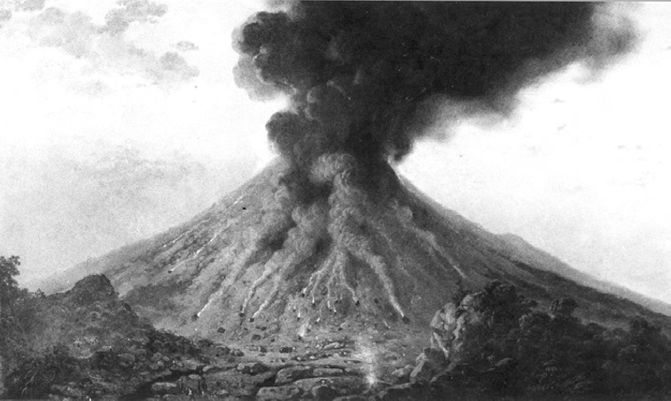
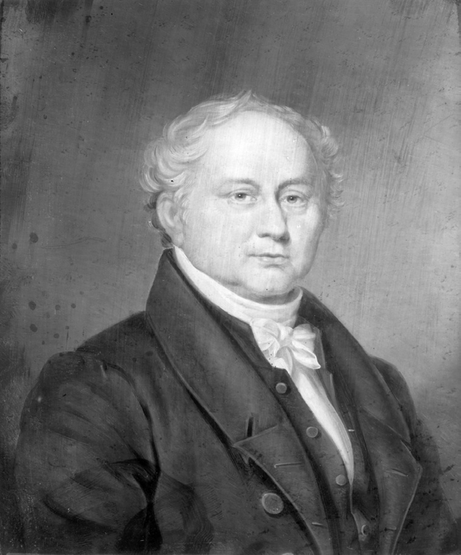
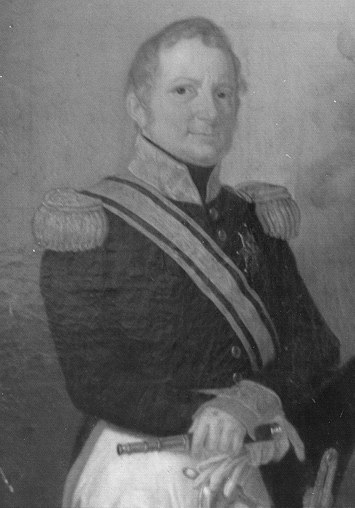
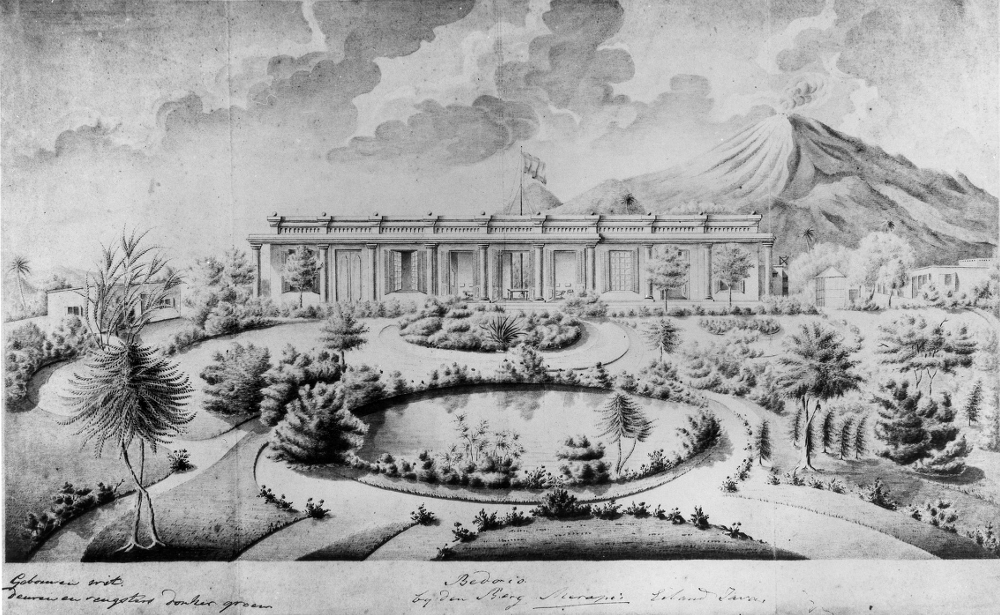
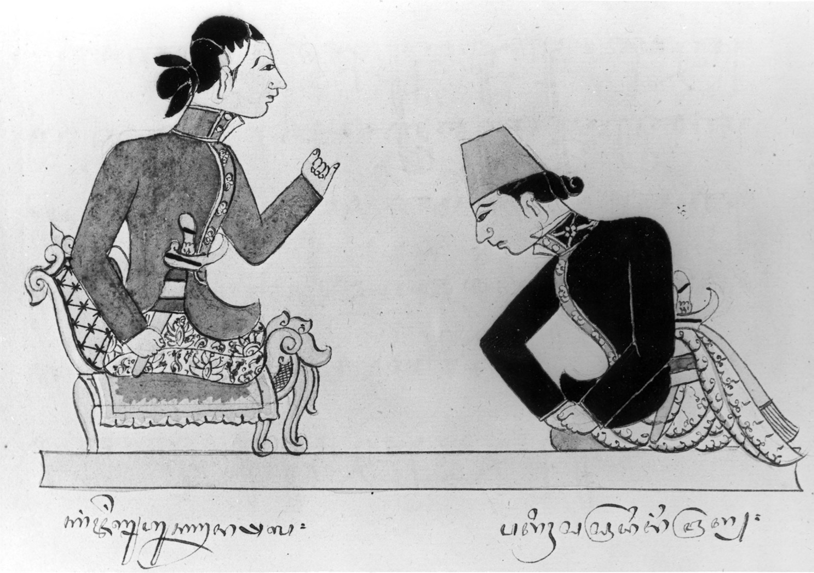
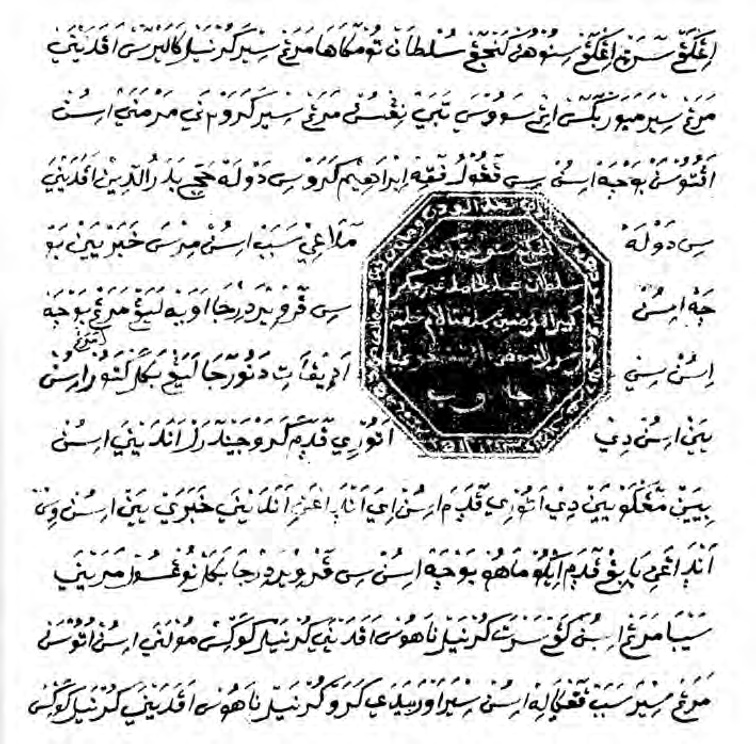
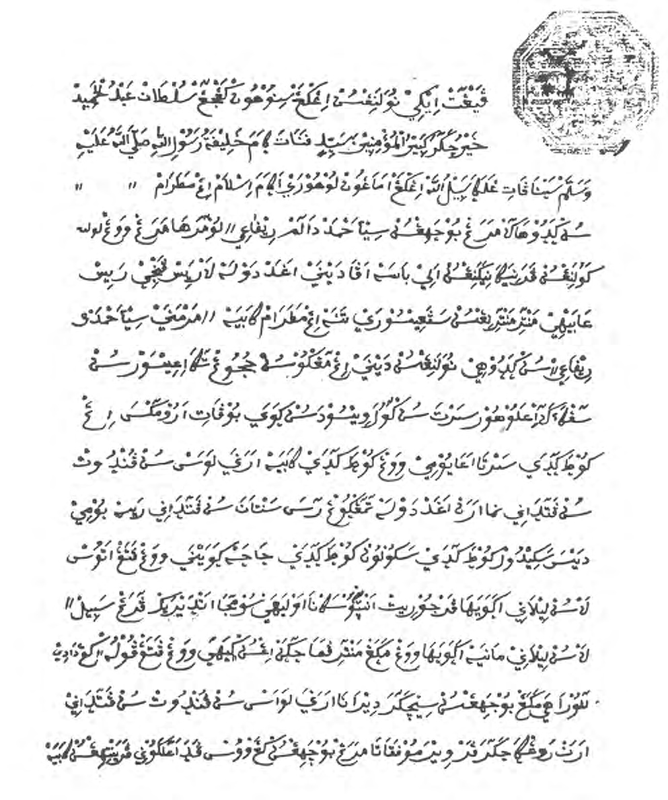
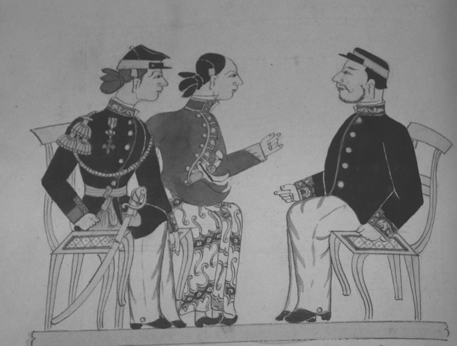
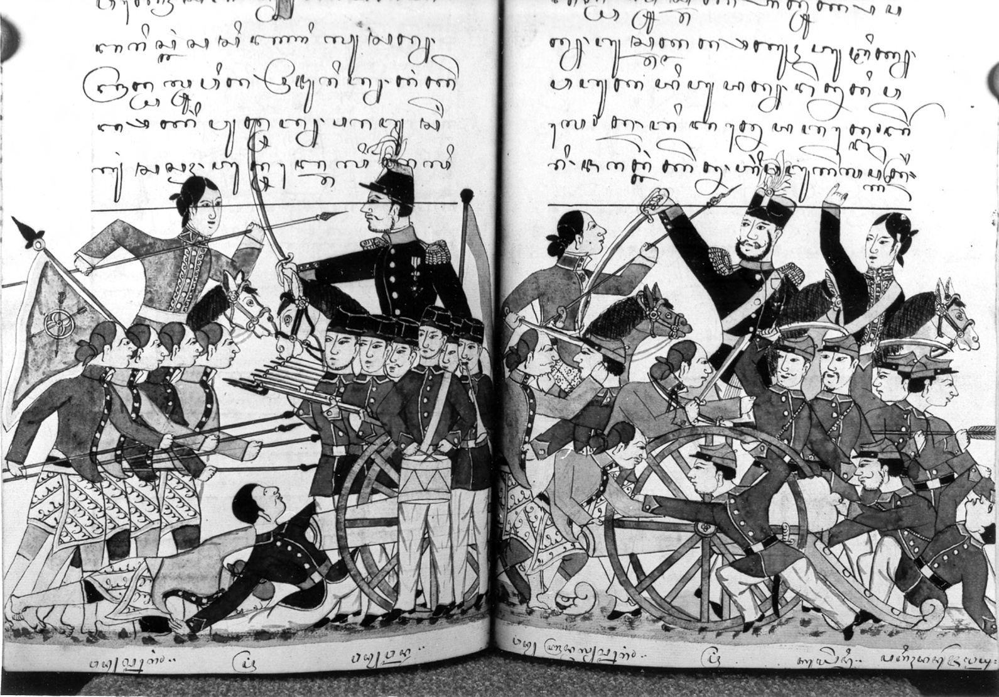

# Chapter X: Waiting for the ‘Just King’: The Road to War in South-Central Java, 1822-1825

## The man of destiny

In the two and a half years which elapsed between the death of the fourth sultan in December 1822 and the outbreak of the Java War in July 1825 the crisis in the Javanese countryside deepened. The main outlines have already been described in the previous chapter. As we have seen, during the 1817-1822 period several movements and uprisings had occurred, some of a pronounced millenarian character, but none had involved figures of true stature and authority in Javanese society. Apart from the quirky Pangéran Dipasana, the other leaders who had emerged in these years, such as Radèn Mas Umar Mahdi, Kyai Iman Sampurna, Sunan Waliyullah, Bendara Radèn Mas Sinduratmaja, and Radèn Ayu Guru, were all commoners. Despite their assumption of impressive names and titles, they lacked the influence to turn their movements into wider regional uprisings. Their appeal was thus limited. They could certainly not be compared to the mercurial Radèn Rongga who had so deeply influenced the young Dipanagara during his November-December 1810 rebellion (Chapter VI). It is likely that apart from his great-uncle Dipasana, whom he mentions specifically in his babad, the prince was unaware of these other self-appointed prophets in the Javanese countryside. The time was coming, however, when he himself would be summoned by prophecy and visions to step forward from the obscurity of Tegalreja and stand centre stage as the long hoped for Javanese Ratu Adil or Just King. Iman Sampurna for one had already indicated in 1819 that the next such person would be a prince of Mataram blood (pp. 490, 491 note 146), and he may well have had someone of Dipanagara’s stature in mind.

The past five chapters have mainly focussed on the history of the Yogya sultanate since the arrival of Marshal Daendels. In this tale, the prince has been a somewhat shadowy figure, making brief and frequently disapproving appearances at the Yogya court. The sources for his early life have been limited forcing us to rely on his remarkable autobiography. In the present chapter, however, the situation changes. Dipanagara will now become the main protagonist and the sources for his life will become ever more abundant. The period foretold by the Parangkusuma prophecy – ‘you alone are the means, but that not for long only to be counted amongst the ancestors’ (p. 151) – was at hand. The next two chapters will describe how the prince’s destiny was fulfilled.

## The aftermath of the fourth sultan’s death and Dipanagara’s guardianship

The fourth sultan’s unexpected fit on returning from his riding tour caused scenes of shock and grief at the court, especially amongst the kraton womenfolk.[^1] Dipanagara was hastily summoned from Tegalreja, but when he arrived in the kraton his younger brother was dead. The head of the Yogya religious establishment (pengulu) and members of the Yogya religious hierarchy were already in attendance at the Srimenganti pavilion in order to wash the sultan’s body and to pray over it. According to Dipanagara, the Yogya Assistant-Resident R.C.N. d’Abo attempted to postpone this lustration ceremony until the arrival of the Surakarta Resident, Baron Adriaan Mauritz Theodorus de Salis, who was then combining his Surakarta post with the additional duties of acting Resident of Yogya,[^2] but he was overruled by the prince. The body was washed and placed in a wooden coffin in the sultan’s private apartments still surrounded by the religious officials who chanted the Usali prayer for the dead.[^3] Other Javanese accounts relate how, on the instructions of D’Abo, the Residency surgeon asked that an incision should be made in the sultan’s thigh to ascertain whether there was still any circulation. This request was passed on to members of the sultan’s close family, but Dipanagara would not countenance it, stating that it was against Javanese-Islamic practice for a body to be mutilated after death. One recalls here the prince’s equally adamant refusal to accept the arcane magico-religious practices for releasing the life force proposed by his great-uncle, Pangéran Demang, at his father’s deathbed in November 1814 (p. 406). The queen mother, however, still entertained hopes that her son might recover so she brushed Dipanagara’s objections aside. The incision was made, but no blood flowed – a clear indication that circulation had long since ceased.[^4] One of Dipanagara’s sons would later reflect that his father had shown pleasure at his younger brother’s death stating:

> Thank God! How could it be otherwise than that he should die in such a fashion? Since he could not bring himself to make war to regain his kingdom or even to rule it properly, it is good that he no longer remains in this world. Now everything will go better.[^5]

But there is no corroboration for this in any other source. The following day the sultan’s body was buried at Imagiri near the grave of his father.[^6]

Meanwhile, in Surakarta De Salis had received word of the sultan’s death and departed in the middle of the night to make the three-hour journey on horseback to Yogya, taking his student in the Javanese language, the eighteen-year-old Adriaan David Cornets de Groot Junior, with him (note 2). Arriving in the Yogya kraton early on the morning of 7 December, he was met by D’Abo who informed him that both the queen mother, Ratu Ageng, and the late sultan’s official consort, Ratu Kencana, together with a number of Yogya nobles, had ‘fervently beseeched’ him to confirm the two-year-old Crown Prince on the throne. They also requested that the Dutch authorities should on no account re-appoint Pakualam I as regent during the sultan’s minority or allow him any authority over the Yogya court. Ratu Ageng told De Salis directly that if no suitable guardians could be found in Yogya, then the European government itself should take over the guardianship.[^7] If this had happened, the sultanate would have been turned into a de facto government protectorate, the last scintilla of the sultan’s authority soon being extinguished. As we shall see, the decision of the Yogya Resident to occupy the throne during the Garebeg ceremonies as the official ‘representative’ of the child sultan would already be seen by Dipanagara and other senior figures in the kraton as an unacceptable sign of the European government’s new and dominant role in court affairs during Hamengkubuwana V’s minority.

To all these requests, the cautious De Salis[^8] replied that he would await Governor-General Van der Capellen’s instructions before proceeding to the Crown Prince’s coronation or the appointment of guardians. In the interval he stated that he himself would take charge of the Yogya administration and the great seal of state. He then proceeded to consult the Residency archives to ascertain precisely what had happened in similar circumstances after the third sultan’s death in 1814. During his researches he came across Garnham’s letter to Raffles of 24 November 1814 (p. 409) concerning Pakualam’s previous appointment as regent and he swiftly came to the conclusion that the independent prince should not serve in that capacity again. The queen mother, Dipanagara’s uncle, Pangéran Mangkubumi, and the chief minister, Danureja IV, were informed of this decision during a conference in the kraton. De Salis assured them that the European government would listen to his advice with regard to Pakualam. In the meantime, he instructed Danureja to continue the administration of the sultan’s lands and ordered the court bupati (nayaka) that no changes were to be made in the government of the kraton without the Resident’s express approval. He also took the decision to recognise the Crown Prince as his father’s official successor and stipulated that the great seal should remain in the keeping of the Yogya Resident until the child sultan had reached his majority on 20 January 1836. Pakualam, who was in attendance at the kraton at this time, declared himself well satisfied with these arrangements, observing that ‘earlier [during his regency, 1814-1820] his good name had been exposed to the designs of the chief minister and the intrigues of the court so that he had become a mere figurehead and had enjoyed no real power’. His sentiments appear to have been genuine given the way he had been treated during his previous incumbency (pp. 409-10). At the same time, De Salis’ letter to the governor-general and various appendices referring to Garnham’s earlier correspondence with Raffles were read out to the informal governing group in the kraton and won universal approval.[^9]

There was some urgency in ensuring a speedy succession given the uncertainties of a prolonged interregnum. On 13 December, there were reports of a number of fires being set at various places around Yogya and other localised disturbances.[^10] The day after this worrying news was registered, Van der Capellen endorsed De Salis’ recommendations in a secret government resolution. The patih was ordered to administer the sultan’s lands, but to undertake nothing of importance without the approval of the Resident. Everything else concerning the guardianship and education of the young sultan together with the governance of the kraton and its private finances was to devolve on four guardians: Ratu Ageng, Ratu Kencana, Mangkubumi and Dipanagara, the first two being concerned with the child sultan’s upbringing and care in the kraton, and the two last being principally responsible for the management of the sultanate during his minority. The yearly sum of 100,000 Spanish dollars from the rent of the tollgates and markets was to be paid directly to these guardians without the intervention of Danureja IV and the patih was instructed to give an account of the financial situation of the sultan’s lands to them every three months and pay the moneys for the guardianship directly into their hands. Moreover, the governor-general’s resolution specifically stipulated that the patih would only be permitted to interfere in the internal administration of the kraton if the guardians were found by the Resident to be lax in the discharge of their duties.[^11]

News of Van der Capellen’s secret resolution reached Yogya on 18 December and on the following day – Thursday, 19 December 1822 – the Crown Prince was appointed as Hamengkubuwana V. The Resident’s proclamation was read out in the Prabayeksa, the sultan’s private apartments, and the oaths of the guardians of the child sultan and the patih, accepting full responsibility for their new task, were signed and sealed by the parties concerned.[^12] Writing six years later, De Salis commented that the establishment of the guardianship had occurred ‘with the general approval of the ratu and the most important courtiers in Yogya; Pangéran Dipanagara also seemed outwardly pleased about it’.[^13] General de Kock later confirmed this, giving an account of the esteem in which Dipanagara was held at this time by the European government:

> Earlier one heard nothing but good about him. He was on cordial terms with Nahuys and did not seem to have a bitter heart against the government. [The fact]

> that this [happened] was entirely due to the disdain heaped on him by Resident [A.H.] Smissaert and [the Yogya Assistant-Resident/Residency Secretary P.F.H.] Chevallier. His authority, moreover, was hampered inside the kraton by Ratu Ageng and outside by the patih.[^14]

Dipanagara largely endorsed De Kock’s observation stating that ‘I was on especially good terms with De Salis, with him affairs went well. But, as soon as the others came – he meant Smissaert [and Chevallier] – everything was plunged into disorder’.[^15] Separately, in his conversations with Knoerle, the prince stated that ‘he had always followed the straight path without deviousness in his dealings with the European Residents’.[^16] Both Nahuys and the veteran VOC official, Nicolaus Engelhard, were of the same opinion. Writing of Dipanagara and his fellow guardian, Mangkubumi, Nahuys would later remark that they were both men ‘who on all former occasions of misunderstanding [between the Yogya court and the European government] had stood quite neutral and were universally considered as good quiet persons without the least ambition’.[^17] Engelhard, as we have seen (p. 77), characterised Dipanagara as ‘a respectable prince […] who in all matters was a Javanese and followed Javanese custom’ (Van der Kemp 1896a:415).

Despite the antagonism between Dipanagara and his two principal rivals, Ratu Ageng and Danureja IV, he seems to have discharged his guardianship duties to the best of his ability for nearly a year after his appointment. It was only after Smissaert’s arrival in mid-February 1823, and that of his assistant, Chevallier, on 26 August of the same year, that these personal antagonisms began to make cooperation impossible. By then the whole issue of the abolition of the land-rent and the indemnification of the European planters had soured relations between the guardians and the Dutch authorities in Yogya. There is thus nothing in the European sources to confirm the highly coloured Javanese accounts of Hamengkubuwana V’s coronation and Dipanagara’s own description of his intense disappointment at being appointed a guardian of his young nephew. Although he does not mention it in his babad, he is likely to have had a hand in the choice of the personal tutor for the child sultan, an Arab from the former Dutch trading post of Surat in western India, Sayyid Hasan, who later taught Hamengkubuwana V to read the Qu’rān and schooled him in Arabic.[^18]

Once the Java War had broken out, however, senior Dutch officials were quick to point out the drawbacks of the guardianship arrangements. Van Sevenhoven, who replaced Smissaert as Resident of Yogya in October 1825, argued that it placed too much responsibility on the shoulders of the patih and the Resident. The idea of giving the Resident a leading role in the guardianship was in principle sound as it would allow him to gain more influence in the internal affairs of the sultanate and learn more about the royal administration. But there was a problem. The Resident’s guardianship duties were not properly defined and in the hands of an incompetent official matters could turn out disastrously.[^19] This in fact happened when Smissaert failed to give due respect to Dipanagara and Mangkubumi and refused to recognise their competence as guardians thus fatally alienating them from the European government.[^20]

The ever insightful Dutch historian of the Principalities, Gerrit Pieter Rouffaer, would later put it succinctly: why place a child of barely three years on the Yogya throne just because he was born from an official consort when in neighbouring Surakarta just a year later the son of an unofficial wife was elevated as Susuhunan Pakubuwana VI (reigned 1823-1830)? And why fail to recognise and respect Dipanagara’s own rights as the eldest born son of a ruler, rights which he should have been allowed to assert with all the honour due to him as Hamengkubuwana V’s eldest uncle and guardian? At the very least why not accord him the title of Pangéran Ngabèhi, the name usually reserved for the eldest son of a ruler by an unofficial wife? In Rouffaer’s view much of the reason for the Java War lay there, in the dreadful mishandling of the prince by incompetent Dutch officials (Rouffaer 1905:600).

## The December 1822 eruption of Mount Merapi and the Jayabaya prophecies

Shortly after the fifth sultan’s coronation, an important event occurred in the natural world which almost certainly had a deep psychological effect on the inhabitants of Yogyakarta. This was the violent eruption of Mount Merapi, the volcano overlooking the city, between 28 and 30 December 1822. In his babad, Dipanagara related how on Friday, 26 December, he had been to the house of his younger brother, Pangéran Suryabrangta, whose son was being circumcised, a ceremony known in Java as supitan. He had supervised the supitan ceremony and had then remained overnight playing chess with his old friend and fellow cognoscente of Javanese-Islamic literature, Radèn Ayu Danukusuma, widow of the murdered Radèn Tumenggung Danukusuma.[^21] The following morning, the prince had returned to Tegalreja, but he was so tired that he slept right through the day and well into the following night. Then, early on the morning of Sunday, 28 December at approximately two o’clock, according to one Dutch report, after a series of heavy earth tremors, which had started the previous evening, Mount Merapi began to erupt.[^22] By the morning of 29 December streams of glowing lava could be seen pouring down the mountain on the Kedhu side with a heavy column of smoke thrown up to a great height and rains of ash and sand covering an extensive area as far as Mount Sumbing in the west.[^23] According to Dipanagara:

> XIX.98 Mount Merapi caught fire as though its peak reached to the heavens. Yogyakarta seemed filled with it. The sky became fire [and] the noise of it was terrifying; it thundered and roared, the fires radiating everywhere. In great commotion, together, everywhere people desperately sought refuge.[^24]

The prince states that he slept through the beginnings of the first eruption, which only became serious between half past four and five o’clock in the morning, when he was awakened by the screams of his female servants. He then went outside into the front courtyard with his wife, Radèn Ayu Maduretna, and looked up into the sky; seeing the burning mountain and the heaving earth, he described how he smiled inwardly to himself knowing that this was a sign of God’s anger.[^25]

The Dutch reports confirm that the eruption was just as violent as Dipanagara made out in his babad. Thus, D’Abo wrote that there were three major eruptions, two on the Sunday morning at five and seven o’clock, and the last at eleven o’clock on Monday, 29 December. He described how a huge pall of smoke and ash was blown in a south-westerly direction from the mountain and stones as large as coconuts were flung as far as twelve kilometres, the ash being carried three times that distance. On the flanks of the mountain, people fled their homes and three villages – Bulu, Deles and Pringlegi – on the Kedhu side were completely destroyed.[^26] The rivers which rose on the Merapi-Merbabu watershed became clogged with hot mud and huge boulders, overflowing their banks (Residentie Kadoe 1871:15). In the southern Kedhu district of Prabalingga, the Kali Pabélan was especially badly affected. Localised flooding here damaged 144 jung of fields planted to rice and tobacco. Even six years after the Java War, the amount of cold lava in the river bed, and its constantly changing flow, made bridge building almost impossible.[^27] A Dutch travel diary from this period speaks of the whole western flank of the mountain, which before 1823 had been intensely cultivated half way up to its summit, now covered with igneous rocks, lava flows and ash (Büchler 1888, I:426-7). Cornets de Groot, who watched the eruptions from Surakarta, gave a magnificent description in a personal letter to his father:

> *Plate 57. Eruption of Mount Merapi, painted by Radèn Sarif Bustaman Salèh in 1865. Photograph by courtesy of the Rijksmuseum van Geologie en Mineralogie, Leiden.*

> It was beautiful to behold; a thick column of smoke rose violently from the top and the thunderous noise was heard clearly in Solo [Sala]. I could see glowing rocks hurled up into the sky, falling right and left around the mountain. Around the peak, there were numerous flashes of lightning caused by the electric attraction of the eruption.[^28]

Heavy rain fell for two weeks after the eruption, washing all the ash – with its trace elements and nutrients – off the sawah. After the last volcanic activity on 3 January 1823, Merapi continued to be wreathed in smoke for days. Much damage was done by the lava flows which gouged two deep valleys in the side of the mountain, flowing in a south and south-westerly direction. Roads were blocked by walls of steaming mud three metres thick and the waters in the rivers, which had their source on the mountain, became boiling hot.[^29] Bodies were washed down the Praga River and were found as far afield at the rich salt-making village of Sirisik near the mouth of the river as it flowed into the Indian Ocean.[^30] Although the damage to agriculture was not as serious as at first feared – with the exception of southern Kedhu – the short-term difficulties caused by the eruption were registered by the rise in rice prices which touched a high of f 6.10 per pikul (62 kilograms) in late January compared with an average of f 5.00-5.50 in the preceding quarter and f 4.00-4.50 in the following year and a half (Appendix X). The 1823 Kedhu tobacco harvest, as we have seen, was also poor (Chapter IX note 82). According to Cornets de Groot, the eruption itself was the first for over three decades (fifty years in fact) and the worst in living memory.[^31]

Besides the physical damage caused by the eruption, the event almost certainly helped to raise millenarian expectations on the eve of the Java War. The mountain itself occupies a special place in local Javanese mythology and its protector spirit, Kyai Sapu Jagad (‘Honourable Sir Sweeper of the World’), is regarded along with Ratu Kidul (Chapter IV note 36) as one of the two most powerful guardian spirits of the sultanate (Ricklefs 1974b:233 note 21). Any volcanic activity on Mount Merapi, not least a violent eruption such as occurred in late December 1822, would have been viewed by the population of south-central Java as a tangible portent of coming change. Dipanagara’s inward reflection that it was a sign of divine wrath would have been shared by many. The fact that it was followed up by a number of subsequent earthquakes in December 1823, January 1824 and September 1825, would have been taken as further proof that Java was about to enter a new era.[^32] Thus in 1770, the apparent eruption of the mountain in that year (note 31) and the ash rains which preceded it, were considered to be two of the important natural phenomena which heralded the end of the Javanese century and the expected fall of the kraton (Ricklefs 1974a:186). We have already seen how the eruption of Mount Kelut in east Java in late June 1811, coming as it did just over a month before the British invasion of early August 1811, may have been taken as a sign that major changes were afoot (p. 280). Later, at the end of the nineteenth century, the terrific explosion of Mount Krakatau in the Sunda Strait in August 1883, clearly heightened expectations of the coming Day of Judgement which was linked in the popular mind with Mahdi beliefs in Banten before the short-lived peasant revolt of 1886 (Sartono Kartodirjo 1966:167). In south-central Java, as we have seen (Chapter IX), popular millenarian hopes centred around the figure of the Just King rather than the Mahdi. In contemporary versions of the Jayabaya prophecies, the Ratu Adil’s coming is described as being preceded by various natural occurrences including rains of ash, earthquakes, flashes of lightning, thunderbolts, heavy rain, gusts of wind, and eclipses of the sun and moon.[^33] The visitations of disease such as the 1821 cholera epidemic and the tangible breakdown of society as reflected in the high prices of food, corrupt administration, the aimless wandering of the rural population and the rise in robberies and violence, all of which were features of pre-Java War life in the Principalities, would have been easily connected in the popular mind with the time of madness or jaman édan which was to precede the coming of the Just King.[^34] We have already seen how the Jayabaya prophecies held great sway at the courts at this time (p. 483), particularly the belief in the hundred-year cycle for Javanese dynasties. These beliefs would persist long after the Java War, resurfacing strongly in the period immediately before and after Hamengkubuwana V’s death in June 1855 when the prophecy that Yogya’s century had been fulfilled was believed by many.[^35] As the Yogya Resident, A.H.W. Baron de Kock (1808-1891), put it at this time, ‘The prophecies of Jayabaya live in the minds of every Javanese and they do not doubt that they will come to pass’.[^36] Even during Indonesia’s struggle for independence in 1945-1949, their continued influence would be noted in the areas where Dipanagara had once fought (Simatupang 1972:41, 72, 89).

Shortly after the outbreak of the Java War, the Jayabaya prophecies seem to have been rewritten to correspond more closely to recent events. Thus in a Malay version provided by a Javanese informant to General de Kock at his Magelang headquarters, the Javanese year AJ 1753 (AD 15 August 1825-3 August 1826) is referred to as the time when Java ‘would begin to be destroyed’ – shades of the Parangkusuma prophecy – and when good people would be set aside by men of no principle. In this final age of disorder – the kaliyuga – before the establishment of the era of the Ratu Adil with its peace and plenty, the world would be turned upside down: fathers would forget their children, children their parents, masters would neglect their servants and servants their masters. The Javanese themselves would be like winnowed rice.[^37] In another Javanese babad version of the events surrounding Dipanagara’s rebellion, Jayabaya is depicted as having prophesied that Yogya would be destroyed after ten windu (eight-year cycles) or eighty Javanese years (Appendix XIV), and after four changes of ruler.[^38] Signs that this time was at hand were to be seen, according to this text, in the corrupt rule of the patih who robbed people while sitting down and was like a devil in human clothes (Chapter VIII note 149). Meanwhile, in the Buku Kedhung Kebo, the author described how in the early stages of the Java War, when Dipanagara was still at his first headquarters at Selarong (July-September 1825), many of the common folk who rallied to the prince believed that he was the Ratu Adil who would carry out the Jayabaya prophecy by driving the Dutch from Java. But, the author asserts, in reality the time had not yet arrived and few understood the true meaning of the prophecies.[^39]

## A small, fat and shy man; Yogyakarta’s new Resident

Just as these events were taking place in Yogya and popular expectations of coming millenarian events were on the rise, important changes were occurring amongst the Dutch official personnel at the courts. As we shall see, these were destined to have a direct influence on the course of events in the sultanate during the coming two and a half years. In late April 1822, Nahuys had been forced to relinquish his position as acting Resident in Surakarta because of growing opposition to his economic policies amongst Van der Capellen’s close advisers, in particular H.J. van de Graaff.[^40] Baron A.M.Th. de Salis, himself an eloquent opponent of Nahuys’ schemes, was chosen as his successor.[^41] Then in November 1822, Nahuys also gave up his official post in Yogyakarta to return to the Netherlands to argue his plans for economic development in the Principalities with the Dutch king and Minister for the Colonies C.Th. Elout (Nahuys van Burgst 1858:129; Louw and De Klerck 1894-1909, I:51 note 2, 52-3, 74). The vacancy in Yogya was not filled immediately, but D’Abo continued as Assistant-Resident and De Salis functioned as acting Resident coming over from Surakarta for important events such as the death of the fourth sultan and the installation of his successor. There was, however, something of an administrative vacuum in Yogya during these months which must have created much the same sort of uncertain atmosphere which had prevailed in Surakarta before Pakubuwana IV’s demise in October 1820 (pp. 500-1).

> *Plate 58. Jonkheer Anthonië Hendrik Smissaert (1777-1832), Resident of Yogyakarta between 1823 and 1825, whose bungling and ineptitude were directly responsible for the outbreak of the Java War. One Dutch contemporary, Willem van Hogendorp, described him as a ‘small, fat and shy man’ (klein, dik en verlegen), and another, the Belgian painter A.A.J. Payen, compared him to Sancho Panza, one of the most archetypal panakawan figures in European literature. Portrait attributed to the Dutch artist W.G.F. Heymans, and probably painted in 1827 after Smissaert had returned to The Hague in disgrace. From the private collection of the Baron van Tuyll van Serooskerken (Kasteel Heeze). Photograph by courtesy of the Stichting Iconographisch Bureau, The Hague.*

Eventually, on 3 January 1823, Van der Capellen nominated the forty-five year old Resident of Rembang, Jonkheer Anthonië Hendrik Smissaert, scion of a long-established Indies family and son-in-law of a former VOC Resident of Surakarta,[^42] to fill the vacancy left by Nahuys’ departure. The reasons given by the governor-general for his unusual choice – Smissaert had no experience of service at the south-central Javanese courts – are significant. First, the former Rembang Resident was appointed to afford him the extra emoluments which the Yogya post entailed and which the financially canny Smissaert had requested in order to provide for his large family.[^43] Second, the governor-general clearly made the appointment in the hope that he would have a senior official in Yogya who would act more obediently than Nahuys had done with regard to the land-rent. He also had in mind the need for an official with extensive administrative experience in Java to undertake a far-reaching investigation of the Yogya territories with an eye to facilitating further territorial annexations. As we shall see shortly, the western mancanagara provinces of Banyumas and Bagelèn were now in the government’s sights. Smissaert with his nearly twenty years’ service in Java seemed to fit the bill. As Van der Capellen pointed out in his letter of appointment:

> I consider the post of Resident at Djokjo [Yogyakarta] in the present circumstances above all as very important. I wish to see an official placed there whom I trust entirely and who in every department of the service gets on with his colleague in Surakarta […] your knowledge of Javanese affairs, your long standing relations with all classes of Javanese and your diligence in the public service are reason enough to convince me that I will not regret my choice.[^44]

Finally, Van der Capellen added that under no circumstances would Nahuys’ business associate D’Abo be allowed to stay on in Yogya. Instead, he would find Smissaert a ‘capable official’ as his assistant (Van der Kemp 1896a:379). This man would later be identified in the governor-general’s inner circle of friends and erstwhile staff. The son of his children’s tutor and one of his former military adjutants, Pierre Frederic Henri Chevallier’s personal influ-ence on the affairs of the sultanate would be almost as disastrous as that of his immediate superior.[^45] D’Abo, meanwhile, stayed on in Yogya attending to Nahuys’ coffee estate at Bedhaya and other matters before returning to Padang, his birthplace in west Sumatra, where he died in May 1824 (Van Enk 1999:218 note 68). It was an unhappy end for a man who had hitched his wagon to Nahuys’ star, but had seen both his marriage (Chapter III note 79; pp. 438-9) and his business projects fail as a result of his superior’s actions.

From the start of Smissaert’s Residency, there was a fundamental difference between what the former Rembang Resident hoped from his position and what Van der Capellen expected of him. Whereas Smissaert had in view a quiet and lucrative appointment to feather his nest before retirement, the gov ernor-general thought foremost of the imminent policy changes relating to the land-rent and incorporation of princely territory. And for this latter purpose Smissaert was manifestly unsuited. This was particularly so when one considers the highly delicate political situation then prevailing in Yogya. Although he did take some administrative initiatives – the establishment of an official Residency postal service in Yogya may have been his work[^46] – Smissaert was a man of distinctly mediocre talents. Willem van Hogendorp described him as ‘a person more suited to the outdoor life than the position of Resident at one of the [south-central Javanese] courts’ (Van Hogendorp 1913:143), while Van de Graaff himself considered his appointment a temporary one, ascertaining correctly that he had little knowledge of kraton affairs.[^47] He also appears to have had difficulties getting on with his subordinates (Louw and De Klerck 1894-1909, I:280; Van der Kemp 1896a:377). Added to this, his physical appearance and manner were distinctly unprepossessing. A fat, balding, middle-aged man of small and stocky build, Smissaert was shy and diffident in conversation (Van Hogendorp 1913:146; Carey 1981a:255 note 87, 273 note 152). Such a combination of poor capabilities and unimpressive physique was doubly unfortunate for a Resident at one of the kraton for the Javanese were shrewd judges of men and attached great importance to the bearing and physiognomy of Dutch officials (Ricklefs 1974a:27-31; Carey 1981a:255 note 87).

Despite his limitations, Smissaert seems to have made a genuine effort from the start of his Residency to follow up Van der Capellen’s instructions regarding the collection of statistics about Yogyakarta, in particular its lands, population and administration. He received little cooperation, however, from the sultan’s officials, writing to the governor-general that the regional bupati were distinctly especially unhelpful in providing him the necessary information:

> There is a certain reserve and dourness in Yogyakarta [compared to Rembang] which makes one too despondent to ask them anything […] none of the bupati seem to know their areas well […] [and] the patih himself has visited many places near Yogya for the first time with me.[^48]

He soon began to form a poor opinion of the patih and the child sultan’s two guardians, Mangkubumi and Dipanagara, as well:

> They are good people but lazy. They know very little about the administration [of the sultanate] for no registers have been kept since the sack of the kraton [by the British] in [June] 1812. Thus, they merely receive the income from the sultan’s lands when the bupati choose to give it to them. Danureja, [moreover], is much taken up with women on whom he spends all his money. [But] he is prepared to serve the Dutch government as much as possible.[^49]

Later, following the outbreak of the Java War when he was casting around for scapegoats on whom to lay blame for the disastrous turn of events, Smissaert wrote more harshly of the patih, claiming that he was ‘a dull, stupid and lukewarm man when it came to affairs of importance for the Netherlands Indies government’.[^50] Yet it was precisely this man on whom Smissaert came to rely so heavily for help and advice during his period as Resident. So why did he do this? If he knew about the chief minister’s character faults and lack of capacity, why choose to delegate so much to him? The answer seems to be that Smissaert was out of his depth, was frequently absent from Yogya and depended on subordinates like Danureja to carry out a large part of his work. As a result the patih was given far too many responsibilities, lacked the necessary support to carry out his tasks, and took advantage of the Resident’s weakness to further his own interests. That these interests included a love of the opium pipe, fine clothes and beautiful women hardly served to hone his administrative zeal (Louw and De Klerck 1894-1909, I:450). It was the same with the Residency translator J.G. Dietrée and the new Assistant-Resident P.F.H. Chevallier, both of whom needed the guidance of a capable superior to get the best out of them (Louw and De Klerck 1894-1909, I:306 note 2). In fact, on a personal level Smissaert does not seem to have got on particularly well with either of them, especially the latter. Yet he still delegated a number of key duties to them (Kielstra 1885:410). How could it be otherwise? For Smissaert was for certain key periods to all intents and purposes an absentee Resident.

On arriving in Yogya in February 1823, he had found the Residency House in a grave state of disrepair. It had been left vacant for several months following Nahuys’ departure,[^51] had suffered earthquake damage during the eruption of Mount Merapi in December (Payen 1988:8 note 6) and needed a new roof. In the end, it was decided to pull much of it down and begin again. But it was not until November 1824 that work on redesigning and rebuilding the entire structure could commence under the capable direction of the Belgian artist-architect, Antoine Auguste Joseph Payen.[^52] Even then work was stopped until the end of the rainy season and only resumed at the end of June 1825 when Payen returned to the sultan’s capital. It was still proceeding when the Java War broke out on 20 July. This situation, so enriching for the historical record given the diary which the ever observant Payen kept of the dramatic events of Dipanagara’s siege of Yogyakarta between late July and mid-September 1825 (Payen 1988), proved fateful for Smissaert and for Dutch interests in Yogya. Given the need to tear down the old residency house to enable the new building to be constructed, Smissaert and his family moved into the house of the former kapitan cina, Tan Jin Sing, in the Chinese quarter of Yogya. They stayed there for just over a year between August 1823 and September 1824, when temporary lodgings became available in the Dutch fort, Vredenburg.[^53] During this period, Smissaert frequently took his family up to Bedhaya, Nahuys’ former estate on the flanks of Mount Merapi (pp. 537-40; Plate 60). According to his own testimony, he only remained there for short periods and always informed the patih of his absence.[^54] But General de Kock remarked that he was there ‘for months on end’, a view confirmed by Lawick van Pabst who stated that Residency office affairs were left in the hands of a clerk.[^55] Indeed, we know from Smissaert’s own correspondence that in the critical weeks before Dipanagara’s rebellion, he was in semi-permanent residence at Bedhaya, returning to Yogya only on Mondays and Thursdays to transact Residency business (Van der Kemp 1896a:382-3 note 1). He even planned a climbing holiday for himself and his family in late June 1825, involving the ascent of Mount Lawu and a visit to the fifteenth-century Hindu-Buddhist temple at Sukuh, ordering the Yogya patih to ensure that the roads were in a good state of repair to accommodate his carriage. This was tantamount to having yet another absentee Resident in Yogya.[^56] The delays caused to the transaction of official business were considerable given the over thirty kilometre round trip required for every journey to and fro to the Resident’s country seat. Smissaert’s absence during the critical weekend before Dipanagara fled from Tegalreja, as we will see shortly, severely handicapped Dutch efforts to open immediate negotiations with the prince after his intentions had become known (note 257).

Initial reactions to the new Resident on the part of the Yogyanese are not known. But Dipanagara afterwards wisely observed that Smissaert was ‘a good man but weak’ (Louw and De Klerck 1894-1909, V:743; Chapter III). The prince also had kind words to say about his wife’s hospitality, remarking that ‘I used to go now and then to Bedhaya […] [and whenever] I went there, Mrs Smissaert [Clara Elisabeth, née Von Liebeherr] out of the goodness of her heart used to come to me offering [me] a bottle of sweet [Cape Dutch] wine which she knew I liked at the time’.[^57] It is also seems that Smissaert was well viewed amongst the Yogya Chinese community, not least by Tan Jin Sing who let him live in his house rent free.[^58] At the time of his departure from Yogya in late September 1825, the former kapitan cina and the other elders of the Chinese community provided him with two glowing testimonials vouching for his goodness of heart and special consideration towards them.[^59]

One of Smissaert’s first public acts, however, seems to have caused great resentment in the Yogya kraton. This concerned his ‘agreement’ – as he put it – to represent the young sultan at the Garebeg Puwasa festivities of 9 June 1823 by sitting in person on the vacant Yogya throne, the dhampar. Given that this had earlier been the focus of such intense dispute during the second sultan’s reign (Chapters V-VII), it seems strange that the new Resident was not more sensitive to its significance. Even the most cursory perusal of the Residency archive would have informed him to leave well alone. Ever the conscientious bull in a china shop, however, Smissaert pressed ahead and came to his own inappropriate conclusion. According to him, the fifth sultan was still too young and shy of people to take part in the Garebeg ceremony. Although he had initially thought of cancelling the celebrations, he was over-ruled by the four guardians, who told him that by right one of their number should represent the sultan. But, as this choice would give rise to jealousy and suspicion amongst them – one can imagine that neither Ratu Ageng nor Ratu Kencana would have been happy to see Dipanagara sit on the throne – they invited Smissaert to act as their representative.[^60] Whether this truly reflected their jointly held views, or only the opinion of Ratu Ageng, who had already indicated her willingness to see the European government act as sole guardian for her grandson, we will probably never know. What is certain is that Smissaert’s subsequent action caused Dipanagara in particular feelings of intense grief and heartache.[^61]

The Resident had decided that if the dhampar remained unoccupied, ‘it would look as though the Netherlands Indies government was not well disposed towards Yogya’.[^62] The governor-general, who had made his own faux-pas with the regard to the Yogya court over this very issue during his 29-31 August 1819 official visit,[^63] ratified Smissaert’s decision, merely adding the rider that the young sultan should be shown to the public even if only for a very short time.[^64] This meant that at the five Garebeg ceremonies during Smissaert’s thirty-one months as Resident, he represented the child sultan by sitting on the throne and even received the homage of the mancanagara bupati when they came to Yogya to hand over their tribute and pay their respects to the sultan. In mitigation, one could argue that Smissaert was a victim of the European government’s decision not to appoint Pakualam or another senior prince – perhaps Dipanagara himself – as regent. If they had, there would have been no debate about who should ‘represent’ Hamengkubuwana V at the Garebeg (Louw and De Klerck 1894-1909, I:449-50, 453). Subsequently, the veteran Indies official, Jan Izaäk van Sevenhoven, who served as acting Resident of Yogya between October 1825 and March 1827, followed Smissaert’s action during the swearing in ceremony for the new guardians of the child sultan on 17 November 1825.[^65] So, the practice of the Resident occupying the Yogya throne at important state functions was apparently continued, at least until the restoration of the second sultan in August 1826. Smissaert’s action was thus not so unique. But, it still caused deep offence. And not just to Dipanagara. It is significant that at the Garebeg Mulud of 16 November 1823, a particularly important occasion since it fell in the Javanese year Dal, the fifth in the Javanese eight-year windu cycle (Appendix XIV), which was supposed to correspond with the year in which The Prophet was born,[^66] Smissaert noticed that the mancanagara bupati refused to answer his questions concerning their districts. Small wonder too that the Resident remarked on the ‘reserve and dourness’ in Yogya at this time for his own action must have greatly contributed to these sentiments. Later, Pangéran Mangkudiningrat II would complain about Smissaert’s action to General De Kock when the latter was commanding the Dutch forces in central Java during the war.[^67] The Resident’s behaviour was also censured by Minister of Marine and Colonies C.Th. Elout, who referred to his decision to represent the sultan at the Garebeg as one of the principal reasons for his dismissal from government service.[^68] Van Sevenhoven would later write his epitaph, speaking of Smissaert’s,

> complete ignorance of [the manners and] customs of the Javanese. For a Resident who had spent so many years in Java and had served in so many different posts, one cannot but suppose that he was in the highest degree blameworthy and that he must always take responsibility for this.[^69]

Poor Smissaert, one cannot escape the conclusion that he was the wrong man in the wrong place. As he reflected much later in his justificatory letter to the Dutch king in September 1828 (Van der Kemp 1896a:380):

> I came to Yogya in 1823 much against my will. I perceived that the arrangements which had been made for the return of the rented lands would cause much discontent and I was entirely satisfied with [my posting as Resident of] Rembang, wanting nothing else than a slightly higher income, which I believe I had the right to ask for having been so long in the Indies.

## The abolition of the land-rent and its consequences

As Smissaert intimated, even before his arrival in Yogya in February 1823, the government was preparing to take a decision of very great consequence: namely, the ending of all land-rent contracts to non-Javanese in the Principalities. Both Van der Capellen and his principal adviser, the Surat-born Van de Graaff (1782-1827) had long been concerned about the proliferation of privately leased estates in the territories controlled by the south-central Javanese courts since it conflicted with their views on the European government’s central role in economic affairs and the need to protect the welfare of the local population (p. 455). In 1816, on the arrival of the Dutch commissioners-general in Java, of whom Van der Capellen was one, it had been decided to observe the status quo with regard to the lands already leased by Daendels and Raffles to private individuals. In the following year, Van de Graaff had taken part in Van der Capellen’s first journey through Java as a councillor for the Board of Finances. On the basis of data collected at that time, Raffles’ land tax system was endorsed as the best groundwork for a comprehensive taxation structure on the island. Meanwhile, the old system of contingents and forced deliveries of cash crops by peasant cultivators was allowed to continue in the Preanger highlands in west Java for the production of coffee and in the Bataviasche Ommelanden (Batavian Environs) for sugar, where private individuals – mainly Chinese – were still permitted to lease land. Sometime after Van de Graaff’s 1817 journey, the Inspectorate of Finances was set up under P.H. van Lawick van Pabst with Van de Graaff as his assistant. Both concurred in the view that grants of land to other than Javanese owners should be refused unconditionally, except for special concessions to those European owners already in occupation. As late as 1818, Van der Capellen was still not convinced of the Inspectorate’s arguments, and tried to persuade Van Pabst and Van de Graaff to rethink their position on the question pending a personal consultation with King William I, who had begun to take an active interest in colonial affairs. Van de Graaff, however, persisted in his attitude and when he became acting inspector general of Finances in 1819, he refused point blank to allow any more renting of land until the king had pronounced on the issue. At the same time, Van der Capellen journeyed yet again to the south-central Javanese courts in late August and September 1819 and discovered that Nahuys, as Resident of Yogya, had arranged land leases in Yogya and Surakarta for his friends. The extent of these leases was not at the time very striking (Chapter IX note 53), but the governor-general asked both Nahuys and his opposite number in Surakarta, Rijck van Prehn, to prepare a report about the situation, an order which both Residents appear to have ignored.[^70]

After this, events began to move very rapidly in favour of a complete repeal of the land-rent. In 1821, Van de Graaff made his second journey to south-central Java and in his own words, ‘saw the evil [of the land-rent] grow to enormous proportions; British, German, French and Dutch planters had taken over extensive lands right in the middle of the princely territories’.[^71] Immediately following his visit, he wrote to Van der Capellen urging him to put an end to the land-rent and to promulgate firmer rules regarding the residence of Europeans in the interior of Java. This resulted in the governor-general issuing an order at the end of October 1821 prohibiting further land-rent in the Principalities until a final decision had been taken by the government.[^72] Again this was ignored by Nahuys, who in that very same year registered the highest number of land leases in Surakarta of any of the years since his arrival in August 1816 (Chapter IX note 53). On 23 March 1822, Van de Graaff’s influential report on the land-rent to Europeans in the Principalities was completed (Van der Kemp 1890:148-94). It was then, according to Van de Graaff, that Van der Capellen began truly to understand the ‘highly illiberal nature’ of the land-rent which ‘deprived the Javanese peasant of his property rights and debased his status to that of a coolie’.[^73] Shortly after his arrival as Resident of Surakarta in late April 1822, De Salis also came independently to the same conclusion. In his own report to the governor-general, he stressed that in his view the land-rent was fundamentally at odds with both European government policy and with Javanese custom.[^74] With these reports still fresh in his mind, Van der Capellen made his third and last journey to the courts in late August and early September 1822. After lengthy discussions with the chief ministers and the leading members of the kraton administrations, he returned to Bogor full of disapproval of the existing situation. A commission was immediately established under the chairmanship of General De Kock, then serving as lieutenant governor-general (in office 1822-1830), which was instructed to investigate the whole issue of the property rights of Europeans in the territories under European government control, one of the key questions being ‘whether the renting of land to Europeans in the Principalities with their désa [villages] and inhabitants is liberal and necessary for the Netherlands-Indies government’. On this point, the commission reported negatively, stating that the government had no means of controlling the activities of the European planters, nor of alleviating the manifest oppression of the Javanese cultivators by the former.[^75]

According to Clive Day, the American historian of the Dutch administration in Java, the decision by the Dutch monarch to back the planters and order the Netherlands Indies government to raise the price paid to private producers of coffee also persuaded Van der Capellen to act quickly (Day 1972:234-5). This meant that even before the commission’s decision was known, Van der Capellen in consultation with his council, decided to promulgate his fateful decree of 6 May 1823, ordering that all land rented by Europeans and Chinese in the Principalities should be returned to their original owners not later than 31 January 1824. This was followed up by a further decree on 20 May 1823, which laid down very strict rules regarding the travel and residence of Europeans, Chinese and other foreigners in Java, especially in the princely states.[^76]

> *Plate 59. Official portrait of Lieutenant-General Hendrik Merkus de Kock (1779-1845), the commander of the Dutch armies in the field during the Java War, and Lieutenant-Governor of the Dutch Asian Possessions (’s Rijks Aziatische Bezittingen) (1822-1825) and of the Netherlands Indies (4 February 1826-16 January 1830). Painted circa 1830. Photograph by courtesy of the Musium Kota, Jakarta.*

This abrupt and radical decision by the governor-general caused mixed feelings at the courts. In Surakarta, De Salis had already noted how, on the receipt of an earlier letter from Van der Capellen reporting his more stringent rules regarding the land-rent[^77] – an interim measure prior to complete abolition – Pakubuwana V had appeared very perturbed (Van der Kemp 1897:26):

> His Highness after reading the letter was greatly dismayed. Although fully alive to the importance of the measure, he raised many objections with me about the execution of the order. In particular, His Highness pointed out that the rent contracts from the leased lands bore the authorisation of his royal seal and that, by breaking the contracts, his seal would be much degraded and it would be very difficult to come to terms with the lessees.

According to Van de Graaff pressure had been put on the Sunan by European land-renters to protest the measure (Van der Kemp 1901, I:193). The Dutch historian, P.H. van der Kemp, even suggested that one letter of protest written to Nahuys in Batavia by the Surakarta prince, Pangéran Buminata, was actually concocted by Nahuys himself with the assistance of a Eurasian land-renter, J.A. Dezentjé, who leased a large estate from Buminata at Ampèl some 40 kilometres west of Surakarta on the Boyolali-Salatiga road.[^78] There is nothing to confirm this. It is clear, however, that several senior Surakarta princes were heavily in debt to the European government at this time and the land-rent may have come at a difficult time. Pangéran Purbaya, the future Sunan Pakubuwana VII, was said to owe 300,000 Spanish dollars and Mangkunagara II around 200,000 Spanish dollars.[^79] But debts alone were not in themselves a cause for opposing the abolition. Mangkunagara II, for example, declared himself fully satisfied with the governor-general’s measure and even offered to help the government with the liquidation of the estates. Likewise, the Surakarta patih, Radèn Adipati Sasradiningrat II, promised to act swiftly to bring the affairs of the land-rent to a conclusion after the Garebeg Mulud of 16 November 1823.[^80]

In Yogyakarta, Van der Capellen’s decision initially met with a favourable reception when it was communicated by Smissaert to the guardians in early June 1823.[^81] Mangkubumi seemed to speak for his fellow princes and all those who had rented lands in the kraton when he observed: ‘everyone was pleased about it. It was as though we had been showered with water. We had been hot, now we were refreshed.’[^82] Such feelings of euphoria were soon dashed, however, by the financial realities of the compensations which the government stipulated should be paid to the planters.[^83] In making these payments, Yogyakarta was more heavily burdened than Surakarta. Whereas the estates in the latter kingdom were to be reimbursed according to the yearly amount produced by the plantations and the payments spread out over a long period, the Yogyakarta indemnities had to be made directly from the sultan’s treasury and income, the estates being immediately taken back by the Yogya ruler before being returned to the original fiefees (Van der Kemp 1897:32-4; Van Hogendorp 1913:147). Why this distinction was made is not entirely obvious. It may be that Europeans who had leased lands from the Sunan’s family in Surakarta soon came to the realisation that they had no prospect of getting immediate compensation from their impecunious landlords. They thus successfully petitioned Van der Capellen to enact a special decree allowing them to hold on to their estates until they could be reimbursed through the sale of the coffee produced on their lands.[^84] In Yogyakarta, where the land-rent was more bitterly resented (Van Hogendorp 1913:147), the decision was taken to adopt a system of immediate compensation.[^85] It is possible that pressure from Ratu Ageng and Danureja IV forced this policy on the reluctant guardians, Mangkubumi and Dipanagara (Van der Kemp 1901, I:197-8). According to Valck, Ratu Ageng in particular thought it better to obey the instructions of the government because her grandson the fifth sultan was still so young and Yogya was in such dire need of government protection.[^86] Whatever the case, it soon became clear that the depleted Yogya treasury had no capacity to meet the payments out of existing funds. The indemnity for Dr Harvey Thomson’s Rajawinangun estate alone – f 99,000 – was nearly half the total annual income received by the sultanate from the European government for the rent of the markets and tollgates, and special arrangements had to be made to pay it off in instalments.[^87] Given the size of the indemnities demanded – that for Thomson’s neighbour, J.M. Tissot, renter of the Jumagatan coffee estate, topped f 110,000 (Van Enk 1999:210) – the kraton was soon facing bankruptcy. Small wonder that Dipanagara was forced to sanction a loan of f 37,000 from the Yogya kapitan cina, Qué Wi Kong (in office 1813-1827), a close relation of Tan Jin Sing (Secadiningrat), to defray the ordinary running expenses of the court.[^88] Indeed, the burden of the repayments on the Yogya exchequer was so onerous that in November 1824, nine months after the last financial indemnities had been agreed, Smissaert was writing that the guardians were far behind with their repayments. Because of low prices for coffee, he reported that the estates would never produce sufficient income to meet these reimbursements.[^89] In the same year, the European government was forced to give the guardians an advance of f 45,000 to repay the planters and a further f 18,333 to meet the daily requirements of the kraton.[^90] Subsequently, moveable goods and family heirlooms (pusaka) were sold to meet the costs of the court and further sizeable sums were deducted from the annual government stipend to meet the payments to the previous estate owners (Van Nes 1844:152).

It seems clear that the indemnities demanded were too high, and many Yogya princes and senior court officials soon began to suspect fraud on the part of the European land-renters.[^91] At the same time, they suffered acute personal financial embarrassment. Many had become almost wholly dependent on land-rent payments for their daily sustenance. They had also used the cash income to finance the imported European luxuries to which they had grown accustomed (pp. 437-8, 459). Within eighteen months of Van der Capellen’s 6 May 1823 decision, according to J.F. Walraven van Nes, who would subsequently serve as acting Resident of both Yogyakarta and Surakarta (Appendix IX), the Yogya pangéran and court retainers were reduced to a state of abject poverty.[^92] General De Kock also remarked that the indemnification process had ‘brought many Javanese into extreme distress and even forced village tax collectors (bekel) to resign their posts because they were unable to raise sufficient taxes’.[^93] The few surviving debt lists from this period indicate that certain members of the Yogya kraton owed large sums to local European and Chinese moneylenders in the two years before the Java War.[^94]

The case of a noble such as Pangéran Blitar (circa 1784-1827), a great-uncle of Dipanagara, who would himself be one of the first to rally to the prince at Selarong in late July 1825, was probably typical of many of his contemporaries. He claimed that he had pawned all his valuables, including his pusaka, stating that his monthly interest payments came to 110 Spanish dollars whereas the highest income he could expect from his lands was 80 Spanish dollars a month.[^95] Smissaert also noted with concern the rapid impoverishment of the Yogya elite and wrote early in 1826 that,

> The princes and regents [bupati] here are very poor. One is doing them a great service if one lends them 100 Spanish dollars, for interest rates here are very high, they pay three percent [a month] sometimes more when they borrow money.[^96]

Such men later gravitated towards Dipanagara, who had earlier indicated his strong personal opposition to the land-rent (Chapter IX), and who, as a guardian, soon became outraged at the size of the indemnities offered to the European planters.[^97] We will return to this shortly, but first we must consider the impact of Van der Capellen’s decrees at the village level.

One side effect of the abolition of the land-rent seems to have been an increase in lawlessness in the countryside, particularly on the part of bandits and other criminal elements (wong durjana) who specialised in making attacks on properties leased by Europeans. The knowledge that these estates would shortly be returned to their original owners and the fact that many lay far from populated areas seem to have emboldened the wong durjana who joined up with disgruntled estate workers eager to square accounts with their erstwhile masters.[^98] Despite Nahuys’ warnings to Smissaert to redouble his vigilance in the months immediately following the publication of Van der Capellen’s May decrees, a number of local attacks were made on European leased estates. Nahuys’s own country seat at Bedhaya, as well as Sempu, Babadan and Kembangarum, coffee estates on the flanks of Mount Merapi nearer to the Yogya-Kedhu border, were amongst those initially targetted.[^99] Indeed, many of these places would later become focal points of support for Dipanagara during the war – what Dutch military commanders would term ‘bandit’ centres.[^100] The most serious incidents involved the property at Babadan leased by the much-hated Amsterdam estate owner, Jonkheer (Baron) Pierre Marie Mathieu Bouwens van der Boyen, who had been sent to Java as a de facto political exile and set up by the government as an estate owner because of fears that he might use his insider knowledge of a recent conspiracy involving the Dutch Crown Prince (future King William II, reigned 1840-1849) to blackmail the Dutch monarch.[^101] With important political connections in the Netherlands, but no skill in estate management, Bouwens appears to have regularly abused his estate workers (note 99; Louw and De Klerck 1894-1909, II:269-71; Van Enk 1999:204-6). Indeed, he was so intensely disliked that the Residents in the sultan’s capital had to issue him with a special allocation of gunpowder from the Yogya fort so that he could use light cannon against would-be assailants.[^102] His workers responded in kind, recruiting local wong durjana to mount a series of attacks on his property in 1823-1825 and eventually razing his estate to the ground following the outbreak of the Java War.[^103]

## Dipanagara’s role as guardian and the land-rent indemnities

As a guardian of the young sultan with special responsibilities for the financial administration of the kraton, Dipanagara was called upon to play a leading role in the negotiations for the indemnification of the European land-renters. The first case involved Bedhaya, for which Nahuys requested the astronomical sum of f 50,000 by way of financial compensation. The former Yogya Resident had already demanded (and secured) an equally inflated figure for the out-of-town retreat of the Surakarta Residents at Kalitan just to the west of Surakarta close to the old royal capital of Kartasura. This country seat had been established by the disgraced Rijck van Prehn (in office 1818-1819) and completed by Nahuys following his appointment as acting Resident at the Sunan’s court in March 1820.[^104] He had also been able to profit from the sale of jewelry and gold ornaments from the Yogya kraton during the fourth sultan’s reign (note 135). He now expected to make a similar profit out of his Yogya property investment.

Smissaert wrote to Dipanagara and his fellow guardian, Pangéran Mangkubumi, on 25 July 1823, stating that the amount stipulated by the former Resident included reimbursements for the house, the warehouses, the 110,000 coffee trees, 30,000 pepper bushes and the yearly rent of 120 Spanish dollars which he had paid the deceased fourth sultan since July 1817. As Nahuys was on the point of departing for Europe, immediate compensation was demanded.[^105] The two guardians came to see Smissaert and asked if they might travel to Bedhaya to inspect the buildings and the grounds. Permission was granted, and Smissaert immediately instructed D’Abo, who was then at Bedhaya overseeing the coffee plantations, to show the princes everything. Accompanied by the patih, Major Tumenggung Wiranagara, and two senior kraton bupati, the guardians made their visit on 29 July. After close inspection of the house and its immediate environs, they came to the conclusion that the van Burgst by the Assistant-Resident of Yogya, R.C.N. d’Abo. It was described by the painter during the weeks before the outbreak of the Java War. Sketch from NvB 22.

> *Plate 60. Bedhaya, the country house on the flanks of Mount Merapi, which was built for Nahuys A.A.J. Payen as une jolie casino (a pretty country retreat) and was used by Resident A.H. Smissaert*

price demanded by Nahuys was far too high.[^106] According to Van Nes, who interviewed Mangkubumi and other kraton members in 1829, the guardians only agreed to the very small figure of 800 Spanish dollars for the buildings (Van Nes 1844:150). Valck even suggested that their offer was lower at 700 Spanish dollars, a sum which D’Abo himself reckoned the house and warehouses to be worth.[^107] Payen, who visited Bedhaya in early July 1825 inferred that these much smaller sums were probably nearer the mark than Nahuys’ inflated figure. In his diary, he wrote scathingly that the land around Nahuys’ ‘pretty little house’ comprising a long gallery with rooms off both ends were (Payen 1988:46):

> arid cinders in which the miserable coffee plantations which surround this estate languish. Seeing them, one is amazed at what they must have all cost to lay out. In buying them back, the sultan will only ever get a bit of wood to burn. Already, some of the [coffee] trees are dead. Mr D’Abo, who set up this establishment, was only too happy to let it go in such a [financially] advantageous way.

It was precisely this realisation that caused the guardians to make their modest bid. As Dipanagara is reported to have said:

> How can Smissaert order us to take over all the land and coffee plantations from Nahuys? The house itself is perhaps an exception because that can be of use to the sultan, but what possible profit can we expect from the coffee and other plantations? The arrangement would amount to nothing more than debts for us [because] we cannot make the same profits from the plantations which the Europeans did.[^108]

Mangkubumi supported his co-guardian in this opinion. But Smissaert, who later acknowledged the difficulties of harvesting the coffee to his deputy, Chevallier,[^109] refused to accept it. He summoned the guardians to a meeting in the old Residency House with the patih present, pressing the guardians on the question and asking Danureja to provide details of the amount of money which Nahuys spent on the daily wages of his labour force (Chapter IX note 74). The figures were given and Smissaert suggested that the sum offered was far too low. Whereupon Van Nes reported the following observations on the part of the guardians:

> ‘Yes’, answered Mangkubumi, leaning his head back on his chair, ‘if you want to reckon everything together, but what possible value does it have for the young sultan?’

> Dipanagara stared straight ahead of him for a while and eventually spoke in a rather surly way:

> ‘If my father hadn’t died, he would still be alive. If Nahuys hadn’t spent so much money, he would still have it in his pocket.’

> Afterwards he spoke not a word more and shook his head.[^110]

But Smissaert held out for the original figure, telling the guardians:

> You should be content with that sum. If it was my own property, I would not relinquish it for such a small price.[^111]

Mangkubumi proposed that the property be returned to D’Abo’s care for two years so that he could make the necessary profits from the sale of the coffee and pepper harvests, precisely the arrangement made in Surakarta with the European land-renters (page 532). But this was not accepted by Smissaert, who, in a private conversation with Danureja, agreed a compromise sum of 26,000 Spanish dollars. When the guardians again refused, Smissaert cited the former Resident’s friendship with the fourth sultan as a reason for their agreement, whereupon Dipanagara is supposed to have burst out:

> My God! Nahuys may well have been a friend of the sultan, but he never did him a favour. Now does he want his friendship paid for in money? He never put the sultan on the throne! Mr [John] Deans [secretary of the Yogya Residency, 1811-1813] was a good friend of [my father] Sultan Raja [Hamengkubuwana III]; he even facilitated his accession […] but he never received any repayment for his efforts other than that the sultan bought him a horse for 700 Spanish dollars.[^112]

At this point, the meeting broke up in acrimony, tempers frayed on all sides. The guardians went straight to the kraton to discuss the matter with Ratu Ageng, pointing out the catastrophic effect it would have on court finances if the sum negotiated by Smissaert was agreed to. But the ratu, on her own initiative and mindful of the need to keep the European government on the right side, instructed Danureja to accept the sum proposed by the Resident.[^113] Afterwards, the guardians were again summoned to the Residency with instructions to bring their seals with them. According to Mangkubumi, they were then ordered to authorize an official letter handing over 26,000 Spanish dollars without even being given an opportunity to peruse its contents.[^114] On their return to the kraton, the guardians realised that they had been duped. But they were constrained to make arrangements whereby 6,000 Spanish dollars was paid immediately out of the sultan’s treasury with the remainder being met by surrendering one-twelfth of the yearly rent paid by the European government for the markets and tollgates.[^115]

Shortly after this, in February 1824, the question of reimbursement for Dr Thomson’s indigo factory at Rajawinangun came up (note 87). But, Dipanagara refused to have anything more to do with the liquidation of the land-rent.[^116] According to his cousin, Pangéran Mangkudiningrat II, he was especially exercised by the fact that notwithstanding the hefty financial reimbursements agreed with the European land-renters many of them still remained on their estates in order to ensure repayments from the annual coffee harvests.[^117] The prince now began to appear rarely in the kraton and it was with the utmost difficulty that Smissaert could get him to come to Yogya for meetings.[^118] He also began to see his co-guardian, Mangkubumi, very seldom and affairs of state were decided in his absence by Smissaert or his Assistant-Resident, Chevallier, in consultation with the patih, the commander of the sultan’s bodyguard, Major Tumenggung Wiranagara, the Residency interpreter, J.G. Dietrée and Ratu Ageng. Indeed, the prince is supposed to have delegated all his responsibilities to Ratu Ageng at this juncture with the words: ‘I wish to have nothing more to do with it [the guardianship]. Handle it in whatever way you choose!’[^119] Later, when he was being escorted into exile, he reflected bitterly on this period (Louw and De Klerck 1894-1909, V:743):

> As a guardian, I always had nothing to do. We were usually informed about the money paid into the sultan’s treasury because I had to give my seal for that, but we never had any knowledge about the money paid out […] and only that which was earmarked for payments within the kraton was given to Wiranagara. When I

> was outside [at Tegalreja], I heard there was no longer any money in the treasury, although everyone knew there must be still much left. [But] the patih […] needed money, first with this, then with that excuse [and] things were always being built. That Dietrée […] he was always busy with the secretary [Chevallier] and the patih and anything of importance was decided without us.

We will see shortly how the ensuing period before the outbreak of the Java War would be an exceptionally significant one for Dipanagara in terms of his spiritual development. Between May 1824 and May 1825, the prince would experience a series of visions which would help to clarify his understanding of his calling as a future Ratu Adil. Even Smissaert seemed to sense that Dipanagara’s focus was now no longer on the mundane concerns of guardianship. In his subsequent justificatory memorial to the Dutch king, he pointed out that ‘the opportunities to see and speak with him [Dipanagara] were very rare [after February 1824] because he was always concerned with his spiritual duties and lived a very isolated life [at Tegalreja]’. As it became clear that Dipanagara might be preparing to oppose the Dutch authorities, the ever sanguine Yogya Resident tried to summon him back from one of his retreats at the cave of Suralanang on the south coast for a meeting at his temporary office in the Yogya fort (Chapter IV note 45). The image of the ascetic prince in his cave plotting rebellion and the senior Dutch official in Yogya sending a runner down to the south coast to persuade him to turn up for a conference at the Yogya fort, speaks volumes for Smissaert’s naiveté. Van Sevenhoven, who saw a lot of the Yogya Resident during this period in connection with their joint duties as commissioners enquiring into the working of the tollgates and preparing for further territorial annexations in the Principalities, remarked that his colleague was always blithely unconcerned about any possible threat from the Yogya princes, dismissing them as too ‘indolent and stupid’ to ever start an uprising against the government.[^120]

## Dipanagara’s break with the court

Although Smissaert refused to read the signs, all the evidence indicates that Dipanagara’s break with the court had already occurred by early 1824.[^121] By the latter half of 1823, two of Dipanagara’s close friends had been dismissed from their offices due to the machinations of Danureja and Ratu Ageng. It is certain these moves aroused the prince’s deep indignation. The first dismissal involved the bupati of Kerja in the Sokawati area, Mas Tumenggung Kertadirja II (born 1779, in office 1812-1821). This man, who had an extensive family (he later admitted to having no less than twenty-nine children and grandchildren), was well known to the prince because his father had served as the patih of the Crown Prince’s establishment (kadipatèn) during Dipanagara’s early manhood in the 1800s (Appendix Vb). As we have seen, the younger Kertadirja seems to have shared the prince’s interest in Javanese-Islamic religious literature (p. 100) and he subsequently took up residence at Tegalreja after his dismissal. On the outbreak of the Java War, he became one of Dipanagara’s principal army commanders in the Madiun area before being captured on the slopes of Mount Lawu in January 1826. After the Java War, he expressed a strong interest in making the pilgrimage to Mecca and ending his days in Arabia as a haji, stating that if it was God’s Will such an end would be the ‘crowning blessing’ of his life.[^122] One of his early letters, written after Dipanagara had restored him to his previous post as bupati of Kerja in August 1825, stated that he was waging war to attack Yogya, to improve the practice of the Islamic religion in Java and to restore peace in the country. He specifically blamed Danureja IV for starting the war pointing out that he had pitted men against each other, in particular new village heads against old ones (note 132; Louw and De Klerck 1894-1909, I:523 note 2). Certainly, his own dismissal was patently engineered by Danureja in order that his father-in-law, Mas Tumenggung Sasrawirana, an uncle of Ratu Ageng, could be appointed in Kertadirja’s place. Kertadirja went as a supplicant to the Residency early in 1823, but although Smissaert ordered a reinvestigation, the original judgement was upheld in the religious court. Again Danureja appears to have influenced the proceedings, for the head of the Yogya religious establishment, Pengulu Rahmanudin, complained bitterly to Dipanagara about it.[^123]

Shortly afterwards, in September 1823, the pengulu himself was dismissed, doubtless because he was viewed by Danureja as being far too closely allied with Dipanagara, whose friend he had been since the days when he had served as head of the Suranatan corps under the name of Kyai Rahmanudin (Chapter VII; Appendix Vb; Carey 1992:442 note 210). He was replaced by his religious assistant (ketib), Abuyamin, who, according to Dipanagara, was insufficiently grounded in an understanding of the Qur’ān and Hadīth (Prophetic traditions) to serve as pengulu.[^124] The Yogya kraton version of the Babad Dipanagara, relates how the prince immediately wrote a letter to Ratu Ageng pointing out that the appointment of the new pengulu was not legal because of his deficiencies in textual knowledge and because the question had not been discussed beforehand in the council of the senior court bupati (nayaka). In the same letter, as we have seen (Chapters VII notes 235-6; Chapter IX), he also asked the ratu to give back the contract from the British which had earlier been lent to the fourth sultan and which had subsequently been burnt. Ratu Ageng replied, declaring that the contract had been ‘mislaid’ given the hopeless disorder of the kraton archives (p. 62), an admission which so incensed Dipanagara that it contributed directly to his final break with the court. Concerning the appointment of the new pengulu, the Ratu wrote as follows:

> Secondly, as for the replacement of the pengulu, Rahmanudin, that is settled. I don’t want to talk about it; let us not bother to discuss it again. I was also ashamed at what people would say if the post were left vacant for a long time. As for the matters of the Qur’ān [?] and Hadīth [?], I don’t know. Therefore, he has been replaced by [Ketib] Abuyamin because this has the approval of Resident Smissaert of Yogyakarta, who after all now has authority over the Dutchmen [Europeans] here. Now stop constantly making trouble. If you wanted to change this you could hardly do it; if you could, you would scarcely dare; if you dared you could barely carry it out; in the end it is best [just] to accept it.[^125]

Ratu Ageng’s letter with its barely concealed impatience with her stepson – ‘now stop constantly making trouble’ – neatly encapsulates the clash between Dipanagara and the court at this time. On the one side, the clique around Ratu Ageng seemed determined to keep on the right side of the Dutch authorities at all costs, financial and moral; on the other, the stormy petrel of Yogya, Dipanagara, was rapidly becoming exasperated with the direction which the dowager queen and her allies were now taking the sultanate.

Meanwhile, the affair of the new pengulu, Abuyamin, dragged on. According to the Buku Kedhung Kebo, the Yogya religious scholars, the powerful group of court-salaried ulama, disputed Abuyamin’s rights to allow marriages between the pinggir people, a class of royal inhabitants in the kraton. Eventually, the new pengulu went to Tegalreja to seek Dipanagara’s authorisation for his appointment, thus legalising his position in Yogya.[^126] It is significant too that despite the fact that Abuyamin had been backed by Danureja and Ratu Ageng to replace Rahmanudin as pengulu, he still joined Dipanagara with most of his entourage of ulama and mosque officials when the prince was at Selarong in July-September 1825 (Carey 1981a:249 note 103). This indicates that the prince’s influence amongst Yogya religious hierarchy was well nigh unassailable, far outweighing any pressure which the patih and the dowager queen could bring to bear. At the same time, the former pengulu and old friend of the prince, Kyai Rahmanudin, took up residence at Tegalreja, which was now fast becoming a centre for those who had fallen foul of the new regime of Ratu Ageng, Danureja and the ineffectual Smissaert in Yogya. Rahmanudin stayed for nearly a year at the prince’s residence from May 1825 until just before the outbreak of the Java War when he departed on a pilgrimage to Mecca. He was thus on hand, as we will see shortly, to give Dipanagara much valuable advice during this crucial period when the prince was experiencing his visions and his plans for rebellion were rapidly taking shape.[^127]

## The moral rot: Danureja IV’s rule and the conduct of senior Dutch officials in Yogya

According to Kyai Maja, Dipanagara had told him when he arrived at the prince’s headquarters at Selarong in August 1825: ‘Uncle, I left Yogyakarta because I was repudiated by the Europeans and by Danureja [IV]’.[^128]

‘Repudiated’ was perhaps a rather mild way of describing what Dipanagara experienced at the hands of the senior Dutch officials in Yogya and the patih in the period following his withdrawal from his formal guardianship duties in February 1824.[^129] Humiliation might be a better word. Just how this came about is the subject of the present section.

The dismissal in quick succession of Kertadirja and Rahmanudin was an outward sign of Danureja IV’s increasingly corrupt and onerous administration. The lack of any proper oversight on the part of the new Yogya Resident has already been mentioned. But even Smissaert was sufficiently concerned by the issue of the chief minister’s appointment of new police officials (gunung; pp. 452-3) to make a formal complaint to Batavia shortly after his arrival in post in mid-February 1823.[^130] Lawick van Pabst, who had taken over Smissaert’s old post as Resident of Rembang, also drew the attention of the European government to the ‘wilful and corrupt’ rule of the Yogya chief minister at this time. He referred in particular to Danureja’s sale of offices, his dismissal of officials and his embezzlement of kraton revenues, which included paying the sultan’s guardians in devalued paper money while he received the tax moneys and European government rent for the markets and tollgates in good silver coin.[^131] Jayadiningrat (Appendix VIII part 2), the author of the mid-nineteenth century Malay text ‘Sketches on the Java War’ and a personal enemy of Danureja, would later give a biting description of the patih’s corruption of the judicial processes in Yogya and its consequences for the sultanate’s officials.[^132] Moreover, in his personal conduct Danureja seems to have grossly infringed court etiquette, for he falsely claimed the right to hold dance dramas (wayang wong) in his residence. Since the maintenance of such classical dance troupes was the exclusive preserve of the sultan, he was forbidden from holding any further performances in Yogya. So he took his dancers to Pajang where he gave performances to the inhabitants of Surakarta instead, thus continuing to display his illegally assumed prestige as a patron of the arts.[^133]

Dance dramas could be seen as an enrichment of the cultural life of south-central Java during a particularly testing time economically and socially. But it was quite otherwise with the patih’s behaviour as a serial philanderer. According to Van Nes, the chief minister’s conduct with the ladies of the court was ‘improper’, and he mentioned that the patih ‘sometimes took women from the court to the villages to debauch them’.[^134] Danureja’s behaviour in this respect had its counterpart in the actions of the Residency interpreter, Dietrée, and the new Assistant-Resident (Residency secretary), Chevallier. The former had already incurred much bitterness in the kraton during the fourth sultan’s reign by purchasing European goods for the sultan and then retailing them to him at four or five times their original price (Van Nes 1844:154-5; Houben 1994:124). He also seems to have kept some of the jewelry and gold ornaments which had been entrusted to him by the sultan to pay for these goods. Like many other Eurasian and European inhabitants in Yogya he made considerable profits by lending money at high rates of interest to impoverished members of the court.[^135] According to Dutch and Javanese sources, Dietrée, a convert to Islam and, according to one source, pious about his religious duties, maintained clandestine relations with various women of rank in the court, amongst whom was a sister of Dipanagara’s co-guardian, Pangéran Mangkubumi, named Radèn Ayu Wiryataruna.[^136] News of these affairs between the court radèn ayu and the patih and the Residency interpreter is reported to have been relayed to Dipanagara by his stepmother, Ratu Ageng, but he is supposed to have told her, ‘I do not wish to know anything about them, I leave them all to your ordering!’[^137]

The prince’s unwillingness to intervene, understandable perhaps given that Ratu Ageng and the child sultan’s mother, Ratu Kencana, had been charged with the household affairs of the court at the time of the establishment of the guardianship in December 1822, opened the way for even more scandalous behaviour on the part of senior Dutch officials. Seemingly with Danureja and Dietrée’s encouragement, Chevallier also joined in the debauch. Indeed, when it came to relations with court women, the patih and the Residency interpreter’s actions were soon surpassed by the Assistant-Resident, who seems to have been driven by an erotic energy which bordered on the manic. This was rendered doubly abusive by his overweening arrogance and contempt for the inlander (native) which was evident, according to Smissaert, in all his contacts with the Javanese.[^138] A typical product of the brash new Europe of the post-Revolutionary era, and with little understanding of Indonesian society – like so many who made their way to Java in the post-1816 period (p. 433) – this unscrupulous and amoral man could perhaps be seen as a classic illustration of Ann Stoler’s argu ment regarding the relationship between colonial authority and sexual control (p. 440). In Chevallier’s case, however, unbridled lust rather than control seems to have been the essence of his dealings with the court radèn ayu. His superior, Smissaert, who later attempted to shift most of the blame onto him for the outbreak of the Java War – not so difficult given that he had conveniently died in the meantime[^139] – wrote that Chevallier had constantly engaged in love affairs with kraton princesses and the wives of Javanese nobles, stating that ‘in general his conduct with numerous Javanese women and girls was not only extremely improper but sometimes even attended by insults’.[^140] Interestingly, Smissaert himself admitted candidly to the Dutch monarch that although he had strictly eschewed love affairs with court women ‘long experience in Java having taught him the risk that this entailed’,

> It would be hypocritical to pretend that in a land where it was generally known that there was more laxity over the rules of decency towards women than in the Netherlands, and where the [local] women themselves were not of the highest virtue, he [Smissaert] had excelled over his predecessors and contemporaries in his [sexual] conduct.[^141]

As for Smissaert’s deputy, it seems he even boasted of his conquests (Van Hogendorp 1913:143; Van Praag 1947:266), brushing aside all his superior’s warnings about the dangers of relationships with the kraton princesses.[^142] According to Pangéran Blitar, Chevallier had mistreated one of Dipanagara’s sisters whom he had found bathing in a river and had lived for several months with one of the prince’s unofficial wives.[^143] When the unofficial wife (selir) in question had tried to go back to Tegalreja, according to Blitar, Dipanagara had refused her entry because she had slept with a European. Chevallier himself is then said to have gone to the prince’s residence to ask why she had not been admitted, to which Dipanagara had replied – understandably – that he did not maintain his selir for the pleasure of the Assistant-Resident, whereupon Chevallier had become angry stating that ‘he would do what he liked with native women’ and had hit the prince over the head.[^144] Blitar’s report seems so outrageous that it would be hard to credit, especially as it was retailed to the Dutch monarch by Smissaert, but for separate pieces of evidence that Dipanagara’s treatment by Chevallier and the Residency interpreter was quite unbelievably awful. A key witness here was Kyai Gajali, a senior ulama in Kyai Maja’s entourage who may have been his brother (note 61). In an interview with the chief magistrate of Batavia, H.M. van der Poll, and William Stavers, the Javanese-speaking Scots landowner and former sepoy officer who served as translator with the help of Maja’s Javanese scribe, Mas Ngabèhi Tirtadrana (Appendix XII no. 4), he related an incident at a Residency reception in the Dutch fort at which both the two Dutch officials went out of their way to be rude to Dipanagara, sneering and scoffing that he was a ‘madman’, a ‘priest’ and ‘a queer cove’ (grove vent). Even Smissaert appears to have failed to observe the normal social niceties referring to the prince by name rather than the using his honorific title – Kangjeng Gusti (‘your lordship’) – as might have been expected when addressing a pangéran. Seeing the prince become steadily more enraged and fearing a scene, Major Tumenggung Wiranagara, according to Gajali, had brought his own carriage and conducted Dipanagara home to Tegalreja.[^145] The date of this reception is not entirely clear. It may have been that which followed the Garebeg Mulud of 4 November 1824, or it could have been that held on 21 May 1825 just after the celebration of the Garebeg Puwasa (note 203), when we have a number of other sources which relate that the expressions of contempt were mutual and that Dipanagara also used very insulting Low Javanese (ngoko) expressions to his Dutch hosts calling Smissaert ‘the bald-headed one’ (si buthak-ngelathak) when asking the Resident to drink with him (Louw and De Klerck 1894-1909, I:47 note 1; Schoemaker 1893:414-6; Carey 1981a:273 note 152; Payen 1988:49). But even if the date is uncertain and Dipanagara did indeed trade insult for insult, the picture this gives of Dutch relations with Dipanagara and other members of the elite on the eve of the Java War is unedifying.

Understandably, the memory of the way he had been treated remained vivid for the prince. During his voyage to Manado, he was reported to have burst out in a torrent of abuse against the Dutch officials of the pre-war period and their inability to speak anything but market Malay, describing how ‘Chevallier and other Dutchmen had trotted into our kraton as though it was a stable and had shouted and called as though it had become a market’.[^146] This recalls what the astute lawyer, Willem van Hogendorp, had written when he commented on the Dutch turning the Yogya kraton into a ‘brothel’ and Dipanagara’s vow to ‘destroy it to the last stone’ and expel the land-renters who had driven out the Javanese officials (p. 389). Van Hogendorp’s pithy summary of the root cause of the problem, inspired in part by a memoir by Nicolaus Engelhard, would have found a strong echo with Dipanagara (Van Hogendorp 1913:142):

> The feeling of unrest is extremely great throughout Java […]. As concerns the cause [of this] it is nothing else than that the Dutch government […] has made itself over the past ten years most vile in the eyes of the Javanese.

The only satisfaction which Dipanagara might have derived from this was that all three of the Dutch officials who had caused him so much grief would meet unhappy ends: Chevallier, seemingly an alcoholic (Carey 1981a:256 note 89), expired of a liver abcess in Yogya in November 1825 when he was just thirty, Dietrée suffered a lingering death of wounds received when storming Dipanagara’s fortified position at Plérèd in April 1826 (Louw and De Klerck 1894-1909, II:261 note 1; Carey 1981a:242 note 31), and Smissaert succumbed to the sorrow of his public disgrace in reduced financial circumstances in The Hague in 1832 in his fifty-fifth year.[^147] As for the prince’s main Javanese protagonists, Ratu Ageng would die of a broken heart in June 1826 (Chapter VIII note 46), Major Tumenggung Wiranagara would end up in exile on distant Banda Island (p. 368), and only Danureja IV would see out his full term as chief minister of Yogyakarta, retiring in 1847 with a princely title and dying in his native Majakerta two years later (Appendix Va; Carey 1992:499 note 486). It is clear from references in his babad during the war years that Dipanagara’s hatred for both Wiranagara and the chief minister remained undimmed.[^148]

## The government’s annexation plans and their impact

Just as the European presence in Yogya was being fatally compromised by the behaviour of the senior Dutch officials charged with maintaining relations with the Yogya court, government policy once again began to move in a direction guaranteed to increase the growing sense of unease in the south-central Javanese kraton. This stemmed from Van der Capellen’s desire to effect further territorial annexations in the Principalities to increase government revenue and bring what he regarded as the benefits of an enlightened European administration to the wider Javanese population. Early in 1821, even before he had decided on the abolition of the land-rent, the governor-general had tried to take advantage of the financial difficulties of the Sunan to force the latter to hand over some Surakarta territory bordering on the government Residencies of Kedhu, Pekalongan, Tegal and Cirebon. This area included the two districts of Jabarangkah and Karangkobar, both renowned as unusually fertile.[^149] Van der Capellen had written to Nahuys enquiring what Pakubuwana V’s reaction might be to surrendering these lands as a ‘surety’ for a government loan of 80,000 Spanish dollars to pay off the debts of his father, the fourth Sunan.[^150] Nahuys’ reply had been an emphatic negative, stating that the newly appointed Sunan ‘would rather forego all financial help than suffer such a loss of territory […] Your Excellency could ask as a surety a small piece of ground, but not rich and prosperous provinces’.[^151] Nahuys also drew the governor-general’s attention to the bitter complaints he had heard from both south-central Javanese rulers concerning the annexations of Daendels (pp. 265-7) and Raffles (pp. 377-89):

> The cession of so many rich areas under various pretexts, which is referred to by the Sunan as ‘wrapping up’, has always been regarded by them as a sign of bad

> times and often references are made to the promises [respecting existing frontiers] which were given by Ambassador Extraordinary, Wouter Hendrik van IJsseldijk, in September 1816.[^152]

Finally, the acting Surakarta Resident warned that if the government did proceed to take over more land from the south-central Javanese courts, the population of those areas would prove restive and difficult subjects for the government and ‘the least spark of displeasure could blaze up […] and bring the whole land into fire and flame’. Again we have the same apocalyptic refrain which MacGillivray and Van Sevenhoven would later express in their reports on the tollgates (pp. 474-5) and which Nahuys was now pointing to in his warning to Van der Capellen over the prospect of further territorial annexations. In Nahuys’ view, the government should only attempt such a policy ‘when the rulers do not have such a great influence on the people and when the average Javanese is more accustomed to the fairer and gentler treatment of the Europeans, and when their loyalty to their chiefs shall have lapsed slightly’.[^153]

In attacking the governor-general’s annexation policy, Nahuys’ own interests were clearly foremost in his mind since further government annexations would restrict the territory available for private European land-renters in the Principalities. But he had a point. His analysis of the sensitivity of the independent rulers to any new take-over of land was an accurate reflection of sentiments at both Surakarta and Yogyakarta at this time. His arguments eventually persuaded Van der Capellen to drop his annexation ideas for the time being. Instead, it was agreed that money should be advanced to both Pakubuwana V and Mangkunagara II (page 531) without using land as collateral.[^154] But the following year, when Van der Capellen made his third and final journey to the courts, he returned to his annexation theme.[^155] By this time Nahuys had been replaced by De Salis as Resident of Surakarta. A strong supporter of the complete incorporation of the princely territories by the government, De Salis is likely to have exercised a strong personal influ ence over the governor-general.[^156] According to Nahuys, Van der Capellen went so far as to air his views in public at a small gathering of Dutch officials and Javanese notables, by remarking to the Surakarta patih how much luckier the island of Java would be if, instead of being ruled jointly by the Dutch and the Javanese, it was governed solely by the former. He even intimated that Surakarta should look to a future when it would be like the former independent courts of Banten and Cirebon, which had been abolished by Daendels (Van der Kemp 1897:23-4). The reactions of the Surakarta court to these highly tactless remarks are not recorded but they are certain to have been ones of dismay and apprehension. Again Van der Capellen did not proceed to active measures, but early in 1823 De Salis spoke once more with the governor-general urging that in the event of Pakubuwana V’s death, provision should be made to take the administration of the police, justice and finance entirely out of the hands of the Surakarta ruler. In his view, this should be done either by entering into a new contract with Pakubuwana V’s successor or, if no acceptable heir could be found, by splitting Surakarta up between Pakubuwana IV’s younger brother, Pangéran Buminata, and various other Surakarta princes, each of whom would sign a separate agreement with the government.[^157]

Soon afterwards, on 5 September 1823, the Sunan died of consumption and was succeeded by his eldest surviving son by a secondary wife, Radèn Mas Saperdan.[^158] In quick succession, the seventeen-year-old Saperdan was appointed Crown Prince on 14 September and then Sunan the following day.[^159] His appointment caused consternation amongst the senior pangéran in the Surakarta kraton who had confidently assumed that Pakubuwana IV’s son by an official consort, Pangéran Purbaya, would succeed. According to Dipanagara, many in Yogya expected Saperdan’s extraordinary elevation to spark a rebellion of the Surakarta princes against the European government, but in his view the princes of Sala were ‘not courageous’ (berani) enough for Adipati Sasradiningrat II (in office 1812-1846) about whether or not to help the courtesy of the KITLV, Leiden.

> *Plate 61. Pakubuwana VI (reigned 1823-1830) of Surakarta conferring with his patih, Radèn Dutch in the Java War. Taken from KITLV Or 13 (Buku Kedhung Kebo) f.148v. Photograph by*

this step.[^160] One can only surmise that in making this remark, Dipanagara may have himself been reflecting on the curious paradox in which the eldest son by an unofficial wife was chosen as the legal successor in Surakarta but that he, who enjoyed a similar position in Yogyakarta, had been passed over just nine months previously when the two-year-old Hamengkubuwana V had come to the throne (Van der Kemp 1896a:303). The difference, however, was that in Yogya, there was a legitimate successor to the fourth sultan, albeit still a toddler, whereas in Surakarta the consumptive Pakubuwana V had died without an heir by any of his official consorts.[^161] The Dutch also seem to have fixed on Saperdan because he was his father’s favourite – an interesting mirror of Dipanagara’s own position viz-à-viz his father, Hamengkubuwana III (pp. 373-6, 443). The other two possible candidates, Buminata and Purbaya were ruled out, the first on account of his age and the second because the recently deceased Sunan had not wanted him as his successor.[^162]

Although Saperdan had passed his sixteenth birthday, the age of majority at the south-central Javanese courts, he was still treated as a minor by the Dutch. As in Yogyakarta, the Resident took charge of the seal of state, with the patih continuing the administration of the Surakarta lands and Buminata and other senior members of the royal family supervising the new Sunan’s education.[^163] Fluent with the pen, and a great cognoscente of Javanese history and customs, the new Sunan proved a difficult and ultimately disastrous choice for the Dutch. He clearly harboured secret sympathies with Dipanagara and admitted that but for the speedy arrival of General De Kock in Surakarta on 30 July 1825, shortly after the outbreak of the Java War, he would have gone over to the prince’s side with most of his court (Louw and De Klerck 1894-1909, I:274-6, II:362-6, 474, III:7-14; Van der Kemp 1896b:543-56; Carey 1981a:292-3 note 241; Houben 1994:24). Furthermore, his own conduct at the end of the war, when he left his kraton in secret to travel to the south coast via Imagiri to meditate at the grave of Sultan Agung and to contact the goddess of the southern ocean, Ratu Kidul (6-8 June 1830), seemed to mirror Dipanagara’s own spiritual preparations for rebellion and led to his exile to Ambon (Houben 1994:35-6). He was replaced by Purbaya who reigned as Pakubuwana VII (1830-1858). Although even the artless Purbaya had maintained his own contacts with Dipanagara and Kyai Maja during the war years (Louw and De Klerck 1894-1909, III:248, 496), he subsequently proved a loyal and dependable ally of the post-war Dutch administration.

The change of ruler in Surakarta in 1823 coming so soon after the appointment of a child sultan in Yogya, seemed to many in the European community in Java a golden opportunity to take administrative responsibilities away from the courts (Büchler 1888, I:414). But Van der Capellen did not feel it advisable to proceed with any sweeping changes at this juncture. The recent problems with the land-rent were still vivid in his mind. He was also aware that any new arrangements which affected only Surakarta and not Yogyakarta would tend to unbalance the political situation in south-central Java. He thus decided to act cautiously. But he reminded the Residents at the courts that he still hoped to place the rulers of Surakarta and Yogyakarta under the immediate control of Batavia, much in the same fashion as the north coast bupati had been in the late seventeenth and eighteenth centuries. As a start, he urged the Residents to look for opportunities for the European government to take over areas distant from the courts but bordering government territory in the pasisir. In particular, he advised the acquisition of land near the frontiers of Tegal and Pekalongan in the west, and around Pasuruan and Surabaya in the east.[^164]

Van der Capellen’s secret policy decision of 9 September 1823 set the tone for government activity right up to the Java War. It caused great anxiety not only at the courts but also amongst the populations of those territories which the government was seeking to incorporate. The first areas taken over were Jabarangkah, which was divided between Surakarta and Yogyakarta, and Karangkobar, the northeastern tip of Banyumas which was held solely by the Sunan. These were needed mainly for strategic reasons to round out government land along the post road between Semarang and Pekalongan. As we have seen (Chapter V), this had originally been laid out by Daendels, but by 1823 it was again under reconstruction. Jabarangkah lay directly athwart this vital artery and both provinces posed frontier and police problems, situated as they were so far from the kraton that little could be done by the patih to maintain order there.[^165] The government seems to have also seen them as partial territorial compensation for the abolition of the tollgates in the Principalities which was being considered in December 1824.[^166] On 1 January 1825, the two districts were placed under government control for a 30-year lease at an annual rent of f 100,000 to Surakarta and f 26,000 to Yogyakarta, the amount of the rent payments reflecting the size of the respective territory held by the courts. Just over a month later (25 February 1825), they were divided up and incorporated into the adjacent government Residencies of Kedhu, Pekalongan and Semarang (Rouffaer 1905:595). A year later, with the Java War raging and the European government hard pressed for cash, the payment of rent to the Yogya court was quietly dropped as part of the 17 August 1826 contract restoring the second sultan to the throne. The Yogya lands in the two districts then became official government territory (Louw and De Klerck 1894-1909, I:523 note 2, II:440-1; Van der Kemp 1897:38-9).

Despite the apparent ease with which this annexation had been made, the move was viewed with deep misgivings at the courts. In Yogyakarta, Dipanagara was particularly incensed by the fact that he was not even consulted over the Jabarangkah ‘lease’,[^167] and that the rent term had been signed for 30 years, when as guardian he had a personal responsibility not to commit his five-year-old charge, Hamengkubuwana V, to any undertakings which exceeded January 1836 when he would reach his age of majority (Louw and De Klerck 1894-1909, II:441). In Surakarta, the new Resident, J.I. van Sevenhoven, remarked (Van der Kemp 1897:40):

> I cannot hide the fact that when I negotiated with the Surakarta court about this rental, they let me feel that they would rather not lease out these lands. Then, because I was able to refute their arguments, they eventually agreed.

The Sunan himself advanced no objection to the sum of f 100,000 but, in Van Sevenhoven’s words, ‘His Highness […] was indeed worried where in the future he would be able to get his dodol, a Javanese delicacy [of] fruitcake, because the most delicious sort was produced in that district’.[^168] Quite apart from these gastronomic concerns, it was obvious to the south central Javanese rulers that the ‘rent’ of the provinces by the government was a mere fiction. Their incorporation into the adjoining Residencies so soon after the initial negotiations had been completed was proof enough of Van der Capellen’s new annexationist policy. Moreover, the fact that the first rent payment for these areas was only made at the end of 1825 and then only partially (Louw and De Klerck 1894-1909, I:76-7) caused great difficulties for the kraton at a time when they needed every scrap of income to support themselves following the abolition of the land-rent (Van der Kemp 1896a:388, 1897:41, 47-8). In December 1826, the Surakarta patih, Radèn Adipati Sasradiningrat II, would unburden himself to a senior Dutch official, the former Surakarta Resident, Pinket van Haak, who was on a special commission to the Sunan’s capital, complaining that the court had been brought into ‘a crushing poverty […] by the loss [of income] from the lands [formerly] rented by Europeans and [by the takeover of] Jabarangkah and Karangkobar, regions which all witnesses are agreed were not given freely in lease by the Sunan […] but on the contrary were extorted’ (Louw and De Klerck 1894-1909, III:5). The inclusion of Jabarangkah and Karangkobar also occurred when negotiations were taking place for much larger annexations of territory in the western mancanagara and nagara agung, namely the takeover of the two rich provinces of Banyumas and Bagelèn as a way of replacing the estimated f 1,000,000 income which the government would have to forego if it proceeded with the abolition of the tollgates.[^169] Chevallier, never the most diplomatic of officials, had conducted preliminary surveys of both the provinces in the latter part of 1824 and his journeys had awakened widespread local concern. As we have seen (p. 27), the patih had protested to the Dutch commissioners enquiring into the working of the tollgates that Bagelèn and Banyumas were vital pillars – literally ‘hands and feet’ (kaki tangan) of the Principalities – providing valuable produce, apanage land and labour for the porters’ guilds. Meanwhile, the government was also shown to have acted in bad faith because, whilst these negotiations were going forward, including a discussion of the Jabarangkah and Karangkobar districts, plans had clearly been made to annex them (Van der Kemp 1897:46). In Yogya, Smissaert must have sensed the heated feelings which this had aroused for on 14 December 1824, he wrote to his co-commissioner, Van Sevenhoven, asking (Van der Kemp 1897:46):

> When Banyumas and Bagelen have not been taken over from the princes, why has Jabarangkah been annexed? […] I must stress most strongly that I do not think it advisable to annex the Yogya lands in Jabarangkah. Yogya territory is much smaller than that of Surakarta and it has lost much more during the period of Daendels and Raffles.

Furthermore, he urged the government to make a quick decision about the reimbursement of taxes in the recently annexed districts in order to reassure the local population, writing that ‘the uncertainty of the government in this matter and the thus floating position of the average peasant, I regard as [extremely] dangerous [at the present time]’.[^170] Van Sevenhoven replied that the government’s plans for further annexations would be shelved until after the return of the recently sailed expeditionary force to Makassar, where Major-General Joseph van Geen (1775-1846) had been sent with a 10,000-strong army of European and Sumenep troops to defeat a hostile coalition of Bugis states led by the queen of Bone.[^171] The lack of European soldiers in Java at this time[^172] and the absence of the governor-general on an inspection visit to Maluku (July-October 1824; Chapter IX) seems to have caused the acting governor-general, H.M. de Kock, to counsel caution. In fact, the Dutch were lucky in that Van Geen’s force returned to Java in late August 1825 just in time to help in the defence of central Java against Dipanagara’s north coast allies and turn the tide of battle in the areas of Semarang and Demak in early September (Louw and De Klerck 1894-1909, I:334-9; Van der Kemp 1901, II:271-3; Payen 1988:126 note 190). Smissaert’s plea with regard to the remission of taxes and the problems of the local population in the leased districts was ignored. The result was that by March 1825 various disturbances had already broken out on the borders of Jabarangkah and Pekalongan. Indeed, the whole area remained in a disturbed state right up to the outbreak of the Java War.[^173] Thus, on the eve of Dipanagara’s great rebellion in Yogyakarta, the government had plunged into a series of measures which could only have a profoundly unsettling effect on the south-central Javanese courts. The first of these, the abolition of the land-rent in May 1823, had been rapidly followed by the partial implementation of Van der Capellen’s ideas about further territorial annexations in the Principalities. He saw this as a necessary first step towards the complete incorporation of the kraton under government control. Both these measures were political dynamite. Not only did they spell financial ruin for the courts, but they also – in the case of the Jabarangkah and Karangkobar leases – reawakened all the old memories and fears regarding land takeovers which dated back to the annexations of Daendels (Chapter VII) and Raffles (Chapter VIII). Meanwhile, in Yogyakarta itself, the internal tensions in the kraton and the patih’s corrupt style of administration had both worsened due to the lack of leadership and control shown by senior Dutch officials. Indeed, the Assistant-Resident and Residency interpreter had both cooperated closely with the patih in advancing his designs. Finally, the guardians of the child sultan were themselves in disarray and both Mangkubumi and Dipanagara were effectively cut off from any say in the administration of the sultanate. The way was thus open for the final build up to the Java War and Dipanagara’s own emergence as the longed for Ratu Adil.

Dipanagara’s pre-war visions By early 1824, as we have seen, the break between Dipanagara and his protagonists in the Yogya court had become very nearly complete. The difficulties over the land-rent indemnities and the patih’s dismissal of two of his close friends had been the catalyst. Throughout this time, the prince had continued to lead an active spiritual life engaging in periods of silent retreat in his cave of Secang at Selarong especially during the fasting month (puwasa; Carey 1981a:246 note 43) and even going down to the south coast to commune again with the goddess of the southern ocean in places like the grotto of Suralanang which seem to have been associated with her cult.[^174] According to Dipanagara’s babad, the fifteen months which preceded the Java War from May 1824 to July 1825, were a very crucial time for him. During this period, a whole series of dreams and visions occurred which helped to clarify still further the prince’s view of himself and the role he would be called upon to play in the coming upheaval in central Java. To some extent, these later visions confirmed and elucidated those which the prince had received as a young man (Chapter IV), but they also pointed at another level to the irrevocable course which Dipanagara was now about to embark upon and which would lead directly to the Java War.

The first vision took place during the fasting month (puwasa) of 1824 on 21 Ramelan AJ 1751 (AD 19 May 1824), when the prince was at his cave of Secang at Selarong. The following is the description in the prince’s babad:

> XX. 7 Now we tell how in the year Dal in the month of Ramelan on the date, the twenty-first,

> 8 the prince was in a cave the name of which was Secang. Every month of Ramelan thus was the inclination of the prince: to associate with the Almighty in prayer inside the cave without returning home [to Tegalreja]. Such was his goal. He was sitting on a séla gilang [a stone which radiated light] called Ambarmaya.[^175]

> 9 These were his pleasures. The interior of the cave he regarded as his residence; [there was] a bathing pool in a trough [and] next to it a pond [formed by] water oozing [from the rock] designed like a well.[^176]

> There was a fenced widara tree.[^177]

> Now the audience place had a great doorway and steps made of gebang palm trunks.[^178]

> The prince’s eyes were half-closed as though asleep, then there was

> 10 a man who appeared before him accompanied by a wind. He stood in front of him [and] his clothes were like those of a haji [returned Mecca pilgrim]. The prince was amazed and spoke softly: ‘I do not know you, where are you from?’ The one asked made a gesture of respect [and] said: ‘I have no home.

> 11 I have come because I have been ordered to summon you, Noble Sir.’ The prince said: ‘What is the name of the one who sent you and where is his dwelling?’ The man said calmly: ‘Indeed, he has no home; all the land of Java is regarded as his residence. He it is who bears the title of Ratu Adil, he is the one who sent me

> 12 in truth to call your honourable self. At present he stands at the top of a mountain, which from here lies in a southeasterly direction. Mount Rasamuni is its name. But, my lord, you are not permitted to take any retainers.’ The prince set out immediately, accompanied by the man,

> 13 as was the wish of God, which the prince merely followed. In a short time they arrived at the foot of the mountain. The one who had summoned him disappeared from sight. Now we tell of the Ratu Adil who stood at the mountain top, competing in brilliance with the lordly sun which for long glowed but palely.[^179]

> 14 The prince had not the strength to know or to look upon the countenance of the Ratu Adil, whose brilliance indeed eclipsed the sun. Only his clothing was closely observed by the prince in its entirety. His turban was green [and] he wore a white jubah (tabard),

> white trousers [and] a red shawl. He faced to the northwest

> 15 standing at the summit of the mountain on top of a smooth stone. There were no shadows and the grass could not be seen. It was as clean as if it had been swept. The prince from below looked upwards facing to the southeast. Then the Ratu Adil spoke in a friendly way: ‘Ah, you Ngabdulkamid,

> 16 the reason I have summoned you is for you to set my army fighting. Let Java be conquered immediately! If anyone should ask you for your mandate, it is the Qur’ān. Order them to seek it [there]!’ Ngabdulkamid said: ‘I beg leave [for] I am unable to fight and I cannot

> 17 bear to see death. And, moreover, earlier I in truth have already carried out tasks which were exceedingly [heavy] amongst my fellow men.’ The Ratu Adil said: ‘That may not be. It is already the wish of the Almighty, [for] the fate of Java has been determined by Him; he who will perform this role is you

> 18 for there is no-one else.’ Afterwards there was a shattering sound as though a dish had been struck by a stone. Then he disappeared. Thus it was impossible to describe this [further]. So thus were the feelings of the prince as he stood upon the mountain;

> 19 his stance was no different [from that of the Ratu Adil] facing to the northwest then did he stand.

> Great was the prince’s astonishment and his chest felt as if fireflies were flickering everywhere, and he was shaken to the core. Then Bocah-Becik and Puthutlawa screamed, the sea flamed, the noise thundered

> 20 and roared like Mount Merapi.[^180]

> The prince descended and departed from there looking around him immediately. But we say no more of this.[^181]

Such is the striking description of Dipanagara’s meeting with the Ratu Adil as it is related in his babad. It is without doubt the most crucial vision of the prince’s life and the one that had the most influence on his subsequent actions.[^182] A question still remains, however, about whether the prince now saw himself as the Just King or whether he considered he would merely be a temporary agent of destruction preparing the way for a later Ratu Adil who would institute an age of justice and plenty. We will return to this issue in a moment, but first we must consider the peculiar mixture of Javanese-Islamic traditions and beliefs which made the vision so remarkable. First, there are the specifically ‘Islamic’ elements of the Ratu Adil’s call to arms. Thus, Dipanagara was summoned by someone wearing the clothes of a haji and the vision itself took place on the evening of the twenty-first of the fasting month, the so-called malem slikur, which together with the evening of the twenty-seventh of the same month – malem pitulikur – is particularly celebrated in Java, probably in remembrance of the lailat al-kadar, the night of the heavenly dispensation when the Holy Qur’ān was believed to have begun to have been imparted to The Prophet Muhammad by the Archangel Gabriel (Juynboll 1930:106-8; Carey 1974a:34-5). We will see shortly how another of Dipanagara’s dream-state visions at the end of this period (16 May 1825) – that of the eight wali wudhar, prophets who held two offices from God, namely, the administration of temporal justice and the exercise of spiritual duties – would similarly occur on a kadar night, the evening of the twenty-seventh. Then, when the Ratu Adil himself appeared, there are other details which give an Islamic cast to the vision. Thus, the Just King is described as having his face turned towards the northwest, the direction which forms the qiblah, the position in which Javanese Muslims set their faces when they perform the five daily prayers (salat) to Mecca (Juynboll 1930:59, 67). Interestingly, this was not the direction which most mosques in south-central Java were aligned in the early nineteenth century. The Mesjid Ageng (Great Mosque) in Yogya, for example, faced due west and it was only in the early twentieth century that the qiblah was changed to the correct position under the influence of the Modernist Muslim Muhammadiyah (the Way of Muhammad) organisation.[^183] One can only surmise that Dipanagara’s vision of the Ratu Adil facing in the right direction may have reflected his stricter approach to the practise of Islam which set him apart from his more traditionalist kraton contemporaries. Finally, the order given by the Ratu Adil is described as having been authorised by the Qur’ān, thus underscoring Dipanagara’s mission as a Javanese Muslim to raise up the high state of the Islamic religion in Java and to carry out the duties of a ratu paneteg panatagama, a ruler who would stand firm as the regulator of religion (Carey 1981a:241 note 30). Indeed, during the Java War, he would frequently stress his Qur’ānic mandate, citing it as the reason for his summons to Kyai Maja to join him at Selarong at the start of the war when the prince felt the need for the advice of a religious scholar well versed in the Qur’ān, and referring to it again in September 1827 as the basis for his negotiations with Commissioner-General L.P.J. du Bus de Gisignies at Salatiga which Kyai Maja undertook on the prince’s behalf.[^184]

Besides these Islamic aspects, there are others, not necessarily in conflict with the first, which have more to do with traditional Javanese beliefs and historical ideas. Thus the clothes worn by the Ratu Adil seem to identify him with Sultan Ngrum, the mythical ruler of Turkey who, as we have seen, organised the peopling and civilising of Java (pp. 159, 483), and from whose territories the Javanese Just King was thought to originate. On another level, the Ratu Adil’s supernatural appearance standing on a mountain top strongly suggests the manifestation of an old animistic Javanese mountain god, such as Sunan Lawu or the guardian spirit of Mount Merapi, Kyai Sapu Jagad (‘Sir Sweeper of the World’).[^185] Furthermore, the hill of Rasamuni has interesting links with Sultan Agung (reigned 1613-1646), the great Mataram ruler of the seventeenth century whose spiritual and temporal achievements Dipanagara so much admired and whose actions he may have sought to emulate (Chapter IV).[^186] Rasamuni also lies close to the artificial lake formed by a dam across the River Opak constructed on Agung’s orders which later gave its name to the kraton of Plérèd, first used by Sunan Amangkurat I (reigned 1646-1677) and taken over by Dipanagara as a stronghold in 1826 during the early stages of the Java War (Gandhajoewana 1940:214-5; Louw and De Klerck 1894-1909, II:279-99). The site of the mountain on the western abutments of Gunung Kidul to the east of the Opak, may also have had some significance in the Jayabaya prophecies for in some later recensions a descendant of Sultan Èrucakra from Rum (Turkey) is described as returning to Java to set up his residence ‘to the east of the Opak River’ in order to rule over a prosperous kingdom.[^187] According to a Dutch official, the inspector of birds’ nests at Rongkob in southern Gunung Kidul, who was captured by Dipanagara’s forces early in the war, the prince himself had the intention of becoming ‘sultan of the south coast of Java’, indicating that he might have been aware of this particular prophecy.[^188] As we will see shortly, he would reiterate this demand for a south coast kraton at the end of the war.

The theme of Arjuna, which has been discussed earlier in connection with Dipanagara’s first visions in circa 1805 (Chapter IV) and his marriage to Radèn Ayu Maduretna in September 1814 (pp. 401-5), can perhaps be discerned again here too. The way in which the prince is summoned from his cave retreat at Secang recalls Arjuna’s encounter with the Hindu god Indra, dressed in the clothes of a wandering mendicant in the Arjuna Wiwāha. At the same time, Dipanagara’s initial refusal to lead the Ratu Adil’s army in battle because he could not bear to see death mirrors Arjuna’s own unwillingness to consent to Kresna before his fight with his kinsman Karna in the Bratayuda, the great ‘brothers’ war’ in the Mahabhārata (Chapter III; Carey 1974a:13; pp. 123-4).

There remains the question of just how Dipanagara saw himself as fulfilling the role ordained for him by the Ratu Adil. This can best be answered after a consideration of the remaining dreams and visions which occurred before the outbreak of the Java War. Thus, after the prince returned to Tegalreja from his fasting month retreat at Selarong, he described how his stepmother, Ratu Ageng, had the same dream three times. In it, she heard a voice telling her:

> XX.24 ‘Ratu Ageng, Ratu Kencana must marry a wali wudhar whose residence is to the northwest. If this does not take place, it is certain that Java will be devastated and I will take your life.’[^189]

According to Dipanagara’s babad, Ratu Ageng was as exceedingly afraid as she might have been if her own life was under threat (she would in fact live for just two more years). She summoned Pangéran Mangkubumi to discuss the matter with him and both seemed to have assumed – although this is not stated directly in the babad – that the residence to the northwest of the kraton must refer to Dipanagara’s estate at Tegalreja, which was indeed situated in that direction.[^190] Mangkubumi agreed to help in persuading his nephew to comply in marrying Ratu Kencana and he dispatched his senior wife, Radèn Ayu Sepuh, a daughter of Radèn Rongga’s companion in arms, Mas Tumenggung Sumanegara,[^191] to broach the subject. She apparently had a rather good relationship with Dipanagara and, as we have seen (Chapter III note 76), was one of the few in the Yogya court who dared to make jokes with him. Interestingly, rumours of this proposed marriage between Dipanagara and Ratu Kencana seems to have reached the ears of European residents in Yogya for both Smissaert and Payen mention it in their writings in August 1825.[^192] Nothing came of Radèn Ayu Sepuh’s mission, however. Dipanagara ridiculed her attempts to make him consider taking another wife, telling her bluntly that in his view there was no woman in Java equal to the daughter of Radèn Rongga whom he had married in September 1814.[^193] Indeed, the fact that Ratu Kencana was already in the advanced stages of a severe psychological illness at this time, which would later provoke her into a frenzied attack on one of her late husband’s unofficial wives (Hageman 1856:40; Van den Broek 1873-77, 20:480; Carey 1992:504 note 509) and bring her to an early grave (1827), could hardly have encouraged Dipanagara to consider her as a potential partner.

Sometime after this, Dipanagara described in his babad how he went himself to the kraton to visit Ratu Mas, the childless consort of his late father and daughter of Radèn Rongga Prawiradirja I, who was then suffering from a minor illness, and how Ratu Ageng and Mangkubumi had decided to divulge the nature of his stepmother’s dreams to the prince. When he heard about them, Dipanagara said that in his view they were only a ‘trial’ (kados jajal), but that if they really proved to be a warning, then the next time Ratu Ageng had a similar dream she should tell the voice to address itself to him. Nevertheless, in his heart the prince was troubled and he asked his uncle about the meaning of a wali wudhar. Mangkubumi replied that, in his view, it meant an apostle of Islam who had failed in his task as a wali.[^194] On hearing this, Dipanagara described in his autobiography, how he felt increasingly perturbed, sensing that he had been shamed before God. He returned home to Tegalreja, but his feelings of shame were so overwhelming that he did not even call at his residence but went straight to his retreat at Sélareja where he remained in isolation for the best part of three days. His friend, Kyai Rahmanudin, the former Yogya pengulu, who was then staying at Tegalreja prior to his planned pilgrimage to Mecca, noticed that the prince had not come to the verandah (surambi) of his nearly completed Tegalreja mosque (p. 86) to recite the Qur’ān with him as usual and understood that he was troubled at heart. He, therefore, sought him out and found him sitting before his small brick pavilion at Sélareja on the séla gilang stone on which he performed meditation and ascetiscism (tapa).[^195] The former pengulu then asked Dipanagara about the cause of his sorrow and when the prince told him about his uncle, Mangkubumi’s, explanation for Ratu Ageng’s recurrent dream, he replied that the meaning of wali wudhar was quite otherwise. According to the erstwhile pengulu, it meant a wali who had two offices in that the Almighty had given him power to administer temporal justice as well as exercising his spiritual duties.[^196] It is clear that what Rahmanudin understood by the term wali wudhar here were prophets (nabi) rather than wali in the usual sense of ‘friends of God’ or saints such as is found in the Sufi teachings which orthodox Islam came only grudgingly to accept.[^197] Thus he went on to say that amongst the 124,000 prophets, there were only six in his view who merited the title of wali wudhar, namely, Adam, Noah, Abraham, Moses, Jesus and Muhammad, the final one being the last of the great prophets (nabi pungkasan).[^198] To these six prophets, Rahmanudin added two from Java – Sunan Giri and Sultan Agung – stating that these had also held the double office characteristic of a wali wudhar as well as being beloved of God. The former pengulu then suggested that Dipanagara might be the ninth but that ‘God alone knows what the end shall be’.[^199] Whereupon the prince remembered his recent meeting with the Ratu Adil and thought to himself:

> XX.45 ‘So it is not possible that I can escape it.’ But he did not speak this out, [but] kept it hidden and smiling said calmly: ‘Thanks be to God!

> 46 What do men in this life wait for if, grandfather, they are not awaiting some exceptionally important task?’ The Kyai Pengulu said: ‘Indeed, lord, if they are strong enough [for it] then even more excellent is the true grace [they receive].’ The prince said: ‘Grandfather, let us render up thanks to God, may it prove successful.’[^200]

Thus Dipanagara appears to have accepted Rahmanudin’s explanation and to have connected it with the mandate given to him earlier by the Ratu Adil in which he had been ordered to combine secular and spiritual responsibilities in ruling over Java. Indeed, this idea of Dipanagara being chosen as the ninth wali wudhar would become much clearer just under a year later when, as we shall see shortly, he had his final pre-war vision at Sélareja and eight wali wudhar appeared to him in a dream. It also puts in perspective Dipanagara’s strong personal admiration for Sultan Agung whom he almost certainly regarded as his immediate spiritual predecessor in Java. The former pengulu’s explanation thus holds the key to the whole series of visions and dreams which occurred to the prince on the eve of the Java War and which appear to constitute a unique Javanese historical tradition. It also provides a telling illustration of the particular Javanese-Islamic outlook which Rahmanudin and Dipanagara both shared, but which in this instance amounted to a major Islamic heresy.[^201]

After his conversation with his friend, Dipanagara describes how his confidence was restored and how he was able to pray again with an undivided mind, coming out early every morning to the surambi to recite the Qur’ān with the former pengulu.[^202] The following year, between 18 April and 18 May 1825 during the fasting month, Dipanagara related how he again went to the cave of Secang to meditate and pray.[^203] In order to solace his troubled heart, he wandered through the garden by the cave and sat down beneath the spreading shade of a banyan tree. It was just after the midday prayer and the garden where he sat was called ‘Modang’.[^204] Then Dipanagara described how he heard a remote but clear voice speaking to him:

> XX. 48 ‘Ah, you, Ngabdulkamid,

> 49 you have been given the title by the Almighty of Sultan Ngabdulkamid Èrucakra Sayidin Panatagama of Java Kalifat Rasulullah. Blessings be upon you!’ Following which the voice vanished.[^205]

Afterwards, the prince returned to Secang where, after the clamorous prayers (trawèh)[^206] which traditionally followed the evening religious observance during the fasting month, he emerged to sit on his séla gilang meditation stone flanked on both sides by his intimate retainers, Puthutlawa and Puthutgurit. Other personal retainers were in the kitchen in the Secang cave complex preparing the evening meal.[^207] It was the night of the 27 Ramelan AJ 1752 – malem pitulikur – in the Javanese year Bé (AD 16 May 1825). Dipanagara ate his evening meal and then slept on top of the meditation stone, his two retainers keeping watch, although soon they too fell asleep. A dream then came to the prince:

> XX. 51 Now the prince dreamt in his sleep in the cave [of Secang] as though he were [back] at Sélareja.

> 52 He was sitting on the séla gilang there in the Pulo Waringin [banyan tree island].[^208] Then suddenly eight men arrived, the ends of their head-dress all hung down. The one in front bore a letter which he carried in both hands. The prince stared [at them] [and] came forward intending to greet them, looking fearful of the eight, whose radiance was like the full moon.

> 53 The prince stood before them in respectful greeting [but] the arrivals paid no heed to [him] and went straight to the pond. The prince followed them. Then all [eight] stood at the edge, Five to the east

> and three to the south. The prince joined those to the south, making four who all faced north.

> 54 Those to the east faced westwards. The one who bore the letter was in front, the others flanking him on both sides. Then the letter was read out [and] its meaning was the same as the voice at [the garden of] Modang. It read: ‘His Highness Sultan Ngabdulkamid Èrucakra Sayidin Panatagama

> 55 Kalifat Rasulullah of the land of Java.’ Then together [the others] responded: ‘‘alaihi ‘s-salām [peace be upon him]!’ The one who had read [the letter] corrected them sharply with a calm speech: ‘That is the wrong response!’ Those he had reprimanded said: ‘How so, Panembahan?’ The reply of the reprimanding one was delivered quietly: ‘This is a matter which exists:

> 56 young friends, the response ‘alaihi ‘s-salām is for what shall be. But for what already exists only the takbīr[^209] is the response.’ Then all eight recited the takbīr together, and the ninth was the prince who joined in [the recital of] the takbīr. After this, the letter was dropped into the pond, sank into the water and was seen no more.

> 57 The eight men [then] vanished from view. From where they had been standing [they had evaporated] like smoke The prince was left standing alone.[^210]

This dream of the eight wali wudhar completed the series of visions received by Dipanagara before the outbreak of the Java War. It brought to a close a period of testing and preparation which had begun when Dipanagara as a young man had engaged in an extensive withdrawal from the world and ascetiscism (tirakat) to achieve spiritual power and insight. He had continued this process of tirakat throughout his adult years by his strictly ordered life of prayer and meditation at Tegalreja and Selarong (Carey 1981a:236-7 note 14; Chapters II-IV). In simple terms, Dipanagara had been tested and found to be a suitable vehicle for divine grace. As the Ratu Adil had told him, his fate had been fixed by the Almighty for there was no one else capable of undertaking the task which the Just King had in mind. Although the prince would have preferred to be exempted from the early stages of the establishment of the Ratu Adil’s reign since these necessarily involved a period of purging warfare and bloodshed, he nevertheless resigned himself to them for they fitted in with his philosophy of life as expressed by him to Kyai Rahmanudin that men must undergo great trials to achieve God’s grace and that life itself is a constant preparation for cosmic responsibility.[^211] In many respects, as the Javanese historian Soemarsaid Moertono would have recognised, Dipanagara’s attitude reflected a quintessentially Javanese acceptance that everything in eternity has been fixed by the Almighty.[^212] It was in this context that he accepted the former pengulu’s explanation of the term wali wudhar. Following this explanation, the dream of the eight wali wudhar came as final confirmation of the favour which Dipanagara had found as God’s tool on earth.

As was the case with Dipanagara’s vision of the Ratu Adil a year earlier, the setting in which this final dream occurred is of considerable importance for an understanding of the prince’s aspirations. Thus the description of Dipanagara falling asleep on his séla gilang in the cave of Secang, strongly recalls the historical traditions concerning Sénapati, the first ruler of Mataram (reigned circa 1574-1601), which is related in the Babad Tanah Jawi (‘Chronicle of the Land of Java’), when in similar circumstances a falling star descended over Sénapati’s head prophesying that he would become king of Java (Olthof 1941, I:75-6, II:78-9; Ricklefs 1974a:398). Indeed, the history of Sénapati was familiar to Dipanagara for he described it at length in the opening section of his babad and in his Makassar notebooks.[^213] He was thus certainly aware of the relevance of Sénapati’s history for his own situation. Secondly, the directions in which the wali wudhar face in Dipanagara’s dream are important for like the earlier vision of the Ratu Adil, the northern and westerly directions once again make up the qiblah of Java to Mecca. Even the turbans worn by the eight men seemed to be associated both with the famous apostles of Islam in Java such as Sunan Kalijaga (Chapter IV note 17) and with great Javanese-Islamic rulers such as Sultan Agung.[^214] Particularly interesting too is the gesture of casting the letter into the pond for in a different way this also had the significance of confirming Dipanagara’s new position by contact between the living water and the eternal underworld.[^215] In his handbook of Sjāfi‘i Islamic law as practised in Indonesia, Th.W. Juynboll mentions a particular belief in the efficacy of water to ward off evil during the second month of the Muslim calendar, Sapar.[^216] On the last Wednesday of that month (rebo wekasan), he describes how (Juynboll 1930:115):

> *Plate 62. Plate of Dipanagara’s seal, see page 622 One tries to strengthen onself against malevolent forces by drinking water, or by bathing in the sea, a river or a well. Particular blessings are thought to accrue from water which has been brought into contact with the seven verses in the Qur’ān in which Allah has pronounced the words ‘salvation’ or ‘peace’ on particular individuals. One gets these verses written on a piece of paper by an expert, which is [then] thrown into water, this water [subsequently] being drunk or bathed in. In Java, it is usual that this blessed water (banyu jimat) is held in readiness on this day in the mosques for the many who ask for it.*

Finally, the titles which Dipanagara received and which were read out by the leading wali wudhar – presumably The Prophet Muhammad himself – prefigure those which he would later assume on the 1 Sura AJ 1753 (AD 15 August 1825) after the outbreak of the Java War when he was at Selarong (Carey 1981a:261 note 108, 287 note 218). Roughly translated they can be taken to mean ‘Sultan Ngabdulkamid, the Just King (Èrucakra), Lord of the Faith (Sayidin), Regulator of Religion (Panatagama), Caliph of The Prophet of Allah (Kalifat Rasulullah)’. On other occasions the prince appears to have interchanged these titles with others such as ‘The First among the Believers (Kabirulmukminin)’, ‘Hamengkubuwana’ – the title of the Yogya sultans – and ‘Commander in the Holy War in Java (Sénapati Ingalaga Sabilullah ing Tanah Jawi)’.[^217] Both these last employ phrases which are used in the official title of the Yogyakarta rulers, such as Sayidin Panatagama Kalifatulah. They even include the sultan’s own name by the use of the words Hamengkubuwana Sénapati Ingalaga.[^218] The assumption of these royal epithets should be understood against the backdrop of Dipanagara’s attempt to create a new kraton and an alternative administration (Carey 1981a:241 note 29), both important facets of any major Javanese rebellion as we have seen in the case of Radèn Rongga in Madiun (Chapter VI). Thus, the prince later gave out various royal titles to members of his family, and he also used many of the administrative ranks which had earlier been bestowed in the sultanate.[^219] Indeed, in many cases the incumbents of these posts hailed from families who had served the Yogya sultans in a similar capacity.[^220] Like most of the Yogya nobility, Dipanagara was deeply concerned about procuring titles and good marriages for his children and relations.[^221] It was said that after the Java War he was bitterly disappointed that his requests that his eldest son should be allowed to keep his wartime title of Pangéran Adipati had been refused by the Dutch authorities.[^222] Traditional hopes for status and continuity in office for families who had previously served the sultanate could thus be said to have loomed large for Dipanagara and the members of the Yogya aristocracy who fought on his side. We will see in the next chapter how Dipanagara’s actions particularly dismayed his leading santri supporters leading eventually to a complete break between the prince and Kyai Maja (pp. 629-39).

> *Plate 63. Piagem (letter of appointment) from Dipanagara to Amad Dalem Ripangi (the keeper of the royal graves at Kutha Gedhé) appointing him bupati of Kutha Gedhé with the title of Amad Dullah Tumenggung Resasentana. Dated 16 Shaban, AH 1241 (AD 26 March 1826). Taken from the H.M. de Kock private collection no. 127 (Nationaal Archief, The Hague).*

The prince’s use of the official name of the Yogyakarta sultans did not mean, however, that he wished to succeed them. He had made this quite clear by his refusal to accept the title of Crown Prince in place of his younger brother (p. 325), a refusal which he later stressed emphatically during his journey into exile. As Knoerle reported:

> Dipanagara told me that he had never aimed at the title of Sultan of Yogyakarta [for] he said there was already a lawful ruler on hand for this throne and that it had never occurred to him to act against the institutions of The Prophet and expel the young sultan.[^223]

## Dipanagara’s understanding of his role as a Javanese Just King and his attitude
towards the Europeans in Java

As for his personal aspirations as a Ratu Adil, Dipanagara referred to them succinctly in the same passage when he informed Knoerle that ‘he had always felt the calling to become a ‘“supreme priest” of Java’,[^224] a position which William Stavers would later translate as raja Islam (ruler of Islam) in an exchange of letters with Kyai Maja during the preliminaries to the abortive September 1827 peace negotiations (Louw and De Klerck 1894-1909, III:249). We have already seen what this might have entailed in terms of Dipanagara’s demand to adjudicate in cases between Europeans and Javanese on the basis of Javanese-Islamic law, thus reversing the legal reforms introduced by Raffles (pp. 385-8). The issue would come up again at the end of the war in correspondence between Dipanagara’s close adviser, Ali Basah Pengalasan, and the Flemish officer, Colonel Jan Baptist Cleerens (1785-1850), in mid-December 1829, which led up to the prince’s agreement to come to Magelang to meet with General De Kock in March 1830. The prince’s demand to exercise unlimited rights of intervention in neighbouring states and district administrations to ensure that local rulers and bupati were performing their religious duties satisfactorily and setting a good example for their subjects was stressed. Pengalasan also indicated that Dipanagara would establish a new kraton in the territory of the south-central Javanese rulers away from the lands controlled by the government (Carey 1974b:288). We know from other sources that his erstwhile headquarters at Sambirata in the Adikarta area of Kulon Praga to the west of the Opak River might have been a favoured place for this royal capital (pp. 480-1; Bataviasche Courant 109, 12-9-1829). Both of these developments would naturally have curtailed the traditional powers of the Yogyakarta and Surakarta monarchs as the heads of the Islamic religion and independent rulers in south-central Java. And it was on this technicality that the ‘peace negotiations’ in Magelang later foundered (Chapter XII). In truth, however, the issue was used by De Kock as a convenient pretext for taking Dipanagara prisoner, the prince’s fate having been decided long before the Magelang conference by the newly arrived governor-general, Johannes van den Bosch, who had told the Dutch army commander that ‘if it is possible to capture Dipanagara or kill him that would be very desirable […] do not enter into any agreement with him’.[^225]

An order from Kyai Maja to the former sub-demang of Sumawana in the Ambarawa district of Semarang gives an indication of the sort of instructions being issued in Dipanagara’s name to local officials who had declared their support for him. This stated that the former sub-demang – now styled penatus (administrator of one hundred tax-paying peasant cultivators) – should observe four strict rules: first, he should follow the precepts of Islam on pain of severe penalties; second, he should shave his hair as a mark of his adherence to the Islamic faith; third, he should hand back any goods which he had stolen or plundered in the event that the rightful owners came forward to reclaim them; and fourth, he should make no changes to the local irrigation systems or impose new taxes.[^226] The concern to hold down taxes was central to Dipanagara’s self-image as a Ratu Adil and was something on which he issued public undertakings, promising that in the event of victory he would not raise more than four Spanish dollars on a jung of land regardless of whether that jung was ‘fat’ (fertile/productive) or ‘thin’ (infertile/unproductive).[^227] He also ordered the public flogging of officials who had demanded more taxes than they were officially allowed (Javasche Courant 67, 6-6-1829), and instructed that booty captured by his forces should be distributed amongst the people on a two thirds one third basis, the chiefs only being allowed to retain a third.[^228] We will return to this theme of wartime taxation in the next chapter when the thorny issue of military involvement in fiscal administration – an early instance of dwifungsi (dual role of the armed forces in military and civil affairs) – was hotly debated between Dipanagara and his commanders.

The key to an understanding of the prince’s political and religious aims as a Javanese Just King must start with his assumption of the titles of Sultan Ngabdulkamid Èrucakra and his reference to himself in his babad as sang murtining ngajurit (‘the embodiment of the fight’).[^229] They indicate that he clearly saw himself fulfilling the role of the Javanese messianic Ratu Adil who would lead a purging war in Java to establish a new moral order. His babad reference once again recalls the Hindu god Wisnu whose seventh incarnation as a world ruler bearing the cakra (solar discus) symbol may well have had a connection with the Èrucakra title.[^230] The prince’s lyrical description in his own autobiography of the situation at Selarong after he had set up his headquarters there at the beginning of the Java War strongly echoed the passage in the Jayabaya prophecies dealing with the period of justice and plenty for the common people inaugurated by the Ratu Adil (note 227):

> XXII.36 So [Selarong] had become a capital. Yogyakarta had moved there. Its market was very large. Everything to be bought was cheap and readily available there; [quickly] sold were the goods of the traders, thus all were greatly pleased. They were no lies or deceit.[^231]

The term Èrucakra, the etymology of which is still rather unclear (Cohen Stuart 1872:285-8; Pigeaud 1947:270-3), almost certainly fitted in with Dipanagara’s view of himself as a latter-day wali wudhar, a wali who would combine both temporal and spiritual functions. For this particular position of priest-king, Dipanagara’s meditative and charismatic character seems to have admirably suited. Thus, as we have seen (p. 87; Carey 1974a:26), a number of references to the prince withdrawing from the day-to-day business of fighting and administration in order to meditate by himself, usually at auspicious places at the junction of rivers, or close to waterfalls and ponds, many of them sites of Hindu antiquity. During the war itself, he apparently had the habit of sending his gold state umbrella (payung) out to villages to raise support for his cause while he himself resided in places far removed from the actual conflict (Louw and De Klerck 1894-1909, II:244). At the end of the war, when he came under closer scrutiny by Dutch and Indonesian observers, his penchant for keeping himself out of the public gaze by hiding his face behind the end of his turban or by using a white gauze veil were also mentioned (Van Doren 1851, I:328 note 1). Both during his time at Metésih, the island in the Praga River which was his temporary residence during the March 1830 peace negotiations at Magelang, and at Semarang and Batavia as he boarded and disembarked from the steamer, the SS Van der Capellen, which took him on the first stage of his journey into exile, he was careful to cover his face from the scrutiny of the crowds of curious onlookers who had gathered to see him (Van den Broek 1873-77, 24:99; Louw and De Klerck 1894-1909, V:746). Besides this ascetic and secretive side, the awe-inspiring nature of the Èrucakra ruler was undoubtedly projected by Dipanagara’s widely believed powers of invulnerability and his intuitive judgement of character through his mastery of the science of physiognomy (ngèlmu firasat) which enabled him to choose capable advisers, officials and military commanders (p. 72). The respect in which Dipanagara and his family were held by the local population can be seen in the report of the large numbers of Javanese who flocked to join his entourage as he journeyed from Rèmakamal to Magelang in February 1830 prior to his March meeting with De Kock.[^232] At the same time, his third son and heir apparent, Pangéran Adipati Anom (post-1830 Dipaningrat) (Appendix IV), drew similar crowds when he was brought from from Mangiran in the district of Bantul south of Yogya to the sultan’s capital after his capture on 1 August 1829. As the Javasche Courant (8-8-1829) reported:

> Particularly striking is the great influence of Dipanagara on the population. His captured son, although bearing no payung [to indicate his status] on the road from Mangiran to Yogyakarta, a distance of some fifteen leagues, received much respect from the local inhabitants who everywhere prostrated themselves in front of him.

Although it is likely that Dipanagara was personally conscious of the implications of the Èrucakra title and of the role which he was required to play, what is not so clear is just how he saw himself in the longer cycle of the Jayabaya prophecies. Did he regard himself as the designated Ratu Adil or rather as the agent of a short spell of purifying destruction such as had been foreshadowed in Ratu Ageng’s dream? Did he conceive his task as preparing the way for the establishment of another Just King at a subsequent date, perhaps over a century later when Indonesia stood on the brink of complete liberation from Dutch rule? Might he even have had his Kartasura namesake in mind as an example of a previous failed Èrucakra ruler who, according to tradition, had seen himself as a path breaker for a later Ratu Adil following the failure of his 1718-1723 rebellion and his attempt to establish his authority as a Just King east of Mount Lawu (p. 492)? It is possible that this question will never be answered satisfactorily. At times, Dipanagara clearly believed that he would be successful against the Dutch and would be able to establish himself as an independent religious ruler – a raja Islam – in south-central Java. Yet, at other times, particularly at the end of the Java War, he looked back in terms which suggest that he had known from the outset that his uprising would be doomed to failure. Thus, as we have seen (Chapter II note 9), Dipanagara later referred to the prophecy of Sultan Agung that the Dutch would rule in Java for three hundred years following the seventeenth-century Mataram ruler’s death in February 1646 and that although one of his descendants would rise against them he would be defeated. This prophecy was apparently reiterated when the prince’s great-grandfather, Sultan Mangkubumi, saw him as a baby in arms and foretold that he would cause greater destruction for the Dutch than he himself had done during the Giyanti War (1746-1755), but that only God knew the outcome (p. 71). The fact that Dipanagara felt almost instinctively that his early battlefield successes against the Dutch would be short-lived can perhaps be gauged by the enigmatic Parangkusuma prophecy (Chapter IV note 58):

> XIV. 80 ‘You alone are the means, but that not for long only to be counted amongst the ancestors.’

It might be seen as a natural reaction to the bitterness of defeat and the day-to-day humiliation of exile for Dipanagara to have justified his failure in this fashion. Furthermore, such an explanation would have fitted into the historical cycle outlined in the Jayabaya prophecies in which the rule of the first Èrucakra ruler would give way to a period of confusion in which a foreign king from Nusa Srenggi – the land of the overseas ogres or Christians[^233] – would hold sway in Java and from which the island would eventually be freed by the appearance of a descendant of the Èrucakra from Rum (Turkey).[^234]

Finally, as regards the Dutch, Dipanagara’s plans for them and those advanced by his adviser, Ali Basah Pengalasan, seem to have amounted to a return to the situation which had prevailed in Java before Daendels’ arrival in January 1808. Thus, in the letter which Pengalasan sent on Dipanagara’s behalf to Colonel Cleerens, the Dutch were given two main choices: either return to the Netherlands and maintain amicable relations with the Javanese through trade, or remain as settlers in the pasisir areas of west Java and the north coast, areas which had been traditional places of European serttlement since the seventeenth century (Carey 1974b:285-8). Two subsidiary options were also advanced: namely, that Dutch military personnel should remain as soldiers serving Dipanagara as defenders of the ‘divine order’,[^235] an idea which harked back to the late Mataram (circa 1574-1677) and Kartasura periods (1680-1745) when VOC troops had been used in support of reigning Javanese monarchs against seditious movements such as the Kajoran faction (Ricklefs 1993:55), and second that Dutch soldiers and officials should consider converting to Islam as some Portuguese and Dutch prisoners-of-war had during Sultan Agung’s reign (1613-1646; De Graaf 1958:233-8). In this case their positions would be enhanced and they would be given increased authority over both Javanese and their fellow countrymen.[^236] This was the case with the Dutch inspector of birds’ nests at Rongkob, Second Lieutenant Paulus Daniel Portier. He was captured by Dipanagara’s forces on the south coast in May 1826 and went through a public conversion ceremony to Islam in which he proved that he was circumcised and had learnt various Islamic prayers including the confession of the faith (‘There is no God but Allah and Muhammad is His Prophet’). Appointed by Dipanagara as tumenggung (district administrator) of Rongkob, he was given a new Muslim name – Mas Nur Samidin – and instructed to wear Javanese dress and use only Javanese in conversation with his superior the bupati of Pacitan. His special task was to convert his countrymen in Rongkob and Pacitan to Islam.[^237] Dipanagara told him in a personal interview that even though he was answerable to the bupati, he placed more faith in his administration than that of a Javanese.[^238] His colleague in Pacitan, J. Wörmer, the nineteen-year-old inspector of the government pepper and coffee estates and a distant cousin of the former Yogya Resident, Nahuys van Burgst, likewise saw which way the wind was blowing and pretended a public conversion to Islam making good his escape across the southern mountains to Surakarta dressed in the garb of a returned Mecca pilgrim.[^239]

It is doubtful that Dipanagara ever entertained the notion that the Dutch should be expelled from Java completely, even though some of his more xenophobic religious advisers, such as Kyai Maja, undoubtedly held this view. Thus during the disastrous Battle of Gawok on 15 October 1826, when Dipanagara suffered a major defeat just to the west of Surakarta, the prince remarked that ‘it was as though something within me told me to spare the Europeans because we could not be in Java without them’ (Louw and De Klerck 1894-1909, V:745). Throughout the conflict, Dipanagara’s principal focus was on the independent Javanese rulers themselves and only through them with the Dutch. If the latter had allowed the prince a free hand in south-central Java to exercise jurisdiction over Javanese-Islamic law and religious practice, there seems no reason to doubt Pengalasan’s assertion that all Dipanagara asked of the Dutch was that (Carey 1974b:288):

> he would not be appointed nor take orders from the government, except that they [Dipanagara and the European government] would be good friends, neighbours and brothers, just like children who have not been on speaking terms and who now talk with one another again. They should not order each other, nor should they be ordered by each other.

Kyai Gajali, however, declared in an interview with Stavers in October 1829 that as long as the Europeans in Java were not under Javanese-Islamic law, the war would be continued. Only once they had agreed to submit to the syariah would Dipanagara’s santri supporters agree ‘to live with them as friends’.[^240]

Given that Dipanagara, at the urging of Senthot, was toying with the idea of extending his conquests beyond Java and recreating a latter-day eastern Indonesian empire along the lines of fourteenth-century Majapahit,[^241] it is unlikely that such co-existence with the Dutch would have been of long duration. Indeed, the times were long past when the European government could have contemplated a return to the pre-Daendels status quo when the European presence in Java had been largely confined to the ‘foreign kingdom’ of west Java and contacts with the south-central Javanese kraton had had the nature of ambassadorial relations between sovereign states. They could also not have countenanced Dipanagara’s establishment as an independent ruler in south-central Java with special religious powers and spiritual dignity. Given the prince’s awareness of historical precedents and Qur’ānic example, it is likely that he would have sought to exercise a form of theocratic authority akin to the priest-kings of Giri in the sixteenth and seventeenth centuries which had given so much trouble to the VOC and their Mataram allies (De Graaf and Pigeaud 1974:137-55; Ricklefs 1993:76). As with Giri, Dipanagara presented the Dutch with a formidable foe: a Javanese leader of great personal charisma and an ability to bind many disparate social elements to his cause. If successful, Dipanagara would have spelt the downfall not only of the European government but also of the Javanese kraton.

It was partly the ineptitude of the Dutch representatives in Yogya in the critical months before the outbreak of the Java War which prevented the government in Batavia from realising the full scale of the challenge they were facing. This meant that when war did engulf much of central Java in July and August 1825, it was almost too late. Only the serendipitous return of General Van Geen’s expeditionary force from South Sulawesi in early August 1825, as we have seen, helped to turn the tide of battle.[^242] Even then more than four bitter years of fighting would be needed before the threat from Dipanagara’s forces would be fully lifted. During this time, the Dutch would have considerable difficulty coming to terms with the Javanese-Islamic and millenarian aspects of his rebellion. Most thought that this was just another rebellion in a long line of dynastic rebellions by disgruntled Javanese noblemen. Even an Indies official as experienced as Jan Izaäk van Sevenhoven misjudged the situation, advising that Dipanagara’s family influence be undermined by fielding the well-born Surakarta prince, Kusumayuda, in battle against him,[^243] and suggesting that confidence in the Yogya sultanate be restored by re-appointing the aged former second sultan to the Yogya throne in August 1826 (Louw and De Klerck 1894-1909, II:410-35; Carey 1992:439 note 201). Given just how out of touch many senior officials were, it was perhaps not so surprising that Smissaert and his junior colleagues in Yogya were poorly briefed. Much depended on the capacity of the local representative. The fact that news of Dipanagara’s rebellion reached the Dutch authorities from Surakarta rather than direct from the sultan’s capital indicated that the acting Resident, MacGillivray, had his ears much closer to the ground than his Yogya colleague (Büchler 1888, II:29; Louw and De Klerck 1894-1909, I:252; Carey 1981a:292-3 note 241; Payen 1988:91-2 note 26).

Just how the prince prepared for war under the very noses of these insouciant Dutch officials in Yogya will be the subject of the next section.

## Preparations for rebellion

Even before Dipanagara’s last vision in May 1825, there is evidence that the prince had begun to have a series of meetings with Yogya pangéran and officials from the Yogya kraton who expressed their concern about recent economic and political developments. The post-Java War bupati of Karanganyar in Bagelèn, Jayadiningrat, described the first meeting as having taken place at Tegalreja as early as 29 October 1824 just before the 4 November Garebeg Mulud, although some of those attending were not in favour of outright rebellion and many counselled patience.[^244] As we have seen, there were also rumours that unpleasant incidents had occurred between Dipanagara and the Dutch at the official Garebeg ceremonies and at various Residency parties. Jayadiningrat recalled that there were even fears that Dipanagara would be poisoned or exiled by the Dutch. This is echoed in the Buku Kedhung Kebo which describes a party given by Smissaert at Bedhaya to which Dipanagara is supposed to have brought a large retinue in order to ensure his protection.[^245] Even though the evidence is largely circumstantial, it does seem certain that Dipanagara began to shun the kraton during the latter months of 1824 and the first half of 1825. As Chevallier later reported (Louw and De Klerck 1894-1909, I:599):

> At the time of the presentation of the Emperor’s [Sunan’s] letters in the kraton or on the occasion of Javanese festivities [the Garebeg], or recently [19 May 1825, note 242] for the official announcement of the triumphal victory of Dutch troops over the Bonenese, Prince Dipanagara never appeared in the kraton and time and again the patih brought this to the Resident’s attention.

In February 1825, Dipanagara may have lent his seal to sanction the payment of f 5,000 from the kraton treasury which was sent to Surabaya at the request of the exiled second sultan to pay for his eighty-strong entourage.[^246] Pangéran Adiwinata, one of the second sultan’s sons who joined Dipanagara at Selarong in late July 1825 after the outbreak of the war but later went over to the Dutch,[^247] related how Dipanagara entered into secret negotiations at this time with some of the second sultan’s allies in the kasepuhan faction and with the ‘old’ sultan himself. Pangéran Jayakusuma, one of the former Yogya ruler’s staunchest supporters during the British attack in June 1812 (p. 336) and soon to be Dipanagara’s most trusted army commander (Chapter III note 3), is reported to have visited the prince at Tegalreja at this time.[^248] Furthermore, two court santri, Haji Abdulgani and Haji Badarudin, the former an intimate of Jayakusuma and the latter the head of the priestly Suranatan regiment who later served Dipanagara in the same capacity (Appendix VIIb), were reportedly sent to the north coast residencies and to Surabaya to seek the erstwhile monarch’s advice.[^249] One of Hamengkubuwana II’s closest counsellors, Haji Amattahir, who had apanage lands at Jatingarang in Kulon Praga, apparently encouraged Dipanagara’s plans and kept the old Sultan informed. He was even supposed to have told Sultan Sepuh that, in the event of a successful uprising in Yogya, he might be reinstated as sultan in the place of his great-grandson, something which did indeed occur in August 1826 but not under Dipanagara’s auspices.[^250] In June 1825, Amattahir travelled to Yogya where he stayed at Jayakusuma’s residence and was given the news of Dipanagara’s imminent rebellion which was scheduled to begin in the following month of Sura (16 August-15 September 1825).[^251] At the same time, according to kraton sources, Dipanagara held meetings with Jayakusuma and his younger brother to coordinate arrangements for calling up supporters from their various apanage villages in the event of an uprising.[^252] Dipanagara’s son, Radèn Mas Alip, stated that these preparations were in train some two months before his father’s planned rebellion[^253] and we know from other reports that the prince was remitting the May Puwasa taxes from his tenants so that they could purchase arms and food (Carey 1981a:262 note 112, 290 note 229).

Adiwinata’s statement that by June 1825 Dipanagara was irrevocably committed to military action is confirmed in a variety of other sources. Thus the former kapitan cina, Radèn Tumenggung Secadiningrat, seems to have warned the Dutch authorities in Yogya as early as May about Dipanagara’s intentions[^254] and we have already described the incident at the Residency party following the Garebeg Puwasa ceremony on 18 May 1825 which sealed Dipanagara’s breach with the Dutch. At this Residency function, Chevallier is reported to have publicly given out that the prince was ‘mad’ and had gone out of his way to ridicule the prince’s entourage following Dipanagara’s early departure from the party by refusing to partake in the official banquet.[^255] The attitudes of local Dutch officials towards Dipanagara at this time are well reflected in Smissaert’s bemused letter to Van der Capellen written on 19 July just a day before the prince’s flight from Tegalreja.

> Prince Dipanagara appears for some time now to have given himself over to fanaticism […]. He is known as someone who from time to time is tormented by madness […] in which state he had previously, more than once, embarked upon stupid steps and forced religious duties […]. All the princes, the patih, the bupati and the other nobles strongly disapprove of his actions and ascribe them to zealotry.[^256]

By the time this letter was dispatched, Smissaert had already been informed about Dipanagara’s remittance of the Puwasa taxes to his tenants and his contacts with bandit groups (wong durjana) to the south of Yogya (Van der Kemp 1896a:332; Carey 1981a:243 note 36, 262-3 note 112). His colleague Hendrik MacGillivray in Surakarta had also warned Smissaert on 16 July that a large force of armed supporters from Dipanagara’s lands in Pajang had gathered in the hilly area around the village of Sepikul and that the demang of Grojogan near Surakarta, a tenant of the prince, had rendered him no taxes for the past three to four months. By 19 July, this same demang together with about 100 followers was on the march to Tegalreja and he arrived just in time to take part in the skirmish with the Dutch at Dipanagara’s residence on the following day.[^257]

The rapid development of events between May and July 1825 is also reflected in Dipanagara’s babad. Thus he described how he returned from his cave at Secang at the end of the fasting month and was greeted by the former pengulu, who was still residing at Tegalreja, with the news that the Dutch were seeking ways to take the prince prisoner. Rahmanudin lent force to his warning by stating that large numbers of Dutch troops had recently arrived in Semarang and that these would be used against Dipanagara.[^258] This was certainly a false piece of information. Whilst there may have been a concentration of troops in Semarang in January 1825 when reinforcements were sent to South Sulawesi to support Van Geen’s Bone expedition (Van der Kemp 1901, II:226 note 5), the bulk of this force did not return to central Java until early August (Louw and De Klerck 1894, I:367-9). Moreover, although similar rumours were circulating in Yogya, there was no substance to them. Indeed, it was not until the very eve of the Dutch attack on Tegalreja on 20 July that suggestions were put forward that Dipanagara should be arrested (Carey 1981a:256-7 note 92). Then, following Dipanagara’s flight, MacGillivray went a step further by sending out secret assassins to try to murder the prince and his uncle, Mangkubumi, at Selarong, a mission which proved abortive (Louw and De Klerck 1894-1909, I:289 note 4).

Dipanagara appears to have taken Rahmanudin’s warnings seriously and he told his friend that he was not afraid but that he would await the outcome of events. Whereupon, the former pengulu urged him to give way and, like his grandfather Sultan Sepuh, undergo all the ill-treatment which the Dutch intended for him. Stating that he himself was not afraid of suffering or death, Rahmanudin said that he was already an old man and would not be strong enough to join in outright warfare should Dipanagara decide on that course of action.[^259] At this, Dipanagara smiled, and in a clear reference to what he now saw as his duty to prepare for a martyr’s (shahid) death a forthcoming holy war, spoke softly:

> XX.64 ‘Grandfather, I will take pleasure in war: death [in battle] is good, so they say.’[^260]

> *Plate 64. Drawing of a meeting between A.H. Smissaert (Resident of Yogyakarta), Radèn Adipati Danureja IV and Major Tumenggung Wiranagara (commander of the Sultan’s bodyguard) in the Yogyakarta Residency house. The sketch may depict them planning an attack on Dipanagara’s residence at Tegalreja on 20 July 1825. Taken from KITLV Or 13 (Buku Kedhung Kebo), p. 51a. Photograph by courtesy of the KITLV, Leiden.*

The former head of the Yogya religious establishment then begged leave to depart on a pilgrimage to Mecca, a request which Dipanagara readily acceded to, remarking that it was fitting that Rahmanudin should spend the rest of his days in Arabia. He urged his friend to seek the intercessions of The Prophet as he bowed before the Ka’bah (the tomb of The Prophet), and to invoke the prayers of all the imām, presumably the heads of the four fiqh law schools in Mecca, that his efforts to serve The True Faith should be successful.[^261] The venerable kyai thereupon took his leave and set out to take ship for the Holy Land in Semarang.[^262]

## The outbreak of the Java War

The pengulu’s departure took place soon after Smissaert had taken the decision to repair some of the side roads around Yogya, one of which skirted the eastern fence of Tegalreja (Carey 1981a:245-6 note 42). On 17 June 1825, this began to be staked out by the Yogya patih’s men. The subsequent blocking off of the road caused considerable inconvenience for Dipanagara and for those who lived on his estate and the surrounding villages (Carey 1981a:251 note 64). Moreover, Danureja IV had not informed the prince of Smissaert’s order and the first he knew of it was the planting of the marker stakes (Carey 1981a:246 note 43). Danureja’s omission, which was almost certainly deliberate, amounted to a gross breach of etiquette and inevitably small fights broke out between Dipanagara’s retainers and the road workers in which the inhabitants of the villages adjacent to Tegalareja were also involved (Carey 1981a:247 note 47). This situation lasted through the end of June and into July, when the skirmishes over the road took on a more serious aspect as Dipanagara’s supporters and tenants from his more distant apanage lands began to arrive in Tegalreja to defend the prince (Van der Kemp 1896a:389-90; Carey 1981a:247 note 47, 262-3 note 112). Dipanagara’s plans for a general uprising in Yogya Selarong in either September or October 1825. Dipanagara’s personal battle on the left. Taken from KITLV Or 13 (Buku Kedhung Kebo), f.136r-v. Photograph in mid-August were now brought forward, the dispute ending any lingering doubts in Dipanagara’s mind about the need for immediate military action. He is supposed to have ordered that the stakes marking the road to be replaced by pikes as a sign that he considered the unannounced highway construction a casus belli.[^263] He also appears to have sent his wives, children and older retainers away from Tegalreja to Selarong with money and valuables to pay for his troops.[^264] Meanwhile, Mangkubumi noticed that the prince had begun to wear his favourite kris, presumably Kyai Abijaya (Appendix XI), which he seldom carried (Van Nes 1844:156, 158; Carey 1981a:277 note 169).

> *Plate 65. A Javanese sketch of the fighting between Dipanagara’s followers and Dutch troops at pennant with his Èrucakra (‘Just King’) symbol of crossed arrows and solar discus can be seen by courtesy of the KITLV, Leiden.*

By the middle of July, Danureja’s secretary, Mas Ngabèhi Wiraprana, began to make detailed reports about the concentration of Dipanagara’s supporters at Tegalreja, indicating that his plans for rebellion were now far advanced. But immediate action could not be taken against the prince because of the patih’s absence from Yogya overseeing the construction of a road near Klathèn. Smissaert, meanwhile, was in his inevitable recess at Bedhaya.[^265] So a crucial weekend (15-17 July) passed and when the harassed Dutch and Javanese officials came together again in Yogya on Monday, 18 July, the initiative for opening immediate negotiations with Dipanagara had been lost. Even if this initiative had been taken, however, it is still very doubtful whether Smissaert would have acceded to Dipanagara’s main demand that Danureja should be dismissed. In fact, the Resident’s handling of the situation, in particular his insistence that the prince should come to Yogya, left Dipanagara with very little room to manoeuvre. The prince was now a prisoner of his own supporters, who had pledged themselves to fight and who refused to allow him to go to Yogya to confer with Smissaert (Van der Kemp 1896a:394; Carey 1981a:272 note 146). Why then did Smissaert not go directly to Tegalreja in his own carriage to pick Dipanagara up as some of his contemporaries thought his predecessor, Nahuys, might have done (Van Hogendorp 1913:147-8)? The hapless Resident subsequently justified his behaviour by recalling what had happened to a former Resident, Pieter du Puy, in Banten, who had been killed trying a similar action against a rebel leader in the kraton of Banten in November 1808, his death being the signal for a general uprising against Europeans in the residency (Louw and De Klerck 1894-1909, IV:618 note 1; De Graaf 1949:368; Carey 1981a:273-4 note 153):

> I felt I must stay in Djokjo [Yogya] to confer with the military commander and to keep the peace. […] if I had gone [to Tegalreja] and been killed, my death would have put the whole European community in Djokjokarta [Yogyakarta] in danger […] [It] would have worked the Javanese up into a murderous frenzy.[^266]

Thus the age-old European fear of the Javanese in an amok state was cited as the problem. After describing Dipanagara as a fanatic, Smissaert was now suggesting that the prince and his followers were in danger of running amok as well, although he acknowledged his political importance:

> This was not a question of [arresting] a common Javanese or even a robber leader, but a man of extreme importance in the Djokjocartan [Yogyakarta] kingdom – a prince who had been appointed as a guardian of the young sultan by the Netherlands Indies government itself.

Given these predictable views, it was hardly surprising that the various missions dispatched by the Resident, Danureja and others in Yogya failed between 18 and 20 July. The last of these led by the senior court bupati (nayaka), Radèn Tumenggung Sindunagara II and Mas Arya Mandura, departed for Tegalreja on the afternoon of Wednesday, 20 July. It was backed up by a mixed Dutch and Javanese kraton troop detachment organised by Chevallier (Carey 1981a:271 note 145, 278 note 186, 280 note 185). It seems that the Assistant-Resident had hoped to take both Dipanagara and Mangkubumi prisoner thus ending the incipient rebellion, but the prince had already been alerted to the dispatch of the force by blacksmiths in Yogya who had helped in the shoeing of the cavalry horses and the preparation of weapons (Carey 1981a:257 note 92, 274 note 156). The arrival of this force precipitated an open conflict with Dipanagara’s armed supporters at Tegalreja. After a hard-fought skirmish, the prince’s residence fell to the Dutch-led expedition and was immediately put to the torch. The princes, however, made good their escape with the majority of their followers through the western gate of Tegalreja. Making their way across small paths over the unseasonally inundated ricefields, they swiftly outrode their pursuers (Carey 1981a:280 note 186, 188). They were even able to observe the evening prayer before overnighting in a village just north of the Yogya-Sentolo road (Carey 1981a:280 note 188, Map A). Payen, who received a full report of the failed military operation from his friend and fellow Walloon, Lieutenant Jean Nicolaas de Thierry (1783-1825), who commanded the 25-strong hussar detachment, gave a vivid description of the princes’ flight:

> With the cavalry on one side and the infantry on the other, the [Dutch-led force] went round the village which enclosed the estate. They could see the rebels withdrawing slowly across the ricefields. Pangueran [Pangéran] Dipo Negoro [Dipanagara] was not very far away mounted on a beautiful black horse [Kyai Githayu] with a superb harness. He was clad entirely in white in the Arab style. The end of his turban flapped in the wind as he made his horse prance. The reins attached to his belt, he [seemed] to be dancing in the midst of his lance-bearing bodyguard.[^267]

The following day, Thursday 21 July 1825, Dipanagara and his uncle arrived at Selarong and there near the cave where the prince had so often meditated and spent days in seclusion they set up the standard of revolt. The Java War had begun (Büchler 1888, II:25-9; Van der Kemp 1896a:400; Carey 1981a:282 note 197).

Conclusion Who could fail to be moved by the poignancy of this moment? Dipanagara dressed for the holy war fleeing across the ricefields while the flames rose from his beloved Tegalreja. As he unfurled his battle standard as Java’s long awaited Ratu Adil in the limestone hills to the south of Yogya the next day, he was certainly under no illusions about what this meant. A Rubicon had been crossed. There could be no turning back. Ahead lay nearly five years of war which would cost the lives of perhaps as many as 200,000 Javanese and disrupt the existence of two million more. During this time the last remnants of Java’s old order would be consumed. Just over a century would have to pass before Java would again know freedom as part of an independent Indonesia. This was history as tragedy as Dipanagara himself would later acknowledge in the opening lines of his babad when he spoke of the suffering and shame he had been forced to endure (pp. 733-4).

Could it have been otherwise? The rapid deterioration in the living standards of the rural populations of south-central Java in the years following the Dutch restoration in 1816 (Chapter IX), meant that there would have been continued peasant uprisings in the latter half of the 1820s even if the Java War had never happened. We have already seen how such revolts, many of which had a pronounced millenarian character, were becoming more ubiquitous in the period 1817-1822. What was unclear was whether a leader of Dipanagara’s stature would emerge to give them with focus. Here the actions of Smissaert and his Assistant-Resident were clearly critical in tipping the balance. If there had been more experienced officials in Yogya, men like Nahuys or Van Sevenhoven, it is possible that some of the more egregiously offensive actions which forced Dipanagara into rebellion might have been avoided. Even then, any post-1823 Resident of Yogya would have had his work cut out convincing the kraton elite of the government’s good intentions. The combination of the land-rent indemnities and Van der Capellen’s annexationist policies deepened the prevailing sense of uncertainty in the south-central Javanese kraton. The days of the independent courts seemed to be numbered. Nowhere more so than in Yogya where the rapid decline in living standards of the elite, internal court rivalries and the problems of minority rule, all undermined confidence in the sultanate. With events in the natural world – in particular the late December 1822 eruption of Mount Merapi and the previous year’s cholera epidemic – seeming to portend a coming cataclysm, is it any wonder that Dipanagara’s emergence as a Ratu Adil elicited such widespread popular support? The legendary prophecies of King Jayabaya seemed about to be fulfilled. It was against this background that Dipanagara’s pre-war visions and dreams occurred. They confirmed what he may have already surmised from his youth that he had been chosen as the vehicle for the purification of Java. With the image of the Javanese Just King still vivid in his mind and with the Qur’ānic mandate of his selection as a wali wudhar seemingly confirmed by the support of the south-central Javanese santri communities, the prince went to war in July 1825 confident that his prophetic visions would stand the test of battle. The vicissitudes of war and the loneliness of exile lay before him. During this time, he would come to revise his views about his destiny. Instead of seeing himself as the promised Ratu Adil who would drive the Dutch from Java, by the end of the war he was indicating that he would be content with the restoration of a pre-Daendelian status quo in which the Dutch would be allowed to remain on the island as traders and settlers along the north coast. By this time his break with the santri communities meant that his hopes of gaining recognition as a regulator of religion were fast receding. He still failed to realise, however, that it was now impossible to put the clock back. A new age of imperialism had dawned. Johannes van den Bosch, the governor-general under whom the prince’s fate was sealed, was in no mood to compromise. Aware of the international dangers occasioned by the Belgian revolt of 1830 and committed to the establishment of a pax neerlandica in the Indies, he would ensure that a third of Dipanagara’s life would be spent in exile. By the time of the prince’s death in Makassar in January 1855, the Dutch colonial regime would be unassailable and Holland, flush with the profits of the Javanese Cultivation System, well on the way to its transformation into a modern industrial state. Just how Dipanagara experienced the bitterness of these years will be the subject of the next two chapters.

## Notes

[^1]: BD (Manado) II:290, XIX.45; B.Ng. II:119, XXX.25-6; KB, Cornets de Groot private collection IXe pt. 4:41, A.D. Cornets de Groot Jr (Yogyakarta) to A.D. Cornets de Groot Sr (Gresik), 6-12-1822.

[^2]: KB, Cornets de Groot private collection IX pt. 4:41, A.D. Cornets de Groot Jr (Surakarta) to A.D. Cornets de Groot Sr (Gresik), 6-12-1822.

[^3]: BD (Manado) II:290, XIX.46-7; KITLV Or 13 (Buku Kedhung Kebo):33-4, III.43-6. The Usali prayer is a special Arabic formula used at burials, Gericke and Roorda 1901, I:97. During the ceremony for Pakubuwana IV’s death described by Nahuys (1821:298-300), the Sunan’s body was washed for two hours with water mixed with tamarind and burnt rice straw. During this time the body itself was enveloped in a large cloth and laid on the knees of the Sunan’s relations. Only the Crown Prince was allowed to clean the genitals and the cloths used for washing were afterwards distributed as magically powerful heirlooms or pusaka. Meanwhile, sandalwood was poured into the mouth, nose and ears and the body was then wrapped in five large pieces of white linen and laid in a teakwood coffin made without the use of nails. At the bottom of the coffin, earth, sand and water from Mecca had been placed along with the Sunan’s nail clippings, hair and teeth, which had been kept during his lifetime. Prayers were then said over the body and it was guarded by priests. Later, it was carried out, under four gold state sunshades (payung) for the Sunan’s relations to pay their last respects. The couch on which the Sunan had died was also strewn with flowers and incense burnt over it for forty days. A similar ceremony is likely to have taken place in the case of Hamengkubuwana IV. See further Van der Kemp 1896a:357.

[^4]: B.Ng. II:119-21, XXX.28-35; KITLV Or 13 (Buku Kedhung Kebo):32-3, III.38-42.

[^5]: UBL, BPL 616, Port. 9 pt. 2, ‘Proces-Verbaal van Radeen Maas Alip’, 3-8-1825. See further Nahuys van Burgst 1835-6, I:12. See also Van Nes 1844:145, who seems to be repeating Alip’s testimony.

[^6]: B.Ng. II:121-2, XXX.43-52, states that Hamengkubuwana IV’s body was buried three days later on 9 December which must be incorrect given the Muslim requirement that bodies are buried before sundown on the day on which the death occurs. In Hamengkubuwana IV’s case, he had died too late on 6 December to be buried on that day. Instead he was almost certainly interred on 7 December.

[^7]: A.M.Th. de Salis (Yogyakarta) to G.A.G.Ph. van der Capellen (Batavia/Bogor), 9-12-1822, cited in Ministerie van Koloniën 4497, Besluit van den Gouverneur-Generaal geheim, 14-12-1822 no. 1.

[^8]: De Salis was described in a Dutch source as a person of ‘shrewd and courageous spirit and [a man] well acquainted with Indies affairs’, Van der Kemp 1901, I:145, citing Mijer 1878.

[^9]: See note 7. The non-appointment of a regent had drawbacks, however, because there was no one to represent the sultan at the Garebeg ceremonies and various other important court occasions, Louw and De Klerck 1894-1909, I:449-50, 453 (on Pakualam’s attitude).

[^10]: Dj.Br. 19¹¹, Summary of Yogya Residency letters, 1814-1825 in ‘Onderschillen stukken gedient hebbende om de geschiedenis van Djokjokarta op te maken’ (henceforth: ‘Onderschillen stukken’), entry for 13-12-1822.

[^11]: Ministerie van Koloniën 4497, Besluit van den Gouverneur-Generaal geheim, 14-12-1822 no. 1. �������������������������������������������������������������������������������������������� See further Louw and De Klerck 1894-1909, I:449-52, on the appointment of replacement guardians for Mangkubumi and Dipanagara after the outbreak of the Java War, with more power being vested in the hands of the Resident.

[^12]: Ministerie van Koloniën 2778, Besluit van Gouverneur-Generaal in rade, 3-1-1823 no. 21 (referring to De Salis’ letter of 20-12-1822), 28-1-1823 no. 29 (detailing the Resident’s 1,000 Spanish dollar expenditure on Hamengkubuwana V’s appointment ceremony). Copies made by G.P. Rouffaer of the oaths taken by Mangkubumi, Dipanagara and Danureja IV, together with De Salis’ proclamation, are in KITLV H 696c, ‘Archiefstukken (Vorstenlandse)’, no. 91:254-6. On the authenticity of these documents see further Roorda 1860:159 note 1.

[^13]: De Salis, ‘Pro Memorie’, The Hague, 8-5-1828.

[^14]: ������������������������������������������������������������������������������������� dK 111, H.M. de Kock, ‘Over het karakter van den Soesoehoenan, den Sultan van Djokjokarta en de prinsen en rijksgrooten’, Magelang, 20-12-1829.

[^15]: Louw and De Klerck 1894-1909, I:743. Dipanagara’s admiration for De Salis was apparently not reciprocated by the former Yogya Resident who wrote in 1828, of Dipanagara’s ‘stupid and mysterious’ appearance, his portly build and the ‘lazy and indolent life’ he led at Tegalreja, which made him ‘the play puppet of his entourage’, De Salis, ‘Pro Memorie’, The Hague, 8-5-1828. Since De Salis’ remarks were penned towards the end of the Java War, they are likely to have been coloured by wartime events and may not have reflected his feelings in 1822-1823 when he was serving as acting Resident of Yogya. See further Chapter III note 63.

[^16]: Knoerle, ‘Journal’, 14.

[^17]: UBL, BPL 616, Port. 11 pt. 13, Nahuys van Burgst, ‘Memoir on causes of Java War’ (English translation of Port. 9 pt. 3, ‘Onlusten op Java’), Maastricht, 2-1826.

[^18]: KITLV Or 13 (Buku Kedhung Kebo):38-42, III.59-IV.11; B.Ng. II:128-36, XXXII.18-XXXIV.10; Yogya kraton MS. A. 62 (Babad Dipanagaran):14-16, all state that Dipanagara was purposely not invited to the coronation ceremony by Danureja IV, on which see further LOr 8552a, 320-1, exchange of letters between Dipanagara and A.M.Th. de Salis in January 1823. In his babad, however, Dipanagara specifically stated that he was present at the ceremony but experienced such mortification at being sworn in as a guardian that he accidentally tore his state clothes (kampuh) and was unable to sign his name on the guardianship document or affix his seal to it, BD (Manado) II:295-7, XIX.61-5. On his return to Tegalreja, he described how he even contemplated suicide but was restrained by his wife, Radèn Ayu Maduretna, BD (Manado) II:297-303, XIX.65-84. Afterwards, he wrote, that he returned his seal to Mangkubumi, refusing to take part in his financial duties as a guardian and giving out that he would henceforth be called by his religious name – ‘Ngabdulkamit’ – not Pangéran Dipanagara, BD (Manado), II:304-6, XIX.86-94. None of this accords with the available historical evidence and is even contradicted earlier in this passage in his babad where he appeared once again to have renounced any rights he may have had to the Yogya throne, BD (Manado), II:294, XIX.57-9. See further Van der Kemp 1896a:315, 325-7, 350, 353-6; Kumar 1972:90-9. On Sayyid Hasan al-Habāshi, see Lettres de Java 1829:83, where he is described as ‘a very intelligent man whom the [European] government often uses for its missions to neighbouring islands’. He later helped the Dutch in the negotiations with Kyai Maja at Salatiga in September 1827 and ‘worked tirelessly’, according to Nahuys, ‘for the surrender of the rebels’, see Louw and De Klerck 1894-1909, III:572-3. He was given a pension of f 100 a month from the Yogya court and a personal landholding of 25 cacah (which brought in an income of f 300 a year), along with a similar land grant for his ‘priestly following’ of five ulama, see Dj.Br. 19¹¹, Valck, ‘Voordragt’, 20-2-1830 (full reference Chapter III note 18). On his Surat origins, see Dj.Br. 71, J.F.W. van Nes (Yogyakarta) to L.P.J. du Bus de Gisignies (Batavia/Bogor), 27-11-1828. The British had been in undivided control of Surat from 1800.

[^19]: Dj.Br. 6, J.I. van Sevenhoven (Yogyakarta) to H.M. de Kock (Surakarta/Semarang), 10-11-1825.

[^20]: Dj.Br. 6, Lawick van Pabst, ‘Nota ter betoogen der gelijkmatigheid van den oorlog van den jare 1746 met dien van den tegenwoordigen tijd’ (henceforth: Van Pabst, ‘Nota ter betoogen’)’, 5-11-1828.

[^21]: On Radèn Ayu Danukusuma’s love of Javanese-Islamic literature, see pp. 99-100. On the fate of her husband, see p. 313. On chess playing in the archipelago at this time, see Crawfurd 1971:93 sub: ‘chess’. There are also references to the game in contemporary Javanese literature, Ricklefs 1974a:393.

[^22]: Dj.Br. 52, R.C.N. d’Abo (Yogyakarta) to Captain J.Th.A. van den Busch (commandant Klathèn), 3-1-1823.

[^23]: Residentie Kadoe 1871:15. This report states that there were eighteen earth tremors in 30 hours, the heaviest being on the evening of 28 December. The last eruption was on 30 December and the volcano was calm again on 3 January.

[^24]: BD (Manado), II:307-8, XIX (Sinom) 98. ardi Mrapi murup ika/ anglir sundhul ing wiyati/ kadya kèbekan* Ngayogya/ kang akasa kadi geni/ kang suwara gigirisi/ gemleger lawan gumludhug/ brama pating pancurat/ kelangkung gègèr pan sami/ ting kudhangdhang ngupados pangungsèn samya. MS. kèbyukan, I have followed Rusche 1908-09, I:98.

[^25]: BD (Manado) II:308-10, XX.1-4. Earlier, Dipanagara had described the eruption thus: BD (Manado) II:307.XIX (Sinom) 97. nulya dhawah tiwas bendunira Hyang Sukma.

[^26]: Dj.Br. 52, R.C.N. d’Abo (Yogyakarta) to Captain J.Th.A. van den Busch (Klathèn), 3-1-1823.

[^27]: ���������������������������������������������������������������������������������������������� Baud 91, P. le Clercq, ‘Copie-verslag over de Residentie Kadoe’, 30-3-1824, 27-8, 30-1; Ministerie van Koloniën 3054, ‘Statistieke beschrijving der residentie Kedoe’ (1836), 10. See further Louw and De Klerck 1894-1909, II:555, on the deep ravines gouged out in the Pabélan and the river’s periodic flooding.

[^28]: KB, Cornets de Groot private collection IXe pt. 4:44-5, A.D. Cornets de Groot Jr (Surakarta) to A.D. Cornets de Groot Sr (Gresik), 31-12-1822.

[^29]: Dj.Br. 52, A.M.Th. de Salis (Yogyakarta) to Algemeen Secretaris (J. Bousquet) (Batavia/ Bogor), 12-1-1823. The important cross-country trading route between Pisangan on the Yogya-Slèman road and Boyolali was completely severed, Baud 91, P. le Clercq, ‘Copie-verslag over de residentie Kadoe’, 30-3-1824, 14.

[^30]: Dj.Br. 52, A.M.Th. de Salis (Yogyakarta) to Algemeen Secretaris (J. Bousquet) (Batavia/ Bogor), 12-1-1823. ������������������������������������������������������������������������������ On Sirisik, see further Dj.Br. 19¹¹, ‘Onderscheidene stukken nopens de Djokjasche landen’, n.y.

[^31]: KB, Cornets de Groot private collection IXe, pt. 4:44-5, A.D. Cornets de Groot Jr (Surakarta) to A.D. Cornets de Groot Sr (Gresik), 31-12-1822, where he wrote ‘thirty years’ which is clearly a mistake. The last eruption of Mount Merapi seems to have been in 1770, Ricklefs 1974a:186, but even this date is disputed; see IOL Mack.Pr. 16.10, where a date of 1772 is given. There had been a violent earth tremor caused by volcanic activity as late as 19-3-1806, Chapter I note 15.

[^32]: Dj.Br. 19¹¹, ‘Onderschillen stukken’, entry for 8-12-1823, refers to a heavy earthquake in Yogya on 8 December 1823; Dj.Br. 67, J. Wormer (Inspector of Cultures, Pacitan) to A.H. Smissaert (Yogyakarta), 10-1-1824, reference to heavy earthquake in Pacitan which was also seemingly felt in Kedhu, Residentie Kadoe 1871:16; Palmer van den Broek 1873-77, 20:518, on the earthquake in Yogya on 25 September 1825.

[^33]: Reksapustaka (Mangkunagaran), Serat Centhini, IV:1812, I (Pucung) 32-3. krep grahana surya/ kalawan grahana sasi/ jawah awu lindu gelap clèrèt warsa. 33. prahara gung/ salah mangsa dresing susur/ agung prang rusuhan/ mungsuhé boya katawis/ tangèh lamun seneng tentreming wardaya. For a later nineteenth-century version, see Wiselius 1886:186.

[^34]: Carey 1981a:4-7; Reksapustaka (Mangkunagaran), Serat Centhini, IV:1812-3, I.34-42.

[^35]: Dj.Br. 1, W.C.E. Baron de Geer, ‘Politieke verslag der residentie Djokjokarta over het jaar 1855’, 31-3-1856.

[^36]: Dj.Br. 4, A.H.W. Baron de Kock, ‘Algemeen verslag der residentie Djokjokarta over het jaar 1850’, 3-1851.

[^37]: dK 166, ‘Nota houdende inlichtingen over het boek Djaja Baja’, n.y. (? 1829). It is useful to compare this with equivalent passages dealing with the end of the kaliyuga cycle in Raffles 1817, I:264; Drewes 1925:160-4; Poerbatjaraka 1933:44-8. On the kaliyuga, see further Zoetmulder 1935:269-72. The phrase used for winnowed rice is lir gabah dinginteri.

[^38]: UBL, Nederlands Bijbelgenootschap MS. 37 (Babad Dipanagaran, Jayabaya version):5, I (Dhandhanggula) 2-3. Prabu Jayabaya duk nguni/ ingkang asung wirayat. 3. nagri Yogyakarta anetepi/ apan sampun kawan panjenengan/ nyandhak sapuluh windu.

[^39]: KITLV Or 13 (Buku Kedhung Kebo):159-60, XIV.69-71; Carey 1974b:43 note 133. See p. 71 on Sultan Agung’s prophecy that the Dutch would rule in Java for 300 years after his death in 1646.

[^40]: Van der Kemp 1901, I:145; vAE 20 (aanwinsten 1941) 20, H.J. van de Graaff (Batavia) to G.A.G.Ph. van der Capellen (Batavia), 23-3-1823; H.J. van de Graaff (Batavia) Mr J. Fabius (Holland), 26-7-1823. See further p. 455. On the Residency changes, see Appendix IX. According to Van de Graaff, Nahuys hoped to be confirmed as joint Resident of both Yogya and Surakarta and to be able to amalgamate the residencies under his control. He was said to have won the support of both the Dutch king, William I, and the minister for the Colonies, C.Th. Elout, for the plan.

[^41]: For a brief biography of De Salis’ career in the Indies, see De Haan 1935a:641-2.

[^42]: Smissaert had married Clara Elisabeth von Liebeherr, daughter of Bogislaus Friedrich von Liebeherr, who had served in Surakarta between 1806 and 1808, on 5 October 1800, see De Haan 1935a:648-9 (who gives a brief biography of Smissaert’s early career up to the end of the British period), Campbell 1915, I:434; pp. 160, 169, and Appendix IX. His later career is referred to in Campbell 1915, I:433-6. See also Carey 1981a. Born in Batavia in 1777 and educated in Holland, he died in disgrace in The Hague in 1832 following his removal from his Yogya post on 26-9-1825 and subsequent dismissal from government service.

[^43]: Van der Kemp 1896a:380; Ministerie van Koloniën 4132, ‘Bijlagen Smissaert’ (henceforth: ‘Bijlagen Smissaert’), G.A.G.Ph. van der Capellen (Batavia) to A.H. Smissaert (Rembang), 4-1-1823, referring to Smissaert’s letter of 28-11-1822 requesting the Yogya post. Van der Capellen’s official decision to appoint him is in Ministerie van Koloniën 2778, Besluit van den Gouverneur-Generaal in rade, 3-1-1823 no. 21. As Van der Capellen put it in his 4 January 1822 letter, ‘the higher income which goes with the post […] and the circumstances of the young sultan’s minority should place you in a more advantageous position’. See further Van der Kemp 1896a:377 note 1, 379. Although there is no proof that Smissaert used his new position for illicit financial gain, De Haan (1935a:648-9) noted that, when he was serving as magistrate in Semarang in 1812, Raffles had to write him a special letter warning him not to sit on cases in which he had a personal financial interest. On Smissaert as a shrewd financier, see Louw and De Klerck 1894-1909, I:277 note 1. On the salary and perks of the Yogya post, see Chapter V note 29 and Chapter VIII note 91.

[^44]: ‘Bijlagen Smissaert’, G.A.G.Ph. van der Capellen (Batavia) to A.H. Smissaert (Rembang), 4-1-1823.

[^45]: Ministerie van Koloniën 2779, Besluit van den Gouverneur-Generaal in rade, 26-1-1823 no. 2, Van der Capellen’s official appointment of Chevallier on 26-8-1823. Chevallier took over from D’Abo on the same day, Dj.Br. 19¹¹, Summary of Yogya Residency letters, 1814-25, entry for 26-8-1823. For biographical details, see Van der Kemp 1896a:400; Carey 1981a:241-2 note 31. A former officer of the 7th Dutch hussars who had seen action at Waterloo, Chevallier had resigned his officer’s commission shortly after arriving in Java in 1820 and entered government service in 1821. He then made a good career, serving as secretary of Banten Residency before moving to Yogya in August 1823. Van der Capellen clearly thought highly of him – not without reason according to Louw (Louw and De Klerck 1894-1909, I:306) – and there is a telling annotation on the original copy of his June 1824 report on the working of the tollgates in the Arsip Nasional in Jakarta (Dj.Br. 52, Chevallier, ‘Rapport’, 15-6-1824, full reference Chapter I note 35) where a senior official, perhaps the governor-general himself, had written in pencil: ‘What does the government want with such tax-farmers and their scandalous conduct? Mr Chevallier must become Resident of Banyumas. This report and the refusal to follow it lies at the background of the present disturbances’. This was written sometime after the outbreak of the Java War on 20-7-1825 and Chevallier’s death on 11-11-1825. Highly ambitious, Chevallier seems to have put his own name forward for the Yogya post confident that his close personal ties with Van der Capellen would ensure his selection.

[^46]: Dj.Br. 58, J.F.W. van Nes (Yogyakarta) to Commissarissen ter regeling der vorstenlanden (Yogyakarta), 30-6-1830, on the establishment of a brieven posterij (letter post) during Smissaert’s Residency to convey letters and official dispatches between Yogya, Surakarta and Semarang; before that all letters had been taken by messengers (oppasser), see Chapter VI note 121. Since all the archives relating to this postal service were destroyed after the outbreak of the Java War by Chevallier, who ordered that they be dumped into one of the canals outside the Yogya Residency house, there is no possibility of confirming Smissaert’s role in its establishment. It is equally likely that Chevallier himself was the initiator of this scheme. See further above Chapter VI notes 120-1.

[^47]: vAE 20 (aanwinsten 1941), H.J. van de Graaff (Batavia) to J. Fabius (Holland), 26-7-1823. See further Van Nes 1844:153-4. For Harvey Thomson’s view of Smissaert whom he described as ‘that little wretch’ on account of his failure to return his rare first edition of Raffles’ History of Java), see Van Enk 1990:34.

[^48]: vAE 28 (aanwinsten 1941), ‘Stukken Smissaert’, A.H. Smissaert (Yogyakarta) to G.A.G.Ph. van der Capellen (Batavia/Bogor), 7-1-1824. Smissaert reported great difficulties in compiling an accurate statistical survey of the sultanate because of the juxtaposition of Yogyakarta, Surakarta and Mangkunagaran lands, see further pp. 11-14. Also certain key maps of the kraton and the Yogya lands had been taken out of the Residency archive and sent to the Marine Academy/Military School in Semarang prior to the British attack in June 1812, see above Chapter VII note 168; Van Oosten 1969:247-62 (on the Semarang Marine Academy, 1782-1826). Danureja IV was, however, ordered to cooperate in compiling a list of Hindu antiquities in the Yogya area for the president of the Antiquities Commission in Japara, and in drawing up a population census, Dj.Br. 52, A.H. Smissaert (Yogyakarta) to Radèn Adipati Danureja IV (Yogyakarta), 20-2-1823, 26-3-1823; A.H. Smissaert (Yogyakarta) to Pieter le Clercq (Magelang), 15-4-1823; AvJ, A.H. Smissaert (Yogyakarta) to President Antiquities Commission (Japara), 10-7-1823, 4-8-1823, 21-8-1823, 16-1-1824; A.H. Smissaert (Yogyakarta) to Hendrik MacGillivray (Surakarta), 3-8-1823. See further Chapter II note 60. Despite the difficulties Smissaert experienced, it is clear that much of the information which he collected at this time found its way into the official statistical report of the Yogya Residency of 1836, see Ministerie van Koloniën 3055, ‘Beschrijving en statistieke rapport betreffende de Residentie Djokjokarta’. On an earlier abortive attempt by the returned Dutch administration to compile a population census in 1817, see Van der Kemp 1913:24.

[^49]: vAE 28 (aanwinsten 1941), ‘Stukken Smissaert’, A.H. Smissaert (Yogyakarta) to G.A.G.Ph. van der Capellen (Batavia/Bogor), 25-11-1824. On the sack of the kraton archive by the British, see pp. 346-52.

[^50]: vAE 28 (aanwinsten 1941), ‘Stukken Smissaert’, A.H. Smissaert (The Hague) to King William I (The Hague/Brussels), n.y. (? 9-1828).

[^51]: Nahuys had departed from Yogya on 1 November 1822. In the interim, De Salis only used it occasionally and seemingly not at all after it suffered earthquake damage in late December 1822. Smissaert arrived to take up his posting on 11 February 1823, and moved over to Tan Jin Sing’s house in August 1823 when the old Residency House was pulled down prior to rebuilding work.

[^52]: vAE 28 (aanwinsten 1941), ‘Stukken Smissaert’, A.H. Smissaert (Yogyakarta) to G.A.G.Ph. van der Capellen (Batavia/Bogor), 10-1-1825.

[^53]: Dj.Br. 67A, A.H. Smissaert (Yogyakarta) to Lieutenant-Governor-General (H.M. de Kock) (Batavia), 4-10-1824. Smissaert stated that he could not move into the fort immediately because an officer’s mess was being constructed there, see vAE 28 (aanwinsten 1941), ‘Stukken Smissaert’, extract of letter of A.H. Smissaert (Yogyakarta) to G.A.G.Ph. van der Capellen (Batavia/Bogor), 7-1-1824.

[^54]: vAE 28 (aanwinsten 1941), ‘Stukken Smissaert’, A.H. Smissaert, comments on the Besluit of Minister of Marine and Colonies, C.Th. Elout, 13-10-1829 La 4 no. 90, upholding Smissaert’s dismissal from government service as per Governor-General’s Besluit of 20-12-1825 no. 1 (henceforth: Smissaert, ‘Comments’).

[^55]: dK XLV, H.M. de Kock, ‘Verhaal over het ontstaan van den opstand van Dipo Negoro’ (henceforth: De Kock, ‘Verhaal’), 10-1825; Ministerie van Koloniën 4132, Lawick van Pabst, ‘Consideratiën op de Nota van den Heer [Hendrik] MacGillivray’ (henceforth: Van Pabst, ‘Consideratiën’), 8-1826.

[^56]: Between March 1820 and April 1822, when he had served as acting Resident of Surakarta (Appendix IX), Nahuys had been more often away in the Sunan’s capital than in Yogya. On Smissaert’s planned climbing holiday to Mount Lawu, see Dj.Br. 81, A.H. Smissaert (Bedhaya/ Yogyakarta) to Danureja IV (Yogyakarta), 23-6-1825. It is unclear whether this took place as Smissaert stated that it depended on the amount of work at his office. Since he was only there on Mondays and Thursdays, it cannot have been too onerous.

[^57]: Louw and De Klerck 1894-1909, V:743. On Dipanagara’s fondness for sweet Cape Dutch – Constantia – wine which he regarded as ‘medicinal’ and thus not forbidden under Qur’ānic law, see Knoerle, ‘Journal’, 35-6, Chapter III note 87.

[^58]: In the end, Smissaert offered him f 88 a month as an ex gratia payment, Dj.Br. 67A, A.H. Smissaert (Yogyakarta) to Lieutenant Governor-General (H.M. de Kock) (Batavia), 4-10-1824.

[^59]: Van der Kemp 1896a:389 note 1. Tan Jin Sing’s testimonial for Smissaert was also signed by other family members and business associates: Qué Hok Sing, Qué Bok Sing, Lien Tjo Tjing, Tjoa In Yoe, Tan Jun Kam, Hoen Lo, and Tian Hok.

[^60]: vAE 28 (aanwinsten 1941), ‘Stukken Smissaert’, A.H. Smissaert (Yogyakarta) to G.A.G.Ph. van der Capellen (Batavia/Bogor), 23-5-1823; A.H. Smissaert (The Hague) to King William I (The Hague/Brussels), n.y. (? 9-1828).

[^61]: Du Bus 402, H.M. van de Poll (hoofd baljuw, Batavia) and William Stavers (translator), ‘Verhoor van Kijaji Modjo in de boeijen van Batavia’ (henceforth: ‘Verhoor Modjo’), 11-10-1829, testimony of Kyai Rosali (Gajali), one of Dipanagara’s leading santri supporters, who is said to have reflected that Smissaert’s action caused Dipanagara een vreeselijk hartzeer. It is unclear which Kyai Gajali is being referred to here, but it is likely that it was the ulama from Dhadhapan, whom some sources cite as Kyai Maja’s brother, Appendix VIIb; Babcock 1981a:293. During his capture by Dipanagara’s forces in late 1826, the Dutch official, Paulus Daniel Portier, heard a similar report when he was being brought to the prince’s headquarters at Kemusuh in Kulon Praga. Apparently, Dipanagara particularly resented sitting on a stool while the Resident sat on the dhampar, KITLV H 263, ‘Verklaring […] houdende een verhaal van zijn gevangenschap bij de muitelingen’ (henceforth, Portier ‘Verklaring’), n.y. (? 9-1826).

[^62]: See above note 60.

[^63]: AN, Kabinet, 2-3-1838 no. 30, F.G. Valck (Yogyakarta) to Algemeen Secretaris (Batavia/Bogor), 18-2-1837 no. 134, stating that during his 29-31 August 1819 visit to the court, Van der Capellen had created great displeasure in Yogya by insisting that his wife, Baroness van der Capellen [Jacqueline Elizabeth, née Tuyl van Serooskerken], should sit beside him on the throne prepared for him at the official receptions. She was apparently the first wife of a governor-general ever to sit on a ‘throne’ on the occasion of such a visit.

[^64]: vAE 28 (aanwinsten 1941), ‘Stukken Smissaaert’, A.H. Smissaert (The Hague) to King William I (The Hague/Brussels), n.y. (? 9-1828).

[^65]: Dj.Br. 81, J.I. van Sevenhoven (Yogyakarta) to H.M. de Kock (Surakarta), 17-11-1825.

[^66]: vAE 28 (aanwinsten 1941), ‘Stukken Smissaert’, A.H. Smissaert (Yogyakarta) to G.A.G.Ph. van der Capellen (Batavia/Bogor), 9-11-1823. The Prophet Muhammad was supposed to have been born on Monday Pon, 12 Mulud, in a Javanese Dal year.

[^67]: Baud 305A, ‘Geschrift van Prins Mangko Diningrat over de oorzaken van den opstand op Java’ (henceforth: ‘Geschrift van Mangko Diningrat’), n.y. (12-1826).

[^68]: vAE (aanwinsten 1941), ‘Stukken Smissaert’, A.H. Smissaert (The Hague) to King William I (The Hague/Brussels), n.y. (? 9-1828); Ministerie van Koloniën 2791, Besluit van den Gouverneur-Generaal in rade, 20-12-1825 no. 1 (decision to uphold Smissaert’s dismissal from his Yogya post, see further note 54).

[^69]: Dj.Br. 17, ‘Minuten van Sevenhoven’, J.I. van Sevenhoven (Surakarta) to Johannes van den Bosch (Batavia/Bogor), 8-5-1831 no. 47, commenting on the Memorie (Memorial) of A.H. Smissaert to C.Th. Elout, n.y. (? 9-1828) thus, eene volslagen onkunde van de gewoonten van den Javaan, by eenen Resident die zoo veele jaren op Java in verschillende betrekkingen gediend heeft, niet altoos niet te veronderstellen, maar hoogst laakbaar en waarvoor hij steeds verantwoordelijk moet zijn.

[^70]: Hageman 1856:21; Louw and De Klerck 1894-1909, I:49 note 7, 53-5; Van der Kemp 1901, I:193, 199, who pointed out that there was not even a copy of the governor-general’s decree in the Yogya Residency archive.

[^71]: vAE (aanwinsten 1941), H.J. de Graaff (Batavia) to J. Fabius (Holland), 26-7-1823; Van der Kemp 1901, I:149; Rouffaer 1905:628. De Graaff’s subsequent report on the land-rent to Europeans in the Principalities dated 23 March 1822 is published in Van der Kemp 1890:148-94. See further Veth 1898, II:349; Van Enk 1990:20-1.

[^72]: Ministerie van Koloniën 2777, Besluit van den Gouverneur-Generaal in rade, 30-10-1821 no. 15.

[^73]: vAE (aanwinsten 1941), H.J. van de Graaff (Batavia) to J. Fabius (Holland), 23-7-1823. There is useful overview of the main arguments for and against the land-rent deployed by Van de Graaff, Van der Capellen, and Nahuys van Burgst, in S.Br. 122, H.G. Nahuys van Burgst (Surakarta) to G.A.G.Ph. van der Capellen (Batavia), 2-12-1821; H.J. de Graaff (Batavia) to G.A.G.Ph. van der Capellen (Batavia/Bogor), 23-3-1822 (Van de Graaff’s comments on Nahuys’ letter).

[^74]: Van der Kemp 1897:23, referring to De Salis’ report of 30 June 1822. See further Louw and De Klerck 1894-1909, I:51-2, 59-70 (which cites the whole of De Salis’ report).

[^75]: vAE (aanwinsten 1941), H.J. van de Graaff (Batavia) to J. Fabius (Holland), 26-7-1823; Van der Kemp 1897:22-3.

[^76]: Ministerie van Koloniën 2778, Besluit van den Gouverneur Generaal in rade, 6-5-1823 no. 1, 20-5-1823 no. 1, both decrees are printed in Staatsblad van Nederlandsch-Indië 17 (1823) and the first is reprinted in Louw and De Klerck 1894-1909, I:621-4. Article 13 of the 20 May edict stipulated that no foreigners should reside further than two leagues (three kilometres) from the Residency capitals if they resided in the ‘interior’ of Java (namely, inland from the north coast). Articles 15 and 18 laid down that all foreign visitors to the princely states had to obtain special passes from the Residents of Surakarta and Yogyakarta before making their journeys. On 26 August 1823, Van der Capellen recapitulated the measures taken by the Residents at the courts to place the Chinese under closer supervision, Ministerie van Koloniën 2779, Besluit van den Gouverneur-Generaal in rade, 26-8-1823 nos. 21-22. See further Van der Kemp 1901, I:146; Rouffaer 1905:628.

[^77]: Van der Kemp 1901, I:194-9, referring to Besluit van den Gouverneur-Generaal, 14-1-1823 La B, forbidding rental of lands for more than three years, ordering all such rentals to be registered with the Resident within two months and insisting that a six-month rent advance was paid by the lessee. It was this decision which was communicated to Pakubuwana V. The governor-general also wrote to Hamengkubuwana V’s guardian at this time, Dj.Br. 81, G.A.G.Ph. van der Capellen (Batavia/Bogor) to Hamengkubuwana V (Yogyakarta), 14-1-1823.

[^78]: Van der Kemp 1897:30-2. On Dezentjé’s estate at Ampèl, see Louw and De Klerck 1894-1909, I:610; Houben 1994:320-1. He also rented 17 other parcels of land amounting in total (including the 11 jung Ampèl estate) to 29 jung. See further Louw and De Klerck 1894-1909, IV:482, on Nahuys’ 28 August 1828 letter to Commissioner-General Du Bus de Gisignies which describes the impact of Van der Capellen’s 6 May 1823 decree in Surakarta.

[^79]: ������������������������������������������������������������������������������������������ Dj.Br. 6, Lawick van Pabst, ‘Nota ter betoogen’, 5-11-1828. ������������������������������ Mangkunagara II, formerly Pangéran Prangwedana, had been confirmed in his full title of Kangjeng Gusti Pangéran Adipati Aria Mangkunagara II by Van der Capellen’s Besluit of 30-10-1821 no. 17, see Rouffaer 1905:602.

[^80]: Ministerie van Koloniën 2737, Besluit van den Gouverneur-Generaal buiten rade, 8-6-1823 no. 3, referring to De Salis’ letter of 29-5-1823 in which both Mangkunagara II and Radèn Adipati Sasradiningrat II’s reactions were described. According to Willem van Hogendorp, however, the land-rent continued in Mangkunagara II’s domains on the recommendation of Mangkunagara II’s aide-de-camp (ordonnans), William Stavers, who rented lands at Singosarèn from him, Van Hogendorp 1913:156; Louw and De Klerck 1894-1909, I:609 (on Stavers’ Singosarèn estate).

[^81]: Ministerie van Koloniën 2737, Besluit van den Gouverneur-Generaal buiten rade, 17-6-1823 no. 4, referring to Smissaert’s letter of 5-6-1823.

[^82]: ������������������������������������������������������������������������������������������� dK 161, J.F.W. van Nes, ‘Korte verhandelingen over de waarschijnlijke oorzaken, die aanleiding tot de onlusten van 1825 en de volgende jaren in de vorstenlanden gegeven hebben’ (henceforth: Van Nes, ‘Korte verhandelingen’), 28-1-1830. The same quote is reprinted with some errors in Van Nes 1844:147.

[^83]: The compensations were later overseen by a three-man commission set up on 3 February 1824 consisting of J.I. van Sevenhoven (first Resident of Surakarta), Hendrik MacGillivray (second Resident of Surakarta), and A.H. Smissaert, Van der Kemp 1897:32-5; Louw and De Klerck 1894-1909, I:75-6.

[^84]: Ministerie van Koloniën 2781, Besluit van den Gouverneur-Generaal in rade, 3-2-1824 no. 13, citing a petition received from J.A. Dezentjé, P. Hamar de la Brethonnière, F.Ph.F. Darlang, Gillean Maclaine, F.M. Kuiper, Frederik Hoff, Christoffel Nolte, Frederik Hartmann van Vlissingen, Carel Eugenius Hoff, François Deux and F. Havinga. See further Van der Kemp 1901, I:197-8; Van Hogendorp 1913:147.

[^85]: The only allowance made was that, if the indemnities were worth more than six months’ rent, they could be paid off in instalments at Mulud and Puwasa, and the term of the repayments was extended to January 1824, Van der Kemp 1901, I:198.

[^86]: Dj.Br. 9A, Valck, ‘Overzigt’, 175.

[^87]: Ministerie van Koloniën 2779, Besluit van den Gouverneur-Generaal in rade, 10-5-1824 no. 25. Thomson’s f 99,000 indemnity had been accepted by Hamengkubuwana V’s guardians, Dipanagara and Mangkubumi, see A.H. Smissaert (Yogyakarta) to G.A.G.Ph. van der Capellen (Batavia/Bogor), 26-3-1824 cited in Van der Capellen’s 10-5-1824 Besluit; Van Enk 1990:27, 1999:210. Given the Yogya treasury’s inability to pay, the government agreed to advance Thomson f 90,000 out of its public treasury (landskas) and indemnify itself at the rate of 8,000 Spanish dollars a month from the ‘pension’ paid to Hamengkubuwana V for the rent of the markets and tollgates. Since the value of one Indies guilder was Dfl 1.20 at this time, and that of the Spanish dollar was Dfl 2.56 (Appendix XVI), Harvey’s f 99,000 (Dfl 118,800) indemnity was worth nearly half the Dfl 256.000 (100,000 Spanish dollars) paid annually for the markets and tollgates.

[^88]: Dj.Br. 17, ‘Minuten Van Sevenhoven’, J.I. van Sevenhoven (Commissioner to the courts of Surakarta and Yogyakarta) (Yogyakarta) to Johannes van den Bosch (Batavia/Bogor), 18-2-1831 no. 13, reporting Danureja IV’s remark that whenever there was no ready money in the kraton to meet daily expenses in the 1824-1825 period, this was borrowed from the kapitan cina and Dipanagara as guardian had sanctioned a loan of f 37,000 from Qué Wi Kong, which was eventually paid off in instalments over three years after the Java War.

[^89]: Dj.Br. 28, A.H. Smissaert (Yogyakarta) to G.A.G.Ph. van der Capellen (Batavia/Bogor), 25-11-1824.

[^90]: Ministerie van Koloniën 2783, Besluit van den Gouverneur-Generaal in rade, 18-5-1824 no. 25, 19-7-1824 no. 10.

[^91]: KITLV H 699g (Archiefstukken Vorstenlanden, Rouffaer notes on Yogya Residency archive), 78. See further Louw and De Klerck 1894-1909, I:59.

[^92]: dK 161, Van Nes, ‘Korte verhandelingen’, 28-1-1830.

[^93]: dK XLV, De Kock, ‘Verhaal’, 10-1825.

[^94]: Ministerie van Koloniën 4132, ‘Bijlagen Smissaert’, lists of debts in Yogya, 5-10-1825; Van der Kemp 1896b:567-70. A number of these debts were owed to Smissaert himself who had made much profit out of receiving pawned goods from Europeans and Chinese, as well as lending money to the commander of the sultan’s troops, Major Tumenggung Wiranagara, and others, Louw and De Klerck 1894-1909, I:277 note 1.

[^95]: Louw and De Klerck 1894-1909, I:600-1, III:109 note 3 (for an unfavourable report on Blitar after he had gone over to the Dutch in 1827); dK 111, ‘Over het karakter van den Soesoehoenan, den sultan van Djokjokarta en de prinsen en rijksgrooten’, Magelang, 20-12-1829; Dj.Br. 54, A.H. Smissaert (Yogyakarta) to Hendrik MacGillivray (Surakarta), 29-7-1825 (stating that Blitar had joined Dipanagara at Selarong on 29 July 1825). See further Appendix VIIIa.

[^96]: vAE (aanwinsten 1941), A.H. Smissaert (Yogyakarta) to G.A.G.Ph. van der Capellen (Batavia/ Bogor), 7-1-1824. According to Chevallier and other contemporary sources, the rates of interest sometimes reached as much as four percent a month, Kronijk van Nederlandsch-Indië 1845:37; Van der Kemp 1896b:569; Louw and De Klerck 1894-1909, I:600.

[^97]: Baud 305A, ‘Geschrift Mangko Diningrat’, n.y. (12-1826), remarked that those princes who had borrowed money from the Chinese were among the first to join Dipanagara at Selarong. This was largely confirmed by Smissaert, vAE (aanwinsten 1941), A.H. Smissaert (The Hague) to King William I (The Hague/Brussels), n.y. (9-1828).

[^98]: On the flight of workers from the coffee estates laid out by Dr Harvey Thomson at Rajawinangun and the French land-renter, J.M. Tissot, at Kasihan (? Jumagatan) near Gamping in Bantul district to the southwest of Yogya (Schoel 1931:168) on 23-7-1825 just after the outbreak of the Java War, see Dj.Br. 81, A.H. Smissaert (Yogyakarta) to Hendrik MacGillivray (Surakarta), 23-7-1825. Tissot’s wife, a Javanese, had refused to move from his Jumagatan estate in early 1824 because she had just given birth to their first child, Dj.Br. 53, A.H. Smissaert (Yogyakarta) to G.A.G.Ph. van der Capellen (Batavia/Bogor), 27-1-1824.

[^99]: UBL, BPL 616, Port. 8 pt. 2, William M. Cotes (Salatiga) to H.G. Nahuys van Burgst (Batavia), 31-5-1823; Port. 9 pt. 3, Nahuys van Burgst, ‘Onlusten op Java’, Maastricht, 2-1826 (on Nahuys’ warnings). For the geographical location of Sempu, Babadan, Kembangarum and Bedhaya, see Louw and De Klerck 1894-1909, IV:Map. Sempu was leased by J.D. Boutet (who seems to have taken it over from another French land-renter, Simon Roze d’Infreville, Louw and De Klerck 1894-1909, I:611 no. 89; Payen 1988:109-10 note 112), Babadan by the Amsterdam-born Dutch estate owner, P.M.M. Bouwens van der Boyen, and Kembangarum jointly by Bouwens and the Scotsman Robert Shand. Since Bouwens had been sent to Java for political reasons and had contacts with the Dutch court, he was exempted from Van der Capellen’s 6 May 1823 decree, see Van Enk 1999:203-6, 219 note 89. He later married one of Smissaert’s daughters, Payen 1988:46, 86-7 note 6.

[^100]: dK 181, A.H. Smissaert (Yogyakarta) to H.M. de Kock (Surakarta), 13-8-1825 (on Demang Nitikrama of Sempu who joined Dipanagara and turned Boutet’s former estate into a ‘bandit’ centre); Louw and De Klerck 1894-1909, I:461 (on Bedhaya), II:268-71 (on Kembangarum); 465-6 (on William Stavers’ estate at Singosarèn where Dipanagara’s supporters burnt his house). The word used by Dutch commanders for rebel supporters of Dipanagara was brandhal which roughly translates as bandit, scoundrel, predator, rebel, freebooter, good-for-nothing, see Carey 1981a:290-1 note 232.

[^101]: This involved a plot to place the Dutch Crown Prince on the throne of France (and Belgium) aided by politically discontented elements in France, Van Enk 1999:205, 220 notes 103-4, citing Nieuwenhuyzen 1907:1521. See further Chapter IX note 165 for a possibly garbled report of this conspiracy to the Surakarta court.

[^102]: Dj.Br. 53, A.H. Smissaert (Yogyakarta) to Commander of Yogya garrison (? Captain Menso Johannes Bouwensch), 14-2-1824. This special issue of gunpowder dated back to 1818, see Dj.Br. 52, A.H. Smissaert (Yogyakarta) to Algemeen Secretaris (J. Bousquet) (Batavia/Bogor), 10-9-1823, referring to Ministerie van Koloniën 2441, Besluit van den Gouverneur-Generaal buiten rade, 11-3-1818. A similar provision of three ponden of gunpowder and one eight-pounder cannon was made to the Yogya interpreter, J.G. Dietrée, to defend his rented village at Pogang to the east of Yogya, Dj.Br. 63, A.H. Smissaert (Yogyakarta) to Commander of Yogya garrison (? Captain M.J. Bouwensch), 14-2-1824.

[^103]: The first attack on Babadan occurred in September 1823 when Bouwens’ bamboo warehouses (pakhuizen) were put to the torch and an attempt made to fire the main house. Europeans were in the house at the time and one of them, Lieutenant Pieters of the Yogya garrison, was killed attempting to fight off the assailants with his bare hands. According to Smissaert, the ringleader of the attack was a certain Pak Panji from the Yogya village of Tempèl on the Yogya-Magelang road which had earlier been a bandit hideout in the British period. Those mounting the attack all had palm-leaf jimat (protector amulets), inscribed with magic formulae as head wrappers to provide them with invulnerability against Bouwens’ cannon. The local police official (oppasser) was very reluctant to investigate the incident and the officials dispatched from the patih’s office in Surakarta (Babadan was in Sala territory) took six days to make the short journey from the Sunan’s capital travelling in Smissaert’s words ‘like the troops of his Holiness the Pope’, Dj.Br. 52, A.H. Smissaert (Yogyakarta) to Algemeen Secretaris (J. Bousquet) (Batavia/Bogor), 5-9-1823; A.H. Smissaert (Yogyakarta) to Hendrik MacGillivray (Surakarta), 6-9-1823, 26-9-1823; UBL, BPL 616, Port. 8 pt. 4, H.G. Nahuys van Burgst, ‘Roof en moord op het landgoed van den Heer Bouwens’, 9-1823. Other attacks occurred in January and April 1824, when an estate overseer was wounded, Dj.Br. 53, A.H. Smissaert (Yogyakarta) to J.I. van Sevenhoven (Surakarta), 7-1-1824, 18-1-1824, 26-1-1824, 29-4-1824; A.H. Smissaert (Yogyakarta) to H.J. Domis (Semarang), 29-4-1824; and on 21 July 1825 when local Surakarta inhabitants participated with the estate workers in the attack, Dj.Br. 81, P.F.H. Chevallier (Yogyakarta) to Hendrik MacGillivray (Surakarta), 21-7-1825. On the razing of Bouwens’ estate in early September 1825, when even the flowers in his garden were torn up, see Payen 1988:74. On the use of palm leafs as jimat, see further Roeder 1970:125; Van Dijk 1981:110; Anderson 1979:237 note 77; Tarling 1992, I:215.

[^104]: Appendix IX; Louw and De Klerck 1894-1909, I:617-20, stating that Van Prehn had constructed the house from materials obtained from a former hunting lodge of the Surakarta court at Jèbrès. Nahuys had demanded f 17,600 for this estate, which the Surakarta patih, Radèn Adipati Sasradiningrat II, was only prepared to offer 4,000 Spanish dollars (f 10,240) for.

[^105]: Dj.Br. 52, A.H. Smissaert (Yogyakarta) to Pangéran Mangkubumi and Dipanagara (Yogyakarta), 25-7-1823. See further Van der Kemp 1896a:341-3; Louw and De Klerck 1894-1909, I:55.

[^106]: Dj.Br. 52,A.H. Smissaert (Yogyakarta) to R.C.N. d’Abo (Bedhaya), 27-7-1823; Louw and De Klerck 1894-1909, I:602-3, Pangéran Mangkubumi and Dipanagara (Yogyakarta) to A.H. Smissaert (Yogyakarta), 11-8-1823 (Javanese original translated by J.G. Dietrée), original in Dj.Br. 6, ‘Authentieke acta betrekking hebbende op den verkoop van Bedojo’, 17-7-1826.

[^107]: Dj.Br. 9A, Valck, ‘Overzigt’, 168.

[^108]: dK 161, Van Nes, ‘Korte verhandelingen’, 28-1-1830. The printed version also contains much the same material but with some cuts, Van Nes 1844:148-50. See also Louw and De Klerck 1894-1909, I:603, where Dipanagara and Mangkubumi made a similar point in their official letter.

[^109]: Dj.Br. 81, A.H. Smissaert (Bedhaya) to P.F.H. Chevallier (Yogyakarta), 13-6-1825.

[^110]: ����������������������������������������������������������������������������������������� dK 161, Van Nes, ‘Korte verhandelingen’, 28-1-1830; Van Nes 1844:149 for the printed version.

[^111]: ����������������������������������������������������������������������������������������� dK 161, Van Nes, ‘Korte verhandelingen’, 28-1-1830; Van Nes 1844:150 for the printed version.

[^112]: dK 161, Van Nes, ‘Korte verhandelingen’, 28-1-1830. This is not in the printed version.

[^113]: dK 161, Van Nes, ‘Korte verhandelingen’, 28-1-1830. This is not in the printed version.

[^114]: dK 161, Van Nes, ‘Korte verhandelingen’, 28-1-1830; Van Nes 1844:151 note 1, where he quoted Mangkubumi as saying that ‘[the letter] indeed bore our seals, but its contents were never made known to us’. The letter referred to is almost certainly that printed in Louw and De Klerck 1894-1909, I:602-3. Smissaert reported the sale to Nahuys in late September, Dj.Br. 52, A.H. Smissaert (Yogyakarta) to H.G. Nahuys van Burgst (Batavia), 22-9-1823.

[^115]: ����������������������������������������������������������������������������������������� dK 161, Van Nes, ‘Korte verhandelingen’, 28-1-1830; Van Nes 1844:151 for the printed version.

[^116]: dK 161, Van Nes, ‘Korte verhandelingen’, 28-1-1830; Van Nes 1844:151-3 for the printed version. It seems that by the end of February 1824, all the lands rented by Europeans in Yogya had been reimbursed, see Dj.Br. 6, Ratu Ageng (Yogyakarta) to A.H. Smissaert (Yogyakarta), 28-2-1824, referring to the lands rented by Dr Harvey Thomson (Rajawinangun), J.M. Tissot (Jumagatan), N. Nogues (Kanangan) and Captain De Ceuvelaire (Karanganyar).

[^117]: Baud 305A, ‘Geschrift Mangko Diningrat’, n.y. (12-1826).

[^118]: vAE 28 (aanwinsten 1941), ‘Stukken Smissaert’, A.H. Smissaert (The Hague) to King William I (The Hague/Brussels), n.y. (? 9-1828).

[^119]: ����������������������������������������������������������������������������������������� dK 161, Van Nes, ‘Korte verhandelingen’, 28-1-1830; Van Nes 1844:153 for the printed version.

[^120]: Dj.Br. 17, ‘Minuten Van Sevenhoven’, J.I. van Sevenhoven (Surakarta) to Johannes van den Bosch (Batavia/Bogor), 5-5-1831 no. 47.

[^121]: There is no evidence to back Dipanagara’s assertion in his babad (note 18) that the break occurred much earlier at the start of Hamengkubuwana V’s reign.

[^122]: Bataviasche Courant 3, 18-1-1826 (on Kertadirja’s capture); AN, Exhibitum 15-11-1831 no. 20, Mas Tumenggung Kertadirja (Yogyakarta) to Radèn Adipati Danureja IV (Yogyakarta), 21 Jumadilawal AJ 1759 (AD 28-10-1831; on his desire to go on the haj and die in Arabia); Louw and De Klerck 1894-1909, I:523 note 2, 559, 576; Carey 1981a:284-5. After his capture by the Dutch on 9-1-1826, he was taken on by Mangkunagara II as a supplier for his troops in the Sokawati area, but did not fulfil his duties properly. Mangkunagara II asked that he should be banished from Java and his previous district of Kerja be incorporated in his own territories after the Java War, Büchler 1888, II:8; AN, Exhibitum 3-5-1830 no. 6, 29-5-1830, Kabinet no. 189. Kertadirja was sent to Ambon in November 1831 so that, in the words of Governor-General J. van den Bosch’s official decision, the government ‘could see Java shot of this spiteful man once and for all’ (om in eens deze wrevelige man op Java ontslagen te zien), Dj.Br. 17, ‘Minuten Van Sevenhoven’, Besluit van den Gouverneur-Generaal, Bogor, 4-11-1831 no. 100, 15-11-1831 no. 20 (decision on annual allowance). There is a reference to him and his two remaining family members in Ambon in 1841 ‘living quietly and modestly’ on his f  50 monthly allowance, which was paid by the Yogya court, AN, Brieven Ambon 1189b, ‘Staat de te Amboina aanwezige Staats Gevangenen onder ultimo December 1841’. It is unclear whether Mangkunagara II received the former Yogya district of Kerja which was a Yogya territorial enclave surrounded by his lands in Sokawati.

[^123]: Dj.Br. 81, A.H. Smissaert (Yogyakarta) to Danureja IV (Yogyakarta), 18-6-1825; B.Ng. II:157-8, XXXVIII.20-5. The term used for ‘suppliant’ in the Yogya babad is pépé, which refers to the practice in Java of a victim of justice clothing himself in white and sitting in the sun on the open field in front of the court (alun-alun) until the ruler took notice of his presence and summoned him to present his case direct to the monarch. The expression is used figuratively here, but see Ricklefs 1974a:60-1 note 62, where another example is given. See also Louw and De Klerck 1894-1909, I:522, where Kertadirja’s dismissal was blamed on bad conduct.

[^124]: Yogya kraton MS A.62 (Babad Dipanagaran):78, Dipanagara (Tegalreja) to Ratu Ageng (Yogyakarta), Sura, Dal, AJ 1751 (AD 9-1823). According to Kyai Gajali, Smissaert had foreknowledge of Rahmanudin’s dismissal, but not Dipanagara, Du Bus 402, Van de Poll and Stavers, ‘Verhoor Modjo’, 11-10-1829, testimony of Kyai Rosali (Gajali).

[^125]: Yogya kraton MS. A.62 (Babad Dipanagaran):79: Bab loro sèlèhé Pangulu Rahmanodin iku wis kena katembungaka lumuh, ora susah rinembug manèh, lan aku isin ucaping jalma yèn ngantiya lowok suwa-suwé, déné prakara dolal-dalil kodas-kadis aku ora weruh, jaragan wektu saiki wus ngintèni si Abuyamin, krana antuk idining Tuwan Résidhèn Semisaret ing Ngayugyakarta, jer kang wus kuwasa saiki wong Welonda, wis aja dhemen kangèlan, Pangéran arep angowahi mangsa bisaa, bisa mangsa waniya, waniya, mangsa nguwisana, wusana becik anarima. For further details on the background to Rahmanudin’s dismissal, see Ministerie van Koloniën 4204, Pangéran Blitar (Sambirata) to Hamengkubuwana II (Yogyakarta), 10-10-1826 La C no. 3 (henceforth: Blitar, ‘Report’, 10-10-1826; Van der Kemp 1896a:328.

[^126]: KITLV Or 13 (Buku Kedhung Kebo):57-64, IV.75-V.83. On the pinggir people, see Gericke and Roorda 1901, II:342. Their origin seems to have been as prisoners-of-war captured by the Mataram kingdom from Blambangan during the course of the seventeenth and eighteenth centuries. The women became unofficial wives (selir) of the rulers and court elite, whereas the men were employed in handicrafts, Winter 1902:84; De Graaf 1958:62, who also mentions the Gajahmati people who were marched to Mataram from east Java.

[^127]: BD (Manado), II:316-7, XX.22-3.

[^128]: Du Bus 402, Van de Poll and Stavers, ‘Verhoor Modjo’, 11-10-1829.

[^129]: Maja’s testimony was translated for the senior magistrate (hoofd baljuw) of Batavia, H.M. van der Poll, by William Stavers, the Javanese-speaking Scots land-renter in Surakarta (Chapter IX note 60) and Kyai Maja’s scribe, Mas Ngabèhi Tirtadrana (‘Tirtadirana’) (Appendix XII no. 4).

[^130]: Dj.Br. 52, A.H. Smissaert (Yogyakarta) to Algemeen Secretaris (J. Bousquet) (Batavia/Bogor), 18-3-1823.

[^131]: Van Pabst, ‘Consideratiën’, 8-1826. The payment of the guardians in devalued paper currency is also mentioned in Dj.Br. 9A, Valck, ‘Overzigt’, 166.

[^132]: The following is Jayadiningrat’s description of the working of the Yogya civil court (pradata) under Danureja IV: ‘For a case to be terminated, everything depended on Radèn Adipati Danureja’s wishes: whoever gave the most bribes or gifts in the shape of money or goods or especially of beautiful women, he was the one who would be favoured. If the losing party refused to accept [the judgement] then a more severe case would be brought against them or it would be rumoured that he maintained bandits [and] witnesses would be called who knew how to turn evidence. In the end, the party who had [earlier] refused to accept [the judgement] would be punished or given a cash fine. If the party owned sawah, then the ricefields or his office [which was paid in land] would be suspended [see Rouffaer 1905:622-3] for one or two years with the declaration that he was a person who did not follow the laws of the land [and] was prepared to oppose them. If an official or a pangéran or bupati died, then the lands attached to his office would be taken over by the Danurejan [the patih’s office] for one or two years and they would not be given to […] his successor [even] if he had come forward [to claim them]. As regards the produce of confiscated land, in the form of money taxes, these would be taken by Radèn Adipati Danureja. If the land was given to an official, then the one who received it would incur a payment for his office or the stamp duties, which were not fixed. They would be estimated according to the amount of sawah; thus for one jung of sawah, which was taxed at five réyal or f 12.50-15.00, the stamp duties would be f 7.75. As for the official who received the sawah by being prepared to pay such sums, he [reimbursed himself by] collecting the money from the village tax-collector. If the latter was willing and able to pay, then afterwards three or four times the amount would be collected. If the village head refused to pay, then he would be dismissed and replaced by another who was prepared to pay such sums. Because of this [rule of] the strongest, there were numerous village wars [prang désa].’ For the full text, see Jayadiningrat 1855-57:4-5, part of the text is given in Louw and De Klerck 1894-1909, I:85-6. For a comparative reference to the purchase of justice in Madiun in this period, see Madioen 1855:3.

[^133]: Van Nes 1844:153; Du Bus 402, Van de Poll and Stavers, ‘Verhoor Modjo’, 11-10-1829, testimony of Kyai Rosali (Gajali; on Danureja’s taking his dance troupe to Pajang). On the sumptuary laws (awisan-Dalem) restricting the holding of wayang wong, see Carey 1980:181, 1992:479-80 note 379. The only dance performance allowed in the kepatihan was the ‘lance dance’ (beksan lawung), Groneman 1888:51-2; Kota Jogjakarta 200 Tahun 1956:145-6.

[^134]: dK 111, J.F.W. van Nes (Yogyakarta) to H.M. de Kock (Magelang), 16-12-1829.

[^135]: ��������������������������������������������������������������������������������������� Van Nes 1844:154-5; Schneither 108 pt. 3, J.I. van Sevenhoven, ‘Stukken rakende de herstelling van Zijn Hoogheid Sultan Hamengkoeboewana den tweede’, 8-1826, which states that Hamengkubuwana IV had sold jewels and gold ornaments from the kraton, which were not heirlooms (pusaka), to Nahuys for between f 10-20,000. Some of these may have been disposed of through Dietrée. They later came into the possession of the government at the time of Hamengkubuwana II’s restoration in August 1826 and some appear to have been given back to the court, see Dj.Br. 81, Pangéran Mangkukusuma, Pangéran Natadiningrat, Radèn Adipati Danureja IV (guardians of Hamengkubuwana V) to Hamengkubuwana II, 10 Sapar AJ 1754 (AD 12-9-1826), 24 Sapar AJ 1754 (AD 26-9-1826), on five sealed boxes containing treasure being placed for safekeeping with the Yogya Resident, J.I. van Sevenhoven, and reference to jewels, gold and silver held by Ratu Ageng. Most of these jewels and gold ornaments were subsequently sold during the Java War to meet the expenses of Hamengkubuwana II’s court, see Dj.Br. 3, F.G. Valck, ‘Algemeen verslag der residentie Djokjokarta over het jaar 1836’, 31-3-1837, who spoke of the ‘complete impoverishment of the Yogya court’. Commissioner-General Du Bus also complained to the minister of the Colonies about European wives of colonial civil servants in Java buying up some of these court jewels at a pittance, Exhibitum, 17-3-1827 no. 35k, L.P.J. du Bus de Gisignies (Batavia/Bogor) to C.Th. Elout (The Hague), 6-11-1826. On the rates of interest charged see note 96.

[^136]: Du Bus 402, Van de Poll and Stavers, ‘Verhoor Modjo’, 11-10-1829, testimony of Kyai Rosali (Gajali), spoke of Dietrée seducing court women and princesses ‘inside and outside the court’. Van Nes 1844:154 note 1, mentions Radèn Ayu Wiryataruna, but he must have been misinformed; Dwidjosoegondo and Adisoetrisno 1941:99-102, do not give any radèn ayu by that name as sisters of Mangkubumi. Instead, Van Nes may have been referring to Radèn Ayu Wiryawinata, a daughter of Hamengkubuwana II by a selir, Dwidjosoegondo and Adisoetrisno 1941:99, See further Van der Kemp 1896a:313. On Dietrée’s conversion to Islam, see Knoerle, ‘Journal’, 15; Carey 1981a:260 note 106.

[^137]: dK 161, Van Nes, ‘Korte verhandeling’, 28-1-1830.

[^138]: vAE (aanwinsten 1941). ‘Stukken Smissaert’, A.H. Smissaert (The Hague) to King William I (The Hague/Brussels), n.y. (? 9-1828), who spoke of his ‘rude and unfriendly’ (ruw en onvriendelijk) manner towards the Javanese on the many tours which he did with the patih through the countryside. He would also drink alcohol out in the open on these tours (Carey 1981a:256 note 89) and, according to Smissaert, behaved inappropriately with the court elite, treating the Yogya princes and nobles with disdain.

[^139]: Chevallier died in Yogya on 11-11-1825, see further Van der Kemp 1901, II:275; Van der Kemp 1896b:570.

[^140]: vAE 28 (aanwinsten 1941), ‘Stukken Smissaert’, A.H. Smissaert (The Hague) King William I (The Hague/Brussels), n.y. (? 9-1828). The names of some of the Javanese women living outside the kraton who were seduced by Dietrée and Chevallier are given by Kyai Gajali. They included the daughters of Pangéran Mangkukusuma (a son of Hamengkubuwana I; Appendix VIII), the wife of Radèn Tumenggung Danuatmaja, a member of the Danurejan family (Appendix II), and Radèn Ayu Mertanagara, a daughter of Hamengkubuwana II who was married to a son of the murdered Radèn Adipati Danureja II (Appendix II), Du Bus 402, Van de Poll and Stavers, ‘Verhoor Modjo’, 11-10-1829, testimony of Kyai Rosali (Gajali). On Van Nes’ reference to one of the court radèn ayu said to be involved, see note 136.

[^141]: vAE 28 (aanwinsten 1941), ‘Stukken Smissaert’, A.H. Smissaert (The Hague) to King William I (The Hague/Brussels), n.y. (? 9-1828).

[^142]: vAE 28 (aanwinsten 1941), ‘Stukken Smissaert’, A.H. Smissaert (The Hague) to King William I (The Hague/Brussels), n.y. (? 9-1828). On court women as sex objects and prostitutes, see Creese 2004:63, 70, 83.

[^143]: vAE 28 (aanwinsten 1941), ‘Stukken Smissaert’, A.H. Smissaert (The Hague) to King William I (The Hague/Brussels), n.y. (? 9-1828), reported that the incident with Dipanagara’s sister occurred after the outbreak of the Java War in the period August-October 1825. Chevallier had forced the local bupati to bring her to him and had then given her a diamond ring presumably in return for services rendered. She had later reported the incident to Dipanagara. It is unclear which of Dipanagara’s selir was involved with Chevallier, Appendix IV. See further Kielstra 1885:410.

[^144]: vAE 28 (aanwinsten 1941), ‘Stukken Smissaert’, A.H. Smissaert (The Hague) to King William I (The Hague/Brussels), n.y. (? 9-1828).

[^145]: Du Bus 402, Van der Poll and Stavers, ‘Verhoor Modjo’, 11-10-1829, testimony of Kyai Rosali (Gajali) (on Chevallier and Dietrée’s expressions of contempt for Dipanagara and Wiranagara’s action in taking Dipanagara home to Tegalreja in his carriage); Ministerie van Koloniën 4204, geheim verbaal no. 159, Blitar, ‘Report’, 10-10-1826 (on Smissaert’s disrespectful way of addressing Dipanagara).

[^146]: Knoerle, ‘Journal’, 41. See further Van der Kemp 1896a:313-4.

[^147]: Carey 1981a:235 note 9; vAE 28 (aanwinsten 1941), ‘Stukken Smisaaert’, contains the official papers of his dismissal and review by the minister of the Colonies, C.Th. Elout, who maintained the original decision of Van der Capellen to strip him of his post in Yogya (26-9-1825) and expel him from the colony (25-12-1825). Smissaert’s financial problems are alluded to in Dj.Br. 17, ‘Minuten Van Sevenhoven’, J.I. van Sevenhoven (Surakarta) to Johannes van den Bosch (Batavia/ Bogor), 5-5-1831 no. 47, suggesting that the government give him a pension ‘to save him from poverty’, which the minister of the Colonies partially agreed in his Besluit of 13-10-1829, when some money was advanced to the former Resident, see vAE 28 (aanwinsten 1941), ‘Stukken Smissaert’. See further page 755 on the fate of the senior Dutch officials under whom Dipanagara was incarcerated in Makassar.

[^148]: BD (Manado), III:262, XXXIX (Dhandhanggula) 2-3. dhateng Jéndral Dhe Kok mangko/ kinèn anerang tuhu/ ingkang datan dados karsa Ji/ sumongga dèndhawuhna/ pan Jèndral tumurut/ déné ingkang dados duka/ marginipun pan saking tiyang kakalih/ Mayor* lawan Danurja. 3. sapunika sumongga karsa Ji/ pan kawula kinèngkèn ngaturna/ lamun pinundhut pejahé/ pan pinejahan iku/ yèn punika pinundhut urip/ ing ngaturaken gesang. * Reference to Major Tumenggung Wiranagara. He had in fact been promoted to lieutenant-colonel by the Dutch by this stage in the war. The present passage in Dipanagara’s babad refers to the peace negotiations between Kyai Maja and Commissioner-General Du Bus with William Stavers acting as translator in September 1827 at Salatiga. See further Louw and De Klerck 1894-1909, III:265-6.

[^149]: On the fertility of Jabarangkah and Karangkobar when compared to other adjacent areas of Bagelèn, Kedhu, Banyumas, Pekalongan and Semarang, see Louw and De Klerck 1894-1909, I:76. Jabarangkah appears to have derived its name from the region bordering the north coast which had formerly been situated outside (jaba) the old tollgate (rangkah) of Mataram (see Map of central and east Java).

[^150]: dK 9, H.G. Nahuys van Burgst (Surakarta) to Algemeen Secretaris (J.C. Baud) (Batavia/ Bogor), 19-2-1821, replying to Van der Capellen’s letter of 10-2-1821. The financial situation in the Surakarta kraton was so desperate at this time after Pakubuwana IV’s death (1-10-1820) that Chinese creditors had to be turned away daily from the gates of the court. On Daendels’ payment of Pakubuwana IV’s bad debts in January 1811, see Chapter VII note 24.

[^151]: dK 9, H.G. Nahuys van Burgst (Surakarta) to Algemeen Secretaris (J.C. Baud) (Batavia/ Bogor), 19-2-1821.

[^152]: dK 9, H.G. Nahuys van Burgst (Surakarta) to Algemeen Secretaris (J.C. Baud) (Batavia/ Bogor), 19-2-1821, referring to the government’s policy of inpakken (‘wrapping up’). On Van IJsseldijk’s August-September 1816 visit to the courts, see pp. 372, 441. One of his diplomatic tasks as ambassador extraordinary was to assure the rulers that the new Dutch government would not effect changes in previous British policy and would respect the treaties signed with the courts. See further Van Deventer 1891:97-104; Van der Kemp 1911:266-8.

[^153]: dK 9, H.G. Nahuys an Burgst (Surakarta) to Algemeen Secretaris (J.C. Baud) (Batavia/ Bogor), 21-2-1821.

[^154]: dK 9, G.A.G.Ph. van der Capellen (Batavia/Bogor) to H.G. Nahuys van Burgst (Yogyakarta/ Surakarta), 10-3-1821; Ministerie van Koloniën 2873, Besluit van den Gouverneur-Generaal in rade, 6-3-1821 no. 21.

[^155]: An account of Van der Capellen’s 1822 journey to south-central Java is in Kern 1941:283-99. There are also interesting references in Lettres de Java 1829:65-93 (on Surakarta), 94-103 (on Yogyakarta).

[^156]: De Salis, ‘Pro Memorie’, The Hague, 8-5-1828, strongly advised the complete destruction of the courts and the incorporation of their lands under government rule. See further Houben 1994:17-72.

[^157]: Ministerie van Koloniën 4497, Besluit van den Gouverneur-Generaal geheim, 9-9-1823 La A, referring to De Salis’ interview with Van der Capellen in July 1823 (a copy of this extract made by G.P. Rouffaer from the Surakarta Residency archive is in KITLV H 696f, Stuk XV, 414-25). De Salis’ influence, however, was brief because he was forced to return to the Netherlands in that same month of July 1823 because of his wife’s health. His Assistant-Resident, Hendrik Mauritz MacGillivray, replaced him, see Ministerie van Koloniën 2779, Besluit van den Gouverneur-Generaal in rade, 15-7-1823 no. 5 and Appendix IX.

[^158]: Saperdan’s mother, Radèn Ayu Sasrakusuma, who had died giving birth to him on 27-4-1806, was a sister of the Surakarta patih, Radèn Adipati Sasradiningrat II, who brought him up and pushed him strongly as a candidate to succeed Pakubuwana V. See further Rouffaer 1905:599; Padmasusastra 1902:170 no. 11.

[^159]: On Pakubuwana VI’s appointment contract, see S.Br. 55, A.H. Smissaert, P. le Clercq and H. MacGillivray, ‘Acte van verband gepasseerd door Z.H. den Soesoehoenan Pakoe Boewana Senopati Ingalaga Abdur Rahman Sayidin Panotogomo de zesde’, 12 Sura AJ 1756, taun Dal (AD 18-9-1823).

[^160]: Knoerle, ‘Journal’, 28. Dipanagara specifically mentioned Pangéran Buminata as too old, and Pangéran Ngabèhi, as too closely connected, through the marriage of his daughter, with Pakubuwana VI (on this marriage, see Ministerie van Koloniën 2781, Besluit van den Gouverneur Generaal in rade, 3-2-1824 no. 1). Both were senior surviving brothers of Pakubuwana IV. He also remarked (Knoerle. ‘Journal’, 27-8): ‘The princes of Sala, Buminata, Ngabèhi and Purbaya, had always firmly doubted the royal birth of [Radèn Mas] Saperdan and as a result of this pressed for the appointment of Purbaya to the Sunanate. The patih of Sala, Sasradiningrat [II], bore a deathly hatred against the said princes to whom he attributed the loss of his father, a previous patih of Sala, Radèn Adipati Mangkupraja II [in office 1796-1804], who had been put to death by Sunan Bagus [Pakubuwana IV] during the British interregnum [1811-1816], because of their persecution and in particular because of the intrigues of Buminata. Sasradiningrat was [then] able to accomplish the appointment of Saperdan as Sunan.’ This whole passage in Knoerle’s journal of his voyage to Manado with Dipanagara, which refers to the political situation in the Surakarta kraton in 1823 has been underlined three times in the margin most likely by Johannes van den Bosch himself. He clearly had a particular interest in Surakarta court politics given the arrest of Pakubuwana VI on 6-6-1830 at Mancingan on the south coast (and subsequent exile to Ambon, 16-12-1830) and the appointment of Purbaya as Pakubuwana VII on 14-6-1830. See further Houben 1994:29-37.

[^161]: Pakubuwana V had had only one surviving child, a daughter, by an official consort, Ratu Mas, and she had married the future Mangkunagara III (reigned 1835-1853), successor to Prangwedana (Mangkunagara II). Out of Pakubuwana V’s 45 children, 25 had died young. Three others, including Pakubuwana VI, were exiled, Padmasusastra 1902:168-74.

[^162]: Dj.Br. 6, ‘Extract uit het secreet register der handelingen en besluiten van den Gouverneur-Generaal in rade’, entry for 9-9-1823, no. LA.

[^163]: Ministerie van Koloniën 2779, Besluit van den Gouverneur-Generaal in rade, 9-9-1823 no. 45; Van der Kemp 1897:10-13. Assessment of Pakubuwana VI’s character can be found in Winter 1902:39; Louw and De Klerck 1894-1909, IV:475-87; and S.Br. 122, J.I. van Sevenhoven (Surakarta) to Lieutenant Governor-General (H.M. de Kock) (Batavia/Bogor), 22-10-1824. De Kock himself would later write of Pakubuwana VI that he had little intelligence but an extensive knowledge of Javanese history and customs  that he could write very fluently, dK 111, ‘Beschrijving van de karakter en hoedanigheid van de Keizer, de prinsen en de rijksbestuurder te Soerakarta’, Magelang, 21-11-1829; and that he had shown better tendencies in the beginning when he had studied hard and listened to the advice of Buminata and Sasradiningrat II, but that latterly he had rejected this advice and treated his great-uncles and family in a high-handed fashion, H.M. de Kock (Magelang) to L.P.J. du Bus de Gisignies (Batavia/Bogor), 7-1-1829 in NA Exhibitum, 11-8-1828 Litt H no. 159k, C.Th. Elout (The Hague) to King William I (The Hague/Brussels), 11-8-1828. See further on De Kock’s testimony, Louw and De Klerck 1894-1909, III:9. The ‘cruel character’and anti-European sentiments of Pakubuwana VI are described in NA, Exhibitum 27-6-1829 no. 119k geheim, Nahuys van Burgst (Surakarta) to L.P.J. du Bus de Gisignies (Batavia/Bogor), 28-11-1828, 7-2-1829, stating that Pakubuwana VI had committed four murders during his reign and made liberal use of his whip against those with whom he took offence against: for example, on 22-11-1828, when he had laid about Radèn Adipati Sasradiningrat II’s (patih of Surakarta’s) son, who was going to the court dressed in Dutch uniform at the head of his father’s prajurit (troops), for not getting out of his way quickly enough. He abused his great-uncles, Buminata and Ngabèhi for ‘licking the shoes’ and ‘kissing the feet’ of the Europeans; and went to the patih’s residence on 18-11-1828 to abuse Kyai Maja’s Bulkio for having surrendered to the Dutch.

[^164]: Ministerie van Koloniën 4497, Besluit van den Gouverneur-Generaal geheim, 9-9-1823 La A. A land swap had already been arranged with Surakarta during De Salis’ Residency (1822-1823), when Surakarta had given up some land at Tingkir near Salatiga, in return for some territory in Semarang Residency around Boyolali, see S.Br. 55, A.M.Th. de Salis, Radèn Adipati Sasradiningrat II, Acte on land transfer of Tingkir district, 24-4-1823.

[^165]: Dj.Br. 52, A.H. Smissaert (Yogyakarta) to Algemeen Secretaris (J. Bousquet) (Batavia/Bogor), 1-3-1823; Van der Kemp 1897:38. Daendels had previously complained about the raids by wong durjana from the forest of Kadhawung, for reference see Chapter VI note 51. On the annexation of Jabarangkah, see further Rouffaer 1905:595. On the geographical position of the two districts, see Map of central and east Java.

[^166]: �������������������������������������������������������������������������������������� AN, Exhibitum, 28-12-1824, G.F. Meylan (Director of State Revenue/Directeur van Landelijke Inkomsten) to G.A.G.Ph. van der Capellen (Batavia/Bogor), 11-12-1824.

[^167]: Du Bus 402, H.M. van der Poll and William Stavers, ‘Verhoor Modjo’, 11-10-1829, testimony of Kyai Rosali (Gajali).

[^168]: Van der Kemp 1897:40. Jabarangkah’s role in the export of this delicacy is mentioned in S.Br. 55, J.I. van Sevenhoven, ‘Nota over de land verhuringen’, n.y. (? 1824), who stated that every year a number of pikul (man loads of 62 kilograms) of dodol were sent to Surakarta and that the delicacy had a very high durian content. He allowed the delicacy to continue to be delivered to the court and also arranged for the transfer of a grave at Séla (p. 265-6) on the borders of Semarang. On the special produce from parts of Bagelèn for the Sunan’s table which was accepted in lieu of tribute (pajeg), see pp. 25-6.

[^169]: Van der Kemp 1897:46; De Salis, ‘Pro Memorie’, The Hague, 8-5-1828. The government’s attention had been drawn to the tollgates by Chevallier’s report of June 1824 (full reference Chapter I note 35). But, although the tollgates were abolished in Kedhu in 1824, nothing was done about those in the Principalities until 1827. See further note 45.

[^170]: Ministerie van Koloniën 4132, ‘Bijlagen Smissaert’, A.H. Smissaert (Yogyakarta) to J.I. van Sevenhoven (Surakarta), 14-12-1824. On Van Sevenhoven’s reply, which was written from Batavia on 29-1-1825, see Van der Kemp 1896a:387. The effects of government policies are also considered in Van Hogendorp 1913:141.

[^171]: Van der Kemp 1901, I, I:163, 226 note 5; Payen 1988:126 note 190. On the background to this war in South Sulawesi involving the Bugis states of Bone, Suppa and Tanete, which had broken out in mid-September 1824, see Sartono Kartodirdjo 1971:35, 127-8; Ricklefs 1993:136-7.

[^172]: On the eve of the Java War, European troop strengths in Java were at least 1,000 or 10 percent below the complement fixed for the Netherlands Indies army, see Van der Kemp 1896b:540; Louw and De Klerck 1894-1909, I:612.

[^173]: Ministerie van Koloniën 4132, ‘Bijlagen Smissaert’, J.I. van Sevenhoven (Batavia) to A.H. Smissaert (Yogyakarta), 29-1-1825 (see also Van der Kemp 1896a:388); Dj.Br. 53, P.F.H. Chevallier (Yogyakarta) to Hendrik MacGillivray (Surakarta), 15-3-1825.

[^174]: Dipanagara’s withdrawal to the cave of Suralanang on the south coast in early 1825, is mentioned in Dj.Br. 17, ‘Minuten Van Sevenhoven’, J.I. van Sevenhoven (Surakarta) to Johannes van den Bosch (Batavia/Bogor), 5-5-1831 no. 47, who reported Smissaert’s attempt to get him to come from there to a meeting in Yogya ‘some months before the outbreak of the Java War [in July 1825].’ The location of this cave is unclear to me.

[^175]: Both séla gilang and Ambarmaya are names for a special stone for performing asceticism (tapa) which literally ‘radiated light’. The name Séla Gilang also recalls the holy black stone associated with the first ruler of the Mataram dynasty (Chapter IV), but the name seems to have been used quite loosely by Dipanagara to refer to any stone on which he meditated or performed tapa. Thus the stone at his own retreat at Sélareja in the grounds of his Tegalreja estate is referred to by the same name, Chapter II note 60. Dipanagara would certainly have been aware of the connections with Sénapati. See further Louw and De Klerck 1894-1909:437.

[^176]: The meaning of lines d-e in this verse are not very clear. The bathing place in a trough to perform ablutions before the five daily prayers is no longer visible at Selarong, but there was still a spring on the hillside above the cave of Secang which was used by the local inhabitants when the present author visited on 12-12-1971. There was also a waterfall close to the cave with a shallow pool at its base. The ‘oozing’ pond may refer to a shallow pool formed by water oozing from the adjacent rock which is described by Louw and De Klerck 1894-1909, I:436. They also mention a small depression in the rock floor of the second ‘cave’, which formed a shallow (0.35 metre) deep pond. For a description of Selarong in 1825, see Van den Broek 1873-77, 22:40, who mentions ‘water which dropped onto a stone which had the shape of a cup; although it dropped continuously the water did not overflow the edges of the cup neither did it go down’; and for a rather more fanciful and poetic description dating from the 1860s, which makes Dipanagara’s cave complex seem like a veritable underground palace, see Rees 1867, II:63, 66-8. Louw’s reservations on this, together with his own much more accurate measurements, in part drawn from the survey carried out in the early 1890s on his behalf by the controleur of the Yogya Residency, O.E.V. Hermens, can be found in Louw and De Klerck 1894-1909, I:435-7.

[^177]: A Jujube tree (Zizyphus Jujuba Lam.), a low tree, the fruit of which can be eaten, De Clercq 1909:347. Dipanagara adds the detail that it was fenced in order to create the impression that it was like the waringin kurung (enclosed banyan trees) on the northern alun-alun before the Yogya kraton thus giving it a royal aspect, see further Carey 1981a:6-7, 238 note 23, 1984b:54.

[^178]: Corypha Gebanga Bl., a palm tree with fan-shaped leaves which grows everywhere in Java. Steps are frequently made out of its sawn trunks in rural Java, De Clercq 1909:210.

[^179]: For an interesting comparison in the Christian mystical tradition of this perception of the sun’s paleness compared to the visionary experience, see Underhill 1961:289-90, St. Teresa of Avila’s (1515-1582) vision of the Hands of Christ, ‘It is not a brightness which dazzles, but a delicate whiteness, an infused light giving excessive delight to the eyes […] It is a light so different from any light here below that the very brightness of the sun we see, in comparison with the brightness and light before our eyes, seems to be something so obscure that no one would ever wish to open her eyes again.’

[^180]: There seems to be some confusion here because earlier in his vision he was instructed to take no companion with him when he went to meet the Ratu Adil. The description here may in fact refer to Dipanagara’s earlier experience during the eruption of Mount Merapi on 29-12-1822 when he had been awakened by the screams of his servants. Both Bocah-Becik (literally: ‘the good lad’) and Puthutlawa were personal retainers (panakawan) of the prince at Tegalreja, BD (Manado), II:327, XX.50. The term puthut in Javanese usually refers to the personal retainer of an ascetic or the follower/pupil of an adept, Gericke and Roorda 1901, II:332. The name Puthutguritna, in fact, occurs in the Pragolamurthi lakon in the wayang repertoire in this context. The name was also given to one of Dipanagara’s own panakawan as well as a close supporter, Rongga Puthutguritna, during the Java War, BD (Manado), III:125-6, XXV.176-9.

[^181]: BD (Manado), II:311-15, XX (Dhandhanggula) 7-20. mengkana kang winarna/ apan ta panuju/ ing taun Edal punika/ sirah-tunggil wulan Ramelan nujoni/ ping salikur tanggalnya. 8. jeng pangéran anèng guwa iki/ pan ing Secang arané punika/ saben wulan Ramelané/ mengkana karsanipun/ kangjeng pangran ngunjalat iki/ [anèng sajroning guwa/ pan tan kondur-kondur]/ mangkana panuju [ika]/ lenggah anèng séla gilang westanèki/ anenggih Ngambarmaya. 9. pan punika kelangènan sami/ jroning guwa minongka dalemnya/ bèji [jeroning] kulahé/ jrèjès telaganipun/ kumeranjang sumur upami/ widara kandhang ika/ pan paso[w]anipun/ kori geng gebang tinatar/ kangjeng pangran liyep-liyep kadya guling/ mengkana nulya ana. 10. wong sawiji prapta ngarsanèki/ mapan sareng kalawan maruta/ sampun prapta ing ngarsané/ ingkang penganggé iku/ kang pinendha lir péndah chaji/ kagyat kangjeng pangéran/ angandika arum/ ingsun tambuh marang sira/ wong ing ngendi kang tinanya atur bekti/ kawula tampa wisma. 11. prapta amba ingutus nimbali/ mring paduka jeng pangran ngandika/ sapa kang kongkon arané/ lan ngendi omah iku/ wong punika aris turnèki/ pan inggih tanpa wisma/ rat Jawi sedarum/ punika minongka wisma/ ingkang samya jinulukan ratu adil/ ingkang ngutus kawula. 12. animbali mring paduka yekti/ pan ing mangké jumeneng punika/ sapucaké ngardi mangké/ saking ing ngriki iku/ kidul wétan pernah ing ngardi/ Rasamuni punika/ nging paduka iku/ tan kalilan bekta réncang/ gya lumampah kangjeng pangéran ing ngiring/ dhateng tiyang punika. 13. kadya sampun karsaning Hyang Widi/ kangjeng pangran anurut kéwala/ tanpantara prapta mangko/ sangandhap ardi iku/ kang nimbali musna tan kaèksi/ mengkana kang winarna/ ratu adil iku/ jumeneng pucaking ngarga/ rebut sorot lan sang hyang pre[d]onggapati/ dangu surem hyang arka. 14. kangjeng pangran tan kuwasa uning/ aningali marang kang wedana/ sang ratu adil cahyané/ kasor ing arka tuhu/ nging busana awas ningali/ kangjeng pangran sedaya/ ijem serbanipun/ arasukan juba séta/ lan calana séta ngagem sebé abrit/ ngalèr-ngilèn ajengnya. 15. pan jumeneng nèng pucaking ngardi/ munggèng séla malinas kéwala/ tan wonten aub-aubé/ myang suket tan kadulu/ resik kadya dipunsaponi/ kangjeng pangran ing ngandhap/ pan tumenga iku/ ngidul-ngétan ajengira/ ratu adil nulya angandika aris/ Èh Ngabdulkamid sira. 16. marmanira sira sun timbali/ wadyaningsun kabèh sira duwa/ ing Jawa rebuten mangko/ lamun ana wong iku/ atetakon marang sirèki/ nuwalanira Kur’an/ kon golèki iku/ Jeng Ngabdulkamid aturnya/ amba nuhun sampun tan kuwawa jurit/ lawan tan saged ika. 17. aningali dhumateng pepati/ lawan malih rumiyin kawula/ sampun nglampahi yektosé/ pendamel awon lelangkung/ inggih sami-samining jalmi/ sang ratu adil nebda/ nora kena iku/ wus dadi karsaning Sukma/ Tanah Jawa pinasthi marang Hyang Widi/ kang dhuwé lakon sira. 18. datan ana iya maning-maning/ ri sawusnya kumepruk swaranya/ mapan anglir upamané/ panjang binanting batu/ nulya musna kalihanèki/ dadya pan datan kena/ winarna puniku/ mangkana mapan anulya/ pangraosnya kangjeng pangéran pribadi/ ingkang jumeneng ngarga. 19. datan éwah jumenengirèki/ ngalèr-ngilèn wau ajengira/ jeng pangran langkung getuné/ myang ngraos jajanipun/ kadya konang pating parelik/ mengkana kagyat nulya/ Bocah-B[e]cik iku/ mapan lawan Puthutlawa/ alok-alok semudra murub puniki/ lan gumledhug kang swara. 20. lan gumuruh lir ardi Merapi/ kangjeng pangran tedhak miyos ika/ tumut aningali mangko/ mapan wus tan cinatur. All corrections in square brackets have been made from Rusche 1908-09, I:100-2. Note in particular that lines g-h of verse 8 are missing in the MS and have been inserted here from the Rusche text. For variant translations, see Louw and De Klerck 1894-1909, I:130-1; Kumar 1972:101-4.

[^182]: Like many of his other visions, the Ratu Adil appeared to Dipanagara when he was in a sub-liminal or semi-conscious state between waking and sleeping/dreaming. For a discussion of the various forms of vision often experienced by mystics – intellectual, imaginary, corporeal – and the types of communication or voices involved – namely 1. an immediate or inarticulate voice; 2. a distinct interior voice; 3. a communication through an hallucination or dream, see Underhill 1961:273, 281-93.

[^183]: Noer 1973:74. The right qiblah had in fact been indicated in chalk on the floor of the Mesjid Ageng by the founder of Muhammadiyah, Kyai Haji Ahmad Dahlan (1868-1923), who hailed from the kauman (firm religious community) of Yogya, much to the consternation of the more traditional members of the kauman.

[^184]: BD (Manado) II:392-3, XXII (Asmaradana) 72-7. rumiyin kawula èstu/ mapan kinèn ngangkat Kur’an. 73. tan kénging lamun ngéwahi/ dhateng paréntahing Kur’an/ nging kawula saèstuné/ dèrèng sumerep sedaya/ Kur’an paréntahira/ marma tyas kula kelangkung/ ajrih bilih kalepatan. 74. Kangjeng Pangran Mangkubumi/ mapan aris angandika/ kulup tan ngapaa kuwé/ mapan akèh pra ngulama/ kang sumurup jawanya/ ing Kur’an paréntah iku/ wong nanging derma kéwala. 75. kulup marang ing sirèki/ endi kang sira kersakna/ wong ngalim Ngayogya akèh/ mèsem ri sang kang misésa/ aris dènnya ngandika/ kiyai leres puniku/ nging kula kirang precaya. 75. kyai sampéyan réncangi/ nenuwun dhateng Hyang Sukma/ rumiyin kawula anon/ tiyang kakalih punika/ amulang wonten Maja/ ing Kwaron satunggilipun/ punika kula precaya. 77. déné sawangipun kalih/ pan samya pekir lakunya/ kados ajrih mring Hyang Manon/ kalamun angéwahana/ mring Kur’an paréntahnya / Kwaron tiyangipun sepuh/ ing Maja anèm punika (where Dipanagara explains why he summoned Kyai Maja and the much older Kyai Kuwaron to Selarong because he trusted their understanding of the Qur’ān); III:297-9, XXIX (Dhandhanggula) 92-3. Sri Naléndra aris angandika/ sampun kyai kajengé/ lamun dalil saèstu/ ingkang nyegah paréntahnèki/ saèstuné punika/ Kur’an kang kula nut/ Ki Maja mapan mengkana/ langkung bungah ing ngilonan kajengnèki/ ngraos yèn angsal karya. 93. kangjeng sultan ngandika malih/ hèh Ki Maja paran prayoga/ ing dalil Kur’an surupé/ mapan sun iki tuhu/ ingkang dadya èsthining galih/ nanging derma kéwala/ anglakoni ingsun/ sabarang paréntahira/ lamun Kur’an ingsun tan nedya gingsiri (where Dipanagara stresses to Kyai Maja that he is most concerned to follow the injunctions of the Qur’ān at the time of the negotiations with Du Bus). See further Louw and De Klerck 1894-1909, III:267-8.

[^185]: I am grateful to Dr Th.G.Th. Pigeaud for this insight. It is perhaps significant here that some of the palaces of the early Islamic rulers of Java were situated on hills and holy mountains such as Giri and Tembayat, De Graaf and Pigeaud 1974:142, 260 note 76.

[^186]: Gandhajoewana 1940:215-7. According to popular belief, Agung used the hill as a place of meditation and prayer. Certain rocks on the hillside are connected with him and his magical horse, jaran Sembrani, which was supposed to have carried Agung to Mecca for his Friday prayers. There is also a tradition about a meeting between Agung and Ratu Kidul at the same place. A lonely grave on the hillside is supposed to be that of Agung’s son by the south sea goddess. On the jaran Sembrani (also sometimes referred to as Janggi Gandan), which clearly has a resonance with The Prophet Muhammad’s winged horse al-Burak which took Him up into heaven, see further Mulyadi 1983:35.

[^187]: Reksapustaka (Mangkunagaran) Serat Centhini:1814, IV, II (Girisa) 13. ing kono Sang Jayèngrana/ wira ing Rum kaya nata/ trah Sultan Èrucakra/ mungguh dènnira akukutha/ ana tanah sawétanya/ ing Kali Opak sanyata.

[^188]: Portier, ‘Verklaring’, n.y. (? 9-1826).

[^189]: BD (Manado), II:317, XX (Dhandhanggula) 24. Ratu Ageng Ratu Kencanèki/ temokena lawan wali ika/ w[u]dhar* lor kulon wismané/ yèn tan kelakon iku/ pasthi rusak ing Tanah Jawi/ sun pundhut nyawanira. * MS. has wedhar, I have followed Rusche 1908-09, I:103.

[^190]: The direction of Dipanagara’s residence was also that of the qiblah to Mecca.

[^191]: The former bupati of Padhangan who had been killed with Rongga in revolt on 17-12-1810, Chapter VI. She had married Mangkubumi on 30-3-1804, dK 145, Waterloo, ‘Memorie van Overgave’, 4-4-1808.

[^192]: Payen 1988:62, 115-6 note 138 (where Payen notes that ‘one suspects that Dipanagara has designs on her’); Dj.Br. 54, A.H. Smissaert (Yogyakarta) to H.M. de Kock (Surakarta), 9-8-1825. See further Van der Kemp 1896a:346-9.

[^193]: BD (Manado), II:319-21, XX.29-33.

[^194]: BD (Manado), II:322-3, XX.38. It is possible that Mangkubumi stated this negative view on purpose to deflect his nephew’s intentions to rebel.

[^195]: BD (Manado), II:323-4, XX.39-41. On this episode, see further Van der Kemp 1896a:418. On the Javanese surambi, see De Graaf 1958:113-6.

[^196]: BD (Manado), II:324, XX (Dhandhanggula) 42-3. pan tegesé wali w[u]dhar punika yekti/ inggih wali angiras. 43. cinepengan adil mring Hyang Widi. MS. wedhar, I have followed Rusche 1908-09, I:106.

[^197]: I am grateful to Professor Merle Ricklefs for this point. See further Hitti 1974:438-9.

[^198]: Interestingly, Dipanagara would later refer to this line of prophets in his conversations with Lieutenant Knoerle on his voyage into exile in Manado, Knoerle, ‘Journal’, 14-5, ‘the prince spoke to me about Adam, Noah, Abraham, Moses, Isa [Jesus] and ended with Muhammad. I am very surprised by the correct opinions of Dipanagara’.

[^199]: BD (Manado) II:325, XX (Dhandhanggula) 44. déné paduka pribadi/ inggih Walahu Alam. I am grateful to Professor Merle Ricklefs for pointing out this unique tradition of the wali wudhar. Although the number of wali wudhar, if Dipanagara is included, turn out to be nine, the symmetrical connection with the nine apostles of Islam (wali sanga) in Java is probably fortuitous.

[^200]: BD (Manado), II:325-6, XX (Dhandhanggula) 45-6. dadi wus ora kena/ gumingsira ingsun/ nanging datan angandika/ pan sinamur mèsem angandika aris/ kaki alkamdulillah. 46. pan wong urip punapa dènanti/ lamun kaki datan angantiya/ pakarya kang luwih abot/ Kyai Pangulu matur/ inggih gusti lamun kuwawi/ pan langkung utaminya/ nugrahan satuhu/ kangjeng pangéran ngandika/ dawek kaki padha sokur mring Hyang Widi/ muga dènlestarèkna.

[^201]: Thus, although the Qur’ān allows that some prophets are more important than others (Arberry 1955, I:308, XVII.57 ‘and we have preferred some Prophets over others’), the idea that there were any major prophets after Muhammad is not permitted. Thus one of the most fundamental tenets of Islam had apparently escaped Rahmanudin despite his position as a legal scholar and former head of the Islamic religious hierarchy in Yogya.

[^202]: BD (Manado), II:326, XX.47.

[^203]: BD (Manado), II:326, XX.48, The Garebeg Puwasa in that year fell on 18-5-1825, see AvJ, A.H. Smissaert (Yogyakarta) to G.A.G.Ph. van der Capellen (Batavia/Bogor), 18-5-1825.

[^204]: On the possible meaning of this term, which Gericke and Roorda 1901, II:495 describe as a ‘white or evenly coloured rectangle or square in the middle of a headscarf’, see Carey 1981a:238-9 note 24.

[^205]: BD (Manado), II:326-7, XX (Dhandhanggula) 48-9. hèh Ngabulkami[d] sira. 49. aranira mengko dènparingi/ iya marang Rabilngalimina/ Jeng Sultan Ngabdulchamidé/ Èrucakra Sayidu/ pan Panatagama ing Jawi/ Kalipah Rasulolah/ samta sira iku/ risampun ical kang swara. On the types of voices heard by mystics, see note 182 above.

[^206]: The trawèh usually involves repeating the phrase Muhammad Rasulullah (‘Mohammad, the Messenger of Allah’) twelve times. Sometimes other dhikr are used, see Gericke and Roorda 1901, I:630-1.

[^207]: BD (Manado), II:327, XX.50. On Dipanagara’s kitchen (pawon) in the Secang cave complex whose location could still be identified by the smoke marks on the cave wall when the former military officer turned writer, W.A. van Rees (1820-1898), visited for his research on his book on Toontje Poland (Colonel Theodorus Poland, 1795-1857), Van Rees 1867, II:66-8, cited in Louw and De Klerck 1894-1909, I:436.

[^208]: Pulo Waringin refers to the banyan tree island at Sélareja which Dipanagara had created as part of his personal retreat space at Tegalreja, see pp. 86-7.

[^209]: The takbīr is the glorification of God by the recital of the phrase Allahu Akbar (‘Allah is Great!’), see Gericke and Roorda 1901, I:644.

[^210]: BD (Manado), II:328-9, XX (Dhandhanggula) 51-7. mengkana kangjeng pangéran/ jroning néndra supena tan nèng guwèki/ kadya nèng Sélar[e]ja. 52. lenggah anèng séla gilang iki/ Pulo Wringin mengkana nulya na/ jalma wolu prapta mangké/ dhestar koncèr sedarum/ kang nèng ngarsa bekta nuwali/ sinongga kalih asta/ jeng pangran andulu/ tedhak mapan nedya kurmat/ èsmu ajrih kawolu kang cahya sami/ lir wulan kang purnama. 53. kangjeng pangran jumeneng ngurmati/ ingkang prapta tan perduli ika/ lajeng jujug blumbang baé/ jeng pangran nulya tumut/ pan sedaya ngadeg nèng tepi/ ingkang gangsal nèng wétan/ tiga kang nèng kidul/ jeng pang[é]ran tumut ika/ kang nèng kidul dadya sakawan puniki/ majeng ngalèr sedaya. 54. kang nèng wétan ngilèn ajengnèki/ ingkang bekta nawala nèng ngarsa/ kalih sisih pengapité/ nulya winaos iku/ kang nuwala ungelnya sami/ lawan swaraning Modang/ mungel kang Sinuhun/ pan kangjeng sultan punika/ Ngabdulkamid Èrucakra kang Sayidin/ Panata ing agama. 55. Kalipat Rasulolah sami/ ingkang anèng iya Tanah Jawa/ samya mengkana jawabé/ ngalaihisalamu/ ingkang maos nyendhu sebda ris/ iku luput jawabnya/ kang sinendhu matur/ kadospundi Panembahan/ jawabipun kang nyendhu ngandika ris/ iki prakara dadya. 56. jebeng jawab ngalaihisalami/ mapan bakal déné kang wus dadya/ pan nanging tekbir jawabé/ lajeng samya puniku/ maos tekbir kawolu iki/ songa kangjeng pangéran/ tumut tekbir iku/ kang surat mapan anulya/ cinemplungaken balumbang amblas ing warih/ pan wus datan katingal. 57. jalma wolu musna tan kaèksi/ saking gènnya jumeneng punika/ anglir kukus upaminé/ kangjeng pangéran iku/ katon gon jejer pribadi. Note: all corrections in square brackets have been made from Rusche 1908-09:108-9 to ensure the text complies with the metre. Variant English translations can be found in Louw and De Klerck 1894-1909, I:136-7; Kumar 1972:112-3.

[^211]: These trials are specifically referred to by Dipanagara in his conversation with his wife, Radèn Ayu Maduretna, during a period when he was contemplating suicide following his appointment as guardian to the child sultan Hamengkubuwana V in December 1822: BD (Manado), II:302-3, XIX (Sinom) 82-3. tegesé ingkang panrima/ [th]ukulé* sakèhing wiji/ lamun ora mengkanoa/ tanpa paédah wong ngaurip/ wong anèng ing donyaki/ mas mirah kang utamèku/ kang gedhé cobanira/ nging lawan nugraha jati/ yèn kuwawa jéku kakasih Hyang Sukma. 83. kelamun ora kuwawa/ kang wiji bosok upami/ pan datan tuwuh sadaya/ dadi tuna wong ngaurip/ angur duk kala bayi/ matiya wus datan kétung. MS. cukulé, I have followed Rusche 1908-09, I:96.

[^212]: Soemarsaid Moertono 1976:16, referring to the Javanese phrases wis pesthiné (it has been predestined’), wis dadi pepesthèn (it is already an inevitability’), wis dadi karsané Gusti Ingkang Maha Kuwasa (‘it is already the wish of the Almighty’) as reflecting the Javanese mystic’s quest to understand God’s wishes on earth, such understanding bringing him peace in this life.

[^213]: BD (Manado), I:233-346, VII.1-VIII.138; Makassar MS. Book I:168.

[^214]: De Graaf 1958:138. Interestingly, one of the pieces of evidence used by the Dutch against Dipanagara’s major kraton protagonist, Major Tumenggung Wiranagara (post-1830, Pangéran Adipati Prabuningrat), when he was exiled to Banda in August 1832, was that according to an informant he had had a dream in which four men dressed as haji with turbans on their heads had appeared and bowed to him, announcing that he would later become a ruler of Java, see AN, Exhibitum 20-9-1832 no. 1, F.G. Valck, interview with Tumenggung Tirtawiguna, Yogyakarta, 6-8-1832. See further Louw and De Klerck 1894-1909, VI:247-52; Houben 1992:241-2.

[^215]: I am grateful to Dr Th.G.Th. Pigeaud for pointing this out. In many countries in the world, the pre-Christian belief of casting coins into ponds or wells in order to establish an undertaking such as marriage, or to pledge a future wish, is still maintained. In Java, water has a special significance because it is the realm of Ratu Kidul.

[^216]: Sapar is thought to be a badly aspected month because it was then that the sickness which would ultimately kill The Prophet Muhammad in the third month (Rabingulawal/Mulud) began to manifest, Juynboll 1930:114.

[^217]: Cohen Stuart 1872:286; Ricklefs 1974b:244-5. Dipanagara’s full title is also given in Makassar MS, Book I:171.

[^218]: Ricklefs 1974b:245 note 1. The full title of the Yogya sultans is Sultan Hamengkubuwana Sénapati Ingalaga Ngabdurahman Sayidin Panatagama Kalifatulah. It should be noted that there is a substantial difference between the term Kalifatulah (‘Caliph of Allah’) and Kalifat Rasulullah (‘Caliph of The Prophet of Allah’) which Dipanagara normally used after 15-8-1825. The former epithet, used by the Yogya rulers, is a rather extravagant title adopted earlier by the ‘Abbasīd dynasty in decline (Hitti 1974:317), which suggested that the ruler was the caliph (successor) of Allah, thus naturally smacking of heretical closeness to the Divine. Kalifat Rasulullah (‘Successor of Allah’s Messenger’) is regarded as being more doctrinally correct.

[^219]: dK 221, ‘Bekendmaking van titels aan verschillende vrouwen verleende’, n.y. (? 2-11-1825 – 10-12-1825), which contains an original note (? by the Resident of Kendhal, O.C. Holmberg de Beckfelt) describing the titles given to Dipanagara’s wives. Thus the prince’s first wife, Radèn Ayu Maduretna, was styled as Ratu Kedhaton (Appendix IV), and his mother, Radèn Ayu Mangkarawati, as Ratu Ageng. Other titles given to Dipanagara’s relations can be found in dK 158, ‘Naamlijsten van Djokjosche hoofden, die aan het Nederlandsch gezag zijn getrouw gebleven of de partij van Diepo Negoro houden of zich weder aan ons gezag hebben onderworpen’, Magelang, 3-1829 – 12-1829.

[^220]: Thus a member of the Danurejan family became Dipanagara’s patih (Appendix II); a son of the Yogya jaksa (magistrate) became his chief magistrate; a descendant of Yogya’s first pengulu, Pekih Ibrahim (Appendix Vb), became the head of of Dipanagara’s religious hierarchy after Kyai Maja had refused the office stating that he was not from a pengulu family (BD [Manado], III:47, XXXIII.65); and Ali Basah Senthot, great-grandson of Hamengkubuwana I’s famous army commander, Radèn Tumenggung Rongga Prawiradirja I (Appendix Vb, Chapter II note 35) became his sénapati (commander-in-chief), see Ricklefs 1974a:87; BD (Manado), III:9-10, XXXII.52-7, III:110, XXXV.28-9.

[^221]: See Van den Broek 1873-77, 22:69; Knoerle, ‘Journal’, 34 (on Senthot’s marriage to Dipanagara’s niece, a daughter of Pangéran Prawiradiningrat, Appendix VIII); Louw and De Klerck 1894-1909, III:370, 488, 493 on Dipanagara’s use of marriage politics and family relationships with Radèn Tumenggung Sasradilaga and other leaders in Jipang-Rajegwesi in 1827.

[^222]: Knoerle, ‘Journal’, 5.

[^223]: Knoerle, ‘Journal’, 18. See further Van der Kemp 1896a:304.

[^224]: Knoerle, ‘Journal’, 18.

[^225]: dK 23, Johannes van den Bosch (Batavia) to H.M. de Kock (Magelang), 6-1-1830. Further references can be found in the Van den Bosch-De Kock correspondence in NA, J. van den Bosch private collection 384. Van den Bosch’s ruthlessness is mentioned in Chapter V note 1.

[^226]: Bataviasche Courant 18, 12-4-1827, report on Secawinangun, sub-demang of Sumawana (Ambarawa), who had taken the title of the former penatus, Kertayuda Wirapatih, whom he had murdered. On the location of Sumawana, see Dumont 1931:364. On head shaving as a mark of adherence to Islam and Dipanagara’s cause during the Java War, see Chapter IV note 10. The earliest reference to the practise is in May 1826 when, during the celebration of the Garebeg Puwasa of that year, Dipanagara had ordered all the bupati, demang and bekel loyal to him to shave their heads prior to his five-day meeting with Kyai Maja at Imagiri, dK 119, ‘Berichten aangaande de verblijfplaatsen van de opstandelingen door verschillende personen en spionnen verstrekt, 1826-1828’, report of a Javanese spy working for the Dutch at Dipanagara’s headquarters at Pideksa (? Deksa, Kulon Praga district), 30 Puwasa AJ 1753 (AD 5-5-1826).

[^227]: Louw and De Klerck 1894-1909, II:502-3. For a reference to the golden age of justice and plenty which the Ratu Adil (Just King) was expected to institute, see (Mangkunagaran), Serat Centhini, IV:1813, II (Girisa) 6-7. bumi sakjung pajegira / amung sadinar sawarsa/ sawah sèwu pametunya/ suwang ing dalem sadina/ wus resik nir apa-apa/ marmané wong cilik samya/ ayem enaké tyasira/ déné murah sandhang tedha. 7. tan ana dursila durjana.

[^228]: Bataviasche Courant 18, 12-4-1827, order of Kyai Muhamad Kastuba, former ulama of the district of Prapak in southern Kedhu.

[^229]: BD (Manado), II:392, XXII.72.

[^230]: Carey 1974a:32 note 106. On murti as one of the names of Wisnu, see Gericke and Roorda 1901, II:483. On Dipanagara’s walking staff, supposedly made for a sixteenth-century ruler of Demak and which he received in circa 1815, had a handle fashioned in the shape of Wisnu’s cakra weapon, see Chapter III note 66.

[^231]: BD (Manado), II:383, XXII (Asmaradana) 36. mapan wus dadya negari/ Ngayogya ngalih punika/ kang peken kelangkung gengé/ murah kang sarwi tinumbas/ pajeng tiyang wadéyan/ dadya samya rena sagung/ tan ana kang doracara. See further Carey 1974a:28 note 95, 1981a:241 note 29. The establishment of a large market in Selarong during the time Dipanagara used it as his headquarters between late July and late September 1825 and the discovery of a huge store of unhusked rice (padi) is confirmed in the Dutch sources, dK 197, H.M. de Kock (Surakarta) to G.A.G.Ph. van der Capellen (Batavia/Bogor), 1-10-1825; Bataviasche Courant 40, 5-10-1825.

[^232]: dK 209, Colonel J.B. Cleerens (Menorèh) to Colonel F.D. Cochius (Magelang), 28-2-1830, reporting that Dipanagara’s ‘chiefs [were] writing letters daily […] to summon the population from Bagelèn and Mataram to Menorèh, so that I must suppose his following will grow by the day’.

[^233]: See Gericke and Roorda 1901, I:781, where srenggi is seen as deriving from the Sanskrit crnggī, literally ‘the horned one’ (Iskandar du’l-Qarnayu). It might also be a version of prenggi (Frank, Frankish, hence European), or even an error or word play on Nasarani (Christian), see Gericke and Roorda 1901, I:233-4, II:252; Van Praag 1947:230.

[^234]: Reksapustaka (Mangkunagaran) Serat Centhini, IV:1813, II (Girisa) 11-3. ing ngantara taun nulya/ ana ratu sabrang saka/ nungsa Srengggi prajanira. 12. jumeneng sri Tanah Jawa/ kukutha nèng lor wétannya/ Girindrana namanira/ suku Wukir Candramuka/ ing ngantara taun nulya/ ana wira saking praja/ ing Rum nglurugi sang nata/ nungsa Srenggi kang ngajawa. 13. sirna akasoran yuda/ sirna sawadya-bala.

[^235]: The phrase used in Pengalasan’s letter is dados pedhangipun ing agami, see Carey 1974b:285, 287.

[^236]: Carey 1974b:285, 287. For a slightly different list of options offered the Dutch at the time of the abortive September 1827 Salatiga peace negotiations between Du Bus de Gisignies and Dipanagara through the joint intermediary of William Stavers and Kyai Maja, see Louw and De Klerck 1894-1909, III:270.

[^237]: These were mainly Eurasians working in the pepper and coffee estates.

[^238]: KITLV 263, Portier, ‘Verklaring’, n.y. (? 9-1826). See further Carey 1981a:294 note 244, where his new Javanese-Islamic name is wrongly given as ‘Nur Salim’.

[^239]: Louw and De Klerck 1894-1909, I:576-8 (where his name is given incorrectly as ‘Wormser’); Carey 1981a:294 note 243, 1986:124. On his relationship to Nahuys, see KB, A.D. Cornets de Groot private collection IXe pt. 3:55, A.D. Cornets de Groot Jr (Surakarta) to A.D. Cornets de Groot Sr (Gresik), 30-10-1821.

[^240]: Du Bus 402, Van der Poll and Stavers, ‘Verhoor Modjo’, 11-10-1829, testimony of Kyai Rosali (Gajali).

[^241]: Knoerle, ‘Journal’, 39-40 reported Dipanagara as saying: ‘[he] asked whether Flores, Sumbawa, Lombok and Bali did not stand completely under our immediate government. To my answer that these islands were beneath our interests, Dipanagara remarked: “How gladly would I have gone to these islands with Senthot, Mertanagara, Sumanagara, Dipanagara the Younger together with 3,000 prajurit [soldiers] from Java if I had known more closely about their condition. Bali, which [even] the English did not dare to conquer, would have fallen into my hands immediately and afterwards the other islands. My Basah [army commanders] are brave and strong [….]. Senthot [in particular] had shown signs of an enterprising spirit and in recent times had suggested the plan to […] try conquests outside Java.’ Dipanagara spoke once again about the conquest of the four islands of Bali, Lombok, Sumbawa and Flores and said that he could have founded there a great and mighty empire for the satisfaction of The Prophet.’

[^242]: The success of Van Geen’s troops over Bone was reported in Batavia on 13-5-1825 (Bataviasche Courant 13-5-1825) and the news reached Yogya three days later, Dj.Br. 11, ‘Register inhoudende korte aanteekeningen der dagelyksche bevelen en verrigtingen van den Resident van Jogjokarta, A.H. Smissaert, tweede semester 1825’, entry of 16-5-1825. The official celebrations were held on 19-5-1825 just after the Garebeg Puwasa, see Van der Kemp 1901, I:163.

[^243]: Dj.Br. 7, J.I. van Sevenhoven (Yogyakarta) to H.M. de Kock (Surakarta/Semarang), 17-11-1825. On Kusumayuda’s pedigree, see Padmasusastra 1902:161, which shows that he was the third surviving son of Pakubuwana IV, his two elder brothers succeeding to the Surakarta throne as Pakubuwana V (reigned 1820-1823) and Pakubuwana VIII (reigned 1858-1861) respectively. His high birth was later cited as the main reason for his removal by the Dutch as army commander in Bagelèn in January 1829, Carey 1974b:275-6.

[^244]: Jayadiningrat 1855-57:16, gives the date of the first meeting at Tegalreja as 3 Mulud AJ 1752. See further Kielstra 1885:412; Carey 1981a:240 note 28.

[^245]: Jayadiningrat 1855-57:17; KITLV Or 13 (Buku Kedhung Kebo):84-6, VIII.23-30. See further Louw and De Klerck 1894-1909, I:47 note 1; Van der Kemp 1896a:340, 364. There is a Javanese text of a letter from Smissaert to Dipanagara in Yogya kraton MS. A.62 (Babad Dipanagaran):105, which seems to have been written early in July 1825, in which the Resident invited Dipanagara to attend a party in the main hall of the Yogya fort (bètèng Loji Ageng), but warned him not to bring more than two escorts because a larger entourage would cause ‘misunderstandings’ with the senior Dutch officers present (angampila abdi pandhèrèk kalih kémawon, awit manawi kathah dhèrèk, mbokmenawi angagèt-agèti, adadosaken salah panggraitanipun para Welandi Ageng). See further Van der Kemp 1896a:364.

[^246]: Dj.Br. 53, A.H. Smissaert (Yogyakarta) to Algemeen Secretaris (J. Bousquet) (Batavia/Bogor), 13-2-1825; Ministerie van Koloniën 2480, Besluit van den Gouverneur-Generaal buiten rade, 23-2-1825 no. 3; Dj.Br. 59, Hamengkubuwana II (Surabaya) to Hamengkubuwana V (Yogyakarta), 25 Jumadilawal AH 1240 (AD 18-12-1824) (announcing his arrival in Surabaya from Ambon); Yogya kraton MS. A.62 (Babad Dipanagaran):33, Hamengkubuwana II (Surabaya) to Pangéran Mangkubumi and Dipanagara (Yogyakarta), n.y. (? 2-1825) (requesting money from the guardians to pay for his 81-strong entourage). On Van der Capellen’s decision to allow Hamengkubuwana II back from Ambon and the appointment of a commission to ascertain the appropriateness of returning him to Yogya, see Ministerie van Koloniën 2477, Besluit van den Gouverneur-Generaal buiten rade, 15-7-1824 no. 3. Smissaert was immediately informed (Dj.Br. 67, Algemeen Secretaris (R. Dozy) to A.H. Smissaert (Yogyakarta), 24-7-1824), and later reported the concerns aroused by Hamengkubuwana II’s possible return to Yogya and restoration to the Dutch king, vAE 28 (aanwinsten 1941), ‘Stukken Smissaert’, A.H. Smissaert (The Hague) to King William I (The Hague/Brussels), n.y. (? 9-1828).

[^247]: dK 165, ‘Translaat-verhaal Adiwinotto van hetgeen den opstand van Diepo Negoro heeft veroorzaakt’ (henceforth: ‘Translaat-verhaal Adiwinotto’), n.y. (? 1826). ������������������������ Adiwinata joined Dipanagara briefly at Selarong at the beginning of the war, but soon after submitted to the Dutch and was killed at the ambush at Nglèngkong in the Slèman area on 30-7-1826 when many Yogya princes loyal to the Dutch lost their lives, see Carey 1981a:240 note 28, 263 note 113; Appendix VIII.

[^248]: dK 165, ‘Translaat-verhaal Adiwinotto’, n.y. (? 1826). On Dipanagara’s supposed links with Hamengkubuwana II, see Smissaert’s report of 30-7-1825 to H.M. de Kock quoted in Louw and De Klerck 1894-1909, I:277.

[^249]: dK 165, ‘Translaat-verhaal Adiwinotto’, n.y. (? 1826).

[^250]: dK 165, ‘Translaat-verhaal Adiwinotto’, n.y. (? 1826). On Hamengkubuwana II’s restoration to the Yogya throne on 17-8-1826, see Chapter VIII; Carey 1992:439 note 201.

[^251]: dK 165, ‘Translaat-verhaal Adiwinotto’, n.y. (? 1826); Carey 1981a:242 note 34. A court haji, Haji Ali, apparently confided to Danureja IV that the prince was planning to leave Yogya to go to his mother’s birth-place at Majasta in the Pajang area on the 8 Sura AJ 1753 (AD 22-8-1825), AvJ, Haji Ali (Yogyakarta) to Danureja IV (Yogyakarta), 18-7-1825. On Dipanagara’s mother’s birth-place, see Chapter II note 13.

[^252]: dK 165, ‘Translaat-verhaal Adiwinotto’, n.y. (? 1826); Carey 1981a:240 note 28.

[^253]: UBL, BPL 616, Port. 9 pt. 2, ‘Proces-verbaal van Radeen Maas Alip’, 3-8-1825; Nahuys van Burgst 1835-7, I:12.

[^254]: dK 165, ‘Translaat-verhaal Adiwinotto’, n.y. (? 1826); Carey 1981a:242 note 34. Tan Jin Sing/ Secadiningrat’s knowledge of what was happening at Tegalreja would have been enhanced by his involvement in the upkeep of Dipanagara’s bodyguard, see p. 401.

[^255]: Ministerie van Koloniën 4194, Geheim en Kabinets Archief, 13-3-1827 Litt. 31 no. 35, Ratu Ageng and Radèn Ayu Hascuran (Yogyakarta) to Hamengkubuwana II (Yogyakarta), n.y. (pre 20-6-1826); Pangéran Mangkubumi (Rejasa, Kulon Praga) to Hamengkubuwana II (Yogyakarta), n.y. (? 10-1826). See further Van Nes 1844:156. The incident involving the banquet appears to have taken place after Dipanagara had been driven home from the party early to Tegalreja in Wiranagara’s carriage.

[^256]: Ministerie van Koloniën 4132, ‘Bijlagen Smissaert’, A.H. Smissaert (Yogyakarta) to G.A.G.Ph. van der Capellen (Batavia/Bogor), 19-7-1825. Smissaert later repeated the same observations in his letter to the Dutch king, vAE 28 (aanwinsten 1941), A.H. Smissaert (The Hague) to King William I (he Hague/Brussels), n.y. (? 9-1828). See further Van der Kemp 1896a:382.

[^257]: Carey 1981a:262-3 note 112, 292-3 note 241. UBL, BPL 616, Port. 9 pt. 2, Hendrik MacGillivray (Surakarta) to A.H. Smissaert (Yogyakarta), 16-7-1825; A.H. Smissaert (Yogyakarta) to Hendrik MacGillivray (Surakarta), 18-7-1825; Ministerie van Koloniën 4132, ‘Bijlagen Smissaert’, Hendrik MacGillivray (Surakarta) to A.H. Smissaert (Yogyakarta), 19-7-1825. MacGillivray’s crucial letter of 16-7-1825 reached Smissaert when he was at Bedhaya (BPL 616, Port. 9 pt. 2, P.F.H. Chevallier, ‘Dag-Register van den Assistant-Resident van Djokjokarta inhoudende aanteekeningen nopens het gebeurde van 16 Julij tot en met 5 Augustus 1825’, entry of 17-7-1825), but he did not see fit to return to Yogya until the following Monday (18-7-1825), an inexcusable delay which was later cited as one of the grounds for his dismissal by De Kock, dK XLV, ‘Verhaal’, 10-1825. See further Van der Capellen 1860:363, 395; Van der Kemp 1896a:393; Louw and De Klerck 1894-1909, I:252. Smissaert later said that he had sent the letter on to Chevallier to deal with on the evening of 17-7-1825, vAE 28 (aanwinsten 1941), A.H. Smissaert (The Hague) to King William I (The Hague/Brussels), n.y. (9-1828). Neither Sepikul or Grojogan are in Dumont 1931, but it seems from MacGillivray’s letter that the former was close to the abutments of Gunung Kidul because he refers to the gebergte (hilly area) of Sepikul.

[^258]: BD (Manado), II:330-1, XX.59-60.

[^259]: BD (Manado), II:332, XX.62-3.

[^260]: BD (Manado), II:332-3, XX (Dhandhanggula), 64. kula kaki mapan remen yuda/ matiya becik ucapé. Dipanagara’s jihad mentality is mentioned in dK 119, Pangéran Bintara report to De Kock, 27-8-1828, in which he referred to Dipanagara’s speech to local chiefs at his Sambirata headquarters in Kulon Praga: ‘You must realise that the paths to Heaven and Hell are open: those of you who go over to the Europeans will go to Hell, while those who die waging war against them will attain to Heaven’. Bintara reported Dipanagara’s concerns that if he made a deal with the Europeans he would suffer too much shame. In particular, he feared that those who had died as shahid in the Holy War, like his late son-in-law, Radèn Tumenggung Natadirja (Gusti Basah; Appendix IV), would speak against him in Heaven. According to Bintara, he believed that Natadirja and other shahid lived in the neck of the malar munga bird of ill omen, Chapter IX note 169.

[^261]: BD (Manado), II:332-4, XX.64-8. The imām to whom Dipanagara referred were the four heads of the fiqh law schools in Mecca: Shāfi‘i, Hanafi, Māliki and Hanbali, Juynboll 1930:19-23. Dipanagara later enumerated them on his voyage to Manado in conversations with Knoerle (‘Journal’, 43), pointing out that the Shāfi‘i school held sway in Java. Dipanagara himself had plans to settle in Mecca should his efforts in Java fail, Carey 1974a:29-33.

[^262]: Carey 1981a:259 note 103. Rahmanudin probably departed in the Javanese month of Besar which in that year started in mid-July since that was the traditional time for pilgrimages to be made, hence its supplementary name of wulan haji (the month of the pilgrims).

[^263]: Dj.Br. 17, ‘Minuten van Sevenhoven’, J.I. van Sevenhoven (Surakarta) to Johannes van den Bosch (Batavia/Bogor), 5-5-1831 no. 47.

[^264]: Carey 1981a:277 note 170; Payen 1988:50, 93 note 36. There is some doubt about when Dipanagara’s wives and children were sent to Selarong. Payen states this occurred on or before 19-7-1825, but Dipanagara in his babad indicates that it was only shortly before the Dutch expedition arrived on 20-7-1825.

[^265]: Hageman 1856:65 (stating that Smissaert only returned from Bedhaya ‘to save his own skin’); Van der Kemp 1896a:383-4, 389-90; Carey 1981a:256 note 90. Smissaert’s justification for his (in)action can be found in vAE 28 (aanwinsten 1941), ‘Stukken Smissaert’, A.H. Smissaert (The Hague) to King William I (The Hague/Brussels), n.y. (? 9-1828). On the construction of the side road to the west of Klathèn from Gondhang to Boyolali, see Carey 1981a:57, 268 note 130.

[^266]: vAE (aanwinsten 1941), ‘Stukken Smissaert’, A.H. Smissaert (The Hague) to King William I (The Hague/Brussels), n.y. (? 9-1828). For a reference to Du Puy’s death, see Hageman 1864:227.

[^267]: Payen 1988:51, referring to Dipanagara seeming to perform a tandhak (dance) in the midst of his bodyguard. Payen’s description of Dipanagara’s attire and mount is very similar to that given in the Surakarta version of the Babad Dipanagara, Carey 1981a:86-9, 276-7 note 169, 277 note 172.
