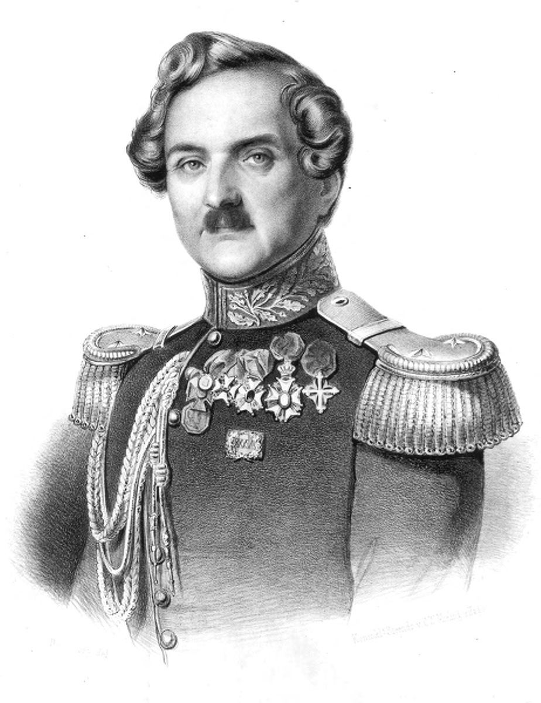
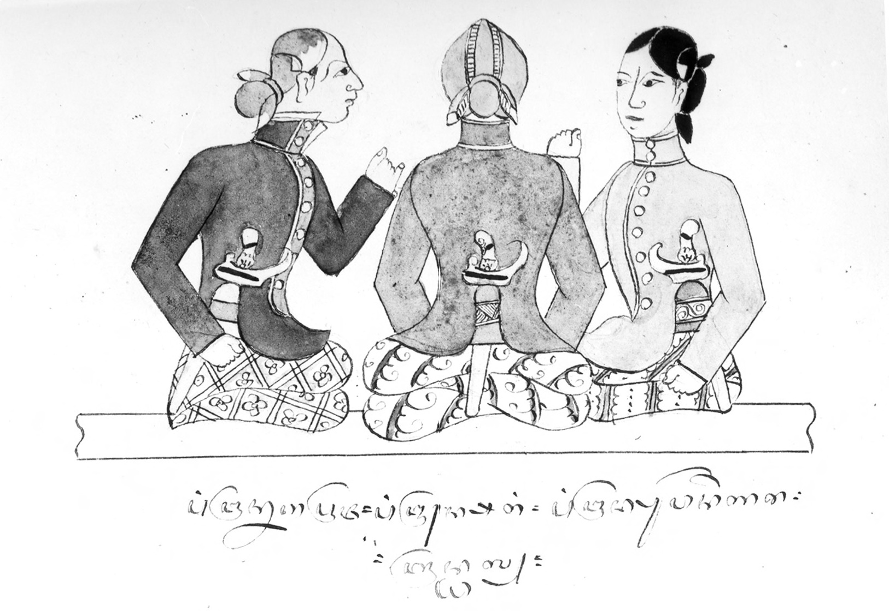
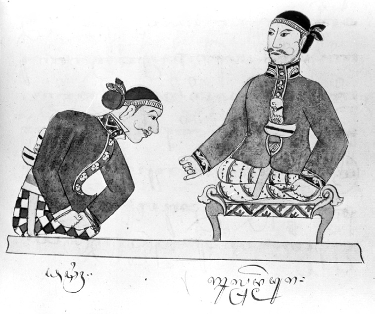

# Chapter XI: The Last Stand of the Old Order: Reflections on the Java War, 1825-1830

## Introduction

The past ten chapters have described the history of south-central Java from Dipanagara’s birth in 1785 through his upbringing at Tegalreja to the outbreak of the Java War. They have drawn on the detailed official testimony of the Residency archives as well as the rich and often idiosyncratic Javanese babad, in particular Dipanagara’s own autobiography. With the outbreak of the Java War, however, we enter new territory. Instead of the daily reports of Dutch Residents and their staff on the economic and political developments in south-central Java, the post-July 1825 record is dominated by the military dispatches between the Netherlands Indies army commander, Hendrik Merkus de Kock, and his senior officers in the field. These military archives, in particular the records of the Dutch East Indies general staff, have been the subject of much detailed study by Dutch historians. P.J.F. Louw and E.S. de Klerck, both serving officers of the Nederlands Oost-Indisch Leger (Netherlands East Indies Army), are the undisputed authorities here. Their magisterial six-volume history of the Java War (Louw and De Klerck 1894-1909) covers the conflict from the Dutch and the Javanese side, drawing extensively on Dipanagara’s babad in Dutch and Malay translation.[^1] In addition, there are a number of works which deal with aspects of the war by other former members of the Dutch colonial army (De Stuers 1833; Weitzel 1852-53; Lagordt Dillié 1863; Kielstra 1885, 1896a, 1896b; Schoemaker 1893; Hooyer 1895-97; Booms 1902, 1911; Aukes 1935), as well as amateur historians and littérateurs (Hageman 1856; Van der Kemp 1896a, 1896b; Somer 1938; Van Praag 1947), former Indies officials (Nahuys van Burgst 1835-36, 1852, 1858; Van Nes 1844), not to speak of more recent Indonesian studies (Yamin 1950; Sagimun 1965; Iskandar 1970; Djamhari 2003). So it would serve no purpose to go over the same ground here. Instead this chapter will adopt a thematic approach looking in turn at aspects of Dipanagara’s war effort. The first section will consider Dipanagara’s methods of mobilization, armaments and taxation. The second and third will deal with the role of women in the conflict, and Javanese cultural and linguistic issues as seen both in the prince’s treatment of Dutch prisoners and in his attitudes towards the Chinese. Two further sections will consider leadership and regional loyalties, and the support received by Dipanagara from the santri communities. The core of the chapter focuses on the breakdown in the prince’s relationship with two of his key supporters, namely Kyai Maja and Senthot, both of whom decided to make their own peace with the Dutch in November 1828 and October 1829 respectively. It will seek to probe the origins of the conflict between Dipanagara’s kraton and santri followers and assess the impact of the prince’s disastrous concession to Senthot over tax revenues. This, it will be argued, allowed Senthot’s commanders to exercise a form of wartime ‘dual function’ as a military and civilian administrative force leading to the alienation of the local population from the prince’s cause. Dipanagara’s own decision to enter into negotiations with the Dutch four months after Senthot’s defection in October 1829 must be looked at in the context of this loss of popular support. Given that there are no readily accessible accounts in English of the Java War, a brief synopsis of the main events will be included in the penultimate section dealing with Dutch military and political tactics.

The next chapter (XII) will consider the prince’s decision to meet with the Dutch army commander, De Kock, and gives a description of his capture at Magelang on 28 March 1830, his subsequent journey into exile (28 March-12 June 1830) and his period of incarceration first in Manado (13 June 1830-20 June 1833) and then in Makassar (11 July 1833-8 January 1855), ending with his death. Much of the material used here has previously appeared in print in the present author’s journal articles and his edition of the Surakarta version of the Babad Dipanagara (Carey 1981a).

## Mobilization for war: finance, peasant manpower and armaments

By the time Dipanagara and Mangkubumi set up the standard of revolt[^2] at Selarong on 21 July 1825, a number of preparations had already been made to mobilize the prince’s peasantry and retainers for war. We have seen in the previous chapter how a good three months before the Dutch attack on Tegalreja, the prince had begun to remit the Puwasa taxes on his estates and to gather funds to sustain his campaign (p. 594). He later reflected that his unexpected flight from Tegalreja on 20 July had caused him to abandon f 3,000 in cash and much unhusked rice as well as various other personal items, one of which was his official seal (Louw and De Klerck 1894-1909, V:743; Carey 1981a:266 note 122), which had been readied for use at the outbreak of war.

The early organization and financing of the war seem to have followed along wholly traditional lines (Carey 1981a:xl). In the opening stages of the conflict, the princes and senior priyayi, who rallied to the prince, contributed their own valuables such as jewellery, cash and other high value portables (ornaments, jewel-encrusted kris sheaths, gold belts). These were often carried into the war zone by their wives and daughters.[^3] Along with the capture of Dutch treasure convoys – such as the one ambushed at Pisangan in the Tèmpèl district to the north of Yogyakarta on 24 July 1825 when f 24,000 in cash intended for the Dutch garrison in Yogya fell into Dipanagara’s hands (Carey 1981a:255 note 83, 290 note 230) – these assets were used to finance the initial campaigns. Periodic distributions of cash to the prince’s supporters also seem to have occurred although some were unhappy at the amounts given out. Radèn Sukur, the son of the bupati of Semarang, Sura-adimanggala IV (pp. 364, 465-6), who joined Dipanagara early in the war, complained that he had only received two silver réyal (one réyal = f 2.40) from the prince up to the time when he, Sukur, had surrendered to the Dutch in August 1829 and that he had been forced to sell his official clothes and ornaments to maintain himself (Carey 1981a:255 note 83). We will return to this issue of finance later in the final section of this chapter in the context of the prince’s arguments with Senthot over his involvement in fiscal administration (pp. 649-51).

As regards armaments, the prince only began to gather weapons after he had arrived at Selarong (Louw and De Klerck 1894-1909, V:745; Carey 1981a:275 note 166). However, it seems that many of his followers had prepared for battle by arming themselves with traditional armaments such as slings and catapults, as well as staves and lances made of sharpened bamboo (Payen 1988:53; Carey 1981a:275 note 166). In late July and early August, bands of armed men from villages in the Yogya area appear to have made their way to Selarong to receive orders from Dipanagara leaving immediately after they had been informed of what was required of them (Louw and De Klerck 1894-1909, I:262. 400; Aukes 1935:79-81; Carey 1981a:285 note 208).

The style of warfare favoured by Dipanagara made full use of these local levies: thus villagers were ordered to fell trees to block roads as well as burn down the wooden bridges and dig up road surfaces or plant them with sharpened bamboo stakes (Payen 1988:53, 55, 102 note 79). Disruption of communications to prevent the Dutch bringing in reinforcements was critical just as it had been at the time of Radèn Rongga’s rebellion in November-December 1810 (pp. 248-9) and during the British attack on Yogyakarta in June 1812 (p. 321). Dipanagara also understood the importance of keeping his own lines of supply open; he appointed one of his uncle, Mangkudiningrat I’s, sons as his captain of ferryboats on the Praga River and ensured that the bandit communities at Kamijara and Mangir, which controlled the key river crossing points, were summoned to Selarong in late July 1825 to receive his instructions (Carey 1981a:243 note 36, 267 note 124). His tactics of disrupting enemy communications while maintaining his own supply lines continued throughout the war. Indeed, as late as August 1828, the Dutch even suspected that a British or American smuggling brig, which had been observed at anchor in the mouth of the Praga River, had supplied the prince with firearms (Carey 1981a:275-6 note 166; Djamhari 2003:xviii). By delaying the passage of Dutch mobile columns, Dipanagara’s forces were able to mount a number of effective ambushes (Louw and De Klerck 1894-1909, II:486, III:442; Bataviasche Courant, 1-1-1828). According to De Stuers, the favoured tactic for these surprise attacks involved the prince’s troops hiding in the long grass by the side of the roads, and then deploying in semi-circular fire attack formation like French franc-tireurs (snipers).[^4] Senthot, Dipanagara’s youthful cavalry commander, also developed techniques for camouflaging his horsemen behind bamboo fences and smearing the tongues of his mounts with salt to keep them still as they lay in wait for the enemy (Louw and De Klerck 1894-1909, II:381). In cases of successful ambushes, neighbouring villagers, who had seemed to engage in peaceful agricultural activities, would take up their farm implements and join in the fray, at times cutting off the retreat of Dutch columns which would run the risk of being overwhelmed unless they could retreat to the safety of a Dutch military stockade or bènthèng (De Stuers 1833:7). In Kedhu, as we have seen (p. 55), many of the villages had stone walls, built earlier to prevent pillaging by roving robber bands, and these rudimentary fortifications were used to great effect by Dipanagara in the early stages of the war along with other fortified places such as Sunan Amangkurat I’s former kraton of Plérèd to the southeast of Yogya.[^5] Even villages protected only by bamboo thickets could be turned into formidable defensive positions, especially when the prince’s supporters ringed them with skilfully concealed mantraps (borang) in which lethally sharpened bamboo skewers had been set.

Dipanagara’s regular troops had firearms and there are references in the Yogya archive to the prince ordering the purchase of rifles.[^6] It is also clear that captured Dutch weaponry, including cannon, were used by his forces (Djamhari 2003:80). As one Dutch mobile column commander reported following the capture of a fortified strongpoint defended by Dipanagara’s white-clad and shaven-head regulars at Mergalunyu near Gombong in western Bagelèn (Louw and De Klerck 1894-1909, III:115):

> never had they shown me such resistance. Their weapons were all good and of the usual European model.[^7] […] The sole artillery piece, which they had left behind in their fort, was a fine one pounder.

It is clear that European artillery techniques were also studied; one of the prince’s commanders, who had taken part in the siege of Yogyakarta in July-September 1825, noted that Dutch cannon invariably fired too high because the defending artillerymen used too much gunpowder.[^8] Although captured Dutch supplies were extensively used, Dipanagara also obtained propellants from local villages in the districts to the south and west of Yogya. These included Samèn in the Pandhak sub-district near Bantul to the south of the sultan’s capital (Carey 1981a:243 note 36, 275 note 166; pp. 49, 101-2), Into-Into on the Praga River (Javasche Courant 111, 16-9-1828; Lagordt Dillié 1863:32), and the villages of Geger (Samigaluh) and Deksa in Kulon Praga,[^9] an area where tin cannonballs were also cast for the prince’s artillery (Javasche Courant 129, 28-10-1828). Experiments were even made in the Menorèh district with the manufacture of bullets made out of tightly packed rush matting (Louw and De Klerck 1894-1909, III:243), the materials presumably being obtained from the neighbouring pradikan (tax-free) villages of Pesantrèn and Bendha in southern Kedhu which specialised in mat weaving (p. 469). The former in particular was mentioned in the Dutch reports as a staunch centre of support for the prince during the war (Bataviasche Courant 33, 17-5-1827).

According to the Dutch military historian, P.M. Lagordt-Dillié (1863:32), the gunpowder produced locally for Dipanagara, particularly that manufactured in Into-Into, was of very high quality, women often helping in its preparation. A former indigo factory at Tegalweru to the west of Yogya appears to have been used as a production centre (Louw and De Klerck 1894-1909, III:562-3), but the main armaments centre was Kutha Gedhé (p. 8). The presence in the town of a large community of artificers, and metalworkers – known locally as the kalang (Carey 1992:473 note 348) – provided the skilled labour force for the manufacture of shot, flints and gunpowder. Moreover, its status as a neutral city – militarily inviolate by virtue of its joint Surakarta and Yogyakarta administration and the presence of its ancient royal graveyard (burial site of Panembahan Sénapati) – made it a place where people could take shelter.[^10] The four bupati tasked with the town’s administration – two each from Surakarta and Yogyakarta – had the duty of ensuring that no supplies from the main market reached the sultan’s capital.[^11]

Certainly, there were good profits to be made from supplying Dipanagara’s forces. After the initial sinophobic attacks of the early months of the war had abated, the Chinese in Jana in eastern Bagelèn appear to have done a brisk trade selling gunpowder and opium to the prince’s troops (Louw and De Klerck 1894-1909, II:215-6). Enterprising Semarang-based suppliers even smuggled gunpowder in loads of dried salted fish at the time of Dipanagara’s campaign against Surakarta in October 1826 (Carey 1981a:276 note 166). Sulphur from the Ijen plateau near Banyuwangi on the Bali Straits appears to have been used in gunpowder manufacture in Java at this time (Raffles 1817, I:180), but rumours that Dipanagara sourced supplies from as far afield as Lombok and Sumbawa, where he had family connections (p. 76), would seem to be without foundation, as were reports that he had received armaments from American or British smugglers (Carey 1981a:275-6 note 166).

Porters, who earned their livelihood on the roads of south-central Java, were the main conduit for the transport of military provisions with gunpowder being moved and stored in heavy leather bags (Louw and De Klerck 1894-1909, III:557). Professional bandits, the scourge of the pre-Java War coun tryside, also served as auxiliaries (Carey 1981a:243-4 note 36). Meanwhile, traditional weapons were frequently used in action against Dutch troops and their Indonesian allies.[^12] In a report from eastern Bagelèn in July 1826, a Dutch mobile column commander related that:

> The ordinary village people here are at one with the rebels so much so that they immediately joined the enemy and assailed our men with sling shots with the result that some on our side were [badly] bruised.[^13]

According to De Stuers, the most ubiquitous weapon was the Javanese stabbing dagger (kris). Mounted at the end of a length of thick bamboo, this made a very serviceable pike or lance which could be used to dismount Dutch cavalry before they could reload their carbines (Louw and De Klerck 1894-1909, II:380; pp. 7, 332). De Stuers went on to describe how Javanese peasants could move easily from their agricultural duties to participating in local ambushes of Dutch and Indonesian troops. They did this by keeping their kris blades always at their side, usually secreted in the folds of their short trousers or loin cloths while they worked their fields. During a military action they would prepare themselves as pikemen by mounting this weapon on a bamboo stave. When the ambush was over, they would break the haft of their weapon, remove the kris blade and melt back into the countryside resuming their previous identities as peaceable peasant cultivators. The war thus took on the aspect of a classic agrarian insurgency, part peasant jacquerie (uprising) as in the Vendée in the west of France in 1793-1795, part organised military campaign (De Stuers 1833:4-10; Tilly 1964:331-9). At the same time, the tactics adopted by the Dutch to overcome this type of guerrilla warfare were also, in De Stuers’ view, inspired by the famous French Revolutionary general, Lazare Hoche (1768-1797), whose ruthless counter-insurgency operations in the west of France had broken the back of the Vendéan revolt in the mid-1790s.[^14] We will return to these Dutch counter-insurgency tactics in the penultimate section of this chapter.

> *Plate 66. François Victor Henri Antoine ridder de Stuers (1792-1881), major-adjutant and aide-de-camp and son-in-law of General H.M. de Kock, who accompanied Dipanagara on his journey from Magelang to Batavia (28 March-8 April 1830). Lithograph by Demoussy (circa 1833-1836). Photograph by courtesy of the Stichting Iconografisch Bureau, The Hague.*

## The role of women

In February 1831, when the Dutch authorities were deciding what to do with Kyai Maja’s part-Balinese wife, Radèn Ayu Maja (note 46), who had remained in east Java following her husband’s capture by the Dutch in mid-November 1828 and had subsequently moved to Yogya after his exile to North Sulawesi in February 1830, the Resident of Kedhu, F.G. Valck,[^15] suggested she be sent to join her husband. This advice was in no way inspired by compassion; rather it was based on the conviction that she was ‘enterprising and dangerous’. In Valck’s view, and that of his colleague, Lawick van Pabst,[^16] the Radèn Ayu was a ‘restless woman of enterprising character who could reawaken old discontents’ if allowed to remain in Yogya. The Resident of Kedhu then made an interesting observation:

> When one calls to mind the scenes of the recently ended war and takes a moment to dwell on the harm and mischief wrought by various wives of prominent Javanese chiefs, one can in particular list [certain] women who excelled themselves in committing acts of cruelty.[^17]

Radèn Ayu Maja, Valck hastily added, was not in the same category as these viragos. But she needed to be dealt with nevertheless.

Who then were these women whom Valck was referring to? He had two in mind: Radèn Ayu Sérang, also known as Nyai Ageng Sérang (circa 1769-1855), the mother of Pangéran Sérang II, whom we have already come across as a scion of the prestigious Kalijaga line of wali (apostles of Islam) in central Java (Plate 13; Mashoed Haka 1976), and Radèn Ayu Yudakusuma, a daughter of the first sultan (Mangkubumi), who was married to a Yogya eastern mancanagara bupati, who served initially as district administrator of Grobogan Wirasari (circa 1792-1812) and then (1812-1825) Muneng.[^18]

As regards the first, she appears to have been a female official of the Yogya court who had moved following her marriage to her much older husband, Pangéran Sérang I, to his family seat in the enclave of Sérang near Demak on the north coast. Following the outbreak of the Java War, she took up arms in support of her son, Pangéran Sérang II, and is mentioned in the Dutch military reports as having led a 500-strong force in the Sérang-Demak area in the first months of the war.[^19] She was also, as we have seen, renowned for her spiritual power (kasektèn) acquired through lengthy periods of meditation in isolated caves of Java’s south coast (Carey 1981a:284 note 205; Carey and Houben 1987:21, 35 note 15). In mid-1826, the captured Dutch official, Paulus Daniel Portier, referred to her son, Pangéran Sérang II, travelling down from the pasisir to consult with her while she was ‘performing tapa [asceticism] in a south coast grotto’.[^20] Her fame as a member of the celebrated Kalijaga wali family, not to speak of her life as a fighter and female ascetic, enabled her to continue to exercise a significant influence over the populations of her home region of Sérang-Demak long after formal hostilities had ended in March 1830. In August 1831, for example, she was interviewed in Ungaran[^21] and cautioned by the Assistant-Resident of Semarang about her ‘magical practices’, in particular her distribution of metal jimat (amulets) made out of thin strips of welded copper, tin and silver three inches long and one inch across which were covered in sacred texts (rajah). These had apparently been given to people in Demak who had known her late husband, Pangéran Sérang I.[^22] Surviving into her late eighties, she outlived both her son and her kinsman, Dipanagara, eventually passing away on 10 August 1855 much to the relief of the Dutch authorities in Yogya who had kept a close eye on her during her last two decades.[^23]

The second of Valck’s prominent Java War female fighters was Radèn Ayu Yudakusuma. Married to the Yogya bupati of Grobogan-Wirasari, one of the eastern mancanagara districts annexed by the British in July 1812 (p. 379), she is said to have refused to depart from her kabupatèn without express instruc tions from the third sultan and resolutely stood her ground against the British officer, Lieutenant George Richard Pemberton, dispatched by Raffles to take over the administration of the province. After the arrival of the royal messenger from Yogyakarta confirming the annexation, she reluctantly agreed to depart but had to take charge of all the removal arrangements for her household because of the indisposition of her husband. This she did according to the ‘Chronicle of the fall of Yogyakarta’ because ‘she was a lady of shrewd intelligence, outstanding ability and manly ingenuity’ (Carey 1992:122, 297, 456 note 272). These qualities were much in evidence during the Java War when from her base at Muneng her husband’s new kabupatèn to the east of the Madiun River, she masterminded the attack on the Chinese community in Ngawi on 17 September 1825.[^24] Although the descriptions of this attack as a full-scale ‘massacre’ seem to be overdrawn,[^25] she soon gained a reputation as a ruthless fighter. ‘A clever but much dreaded woman’ in Louw’s words (Louw and De Klerck 1894-1909, III:510), she became one of Dipanagara’s senior cavalry commanders in the eastern mancanagara and joined forces with Radèn Sasradilaga in Jipang-Rajegwesi during his 28 November 1827-9 March 1828 rebellion (Louw and De Klerck 1894-1909, III:510). At the time of her eventual surrender to the Dutch in October 1828, it was noted that, along with other members of her extensive family, she had shaved off all her hair as a sign of her dedication to the holy war against the kafir Dutch and their ‘apostate’ Javanese allies (Louw and De Klerck 1894-1909, III:514-5).

Although Valck does not give more details of the other wives of prominent Javanese chiefs who made a name for themselves during the war, we can surmise that they would have included erstwhile members of the elite prajurit èstri (Amazon) corps. As we have seen (p. 5), they provided close protection for the rulers and security for their private apartments at night. Given their proficiency with weapons, which had impressed no less a figure than Marshal Daendels when he witnessed their adroit manoeuvres on horseback at the time of his official visit to the Yogya court in July 1809 (p. 210), and sealed the fate of the one British officer to die during the Raffles’ attack on the kraton in June 1812,[^26] they were well placed to assume leadership positions as battlefield commanders during the war.

Nor was it only well-born Javanese women who took the initiative: in Ngawi and the adjacent customs’ post of Kudur Brubuh, a peranakan Chinese woman was apparently instrumental in setting up a local police force to ensure security following Radèn Ayu Yudakusuma’s 17 September attack.[^27] In Semarang, meanwhile, the wife of the pensioned bupati, Kyai Adipati Sura-adimanggala IV, a highly educated and intelligent lady of part Arab descent (Crawfurd 1820, I:48-9; De Haan 1935a:640-1), had apparently been the driving force in persuading her youngest son, Radèn Mas Sukur, to join Dipanagara by going over to Pangéran Sérang II’s forces in Demak in late August 1825.[^28] Her action may have contributed to the arrest of both her husband and her eldest son, Radèn Mas Salèh, during the first year of the war, an ordeal which certainly hastened her husband’s death in 1827. At the end of the war, the mother of one of Dipanagara’s key commanders in eastern Bagelèn, Ali Basah Jayasundarga, was reported to have refused to follow her son and daughter-in-law into surrender and had to be shot dead by Dutch forces when they stormed her hiding place in the Gunung Persada area.[^29] So the reports of women helping in the preparation of gunpowder in the villages to the west of Yogya (Lagordt Dillié 1863:32), bringing cash and valuables into the war zones (p. 607) and being found in full male battle dress (prajuritan) amongst the slain during the siege of Yogya in August 1825 (note 50) seem to be consistent with what we know of their pre-war role in Javanese society (Carey and Houben 1987:12-42). These were very definitely not the simpering radèn ayu of late nineteenth-century Dutch colonial literary fiction (Carey and Houben 1987:13), nor would their destiny as warriors be forgotten when Indonesia at last had the opportunity to fight for its independence in the mid-twentieth century (Carey and Houben 1987:21).

## Xenophobia and identity: changing attitudes towards the Chinese and issues of Javanese language and culture

Radèn Ayu Yudakusuma’s involvement in the attack on the Chinese community in Ngawi also underscored another salient feature of the early months of the Java War, namely the intense xenophobia which gripped many who rose in support of Dipanagara, a xenophobia which often went hand in hand with a form of Javanese cultural and linguistic chauvinism. This was most tellingly displayed in Dipanagara’s treatment of Dutch prisoners-of-war and in his attitude towards the Chinese, and it is to these subjects that we must now turn.

Given the invidious role which the inhabitants of the Middle Kingdom had been called upon to play by the returned Dutch administration in the years immediately preceding the outbreak of the Java War (pp. 467-80), it is understandable that they should have been singled out in the opening months of hostilities as objects of particular popular vengeance. In all, some 25,000 mainly mixed blood (peranakan) Chinese were thought to be at risk (Carey 1981a:260 note 106). Payen observed in his diary on 10 August 1825 that ‘everywhere the Chinese are massacred, they spare neither women or children’ (Payen 1988:62, 116 note 141). Besides the communities at Ngawi and other customs posts along the Sala River, the large Chinese weaving settlements in eastern Bagelèn such as Jana and Wedhi on the Lèrèng River were also targeted. For a time, the population in Jana managed to hold out by constructing their own fortified redoubt (bènthèng) where they could shelter from the initial attacks (Payen 1988:74, 131-2 note 215). They also attempted, as we have seen, to come to a modus vivendi with Dipanagara’s forces by supplying them gunpowder and opium. But eventually in 1827 the entire community of 147 men, 138 women and 185 children had to be evacuated to Wanasaba from whence most made their way to the greater safety of Semarang and Magelang (Louw and De Klerck 1894-1909, III:86, 108-9). Although the local Javanese population later begged for their return in June 1829 stating that they wanted them back as traders rather than as market tax collectors so that they could dispose of their products more cheaply (Louw and De Klerck 1894-1909, V:433), it does not seem that the community was ever re-established.

The fate of the Jana Chinese was replicated in many areas of south-central and east Java during the course of the war, but it would be wrong to draw the conclusion that Dipanagara’s prang sabil was an anti-Chinese battue. True, there were some like Kyai Maja who were diehard xenophobes said to be given to gratuitous acts of cruelty (De Stuers 1833:15; Carey 1979:73, 1981a:260 note 106), but as the war progressed the picture became more varied. Not only did Chinese merchants supply arms and money (Van den Broek 1873-77, 20:561), but some even fought alongside Dipanagara’s forces. This was the case in Tuban and Lasem on the north coast during Radèn Aria Sasradilaga’s abortive campaign from late November 1827 to early March 1828, where the local Chinese community, most of them converts to Islam and descended from mixed-blood Chinese families long resident on Java’s pasisir, collaborated closely with the Javanese and were threatened with dire reprisals by the local Dutch authorities after Sasradilaga’s defeat.[^30]

In inland areas, however, such instances of Sino-Javanese cooperation were rare. The bloody events of the first months of the war had traumatized the Chinese and a deep suspicion of Javanese intentions remained an abiding legacy of this period. These attitudes of fear and distrust were reciprocated by the Javanese. Dipanagara himself led the way by forbidding his commanders to have intimate relations with the Chinese. Here he was only reflecting what his great-grandfather, Sultan Mangkubumi, had said about not allowing Chinese to have too close a relationship with the ruling family in Yogya since it would occasion discord in the kraton (p. 399). These warnings were echoed by Pakualam I during a conversation with the Dutch Ambassador Extraordinary Wouter Hendrik van IJsseldijk in September 1816 when he had complained about Tan Jin Sing’s elevation to the position of a Yogya bupati.[^31] But Dipanagara went even further, instructing his commanders to desist from all forms of sexual relations with the Chinese and forbidding them to take peranakan mistresses and wives from the local population. He regarded such alliances as bringing inevitable misfortune (Carey 1984:2). Here he was putting forward a prescription which had definitely not been insisted on in pre-war kraton circles. Indeed, liaisons between Javanese rulers and attractive Chinese peranakan women had been so frequent that they barely rated a mention in the Javanese sources (Carey 1984:14-5). One striking example of this was the prince’s own grandfather, Hamengkubuwana II, whose favourite unofficial wife was of partly Chinese descent.[^32] She had given birth to none other than Dipanagara’s closest Java War commander Pangéran Ngabèhi, that ‘well built, intelligent and discerning nobleman’ who had inherited the pale yellow skin of his mother (Van den Broek 1873-77, 24:83). As we have seen, it may have even been the case that Dipanagara’s first official wife, Radèn Ayu Retnakusuma, hailed from the same part-Chinese lineage (Chapter III note 3).

So why the radical change in Dipanagara’s attitude? Much can be explained by the context of the Java War and its antecedents, in particular the role of the Chinese as tax collectors, but the prince also seems to have had a personal reason for warning against such sexual liaisons. In his babad, he relates that he himself had succumbed to the charms of a captured Chinese girl from the Pajang area who had been brought to him as a masseuse just before the disastrous battle of Gawok in mid-October 1826. The following is the brief and rather coy passage in which he makes his admission of sexual infidelity:

> XXXVIII. 13 in Kedarèn at night, the one who was ordered to provide a massage was a female prisoner, a Chinese woman [nyonyah]. His Highness the sultan behaved wrongly. Because of his feelings for his wife [Ratu Kedhaton] confused was the [sexual] solace.[^33]

Dipanagara implicitly suggests that his subsequent defeat in this key battle was in part due to this moment of weakness. He may also have reflected that the two wounds he received on the battlefield were an indication that his invulnerability and other spiritual powers had been temporarily neutralised by his sexual indulgence, something which he took care to hide from his wife on his return to his Kulon Praga headquarters (p. 121). He reverted to this theme later in his babad when he blamed his brother-in-law, Radèn Aria Sasradilaga’s, successive defeats in Rembang and Jipang-Rajegwesi in January 1828, the last of which effectively ended his rebellion, on his blatant breach of his instructions prohibiting sexual congress with Chinese females. According to Dipanagara, Sasradilaga had forced himself[^34] on one of the peranakan ladies from Lasem after that coastal town to the east of Rembang had fallen briefly under his control on 31 December 1827.[^35]

Underlying these cross-racial sexual insecurities, another important theme may be discerned – what Valck would later characterise as a ‘feeling of [Javanese] nationality’ (gevoel van nationaliteit; Preface note 9). This can be seen most clearly in Dipanagara’s treatment of Dutch prisoners whom he insisted should speak High Javanese (krama) rather than Malay, that ‘language of chickens which no ruler in Java wished to hear’ (p. 109), dress in Javanese not European dress, and consider conversion to Islam.[^36] This last was some thing which the prince also expected of Chinese who came over to his side, the process of ‘becoming a Muslim’ for them being quite simple: namely, having their pigtails cut off, undergoing circumcision and uttering the declaration of The Faith (sahadat) ‘There is no God but God and Muhammad is His Prophet’ (Louw and De Klerck 1894-1909, III:465; Carey 1981a:259 note 106). Perhaps this was really not so unusual. After all, in the early seventeenth century, Sultan Agung (reigned 1613-1647), whom Dipanagara took as a model in so many things, made efforts to have Dutch prisoners circumcised in preparation for their conversion to Islam (De Graaf 1958:102). But the insistence on Javanese sartorial and linguistic codes which went with this conversion process, was rather striking. It can perhaps be seen as a reaction to the powerful Europeanising influences which had been sweeping over the south-central Javanese courts following the Dutch restoration in 1816 (page 459, Plate 54). Paulus Daniel Portier, the inspector of the birds’ nest rocks at Rongkob, who was captured on the south coast in mid-1826 and wrote a remarkable report on his two months’ captivity (August-September 1826),[^37] gave some insights into the pressures which were placed on Dutch prisoners to adopt Javanese cultural and religious norms. Told that he must convert to Islam to save his life, Portier was assured that if he did so he would be appointed a troop commander with the appropriate pay and privileges. Since he was already circumcised, his ‘conversion’ was not so difficult. Indeed, we have already seen how that was handled at Dipanagara’s Kulon Praga headquarters (pp. 588-9). In the meantime, he promised to fight on the prince’s side. Given the new Muslim name of Nur Samidin, he was immediately invested by the pensioned bupati of Pacitan, Kyai Tumenggung Jagakarya (p. 589), with his ‘symbols of office’, namely a horse, a kris with a gold sheath and a Javanese striped (lurik) cotton jacket. Contemplating his changed appearance, Portier wrote that ‘he had [now] become just like a Javanese even down to my dress’. Brought across the Praga River to Dipanagara’s headquarters at Kemusuh by way of the village of Rejasa where the prince’s uncle, Pangéran Mangkubumi, was looking after the women and children of Dipanagara’s senior commanders, he was greeted by Mangkubumi’s exclamation: ‘Well, that European! One would scarcely give him that name. He looks just like a Javanese, in fact he bears a close resemblance to [the Yogya Residency interpreter] Dietrée!’

We would need many more accounts like Portier’s to build up a full picture of how Dutch prisoners were treated. Javanese sartorial codes, for example, were not always insisted upon: after his surrender in mid-October 1829, Senthot apparently forbade the soldiers of his barisan (troop) from wearing Javanese dress (Van den Broek 1873-77, 24:93), although the Dutch had hopes of persuading him otherwise.[^38] Furthermore, some Dutch prisoners were clearly not as fortunate as the inspector of birds’ nests from Rongkob. The government inspector of cultures in Pacitan, F.H. van Vlissingen, for example, who was a particular object of the pensioned bupati’s hatred, was summarily beheaded. There was even an attempt to drink his blood.[^39] Another European, a French landowner by the name of François Deux (Louw and De Klerck 1894-1909, I:609, 612-3; Chapter X note 84), who lived like a Javanese and went around with a peci, a small black hat often worn by Javanese males especially on Friday visits to the mosque – an indication that he had become a Muslim – was likewise detested by the bupati as a lackey of the decapitated inspector. Conversion to Islam on its own was thus no guarantee of acceptance. According to Portier, Jagakarya himself lost no opportunity to express his hatred for Europeans in general. As we have seen, he considered them completely lacking in religious feelings (p. 449) and he now no longer feared them because in his view the balance of force had shifted decisively in favour of the Javanese.[^40]

## Leadership and regional loyalties

The role of the pensioned bupati of Pacitan during Portier’s two-month captivity raises questions about the nature of leadership on the Javanese side during the war. Although the part played by local officials was crucial to the success or failure of Dipanagara’s cause in certain areas, in the early stages of the conflict the main leadership initiative was provided by the Yogya princes and senior officials who rallied to Dipanagara (Appendix VIII). Members of the rural Islamic communities were also important here. As regards the first group, many came to Selarong to receive their commands from Dipanagara in late July and early August 1825. According to Payen and Willem van Hogendorp, most set fire to their Yogya residences before going over to Dipanagara to prevent them falling into enemy hands (Payen 1988:56, 105 note 95; Van Hogendorp 1913:173-4). While he was still at Tegalreja, Dipanagara had apparently sent out letters of authority (piagem) mandating various princes and senior priyayi to act on his behalf as military commanders. These letters carried his princely seal and were intended as declarations of war. The buku adds the detail that Dipanagara announced his intention of waging a holy war and urged the local commanders, whom he had appointed, to gather the village people together and make known that they would be participating in a prang sabil. According to this source, Dipanagara proclaimed himself as the head (imam) of the Islamic religion in Java.[^41]

During his flight from Tegalreja, Dipanagara’s personal seal which bore his full princely title of ‘Bendara Pangéran Aria Dipanagara’ was, as we have seen, left behind and he had a new one made in pégon (Javanese written in unvocalised Arabic) script with the inscription ingkang jumeneng Kangjeng Sultan Ngabdul Khamid Èrucakra Kabirul Mukminin Sayidin Panatagama rasullahi s.a.w. ing Tanah Jawi (He who is raised as His Highness Sultan Ngabdulkamid Èrucakra, the First among the Believers, Lord of the Faith, Regulator of Religion, [Caliph] of The Prophet of God, may peace be on Him, in Java; pp. 580-1; Carey 1981a:266 note 122). This inscription would later appear in bold black Arabic calligraphy on his yellow silk standard. So much in demand were these letters of authority with Dipanagara’s seal that the prince’s followers from as far afield as the north coast and the eastern mancanagara, begged him for them. One of these, Pangéran Sérang II, who claimed kinship to the famous south-central Javanese apostle of Islam, Sunan Kalijaga (pp. 132-3), was invested by Dipanagara, while he was at Selarong, as a commander in the holy war in his home district of Sérang near Demak and given the title of ‘he who fixes firm the Islamic religion’.[^42] Both Dutch and Javanese sources also indicate that Dipanagara appointed a number of princely and senior priyayi commanders in the areas around Yogyakarta to coordinate the siege of the city in the first weeks of the war. At the same time some of these well-born commanders were used to take the banner of rebellion into adjacent districts like Pajang and Sokawati further to the east (Carey 1981a:53-5, 266-7 notes 123-5, 124, 284 note 206). The majority of the letters of authority (piagem) bearing Dipanagara’s seal were, however, distributed by members of the religious communities, in particular leading ulama, who helped spread news of Dipanagara’s revolt to the furthest reaches of the princely territories (Louw and De Klerck 1894-1909, V:629-30). The process of mobilization thus had a formal aspect which depended on the receipt of letters from Dipanagara written both before and after his flight from Tegalreja. This pattern would continue throughout the war with the prince investing his commanders with titles such as ali basah (‘The High Pasha’; p. 153) or dullah[^43] and new Muslim names, and using members of the religious communities to maintain contacts with his far-flung supporters and to encourage others to join the holy war against the Dutch.

The war also appears to have had strong regional aspects, based as it was in south-central Java with only limited campaigns in other areas such as Demak (1825), Madiun (1825-1826) and Rembang and Jipang-Rajegwesi (1827-1828). It is clear that regional rivalries undermined the prince’s war effort at crucial moments. This was the case when frictions arose between Kyai Maja’s Pajang troops and Mataram levies loyal to Dipanagara during the prince’s advance on Surakarta in early October 1826 (Louw and De Klerck 1894-1909, II:499, 520). There were also tensions inspired by such regional loyalties involving Dipanagara’s commanders. Senthot, for example, apparently objected strongly in early 1829 to the marriage of Radèn Tumenggung Mertanagara (Ali Basah Ngabdulkamil II),[^44] to Dipanagara’s daughter, Radèn Ayu Basah, the widow of Senthot’s half-brother, Radèn Tumenggung Natadirja (‘Gusti Basah’), who had died of battle wounds in early August 1828 (Appendix IV), because the bridegroom hailed from Rèma (Bagelèn) rather than Mataram.[^45] The situation was complicated later in the war when Dipanagara began recruiting Balinese soldiers from Klungkung and Buleleng through the contacts of Radèn Ayu Mangkubumi, the divorced part Balinese wife of his uncle, Mangkubumi, who later married Kyai Maja.[^46] A number of Bugis from South Sulawesi also fought for the prince. Hailing from the Bugis regiments which had served in the Yogya kraton before 1812 (pp. 5, 379), at least two of these soldiers of for their attack on Demak in late August 1825. KITLV Or 13 (Buku Kedhung Kebo).

> *Plate 67. Pangéran Natapraja, Pangéran Sérang II and Pangéran Purwanegara discussing Photograph by courtesy of the KITLV, Leiden.*

tune, Rangga Daèng Makincing and Ngabèhi Daèng Maréwa, rose to become military commanders of Dipanagara’s elite troops and are mentioned in the prince’s babad (Carey 1981a:253 note 72).

According to Dipanagara, the fighting quality of his troops varied considerably from district to district and he later observed to De Stuers that (Louw and De Klerck 1894-1909, V:743):

> the people of Madiun are good at resisting a first attack and they acquit themselves well, but afterwards they are not much use. The people of Pajang are also brave, but likewise for a short space of time. The people from Bagelèn are better, but they must fight in their own area; if they are outside they collapse quickly. But the people of Mataram are the best of all: they fight well, they persevere and they know how to withstand the hardships of war.

This echoed what Dipanagara’s eldest son, Pangéran Dipanagara II, was reported to have said after the Java War about the qualities of the men of Mataram; namely, that they could keep secrets, had a generous heart, and were strict about the observance of their religion (Chapter II note 8). Interestingly, similar observations about the regional variations in fighting capacity amongst the populations of south-central Java were made later during the Indonesian Revolution (1945-1949), when military commanders from Kedhu and Bagelèn were singled out for praise, along with those from Banyumas who were dubbed the ‘Prussians of Java’.[^47]

## The role of the santri communities

The second group which rallied to Dipanagara at Selarong were the ‘men of religion’ or santri. A rough survey of the available Dutch and Javanese sources has yielded a list of some two hundred men and women who afforded Dipanagara assistance at some stage during the war (Appendix VIIb). Amongst these were some Arabs and mixed blood Chinese (peranakan). The majority had affiliations with the rural based religious communities and with the south-central Javanese kraton, a sizeable number originating from the strict religious community (kauman) in Yogya. They included court santri who were members of the official religious hierarchy or the special corps of religious officials like the Suranatan and Suryagama serving in the kraton, as well as inhabitants of the Yogya-administered tax-free villages (pradikan) and religious schools in the Mataram area. Another large group was brought over by Kyai Maja when he joined the prince at Selarong in early August. These included members of his extensive family and students from his pesantrèn at Maja and Badhèran in the Delanggu area (pp. 91-2, Plate 10).

Of those whose titles can be readily identified, twenty-two were returned Mecca pilgrims (haji) and seventeen are listed as sèh (Syeikh) or sarif (Sherif), an epithet which was usually only given to Arabs of good birth or those who claimed kinship to the family of The Prophet. In Java, however, it was often used at this time to denote men of influence in religious affairs. The descendants of the families of the wali or apostles of Islam in Java were frequently referred to by this title. Leaving aside Kyai Taptajani, the former head of the centre for scholars of Islamic law at Melangi, and Mas Lurah Majasta, the head of the small Islamic religious boarding school at Majasta near Tembayat, only three of those on the list – namely, Sèh Abdul Ahmad bin Abdullah al-Ansari and his son-in-law, also known as Sèh Ahmad, both of whom hailed from Jeddah, and Sarif Samparwedi (Hasan Munadi), who commanded Dipanagara’s ‘priestly’ Barjumungah bodyguard regiment – can be clearly identified as Arabs. In addition, there were some eighteen religious and mosque officials (pengulu, ketib, modin) as well as keepers of holy sites and graveyards (amad-dalem, jimat/jurukunci). At least ten on the list were religious teachers (kyai guru), namely heads of pesantrèn from Bagelèn, Kedhu, Mataram, Pajang, Panaraga and Madiun. A further three, Nyai Maja, Kyai Maja’s official consort who died in childbirth in 1828, Nyai Gedhung Gubah, the wife of Maja’s former pupil Haji Imamraji, and Nyai Muhamad Hasan, Maja’s sister from Pulo Kadang, were respected female members of these same religious communities (Carey 1987:277).

The remaining 121 were referred to as kyai, a term used loosely in Java as an honorific epithet for old men or revered country gentlemen as well as for teachers of religious and spiritual disciplines. All those listed as kyai in the Dutch reports, which form the basis for the present survey, may not have been men of religion in the strict sense although most undoubtedly were. They included several kyai who were adept in the mystical ‘sciences’ (ngèlmu) and had special skills in the instruction of their followers in the esoteric arts of warfare, ranging from the inculcation of warlike virtues (ngèlmu kadigdayan) and the art of striking fear (ngèlmu kawedukan) to invulnerability to bullets and sharp weapons (ngèlmu kaslametan; Carey 1981a:253 note 75). Amongst the special charms and amulets (jimat) they specialised in were pieces of wood and strips of paper with intricately written sacred texts or rajah. These were carried into battle in the folds of turbans or sewn into the white tabards of Dipanagara’s elite troops (Louw and De Klerck 1894-1909, I:208; Aukes 1935:74; Carey 1981a:276 note 168). Widely considered to confer protection from danger, they were believed to have the power to turn Dutch gunpowder and lead into water (Payen 1988:72, 129 note 200). Likewise, the banners carried into battle by the prince’s troops were also seen to have magical powers. Blessed by the ulama, they were decorated with crescent moons, snakes and sentences from the Qur’ān (Javasche Courant, 20-10-1829; Booms 1911:34; p. 152). Every unit of 150 men had a separate battle banner in red, black, white or yellow colours.

Dipanagara’s own personal standard, as we have seen, was a large yellow silk square with his royal titles as Sultan Èrucakra inscribed in black Arabic lettering. When he took to the field, however, a green triangular pennant with a black disc in the centre appears to have indicated his presence amongst his troops. Senthot’s was red (Louw and De Klerck 1894-1909, I:208; p. 153, Plate 65). It is clear that the prince himself was considered to have magical powers as a living jimat. According to Smissaert, some in Yogya thought he could fly, make it rain or be dry (Carey 1981a:276 note 168), while other sources refer to his invulnerability to bullets and intuitive capacity to tell people’s character through the study of their faces (ngèlmu firasat; Carey 1981a:276 note 168; Chapter III). Not surprisingly, many desired to develop closer links with him. In September 1826, Kyai Banjarsari, the head of the well-known religious school in the Madiun area, wrote to him begging him for a ‘jimat of his blood’ in the person of his sister, Radèn Ayu Sasradiwirya, to reinforce his kinship ties with the prince’s family (Louw and De Klerck 1894-1909, II:568; Carey 1981a:276 note 168). Dipanagara’s status in the eyes of his santri supporters was greatly enhanced by the religious character of his struggle against the Dutch and their ‘heathen apostate’ Indonesian allies. As we have seen (pp. 583-91), this took on many of the aspects of a ‘holy war’ or prang sabil, something which the Dutch Minister of the Colonies C.Th. Elout (in office 1824-1829), pointed out in a March 1827 letter to the king, when he rejected the idea of buying Dipanagara out with a separate principality made up of lands taken from the Yogya sultanate. Underscoring how religious influences had played a crucial role in the fighting, he described how in nearly every engagement groups of religious scholars or ulama, clad in their distinctive white or green tabards and turbans, had helped to stiffen the resolve of Dipanagara’s troops through chanting endlessly repeated phrases from the Qur’ān.[^48] Elout’s description was confirmed by Lawick van Pabst, who mentioned that both men and women, who joined Dipanagara, had shaved their heads, wore ‘priestly’ dress and went into battle chanting dhikr.[^49] In fact, the cutting off of hair only seems to have become a mark of the holy war following Dipanagara’s victory at Kasuran on 28 July 1826 (Chapter IV note 10), and not all the prince’s supporters, as mentioned earlier in this chapter, were clad in tabards and turbans; during the siege of Yogyakarta in early August 1825, the body of one of the female fighters, who may have been a member of the court Amazon regiment (prajurit èstri), was found to be clothed entirely in male Javanese fighting dress (prajuritan).[^50] Dutch field commanders, however, were sufficiently concerned about the role of the ulama on Dipanagara’s side in the fighting that they took the precaution of attaching religious scholars to their own mobile columns, ordering them to lead the chanting of dhikr before their men, who included many Madurese and other Indonesian troops, went into battle (Louw and De Klerck 1894-1909, III:293). They also included prominent religious figures, often sayyid (descendants of The Prophet) or those who passed themselves off as such, in their various negotiations with Dipanagara before 1830 in the hopes that this would enhance their negotiating position (Louw and De Klerck 1894-1909, III:248-50, V:584-5; Carey 1987:278 note 19; p. 511 note 18, p. 676). After the war, they likewise took care to find places for many of Dipanagara’s leading religious supporters as pengulu and assistant pengulu in the newly created government regencies (kabupatèn) carved out of the territories annexed from the courts in 1830 (Carey 1987:278 note 20).

It was precisely the marked religious character of the war which caused Elout to reject suggestions made by some senior Dutch officials that hostilities should be brought to an end by recognising Dipanagara as an independent prince in the same way that Mangkubumi (Hamengkubuwana I), Radèn Mas Said (Mangkunagara I) and Natakusuma (Pakualam I), had been recognised in 1755, 1757 and 1812 respectively. In Elout’s view, Dipanagara’s claim to be recognised as a protector and regulator of religion, and his intimate associations with the religious communities made any such concessions impossible. The war in his opinion threatened the very foundations of Christian European authority in Java, the religious factor alone setting it apart from the dynastic struggles of previous centuries.[^51]

## Satria and santri: the breakdown in relations between Dipanagara and Kyai Maja

Why did the santri rally to Dipanagara in 1825? The question is worth asking because if one considers the course of Javanese history up to the Java War, relations between the court and the religious communities in south-central Java had been marked more by hostility than cooperation. One thinks here of the bloody events of Sunan Amangkurat I’s reigned (1646-1677) when thousands of ‘men of religion’ and their families had been put to the sword on the northern alun-alun (great square) of the kraton of Plérèd in circa 1650. The so-called Javanese ‘Succession Wars’ of the late seventeenth and early eighteenth centuries had also highlighted the inherent tensions between the kraton and the kauman (firm religious community). This saw religious scholars and revered ‘saints’ like Panembahan Rama of the Kajoran religious dynasty near Tembayat participating in major rebellions against royal authority such as that led by the young Madurese nobleman, Radèn Trunajaya, a man with strong religious convictions, in 1676-1680 (De Graaf 1940:273-328; Ricklefs 1993:30-57).

Why should the Java War have been different? The uniqueness of Dipanagara’s upbringing at Tegalreja (Chapter II) may have counted for something here. Certainly, his personal commitment to Islam and his extensive contacts with the santri communities in south-central Java (pp. 98-101) marked him out as a rather unusual product of kraton society. But this was not without its problems. Just where did his loyalties lie? Did he remain at heart a Yogya nobleman who happened to have experienced an unusual childhood and exposure to the teachings of Islam? If this was the case, was he no more than an ascetic version of Pangéran Buminata, the pious Surakarta grandee renowned as a patron of religious teachers in the Sunan’s capital (Chapter II)? Or had he abandoned entirely the respect due to him as a satria (warrior prince; member of the Yogya ruling family), in order to throw in his lot with the santri? For the author of the Surakarta version of the Babad Dipanagara[^52] the answer was not in doubt: Dipanagara was an ‘egg-saint’, a hypocrite santri, white outside but inside all yellow (Carey 1981a:19):

> II. 8 ‘It is a sham his giving himself over to religion,

> 9 and often going away to perform asceticism. He is hand in glove with the santri. He has given up the sense of honour of the satria, for he has accepted the sense of honour of the santri. […] 10 […] He mixes with the scum of the nation [and] is arrogant enough to invite battle. But these santri, what do they amount to?

Another contemporary Javanese source, the Buku Kedhung Kebo, put it slightly differently. The problem for the author of this text[^53] was not so much the genuineness of Dipanagara’s commitment to Islam, but rather the appropriateness of his decision to vest political power in the santri. Again the reply was unequivocal:

> XIV.35 The santri cannot govern the state for that is the character of the santri. They seek themselves. They cannot wield political authority for their minds are narrow. Very different is the charisma of a king.

Dipanagara himself seems to have been deeply conflicted. On the one hand, he was waging a holy war and for this he needed the support of the santri, not least to ensure that he interpreted his Qur’ānic mandate correctly (Chapter X note 184). On the other hand, he was a traditional Javanese, quintessentially so as Nicolaus Engelhard, the veteran former VOC official, had pointed out (p. 510). As a prominent member of the Yogya royal house, he naturally thought in terms of setting up a kraton with all the trappings of monarchy, albeit one with a distinctive Javanese Islamic hue. This was clear to Dutch captives like Portier,[^54] who was brought to Dipanagara’s temporary headquarters at Kemusuh[^55] in Kulon Praga district in mid-1826, and rode with the prince to the neighbouring village of Kepurun. In Portier’s eyes, the journey had all the aspects of a royal progress with Dipanagara attired in full state regalia,[^56] drummers going before him, his elite Bulkio bodyguard regiment with lances providing his personal guard of honour,[^57] and Kyai Maja in his signature ‘priestly garb’ (dark green tabard and white turban; Somer 1938, II:443), and the Yogya princes riding immediately behind. The Dutchman had the impression that as many as 10,000 armed men were on the move but this must have been an exaggeration. On their arrival at Kepurun, the prince held court on a bamboo throne in a traditional Javanese pendhapa (open-sided pavilion), giving out letters of authority (piagem), approving battle plans and questioning Kyai Maja about progress on the Salatiga-Boyolali front. Maja and the assembled princes, the latter all dressed in white ‘priestly’ clothes, sat on the floor before him as in a formal kraton audience, answering his questions. This was a traditional style of governance, a kraton in the wilderness much like Sultan Mangkubumi’s wartime residence at Yogya in 1749 or his temporary pavilion (pesanggrahan) at Gamping (1755-1756) where he lived prior to the occupation of his newly built Yogya kraton (Ricklefs 1974a:79-80). Dipanagara reinforced this image of a court by conferring titles on his close family (Chapter X note 219; Appendix IV), marrying key supporters to members of his family,[^58] distributing traditional largesse to his supporters at the time of the Garebeg ceremonies,[^59] having one of his santri advisers act the court jester (Chapter XII note 75), and giving yellow payung (state umbrellas) to his princely followers and military commanders as a mark of their status in the holy war.[^60] The fact that these quintessential kraton symbols of office were described in the Javanese sources as ‘signs of the holy war’ (pratandha prang sabil) is a measure of the confusion which seems to have prevailed about what Dipanagara was doing. Was he establishing a kraton or fighting for something entirely different – a new moral order in Java in which the high state of the Islamic religion would be restored? This is what the prince and those close to him said they were doing,[^61] but it was certainly not how Kyai Maja came to perceive Dipanagara’s wartime priorities. When the kyai surrendered to the Dutch on the slopes of Mount Merapi on 12 November 1828, it soon became apparent to the Dutch officers negotiating with him that relations between the prince’s kraton and santri supporters had irretrievably broken down. As Maja himself put it to his Dutch captors (Carey 1987:282):

> The first proposal which won me over to waging war was that Dipanagara promised me the restoration of our Faith. Believing this, I joined him wholeheartedly, but later I discovered this was not his real aim as he speedily began setting up and organising a kraton. I made representations to him which he took very much amiss so much so indeed that we exchanged bitter words. Since that time I was in disagreement with Dipanagara, which led to him ordering me to bring the war to an end in one way or another.

De Stuers would later corroborate this after discussions with Dipanagara following his capture in Magelang (Louw and De Klerck 1894-1909, V:742):

> That occasion comfirmed what [we] had often heard tell formerly by various Javanese – namely, that when Kyai Maja was lowered in rank and regard, matters had less cohesion amongst the rebels [brandhal] as that priest [Maja], who passed for being very learned in knowing the Qur’ān completely by heart, had succeeded by the exact rules laid down in it in establishing his influence and authority among the people to such an extent that even priests who had often been to Mecca had shown themselves in everything inferior to Maja.

When Dipanagara learnt before his departure for Batavia in early April 1830 that two of his closest religious associates – Mas Pengulu Kyai Pekih Ibrahim, who had served as his pengulu (in office 1828-1830), and Haji Badarudin, the erstwhile head of the Suranatan regiment in Yogya (Appendix VIIb) – both of whom he had known from his youth up and who had followed him throughout the war, had decided not to share his exile, he burst out bitterly (Louw and De Klerck 1894-1909, V:742):

> These are the men who should have been the first to adhere loyally to me […] for what do I know of the Holy Books except what they taught and told me? They are thus the people I have always relied on […] they are now the ones who desert me!

Such clear evidence of a complete rift between the two principal leaders of the Java War, a war which had earlier impressed men like C.Th. Elout with the strength of its religious zeal and the degree of cooperation between the prince’s kraton and santri supporters, raises important questions about the nature of Dipanagara’s leadership. How can we explain the unravelling of this once mutually supportive relationship?

One element relates to the regional rivalries already referred to. Dipanagara’s base was Mataram, whereas Kyai Maja’s loyalties lay in Pajang. After Maja had rallied to the prince at Selarong in August 1825, many of the ulama in his entourage joined the prince’s elite bodyguard regiments (Turkio, Arkio, Bulkio) and were appointed to important positions in the civil administration under Dipanagara’s control (Carey 1987:287). In late August 1826, following a string of victories by the prince’s forces, which had resulted in much of Pajang falling under his sway, Maja began to press for an attack on those places which had yet to be overrun (Louw and De Klerck 1894-1909, II:469-70). These included Kalitan and Boyolali, but his ultimate prize was Surakarta. The kyai saw this as his natural sphere of influence. As Dipanagara relates in his babad, he boasted that the previous generation of princes in Surakarta had studied under his father, Kyai Badhèran, and now their sons were all his pupils. At the same time, he belittled the prince’s own standing in Surakarta, stating that although the court was generally well disposed towards him in the early stages of the war, he received little support from the Sunan’s kraton as the conflict had developed.[^62] Dipanagara describes how he became increasingly irked by this arrogant attitude. As we will see shortly, the momentum of his military advances was held up by these disputes and precious weeks were lost so that when on 15 October 1826 the prince’s 5,000-strong army began to move into position for an attack on Surakarta, he suffered a major defeat at Gawok just to the west of the city. Bitter recriminations followed. His kraton and santri supporters blamed each other for the disaster. In particular, Kyai Maja and his family were accused of having recklessly pressed the attack on the Sunan’s capital to further their own interests (Louw and De Klerck 1894-1909, II:496-520; Carey 1987:287). What had been a festering rivalry, noted as early as May 1826, when the minister of the colonies’ Malay-speaking son, Major C.P.J. Elout, had relayed a report from the village head of Tèmpèl in the Slèman district that Dipanagara had not wished to remain with Kyai Maja following the end of the fasting month,[^63] was now an open conflict.

This appears to have widened in August 1827 at the time of the peace negotiations brokered by William Stavers and Kyai Maja (Louw and De Klerck 1894-1909, III:264-76), when a major dispute arose between Dipanagara and his chief religious adviser over the nature of political authority. According to the account given in the prince’s babad, Maja attempted to challenge the prince’s position as Sultan Èrucakra by asking him to consider dividing his sovereignty into four parts, that of ratu (king), wali (apostle of religion), pandhita (one learned in the law) and mukmin (the believers). Maja suggested that Dipanagara should choose for himself one of these four functions, implying that if he chose that of ratu, he, Maja, would take that of wali and enjoy undisputed religious authority. This Dipanagara refused stating that Maja – whom he addressed as ‘uncle’ (paman) thereby acknowledging his status as a senior kyai despite the fact that he was seven years his junior – clearly wished to exercise authority over him. He even drew a comparison between Maja and the prominent spiritual lords of Giri in the sixteenth and seventeenth centuries who, according to Dipanagara, had exercised power over the sultans of Demak.[^64] Later, when the prince tried to curb Maja’s ambitions by suggesting that he should take over as his pengulu or head of his religious establishment from his first appointee Haji Imamraji (in office 1825-1828; Appendix VIIb), he cited the example of the early sixteenth-century Sunan Kudus, a wali whom Dipanagara averred had acted more like the pengulu of the sultan of Demak, and who was thought by the prince to have been amenable to carrying out the temporal demands of the Demak rulers.[^65] This time Maja refused stating that he was not from a pengulu family anyway and thus could not possibly contemplate such a post. Instead, he wished to be recognised as imam or head of the whole Islamic religious community.[^66] This ambitious claim Dipanagara dismissed, pointing out that the argument over the delineation of functions in his royal administration was a specious one because God had chosen him and him alone as the caliph of The Prophet of God in the holy war between Muslim and heathen in Java, and that only the Almighty knew when that commission would be withdrawn.[^67]

A Javanese manuscript, which originates in the Kampung Jawa Tondano, Minahasa (North Sulawesi) village where Kyai Maja and some sixty-two of his close associates were exiled in early 1830,[^68] gives an insight into how Maja may have seen things. It states that Dipanagara still sought worldly goals[^69] and also continued to violate the syariah (Islamic religious law; Babcock 1981a:302). The prince’s attempt to establish a kraton was already evidence of such worldly ambitions. He was also, according to Maja, too taken up with Javanese superstitions and beliefs. One incidence of this was his fascination with pusaka (heirloom) daggers, some of which he had obtained through ascetic practices and encounters with the Javanese spirit realms, a relationship deemed inappropriate for a strict follower of Islam (Babcock 1981a:302 note 8; Appendix IV note 2). However, Maja himself was not above worldly involvements. A political man of the world in Babcock’s words, he had served as an emissary in Pakubuwana IV’s secret correspondence with various Indonesian rulers in 1811-1812, carrying messages to the Raja of Buleleng an act for which the British imprisoned him for a period in the Surakarta kepatihan (chief minister’s offices; Chapter VII note 87). He was also prepared to contradict the Surakarta pengulu. Indeed, contemporary documents from the Surakarta court speak of his self-opinionated and intractable character (Babcock 1981a:301; Carey 1981a:262 note 110). He clearly had great ambitions for his family in Pajang. It is thus hardly surprising that the long-drawn out argument between Dipanagara and his chief religious adviser, which drew on the historical example of the wali, proved impossible of resolution. The fact that Maja was almost certainly the more intelligent of the two, and had been the main driving force behind the war from the start, made things worse (Somer 1938, II:447-8).

Although Kyai Maja’s initial peace negotiations with the Dutch in August 1827 seem to have had Dipanagara’s full backing, the same cannot be said for his initiatives in late October and November 1828. After insisting that he be provided with a 500-strong force, which included 300 men of the elite Bulkio regiment under seasoned commanders such as Muhamad Ngusman Ali Basah (Appendix VIIb), he entered into negotiations with the Major Tumenggung Wiranagara and the Javanese-speaking Dutch infantry captain, Johan Jacob Roeps, at the centre for scholars of Muslim religious law at Melangi (p. 99). The Kampung Jawa Tondano manuscript suggests that Kyai Maja was keen to make a settlement with the Dutch for the benefit of the ‘servants of Allah’, for the well-being of Java and for the preservation of Islam.[^70] But it seems from the account given in Louw and De Klerck (1894-1909, IV:590-6) that he used the presence of this force to gain leverage in the negotiations by arraying them in battle formation just outside Melangi directly in front of Lieutenant-Colonel Joseph Le Bron de Vexela’s 3rd mobile column which had been dispatched to provide security for the Dutch and Javanese negotiators. Exactly what Maja had in mind is unclear. He may have been seeking to have his family returned to Pajang with special privileges from the European government. These may have included his recognition as a regulator of religion at the courts (Louw and De Klerck 1894-1909, IV:590-1) backed perhaps by a military force or barisan (troop) made up of former Bulkio, which he may have thought the government would accord him. Such barisan had been permitted to certain prominent noble supporters of Dipanagara who made their peace with the Dutch,[^71] but what Maja failed to realise was that the Dutch were far more lenient with members of the nobility who came over to their side than with prominent santri like himself whom they deemed principally responsible for stoking the fires of religious zealotry during the war (Somer 1938, II:447; Babcock 1981b:77 note 9). Between the first and the second round of the negotiations, which took place on 31 October and 5-9 November 1828 respectively, Maja appears to have demanded a further 500 troops from the prince’s reserve, a request which was refused. This sparked a bitter argument with Dipanagara’s senior military adviser, Pangéran Ngabèhi, into which the prince himself was drawn leading to a further fraying of their already tense relationship.[^72] Keeping entirely silent about his intentions, according to Dipanagara, Maja then departed again for Melangi with the intention of cutting a separate deal with the Dutch. But no deal was on the table. In fact, Le Bron’s column had been tasked with making sure that Maja and his force did not escape. Thus when the negotiations broke down on 10 November and it became clear that the kyai was attempting to make for Pajang,[^73] he was intercepted on the slopes of Mount Merapi near Bouwens van der Boyen’s former estate at Babadan. Given two minutes to make up his mind between unconditional surrender and immediate battle under unfavourable conditions (Le Bron had Maja’s force as good as encircled), Maja opted for the former. Even then the kyai’s pretence that he was joining the Dutch of his own free will was maintained. Entering Klathèn under Dutch escort on 14 November, his still fully armed force, according to Nahuys van Burgst’s eyewitness account, came into the town as though celebrating a victory, striking up ‘religious songs from the Qur’ān’ as they marched (Louw and De Klerck 1894-1909, IV:617). It was only with great difficulty and after a shouting match with Nahuys, that Maja was prevailed upon to allow his force to be partially disarmed.[^74] The Kampung Jawa Tondano manuscript, which gives a seemingly accurate account of these events, maintains the fiction that far from surrendering the venerable kyai was being ‘invited’ to confer with ever more highly placed Dutch officials as he proceeded via Salatiga and Semarang to Batavia. The reality was quite otherwise. Maja was detained for a year in the city gaol in the vain hope that he would use his good offices to win over a number of other Java War leaders. When that failed, he was banished from Java for life (Babcock 1981a:304).

After the war, when Dipanagara and Kyai Maja initially found themselves sharing the same Minahasan exile,[^75] the attitudes of the two men were a study in incompatibility. The prince showed continuing solicitude for Maja, complaining to Knoerle during his voyage to Manado that the kyai had not been allowed to bring his part Balinese wife into exile with him and dictating a request on his arrival in Manado that she be allowed to join her husband in Tondano along with the wives of three of the senior commanders who had been taken prisoner with him.[^76] He also sent Maja a present of f 50 and received at least two individuals from the kyai’s entourage, one of whom may have helped him as an amanuensis in writing his babad.[^77] Maja on the other hand refused to have anything to do with his former comrade in arms: he sent back the fifty florins stating that the monthly allowance he was receiving from the government was more than enough for himself and his followers. He also failed to respond to Dipanagara’s request for copies of quotations from the Qur’ān.[^78] At the same time, two haji from Maja’s entourage, whom the prince had specifically asked to join him in Manado, possibly under pressure from Maja, refused to leave the kyai’s settlement at Tonsea Lama in Tondano district.[^79] The Dutch authorities appear to have encouraged this breach, pointing out to Dipanagara after his original dispatch of his cash gift that close relations with Maja would not be permitted.[^80] The Java War protagonists would never meet again. Maja died in his fifty-ninth year in Tondano on 20 December 1849 (Babcock 1981a:307), while Dipanagara, who outlived him by six years, expired three months before his much younger army commander, Senthot (note 106). Thus the Java War leaders passed from the scene, divided in death just as they had been separated in life by the vicissitudes of war and the irreconcilable polarities of personal ambition and social identity. The temporary alliance of satria and santri may have imbued the five-year conflict with a unique social breadth not to speak of religious fervour, but it was a deeply unstable relationship which even a santri prince of Dipanagara’s stature could not bridge.

## Dutch military and political tactics

Before considering how Dipanagara’s position unravelled in the final fifteen months (December 1828-February 1830) of the war as further defections, notably that of Senthot, and battlefield losses, in particular that of Ngabèhi, undermined his capacity to fight, it is necessary to turn aside for a moment to consider what problems the Dutch faced. If the prince’s side was so riven with internal rivalries, in particular those between his kraton and religious supporters, how come it took the Dutch so long to gain the upper hand in the conflict? Why were nearly two years lost (1825-1827) before De Kock and his fellow commanders came up with a winning strategy, namely the combined use of temporary battlefield fortifications – the so-called bènthèng system – and a greatly increased number of mobile columns?[^81]

Part of the answer must be sought in the glaring inadequacies of the Dutch colonial army. Deficient in resources, its officers took time to come to an understanding of the nature of the war they were waging. During the first two years, 6,000 infantry were deployed with a further 1,200 artillery and cavalry (Djamhari 2003:79). There were no reserves. Although close on 2,400 men were sent out from the Netherlands during the course of 1826 to replace those killed and wounded (Louw and De Klerck 1894-1909, II:501 note 2, 1904, III:131), they could not be immediately deployed because of their lack of knowledge of the terrain and the challenges of the climate. At the same time, their classic European military training was also found to be a poor preparation for the Vendéan style counter-insurgency warfare which they were called upon to fight in south-central Java. Attrition rates amongst these newly arrived troops were also very high. Many succumbed to disease soon after their arrival in Indonesia. Of the 6,000 European infantry on active service in south-central Java between July 1825 and April 1827, 1,603 or 27 percent were dead by the end of this period (Djamhari 2003:81).

Commissioner-General Du Bus de Gisignies’ (in office 1826-1830) economy measures also had a deeply demoralising effect on Dutch troops in the field: equipment, pay and soldier’s welfare all suffered and it proved difficult to recruit new troops – in Indonesia at least – because conditions were so poor. Van Geen, who served as the main Dutch field commander during these first two years,[^82] decided that a doubling of the Dutch troop strength was required and by late 1826 he was requesting a further 6,000-strong expeditionary force be sent out from the Netherlands. But these did not start to arrive until May 1827 (Louw and De Klerck 1894-1909, II:573-4, III:131-3). By this time, the newly-introduced system of temporary battlefield fortifications had begun to transform the course of the war as we shall see in the next section (Djamhari 2003:87-8). The small number of European troops made it difficult for the Dutch commanders to take offensive action against Dipanagara’s fast moving forces in the pre-April 1827 period. Nor was the presence of large numbers of Indonesian auxiliaries much help. Apart from the Madurese, in particular those from Sumenep and Sampang (pp. 358-9), they were of doubtful military value. Their increasing addiction to opium and their insistence on bringing their wives and families on campaign greatly complicated the logistics of moving Dutch mobile columns through enemy-held territory. It turned what should have been a tight fighting force of around 500 troops,[^83] into a lumbering juggernaut which looked more like a baggage train than a military formation (Djamhari 2003:80-1).

The military tactics used to contain Dipanagara during the period 1825-1827 were also inappropriate. As we have seen, this was neither a European war of sieges and set-piece battles, nor a Napoleonic-style campaign of swiftly marching armies and decisive battlefield encounters. Rather it was a guerrilla conflict marked by ambushes, rapid movement and unconventional attacks designed for surprise (Louw and De Klerck 1894-1909, V:633-4). The Javanese proved excellent guerrilla fighters able to subsist on minimal rations such as dried rice, edible roots, and fruits gathered from forest areas (Louw and De Klerck 1894-1909, V:632). They learnt how to wear down the enemy without allowing them chances for pitched battles, and proved adept in using captured weaponry against them. The three expeditions sent against Dipanagara’s first headquarters at Selarong in the period 21 July-9 October 1825 not only failed to capture the prince and his top commanders, but also proved ineffective in easing pressure on Yogyakarta which remained under siege until 20 September when it was relieved by a heavily armed Dutch military column from Surakarta (Payen 1988:79-80). By the time the Dutch and Indonesian forces were destroying Dipanagara’s meditation cave at Guwa Secang on 10 October, the prince was already planning his move across the Praga River to his new base at Deksa (4 November 1825-4 August 1826) and dividing his army into three fast-moving battle groups, two of which were sent to the north and southeast of the sultan’s capital, and a third westwards into Kulon Praga and eastern Bagelèn (Djamhari 2003:67). Throughout the rainy season of November 1825 to April 1826, these forces continued to move with virtual impunity through the Mataram countryside and when the rains eased in April 1826, 800 of his troops began to ensconce themselves in the old kraton at Plérèd. On 9 June, Colonel Frans David Cochius (1787-1876), De Kock’s most senior engineer officer, had to bring a 4,200-strong force to bear to dislodge the defenders in a bloodbath which left all but 40 of the 400, who stayed to guard the crumbling ruin, dead (Louw and De Klerck 1894-1909, II:297-9).

Undeterred by this loss, the following month (July 1826), Dipanagara’s forces, commanded by Senthot, began winning a series of victories which took them from the east bank of the Praga River to the very outskirts of Surakarta. In quick succession, victories at Kasuran (28 July),[^84] Lèngkong (30 July), where the flower of the Yogyakarta nobility perished, Bantul (4 August), Kejiwan (9 August), and Delanggu (28 August), brought a large proportion of the south-central Javanese heartland under Dipanagara’s control. In desperation, the Dutch began stripping their outer island garrisons of troops and bringing up soldiers newly arrived from Europe.[^85] De Kock was determined to hold the Salatiga-Surakarta defence line. But by 11 October members of the Sunan’s bodyguard, who had just taken part in the Garebeg Mulud celebrations, had to be hurriedly thrown into the fight to clear the prince’s vanguard from the outlying western kampung of Surakarta (Louw and De Klerck 1894-1909, II:509). The Dutch position seemed hopeless. Only the arguments between Kyai Maja and Dipanagara over tactics on the Pajang front described in the previous section allowed them to concentrate sufficient troops to gain a victory over the prince at Gawok on 15 October 1826. Even then Dipanagara’s forces remained present in much of Pajang and Mataram for most of the following year.

By the end of 1827 a new front had opened in Rembang and Jipang-Rajegwesi when Dipanagara’s brother-in-law, Radèn Aria Sasradilaga, went into revolt. An erstwhile tumenggung (captain) of the sultan’s troops, Sasradilaga had considerable military experience and was able to count on the loyalty of a number of former kraton prajurit (court bodyguard troops), whom he had earlier commanded when he was serving as deputy head of the Yogya forces in alliance with the Dutch in 1825-1827 (Louw and De Klerck 1894-1909, III:370). He also had strong family connections and influence in Jipang-Rajegwesi where his father had been bupati and he himself had been born and brought up (Louw and De Klerck 1894-1909, III:370, 490). According to the pengulu of Rembang, who had married his sister, Sasradilaga had gone into revolt largely because of the actions of the Yogya patih, Danureja IV, who had thwarted his ambition to replace his recently slain Javanese commanding officer. Leaving the kraton secretly with his troops, Sasradilaga had made his way along the south coast to the eastern mancanagara eventually ending up in Jipang (Louw and De Klerck 1894-1909, III:490). For some anxious weeks between early December 1827 and mid-January 1828 the government’s overland communications between Semarang and Surabaya were cut. De Kock had to cancel plans to return to the Netherlands and hand over temporary command of the army to Van Geen (Louw and De Klerck 1894-1909, III:391-400), a serendipitous decision given the hatred aroused by Van Geen’s scorched earth tactics, his summary execution of prisoners, and his indiscriminate brutality towards the local populations in central Java, which included the burial of suspects up to their necks in earth to be eaten by ants and other insects (Knoerle ‘Journal’, 32; Chambert-Loir 2000:284; Djamhari 2003:68-9).

A good year before reports of the new revolt in Rembang began to arrive in late 1827, Dutch military and civilian officials had embarked on a series of intensive consultations aimed at finding a suitable policy to end the war (Louw and De Klerck 1894-1909, II:573-8). Both initially blamed the other for the military stalemate. Dutch field commanders accused the Residents of failing to prevent the local population from joining Dipanagara’s forces, while the senior civilian administrators berated De Kock and his generals for failing to grasp the wider socio-economic implications of their military failure. It was plain to see that the south-central Javanese economy was at a standstill, taxes could not be gathered, Javanese officials were still deserting in droves and the colonial state was sliding into bankruptcy (Van der Kemp 1901, II:271-2; Louw and De Klerck 1894-1909, II:573-7; De Prins 2002:137; Djamhari 2003:69). Even supposedly loyal rulers like Sunan Pakubuwana VI could not be counted on (p. 559). Two-faced at best, the mercurial Sunan protested his loyalty to the Dutch while preparing to throw in his lot with the prince should the Dutch military position become untenable (Carey 1981a:292-3 note 241; Djamhari 2003:69).

Meanwhile, high-level disputes between Du Bus and De Kock over tactics made the search for a peaceful resolution to the war even more difficult. The commissioner-general fancied himself as a military strategist even though his sole experience of war was as a minor Napoleonic functionary in his native Doornik (Tournai) and later as a deputy district administrator in West Flanders during the June 1815 Waterloo campaign.[^86] He had no time for the expense and patient planning involved in De Kock’s fortification system. Instead, he thought in terms of the shock tactics of the French Revolutionary levée en masse (mass mobilization of the population) and the quick breakthroughs which might come through direct negotiations with enemy leaders. He tried both in September 1827 at Salatiga, coming in person to central Java to participate in the talks initiated by William Stavers and Kyai Maja the previous month, and issuing a grandiloquent appeal for a general popular uprising against Dipanagara on 26 September (De Prins 2002:148-9). Both fell flat. In the words of Du Bus’ biographer, Bart de Prins ‘the princely states and Yogyakarta were not France or Paris, [and] to the great annoyance of De Kock and his generals, Du Bus completely failed to see it’ (De Prins 2002:149). One of the few initiatives taken by the commissioner-general at this juncture, which did address some of the underlying causes of the war, was his 17 May 1827 decision to end Van der Capellen’s 1823 prohibition of the land-rent in the princely states (p. 529). The short-term benefits of this were immediately apparent. They helped to resolve some of the problems faced by Javanese noble landowners in the years immediately preceding the Java War and persuaded many to throw in their lot with the government in the closing years of the conflict (De Prins 2002:147-8).

> *Plate 68. Patih (prime minister) and the Sultan of Madura (formerly Panembahan Cakraningrat V of Pamekasan) discussing the sending of Madurese troops to help the Dutch. KITLV Or 13 (Buku Kedhung Kebo). Photograph by courtesy of the KITLV, Leiden.*

Other political strategies for bringing the war to an end, canvassed in this 1826-1827 period, were rejected as impractical. One such was the Surakarta Resident Hendrik MacGillivray’s suggestion that Yogyakarta should be dismembered and divided between the government, the Susuhunan and the Mangkunagaran. De Kock thought this altogether too radical. Indeed, MacGillivray was himself deemed to be rather less than credible as an authority on Javanese court affairs. Within months of making his proposal, he would be suspended from his position as Resident for administrative malpractice (Louw and De Klerck 1894-1909, II:411-6; Appendix IX). Another was the idea of splitting Yogyakarta and offering Dipanagara an independent principality. As we have seen, this was dismissed out of hand by the Dutch Minister of the Colonies C.Th. Elout as inappropriate given the religious character of the war, although it was brought up again by Lawick van Pabst on 28 February 1830 when it became clear that Dipanagara was prepared to negotiate a peace deal.[^87] The only initiative which was taken up was the restoration of the exiled second sultan of Yogya. This occurred on 17 August 1826 in a hastily convened ceremony presided over by Du Bus in the governor-general’s palace in Bogor, the sultan returning to Yogya on 20 September and taking over the royal administration two days later (Louw and De Klerck 1894-1909, II:433-43). But this did not have the desired effect. The seventy-six year old second sultan was in his dotage and lacking in energy (Chapter VIII). Dominated by his rapacious, low-born and immensely fat last official consort, Ratu Sultan,[^88] an erstwhile commander of his Amazon corps, the sixteen months of his third and last period as ruler were deeply demoralising for the Yogya court. In Dipanagara’s words: ‘The restoration of [the] old sultan […] was an unrighteous act for his sons and grandsons could expect nothing good from this sultan’ (Knoerle 1835:151).

Although de Kock’s hopes that the old sultan’s return would restore the moral authority of the sultanate were misplaced (Louw and De Klerck 1894-1909, II:435; Carey and Houben 1987:32; Carey 1992:438 note 201; Djamhari 2003:77-8), he took the opportunity to make a close study of the military situation, coming up with a five-point strategy which combined both political and military elements. First, he decided to develop a closer relationship with the sultanate so that the remaining princes and senior officials did not go over to Dipanagara. Second, he resolved to deepen political and military ties with Surakarta so that both Sunan Pakubuwana VI and Mangkunegara II remained loyal. Third, he made a commitment to take back those areas of Mataram still under Dipanagara’s control and restore an effective system of administration and security so that the economy could be revived. Fourth, he determined to contain the prince’s forces within a narrow strip of mountainous land between the Praga and Bagawanta rivers in the districts of Kulon Praga, southern Kedhu and eastern Bagelèn so that they could be isolated and worn down. This would create what in today’s military parlance would be called a ‘killing area’ (Djamhari 2003:78-9). Finally, he resolved to capture Dipanagara and the other leaders of the rebellion, if necessary by putting a price on their heads.[^89]

The key to the success of De Kock’s plans was the system of temporary battlefield fortifications (bènthèng stelsel) pioneered by his chief engineer officer, Colonel Cochius, whose experience of setting up such fortification systems had long preceded the Java War.[^90] Early in the conflict (October 1825), Cochius had set up his first bènthèng at Kalijengking in southern Kedhu on the Magelang-Yogya road to provide protection for military convoys as well as overnight shelter for his troops. Other mobile column commanders followed suit. One such was the Gent-born Major Eduard Marie de Bast (1789-1827), who constructed his own fortification at Trayem in southern Kedhu on the road from Magelang to Beliga in late 1825 (Djamhari 2003:83). Cochius’ original design was very simple. After choosing a suitable strategic location, usually on a hill top or some other natural defence, he built a rectangular barrack-like structure sufficient to house at least a platoon (25-30) of soldiers. He then defended it by erecting a stout coconut palm-tree trunk stockade roughly 1.7 metres high with one or possibly two elevated gun-emplacements at the corners where cannon could be mounted on earthwork redoubts. Given the temporary nature of the construction, such fortifications could be easily abandoned and new bènthèng built in other locations where there was greater need for close support of troops in the field (Weitzel 1855-7, I:39; Louw and De Klerck 1894-1909, II:578-80; Djamhari 2003:84-5, 231-2, 305-8).

Introduced on a systematic basis from May 1827 as part of De Kock’s new integrated battlefield strategy, the bènthèng, along with the eleven mobile columns which were operational in south-central Java by the end of the war (note 81), were the key to Dutch military success against Dipanagara.[^91] Indeed, by March 1830 no less than 258 such temporary fortifications had been constructed throughout central and east Java, the largest number (90) being built in 1828.[^92] They covered a vast area stretching from the district capital of Banyumas in the west to Panaraga in the east. At least sixteen of the structures were large enough to house over 100 troops and could mount a number of cannon (Djamhari 2003:315). Cochius’ own contribution would later be set in stone through the construction of one of the largest of these fortresses – the post-war Fort Cochius at Gombong in the Kebumèn Residency of western Bagelèn (Houben 1994:111) – which would subsequently serve as one of the first postings of an obscure Javanese corporal of the Royal Netherlands Indies Army by the name of Soeharto (1921-2007) who would later become the second president of Indonesia (1966-1998). In this fashion the bènthèng stelsel was destined to have a continuing resonance in modern Indonesian history.

## Dipanagara’s fiscal regime; Senthot and the problems of dwifungsi

How then did this new strategy impact on Dipanagara and his commanders in the closing stages of the Java War? To answer this, it is necessary to take a closer look at the prince’s fiscal administration which was so critical to his war effort. After the initial phase of the war when ad hoc financing had been the norm, Dipanagara began to organize his own administration to raise taxes – such as land tribute and levies on local markets – in the areas under his control. As we have seen, certain places, such as Kutha Gedhé and the villages of Into-Into on the Praga River and Geger in Kulon Praga, were designated as centres for the manufacture of gunpowder and armaments and were appointed to channel taxes as well as vital supplies of food and war matériel to the prince’s forces (Carey 1981a:275 note 166, 288 note 221). Although most of the taxes in money and kind raised from the local populations were handed over to Dipanagara’s army commanders, a real attempt seems to have been made to keep military and administrative duties separate. Occasionally, bupati appointed by Dipanagara would take a direct part in the fighting, but mostly they were restricted to a purely administrative role. Indeed, the men chosen by the prince for high office in his war administration were usually drawn from the ranks of the senior court priyayi who had served the sultanate in a similar capacity before the war. One such family was the Danurejan who had supplied all the chief ministers (patih) in Yogya up to Sumadipura’s appointment in December 1813 (pp. 395-7; Chapter X note 220; Appendix Va).

As regards his appointments to senior commands within his army, however, Dipanagara adopted slightly different criteria. Here suitability was judged not on the basis of previous family position in Yogya, but by the yardstick of personal bravery and military flair on the battlefield. In Dipanagara’s view, courage was essentially a youthful quality so many of his senior commanders (basah) were very young, either in their late teens or early twenties.[^93] He later expressed astonishment at the age of the Dutch generals, men like De Kock, Van Geen and Holsman,[^94] all of whom were already well into late middle age by the time of the Java War.[^95] Although a number of the prince’s commanders were scions of Yogya noble families or closely related to him by marriage, there were a few, like Kyai Maja’s nephew and son-in-law Tumenggung Pajang (Appendix VIIb), who were of more humble birth.[^96] All, however, had been required to distinguish themselves by individual acts of bravery on the battlefield. Even ordinary soldiers aspiring to join Dipanagara’s elite regiments had to undergo tests of personal courage such as leaping across deep ravines (Carey 1981b:55 note 5). Those who distinguished themselves for military command were advanced first to the position of tumenggung – a military title at this time – and then to the senior rank of ali basah (High Pasha) which carried with it an independent command (p. 153).

The most important of these teenage army commanders was, of course, Ali Basah Abdul Mustapa Prawiradirja alias ‘Senthot’ (1808-1855), a nom-de-guerre derived from the Javanese mak senthot meaning ‘to fly’ or ‘to dash’.[^97] This illiterate young Yogya nobleman, a son of Radèn Rongga Prawiradirja III by an unofficial wife (Chapter II note 35), whom Dipanagara had tried in vain to educate as a santri,[^98] had joined the prince at Selarong in August 1825 when he was just seventeen. Described by De Stuers as ‘young, fiery and in every respect a brilliant Javanese […] who knew how to blaze a trail for himself by virtue of his energy and shrewdness’ (Soekanto 1951a:42; De Stuers 1833), he gained a name for himself for his courage and leadership qualities on the battlefield, even earning praise from those Dutch officers who felt the threat of his rapid advances and deadly ambuscades. By late 1828, when he was in his twentieth year, he had already emerged as Dipanagara’s leading strategist and military commander.[^99] By this time, despite some brilliant victories, which included the destruction of Major H.F. Buschkens’ 8th mobile column at Kroya in eastern Bagelèn at the beginning of October 1828 (Louw and De Klerck 1894-1909, IV:492-502), the tide of war was starting to turn against the prince. As we have seen, in mid-November 1828, Kyai Maja had allowed himself to be taken prisoner with 500 seasoned troops on the slopes of Mount Merapi, and the prince with his remaining forces were being gradually hemmed into an increasingly narrow strip of territory between the Praga and Bagawanta rivers. In this area, the Dutch strategy of establishing temporary battlefield fortifications (bènthèng) to protect the villages recently ‘pacified’ by their troops, described in the previous section, was already beginning to deny Dipanagara and his commanders vital supplies. In particular, difficulties were experienced in the collection of taxes for the upkeep of the prince’s elite regiments and Dipanagara’s patih, Radèn Adipati Abdullah Danureja (Appendix II), was blamed by some commanders for his ineffective administration.

It was against this deteriorating situation that Senthot wrote to Dipanagara in December 1828 requesting first that he should be placed in overall command of his forces in the field, and second that he be allowed to levy taxes for his men directly, thus bypassing the patih’s administration (Louw and De Klerck 1894-1909, IV:673). The latter request greatly concerned Dipanagara, who was acutely conscious of his role in the eyes of the local population as a Ratu Adil (Just King) who would ensure a light taxation regime and the provision of cheap food and clothes (Carey 1981a:xxxix-xl). He feared that if Senthot, who was renowned for his ostentatious and spendthrift lifestyle (Carey 1981b:56 note 8), was allowed to combine both administrative and military responsibilities, the common people would be oppressed and their support for his holy war would evaporate. He thus convened an urgent meeting of his principal advisers to discuss the matter, in particular asking his uncle, Pangéran Ngabèhi, about his central concern:

> XXXV.47 ‘If he who holds the sword is also given the holding of money, how [then]? Might that not lead to neglect?[^100]

In these three short lines in his babad Dipanagara seemed uncannily to prefigure late twentieth century debates in Indonesia about the appropriateness of the dual function (dwifungsi) of the army as a military and socio-political force (Crouch 1978:25; Carey 1981b:51), debates which have yet to be fully resolved. But this is to get far ahead of our tale and our time.

Ngabèhi and the prince’s other advisers sought to reassure the prince, stressing that such a move would give greater unity to his war effort and would prevent delays in getting supplies through to his troops as had occurred earlier under Danureja. Dipanagara reluctantly agreed. He now ordered that the f 3,000 a month from the market taxes in Kulon Praga and eastern Bagelèn be divided between Senthot and himself, with two-thirds going to his army commander and the rest being retained for his own use (Louw and De Klerck 1894-1909, IV:674). He soon regretted his decision. In his babad, he related that shortly thereafter the Dutch started building a large new bènthèng at Nanggulon[^101] in central Kulon Praga on the road between Sentolo and the Bagelèn border, but Senthot did not react quickly enough because he was totally preoccupied with receiving official reports and money, and with the administration of the army.[^102] When the youthful ali basah did eventually order a full-scale attack, he found the Dutch too firmly entrenched and his troops were beaten off with considerable loss of life (8 January 1829; Louw and De Klerck 1894-1909, IV:678-82). Even after this reverse, Dipanagara lamented that Senthot was still spending too much time in long-running disputes with the ineffectual patih.[^103] Meanwhile, the young army commander’s own tax collectors had begun to act harshly towards the local population. In June 1829, the month in which the Dutch captured part of Dipanagara’s administrative archive in an engagement on the south coast of Kulon Praga (Louw and De Klerck 1894-1909, V:207), Ngabèhi wrote to Senthot informing him that one of his tax officials had been punished with a public beating for levying more taxes than was permitted (Carey 1981a:xl). At the same time, a report by one of Senthot’s subordinate officers, Radèn Tumenggung Pancaatmaja, in July 1829 lamented that food supplies were getting scarcer and more expensive. Local officials, who had once supported the prince’s cause, he wrote, were now turning against him by choosing to return to areas under the control of the Dutch bènthèng where they could be assured of a better livelihood and protection against sudden attack. Ready money for the upkeep of Dipanagara’s forces was also scarce because, in the view of this officer, the number of markets under Dipanagara’s control had steadily dwindled. Dipanagara would fight on, according to Pancaatmaja, but the morale of his uncle, Mangkubumi, and the other Yogya pangéran, who were with the families of the prince and his top commanders at Rejasa, was very low because there was nothing for them to eat.[^104] There were even isolated cases in the last year of the war (1829-1830) of local people turning against unpopular officials allied with Dipanagara and finishing them off so great was their craving for peace (Louw and De Klerck 1894-1909, V:516, 519-20). The policy of the Dutch bènthèng commanders may also have had an influence here. They apparently tried to win the local population over to their side by promising them free ploughs, draught animals and seeds if they moved to areas under their control. They also lowered tax rates, diminished corvée demands and paid higher rates for day labourers in the immediate vicinity of their fortified outposts to encourage the settlement of peasant cultivators and their families (Carey 1981a:lxviii note 185; Houben 1994:20; Chapter I note 124). The inevitable result of these developments was that by the end of September 1829, the fourth year of the war, organized resistance to the Dutch in the fertile rice plains of south-central Java was at an end (Djamhari 2003:217). The crucial bonds of trust and cooperation between Dipanagara’s forces and the local population had been sundered and without them there could be no successful prosecution of the guerrilla campaign.

By this time Senthot had already surrendered to the Dutch (16 October 1829). He had fought bravely throughout and had suffered many battle wounds,[^105] but there are strong indications that he had hedged his bets to ensure that things would turn out as well as possible for him. As early as July 1829, when his junior officer was reporting problems with food supplies, he had already entered into tentative negotiations for his surrender and when he did eventually come over it was on distinctly favourable terms. The Dutch permitted him to keep his own government-financed 500-strong troop or barisan, which subsequently saw service in west Sumatra against the Padri (1832-1833) and he was paid a retainer of f 5,000.[^106] The same period, meanwhile, witnessed the nadir of Dipanagara’s personal fortunes. On 21 September 1829, one of his last remaining senior commanders, Pangéran Ngabèhi, and his two sons, were killed in a bloody encounter in the Kelir Mountains on the Bagelèn-Mataram border. Shortly thereafter on 11 November 1829, following his near capture by Major A.V. Michiels’ 11th mobile column in the Gowong mountain region to the west of Kedhu when he had to leap into a ravine and hide under tall pampas grass (glagah) to escape. Abandoning his horses, heirloom pike[^107] and wardrobe[^108] (Van den Broek 1873-77, 24:91; Louw and De Klerck 1894-1909, V:490-6), Dipanagara decided to wander off into the jungles of western Bagelèn. Only his two panakawan (intimate retainers), Banthèngwarèng and Rata, accompanied him for the entire journey (Louw and De Klerck 1894-1909, V:423; Carey 1974a:25). These wanderings, which would take Dipanagara initially to the remote Rèma area between Bagelèn and Banyumas, would continue until mid-February 1830 when his first direct negotiations with Colonel Jan Baptist Cleerens (1785-1850) began. These eventually resulted in the abortive ‘peace conference’ at Magelang (8-28 March 1830), his arrest (28 March), 25-year exile in Sulawesi (12 June 1830-8 January 1855) and death (8 January 1855; pp. 752-3). As he dragged his weary and malaria-ridden body along the rhinoceros’ paths to the peasant huts in which he hid for over three months (mid-November 1829-late February 1830; Louw and De Klerck 1894-1909, V:525-6; Carey 1981b:56 note 10; Chapter III), Dipanagara may have reflected that although his defeat was probably inevitable – both the Parangkusuma prophecy (Chapter IV) and a further divine prompting (wangsiting Hyang Agung), which he told his uncle, Pangéran Mangkubumi, he had received in late September 1829 (Chapter XII), had warned as much – it had undoubtedly been hastened by his disastrous concession to Senthot just over a year earlier. In terms of social unity and cooperation between the local population and Dipanagara’s troops, the short-lived experiment with ‘dual function’ had been a disaster. Admittedly, Senthot’s own youthful and headstrong character was partly to blame. Had a more experienced commander like Ngabèhi been in charge, things might have worked out differently. But the very fact that up to December 1828, Dipanagara had taken great care to see that administrative and military duties were kept separate shows that he was acutely aware of the dangers which might ensue if they were exercised together. It was only under extreme pressure that he went against this conviction and then he quickly regretted his decision. He remained to the end a supreme pragmatist in matters of statecraft, drawing on his own experience as a skilful administrator and financial manager of his estate at Tegalreja and far-flung apanage lands (p. 78). This experience had taught him if nothing else that the loyalty and support of the common people would only be forthcoming if they were treated with consideration (Carey 1981a:xl, 240 note 27).

## Conclusion

The Java War constituted a huge upheaval in Javanese society, which, as we have seen (Preface), affected two million Javanese, one third of the total population of the island. An estimated 200,000 Javanese civilians died and one fourth of the cultivated area of Java sustained damage. In securing their pyrrhic victory, the Dutch lost 8,000 of their own troops as well as 7,000 Indonesian auxiliaries. The 20 million guilder cost to their exchequer would only be recouped through Van den Bosch’s Cultivation System, which brought an estimated 832 million guilders to the Dutch home exchequer between 1831 and 1877 (Ricklefs 1993:123).

The last stand of Java’s ‘old order’, the Java War witnessed the dismemberment of the south-central Javanese courts in 1830 as the remaining mancanagara territories were finally annexed by the colonial government (Houben 1994:17-72). As such it could be seen as part of a long line of military disasters, beginning in the late seventeenth century with the Trunajaya Rebellion (1676-1679), which had destroyed the power of the once mighty empire of Mataram. By the end of the conflict, the Dutch remained in undisputed control of the island. Their rule would last for the next 112 years.

In retrospect, it seems strange that the Dutch took as long as they did to get a grip on the military challenge posed by Dipanagara’s rebellion. Given the inherent tensions between the prince’s santri and kraton supporters, the intense regional rivalries and conflicts over war aims, all of which would ultimately pull Dipanagara’s war effort apart, it is surprising that two years had to pass before the Dutch hit on a winning strategy – namely, the combined application of Cochius’ bènthèng system and the near doubling of their mobile columns. It is a truism that generals are always fighting the last war. In the Dutch case, the memory of the Javanese dynastic conflicts of the late seventeenth and eighteenth century, seem to have coloured their judgement. They spent too much time thinking that Dipanagara might be bought off with a quasi independent principality and his problems explained by thwarted political ambition. But he was not a Radèn Mas Said (Mangkunagara I) or even a Sultan Mangkubumi. It did not help that their colonial army was so ill adapted to the challenges of fighting a guerrilla war, nor that the relationship between the Dutch civilian and military authorities – epitomised by the conflicts between Du Bus and De Kock – was so poor. The parlous state of the colonial finances during these years also limited their room for manoeuvre, as did the political problems experienced by the Kingdom of the United Netherlands during the build up to the Belgian revolt of 1830.

Perhaps the greatest deficiency lay in the Dutch analysis of the Islamic aspects of the war. Here they were fighting blind. There was no Christiaan Snouck Hurgronje (1857-1936)[^109] to advise them. If there had been, De Kock and other senior military commanders might have been encouraged to exploit the tensions between Dipanagara’s santri and kraton supporters much earlier and to greater effect. Certainly, some of the more egregious errors associated with Van Geen’s scorched earth strategy in south-central Java in 1825-1827 and the alienation of the local civilian populations might have been avoided. A policy of attraction based on the honouring of Islamic institutions and practices, in particular a restoration of the competence of the Islamic courts (surambi) (pp. 386-7), might have gone a long way to satisfying the religious grievances of Dipanagara’s santri supporters.

One area which was probably non-negotiable was that of Javanese identity. While Valck’s analysis regarding Javanese ‘nationalism’ may have been overdrawn, it is indisputably the case that a key aspect of Dipanagara’s struggle was a desire to defend Javanese culture. After all, he had lived through a period when Javanese society had been turned upside down by the ruthless colonial policies of Daendels and Raffles. His own experiences of the British attack on the Yogya kraton, his treatment at the hands of the representatives of the post-1816 returned Dutch administration and the seemingly unstoppable spread of European influences in everything from clothing to language, had convinced him that alongside the raising up of the high state of the Islamic religion, the restoration of specifically Javanese values was a key priority. Hence the treatment meted out to non-Javanese during the war, especially the Dutch and the Chinese. In many ways, the Java War was the last attempt by the Javanese ancien régime to turn back the tide of Dutch colonialism. As such it was a magnificent failure. But it had the capacity to inspire future generations as we will see in the next chapter. Transported on the first stage of his journey into exile on that most quintessential of products of the new industrial age – the first steamship in Netherlands Indies service – Dipanagara would have ample opportunity to reflect on the bitterness of defeat and the fate of those born to live in changed times.

## Notes

[^1]: Louw and De Klerck 1894-1909, II:345 note 1; Carey 1981a:xxv-xxvi, lxi note 85. For a good description of the rather chaotic and much delayed process of preparing the Dutch and Malay translations of the BD (Manado) in the 1864-1874 decade under the aegis of the Batavian Society (Bataviaasch Genootschap van Kunsten en Wetenschappen), see Van Praag 1947:20-3. Of the two authors, Louw (1856-1924) was much more sympathetic to Dipanagara and his babad than his younger colleague De Klerck (1869-?), who wrote the last three volumes covering the period 1828-1830.

[^2]: Dipanagara’s personal standard is described in Louw and De Klerck 1894-1909, I:208. See also plate 65.

[^3]: Carey 1981a:52; Dj.Br. 7, A.H. Smissaert (Yogyakarta) to H.M. de Kock (Surakarta), 9-8-1825. For an interesting comparison with General Sudirman’s use of similar methods of war finance following the Second Dutch Police Action in December 1948, see Simatupang 1972:52, 152: ‘Panglima Besar Sudirman ordered two men to enter the city [of Yogyakarta] and ask Bu Dirman for jewelry to finance him during the guerrilla war’.

[^4]: De Stuers 1833:6-7. See further Louw and De Klerck 1894-1909, III:98, on Dipanagara’s troops hiding in long alang-alang grass in southern Kedhu during an operation against Major (later Major-General) A.V. Michiels’ forces in May 1827. Besides De Stuers’ book, various other studies deal with the military tactics used by Dipanagara’s forces during the war, amongst the most important being Lagordt Dillié 1863; Iskandar 1970 and Djamhari 2003. On the destruction of the stone walls besides the main roads between Yogya, Magelang and Surakarta to prevent ambushes by Dipanagara’s troops early in the war, see Chapter I note 139.

[^5]: De Stuers 1833:2; p. 571. On the construction by Dipanagara’s troops of earthenwork ramparts and bamboo stockades as defensive positions in Banyumas, see Louw and De Klerck 1894-1909, III:126.

[^6]: Dj.Br. 6, ‘Vergadering bij den raad uitmakende het bestuur over den rijk van Djokjo in naam van den minderjarige sultan’, entry for 2-2-1826. See further Djamhari 2003:80.

[^7]: On the Prussian infantry flintlock musket with ball shot, which was in general issue in the Netherlands Indies Army during the Java War, see Louw and De Klerck 1894-1909, I:226-8. It generally failed on every fifteenth round. In 1828, 200 new percussion rifles, which were being introduced into the French army for the 1830 Algiers expedition, were brought to Batavia for fire testing purposes. Although they were found to be much more reliable, failing only on every 290th shot, they arrived too late for general use in the Java War.

[^8]: Portier, ‘Verklaring’, n.y. (? 9-1826), quoting Pangéran Natapraja (Radèn Mas Papak).

[^9]: On the involvement in villagers in the manufacture of gunpowder in Kulon Praga, see AN, Exhibitum, 6-12-1831 no. 1 (papers relating to the exile of Mangkudiningrat II), La F, J. Jansen, Report of Spies (Note of F.G. Valck), 22-10-1831.

[^10]: BD (Manado), III:276-7, XXIX (Dhandhanggula) 42. Kitha Ageng punika yèn kanging/ kados sanget Kangjeng Sultan susah/ sabab punika bandhané/ sagung aprang puniku/ lawan dados pangungsènèki/ sagung tiyang sadaya/ lan kinarya iku/ pakèndelan Sénapatiya/ lamun gilir ing ngriku panggènanèki/ tata pélor sandawa*. * Rusche 1908-09, I:284 has tata mimis lan obat. See further Carey 1981a:275 note 266. On Kutha Gedhé during the Java War, see further Van Mook 1972:23-4.

[^11]: Portier, ‘Verklaring’, n.y. (? 9-1826).

[^12]: dK 197, A.H. Smissaert (Yogyakarta) to H.M. de Kock (Surakarta), 30-7-1825 (on the use of slingers); Louw and De Klerck 1894-1909, I:401 (on villagers from Mangir, a village close to the confluence of the Kali Bedhog and Kali Praga, killing members of the Mangkunagaran legion with cudgels). On the weapons used by Dipanagara’s troops, see further Louw and De Klerck 1894-1909, V:630-1.

[^13]: Louw and De Klerck 1894-1909, II:364, report of Lieutenant-colonel Johan Diell (1776-1827), Waja (Bagelèn), 22-7-1826.

[^14]: ���������¹¹��������������������������������������������������������������������������������������� Dj.Br. 19¹¹, De Stuers, ‘Inleiding tot de geschiedenis van den Java-oorlog’, n.y., 5. ������������ For a reference to the sadistic methods supposedly employed by Dutch commanders to punish Dipanagara’s civilian supporters, see Knoerle, ‘Journal’, 32, ‘Dipanagara told me about a ‘cannibalistic’ habit of which an officer [? Lieutenant-colonel Joseph Le Bron de Vexela, commander of the 3rd Mobile Column based at Pisangan, Louw and De Klerck 1894-1909, V:644] of which an officer of our army at Pisangan [to the northwest of Yogyakarta on the main Yogya-Magelang road] was guilty. This officer had buried an aged Javanese woman, who had gone to Pisangan to buy padi [unhusked rice], up to her breast in a pit and had given her as a prey to ants and other creeping creatures. Dipanagara told me about this inhuman act with gestures which portrayed his horror.’

[^15]: Valck served as Resident of Kedhu from 1826 to 1830 and was in post when Dipanagara was taken prisoner in Magelang on 28-3-1830, Carey 1982:25.

[^16]: Van Pabst was serving at this time (1830-1834) as commissioner for the annexed districts of the Principalities, see Houben 1994:54.

[^17]: Dj.Br. 17, F.G. Valck (Yogyakarta) to J.I. van Sevenhoven (Yogyakarta), 12-2-1831, in J.I. van Sevenhoven (Yogyakarta) to Johannes van den Bosch (Batavia/Bogor), 16-2-1831. Valck’s rather convoluted Dutch text reads: dan wanneer men zich de toonelen van den jongst geindigden oorlog in het geheugen terug roept en daarbij een oogenblik blijft stil doen bij het kwaad en de onheilen welke eenige vrouwen van aanzienlijke Javaansche hoofden hebben bedreven en in het bijzonder kunnen worden gerangschikt de moeder van Pangerang Serang en de Radeen Ajoe Joyo Koesoemo van Muneng die in het plegen van wreedheden hebben uitgemunt.

[^18]: Dj.Br. 17, F.G. Valck (Yogyakarta) to J.I. van Sevenhoven (Yogyakarta), 12-2-1831. Valck referred erroneously to Radèn Ayu Yudakusuma as ‘Radèn Ayu Jayakusuma’ in his letter, see note 17.

[^19]: Ricklefs 1974a:241-4 (references to Radèn Ayu Sérang’s association with the Yogya court under Hamengkubuwana I); Dj.Br. 7, Captain H.F. Buschkens (Demak) to Major-General Joseph van Geen (Semarang), 3-9-1825 (on Radèn Ayu Sérang’s leading role in her son, Pangéran Sérang II’s, attacks on Purwadadi and Demak in late August early September 1825). See further Louw and De Klerck 1894-1909, I:369-91; Carey and Houben 1987:21, 35 note 14.

[^20]: KITLV H 263, Portier, ‘Verklaring’, n.y. (? 9-1826). The cave appears to have been that of Trisik (? Sirisik), whose location is unclear, see further Chapter IV note 45, Chapter X note 30; Carey 1981a:284 note 205.

[^21]: She was staying at the time with her grandson Pangéran Natapraja (Radèn Mas Papak) who had been given command of his own barisan (troop) by the Dutch which was then posted at the Dutch fort at Ungaran. It was disbanded on 16-6-1832 in accord with the governor-general’s besluit of 19-5-1832 no. 22 and both Natapraja and Radèn Ayu Sérang, who was given a lifetime allowance of f 100 per month paid by the Yogya court in addition to the f 1,000 in jewels she had received at the time of her surrender on 21-6-1827 (Louw and De Klerck 1894-1909, III:573), were brought to Yogya to live in Pangéran Mangkubumi’s erstwhile dalem (princely residence).

[^22]: AN, Exhibitum 6-12-1831 no. 1, H.M. Le Roux (Assistant-Resident Semarang) to Pieter le Clercq (Semarang), 19-8-1831.

[^23]: Dj.Br. 1, W.C.E. Baron de Geer, ‘Politieke verslag der Residentie Djokjokarta over het jaar 1855’, 31-3-1856.

[^24]: Louw and De Klerck 1894-1909, I:525; Carey 1984:1-2. Her husband’s extensive debts to Chinese moneylenders in east Java and the oppressive role played by Chinese customs post keepers (bandar) in the years before the Java War clearly did not endear the inhabitants of the Middle Kingdom to the feisty Radèn Ayu, see further Carey 1992:456 note 271.

[^25]: See Louw and De Klerck 1894-1909, I:525, 545, 560-1; Carey 1984:1-2, both appear to exaggerate, especially the latter. It is clear from the available contemporary sources that only about 12 of the 40 strong Chinese community were killed during the 3 a.m. attack, the rest managing to barricade themselves in their houses and attic storage areas. Their houses were eventually set alight and the survivors taken prisoner to Purwadadi on the road between Ngawi and Maospati in Madiun.

[^26]: See p. 349 for a reference to the female defender whom the British officer, Lieutenant Hector Maclean of the 14th Regiment of Foot (Buckinghamshires), unwisely tried to pick up and who literally went for the jugular with her stabbing dagger.

[^27]: Dj.Br. 7, Hendrik MacGillivray (Surakarta) to P.H. van Lawick van Pabst (Rembang), 30-12-1825.

[^28]: UBL BPL 616 Port. 12 no. 8, ‘Verklaring van Radèn Mas Machmoed, een gevangen muiter’, 1-8-1829. Sukur claimed that he had overheard a conversation between his mother and his elder brother, Salèh, in which the former had declared that, ‘Soekoer is not courageous enough to stand by the Javanese and drive the Europeans from Java’. He had thus been shamed into leaving Semarang and joining Pangéran Sérang II’s forces in Demak, but see Louw and De Klerck 1894-1909, I:365 note 2, where Sukur’s mother’s actions are put in a rather different light: she was reported to have urged her husband to report Sukur’s disappearance to the Dutch authorities, but he had postponed doing so, an oversight which was one of the reasons for his and his eldest son’s internment on a Dutch warship in Semarang harbour, Soekanto 1951:35-8.

[^29]: dK 49, Colonel J.B. Cleerens (Gunungpersada) to H.M. de Kock (Magelang), 17-11-1829, reporting the shooting of Jayasundarga’s mother in her hideout at Paningran. It should be noted that there is both a Gunung Persada (Mount Persada) and a village by the name of Gunungpersada, see Louw and De Klerck 1894-1909, V:Map. Cleerens’ base was at the latter.

[^30]: Louw and De Klerck 1894-1909, III:444-5; Carey 1984:2 note 5. The Resident of Rembang, F.E. Hardy (in office 1827-1828), wanted to hand them over to the military authorities to be shot and their houses and personal belongings burnt, but De Kock refused. Instead, he proposed that Chinese who misbehaved should be handed over to their own constituted authorities (kapitan cina), or if they were found with weapons in hand fighting for Dipanagara, they should be dealt with by the relevant Dutch military commanders in the same way as all other Javanese prisoners-of-war.

[^31]: Baud 306, Van IJsseldijk, ‘Rapport’, 11-12-1816. On Sino-Javanese relations, see further Remmelink 1994:5.

[^32]: This was Mas Ayu Sumarsonawati, Mandoyokusumo 1977:21 no. 30; Van den Broek 1873-77, 24:87. See further Carey 1984:20-1.

[^33]: DN (Manado) III:227, XXVIII (Sinom) 13. ana ing Darèn punika/ anèng ing dalu kinèn meteki/ kang boyongan nyonyah cina/ kangjeng sultan salah kardi/ saking tyasé mring kang rayi/ kinarya panglipur wuyung. See further Louw and De Klerck 1894-1909, II:517 note 1; Carey 1981a:260 note 106.

[^34]: The term used by Dipanagara in his babad, anjamahi, also has the meaning of ‘rape’. See also note 35.

[^35]: BD (Manado) IV:11, XXXII (Maskumambang) 71-3. cina ing Lasem sadaya. 72. mapan sampun samya manjing agami/ Dèn Sasradilaga/ dadya supé weling aji/ anjamahi nyonyah cina. 73. pan punika ingkang dadi marginèki/ apes juritira.

[^36]: KITLV H 263, Portier, ‘Verklaring’, n.y. (? 9-1826); Carey 1974b:285, 287.

[^37]: KITLV H 263, Portier, ‘Verklaring’, n.y. (? 9-1826).

[^38]: dK 49, Colonel J.B. Cleerens (Banaran/Panjer) to H.M. de Kock (Magelang), 3-1-1830, stating that ‘the turban is now going out of fashion [de tulbaan […] zijn reeds lang buiten de mode]. […] I think that Senthot will also abandon the turban. He wrote me a polite letter in which he called himself Kangjeng Radèn Ali Basah’. Cleerens made strenuous efforts to persuade Dipanagara’s captured commanders in Bagelèn to give up wearing their turbans and re-adopt the Javanese ‘national’ head-dress – namely the blangkon – by pointing to three examples of ‘well-dressed Javanese’ in his entourage: Pangéran Blitar II, Radèn Tumenggung Sawunggaling, the serving Yogya bupati of Bagelèn, and the ‘old’ Kyai Wangsasetra, presumably a pensioned Yogya bupati.

[^39]: KITLV H 263, Portier, ‘Verklaring’, n.y. (? 9-1826), stated that Van Vlissingen was beheaded on the orders of Radèn Mas Papak (Pangéran Natapraja’s) younger brother, Radèn Tumenggung Setradipura, but a mistake was made and instead of drinking Van Vlissingen’s blood that of a recently executed Javanese was drunk instead.

[^40]: KITLV H 263, Portier, ‘Verklaring’, n.y. (? 9-1826).

[^41]: KITLV Or 13 (Buku Kedhung Kebo):89, IX.7-8.

[^42]: Sénapatining prang sabilollah ingkang anetepaken agami Islam, see Carey 1981a:241 note 30.

[^43]: Seemingly a shortened version of ‘Abdullah’. This junior commander title is sometimes rendered in the Javanese sources as amad dullah, see Carey 1982:5 note 22.

[^44]: Mertanagara was a son of the former Yogya patih, Danureja II (in office 1799-1811), by an unofficial wife, see Appendix II.

[^45]: BD (Manado), IV:129, XXXV.85. See further Appendix IV.

[^46]: Carey 1981a:250 note 58; Knoerle, ‘Journal’, 23. In his babad, Dipanagara mentioned that Maja’s previous official wife, Nyai Maja, had died in childbirth in early 1828, leaving behind many young children, who were now motherless because Maja’s two other secondary wives had also died. Dipanagara had taken pity on them and given Maja a cousin of his own recently deceased wife, Ratu Kedhaton, as a bride. According to Dipanagara, who had an eye for such things (Chapter III), she was a rather attractive young woman with yellow skin, a rich widow with no children of her own, BD (Manado) IV:45, XXXIII (Sinom) 44-5. mapan nulya dèntrimani/ ingkang santana kangjeng ratu kang swargi. 45. randa anom inggih dèrèng gadhah anak/ ayu kuning tur sugih. In his conversations with Knoerle (‘Journal’, 23), she is referred to as the ‘granddaughter’ (? great-granddaughter) of Hamengkubuwana I’s Balinese army commander, Mas Tumenggung Malangnegara, and a daughter of Mas Tumenggung Sumanegara, the former Yogya bupati of Padhangan who had died in rebellion with Radèn Rongga on 17-12-1810, see p. 248. According to Dipanagara, she had been divorced from his uncle, Pangéran Mangkubumi, for three years and had remained a divorced Radèn Ayu in Dipanagara’s following during the war. However, in his babad (BD [Manado] IV:45, XXXIII.45), her previous name is mentioned as Radèn Ayu Prawiradiningrat, which indicates that she may have been married to Dipanagara’s younger brother, Pangéran Prawiradiningrat. On the role of Balinese and Bugis mercenaries in Java, see further Remmelink 1994:20.

[^47]: Simatupang 1972:76. The fact that the Indonesian army commander General Sudirman hailed from Banyumas was not coincidental. See further Louw and De Klerck 1894-1909, VI:109, who cite the description in the archive of the 1830 commissioners for the regulation of affairs in the princely territories (commissarissen tot regeling der zaken in de vorstenlanden) that Mataram, Pajang and Sokawati were producers of soldiers in contrast to Bagelèn which was seen as a source of coolie labour.

[^48]: NA, Ministerie van Koloniën 4194, GKA 46k, C.Th. Elout (The Hague) to King William I (The Hague/Brussels), 19-3-1827.

[^49]: Dj.Br. 6, Van Pabst, ‘Nota ter betoogen’, 5-11-1828. See further Carey 1987:277 note 17.

[^50]: Dj.Br. 7, F.D. Cochius (Magelang) to H.M. de Kock (Surakarta), 3-8-1825 (on the discovery of the body of a female soldier dressed in full male battle dress [prajuritan] on the outskirts of Yogya). See further Carey 1981a:xliii.

[^51]: NA, Ministerie van Koloniën 4194, GKA 46k, C.Th. Elout (The Hague) to King William I (The Hague/Brussels), 19-3-1827.

[^52]: On the authorship of this text, see Carey 1981a:xvii-xix.

[^53]: On the authorship of the Buku Kedhung Kebo, see Carey 1974b:259-84.

[^54]: All references from Portier, ‘Verklaring’, n.y. (? 9-1826).

[^55]: For the location of Kemusuh see US NIMA Geonames Server (S 7˚ 42’ 0” E 110˚ 17’ 16”, Kabupaten Kulonprogo), which gives its position between Nanggulon and the Praga River, close to the village of Resaja, where the wives and children of Dipanagara and his top commanders were kept. I am grateful to Amrit Gomperts for this reference.

[^56]: For descriptions of Dipanagara’s attire as Sultan Èrucakra and leader in the holy war, see Carey 1981a:276-7 note 169; Payen 1988:95 note 48; Chapter X.

[^57]: For another description of Dipanagara’s personal bodyguard of 3-400 turbaned ‘priests’ (presumably members of priestly Barjumungah regiment) and as many cavalry, all armed with lances, see Louw and De Klerck 1894-1909, II:553.

[^58]: Amongst these marriages was that of Kyai Maja to the divorced wife of Dipanagara’s uncle, Pangéran Mangkubumi, see note 46.

[^59]: See Bataviasche Courant 44, 2-11-1825 (on preparations for Dipanagara’s celebration of Garebeg Mulud when he gave out the same presents to the ‘priests’ [ulama] as the Yogya sultan); Dj.Br. 7, H.M. de Kock (Surakarta) to G.A.G.Ph. van der Capellen (Batavia/Bogor), 27-10-1825 (on Dipanagara’s celebration of the Garebeg Mulud at Dagèn to the south of Selarong, reporting that ‘the priests from the royal burial ground at Mangiran [on the Praga River] who usually go to Yogya to pay their respects to the sultan [will now pay their respects to Dipanagara], for there is now the general belief that if the rebel [Dipanagara], who has recently been raised as sultan, is able to celebrate this holy feast undisturbed, this will gain him a great following amongst the floating masses’); Javasche Courant 53, 1-5-1828 (on Pangéran Dipanagara II celebrating the Garebeg Puwasa in the company of his army commanders with ‘princely lustre’ at the village of Alang-Alang Ombo in western Bagelèn, the local inhabitants bringing him presents of tribute cash [pajak], meat, fruit and rice, and decking his house out ‘in the usual style with palm fronds’).

[^60]: Carey 1981a:285 note 209, 286 note 215. See also Louw and De Klerck 1894-1909, II:244 on Dipanagara’s practice of sending his personal payung out to the villages to raise support.

[^61]: Carey 1987:279-81. As a senior ulama who went over to the Dutch with Kyai Maja in mid-November 1828 put it: ‘The conduct of Dipanagara is due to the fact that both princes [the Sunan of Surakarta and the Sultan of Yogyakarta] have forgotten to protect the Islamic religion. Many [Javanese] Muslims cannot read the shahadat [confession of The Faith] and forget to pray five times a day. They do not fast and do not give to the priests the lawful tithe of their income [zakat]. Moreover, they do not go on the pilgrimage to Mecca. Besides these five points, some [Javanese] Muslims use strong drink and associate with women without being married to them. Both [south-central] Javanese rulers are entirely indifferent to this and do not complain about these shortcomings’, Carey 1987:279-80. This rather orthodox statement of Dipanagara’s war aims was later underscored by the prince himself in his various negotiations with the Dutch officers who arranged his surrender in early 1830 (Carey 1987:281). Speaking to De Stuers on his journey from Magelang to Semarang in late March and early April 1830, he remarked: ‘If I insisted on [my] known demands then it was out of the conviction that people at the courts did not follow the old adat [custom] so scrupulously as before and above all neglected religion’ (Louw and De Klerck 1894-1909, V:744).

[^62]: BD (Manado) III:188-9, XXVII (Pucung) 12-5. marmanira Ki Maja pan saya dadra. 13. tekaburnya mengkana pangucapipun/ sapa dènandelna/ wong Sala iku kabèh/ bapakané pan murid bapak ingwang. 14. ing saiki mapan kabèh murid ingsun/ mengkana jeng sultan/ Kyai Maja dèndukani/ pan nanging ya kèndel sakedhap kéwala. 15. sabab Pajang pan sampun radin sadarum/ nanging kantun Sala/ lawan ing Kalitan iki/ Boyalali punika kang dèrèng bedhah. 16. nanging sampun sedaya tan saged metu/ marma Kyai Maja / kelangkung tekaburnèki/ saben dina ngaturi bedhah Kalitan. On Maja’s views about Dipanagara’s lack of influence in Surakarta and the limited support for him there, see NA, Exhibitum 27-6-1829 no. 119k geheim, Nahuys van Burgst (Surakarta) to L.P.J. du Bus de Gisignies (Batavia/Bogor), 7-2-1829.

[^63]: Louw and De Klerck 1894-1909, II:267, quoting C.P.J. Elout (Tèmpèl) to H.M. de Kock (Magelang), 15-5-1826. Major Elout did not mention the end of the fasting month, but it is clear from the date of his letter that the Garebeg Puwasa had just taken place. Maja, according to Elout, had departed in the direction of Magelang with the majority of the ‘priests’ (ulama) while Dipanagara had made for the former coffee estate at Kembangarum on the slopes of Mount Merapi (Chapter X). On Elout’s knowledge of Malay, see Van der Kemp 1914.

[^64]: He also pointed out that while he may have turned to Maja for advice, he was not his pupil, BD (Manado) III:331, XXX (Asmaradana) 129-30. ingsun weruh karepira/ mapan jaluk wasésa/ kaya Sunan Giri iku/ dadi ingsun sira karya. 130. kaya Sultan Demak dhingin/ ingsun dudu* muridira. * BD (Manado) has dumèh, I have followed Rusche 1908-09, I:312.

[^65]: BD (Manado) IV:45-6, XXXIII (Sinom) 52-3. dhawuhna karsa mami/ mring si paman Maja/ déné sasèlèhira/ Pangulu Kaji Mamraji/ si paman Maja/ ingkang sun kon gentèni. 53. dadi iku pan wus nora ketanggungan/ kaya dhèk Demak dhingin/ wali pangulunya/ Suhunan Kudus ika.

[^66]: BD (Manado) IV:46, XXXIII (Sinom) 56. lamun dadi pangulu dika aturna/ pan sanget lumuh mami/ namung dadi Imam*/ punika karemen kula/ kalamun pareng Nerpati/ nanging punika/ ingkang kula bumèni. BD (Manado) Iman, I have followed Rusche 1908-09, II:46.

[^67]: BD (Manado) IV:59, XXXIII (Sinom) 112-3. déné sun iki Dulmajid/ karsa Hyang Sukma/ anèng ing Tanah Jawi. 113. pan kinarya Kalipah Jeng Rasulolah/ dadi pangirid sabil/ Èslam lawan laknat/ pan nugrahan kéwala/ pinundhuta rina wengi/ tan weruh ingwang/ iku kagungan Widi.

[^68]: For a discussion of the size of Kyai Maja’s party and the actual dates of their departure from Batavia (they may have travelled to North Sulawesi in two groups via Makassar and Ambon), see Babcock 1981a:281-92. Knoerle, ‘Journal’, 49, referred to ‘the high priest Kyai Maja together with 62 of his followers having arrived in Manado’.

[^69]: Babcock 1981:302 gives nedi ‘aradl dunya, which must be a Javanese-Arabic rendering of nedhi aral dunya.

[^70]: Babcock 1981a:303 note 11, which cites the Kampung Jawa Tondano MS as stating that Maja’s mission was amrih mashlahaté kawulaning Allah, sedaya sarta amrih karaharjané negari [lan] lestariné Agami Islam. See further Louw and De Klerck 1894-1909, IV:595-602, which describes in detail the two meetings between the Dutch and Maja on 31-10-1828 and 5-11-1828, and the prominence that Maja gave to the position of Islam in contemporary Javanese society, and his willingness to recognise the Dutch as ‘the sword of religion’ (pedhangipun ing agami), see further Carey 1974b:285.

[^71]: These included Pangéran Mangkudiningrat II and Pangéran Natapraja, a grandson of Radèn Ayu Sérang (Chapter IV), who had come over to the Dutch on 10-12-1826 and 21-6-1827 respectively, and would subsequently be the case for Senthot, when he made his peace on 16-10-1829.

[^72]: Louw and De Klerck 1894-1909, IV:602-4; Knoerle, ‘Journal’, 24-5.

[^73]: It seems that Kyai Maja was intending to make for his eponymous pradikan village to begin new negotiations, Louw and De Klerck 1894-1909, IV:610.

[^74]: Louw and De Klerck 1894-1909, IV:618-9. Their kris were not taken from them until they reached Surakarta on 16-11-1828.

[^75]: Kyai Maja and his 62-strong party appear to have arrived in Manado on 1-5-1830 after lengthy stopovers in Makassar and Ambon. In accord with the instructions of the governor of Maluku, they had been given a place to stay in the interior of Manado Residency, namely Tonsea Lama near Tondano, Knoerle, ‘Journal’, 49; Babcock 1981a:284.

[^76]: Knoerle, ‘Journal’, 23; vdB 391, ‘Voorstellen [van den] Pangerang Diepo Negoro aan den Luitenant Adjudant Knoerle in de tegenwoordigheid van den […] 2e Luitenant [C.] Bosman’, Manado, 19-6-1830, proposal 3. The commanders (tumenggung) in question were Urawan, Pajang and Brajayuda. Radèn Ayu Maja, who had lived in Bojonegoro and Madiun for most of the two and a half years following her husband’s capture and had come to Yogya in late 1830 through the good offices of the princely guardians of Hamengkubuwana V, was eventually allowed to join him in Tondano, but, as we have seen, not out of compassion on the part of the Dutch authorities, Dj.Br. 17, J.I. van Sevenhoven (Yogyakarta) to J. van den Bosch (Batavia/Bogor), 16-2-1831, enclosing a letter from F.G. Valck (on temporary commission to Yogyakarta) of 12-2-1831.

[^77]: AN Exhibitum, 2-7-1831 no. 15, J.P.C. Cambier (Manado) to J. van den Bosch (Batavia/ Bogor), 22-4-1831. The letter contains a list of those who were with Dipanagara in Manado. These included two people from Kyai Maja’s entourage from his first exile settlement in Tonsea Lama (Tondano), a ‘priest’, whose name is given alternatively as ‘Suranata’ and ‘Satruna’, who was sent to help Dipanagara at the start of the fasting month (Puwasa) of AJ 1759 (AD 22 February to 24 March 1831), and with whose services Dipanagara was said to be displeased; and Kyai Tirtadrana, ‘a very able man’ who was able to speak fluent Malay and served as the Resident of Manado, D.F.W. Pietermaat’s (in office 1827-1831), interpreter and spy in his dealings with Dipanagara, AN, Exhibitum, 30-10-1830 no. 28, D.F.W. Pietermaat (Manado) to J. van den Bosch (Batavia/Bogor), 20-8-1830. It was this man who may have served as Dipanagara’s amanuensis in the writing out of his babad from 20-5-1831 to 3-2-1832, Carey 1981a:lxi note 82; p. 733 note 232.

[^78]: ����������������������������������������������������������������������������������������� AN, Exhibitum, 2-7-1831 no. 15 (Besluit van den Gouverneur-Generaal in rade), J.P.C. Cambier (Manado) to J. van den Bosch (Batavia/Bogor), 22-4-1831.

[^79]: Knoerle, ‘Journal’, 51. The haji in question were referred to as Haji Muhamad Tajib and Haji Ali in Knoerle’s account, see further Appendix VIIb and Chapter XII notes 154 and 200.

[^80]: AN Exhibitum, 2-7-1831 no. 15, J.P.C. Cambier (Manado) to J. van den Bosch (Batavia/Bogor), 22-4-1831.

[^81]: Djamhari 2003:88 lists eight mobile columns at the time of the introduction of the bènthèng stelsel in May 1827 with the names of their commanders and areas of operation. These stretched from Banyumas in the west to Boyolali in the east, each covering an area varying from a full Residency (Banyumas, Yogyakarta) to a single district (Menorèh, Kalijengking). By the end of the war, the number of columns had reached fourteen according to De Stuers 1833:Plate 3, although the highest number referred to by Djamhari (2003:201 ) is twelve, and Louw and De Klerck 1894-1909, V:644 only list eleven with one (mobile column 9) having been suspended.

[^82]: Although Lieutenant-General H.M. de Kock was the overall commander of Dutch forces during the Java War, his position as lieutenant governor-general and frequent absences in Batavia – for example in early January 1826 when he had to assume temporarily the governor-generalship during the interregnum between Van der Capellen’s departure and the arrival of Du Bus (1-1-1826 – 16-1-1826) – meant that many of the day-to-day battlefield decisions were the responsibility of the Gent-born Major-General Joseph van Geen. Radèn Aria Sasradilaga’s revolt in Rembang on 28-11-1828, however, caused De Kock to abandon his plans to hand over temporary command of Dutch forces in Java to Van Geen, who eventually left for Europe on 24-6-1828, after much criticism of his battlefield tactics.

[^83]: The usual composition of a 500-strong Dutch mobile column was 350-400 infantry of whom 100-120 were Europeans and the rest Indonesian auxiliaries (hulptroepen), 30-40 hussars, two mounted artillery pieces, a pioneer detachment (25 men), a medical officer, a quartermaster and a 37-40 strong horse train with five days of supplies, Louw and De Klerck 1894-1909, I:206; Hooyer 1895, I:62; Djamhari 2003:88.

[^84]: Van Geen reported that Dipanagara’s forces had charged at the Dutch lines in a seeming frenzy with blood-curdling shrieks and lowered heads, see Louw and De Klerck 1894-1909, II:378. On the losses sustained by Dipanagara’s forces at Plèrèd, see KITLV H 263, Portier, ‘Verklaring’, n.y. (?9-1826).

[^85]: Louw and De Klerck 1894-1909, II:501 note 2 on the arrival in Semarang in early September of 241 regulars from Makassar (with another 141 expected) and a further 468 with 15 officers from Padang/west coast of Sumatra in October. In the last four months of 1826, De Kock received a total of 2,632 new troops with 64 officers, including those from outer island garrisons and direct from Europe.

[^86]: Du Bus had served as adjoint au maire (deputy mayor) of Tournai (Doornik) during the 1813 allied advance on France and then as sous-intendant (deputy district administrator) of Courtrai (Kortrijk), both towns near his birth-place at Dottenijs (Dottignies) in West Flanders, during the Waterloo compaign of June 1815, De Prins 2002:148, 285.

[^87]: Louw and De Klerck 1894-1909, V:724-5 (which prints a fragment of the text of Lawick van Pabst’s note of 28-2-1830); Kielstra 1896a:86 (quoting Weitzel 1852-53, II:530-32). This proposal should be read with Van Pabst’s earlier concept note (‘Nota ter betoogen’, 5-11-1828, for full title see Chapter X note 20), which compared the Java War with Sultan Mangkubumi’s rebellion in 1746 and reflected on the relevance of the 1755 Giyanti peace settlement for the prospects of a similar agreement with Dipanagara. In his second concept note, Van Pabst spoke of establishing the prince as a quasi-independent ruler like Radèn Mas Said (Mangkunagara I) with 4,000 cacah (households) of land. But it was never seriously considered.

[^88]: Formerly Radèn Ayu Andayaningrat, see Carey 1992:413 note 73.

[^89]: Djamhari 2003:78-9. On the day of Pangéran Ngabèhi’s death in the Kelir mountains on 21-9-1829, De Kock offered a reward of 10,000 Spanish dollars (f 20,000) for anyone handing in Dipanagara dead or alive, Louw and De Klerck 1894-1909, V:377-8; Soekanto 1965:401.

[^90]: Djamhari 2003:87, states that Cochius had served under Daendels in Java as a young first lieutenant-engineer tasked with establishing fortifications in strategic north coast cities (Batavia, Semarang and Surabaya) to prevent a British landing, but there is no mention of his previous Java experience in his service record in Louw and De Klerck 1894-1909, I:260 note 1. This indicates that Cochius only arrived in Java in May 1816 as a captain-engineer, and received his appointment as adjunct director of fortifications six years later (22-6-1822). Djamhari gives a note (2003:87 note 34) to substantiate his assertion, which purports to refer to a document in the De Kock collection, but this has seemingly nothing to do with Cochius. Many of Djamhari’s notes seem to be out of sequence.

[^91]: For a recent analysis of the impact of the bènthèng stelsel, see Djamhari 2003:78-215. Djamhari’s work is important, based as it is on original research, but there are problems with his methods of footnoting (note 90) and use of evidence.

[^92]: According to Djamhari 2003:319, up to May 1827, only ten such fortifications had been constructed, but 30 followed in May-December 1827, 90 in 1828, and 53 in 1829, with a further 75 whose date of building is unclear.

[^93]: On the capture of three fifteen year-old boys, who had participated in the siege of Yogya as members of Dipanagara’s forces, see Dj.Br. 54, A.H. Smissaert (Yogyakarta) to H.M. de Kock (Surakarta), 16-8-1825.

[^94]: Godfried Jacob Holsman (1771-?), was commander of the First Large Military Division (Eerste Groote Militaire Afdeeling) at the time of the outbreak of the Java War. This covered the whole of west Java and part of central Java from Anyer on the Sunda Straits to Cirebon and Cilacap in western central Java. It also included the districts of Lampung and Padang in Sumatra. Louw and De Klerck 1894-1909, I:664. He was given command of troops in the field in 1827-1828, see below note 95.

[^95]: Knoerle, ‘Journal’, 18, ‘[Dipanagara] asked me why our generals and army commanders were old men because, he said, it was a truth that bravery was less met with in the old than in persons of a young age’. The three senior Dutch generals in post during the Java War were: De Kock (born 25-5-1779), Van Geen (born 1-9-1775), and Holsman (born 4-7-1771). They were thus aged 46, 49 and 54 respectively when the war broke out. Holsman’s last major command was against Radèn Aria Sasradilaga’s forces in Rembang. This occurred when he was 57 and he fell ill during the operations (11-2-1828), having to be replaced by his second-in-command, Lieutenant-Colonel W.A. Roest, a former military adjutant to Governor-General Van der Capellen. Holsman retired from active service in November 1828 and was given a pension the following year (10-5-1829). The only relatively young general whom the Dutch appointed to supreme command during the Java War was Major-General Benjamin Bischoff (born 22-9-1787 – died 7-7-1829), who had distinguished himself during the early stages of the expedition against Boné in 1824 and had subsequently served as governor and military commander of Makassar (1824-1827). However, he died shortly after arriving in Java on 13-5-1829. Even Bischoff had been brought out of retirement in Holland to take up his post.

[^96]: Knoerle, ‘Journal’, 24, ‘[Dipanagara] told me […] that during the war he had tried to bind the braver and more enterprising upper officers in his army to him by marriages as the surest means of devotion […] He told me that Tumenggung Pajang was a young man of lowly birth, who had been appointed a tumenggung in view of his courage and discretion. He had been two years the son-in-law of Kyai Maja.’

[^97]: Gericke and Roorda 1901, I:753; Knoerle, ‘Journal’, 40, ‘[Dipanagara] said that this name was an allusion to his character and prevailing behaviour. “Senthot” means to escape, flee, withdraw oneself or fly, and in general people mean by this a character which it is not easy to get to know, a man of a wily, complicated temperament. [He] remarked that Senthot had always shown signs of an enterprising spirit, and that in recent times he had suggested a plan to Dipanagara to try conquests outside Java.’ See further Chapter X note 241.

[^98]: Knoerle, ‘Journal’, 40, ‘Senthot can neither read nor write and from his earliest childhood had shown a violent dislike for the intention of Dipanagara […] to educate this basah for the position of a “priest”’.

[^99]: See further Knoerle, ‘Journal’, 15-6, ‘Senthot is his hero [and] he [Dipanagara] said that he had given him the same name as his father, Rongga Prawiradirja III (‘the most excellent hero’) […] Dipanagara told me that Senthot had lost eight horses shot from under him during […] the war, that he was often wounded and that he […] had the calling to die as a commander in battle just as his father [had done] during the period of Marshal Daendels’. See further pp. 191-2, Plate 21.

[^100]: BD (Manado) IV:116, XXXV (Dhandhanggula) 46. lamun tiyang nyepeng pedhang/ dipunsambi nyepeng arta kadospundi/ punapa tan kapiran. Kapiran from the root pir is a rather difficult Javanese word to translate. It also has the sense of ‘disappointment’ and is translated as such in the Dutch and Malay translation of the BD (Manado) supervised by A.B. Cohen Stuart, Louw and De Klerck 1894-1909, IV:673. I have followed Pigeaud 1938:167.

[^101]: This was a sizeable structure, the third largest ever built by the Dutch, capable of housing 221 troops and defended by several canon, Djamhari 2003:315.

[^102]: BD (Manado) IV:119-20, XXXV (Dhandhanggula) 56. laknatolah langkung agengnèki/ karya bètèng anèng Penanggulan/ kang punggawa katiganèki/ datan kuwawi iku/ anadhahi nulya tur uning/ dhumateng Radèn Basah/ pan katungkul iku/ anampani kang lapuran/ lawan arta lan nyambi nata prajurit. See further Louw and De Klerck 1894-1909, IV:675.

[^103]: BD (Manado) IV:123, XXXV (Dhandhanggula) 67-8. Radèn Basah katungkul/ udur arta lan Dèn Dipati/ dadya Sri Naranata/ sayang ngles tyasipun/ rumaos dinukan Suksma/ sabab saben-saben nurut aturnèki/ ingkang para niyaka. 68. datan wonten kang karsa pribadi.

[^104]: Dj.Br. 9B, ‘Kiai Sentot 1830’, Report of R.T. Pancaatmaja, 12 Sura AJ 1757 (AD 13-7-1829). See further Louw and De Klerck 1894-1909, IV:682; Soekanto 1951a:18-19; Carey 1981a:xl.

[^105]: According to a Javanese spy working for the Resident of Kedhu, F.G. Valck, Senthot had lost the use of his right arm just before his surrender, dK 160, ‘Notas van den Resident van Kadoe […] over de verblijfplaatsen, plannen enz. van Diepo Negoro naar inleiding van hem door verschillende inlanders verstrekte inlichtingen, 5-10-1829 – 18-11-1829’ (henceforth: Valck, ‘Inlichtingen’), entry for 6-10-1829. It is unclear whether this was a permanent disability.

[^106]: Soekanto 1951a:60 note 18. The young commander’s subsequent fate was less fortunate, however. Accused of collusion with pro-Padri leaders, he was exiled to Bengkulu (1833-1855) dying there on 17-4-1855 some three months after Dipanagara’s own demise in Makassar, Louw and De Klerck 1908, V:405; Soekanto 1951a:31-46. See further p. 746 note 267.

[^107]: This was Kyai Rondan, see Appendix XI. Dipanagara believed that this holy pike gave him forewarning of impending difficulties and danger. Its loss thus affected him deeply and he took it as a sign from the Almighty that he had been betrayed by three of his commanders (basah) in Mataram, Louw and De Klerck 1894-1909, V:496.

[^108]: This contained his apparel for the holy war, see Chapter X; ‘no great wardrobe’ according to the Dutch mobile column commander, Major (later Major-General) Andreas Victor Michiels (1797-1849), Louw and De Klerck 1894-1909, V:493.

[^109]: Perhaps the most famous nineteenth-century Dutch scholar of oriental cultures and languages, who became Professor of Arabic at Leiden University in 1906. He had served as adviser on Arab and native affairs to the Netherlands Indies government (1889-1906) and had used his knowledge of Islamic cultures to devise strategies to crush the resistance in Aceh in the late 1890s while acting as political adviser to the Dutch military commander and governor of Aceh, General J.B. van Heutsz (1851-1924; in post as governor, 1898-1904).
