# Chapter XII: Enduring the Unendurable: Dipanagara’s Capture at Magelang and Exile in Sulawesi, 1830-1855

> Ada lagi Sulawesi tempat yang tersunyi

> dekat rimba

> jauh ramai tempat yang terkiri makam Diponegoro

> pahlawannya sejati membela bangsa kita pahlawan yang berhati suci.[^1]

## Part One: The road to Magelang and Batavia

### Introduction

By the end of September 1829, it was clear that the war was drawing to a close. Earlier that month, just before the decisive battle of Siluk (17 September) in the Selarong hills just to the east of the Praga River, when Dipanagara’s uncle, Pangéran Prabuningrat, had been killed defending the prince’s retreat,[^2] the Java War leader had confided to Mangkubumi that he had received a divine instruction (wangsit) that his efforts would come to nought. Nothing remained for him in this world, he confided to his grey-haired and goitre-afflicted kinsman, but to die a martyr’s death on the field of battle.[^3] This conviction was confirmed four days later by the gruesome deaths of another of the prince’s uncles, his senior army commander and trusted adviser, Pangéran Ngabèhi, who together with his two sons, Adikusuma and Jayakusuma, were ambushed in the Kelir mountains.[^4] When news of this terrible loss reached Dipanagara, he confided in his babad that he realised that he now remained alone in this world and he felt he could no longer control events for those who remained behind.[^5]

We have seen in the previous chapter how the combination of the Dutch system of temporary battlefield fortifications and the near doubling of their mobile columns had begun to hem Dipanagara into an increasingly narrow strip of land between the Praga and Bagawanta rivers. If September 1829 had been a black month for the prince with an unprecedented number of his top commanders and supporters, including his uncle, Mangkubumi, giving themselves up,[^6] October was no better: Senthot, who negotiated his own surrender (p. 652), and Dipanagara’s mother and daughter, Radèn Ayu Gusti (Appendix IV), who were captured in a village in southern Kulon Praga (Chapter II note 17), were in Dutch hands by the month’s end. Following his near capture in mid-November 1829 (pp. 652-3), Dipanagara would struggle on virtually alone for another three months, hiding out in shacks and abandoned houses in the jungle fastnesses of western Bagelèn assailed by acute tropical malaria[^7] and accompanied for most of the time only by his two panakawan (intimate retainers). But with Dutch military strength at its peak, a f 20,000 price on his head (Chapter XI note 89), and at least eleven mobile columns searching for him and his remaining commanders (Chapter XI note 81), it was clear he could not live a fugitive life forever. It would only be a matter of time before he was forced to negotiate his own surrender.

The present chapter describes the process whereby Dipanagara was eventually brought to the negotiating table and forced to abandon his fugitive existence for permanent exile in Sulawesi. It is divided into two parts. The first deals with the process of negotiations through to the prince’s capture at Magelang on 28 March 1830 and his subsequent stay in Batavia where he was held for nearly a month (8 April-3 May 1830) in the Stadhuis (Town House) awaiting the decision of the new governor-general, Johannes van den Bosch, regarding his exile. The second covers his exile proper from his sea voyage to Manado (3 May-12 June 1830) until his death in Makassar on 8 January 1855. The first part contains three sections, which begin with a consideration of the background and course of the prince’s February 1830 negotiations with the Dutch field commander in Bagelèn and Banyumas, Colonel Jan Baptist Cleerens (1785-1850), and what Dipanagara thought had been offered him by way of safe conduct by the Flemish officer as he made his way to Magelang on 8 March for the start of his ‘peace negotiations’ with De Kock. The second section explains the circumstances of his arrest on 28 March from the perspective of both Dipanagara’s own babad and De Kock’s official diary. The third section describes the prince’s transfer to Batavia in the company of De Kock’s son-in-law, Major F.V.H.A. de Stuers, and the Javanese-speaking infantry captain, Johan Jacob Roeps,[^8] and his month-long sojourn in the colonial capital.

The second part continues the story, beginning in section four with the former Java War leader’s sea voyage to Manado under the escort of Van den Bosch’s German adjutant, Second Lieutenant J.H. Knoerle. The subsequent section gives an account of the prince’s initial three-year exile in North Sulawesi, where his experiences with the local population appear to have been less than happy, but where he was able to complete his autobiography and start a new family with Radèn Ayu Retnaningsih, the only one of his surviving official wives to accompany him into exile. It is followed by a final section which considers the reasons for Dipanagara’s rather abrupt transfer to Makassar in July 1833 and the more constrained pattern of his exile life during his last twenty-two years, as well as the fate of his family both during his exile and following his death on 8 January 1855. A conclusion sets the prince’s life in the wider sweep of Javanese history and attempts an assessment of his significance as an historical figure in the context of contemporary Indonesia.

### The colonel’s promise: Dipanagara’s negotiations with Cleerens in February 1830 and the question of safe conduct

Following his comprehensive defeat on 17 September 1829 at Siluk (Louw and De Klerck 1894-1909, V:385-9), Dipanagara and a small number of his troops escaped back across the Praga River.[^9] Then, following the death of Ngabèhi and his sons in the Kelir Mountains on 21 September, the prince decided to move even further west. On the night of 26-27 September 1829, much to the surprise of Cleerens who thought that the prince would never cross the Bagawanta, he forded the upper reaches of the river with a fifty-strong escort and travelled on into central Bagelèn.[^10] Djamhari describes these events as marking the end of the Java War in military terms (Djamhari 2003:217):

> Heavy pressure [from the Dutch] now meant that Dipanagara’s troop commanders had no other choice but to end their resistance and surrender. [His] strength had lost its critical mass for in these last stages [of the war] his forces no longer had the energy and will to fight. The majority of his troop commanders now gave themselves up out of frustration and sheer exhaustion.

In early October, one of his commanders, Ali Basah Hasan Munadi,[^11] the head of his priestly Barjumungah bodyguard regiment, apparently counselled the prince to make for the mountain region of Rèma between Bagelèn and Banyumas, the home district of the Danurejan family (Appendix Va). Here his young supporter, Ali Basah Ngabdulmahmud Gandakusuma (Appendix II), a son of the murdered Danureja II, was said to be still holding out with some 300 troops.[^12] Two other members of the same family, Gandakusuma’s elder brother, Ali Basah Ngabdulkamil Mertanagara, a trusted confidante and son-in-law of the prince, and Dipanagara’s patih, Radèn Adipati Abdullah Danureja, a younger sibling of Danureja II, were also able to draw substantial local support from the district. Further to the north, in the Ledhok area of northwestern Kedhu and in the adjacent region of Karangkobar, another commander with whom Dipanagara was in contact,[^13] Basah Imam Musbah, continued to harry the Dutch from his mountain base high up on Mount Sundoro (Louw and De Klerck 1894-1909, V:304-5, 431-2). Dipanagara’s eldest son, Pangéran Dipanagara II, would join him there in mid-December (note 17). Rèma thus made sense as a place for Dipanagara to lie low and give some respite to his fever-wracked body as he contemplated his next move.

Hasan Munadi, who claimed to have talked extensively with the prince before his move to Rèma, asked him whether he would ever give himself up to the government and if so whether he might be content with Yogyakarta as a consolation prize. No, answered Dipanagara, he would never surrender to the government because he would feel too ashamed if his plans to become ‘prince over Java’ failed. As for being appointed sultan of Yogya ‘then I should have only half succeeded in my plans and all our troubles would have been in vain’. In underscoring these political ambitions, Munadi appears to have dismissed Dipanagara’s plans to ‘raise up the high state of the Islamic religion’ as a ploy to cover up his real motives. As for the Europeans, Munadi reported the prince as saying that they could remain in Java, but only as traders and then only in specially designated ports on the north coast, which we know from another source included Batavia and Semarang.[^14] The administration of the interior would be his and his alone, the Sunan and the sultan serving as his subordinates.[^15] Finally, Munadi stated that, despite the price on his head, Dipanagara would never be killed or taken prisoner as a result of his supporters’ actions. His people would never betray him. Instead, the only way he would be brought to submission would be by outright military defeat or capture.[^16]

We will see shortly how much of Munadi’s assessment was close to the mark, although his refusal to give credence to the prince’s desire to be recognised as a ‘regulator of religion’ in Java overlooked a central plank in Dipanagara’s war effort. It was this issue above all else which would make it impossible for the Dutch to offer him terms and agree a negotiated peace at Magelang in March 1830. Munadi also missed something else, the possibility that Dipanagara might have had a hidden strategy designed to exhaust the Dutch treasury by prolonging the war for another one or two years. As the son of the deceased Pangéran Blitar (Appendix VIII) put it when Cleerens assured him that the Dutch would fight for as long as it took to bring Dipanagara to submission,

> Yes, that is what you say colonel, but people outside believe differently. Dipanagara says that the government cannot sustain its present-day expenditure and if he can remain hidden for one or two more years the government will not be able to pay its troops.[^17]

If this was indeed Dipanagara’s strategy, it seemed to be working. For three whole weeks following the prince’s narrow escape from Major Michiels’ mobile column in Gowong on 11 November (p. 652), there was no firm news of his whereabouts. Then came a partial breakthrough. Ali Basah Kerta Pengalasan, the battle-scarred opium addict,[^18] who had led the defence of Plèrèd (Chapter XI) and taken a key part in the battle of Gawok before becoming one of Dipanagara’s most prominent commanders in Bagelèn, had surrendered on the very day of Dipanagara’s near capture by Major Michiels’ mobile column (Carey 1974b:281). He had been brought to Cleerens’ headquarters at Kedhung Kebo (post-1830, Purwareja) and been treated more as a personal friend than a captive.[^19] Keen to ingratiate himself with the Dutch high command and secure himself a post and salary similar to that achieved by Senthot, of whom he was intensely jealous, he promised to open peace negotiations with Dipanagara. In particular, he undertook to write to Dipanagara’s patih, Radèn Adipati Abdullah Danureja, who was then at Kecawang[^20] in the Karanganyar district of western Bagelèn along with a number of Dipanagara’s close family and supporters (Carey 1974b:281-2). This he could do with ease given his fluency with the pen.[^21]

Pengalasan’s letter had the desired effect. On 2 December, his messengers arrived back in Cleerens’ bivouac at Gunungpersada, reporting that they had been well received by Danureja at Kecawang. The prince’s patih along with two of the prince’s sons, Pangéran Dipanagara II[^22] and Pangéran Dipakusuma (Appendix IV), a younger brother, Pangéran Adisurya (Appendix VIII),[^23] the two Danurejan siblings, Mertanagara and Gandakusuma, and various tumenggung, including Dipanagara’s brother-in-law, Radèn Tumenggung Dipawiyana, who would share his exile in Manado, had talked through the night about the implications of Pengalasan’s missive.[^24] The desire for peace was palpable and emotions were running high: the envoys reported how the younger Pangéran Dipanagara had wept as he asked for news of his wife and child whom he had not seen for many months.[^25] Danureja now asked for a fourteen-day ceasefire, but this was refused by De Kock. There would be no ceasefire until Dipanagara, whose whereabouts were still unclear, wrote in person stating that he was prepared to negotiate.[^26] To ease the proceedings Pengalasan asked for good Dutch import paper,[^27] ink and pens, and suggested that white bread, refined white sugar and tea be sent as presents to Danureja, another reflection of the Europeanised tastes of the early nineteenth-century kraton elite.[^28] He then sprang a surprise. Instead of a letter direct from the Java War leader, Pengalasan attempted to ventriloquise for him by drafting a text which purported to reflect ‘His Highness the Sultan of Java’s’ conditions for a peace settlement (Carey 1974b:285-8).

Unlike Hasan Munadi, Pengalasan gave due prominence to the prince’s wish ‘to restore the high state of the Islamic religion throughout the whole of Java’, stating that ‘my own guess, Sir, is that if the Sultan of Java does not succeed in his determination to raise up [the Islamic] religion […] he would rather depart this earth.’ The Dutch, meanwhile, were offered four choices: first, if they wished to remain in Java as soldiers in the pay of the Javanese, they would be allowed to keep their ranks and stipends provided they became ‘the sword of religion’, a reference to the VOC period when Dutch troops had been used against seditious movements such as the Kajoran faction. Second, if they ‘felt at home in Java’ and were willing to stay in a private capacity and trade, they would be allowed to do so only if they agreed to remain in a specially designated area on the north coast. Third, if they wished to return home to the Netherlands, ‘we will continue to be forever as brothers with each other’. But then came the sting. If the Dutch wanted any Javanese produce they would have to pay the right price for it and if they wanted ‘to cultivate ricefields in Java’ – namely lease land – they would have to rent it for the right rent. Finally, if the Dutch ‘entered the True Faith’ and became Muslims then their livelihood and positions would be improved.

Pengalasan indicated that Dipanagara would take lands for his upkeep from both Yogyakarta and Surakarta, and spoke of the relationship of his kraton with the Dutch, envisaging a return to an idealised pre-Daendels’ past: the prince and the Netherlands Indies government would be as ‘good friends, neighbours, and brothers, just like children who have not been on speaking terms but now talk to each other again. They should not order each other, neither should they be ordered by each other’. Finally, he gave some impression of what Dipanagara’s role as ‘regulator of religion’ might entail taking the example of the Rèma district where the prince was now ensconced. If the local ruler or district head was prepared to perform the obligatory prayers and ordered his followers to pray, then he could remain in authority without let or hindrance. But, in the event that he was not willing to perform the obligatory prayers then he would be changed, and if this could not be done peacefully he would be attacked (Carey 1974b:287-8).

Pengalasan’s letter was so detailed and seemed to reflect so accurately the prince’s thoughts that the Dutch began to suspect that he was the man whom Dipanagara had chosen to open negotiations with them. Cleerens in particular was in no doubt about this:

> I cannot believe Pengalasan himself could have written so stupid a letter. I think it must be the work of Dipanagara who earlier had been on a sort of pilgrimage and filled his head with such fancies[^29] […] I think more and more that Pengalasan is the man that Dipanagara has sent to negotiate with us.[^30]

In fact, the colonel was mistaken. Although Pengalasan was favoured by the prince and appeared to exercise a certain influence over him at the February 1830 meetings in Rèmakamal and Kecawang, and during Dipanagara’s fortnight stay in Menorèh,[^31] he was not his chosen emissary. What he managed to do in his letter was to relay with skill many of the key issues which Dipanagara would later raise in Magelang. Reflecting the general ignorance about the Islamic world amongst Europeans in Java at this time, however, Cleerens, read too much into the text, purporting to see the long hand of the Ottoman Empire behind the Ali Basah’s epistolary initiative: Rèma was not the eponymous district between Bagelèn and Banyumas, he told De Kock, but Turkey (‘Rum’) and ‘the Great Turk [Ottoman Sultan]’ would protect the prince. So exercised was the Flemish officer about this supposed Ottoman link that he went out of his way to relay to Pengalasan the news from the Russo-Turkish War,[^32] which ended with the fall of fortress town of Adrianople (Edirne) to the Russians on 30 July 1829.[^33]

After Cleerens had moved to Panjer in Kebumèn district on 4 January 1830 in order to be closer at hand in the event that direct talks could be opened through Pengalasan and the prince’s patih with Dipanagara, another bogeyman came out of the good colonel’s closet: England. A rumour was now spreading in Bagelèn, Cleerens said, that the English would return to Java to help Dipanagara become the raja agama (regulator of religion).[^34] This same fear of perfidious Albion and its long-term designs in the archipelago, as we will see shortly, would drive the Dutch to transfer Dipanagara from his all too exposed Minahasan (North Sulawesi) exile to the greater safety of Makassar in July 1833.

As Cleerens moved ever closer to the longed for breakthrough with Dipanagara, what was the Dutch negotiating position? Just what were they prepared to offer him now that the war was ending in their favour? The answer would not be long in coming. On 29 December, De Kock had given Cleerens full powers to negotiate with Dipanagara through his patih, but had ordered him to make sure that the area where the prince was hiding out should be surrounded in the event that negotiations failed.[^35] Danureja apparently got wind of this because he asked for the Dutch bènthèng commanders not to come too close to the Menorèh mountain region between eastern Bagelèn and southwestern Kedhu where he said Dipanagara had now moved – false information as it turned out. There was even talk of exchanging hostages.[^36] On 26 December, Pengalasan wrote to reassure Danureja that no harm would come to Dipanagara once negotiations were opened.[^37] But he had no right to give such an assurance.

Shortly after Pengalasan’s letter was sent, on 4 January 1830, His Dutch Majesty’s sailing ship Rupel slipped into Batavia harbour.[^38] On board was the new governor-general, Johannes van den Bosch, carrying instructions from King William I himself. ‘The absolute will of the king’, De Kock reported soon afterwards to his deputy, Colonel Cochius, ‘is that there should be no further negotiations, only an unconditional surrender will be permitted.’[^39] Indeed, a bare two days after his arrival, Van den Bosch, as we have seen (page 584), was hurrying to underscore his monarch’s instructions by urging De Kock to capture or kill Dipanagara:

> Do not enter into any agreement with him […] only on the understanding of life imprisonment can his surrender or capture be sanctioned. No other understanding whatsoever [can be permitted].[^40]

While some Dutch officials were prepared to try and arrange Dipanagara’s assassination (page 595), De Kock was not one of them. A humane man, who had himself experienced the bitterness of defeat and wartime detention in England (1811-1813) after Java had fallen to the British in September 1811 (p. 287), he had a certain sympathy for the Javanese. Writing to a friend in June 1831 after he had returned to Holland and been given command of the Dutch army in Zeeland during the Belgian Revolt, he confided that he thought the Belgians ‘infinitely worse’ (oneindig slegter) than the Javanese, although he acknowledged that the southern Netherlanders had not always been properly treated by his countrymen.[^41] Following his meeting with Dipanagara at Magelang, he would form a rather favourable view of the prince as would many members of his staff.[^42] Van den Bosch’s hard line filled him with foreboding. How could he possibly accomplish Dipanagara’s surrender if no negotiations were allowed?

On 29 January, after handing over temporary command of the Dutch forces in the field to Cochius,[^43] De Kock hurried to Batavia to reason with the new governor-general (Louw and De Klerck 1894-1909, V:531; Kielstra 1896a:90). By 8 February, he was writing to his deputy, ‘General Van den Bosch is no longer so completely set against negotiations, he only says that in Europe people are very much against [such a course of action]’ (Kielstra 1896a:90). Two days later the commander-in-chief reported that he was preparing to return to Magelang, ‘perhaps I can be useful there: although affairs are in just as good hands with you [Cochius] as with myself, perhaps Dipanagara will agree to negotiate with no one else [but myself]’ (Kielstra 1896a:90). The following day, with Van den Bosch’s blessing, he sent Dipanagara another letter assuring him that if he did agree to a meeting ‘he would be well received’, a condition which Senthot had indicated Dipanagara would insist on given his touchiness about the way he had been treated previously by Europeans (Kielstra 1896a:90; pp. 550-2). Eventually, on 25 February, after De Kock had received reports that Dipanagara had placed himself in Cleerens’ hands, he boarded the same ship which had brought Van den Bosch to Java and sailed for Semarang.

De Kock was right about Dipanagara. The prince’s patih had told Cleerens, following his surrender on 16 January, that the Java War leader would refuse to speak to any other Dutch officer but the commander-in-chief in person and that he was aggrieved that since Kyai Maja’s capture in mid-November 1828, he had received no letters from De Kock.[^44] He also requested to be addressed by his title of sultan.[^45] De Kock’s flexibility over negotiations (he would refuse to use the sultan’s title) was not, however, backed up by Van den Bosch. After Dipanagara had arrived in Magelang on 8 March, he would write to De Kock:

> Despite his capabilities […] [Dipanagara] nevertheless remains a criminal who inspires contempt […]. To show favour to such a man would certainly be regarded in a later period as unpardonable weakness […]. People would never consider such favours as reflecting any feelings for his character and bravery. How would it appear if we should show favour to a man who has been so far beaten that he was reduced to wandering in the forests with only two followers?[^46]

The most he was prepared to consider was a temporary exile for the prince in Bandung or some other place in the Priangan area of west Java,[^47] with a vague promise that he might be allowed to return to the princely states when the political situation had calmed down sufficiently. He might even be allowed to undertake the haj (pilgrimage to Mecca). ‘But in any event’, Van den Bosch observed, ‘once he has come to Magelang, he should not be allowed to slip through our fingers.’[^48] We will see shortly, how, as soon as Dipanagara had been captured, the new governor-general would forget entirely about his earlier more lenient considerations.

Far away in western Bagelèn, Cleerens had the tricky task of convincing the prince’s intermediaries that it was in their sovereign’s best interests to meet De Kock and open peace talks. If persuading him to meet with the Dutch commander-in-chief was not such a problem, what would be the bait which would make the subsequent negotiations of value for the prince? In his babad, Dipanagara devotes nearly four cantos, or almost a tenth of his entire chronicle, to the process of the peace negotiations. These describe developments from the receipt of the first letters from Cleerens and De Kock, which Radèn Adipati Abdullah Danureja had been asked – but failed – to pass on to him on 7 December 1829, to the end of the account of his capture in Magelang on 28 March 1830.[^49] The tone of the first part of the babad describing these peace contacts is one of extreme caution. At first, Dipanagara refused even to receive the initial letters until persuaded by the arguments of one of his religious advisers, Kyai Melangi (Appendix VIIb), who pointed out that in the time of The Prophet, if a letter arrived it would be studied to ascertain whether its contents were good or bad, and then replied to accordingly.[^50] Dipanagara, who seemed to place more trust in his santri advisers than his patih, was suitably impressed by the kyai’s knowledge of the traditions of The Prophet.[^51] Immediately, he was ordered to go down to Kecawang to bring Danureja and the letters back to his mountain headquarters in Rèma.[^52] But, no sooner had Melangi arrived at Danureja’s former base in mid-January 1830, than he fell sick. The patih, who had tried to hide himself with five followers in a hut deep in the adjacent wilderness of the Rawa Tambakbaya (Louw and De Klerck 1894-1909, V:524), decided at this moment to surrender to Cleerens at Panjer.[^53] So precious weeks were lost until in early February Dipanagara – who described himself as feeling that it was as though it was God’s Will that he should experience suffering and shame in this world[^54] – relates how he was convinced by his santri advisers that he should open direct talks with Cleerens, ‘a man whose heart could be trusted’ in the words of his babad.[^55] The prince had also heard separately from Senthot, who had written to him through the intermediary of Danureja, inviting him to make peace with De Kock.[^56] His pengulu, Kyai Pekih Ibrahim, and long-time friend, Haji Badarudin, were thereupon delegated to go to the bènthèng at Kemit in the Gombong district of Karanganyar, where Cleerens had now moved, to make the appropriate arrangements. The Flemish officer was to be invited to meet with him at Rèmakamal on the upper reaches of the Cingcingguling River some sixteen kilometres due north of the Dutch bènthèng at Rèma Jatinegara on Tuesday, 16 February.[^57]

According to Cleerens, the prince asked for presents. These included enough black cloth for some 400 mounted troops, half of whom would come with him as his bodyguard from Rèmakamal,[^58] f 200 in cash to pay for them, one gold state umbrella (payung) to mark his royal status and two pairs of scissors, presumably to cut his own and his troops’ hair.[^59] As Dipanagara journeyed towards Magelang in late February and early March, these requests would grow exponentially: by the time he reached Menorèh, Pengalasan was reporting that the prince required an advance of f 10,000 to cover his troops’ stipends with a further f 200 being needed just to provide him with a new wardrobe. Additional quantities of black cloth were also needed to outfit another 400 men, a case perhaps of creative financing on the part of Dipanagara’s army commanders.[^60] Cleerens for his part also made a request of the prince: that he put his demands for the proposed meeting in the form of a letter so that he could show De Kock in Batavia that Dipanagara was serious about peace negotiations.[^61]

When this epistle eventually arrived, it caused consternation. The prince had placed his pégon seal in the middle of his text, and was deemed to have used inappropriately coarse Javanese. This seemed to the authorities in Yogya, where the letter was sent for analysis, to be the type of Low Javanese (ngoko) language which was usually employed by the sultan to junior officials in the kraton. As for the placement of the seal, this indicated, according to J.F. Walraven van Nes, the acting Resident of Yogyakarta (in office 1827-1830), that Dipanagara ‘stood in the centre of Java, and with his arms [outstretched], as it were, wished to draw everything to him and take it under his protection’.[^62] In his babad, Dipanagara gave a very different explanation, stating that he had told Cleerens at the Rèmakamal meeting that he had placed his seal as Sultan Ngabdulkamid in the centre of the letter because that was the position of The Prophet’s city, Mecca, which in the view of all devout Muslims was considered as standing in the very centre of the world. ‘You may not wish to pay your respects to The Prophet, who is most excellent’, he reported he had told Cleerens, ‘but it is my duty because in truth I am a believer in the religion of The Prophet’.[^63] As for the tone of the letter and the language used, Dipanagara was giving instructions to Cleerens and his deputy commander in the Bagelèn-Banyumas region, Major H.F. Buschkens. In particular, he was asking them to prepare pesanggrahan (temporary bamboo pavilions) for his reception and that of his army commanders at Rèmakamal, Kecawang and Kalireja in the Pagebangan sub-district of Karanganyar, where Dipanagara expected De Kock to come to meet him. If questioned about this, his reply would undoubtedly have been that it was appropriate as a ruler that he should use such Low Javanese language to his subordinates.[^64]

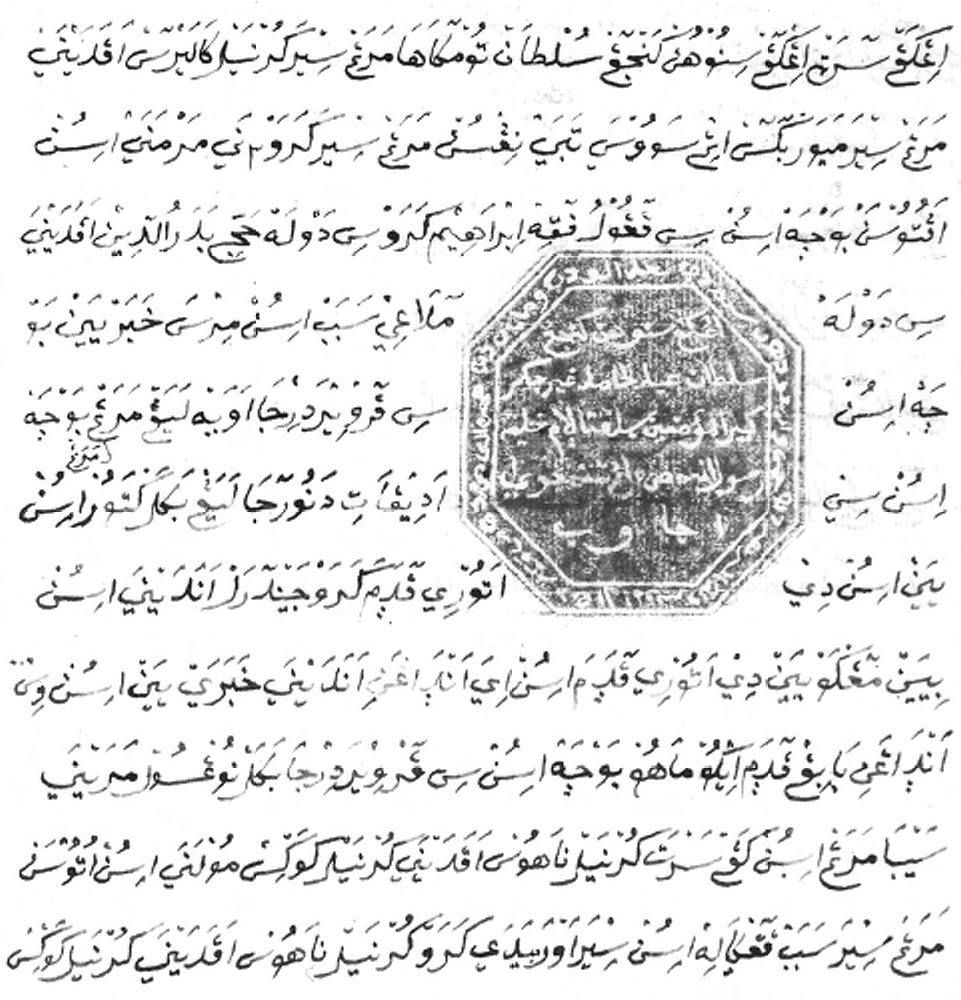

> *Plate 69. Letter of Pangéran Dipanagara to Colonel (later Major-General) Cleerens (1785-1850) and Major (later Major-General) Hendrik Frederik Buschkens (1795-1860), dated 17 Shaban, AH 1245 (14 February 1830; Islamic calendar from the date of the flight of The Prophet AD 622 from Mecca to Medina) in pégon (unvocalised Arabic) script dealing with the negotiations for a meeting at Rèmakamal in north-eastern Bagelèn to discuss peace terms. Dipanagara’s seal which bears the royal title which he assumed at Selarong on 1 Sura, AJ 1753 (15 August 1825; Javanese year – lunar era inaugurated by Sultan Agung [reigned 1613-1646] in 1633), is placed in the middle of the letter and reads as follows: ‘Ingkang Jumeneng Kangjeng Sultan Ngabdul Chamid Herucakra Kabirul Mu’minin Sayidin Pantagama [...] Rasullah s.a.w. ing Tanah Jawi’.*

The Rèmakamal meeting itself seems to have passed off well despite Cleerens’ late arrival.[^65] Dipanagara had ridden down to the meeting from his mountain headquarters at Sampang accompanied by his mounted bodyguard with his heirloom kris, Kyai Ageng Bandayuda, being carried before him to ward off danger.[^66] When the colonel eventually arrived, he had shown the prince all due respect, dismounting from his horse some way from the meeting pavilion and walking the last distance with his cavalry kepi off even though it was a very hot day.[^67] His adjutant, Second Lieutenant Carl Philip Conrad Steinmetz, followed at a short distance together with the prince’s patih and his former Bagelèn commander, Pengalasan. Pleasantries and jokes were exchanged, including some light-hearted banter about the number of guns which should be fired to salute the prince as he passed by the various Dutch bènthèng on his journey to Kecawang and Kalireja.[^68] After refusing both the cannon salutes and the three horses offered him by Cleerens and Buschkens, Dipanagara asked to leave for Kecawang accompanied by Steinmetz and four Dutch hussars. The meeting had lasted just two hours. Cleerens, meanwhile, returned to Kemit to make further preparations for the prince’s journey onwards to Kedhu taking care to avoid the crossing of rivers like the Bagawanta and the Elo in southern Kedhu, which Dipanagara insisted no prince of Mataram blood could pass over.[^69] Cleerens’ own report is missing but his superior, Cochius, described the encounter as ‘polite and familiar’ despite the fact that no major undertakings were given by Dipanagara or conditions agreed on (Louw and De Klerck 1894-1909, V:554, 721).

With De Kock still absent in Batavia, Dipanagara initially intended to await his return in western Bagelèn, but Cleerens persuaded him to journey on with him to Menorèh and sit out the general’s return there. He arrived on 21 February, his entourage having nearly doubled to 700 en route, the local population of this part of southern Kedhu showing him particular respect. According to Dutch reports, many local people in the mountain settlement were amazed at the speed with which the prince had come over, some doubting the testimony of their eyes that this was indeed the legendary Java War leader in their midst (Louw and De Klerck 1894-1909, V:723). Everywhere he went, food and fruit were brought for him, some even being sent up to him from Bagelèn during his stay by provincial chiefs who had never taken his side in the war (Louw and De Klerck 1894-1909, V:554-5, 723). He apparently got on very well with the Dutch officers and mobile column commanders whom he was introduced to during his journey, but was adamant that he would not meet with any of the Javanese officials who were in the employ of the government or of the south-central Javanese courts (Louw and De Klerck 1894-1909, V:554).

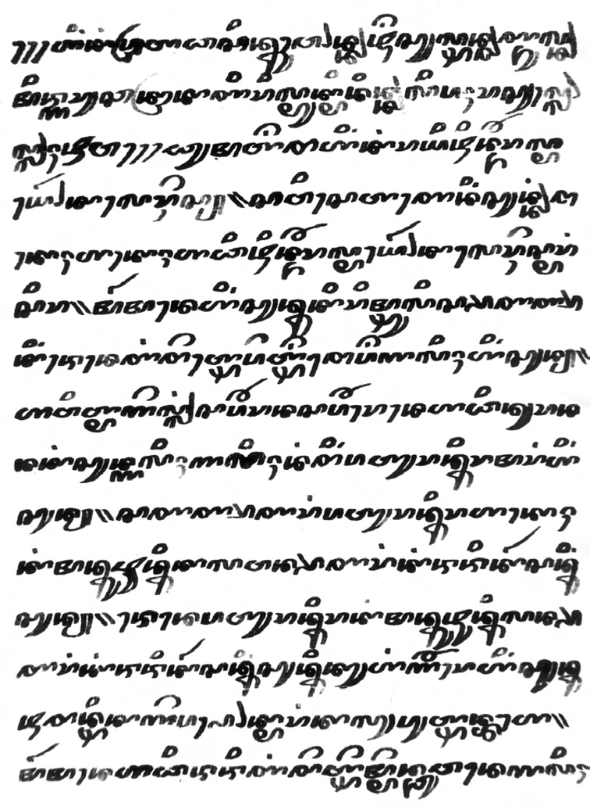

> *Plate 70. Letter of Dipanagara to Major-General J.B. Cleerens, dated Makassar, 23 Ruwah, AJ 1763 (14 December 1835): AN, Geheim Besluit van den Gouverneur-Generaal in rade, 15-3-1837, no. 57. See Appendix XIII part B.*

The prince would spend just over a fortnight at Menorèh before setting off for Magelang on 8 March. During this time, he allowed himself to be treated by a Dutch military doctor for his malarial fever and commenced preparations for the start of the fasting month which began on 25 February (Louw and De Klerck 1894-1909, V:723). The prince’s experience of western medicine did nothing to alter his views about the superiority of traditional Javanese herbal remedies (p. 117). Despite his robust constitution – a constitution ‘made of iron’ in De Kock’s words (p. 116) – it was clear that he was suffering from the privations of his long months in the forests of western Bagelèn. Cleerens reported that ‘more than anyone else, [he] needs rest, his whole body is tired out’.[^70] His physical condition may have been one of the reasons for his willingness to enter into negotiations with the Dutch at this time.

Dipanagara’s period at Menorèh is well documented in Cleerens’ dispatches and it was here that an issue came up which would have long-term consequences for both the prince and his Flemish host. This concerned the undertaking which he thought Cleerens had given him with regard to his forthcoming negotiations with De Kock; namely, that if they proved not to his liking he would be allowed to return unmolested to Bagelèn to continue his struggle (Appendix XIII note 7). He specifically requested his pengulu, Kyai Pekih Ibrahim, to ask the colonel for such an undertaking (Carey 1982:19), and after his capture in Magelang, he discussed the issue at length with one of his two Dutch officer escorts, Captain Johan Jacob Roeps, telling him that he had been under the impression that if he could not come to an agreement with the general on this occasion, that people should have ‘let him return without hindrance to the mountains’ (Louw and De Klerck 1894-1909, V:741). We will see shortly how even De Kock would describe in his official report of his 28 March 1830 meeting with the prince, which resulted in his capture, how the prince had complained bitterly about the way he was being treated. Indeed, the prince never forgot this betrayal. Five years after the war, when Cleerens had returned to Java loaded with honours as a titular major-general, Dipanagara wrote secretly to him from Makassar reminding him of his previous ‘statements’. This communication would prove fateful for both men. It immediately led to much tighter restrictions on the prince’s freedom of movement in Fort Rotterdam in Makassar, and may have contributed to the Flemish officer’s sudden relief from his position as military commander of Sumatra’s West Coast.[^71]

While there is nothing in the colonel’s letters to suggest that he made any promises of this nature, he certainly went out of his way to reassure the prince, who was exactly his age, stating that he held himself personally responsible for his interests (Appendix XIII note 7) and repeating De Kock’s promises that no harm would ever be done to him.[^72] He also treated him with respect, addressing him as ‘sultan’ and speaking to him directly in Malay. Privately, however, he took a critical view of the Java War leader describing him as ‘either a very stupid or a very dissembling person’ and belittling his understanding of Islam – ‘he prays a lot and speaks constantly about the law of Muhammad but he knows little of The Faith’ – stating that he badly needed the presence of the Surat-born Sayyid Hasan as his religious adviser at the forthcoming Magelang meeting with De Kock.[^73] In this context, Cleerens was very critical of the ‘young men’ who seemed to make up the inner circle of the prince’s entourage. He feared they were misleading him due to their lack of knowledge and self-interest, and tried in vain to encourage the prince’s patih to take a more proactive role.[^74] He also noticed how one of the santri advisers in Dipanagara’s entourage, Haji Ngisa, seemed to be acting the role of court jester.[^75] Constantly on the look out for evidence of the prince’s ‘treachery’, such as his supposed failure to keep a promise not to increase his armed following by accepting new recruits from Bagelèn, Gowong and Mataram,[^76] the colonel pressed Cochius to send him a few hundred more cavalry and infantry so that he could be certain that the prince would not be able to escape either from Menorèh or during his forthcoming journey to Magelang.[^77] On the evening before Dipanagara’s departure, Cleerens signalled a change in attitude towards him by dropping his royal style as ‘His Highness Sultan Ngabdulkamid’ and addressing him for the first time by his old princely title of Pangéran Dipanagara, something which De Kock would also do when the prince eventually arrived in Magelang (Louw and De Klerck 1894-1909, V:564).

### Treachery or honourable submission? Dipanagara’s arrest at Magelang, 28 March 1830

As soon as De Kock returned to Magelang from Batavia at the beginning of March, he ordered Cleerens to bring Dipanagara and his entourage up to his Kedhu headquarters to meet him. Although the prince agreed to leave immediately, no sooner had he begun his journey than he asked to return to Menorèh. There was no point in going to Magelang, he told Cleerens, because all he could do would be to pay De Kock a polite visit. No serious discussions could take place during the fasting month. All negotiations would have to wait until it was over on 27 March. The Flemish officer should have known this because once the fast had begun on 25 February Dipanagara had gone into daily retreat in Menorèh and had refused all Cleerens’ entreaties that he compose a letter to De Kock stipulating his negotiating demands.[^78] Eventually a compromise was reached; Dipanagara would go to meet De Kock but only for a courtesy visit. He would then observe the fast with his entourage in a specially prepared encampment at Magelang in an area by the Praga River just to the northwest of the Residency House known locally as Metésih.[^79] Only when the fast was ended would proper talks begin.

When all the preparations had been completed on 7 March, De Kock sent word to Cleerens. The following day at around noon Dipanagara with his young army commanders and an entourage which had now swollen to around 800[^80] – far greater than the modest fifty-strong mounted escort which Cleerens had originally envisaged would accompany him from Menorèh[^81] – entered the town. Many of these were former prajurit (soldiers) and members of the prince’s erstwhile bodyguard regiments who had joined him during his journey through Bagelèn and southern Kedhu. Armed mostly with pikes, they were now accoutred in black turbans and tabards made out of the cloth provided by Cleerens during the prince’s progress from Rèmakamal to Menorèh. There were fears on the Dutch side that with so many Javanese troops in the heart of the garrison town and more expected when Pangéran Dipanagara II and Imam Musbah arrived from their base on Mount Sundoro in northern Kedhu, they might have a fight on their hands should the Java War leader have to be seized manu militari.[^82] As a precaution, advance units of two of the Dutch mobile columns, which had been operational in Bagelèn and Kulon Praga, were brought to Magelang earlier on the morning of 8 March to supplement the forces already present at Dutch military headquarters.[^83] ‘Dipanagara still possesses much support, everywhere people show him respect’, an anxious Van den Bosch reported to the minister of the Colonies in The Hague,[^84] and the prince himself mentioned the steady stream of Yogya officials, court artisans, grooms, goldsmiths and others who made their way to Magelang, along with former soldiers from Pajang, Kedhu and Bagelèn, to offer him their services.[^85] The town was overflowing with people, according to Dipanagara, and five buffaloes had to be slaughtered every day to feed them. So great were the corvée demands for the construction of temporary bamboo shelters that many Magelang inhabitants decided to move away temporarily to escape the burdensome labour services.[^86]

De Kock’s detailed report of the events concerning Dipanagara during his stay at Magelang, up to and including what the general discretely termed the prince’s ‘coming over’ (overkomst) – namely his capture on 28 March – is a major source for this three-week period.[^87] It can usefully be set besides Dipanagara’s own babad account, which naturally gives a very different perspective on these same events. What is especially interesting about De Kock’s account is its element of self-reflection. Albeit written from the perspective of a senior Dutch military officer and former lieutenant-governor-general of the Netherlands-Indies, De Kock was clearly troubled by the manner of the Java War leader’s arrest. This can be seen in the juxtaposition of his description of the prince’s formal reception on 8 March and what he wrote shortly afterwards about the propriety of his own behaviour towards Dipanagara. Thus he relates that he received the prince, his commanders and religious advisers with due honour in a formal meeting attended by his entire staff and senior Dutch officials in the Residency House. All local Javanese officials and princes of the blood from the courts, who were at Magelang at the time, had been excluded out of respect for the prince’s wishes. De Kock welcomed him as ‘Pangéran Dipanagara’ and let him sit directly to his left, his entourage being placed on a row of chairs ranged further along on both sides of the general. The meeting was short. The commander-in-chief opened by saying that out of respect for ‘different ways of thinking and the stipulations of other religious persuasions’, the prince would be left in peace during the fasting month, but he hoped that after it was over, matters between the two of them would be speedily settled. Now that they had been enemies for five years, he trusted that their friendship would endure much longer, the Netherlands Indies government being ‘just and mild’. Dipanagara then stayed for a few minutes, speaking, according to De Kock, in a friendly way with the assembled Dutch officers and civilian officials before being escorted by the Resident of Kedhu, Valck, to his prepared encampment at Metésih. De Stuers would later capture this event in a deftly executed sketch showing a sombre prince riding up to the large bamboo and palm-leaf roofed pesanggrahan surrounded by his pikemen (De Stuers 1833: Plate 12).

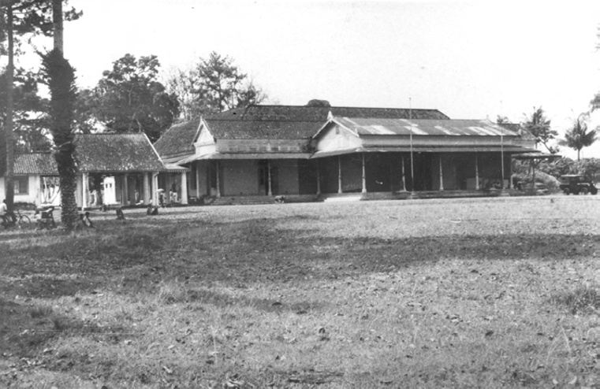
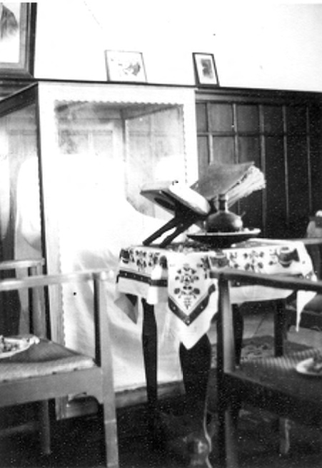

> *Plate 71 (above) The ‘old’ Residency House (Karesidenan Lama) at Magelang where Dipanagara was taken prisoner by the Dutch on 28 March 1830. The door leading to the room where he conducted his ‘negotiations’ with the Dutch commander, Lieutenant-General Hendrik Merkus de Kock (1779-1845) is on the extreme right of the picture underneath the pendhapa. (left) The study where General De Kock held his talk with Dipanagara just before his arrest, now a local museum. Photographs taken by Peter Carey, February 1972.*

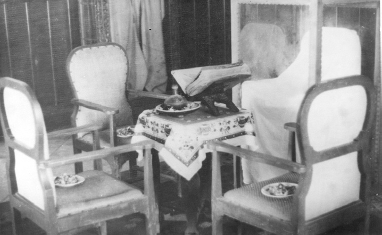

> *Plate 72. Photograph of the interior of the study used by De Kock where Dipanagara was arrested on 28 March 1830. The chairs are supposedly originals, that on the right (shrouded in white cloth and under a glass case) supposedly the one used by Dipanagara during his ‘negotiations’ with General De Kock. Against the wall at the back of the picture (in the glass case) is the tabard (jubah) supposedly worn by Dipanagara during the war (with a cindhé edging supposedly sown by his Chinese mistress) and on the table is a copy of a Taqrib (fiqh) text with a diagram at the back showing the location of certain graves, which was supposedly owned by Dipanagara’s religious adviser, Kyai Melangi. Photograph taken by Peter Carey at the ‘old’ Residency House (Karesidenan Lama) at Magelang in February 1972.*

Soon afterwards, De Kock confided his doubts about the propriety of his behaviour towards the prince in his Magelang diary (Louw and De Klerck 1894-1909, V:566-7):

> Already, according to some people, I should have placed Dipanagara under immediate arrest because he is a rebel who has waged an insurrection against his ward and legal sovereign [Sultan Hamengkubuwana V] and against the Netherlands-Indies government. As a subject of one of the Javanese rulers, he really had no right to any special consideration. At the same time, had he perceived, after being in Magelang for some time, that his wishes would not be met, it was not inconceivable that he would have silently departed and recommenced hostilities.

> I realised that such a way of acting on my part was ignoble and dishonest [onedel en oneerlijk] since Dipanagara had come to Magelang in good faith to meet me. Furthermore, he himself could have harboured no hostile designs because he had not the slightest idea how he would find everything in Magelang, and for anyone with even the slightest knowledge of the Javanese, the high degree of trust evinced by Dipanagara was striking.

> [But] if I had placed Dipanagara under immediate arrest, although the war would have been brought to an end more speedily, such conduct would in general have created an unfavourable impression: […] the princes and Javanese chiefs, who had one by one submitted to the Netherlands Indies government, would have been brought into uncertainty [thinking perhaps] that after the chief rebel had been captured by guile, some of them would be forced to share his fate.

> Although it was already clear that Dipanagara was governed by his own pride and self-interest, because his following was already double that stipulated at Rèmakamal and there was little hope that he would come forward with moderate proposals, I had the intention of acting openly and honourably and winning his trust in all ways possible. So that if need be I could act forcibly at the end of the fasting month. [In this way] both Europeans and Javanese would be convinced that Dipanagara had only his own rash behaviour to blame for forcing me to take such drastic measures.

> I also wanted to get the submission at Magelang of Imam Musbah and Pangéran Dipanagara the Younger [who were] still at large in the Karangkobar area before proceeding against the latter’s father. This I succeeded in doing.

De Kock’s behaviour towards Dipanagara was thus governed principally by political considerations, namely, to ensure the full submission of Dipanagara’s principal army commanders before he moved against the prince himself, to lull the latter into a false sense of security and to make his arrest appear not as a treacherous act but as a direct outcome of his own intransigent behaviour. It was neither open nor honourable to proceed in this fashion, but in De Kock’s view the end justified the means. In a private communication with Van den Bosch after his 8 March meeting with Dipanagara, he told the governor-general that in his view the prince’s arrival in Magelang constituted a de facto submission (Louw and De Klerck 1894-1909, V:569). De Kock’s gestures of friendliness and consideration towards Dipanagara, however, continued. Immediately after the prince’s arrival he made him a special present of a fine grey horse and provided f 10,000 in two instalments for the upkeep of his followers during the fasting month. He also allowed members of his family, who were being detained in Yogya and Semarang, to join him in Magelang.[^88] Meanwhile, senior members of De Kock’s staff, such as his adjutant and son-in-law, Major F.V.H.A. de Stuers, and the Resident of Kedhu, were frequent visitors to Dipanagara’s encampment at Metésih enquiring solicitously about his needs (Louw and De Klerck 1894-1909, V:572). The Resident, however, appears to have riled the prince by what he later referred to as his ‘stupid and piffling questions’ (p. 109). In particular, he took umbrage at Valck’s insistence that those flocking to join him were tax dodgers and corvée labour evaders rather than bona fide soldiers.[^89] The Resident also appears to have created difficulties with the small gifts of palm sugar and sugar cane which the local inhabitants brought, the prince having to point out to him that although he had no particular love for sweets, it was a Javanese custom to bring presents and he had to accept them as tokens of their respect for him as the ‘leader of Java’ (lajering Jawa).[^90]

De Kock appears to have met Dipanagara on three separate occasions during this period, twice for pre-dawn walks in the Resident’s garden and once when he came in person to his encampment before the start of the daily fast (Carey 1982:9 note 36). According to Dipanagara’s testimony, these meetings took place in a pleasant and unrestrained atmosphere, the two men exchanging jokes[^91] and finding mutual pleasure in each other’s company. The fact that both were still mourning the death of their wives, to whom they had been especially devoted and who had died within months of each other in 1828, appears to have made them feel particularly close.[^92]

While this rapport was being established, De Kock was coming to the realisation that Dipanagara would never surrender himself unconditionally to the government. A spy, Tumenggung Mangunkusuma, whom the Resident of Kedhu had placed in the prince’s entourage, reported that the prince was steadfast in his intention of obtaining recognition as sultan over the southern part of Java. Other senior officials stressed that Dipanagara wanted nothing less than the position as ‘royal maintainer and regulator of religion in Java’ (ratu paneteg panatagama wonten ing Tanah Jawa sedaya), or ‘head of the Islamic religion’ (Louw and De Klerck 1894-1909, V:573, 585; Carey 1982:10). Realising encampment at Metésih, a settlement near the Praga River just below the ‘old’ Residency House which ultimately led to his arrest on 28 March 1830. Uncoloured litograph by the Dutch painter officer, Major (later Major-General) F.V.H.A. Ridder De Stuers (1792-1881). Print from De Stuers that such demands could not even begin to be met by the government without compromising the position of the existing south-central Javanese rulers, De Kock took the decision to act decisively after the end of the fasting month.

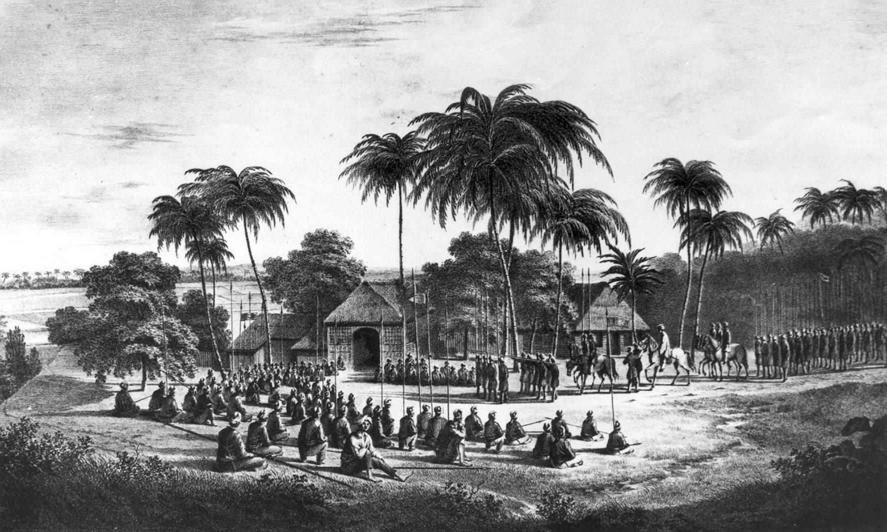

> *Plate 73. Sketch of Dipanagara and his armed followers (pikemen; prajurit) entering the prepared (Karesidhenan Lama) at Magelang, on 8 March 1830 before the ‘peace’ negotiations with the Dutch and lithographer, Wilhelmus van Groenewoud (1803-1842), based on a sketch made by the Dutch 1833: Atlas, Plate 12. Photograph by courtesy of the KITLV, Leiden.*

On 25 March, two days before the fast officially ended, he gave secret orders to two of his senior infantry commanders, Lieutenant-Colonel Louis du Perron and Major A.V. Michiels, who had sizeable troop contingents in Magelang (note 83), instructing them that when Dipanagara came to him to discuss his peace terms, all the necessary military preparations should have been put in place to secure his arrest. Thus the troops were to remain in full uniform with equipment at the ready in their barracks and cavalry mounts saddled up, so that at the first word of command all military personnel could immediately assemble under arms. On the day that Dipanagara was expected – 28 March 1830 – the usual guard at the Residency House was to be doubled, a move which was not expected to arouse suspicion because it was a Sunday when a larger than usual number of soldiers in full dress uniforms always gathered for the Sunday parade. On De Kock’s instructions a detachment of hussars was to be immediately dispatched to Bedono on the Kedhu-Semarang border to take over as an escort for the last stage of the prince’s journey to Semarang. All other Dutch officers without special commands were to gather at the Residency House to keep an eye on the chiefs whom Dipanagara would bring with him to his conference and who would be waiting outside in the long front gallery. Meanwhile, the carriage of the Resident of Kedhu was to be held in readiness to take Dipanagara immediately away from Magelang. The senior infantry officers were enjoined to go about their task with the greatest possible composure and to see that no one was harmed unnecessarily. Any resistance, however, was to be met by overwhelming force (Louw and De Klerck 1894-1909, V:589; Carey 1982:10 note 39). In this fashion everything was held in readiness to secure Dipanagara’s capture, disarm his 800 armed followers, and head off any last-minute opposition.

Was it possible that Dipanagara, as he suggested in his babad, was totally oblivious to these preparations? Did his sudden arrest during a courtesy visit to De Kock to mark the end of the fasting month really take him so completely by surprise? Gandakusuma, his young Rèma-based commander, who had followed him to Magelang, would later remark that this was very far from being the case. In his heart of hearts, Dipanagara always knew that he would be arrested Gandakusuma asserted. Decades afterwards in the late 1870s when the now grey-haired former ali basah was coming to the end of a distinguished career as patih of Yogyakarta (Appendix Va), he was engaged in conversation by the then Dutch Resident of Yogyakarta, A.J.B. Wattendorff (in office 1873-1878). The following is the Dutch historian E.B. Kielstra’s report of this exchange (Kielstra 1896a:85-6; Louw and De Klerck 1894-1909, V:573-4):

> During a conversation with the patih [Gandakusuma] about the events and conditions of past times, Mr Wattendorff expressed the opinion that the capture of Dipanagara could not be reconciled with the highest standards of justice. The patih showed himself to be considerably surprised.

> ‘But Dipanagara already knew beforehand that it would turn out thus!’ According to the patih, Dipanagara’s pride prevented him from taking any other solution. He always put forward his demands to be recognised as sultan and head of the Islamic religion in Java, knowing full well that General De Kock would never permit them. He was malu [ashamed and embarrassed] to drop them, but he saw no ignominy in submitting to superior force. In this way his prestige in the eyes of the people would remain undiminished.

> Mr Wattendorff is convinced that the patih was quite sincere in his observations. Already nearly half a century had elapsed and what had happened in 1830 and in previous years had become pure history. The man who had followed his father-in-law[^93] during the whole rebellion, could have had no cause to do any violence to the truth and the way he related the event bore the stamp of authenticity.

Gandakusuma undoubtedly had his own reasons for stressing the inevitability of Dipanagara’s arrest by the Dutch. By the time Wattendorff met him, he had been a senior official of the Yogyakarta sultanate for over forty years and his position as patih entailed special responsibilities to the Dutch (p. 168). He was thus unlikely to have wanted to cause them undue offence by dwelling on the darker aspects of their rule in Indonesia. But there is much more than mere diplomatic deception in his explanation of the way in which Dipanagara succumbed to his fate.

In the prince’s own babad, there are many indications that although De Kock’s volte-face took him by surprise and pained him deeply as a betrayal of personal trust and friendship, the arrest itself was not totally unexpected. In the view of Muslims, there is no dishonour in submitting to superior force and the way in which Dipanagara described the event and its antecedents indicates that he had long since given himself up to his destiny. The key phrase with which he introduced the sombre Maskumambang metre of the last canto of his autobiography relating his capture and exile – ‘we talk of the sultan [how] on the morning [of 28 March 1830] he was like gold being carried along by water’[^94] – exactly indicates his state of mind at the time. This was later confirmed by De Stuers, who wrote after his voyage to Batavia with the prince (Louw and De Klerck 1894-1909, V:746):

> If a trait in Dipanagara struck Captain Roeps and myself in particular, then it was his unchanging indifference, resignedness or submission – I do not quite know how to describe this feeling as it manifested itself in Dipanagara – concerning the dispositions which would be pronounced regarding his future life in exile and which he had requested he might speedily hear.

The prince thus felt himself swept along by forces outside his control, an impression further strengthened by a brief conversation between himself and Gandakusuma on the very morning of his arrest. The latter had come to the prince after the morning prayers in his small chapel to suggest that all his armed followers should accompany him to the Residency House. According to Dipanagara’s own testimony, he realised that such was not God’s Will. Smilingly, he rebuked Gandakusuma, stating that such a move would cause unpleasant surprise and that everything should happen ‘as normal’. Hearing this, Gandakusuma wanted to remonstrate but kept silent out of fear despite his heart’s deep forebodings.[^95] If such an incident did indeed occur – and in fact we know from other sources that Dipanagara actually brought around one hundred armed men with him to the Residency House (Louw and De Klerck 1894-1909, V:590) – then it is likely to have reinforced any feelings that Gandakusuma might have already had regarding Dipanagara’s premonition of what was in store for him.

Meanwhile, the prince described in his autobiography how he departed for the Residency House at around eight o’clock on the morning of 28 March ‘suspecting nothing’.[^96] He mentioned that he had not even bothered to wear his official clothes, but was dressed informally as though for a pleasure trip.[^97] It was the same with his close entourage, none of whom carried any insignia of office. Amongst these latter were his three sons – Pangéran Dipanagara II, Radèn Mas Jonèd and Radèn Mas Raib – four of his principal army commanders – Gandakusuma, Mertanagara, Suryawinata and Imam Musbah – two of his closest religious advisers – Haji Ngisa and Haji Badarudin – and his two faithful panakawan (intimate retainers), Banthèngwarèng and Jayasurata (‘Rata’).[^98] On his arrival at the Residency House, he was greeted by Valck and shown into De Kock’s study. His three sons, religious advisers, two panakawan, along with Ali Basah Mertanagara, accompanied him. The others sat on stools just outside the room where Dipanagara could see them. On the Dutch side, Lieutenant-Colonel W.A. Roest, one of De Kock’s staff officers, Major-Adjutant De Stuers and the military interpreter for Javanese, Captain J.J. Roeps, sat with the prince’s immediate entourage inside the study. The other Dutch officers present, amongst them Lieutenant-Colonel A. de Kock van Leeuwen, the field artillery commander, and Major Johan Jacob Perié, who was in charge of the cavalry detachment, remained outside in the inner gallery on De Kock’s instructions to keep an eye on Dipanagara’s followers and engage them in ‘friendly conversation’ (Louw and De Klerck 1894-1909, V:590-1). By this time, the officer in command of the troops at the Residency House, Lieutenant-Colonel Du Perron, had already departed to put De Kock’s orders for the day into effect. The number of men fully equipped and armed in the vicinity of the Residency House apparently aroused no suspicions amongst Dipanagara’s party. None considered that anything untoward was afoot (Louw and De Klerck 1894-1909, V:590). Indeed, Dipanagara remarked that everyone in his group felt fully at ease because De Kock behaved no differently than before.[^99]

The conversation, as reported in the prince’s babad, opened with De Kock remarking that Dipanagara should not return to Metésih but should remain in the Residency House with him, to which the prince replied:

> Why should I not be allowed to return [general]? What should I do here? I have only come for a short time to pay you a friendly visit such as is the Javanese custom after the fasting month. At this time, those who are younger go to the homes of those who are older to nullify all the faults which have been committed [during the previous year]. In this case you, general, are the older party and the same situation holds.[^100]

At this De Kock replied: ‘the reason I [want to] detain [you] is that I wish to clear up all the matters between us this very day’.[^101]

With the conversation now taking an unexpected turn, Dipanagara remarked with great surprise: ‘What matters, general? Indeed, I have neither matters on my mind nor do I harbour any [in need of discussion between us]‘.

Valck then explained that for as long as Dipanagara had been at Magelang, the general and his officers had thought of nothing else by the issues to be settled between the prince and the Dutch. To which Dipanagara’s commander, Mertanagara, immediately interjected that political affairs (prakawis) were far from the prince’s heart and that another day should be set to discuss them. ‘No!’ answered De Kock, ‘that cannot be allowed. Whether he wants it or not I wish to finish everything now!’[^102]

De Kock’s own testimony in his diary – though less dramatically phrased – accords well with Dipanagara’s autobiography on most points (Louw and De Klerck 1894-1909, V:14):

> I told him that I was responsible to the governor-general [Van den Bosch] and that I would be blamed if I did not make a speedy end to all outstanding matters because the costs of the war were rising and the time for repatriating the Dutch troops and Indonesian auxiliaries had almost passed. Again Dipanagara answered me that he could not discuss any matters with me today because he was not prepared for it. He asked me [to allow him] to return home so that he could think things over [and] would tell me later when he wished to come to speak with me. I told him a second time that matters must be ended now [and] that he had had enough time to think everything over during the fasting month. Whereupon Dipanagara observed that during that time he had not thought at all about political matters. I replied that I had thought about little else and that the welfare of my troops and that of the Javanese people had caused me to be continually mindful about ways in which the war could be brought to a [speedy] end. Since God had now given me the opportunity, I should make use of it [and] that I would not be put off by any further delays or promises. But in the name of the governor-general I now ordered Dipanagara to tell me what his intention had been when he requested to meet me, what he had to say to me and in what way he desired that the war should be brought completely and utterly to a close.

When this was translated for Dipanagara,[^103] De Kock reported how the prince complained bitterly about the way he was being treated, saying that he had come to Magelang of his own free will and that, according to the undertaking of Colonel Cleerens, he should be at complete liberty to depart if he could not come to a satisfactory agreement. Similar reactions are described – albeit more forcefully – in Dipanagara’s babad:

> The sultan [Dipanagara], when he heard the words of the general, remembered the order of The Almighty regarding the ruler of Java [Ratu Tanah Jawa] and his double role as a soldier. Then he recalled his enemy. The sultan’s courage was thus aroused and he said: ‘What is this now? Are people looking for a quarrel without there being any reason for it? If you are seeking to dispense justice, I am not as

> king for your judgement! If you, General De Kock, indeed feel compelled to invite a quarrel, summon Colonel Cleerens and Ali Basah [Pengalasan] here first. Once they have arrived, I will investigate the matter for I did not come here with the intention of seeking a quarrel [or] asking for judgement. Now you are concluding in your own fashion! [In fact], the two [Cleerens and Pengalasan] said you wanted to make peace as well as negotiate. I asked what was meant by “peace” and they answered, “sound discussions and deliberations”. Likewise, earlier you sent someone to give me a horse, “as a sign of your friendship” [sobat] in Mang[un]-kusuma’s words. When I asked him the meaning of the word “friendship”, he said, “returning to friendly association [pisanakan] again, [and] wiping out all faults [which have been committed]. When Muslims come together [all is forgotten], [and] the only discussions are on fitting things which give satisfaction to all. Since you have already given me a mark [of your friendship], sooner I do not reciprocate [this present]. But notwithstanding all that, in truth I am not looking for a quarrel. Therefore bring the [ali] basah and the colonel here!’ General De Kock bowed his head [and] replied: ‘If, Tuwan [Sir], you are asking that these two come [here], it is now too late.[^104] If you had asked for it earlier, I would certainly have brought them both here.’ The sultan said: ‘Heh, general! You are a thoroughly evil man! Why do you say now that there is so much hurry [when] earlier during the fast you gave no indication that you had such thoughts? If I had known [beforehand] that your heart was not clean, I would certainly have insisted that the two should not be allowed to return [to Bagelèn] for they are the ones who hold [the key to] the issue. It was for this reason that I totally trusted you, General De Kock, when you ordered them to return for I thought there were no longer any issues [between us], only harmonious discussions [which could be completed] at our pleasure. But now it is clear that your heart is evil. When I arrived here earlier, you welcomed me by my old name which I no longer use. For, in truth, I have already bestowed it on my [eldest] son. So, in fact, general, your evil behaviour [rusuhira] is plainly evident, [for how] can a father and a son both have the same name?’ General De Kock answered with his head still bowed: ‘Yes, but was not your name, Tuwan, in former times actually Pangéran Dipanagara? And moreover, the reason I am enquiring about your wishes, Tuwan, is that [formerly] you gave an undertaking. If you have no issues to discuss, who then has been the leader in the war which has been waged for so long in Java? I am therefore asking what your wishes are now?’[^105]

This whole conversation is omitted in De Kock’s report. He merely noted that after Dipanagara’s complaints about the way he was being treated, ‘much conversation occurred between Dipanagara and the people with him. But when he saw that I could not be moved to change my previous decision [insisting on immediate negotiations], the big words came out: Dipanagara said that he wanted nothing else than to be the head of the Islamic religion in Java and to retain his title of sultan. He left all the other arrangements entirely up to the discretion of the government’ (Louw and De Klerck 1894-1909, V:595). Immediately on hearing this, De Kock told his staff officer Lieutenant-Colonel Roest to go outside and order Lieutenant-Colonel Du Perron to march his troops out of the Magelang barracks and bring them to the Residency House, while the Residency guard was to come into the front gallery where Dipanagara’s other followers were seated (Louw and De Klerck 1894-1909, V:597). The prince’s arrest was just minutes away.

Dipanagara also referred to De Kock’s orders to the awaiting Dutch troops, but before doing so he reported a much more extensive and emotional conversation between himself and the Dutch commander-in-chief:

> ‘You ask who is the chief man [panggedhé] of the war in Java. He is none other than I, General De Kock! Muslims do not leave their own kind. If people engage in war there must be an opposing party. People do not quarrel with their own friends. It is you, general, who out of your own wishes, want to dispense justice. [But] who has ever heard of such a case in which one of the quarrelling parties acts as magistrate [jeksa]? If such is the situation, it only occurs because of your wickedness. I am not afraid of death. In all the fighting I escaped it. [As for my followers] they merely carried out my orders during the war in Java and thus cannot be held responsible. Now indeed nothing else remains [for me] except to be killed [and] I am not intending to avoid it. But I charge you, when I am dead, to bring my body back to Jimatan [Imagiri] so that I can be together with my wife [Radèn Ayu Maduretna; Appendix IV].’ General De Kock could not raise his eyes, as though exceedingly ashamed, so he just [sat] with bowed head and said softly: ‘Indeed, Tuwan, I have no intention of killing you. But the question of the letters[^106] is not the same as that of religion. It would not be fitting to follow your desires here for if they were followed, the Sunan [of Surakarta] would be deeply ashamed [isin].’[^107]

In his report, De Kock also touched on this important point and mentioned Dipanagara’s request to be killed on the spot rather than be sent away into exile:[^108]

> I told Dipanagara that his conduct up to that time had made me fear that he would come up with such rash demands [and] that he could have easily concluded that the government could not now permit what had not even been discussed in 1827

> [at the time of the Salatiga peace negotiations]. He knew well that the government had promised and given protection to the Sunan of Surakarta and the sultan of Yogyakarta for the past five years, and that these rulers were, according to eastern custom, themselves the heads of religion in their own lands. Dipanagara then said that if what he wanted was not accorded him, the government could do with him what it chose, but that he himself was not going to give up his demands.

To which De Kock replied that in his view Dipanagara had forfeited all further trust and that he could detain him as a prisoner, and send him to Ungaran or Salatiga, leaving subsequent decisions as to his fate to the governor-general (Louw and De Klerck 1894-1909, V:597). De Kock was in fact being less than honest with the prince by stating that he would be kept at one of these two central Javanese towns to await Van den Bosch’s further instructions. As we have seen, arrangements had already been made with De Kock’s adjutant, De Stuers and the military interpreter, Captain Roeps, to escort Dipanagara to Semarang and then on to Batavia following his arrest. Perhaps the commander-in-chief wanted to pretend that Dipanagara would be kept initially at one of these places in order to reassure him that he would not be required to leave the Javanese heartland or kejawèn. If so he was being severely economical with the truth.

> ‘Hereupon’, noted De Kock, ‘Dipanagara protested strongly asking about what in fact the government would permit. I answered that it was at present too late to return to that again because he was now entitled to neither trust nor consideration. If he had wanted to live as a simple pangéran [prince] with his family and a good income in the territories of the government, or if he wanted to make the journey [haj] to Mecca, the governor-general might well have allowed him his more modest requests. But after the obstinate pride he had shown, there was nothing more to be done with him, and moreover the peace of Java and the protection which the government had promised the Javanese rulers urgently demanded that he should be removed from the princely territories.’

During the time when this conversation was taking place, Major Michiels with soldiers from his own mobile column and units of Du Perron’s Magelang garrison force were nearing the Residency House. Michiels was given orders to go straight to Dipanagara’s encampment at Metésih with some of the local Javanese chiefs to disarm the prince’s armed troop who were then on morning exercises. Thanks to the negotiating skills of Haji Ngisa,[^109] this occurred peacefully and once De Kock was informed, he immediately ordered the disarming of the hundred or so troops who had accompanied Dipanagara to the Residency House. Their commanders, who were sitting in the front gallery, were also required to hand over their kris. One of these, Imam Musbah, would, following Dipanagara’s arrest, be bound in chains and sent to prison, as would two other junior commanders whose Kedhu provenance made them liable to detention in Magelang.[^110] As a measure of prudence, De Kock told the prince that he must leave at once under the escort of the two designated officers, but any of his wives and children who wished to follow him had permission to do so. To which Dipanagara replied, in the general’s words, ‘very simply that he did not wish to depart and that I could have him killed on the spot for he did not want to be sent away. [Moreover,] the treatment he was receiving was wholly contrary to what had been promised him [by Cleerens].’

> ‘I told him’, reported De Kock, ‘that he must not forget that he had been the guardian of the young sultan of Yogyakarta, and that instead of protecting him he had betrayed and hurt his pupil, [acting entirely] contrary to the prohibitions of the Qur’ān. That notwithstanding all the misfortunes he had brought to Java and which he himself had experienced, he could not be dissuaded from his detestable plans for which reason he could count on no compassion [from me]. That [any such treatment] would betray great weakness on my part and that I had not waited so patiently until the end of the fasting month [to behave so].’

Dipanagara then asked his chiefs and children whether they would allow him to be carried off in this manner, but they all cast their eyes to the ground and did not answer. Soldiers encircled the Residency House. At this point, according to De Kock (Louw and De Klerck 1894-1909, V:598-9),

> Dipanagara wanted absolutely to talk with his pengulu, Kyai Pekih Ibrahim, who was brought into the room. ‘Did you not ask Colonel Cleerens on my behalf’, Dipanagara said, ‘that I would be free to return if I did not reach an agreement with the government?’ ‘Yes!’ answered the pengulu. After which Dipanagara spoke again with his chiefs and took a cup of tea. When I saw it was nearly ten o’clock[^111] and that he must depart, I let the carriage [of the Resident] drive up and ordered Major-Adjutant De Stuers and Captain Roeps to take the prisoner on the first day to Ungaran and the following one to Semarang, and from there to depart by the first shipping opportunity to Batavia. I gave these officers a written order and it was just striking ten o’clock when the disturber of the peace of Java, stripped of all his greatness, was taken away as a prisoner. Gelukkig [Thank goodness]! Praise be to God! All is concluded. After Dipanagara’s departure, everyone showed their unfeigned joy. A few of the men who had remained loyal to him to the last said they had feared that Dipanagara would be unlucky because his claims were too great.

Such ‘unfeigned joy’ was indeed recorded on the lips of those who had fought for the Dutch. One such was the future post-war bupati of Purwareja (Kedhung Kebo) in Bagelèn, Radèn Tumenggung Cakrajaya (post-1832, Radèn Adipati Cakranegara, in office 1830-1862) whom Cleerens reported as saying: ‘This is good [news], now the war is over, well and truly over’.[^112] News of the event was immediately sent to the governor-general, the Residents of Java, and to some of the senior officers and officials in the princely states. A special supplement to the official government newspaper, the Javasche Courant, published an account on 1 April and soon all the European community in Java were apprised. On the same day as the Java Gazette announcement, De Kock wrote out his report on the proceedings for the governor-general. At the end he made three interesting observations. First, that throughout the proceedings Dipanagara had shown not the slightest fear. Second, that he, De Kock, regarded the report as a way of defending his actions against the censure of future critics who might accuse him of treachery. Third, that had Dipanagara not come to him at the Residency House, he would have sought ‘to carry him off’ (oplichten) from his own encampment. But such a course of action, in his view, would have been fraught with difficulties and it was more than likely that the prince would have left everything and escaped (Louw and De Klerck 1894-1909 note 1). The general’s tactics of feigned friendship and seeming accommodation had thus paid off. Dipanagara was arrested without bloodshed and De Kock could boast that after five years of bitter fighting he had brought the war to an end by his own diplomacy and military skill. When he arrived back in the Netherlands to a hero’s welcome in late October 1830, he would commission the most celebrated Dutch history painter of his age, Nicolaas Pieneman (1809-1860), to execute a tableau of the moment when he came out on the steps of the Residency House to point Dipanagara into the Resident’s waiting coach which would take him to Semarang and into exile.[^113] As Radèn Salèh’s biographer, Werner Kraus (2005:282), points out, Pieneman made Dipanagara and his retainers look duly submissive. All seemed to understand that De Kock’s stern action was for the best for the Javanese and that he had no choice but to send the prince away ‘just like a loving father sending a misguided son away to teach him a valuable lesson’. Here was no ‘monstrous colonizer’ but ‘an educated and civilized gentleman, respected leader of the freemasons in the Indies’ (Kraus 2005:282). All those depicted in the painting are relaxed – even those in tears. ‘There is no resistance, no commotion and high above the pageant flies merrily the Dutch tricolor […] Pieneman’s painting is a tribute to the glory of the Dutch. The pain of the Javanese is nowhere to be seen’ (Kraus 2005:282-5).

But this is not how Dipanagara or most of his followers saw it. After De Kock had pointed out that any change in the supervision of religion in south-central Java would cause shame and embarrassment to the Sunan, the prince replied in Low Javanese to indicate his disdain for the Dutch commander-in-chief:[^114]

> ‘Heh, general, I think a man with such ideas will have a lot of trouble with my religion! Moreover, general, why are you, who do not [even] follow [my] religion talking thus? In truth, I am not asking about the religion which I practise. Even if you should leave [the regulation of] your [Christian] religion in my hands, I certainly would not be willing, [for] what should I do with it? But as for Muslims who misrepresent their religion, I desire to put them in order. [Now] there’s a difficult business! They do not side with you, but it is not sure that they will side with me [either]. What should one call people who act thus, general? All the same, have them choose between my religion and yours [and see] which they choose. Only then will it be apparent what they have set their hearts on.’ The general answered: ‘That would be to my liking!’ His Highness the sultan replied: ‘If, general, this is what you are content with, I cannot go on to parley with you. And, moreover, as concerns the letters, they are pointless. For all the letters were in truth nothing but fabrications by you and [Commissioner-]General Du Bus. They [did not reflect] your true wishes. Similarly, with the language of the letters: the style used by [Commissioner-]General Du Bus and yourself [was not a reflection] of your real intentions. The only purpose of my coming here was to press you to make good what you had earlier written in those letters, [namely] your promised undertaking that I should become head of the Islamic religion in Java. Now you have broken [this promise], I stand as a witness to all your treachery. For earlier, Colonel Cleerens made me a promise that if the discussions came to nought, I would be invited to return to Kecawang.’ The general spoke thus: ‘If, Tuwan, you return war will not fail to break out again.’ His Highness the sultan replied: ‘Why are you fearful of war if you are soldiers and real men?’ General De Kock said, ‘If it is thus, as a matter of fact I cannot settle the question, because I am no longer in a position to do so.[^115] But at Salatiga there is someone with a further mandate. He can settle it. So you had better go to Salatiga.’[^116] His Highness the sultan said in a friendly voice: ‘Why should I go to Salatiga? What would I seek there, general? I have not the slightest intention of seeking justice in Salatiga! Moreover, if you, De Kock, want [to finish things] here now, I am not willing.’ General De Kock then went out and with a thunderous voice ordered all the troops to enter the Residency [compound].

A Dutch source related that at this point one of the prince’s followers drew his kris and placed himself in front of Dipanagara as though to protect him,[^117] an observation which is borne out in his babad where the Java War leader mentioned the behaviour of his eldest son,

> Now it is related that Pangéran Dipanagara [the Younger], because he was still youthful, got up from his seat thinking of his soldiers and came close to the Resident [Valck]. Whereupon the sultan winked to Radèn Basah Mertanagara and said: ‘General, you are bringing everything into a difficult pass!’ Through the Will of the Almighty, Radèn Basah Mertanagara did not [burst into] anger. Thus the sultan smiled when he looked at the Radèn Basah, Haji Ngisa and Haji Badarudin who were [all] mindful of the Lord’s Providence and conscious of their dependants and the baseness [of which they were now the victims]. Then De Kock took His Highness by the hand and brought him to sit on the sofa. The general did likewise. Time and again, the sultan debated in his heart: ‘If I kill the general, the end will be trouble for it is beneath the dignity of a prince to fight as one who runs amok. It would bring me into disrepute. [The Dutch are perpetrating] an unheard of treachery. But despite that I have no companion [kanthi] [and] it is better that I give myself up to my fate. To those who remain it can be left to decide whether they wish to follow my orders in life and death as many have already done. I had better share their lot!’ The sultan then instructed that Mas Pengulu [Pekih Ibrahim] should be summoned. Once he had come […] the sultan said, ‘How comes it pengulu that things have turned out thus?’ Mas Pengulu replied: ‘It is best, Highness, that you just follow the instructions of your brother [De Kock].’ The sultan smiled [and] said in a companionable way: ‘Come on, Major [De Stuers] let us depart!’ The general then said: ‘Will you not [take] your sons, army commanders and soldiers?’ The sultan replied: ‘[No], De Kock, that would [only] give more trouble!’ His Highness then got into the coach, only one intimate retainer [panakawan] followed him, Rata by name, who bore the sultan’s betelbox. [They sat] together with Captain Roeps [and] Major de Stuers […]. The sultan was greatly ashamed at heart and was prepared to die. It was on a Sunday, the second of the [Javanese] month Sawal in the [Javanese] year Jimawal [28 March 1830] that His Highness departed from the land of Java. The wish of His Highness was to go on the pilgrimage [to Mecca] because of his great shame. He was not attached to all his high dignity nor to his loved ones, to his mother [and] his children. As regards his followers, nothing remained for them but to await the sultan’s yielding to superior power and resigning himself to God’s dispensation. It was for this reason that the sultan’s heart accepted grief and affliction in this world, for it was [all] solely in redemption of His Highness’s pledge in the event that he should prove unable to reinstate [the Islamic] religion throughout Java. For this reason, acceptance of his lot was just the wish of the sultan. Ever increasing shame [in the eyes] of the Almighty was the principal reason for his heartfelt grief.[^118]

Thus Dipanagara closed his account of the dramatic and – in his view treacherous – meeting with De Kock in Magelang. It must remain an open question whether from the start Dipanagara really came to Magelang under the impression that his demands to be appointed as ‘regulator of religion’ in Java would be met or whether, as Gandakusuma later averred, he came in the full knowledge that he would be taken prisoner. Such an outcome was probably what he expected despite the numerous references to Colonel Cleerens’ supposed guarantee of safe conduct. Not only would this demonstrate to his family and followers that he had been forced to bow to superior force, but it would salve his pride. It would also guarantee his place in history as we can see from looking at another artistic composition depicting the prince’s capture.

Twenty-seven years after Pieneman painted the heroic scene of the prince’s ‘submission’, another artist, Javanese this time, Radèn Salèh Syarif Bustaman (circa 1811-1880), produced a very different tableau. Entitled in German ‘Ein historisches Tableau, die Gefangennahme des Javanischen Häuptlings Diepo Negoro’ (‘A historic tableau, the arrest of the Javanese chief Dipanagara’), which he later presented to the Dutch king, William III (reigned 1849-1890) in a curious back-handed gesture (Carey 1982:1, 1988:139 note 239), this composition has an extraordinary emotional quality. A clearly furious Dipanagara stands at the centre of the painting having just emerged onto the steps of the Residency House. Struggling to keep his feelings under control, his look is charged with a fiery determination. His left hand clenched across his waist, he stretches out his right to console a weeping Javanese woman – perhaps his wife, Radèn Ayu Retnaningsih, a piece of artistic license here[^119] – who is clutching distraughtly at his leg. As Kraus (2005:285-6) has vividly described, the faces of De Kock and the other Dutch officers are frozen as though staring into the middle distance. Whereas in Pieneman’s version, the prince is placed a step lower than the victorious Dutch commander-in-chief, Salèh sets Dipanagara on the same level, but to the general’s right thus placing the Dutchman on the weaker female side in the Javanese spatial order. Instead of pointing the prince out of his country, the Java War leader is being ‘invited’ by a somewhat helpless De Kock to enter the waiting coach. Most significantly, the heads of the principal Dutch officers[^120] are slightly out of proportion, too big for their bodies, whereas those of the grieving Javanese, who witness the arrest, are of the right size. No error this, but a message: the heads of the Dutch officers are those of raksasa (monsters). Given De Kock’s position to the left of the prince, Saleh is perhaps suggesting that the general should be seen as a female raksasa, a particularly revolting form of ogre. The major difference, Kraus argues, is in the perspective with which Pieneman and Salèh chose to depict the drama. Whereas the Dutch artist constructed his painting from the northwest, Salèh took the northeast as his point of departure. In Kraus’ (2005:286) words,

> the Dutchman Pieneman introduced a sharp wind from the west – common in Holland – that gives the Dutch flag a very dynamic appearance. In Raden Saleh’s work the atmosphere is absolutely quiet. The universe holds its breath, no leaf and certainly no flag is moving. [In fact,] Raden Saleh has ‘forgotten’ the Dutch tricolor altogether.

In Salèh’s painting it is morning, the dawn of a new day: not only the dawn of a new colonial era, but also one which would herald the collapse of that order. The memory of Dipanagara – his genius and his suffering – would one day – Salèh seems to be telling us – redeem the nation from the shackles of colonialism (Kraus 2005:278). As if in response, nature itself would put on its own display of awesome power as a counterpoint to the drama of that historic morning in Magelang, the garrison town whose name in High Javanese means ‘obstinate’ or ‘stubborn’ (Gericke and Roorda 1901, II:521). Early in the afternoon, as the Dutch mobile column commanders made their way back to their respective posts in Bagelèn and Kulon Praga, the heavens opened and sheets of torrential rain lashed the south-central Javanese countryside sweeping away the horse of Colonel Cleerens’ second-in-command, Captain Rinia van Nauta, as he attempted to ford a swollen river on his journey back to Kedhung Kebo (Purwareja).[^121] So the Java War ended as it began under the storm clouds of the west monsoon.[^122]

### Steamboat to Batavia: how Dipanagara received the governor-general’s life sentence

‘How have I come to this? How did I come to this?’, Dipanagara’s periodic exclamations broke the silence in the carriage which bore him on his way under cavalry escort to Bedono on the borders of Semarang Residency. There he transferred into a tandhu (sedan-chair) which took him up the steep mountain road through the Jambu hills to the eponymous sub-district capital where another carriage was waiting to take him to Ungaran (Louw and De Klerck 1894-1909, V:741). Still suffering from malarial fever, he did not speak a word throughout this part of the journey. Reaching Ungaran in the late afternoon, the party rested and Dipanagara asked to be excused to go and pray on the battlements of the small Dutch fort, his first salāt al-maghrib (evening prayer) as an exile. De Stuers and Roeps watched him from a short distance. Afterwards, he was invited to take dinner with the commandant and the two officer escorts, De Stuers observing that he ‘had a very good understanding of European customs. I had until then never seen a prince from the Yogyakarta court sit and eat so decently at table’ (Louw and De Klerck 1894-1909:741).

During the hour-long meal, the prince spoke ‘affectedly’ about his young army commander, Ali Basah Mertanagara, but did not mention any of his children, although he would later entrust Roeps with letters for his mother and eldest son, in which he showed particular concern for his widowed teenage daughter, Radèn Ayu Jayakusuma (Appendix IV, XIII). He also asked De Stuers to write to De Kock telling the commander-in-chief ‘to inform his people so that they would not be sad about his absence, to say that God had thus ordained it, that his people should keep as united as possible and that [the general] should be certain to keep a good eye on them and look after them well’ (Louw and De Klerck 1894-1909, V:741). He also asked that some of his wives and followers – including his pengulu, Pekih Ibrahim, and his long-time friend and adviser, Haji Badarudin – as well as his baggage should be sent up to him. Amongst the wives who joined him in Semarang was Radèn Ayu Retnaningrum,[^123] a daughter of his uncle Pangéran Panengah (post-1812, Dipawiyana I, Appendix VIII), whom he had married in January 1828. The prince’s ‘favourite concubine’ according to De Stuers, she would subsequently plead illness, declining to accompany him on the steamship from Semarang to Batavia on 5 April, a refusal which brought to mind for Dipanagara the similar fate which had befallen the second sultan when his favourite official wife, Ratu Kencana Wulan (post-1812, Ratu Wétan), had refused to share his temporary banishment in Ambon (Louw and De Klerck 1894-1909, V:746; p. 441). His two religious advisers, as we have seen (p. 638), would also decline his invitation to travel on with him into exile.

Arriving in Semarang on the evening of 29 March, Dipanagara spent a week in the Residency House in Bojong, Van den Bosch having decided not to hold him temporarily in the town jail.[^124] Eating every day at the table of the Resident, he refused the wine offered him, but developed a liking for the freshly baked bread.[^125] He also seems to have grown accustomed to the Dutch potatoes (kentang Welanda) – kentang sabrang (‘exile’s potatoes’) in the punning words of his panakawan, Rata – which would become his daily fare during his sea voyages to Batavia, Manado and Makassar.[^126] Although he was watched by a strong guard, and was never allowed out of sight of his officer escorts,[^127] the prince ‘gradually got into a good mood and was pleased with the considerate treatment at the Residency House’. Both De Stuers and Roeps, who would be recommended by Van den Bosch to the Dutch king for the Order of the Netherlands Lion for their political services at this time,[^128] took the opportunity to question him about the Java War and its antecedents, information which they speedily passed on to the governor-general.[^129] On 3 April, when they informed him that they would be taking the steamship, the SS Van der Capellen,[^130] to Batavia, the prince ‘expressed immediate readiness, only requesting that when we arrived there [in Batavia] long negotiations would not be held with him again, ‘People know that I long to have my legal rights[^131] or be sent to Mecca or to [some] other place.’ That this ‘other place’ might mean exile in eastern Indonesia was clearly on the prince’s mind because he asked De Stuers whether Ambon was a large island (Louw and De Klerck 1894-1909, V:742, 744). The major, however, encouraged him in the belief that he would decide his own fate, only breaking the news to him that he would be placed at the disposal of the governor-general once they had boarded the steamer.[^132]

On the morning of 5 April, Dipanagara’s nineteen-strong party, which included his wife, Radèn Ayu Retnaningsih, his sister, Radèn Ayu Dipawiyana and brother-in-law, Radèn Tumenggung Dipawiyana, went down to the harbour to board their vessel. De Stuers reported that (Louw and de Klerck 1908, V:746),

> Dipanagara was in good heart but silent, perceiving many people on the wharf, who had gathered there out of curiosity, [he] covered his face with an end of his turban, which excited the multitude even more but caused at the same time a great disappointment. Our embarkation went to plan [and] when we left land he looked around on all sides but I saw no emotion in him. On board everything suited him very well, ‘Here I am’, he said, ‘entirely at my ease, so I could quite remain thus. I am perfectly content provided people treat me in a polite and friendly manner (looking at us) [as he spoke], but my present situation is the consequence of the surly and contemptu

> ous treatment which I had to experience before [at the hands of Smissaert, Chevallier and Dietrée].’ […] [He] appeared to have confidence in us [and] he was extremely genteel in his social relations. He was neither difficult nor exacting and seemed to avoid everything that he thought could draw attention to our watchfulness and vigilance, by which [he] showed that he could be what he was not at Metésih.

To fortify his spirits, he drank a bottle of zemzem water from Mecca which had been given him in Magelang by a haji recently returned from the holy city. This water ‘imbibed by leading Muslims who had been initiated into the sublime secrets of the religious system of The Prophet’ had the power, according to Dipanagara, to rid pilgrims of all earthly desires and preserve the spirit of the faithful against temptation. So fortified, he prepared to learn what the governor-general had decided for him when he arrived in Batavia three days later.[^133]

Although news of the prince’s arrival had not been published in the Government Gazette (De Haan 1935b, II:222 note 1), crowds of curious European onlookers chartered small boats or gathered at the wharf to watch him disembark. One of these was a young Scotsman, George Frank Davidson, who had arrived in Java in 1823 to work for the firm which his elder brother, John Davidson, had set up (Davidson 1846:9):[^134]

> I saw him landed at Batavia […] from the steamer which had brought him from Semarang. The governor[-general’s] carriage and aide-de-camps were at the wharf to receive him. In that carriage he was driven to gaol, whence he was banished, no one knows whither, and he has never been heard of since […] Poor fellow! How his countenance fell, as well it might, when he saw where the carriage drew up! He stopped short on putting his foot on the pavement, evidently unwilling to enter the gloomy looking pile. [He] cast an eager eye around and, seeing there was no chance of escape, walked in. Several gentlemen followed. Before the authorities had the door closed, I saw the fallen chief, with his two wives,[^135] confined to two miserable looking rooms.

‘The gloomy looking pile’ referred to by Davidson was the Stadhuis, the Town House of Batavia, where Dipanagara stayed from the 8 April-3 May 1830 (Van Doren 1851, II:54; De Haan 1935b, II:222). However, he was not incarcerated in the police prison situated below the Stadhuis, where Kyai Maja and his party had been held in terrible conditions from early 1829 to February 1830, and where Maja’s brother, Kyai Hasan Besari, had died just three months previously.[^136] Instead, he was lodged in the Batavia jail warder’s quarters immediately above the cellar prison, a place often used for detaining prominent Indonesians and Europeans (De Haan 1935b:222). During his time in the colonial capital, he was met by members of the Batavian city administration led by the chief magistrate (hoofdbaljuw) – equivalent of the local Resident – J. van der Vinne, a man of great idealism and energy, who served as vice-president the Bataviaasch Genootschap van Kunsten en Wetenschappen (Batavian Scientific Society) and had a particular interest in the development of education in the colonial capital (Nieuwenhuys 1973:82). The harbourmaster, J.N. Olijve, and the Assistant-Resident of the Bataviasche Ommelanden (Batavian Environs), Adrianus Johannes Bik (1790-1872),[^137] a gifted draughtsman who did a charcoal life drawing of the prince which now hangs in the Musium Kota in Jakarta, were also present.[^138] Bik’s sketch gives a striking impression of the Java War leader showing him with very high cheek bones and slightly sunken cheeks, a result of the bouts of malaria from which he was still suffering and which would continue throughout his voyage to Manado.

Dipanagara clearly found his three-week stay in the Stadhuis a trial, later telling his officer escort Knoerle during his Manado journey that ‘his health did not permit him to remain in Batavia where he was exposed to the frightful heat prevailing in the place’.[^139] The prince was not the only dignitary suffering from poor health in that month. Sixty kilometres away in the cooler mountain climate of Bogor, the prince’s nemesis, Johannes van den Bosch, was also seriously indisposed. Unable to work, he was being treated by his doctors with mercury chloride for an undisclosed illness.[^140] In his babad, Dipanagara states that because of a ‘heavy sickness’, which had confined him to his bed, Van den Bosch could not see him.[^141] Instead, the governor-general summoned Captain Roeps, who had remained in Batavia with the prince, to give him a personal report on what he had learnt from his conversations with the Java War leader during his journey from Magelang. The infantry officer seems to have dwelt particularly on the religious aspects of the war and the influence of the ulama. Indeed, on 19 April, Van den Bosch was confiding to the Raad van Indië (councillor of the Indies), Pieter Merkus (1787-1844), who was then serving as one of the newly appointed commissioners for the regulation of the affairs of the princely states,[^142] that ‘the perturbation of priests’, in particular their discontent over the abolition of penalties of the Qur’ān (Chapter VIII), had been the main reason for the widening of the Java War after its ‘fortuitous’ outbreak.[^143] He asked Merkus to enquire into ways of ‘pacifying the priestly class’ and suggested that the government should be more accommodating over the issue of the implementation of Islamic law. He cited here the example of the British, who had taken over the administration of former Dutch settlements on the Malabar coast of India and had continued to allow the practise of satī (self-immolation of widows on the funeral pyres of their husbands). The governor-general suggested that punishments according to the law of the Qur’ān should again be permitted.[^144] He also stressed that he was determined to reassert the power of the civilian authority over the army after five years of war had distorted the relationship.[^145]

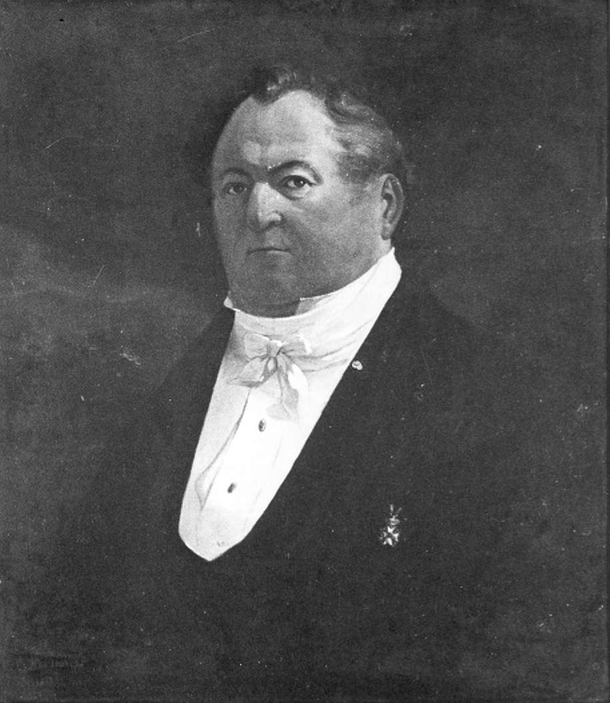

> *Plate 74. Adrianus Johannes Bik (1790-1872), baljuw (magistrate) of Batavia and guardian of Dipanagara during his stay in the Stadhuis (8 April-3 May 1830). Both A.J. Bik and his younger brother Jannus Theodorus were trained artists. Oil painting made circa 1842 and possibly by Ernest Hardouin. Bik is shown wearing the Order of the Netherlands Lion (Ridderorde der Nederlandsche Leeuw). Photograph by courtesy of the Stichting Iconographisch Bureau, The Hague.*

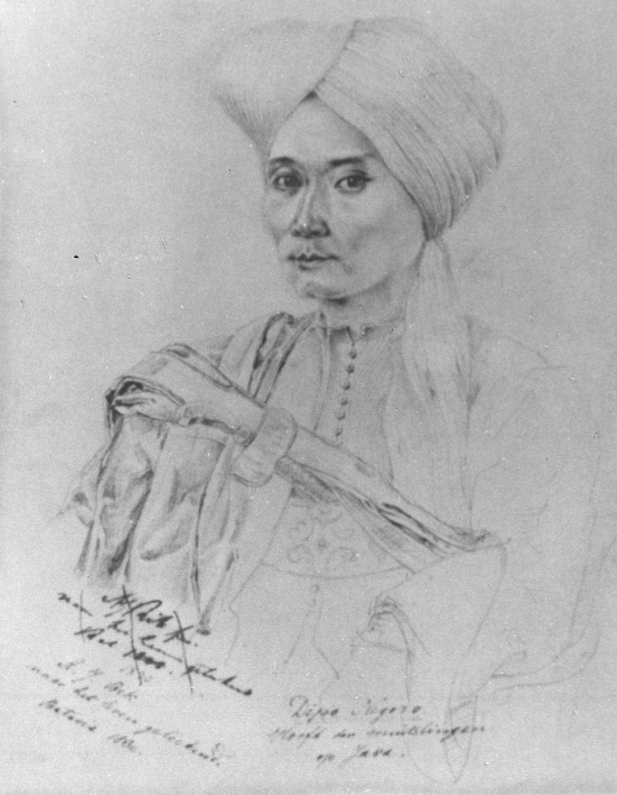

> *Plate 75. Charcoal sketch of Dipanagara by A.J. Bik. It shows him dressed in the ‘priestly’ garments which he wore during the Java War, namely a turban, an open-necked kabaya (cotton shirt) and a jubah (loose outer robe). A sash hangs over his right shoulder and his pusaka kris (heirloom dagger), Kangjeng Kyai Bandayuda, is stuck in his flowered silk waist band. The slightly sunken cheeks, which accentuate the prince’s high cheek bones, were the result of successive bouts of malaria from which he had been suffering since his wanderings in the jungles of Bagelèn at the end of the war. Photograph by courtesy of the Musium Kota, Jakarta.*

With regard to Dipanagara, he showed himself considerably less flexible. All idea of allowing the prince to remain in Java was rejected as being too politically sensitive. He was to be banished ‘for the peace of the island’ and held as a state prisoner (staatsgevangene) in Manado – ‘the most suitable place outside Java’, whither Kyai Maja and his party had recently been dispatched.[^146] Given Van den Bosch’s illness, the actual details of the terms under which the prince would be held, which included special instructions for the Resident of Manado, were worked out by two Indies councillors, J.C. Goldman and J. Bousquet, in Batavia. On 29 April, they sent their draft besluit (government order) and instructions up by special courier to Bogor for the governor-general’s signature.[^147] The following day both were officially approved.[^148] The order stipulated that ‘a suitable residence’ would be found for Dipanagara ‘in accord with his rank’, if possible on a river with a piece of adjacent ground where he could ‘wander’ and where a garden could be laid out for him. This would be chosen by the Resident of Manado, D.F.W. Pietermaat (1790-1848; in office 1827-1831) and by the prince’s officer escort, Second-Lieutenant J.H. Knoerle.

In his babad and his conversations with Knoerle during his voyage to Manado, Dipanagara also mentions these stipulations, but suggests that they were part of a promise made to him by Van den Bosch through the medium of Captain Roeps. In Knoerle’s words:

> Dipanagara made it appear as if his removal to Manado was due to his own wishes […] people had promised [him] gardens, carriages, and as it were unconstrained use of his personal liberty. […] [He] always seeks every available [opportunity] to persuade me that his freedom may not be hampered in Manado.[^149]

It is possible that, as had happened with De Kock in Magelang, the Dutch officers and officials with whom Dipanagara dealt in Batavia, especially Roeps, were less than honest about what lay in store for him. They may have encouraged him in the notion that his exile to Manado constituted a form of temporary ‘retirement’ which would give time for a letter to be sent back to Holland to request the Dutch monarch’s approval for the prince’s pilgrimage (haj) to Mecca, a journey on which he set much store and on which hoped he might be accompanied by former santri supporters who were already haji (returned Mecca pilgrims).[^150]

That this was far from the spirit of Van den Bosch’s order can be seen from the stipulations regarding Dipanagara’s status as a state prisoner. These speak more of Manado as part of a Dutch eastern Indonesian ‘gulag’[^151] than his confinement Dipanagara was kept on the second floor of the jailer’s house (ci-sche Kerk or ‘New Church’ and railings in the right foreground were demolished Photograph by courtesy of the Musium Pusat, Jakarta.

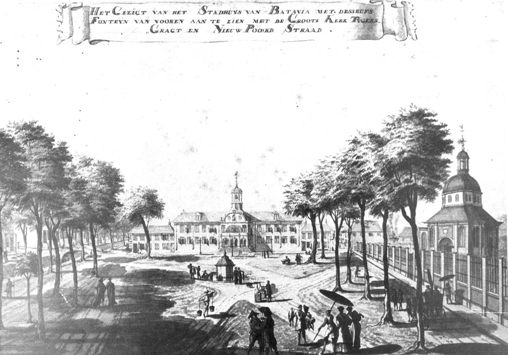

> *Plate 76. A view of the Stadhuis (Town House, Batavia) by Johannes Rach (1789). During pierswoning) which appears to the left of the main building in the picture. The Holland-in 1808, twenty-two years before Dipanagara’s arrival. Coloured aquatint with etching.*

a place of honourable temporary retirement. As many as fifty soldiers were to accompany Dipanagara on his Manado voyage. On their arrival, the Resident was to retain a sufficient number of troops to guard the prince and ensure that he could not escape. Indeed, the former Java War leader’s surveillance was made the particular responsibility of the Resident. He was to ‘closely observe’ his behaviour and actions and that of his followers, and see that no one visited him without the Resident’s express consent. At least once every three months, a report of the prince’s situation was to be sent back to Java. In the event that important events occurred, these reports were to be made more frequently, their dispatch to Java depending on the availability of shipping. Despite this close surveillance, Dipanagara was to be treated ‘in a friendly fashion’ by the Resident and due account taken of his birth and rank. The same monthly stipend of 600 guilders (half in silver and half in copper) was to be given to the prince as had been accorded to both the exiled second sultan, Hamengkubuwana II, in Ambon in 1817-1825,[^152] and the more recently banished last ruler of Palembang, Sultan Mahmud Badaruddin (reigned 1804-1812, 1813, 1818-1821), who was then ending his days in Ternate.[^153] In addition, a special allowance of f 400 in silver was to be made available by the director-general of Finances to defray the costs of the prince’s six-week voyage to Manado. As we have seen (p. 638), he was also to be permitted to choose two ‘priests’ or haji from Kyai Maja’s following in Tonsea Lama (Tondano) to assist him in his religious duties.[^154]

At the same time, the order made arrangements for Dipanagara’s family. The prince had spoken warmly about his mother and clearly hoped that she might join him in exile. In fact, both she and her grandsons chose to remain in Java.[^155] Since none of the prince’s children wished to follow him to Manado, it was proposed, seemingly at the prince’s own suggestion, that his eldest son, Pangéran Dipanagara II, and other family members should be allowed to return to live at Tegalreja.[^156] Van den Bosch agreed to this, provided ‘they did not constitute a danger for Java’. Others, such as the prince’s second eldest son, Pangéran Dipakusuma, and his third son, Pangéran Dipaningrat,[^157] were to be given quarters in the Yogya kraton. Finally, the draft decree made provision for the division of Dipanagara’s heirloom kris and pikes, Captain Roeps being tasked with distributing them amongst the prince’s family (Appendix XI). The only exception was Dipanagara’s personal kris, Kyai Ageng Bandayuda, a major pusaka which had been made from the melted metal of three of the prince’s previous heirloom weapons (Appendix XI note 2). The prince had this with him in Batavia[^158] and it remained in his personal possession throughout his exile in Sulawesi, eventually being interred with him, according to Dipanagara family oral tradition, in his grave in the Kampung Melayu in Makassar (Appendix XI note 2).

On 27 April, Knoerle, who was then serving as one of Van den Bosch’s military adjutants, received his secret orders relating to his mission as officer escort during the prince’s voyage to Manado. These were given him directly by the governor-general, who had now resumed work following his month-long sickness.[^159] The second-lieutenant was chosen because of his supposed knowledge of Javanese, Roeps not being available[^160] and Dipanagara having insisted on being accompanied by an officer who could converse with him in his mother tongue rather than in Malay which he spoke poorly and which he found deeply distasteful.[^161] Knoerle departed for Batavia with the governor-general’s signed order on 30 April and immediately called on Dipanagara at the Stadhuis to introduce himself and reassure him about the coming voy age.[^162] He then went down to the harbour to board the Dutch naval corvette,[^163] the Pollux, which was lying at anchor in Batavia roads. Recently arrived from Europe with the commander-in-chief of the Dutch Indies navy (note 176), it was deemed the most suitable available transport for the prince, equipped as it was with a deck battery of sixteen small calibre naval guns sufficient to deter attack by Buginese pirates or other hostile boarding parties.[^164]

Although it had originally been envisaged that Dipanagara would embark with his party on 1 May, there was a delay due to the need to prepare suitable accommodation for the exiled leader and his party.[^165] The corvette also had to take on six weeks’ supply of fresh water and food, no stopovers being envisaged because of the political sensitivities surrounding the corvette’s principal passenger.[^166] Eventually, at eight o’clock on the morning of Monday, 3 May, Dipanagara and his followers[^167] came on board, accompanied by Roeps and the same Batavian city administration officials who had greeted the prince on his arrival from Semarang.[^168] They were met by the corvette’s commander, Kapitein-ter-zee (naval captain) Eeg, his junior officers and the ship’s doctor, Surgeon Major H. Schillet, an expert on cholera (Schillet 1832), whom the prince took an instant liking to because his face reminded him of the former British Resident, John Crawfurd.[^169] Once the prince’s luggage had been loaded, the city officials took their leave, the hoofd baljuw (chief magistrate), Van der Vinne, stressing that if Dipanagara had any requests he should not hesitate to address himself to the Resident of Manado, who was vested with the same authority as himself.[^170] At eleven, Roeps also departed. Knoerle then saw to the furnishing of Dipanagara’s cabin and repeated again the assurances given to him at the Stadhuis regarding the respect which would be paid to the women in his party. The prince had apparently shown particular anxiety that his two radèn ayu (noblewomen) – namely his wife and sister – might be insulted or otherwise taken advantage of by the Dutch crew.[^171] There being no wind the corvette rode at anchor for almost a day and a night, much to Dipanagara’s annoyance. He gave Knoerle the distinct impression that he was anxious to put Java behind him once and for all, further sightings of the Javanese coastline ‘causing him an unpleasant feeling’. ‘He was ashamed ever to see Java again’, Knoerle reported, ‘he longed for his arrival in Manado [where] he would ask the governor-general for money and a vessel for a journey to Mecca as soon as he was strong and his heart was calm and at rest again’.[^172] At five o’clock the following morning of 4 May, a light breeze began to blow off the land and the corvette set sail as the first streaks of dawn stole over the Bay of Batavia.[^173] A new chapter in the prince’s life had begun. He would never set foot on the island of his birth again. A quarter of a century of exile and imprisonment lay before him.

## Part Two: The sultan over the water

### The Radeau de Méduse: surviving the corvette Pollux, 4 May-12 June 1830

For a Javanese for whom the nearest encounters with the ocean had been a brief pilgrimage to the south coast in circa 1805 (Chapter IV) and subsequent meditations in the grotto of Suralanang (p. 543), Dipanagara’s nearly six weeks at sea – much of it becalmed – would not be a pleasant experience. The prince’s reference to this purgatorial odyssey in his babad is suitably laconic:

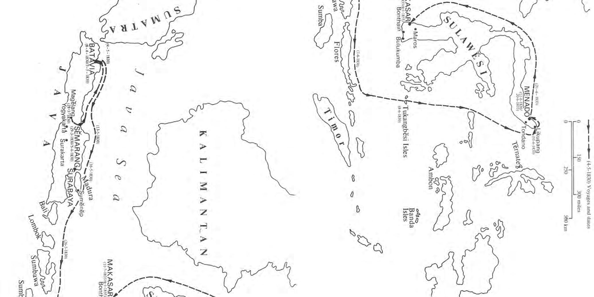

> *Map 6. Dipanagara’s journey into exile in Manado (1830-1833) on the corvette Pollux (4-5-1830 – (20-6-1833 – 11-7-1833. Map drawn by J. Wilbur Wright of Oxford.*

12-6-1830) and his subsequent voyage to Makassar (1833-1855) on the sailing sloop Circe

> XLIII. 308 The sails were set and [we] left Batavia for Manado, but there was no wind and the boat was exceedingly slow.

> 309 […] many of the accursed [Dutch crew and soldiers] were sick and died on board ship. The sultan was troubled at heart.

> 310 Maybe we will all be damned [to die] and not reach Manado. We speak no further of this. They arrived in Manado.

> 311 Two and a half months long [sic] was the sultan’s journey from Batavia to Manado because there was no wind.[^174]

Knoerle’s own diary closely echoes the spirit of Dipanagara’s account. At seven in the morning of the first day, for example, the prince summoned the second-lieutenant to his cabin and requested he be taken on deck, one of only six occasions, according to Knoerle, during the whole forty-day voyage when the exiled leader came up from his cabin (Knoerle 1835:167-8). ‘The compass, the ship with sails set on high and the motion of the vessel’ caught the prince’s delighted attention, but death, which stalked the ship daily, had already shown its grim face:

> The detachment of troops had one dead who at that moment was sent overboard. The burial ceremony caused the prince to ask whether the deceased had been a captain. On [my] answer that he was an ordinary soldier, Dipanagara asked why we paid more attention to a dead than a living person.[^175]

In the first five days alone, four died, the ceremonies for the burials – the slow march of the honour guard of soldiers and the muffled drums – being heard distinctly by the prince in his cabin below the quarter deck.[^176] Laid low by his recurrent malarial fevers and afflicted by repeated vomiting from sea sickness, the prince’s face grew steadily more sunken and thin. He thought that perhaps his own time had come. A week into the voyage, he confided to Knoerle that he was content to die, trusting absolutely in The Almighty. As his fever-wracked body was gently rubbed down with eau-de-cologne provided by the German officer, his wife, Radèn Ayu Retnaningsih, lay weeping at his feet.[^177]

Despite the intensity of his bouts of malaria and his increasingly cadaverous appearance, Dipanagara was not yet at death’s door. A great believer in traditional Javanese remedies, he regularly dosed himself with freshly prepared beras-kencur made of camphorated galanga root, turmeric, rice flour and palm sugar, forcing Knoerle on occasion to beat a hasty retreat from his cabin so close and overpowering was the smell of the herbal concoctions.[^178] In the periods when his fever lifted, Dipanagara showed an intense interest in his surroundings. The geography of eastern Indonesia fascinated him. How far was Ambon from Manado? Was Manado a long way from Makassar or the tanah Bugis (Bugis region) of South Sulawesi? Could he see the map of ‘Makassar’ which he had noticed up on the fore-deck so that he could acquaint himself with the shape of the island of Sulawesi?[^179] When Knoerle demurred saying that the ship’s chart of Sulawesi was the only one available for navigational purposes, the prince did not give up. He wanted to know about the sea route to Jeddah. Were the coasts of Sulawesi navigable and what sort of inhabitants lived there, Christians or Muslims?[^180] Was it the custom in Europe, Dipanagara wanted to know, to exile a leader who had been defeated in battle to a far off island and cut him off from all his relatives? What was the Java War leader planning? Another Elba-style escape? Another Hundred Days? Knoerle could well wonder. He cited the example of Napoleon, like Dipanagara just forty-four years old when he was sent into exile, but did so ‘in a gentle way omitting all painful remiscences’.[^181] Eventually, tiring of these ‘peculiar questions’, he let the prince see a copy of the British map maker and hydrographer James Horsburgh’s (1762-1836) sea chart of the Indonesian archipelago to give him an explanation of the various islands. Dipanagara’s interest remained focussed on Ambon, Makassar and the sea route to Jeddah which could only be traced on the chart as far as Pulau Pinang.[^182]

Knoerle clearly found the prince at turns fascinating and exasperating. On 14 May, at two o’clock in the morning as heavy storm showers swept up from the south off the mountains of Japara, ‘Dipanagara rushed out of his cabin all of a sudden and shrieked to me to come to him; […] the commander of the corvette should drop anchor immediately!’ The officer escort had to explain the infeasibility of this suggestion, pointing out that they could make use of these showers to advance their journey by putting out more sail and tacking along the coast.[^183] The next day, the eleventh of their voyage, Knoerle confided in his diary that ‘Dipanagara was unbearably capricious, the sea was dead calm, it was very hot, and we were near the coast of Lasem’, the sight of the Javanese coastline making the exile feel deeply uneasy. ‘The prince asked me to procure some sirih (leaf for the preparation of betelnut) during the journey past Surabaya or Madura, and if possible also some fruit.’[^184] His requests could not be granted given the necessity of avoiding port visits. Even encounters with the pilots of Sidhayu or Surabaya, who might have had sirih on board, were deemed inexpedient.[^185] Yet, here was the same prince who insisted on sending Knoerle rice cakes every day from his table and inviting him to breakfast off potatoes, sambal (hot spiced chilli condiment), tea and ship’s biscuits served by his Radèn Ayu while sitting side-by-side with him on his large straw mattress, who delighted in the pictures in the books and almanacs which Knoerle lent him (p. 109), and in the Rhenish and Cape wines which his officer escort procured for him as ‘medicine’ for his impromptu wine tastings.[^186] The same prince who asked to have the oil portrait of King William I (reigned 1813-1840), which hung in Captain Eeg’s quarters, to be brought to his cabin so that he could show it to his womenfolk.[^187]

During these encounters – ‘conversations on a straw mattress’ as Knoerle later depicted them[^188] – in which Dipanagara would address the second-lieutenant in Low Javanese as kowé (familiar ‘you’),[^189] the prince ranged over a staggering range of topics. These included Javanese history and mythology as well as reminiscences of his own life and times. His wartime experiences loomed large, no doubt because of Knoerle’s line of questioning, his diary being compiled as an intelligence briefing for the governor-general on the causes and consequences of the Java War. For example, when the ‘Pollux’ passed Sumbawa, the island where Dipanagara’s great-grandmother, Ratu Ageng Tegalreja’s, maternal family hailed from (p. 76), and the prince began to talk of the long-standing small prau (outrigger sailing boat) trade between Bima, Lombok and Blambangan in the eastern salient of Java, Knoerle immediately sought to probe him for further information on his supplies of war matériel. The German officer suggested that the government ‘knew full well’ that he had received gunpowder during the war from these eastern Indonesian sources, a suggestion which Dipanagara vigorously denied.[^190]

Knoerle’s personal view of the prince was predictably contradictory: on the one hand, he was full of praise for the Java War leader’s ‘strong and enterprising character’, ‘shrewdness’, and ‘acute judgement’ (p. 107). On the other, he was disdainful of his religious convictions. Here he betrayed the prejudices characteristic of even the most enlightened of his nineteenth-century European contemporaries. One thinks, for example, of the great Dutch author, Multatuli (Eduard Douwes Dekker, 1820-1887), who dismissed the prince as a ‘poor fanatic’ (armen dweeper) during his conversations with Colonel Cleerens in the Preanger Highlands in 1845-1846.[^191] Knoerle pre figured Multatuli’s views in his concluding letter to Van den Bosch on his arrival back in Java:

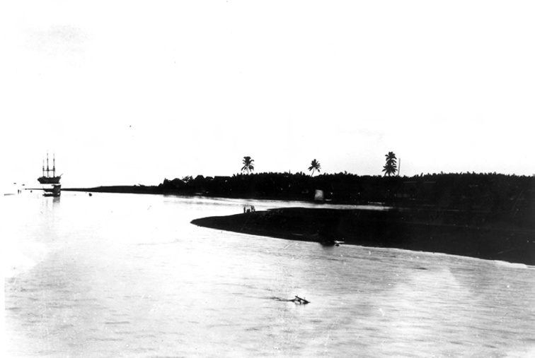

> *Plate 77. The bay of Manado with a three masted schooner (probably a mail boat) anchored off the town. Photograph taken between 1860 and 1870, perhaps by Woodbury and Page. Courtesy of the KITLV, Leiden.*

> I got to know this selfsame state prisoner Javanese prince as a zealot, who considered his religious principles as the highest and most elevated on earth, and who wished to erect his religious establishment on the ruins of all other systems. [^192]

By 1 June, the corvette had sailed to its furthest point east arriving to within sight of the small islet of Paloe on the same longitude as Endeh off the north coast of Flores, a sighting which caused Dipanagara to express surprise when he learnt that the Dutch had yet to appoint a Resident on the island.[^193] From here it turned to the north making for the Bangka Strait off the northern tip of Minahasa. Ten days later, it was in front of the Dutch trading post at Likupang situated in the strait itself (Map 6). A number of small fishing boats came up to sell local produce, but even here it was not possible to acquire sirih for Dipanagara. The corvette commander decided to sail on. Finally, on 12 June 1830 at eleven in the morning, the Pollux dropped anchor in the roads of Manado. The following day the prince and his followers disembarked and were escorted to Fort New Amsterdam, the Dutch military strongpoint – later destroyed by American bombing in World War II – which would be their home for the next three years.

### A Minahasan interlude: Dipanagara’s Manado years, 1830-1833

According to the prince’s babad, Van den Bosch had promised him through the intermediary of Captain Roeps ‘seclusion and quiet’ in a large house with an extensive view close to mountains and sea, in a place where there were many large gardens, fine houses, and places to wander undisturbed (note 150). So what did Dipanagara find in Manado? The British naturalist, Alfred Russel Wallace (1823-1913), who visited the Minahasan capital just four years after Dipanagara’s death in January 1855, described it in glowing terms (Wallace 1890:185):

> The little town of Menado [Manado] is one of the prettiest in the East. It has the appearance of a large garden containing rows of rustic villas, with broad paths between, forming streets generally at right angles with each other. Good roads branch off in several directions towards the interior, with a succession of pretty cottages, neat gardens, thriving plantations, interspersed with wilderness of fruit trees. To the west and south the country is mountainous, with groups of fine volcanic peaks 6,000 or 7,000 feet high, forming grand and picturesque backgrounds to the landscape.

Although the scenery may have lived up to the governor-general’s promise and the freedom granted the prince was immediately honoured,[^194] it soon became clear that Van den Bosch’s original intention that the Java War leader should be lodged in a secure location in the interior of Manado Residency was impractical. When Knoerle met with Resident Pietermaat on the day of the arrival of the Pollux, it was decided that the prince should be lodged temporarily in a four-room house in Fort New Amsterdam, the main Dutch fortress in Manado. The designated building, which had large verandahs to the front and rear, was normally used as the Residency offices, and to make it more habitable for Dipanagara’s stay, a wash-house with an outside gallery was hurriedly constructed.[^195] Suitably ‘elegant’ furniture was also acquired. This included a book shelf and writing desk with drawers, as well as a large standard lamp equipped with the latest patent oil light.[^196] No less than twenty-four oil lamps were also purchased for the prince’s quarters.[^197] Dipanagara clearly intended to undertake some writing during his time in Manado. In addition, six gun lanterns (geschutlantarnen) were transferred from the Pollux to help the military detail tasked with the guarding of Dipanagara in Manado and his fellow exile, Kyai Maja, in distant Tondano, to illuminate their respective guard posts. Two horses were also bought for the prince so that he could undertake excursions outside the town and he asked for three saddles and harnesses to be sent out to him from Magelang.[^198]

By the time Knoerle departed for Java on 20 June, the decision had been taken that the prince would stay in Manado, there being nowhere in the interior to put him. In the intervening days (14-17 June 1830) Knoerle had made an extensive tour of the interior travelling through the mountainous districts of Tomohon, Tonsawang, Tondano and Sonder. It soon became clear that the only suitable location in the interior for Dipanagara was Tondano. But there was a problem which Knoerle had not anticipated. Kyai Maja and his 62-strong following had arrived in Manado from Ambon on 1 May and had been settled at Tonsea Lama in this selfsame district (Knoerle 1835:173-5; Chapter XI note 75). Their transfer and settlement in Tondano had been physically challenging. According to the second-lieutenant, only the allocation of two coffee gardens by the Resident, had made it possible for such a large community to sustain themselves by their agricultural activities (Knoerle 1835:175). All the ricefields and houses – apart from a dwelling used by the Resident during his inspection journeys into the interior which had been temporarily allocated to Kyai Maja[^199] – had had to be constructed from scratch. It was feared that even though Dipanagara’s party was smaller, such a move would be equally physically challenging. But the key issue was political. Both Knoerle and Pietermaat considered it entirely inappropriate that the Java War leader and his chief religious adviser should end up in exile in the same Minahasan location (Knoerle 1835:173-4). No matter that relations between the two men were at rock bottom, something which Knoerle soon surmised from the refusal of the two haji from Maja’s party to accede to Dipanagara’s request to join him in Manado,[^200] the mere possibility that Maja and the prince could again be in close contact was anathema. Pietermaat and Knoerle’s task was made easier by Dipanagara’s clear preference to remain in the Minahasan capital on account of the climate – he feared the chill of the high Tondano plateau where the early morning temperature could fall to below seventy degrees Fahrenheit.[^201] The two Dutch officials thus revised Van den Bosch’s original instructions and made a unilateral decision to keep the prince in Fort New Amsterdam pending the arrival of an engineer officer from Ternate tasked with undertaking a survey of alternative accommodation in the environs of Manado.[^202]

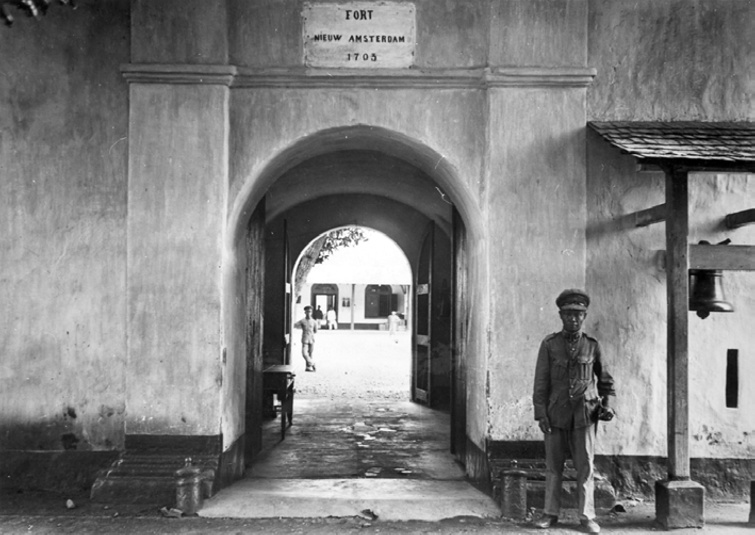

> *Plate 78. ‘Fort Nieuw Amsterdam’, Manado (completed in 1705) where Dipanagara was kept between June 1830 and June 1833. The Resident’s house in which he had his accommodation can be can be seen through the open gateway. The fort was later destroyed by American bombing (circa 1944). Photograph probably taken in the 1930s. Courtesy of the KITLV, Leiden.*

On 19 June, just a week after the ‘Pollux’ arrived, the corvette’s commander and ship’s officers came to the fort to take their formal leave of Dipanagara. They were returning the next day to Batavia via Surabaya, a journey which would be completed in just nineteen days. Some fifty-three soldiers,[^203] under the command of Second-Lieutenant C. Bosman remained behind to guard the prince. Unfortunately, this junior officer, unlike Roeps and Knoerle, lacked the diplomatic and linguistic skills needed to handle Dipanagara. Within weeks, his ‘rough and inconsiderate’ behaviour had caused Pietermaat to arrange his transfer to Ternate, where the 40-strong garrison was in need of an additional officer.[^204] In his babad, Dipanagara mentions this courtesy visit and the conversation which took place between himself and Knoerle and Captain Eeg. After confirming his monthly stipend of 600 guilders, the commander of the ‘Pollux’ suggested that the prince might have a personal message for the governor-general. Perhaps he would like to send a letter back to Java which he could take for him? ‘No’, Dipanagara replied, ‘I have no desire to send a letter for I cannot write […] just send my regards to General Van den Bosch!’[^205]

This pretence of illiteracy on Dipanagara’s part was somewhat disingenuous. The prince could write in Javanese albeit with many grammatical errors (Appendix XIII). Indeed, we will see shortly how, when necessity demanded, he could get letters – and even major literary endeavours like his 43-canto autobiographical babad – written, especially if he had the services of an amanuensis. So pleading lack of literary skills was perhaps a way of sending his own message to Van den Bosch that the governor-general’s failure to meet him during his three-week sojourn in the colonial capital had not gone unnoticed. Privately, however, Dipanagara did seek to get some messages through to ‘his exalted friend’ in Batavia. In particular, he asked – in a formal agreement drawn up by Knoerle and witnessed by Bosman – that his wives, who had remained behind in Yogya (Appendix IV part 2), and those of Kyai Maja and his fellow exile commanders, who were sharing the kyai’s banishment in Tonsea Lama, should be sent out from Java to be reunited with their husbands. He also requested that his two close religious advisers, Haji Badarudin and Haji Ngisa, should be allowed to join him in Manado, and that Van Den Bosch should remain the ‘protector’ of his children in Mataram. [^206] Although Kyai Maja’s wife was indeed brought over to Minahasa – although not on compassionate grounds (Chapter XI note 76) – all Dipanagara’s other requests were met in the negative. None of his other wives wished to share his exile. Nor too did the two haji. They were too busy making new careers for themselves in the post-war Netherlands-Indies, Haji Badarudin as chief pengulu of Bagelèn (Appendix VIIb) and Haji Ngisa as religious adviser to Senthot and his government-sponsored barisan (troop) in Ungaran.[^207]

Dipanagara’s life as an exile in Manado would not be easy. Soon after the departure of the Pollux, according to the account given in Dipanagara’s babad, Manado was visited by a serious epidemic – possibly cholera or dysentery – during which many of ‘the accursed’ (laknat), by which Dipanagara presumably meant the local Dutch, non-Muslim Chinese and Christian Manadonese inhabitants, died.[^208] At the same time, the sudden contraction of the prince’s world to four rooms in Fort New Amsterdam in the company of his wife, sister and brother-in-law, after five years of war and the solitude of his last months as a fugitive in the mountains of western Bagelèn, was hard to bear. Scarcely a month after his arrival, the prince decided that he no longer wished to ride out into the surrounding countryside, the environs of Manado not be ing suitable, in his view, for excursions on horseback and the saddles which he had asked for from Magelang not having arrived.[^209] The two horses, which had been bought for him by the local Dutch authorities, were returned to their previous owners.[^210] He now asked that henceforth he should just be addressed as ‘Pangéran Ngabdulkamit’, a title which he would alter to the more spiritual epithet of fakir (mendicant) Ngabdulkamit after his transfer to Makassar in July 1833 (pp. 151-2).

In keeping with his mendicant aspirations and with an eye to saving money for his long planned pilgrimage to Mecca,[^211] Dipanagara began to be very close fisted with his cash stipend. By late August 1830, Resident Pietermaat became alarmed that he might be building up a ‘war chest’ so substantial were his savings in money and jewels.[^212] He took the immediate decision to cut the prince’s monthly income by two-thirds to just 200 guilders. This was clearly too drastic as Dipanagara needed over half this stipend just to pay his servants and kitchen expenses, but out of pride he appears to have kept silent only remarking, ‘It is well. The government fixed my income at f 600 without consulting me and can [now] only but act as it thinks fit!’[^213] Eight months later, Pietermaat’s temporary replacement, J.P.C. Cambier (in office 1831-1842), decided to raise this to f 311 a month, a move which Dipanagara again greeted with studied indifference. His ‘extreme obstinacy’ and pride, in Cambier’s words, prevented him from ever asking for more money from the Dutch authorities.[^214] Although this stood at f 350 in July 1837 after the government had taken the decision to send the bulk of the prince’s followers back to Minahasa, it was still not sufficient – given Dipanagara’s growing family – to prevent his household descending into a state of near poverty by the late 1840s (note 268).

In an extraordinary piece of creative accounting tellingly illustrative of the way in which the Dutch made their fortunes in the post-Java War Indies both the Resident of Yogyakarta, F.G. Valck (in office 1831-1838, 1838-1841), and the director-general of Finances in Batavia advised that the Yogya court, which was being charged the full costs of the prince’s upkeep, should not be informed that Dipanagara’s monthly stipend had been cut in half. Instead, they proposed that the sultan’s treasury be made to pay a lump sum of f 22,200 for the first three years of the exile’s maintenance, which included his period in Batavia, that sum being immediately credited to the account of the Resident of Manado.[^215] Even the small purchases of sirih and other necessities, which the prince had made during his three-week sojourn in the colonial capital, were to be included in the Dutch accounts.[^216] Such pettifoggery on the part of the Dutch authorities, the same mean-mindedness which would make the exile life of the Padri leader, Tuanku Imam Bonjol (1772-1864), such a misery when he was moved to Manado in 1840 (Dobbin 1972:19), appear to have taken their toll on the prince. Like Bonjol after him, Dipanagara does not seem to have been very well received by the local Christian and Muslim inhabitants of the Minahasan capital. The popular tradition that the prince had been so incensed by the abuse he had suffered in the local market (pasar) that he had flung his heirloom walking staff on the ground causing the ground to rock as though in an earthquake (Chapter III note 66), may be a reflection of this. So too was the Resident’s account of the rebuff administered to the prince by a leading Muslim inhabitant of Manado, Lieutenant Hasan Nur Latif, whose daughter’s hand Dipanagara had sought in marriage (p. 119). A commissioned officer in the Dutch East Indies Army, Latif had remarked that the union would bring his child ‘ill fortune’, a sentiment endorsed by the acting Resident who observed that from a political point of view it was unsuitable for a prominent Islamic citizen like Latif to be linked by marriage with the exile prince.[^217] Despite Latif’s refusal, Dipanagara continued to lead an active sexual life during his period in exile in Manado and Makassar.

As we have seen (pp. 117-8), Cambier’s predecessor, Pietermaat, had already reported that Dipanagara’s ‘greatest conversation is about women of whom he seems to have been a great lover’, and he would go on to have no less than seven children in exile, some by Javanese women other than his official consort, Radèn Ayu Retnaningsih (Appendix IV).

The growing tensions of family life in the enclosed confines of Fort New Amsterdam, however, clearly made for difficult inter-personal relations within the prince’s immediate family. In April 1831, the acting Resident was reporting that,

> The prince at present leads a very unpleasant life and his own intolerant humour is the entire cause of it […] most of the time he is quarrelling with his sister, or with his wife and brother-in-law [Radèn Tumenggung Dipawiyana], [who] have pressed for buying [him] a garden.[^218]

Purchased and laid out for the sum of f 254, this garden lay one and a half leagues (7 kilometres) from Manado close to the Saria River with a hill behind.[^219] A pleasant spot, but one which Dipanagara cared less and less to visit. Instead, it was given over to growing vegetables for the prince’s table, the f 40 bamboo dwelling, which had been constructed on the adjacent hillside as a meditation hut, being used by the prince’s sister and brother-in-law to put some distance between themselves and their increasingly cantankerous relative. Dipanagara’s physically imposing younger sister, who shared the prince’s commoner stock on her mother’s side,[^220] seems to have been at the heart of this growing family rift. Described by Knoerle as ‘resolute and free, […] and of a very vivacious spirit’,[^221] Radèn Ayu Dipawiyana appears to have gone head-to-head with her elder brother in numerous family tiffs. In his babad, Dipanagara mentions that after he had been in Manado for some time,

> XLIII.329 many trials came to test the sultan. Often his own younger sister Radèn Ayu Dipawiyana

> caused him feelings of shame together with the tumenggung [her husband]. But the sultan paid the two no attention. Night and day only the Almighty afforded the sultan protection, [along with] the grace of [His] Holy Prophet.[^222]

Soon the Resident was reporting that, given a free choice, all Dipanagara’s family, including his wife, Radèn Ayu Retnaningsih, and his servants would have liked to leave the prince and return to Java. Since the Resident’s instructions, received from his counterpart in Batavia, J. van der Vinne, explicitly stated that all these individuals shared Dipanagara’s status as state prisoners (staatsgevangenen), Cambier first had to seek permission from Batavia. Enquiries by the governor-general indicated that there would be no objection to either Retnaningsih or any of the prince’s other followers from returning to their respective homes in Java. They had all accompanied him voluntarily and were not considered ‘dangerous for the general peace’.[^223] Thus reassured, Van den Bosch passed a decree in council on 2 July 1831 giving Dipanagara’s wife and followers formal leave to repatriate themselves.[^224] In the end, Retnaningsih, who had just been delivered on 4 January 1832 of Dipanagara’s first child born in exile, Radèn Mas Kindar, also known as Radèn Mas Abdurrahman,[^225] elected to stay with her husband, leaving the prince’s younger sister and brother-in-law, together with their intimate retainer (panakawan), Rajamenggala, to return to Java with their wives, servants and children in August 1832.[^226] For Dipanagara, it must have been a merciful relief to be rid of his feisty sibling and her equally difficult husband. The four rooms in Fort New Amsterdam were now left free for the prince and his wife to care for their eight-month-old son, whose birth, according to Cambier, had given the prince much pleasure.[^227] Radèn Mas Kindar would grow up, according to an official report, into a strikingly handsome and energetic young man whom Dipanagara would take care to educate – along with his younger brothers, Radèn Mas Sarkuma (1834-1849) and Radèn Mas Dulkabli (alias Radèn Mas Mutawaridin; born circa 1835),[^228] – ‘as a priest’, namely in the pesantrèn (religious boarding school) style. He would develop into a warm and zealous Muslim with a deep hatred of all things Dutch.[^229]

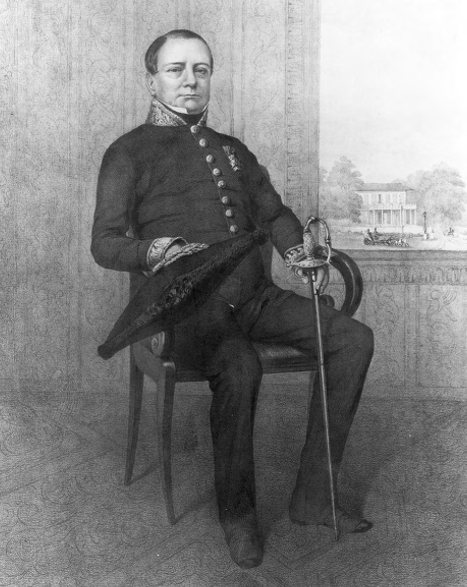

> *Plate 79. Daniel François Willem Pietermaat (1790-1848), Resident of Manado (1827-1831) and deputy governor of Makassar (1833). He oversaw Dipanagara’s transfer from Manado to Makassar in June-July 1833, and later became Resident of Batavia (1834-1837) and Resident of Surabaya (1839-1848), where he died. Lithograph probably made in 1838, when he was on sick leave in the Netherlands. The house depicted through the open window is probably the Residency House of Batavia or Het Huis Simpang in Surabaya. Photograph by courtesy of the Stichting Iconografisch Bureau, Den Haag.*

One of the ways in which Dipanagara sought to educate his children in the iniquities of Dutch rule was by entertaining them with accounts of his life and times. In the words of the Civil and Military Governor of the Celebes (Sulawesi) Colonel Alexander van der Hart (1808-1855; in office, 1853-1855, who reported to the governor-general immediately after Dipanagara’s death on 8 January 1855, the prince had kept (Sagimun 1965:360):

> his sons constantly engaged in prison [in Fort Rotterdam, Makassar, 1833-1855] with tales of his life and adventures […] an embittered father, he considered us [the Dutch] as his [sworn] religious enemies and the cause of all his misfortunes and protracted suffering. He thus imprinted little love for us on his children’s [minds].

The principal vehicle for Dipanagara’s instruction was his autobiography whose inception the prince described somewhat fancifully as follows (Carey 1981a:lx note 78):

> XLIII.322 Resident Pietermaat

> 323 enquired of the sultan [Dipanagara]: ‘What is the reason Your Highness came here?’ Smiling the sultan replied:

> 324 ‘Ah, Resident, if you ask me, promise me can you deliver this letter [requesting permission to depart on the haj] to the King of the Netherlands [William I, reigned 1813-1840]?

> 325 If you promise it, I will indeed tell you the reason why I came to Manado. If you cannot promise, then it is in vain

> 326 that I tell you the real facts.’ The Resident gave his pledge. Then he was given the chronicle from the very beginning

> 327 until the final arrival in Manado. Resident Pietermaat, when he heard the truth, became deeply ashamed

> 328 because of the perfidy of his countrymen, how they had been able to end the war in this treacherous fashion. We talk no more of this.

Pietermaat may well have encouraged Dipanagara to write down his personal memoirs, although by the time the prince began to compose his babad on 20 May 1831, the Dutch official had already departed from Manado to take up a post in Batavia.[^230] We know from the late nineteenth-century scholar, A.B. Cohen Stuart, that the manuscript, which ran to over 1,000 folio-sized pages in pégon, the script favoured by the more self-consciously religious communities in Java, remained in the hands of Dipanagara’s descendants in Makassar after his death and was presumably considered by them as a family heirloom.[^231] It was divided into two parts. The first part – roughly a third of the entire work – gives the history of Java from the fall of Majapahit (circa 1527) to the peace of Giyanti (1755). The second part deals with the prince’s own life and times from his birth in 1785 to his exile in Manado. Completed in just under nine months (20 May 1831-2 February 1832), it was written precisely during the period when the tension between Dipanagara and his close family members was at its height. Given the intensity of Dipanagara’s output – over one hundred folio pages a month – for which he had only the help of a single amanuensis,[^232] it is not hard to surmise that during this period Dipanagara would have had his attention completely focussed on his literary production. No wonder that he eschewed horse rides and visits to his garden plot and meditation hut. No wonder that he proved a cantakerous and difficult companion to his increasingly exasperated family during these months in Fort New Amsterdam. What author, cooped up in four rooms in a hot fortress town whose inhabitants were indifferent if not hostile, and with argumentative relatives would not have felt as he did? The pains of exile and authorship hardly come more purgatorial than this. But what a manuscript would result. The source of Dipanagara’s anti-Dutch teachings for his growing family in Manado and Makassar, it would prove to be one of the great historical productions of modern Java – a national treasure strangely without honour in contemporary Indonesia. Here is how this magnificent work begins:

> I. 1 ‘I lay out the feelings of my heart in the [sad] Mijil metre. Created to bring solace to my heartfelt desires, it was done in the town of Manado without being seen by anyone, but the grace of The All-Knowing One.

> 2 Much does my heart feel of [past] discordant actions. So now my heart is fixed. How would it be with my actions if there was not also the forgiveness of The Almighty?

> 3 I have experienced shame and suffering, but my request is that all former things should be set aside, [and] that my family should truly observe the Religion of The Prophet thereby gaining succour.[^233]

### Closing the circle: the state prisoner of Fort Rotterdam, Makassar, 1833-1855

Even as Dipanagara was dictating these lines, half a world away in the Kingdom of the United Netherlands, events were taking place which would alter radically the conditions under which the prince and his family were held in exile. Exasperated by the same Dutch quest for immediate profit which had led to such suffering in south-central Java before the Java War (Chapter IX), the inhabitants of the Southern Netherlands had risen in revolt following an insurrection in Brussels on 24 August 1830. Belgian independence had been proclaimed (4 October 1830), but despite the pressures from the great powers and the elevation of Leopold of Saxe-Coburg as the new Belgian monarch (21 July 1831, reigned 1831-1865), the Dutch king, William I (reigned 1813-1840), had refused to disarm. A series of military engagements had ensued which eventually led to a French army entering Belgium in support of the nationalist forces and bombarding the citadel of Antwerp where a Dutch garrison under General David Hendrik Chassé (1765-1849)[^234] eventually surrendered after a heroic two-year siege (December 1832). In early 1833, it seemed that the French might even cross the Dutch-Belgian border into Zeeland. With a European war looming, Van den Bosch became seriously alarmed that ‘an unscrupulous enemy’ – by which he clearly meant the British – might seek to use the large numbers of exiles in the ‘outer possessions’ for political purposes. In particular, he was concerned that Dipanagara might take advantage of the opportunity of a new European conflict to escape and return to Java to lead a new rebellion.[^235] It was clearly inappropriate for him to remain in the town of Manado close to the shipping routes where British naval forces might reappear at any moment to repeat their previous 1795-1797 and 1808-1810 amphibious operations when nearly all the Dutch outer island possessions had fallen into their hands. The trusted Pietermaat was thus delegated to leave his post at the High Court in Batavia and return immediately to Manado to arrange for Dipanagara’s transfer to a newly constructed strongpoint deep in the Minahasan interior.[^236]

Once in Manado, Pietermaat soon realised that Van den Bosch’s proposals were impractical. The Netherlands Indies Government had no legal sovereignty in Minahasa, its authority depending on a contract with the local chiefs dating back to 1810. It thus had no rights over land. Without the permission of the local authorities no fort could be built in the interior. Besides, none of the chiefs, in Pietermaat’s view, would believe that such a strongpoint was being constructed only to house an ‘unimportant person’ like Dipanagara. They would suspect that it was a move by the government in the direction of outright annexation and they would resist it. If it came to war, what could a garrison of 40 Dutch and native troops in Manado do against a hostile Minahasan population of 80,000? Furthermore, the British were well liked in Minahasa. During the period of their rule (1811-1817), they had treated the population well giving lavish presents to the local chiefs and demanding no forced deliveries or personal labour services from the peasant cultivators. If they landed they would be welcomed with open arms.

An alternative strategy would have to be found. One such alternative actively canvassed by Van den Bosch both during his period as commissioner-general of the Netherlands Indies (1832-1834) and as minister of the Colonies (1834-1839), was to send Dipanagara, along with other prominent Indonesian exiles, back to the Netherlands. His suggestion was that they should be held in one of the royal fortresses which served as state prisons for members of the Dutch elite, such as Loevestein in Gelderland[^237] and Woerden in the province of Utrecht.[^238] All the costs would be met by the Indies exchequer, meaning, in Dipanagara’s case, the Yogya court. If Dipanagara had rejected Tondano with its 69 degree Fahrenheit mean early morning temperature as too cold (note 201), no leap of the imagination is necessary to contemplate how many Dutch winters he would have survived in the damp fortresses of the Netherlands ‘water line’ frontier defence system.[^239] It was fortunate for the prince that the Dutch king rejected Van den Bosch’s proposal out of hand as politically unacceptable.[^240] Indeed, it would not be until the early twentieth century that Indonesian exiles were sent back to the Netherlands and then as in-country detainees rather than as state prisoners incarcerated in royal fortresses.[^241]

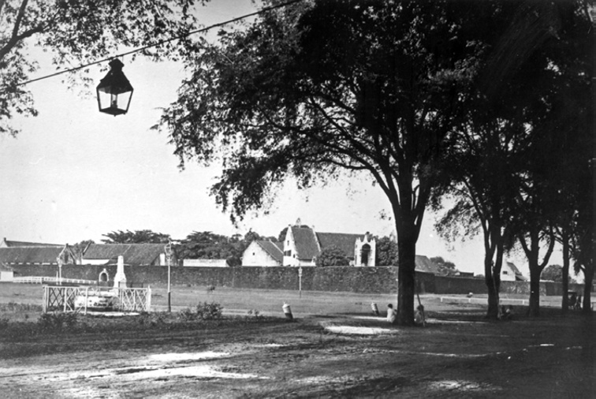

> *Plate 80. A view of Fort Rotterdam, Makassar looking towards the north-east bastion (Bastion Mandarsaha), probably taken in the late nineteenth century. The building which housed Dipanagara and his family is the second from the left immediately behind ‘landward’ gate (landpoort). The tall building over the wall in the foreground housed the guardhouse and powder-magazine of the Bastion Mandarsaha. Photograph by courtesy of the KITLV, Leiden.*

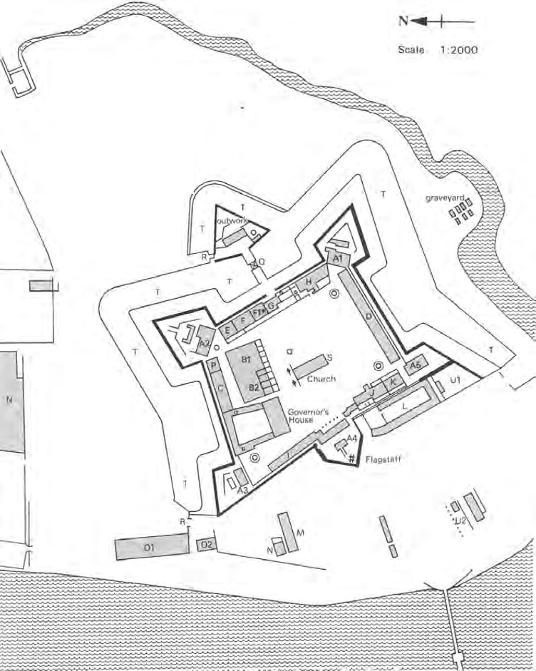

> *Map 7. Groundplan of Fort Rotterdam, Makassar (now Benteng Makassar) showing the main buildings and Dipanagara’s quarters, 1833-1855. Outline taken from the NA (Nationaal Archief), Leupe Collection 1309, ‘Hoofd plan van ’t Kasteel Rotterdam [...]’, door C.F. Reimer, n.y. [1770?]. The relevant places relating to Dipanagara are: F – the house of the VOC storekeeper (winkelier) which after August 1809 was converted into officers’ quarters (no. 6); F1* – officers’ dwelling no. 7, the location of Dipanagara’s quarters near the main guardhouse with an attic view over Makassar harbour and which in 1844 were enlarged by the addition of two rooms from the adjacent officers’ dwelling no. 6; G – the main guardhouse or hoofdwacht. Map drawn by J. Wilbur Wright of Oxford.*

With his plans to transfer Dipanagara to the Netherlands finding little favour, Van den Bosch hit on an Indies alternative. The prince would be moved south in deepest secrecy to Makassar where he would be held until his dying breath in Admiral Cornelis Janszoon Speelman’s (1628-1684) great stronghold of Fort Rotterdam.[^242] Instead of Manado’s puny 40-strong garrison, the south Sulawesi fortress boasted a complement of 200 soldiers and powerful gun batteries mounted on its five great bastions which covered all the approaches from sea and land. It was altogether a more formidable defensive structure. In this way, Dipanagara and his followers[^243] would exchange Fort New Amsterdam for Fort Rotterdam travelling the length of the Dutch eastern Indonesian gulag by naval schooner, a clandestine twenty-one day (20 June-11 July 1833) odyssey made all the more poignant by the name of the vessel tasked with transporting them, the Circe, styled after the queen goddess in Homer’s epic who could transform men into animals. Van den Bosch went to enormous lengths to ensure that even the local Dutch authorities in Manado were not informed of Dipanagara’s true destination. Acting Resident Cambier was to be told that the prince was bound for Ternate. Meanwhile, the schooner’s captain was only to be instructed to hold course for Makassar when he had cleared the roads of Manado. On reaching Makassar on 11 July 1833, the ship’s officers were sworn to secrecy and forbidden to enter into any correspondence regarding their voyage. The ship’s log was altered and immediately after depositing the prince and his party, it sailed to Ambon making it look as though the Moluccas had been its original destination all along. On arrival in Ambon, the captain was relieved of any obligation to report his movements to the local Dutch authorities in Fort Victoria. [^244] But even these strict instructions seem to have been of little avail in preventing the schooner’s Indonesian sailors from reacting badly to the former Java War leader’s presence in their midst. Jan Izaäk van Sevenhoven (in office 1832-1839), who served as a member of the Raad van Indië (Council of the Indies), would later advise that Dipanagara should never again be moved by a Dutch warship given the possibility of mutiny amongst the ship’s crew. Any further transfers should be by ‘colonial trader’, namely by ordinary merchantman.[^245]

Unlike in Manado, neither the prince nor his followers were to be allowed outside the walls of Fort Rotterdam, at least not until the state prisoner had breathed his last (8 January 1855). Dipanagara was to be held in an officer’s billet, previously home to two lieutenants,[^246] close to the main guardhouse with an attic view over Makassar harbour and with the high inner curtain wall of the fort blocking the landward perspective towards the town (see Map 7). The prince was permitted to take exercise under escort within the bounds of the fort but only between the hours of sunrise and sunset. At sunset, the military commandant was to check that both he and his followers were back in their quarters. No-one was to be allowed to visit the prince except with the express permission of the governor. The only exceptions were the commandant, the officer in charge of the guard detail and the senior Dutch interpreter in Malay. Special attention was to be paid that neither Dipanagara nor his followers struck up relations with the local Indonesian soldiers, servants, other exiles and members of the chain gangs working inside the fort. Garrison personnel were also to be discouraged from spreading any gossip about Dipanagara’s presence in their midst. In the event of war in Europe and the threat of a naval landing, the governor of Makassar could consider moving Dipanagara immediately into the interior to a place such as Maros, or further along the coast to Bonthain or Bulukumba by Bugis prau (schooner) under the guard of an officer. Finally, the Makassar harbourmaster was to ensure that all private correspondence being sent out from the port was to be addressed to the governor-general ad interim, J.C. Baud,[^247] so that it could be opened and inspected in the Algemene Secretarie (General Secretariat) in Batavia before being passed on to the addressees. At the same time, skippers of Bugis prau and other local vessels were to be warned to take no parcels or letters to Java.[^248]

Just how easy it proved for Dipanagara and his followers to breach these seemingly comprehensive restrictions on their freedom can be seen in the aforementioned episode of the prince’s correspondence with the recently promoted Major-General J.B. Cleerens, who had negotiated the 16 February 1830 Rèmakamal meeting. Not only was Dipanagara informed of the Flemish officer’s return to Java within weeks of his arrival in Batavia on 13 October 1835, but he was also able to dictate a formal letter to him complete with yellow silk cover and seal, which he succeeded in delivering to Java by clandestine means (Appendix XIII part B). So much for Van den Bosch’s elaborate security instructions. How could it be otherwise? Dipanagara’s family and extensive following could hardly be insulated from contacts with the rest of Indonesian society in Fort Rotterdam. Although the prince himself was accommodated with his wife and son in the two-room former officers’ residence right by the main guardhouse, his followers lived in the servants’ quarters in an adjacent part of the fort where they could mix freely with the locally born civilian and military members of the garrison. There would thus have been plenty of opportunity to smuggle news in and outside the prince’s fortress prison. Besides, Makassar was not Manado. Unlike Christian Minahasa – the so-called ‘thirteenth province of Holland’[^249] where a majority Christian population tended to be hostile towards pious inner island Muslim exiles like Dipanagara and Tuanku Imam Bonjol – neither the Makassarese nor the Bugis had any love for the Dutch. The prince’s devotion to Islam, albeit one coloured by his Javanese beliefs, would also have commanded their respect. And the feeling was mutual. In April 1844, after Dutch de facto recognition of Belgian independence in 1840 had removed any lingering threat of Holland’s involvement in a European war, the governor of Makassar had asked Dipanagara whether he might like to be transferred to another part of the Netherlands Indies where there would be less restrictions on his freedom and more living space for his growing family. No, answered the prince, he wished to spend the rest of his days in Makassar, a decision reinforced five years later by his request to be buried in the South Sulawesi capital close to the grave of his second son[^250] rather than have his mortal remains transferred back to Java for interment in the royal graveyard at Imagiri close to the grave of his beloved wife Radèn Ayu Maduretna (Ratu Kedhaton) (?1798-1828).[^251] Is it any wonder then that despite his incarceration in Fort Rotterdam, Dipanagara had the means of communicating secretly with Java, in particular through correspondence taken by skippers of Indonesian trading ships?

Even after most of his followers had been separated from him in June 1839, leaving just one Javanese woman to do the heavy household chores and three Javanese intimate retainers (panakawan) to look after his children,[^252] news of Dipanagara’s situation continued to reach the outside world. Just before the outbreak of the February 1848 Revolution in Paris, for example, an article appeared in the French press fiercely critical of the way in which the prince was being treated in exile. It spoke of him being held ‘in the Moluccas [Maluku]’ (Carey 1982:3):

> enclosed between the four walls in a little fort, separated from his family, closely watched, denied the means of writing either to the governor-general or to whoever else, treated over the past eighteen years with a harshness and a cruel severity little worthy of the government of this country [the Netherlands].

The question of how such news about Dipanagara got out is an intriguing one. After the clampdown which followed his communication with Cleerens in December 1835, the restrictions placed on the former Java War leader and those serving in his household were so severe that the Dutch authorities could persuade no Makassarese or Bugis to take employment with him. And this despite the fact that the governor very much wanted a trusted local to work with the prince so that he could report on his movements. Those Javanese who remained with Dipanagara were now no longer allowed to marry Makassarese or Bugis but had to choose their partners from amongst the Javanese community in the local Kampung Jawa (Javanese quarter) or the families of Javanese soldiers serving in the garrison. Even then their parents-in-law were to be informed that they would be placed under surveillance and no longer permitted to mix freely with the locals.[^253] Yet, still news of Dipanagara’s situation leaked out. How could this have happened? The Indonesian crew of the schooner Circe, which had transported Dipanagara from Manado in mid-1833, may well have talked with their families and friends in Java. We also know that Dipanagara continued to write to his relatives. In late 1839, for example, he attempted to send a letter through to his mother, Radèn Ayu Mangkarawati, in Yogyakarta which the Dutch authorities refused to pass on because he insisted on styling himself with his old Java War titles.[^254] The decision to open Makassar as a free port in 1848 in order to help the Dutch withstand the increased commercial competition from Singapore (Van Marle 1971:37) led to many more Indonesian and Arab vessels visiting the South Sulawesi harbour town. This in turn opened up new opportunities for contact with the outside world.[^255] It is possible that through such informal channels, the Semarang-based family of the Javanese painter, Radèn Salèh Syarif Bustaman, which had close contacts with the Yogyakarta court,[^256] were informed of Dipanagara’s plight. Indeed, the present author has even suggested that Salèh himself was the source of the report which appeared in the French press given that he visited Paris frequently in the late 1840s and made a number of lengthy stays in the French capital in order to work with leading French artists (Carey 1982:3-4; Scalliet 2005:253).

The Dutch authorities certainly took the report seriously. Baud, who was then serving as minister of the Colonies (in office 1840-1848), reported to King William II that he had ordered the Dutch ambassador in Paris to refute strenuously the charges in the French press (Carey 1982:4). The points which Baud insisted the Dutch representative make in the correspondence column of the French newspaper in question are revealing both of aspects of the prince’s life in Makassar and the self-perception of the Dutch government.[^257] The prince, Baud stressed, was not being held in Maluku, still less in a small fort but in the ‘spacious surroundings’ of Fort Rotterdam where he occupied one of the officer’s quarters. Far from being deprived of his family, he had his wife and seven children born to him in exile around him, one of whom was now of marriageable age. Indeed, so extensive had Dipanagara’s family become that an adjacent officer’s dwelling had had to be converted for his use.[^258] Although he was not allowed to write letters in view of his status as a state prisoner (staatsgevangene), he could write for his own amusement and had with him books and Javanese manuscripts copied for him at government expense in Surakarta for the education of his children.[^259] Governor of Makassar (post-1847, Celebes) Petrus Johannes Baptiste de Perez (1803-1859; in office 1840-1848), whose official residence was situated inside Fort Rotterdam, also spoke frequently with him about his needs and requirements. In short, according to Baud, Dipanagara was being treated in the same humanitarian fashion which Governor-General Van den Bosch had originally envisaged when he signed the orders relating to the prince’s exile on 30 April 1830.[^260]

As Baud indicated, one of the key features of Dipanagara’s life in his latter years in Fort Rotterdam was the attention he paid to his family, in particular his children. In January 1844, he asked the governor for a number of Javanese texts which he wanted to have to hand for the education of his five sons, three of whom were reaching puberty. This was the age when as young male Javanese they might have contemplated setting off for further study in various local pesantrèn as most of the prince’s sons by his previous wives had done during his years at Tegalreja.[^261] It is significant that at least two of the texts which the prince requested at this time, the Serat Ménak and the Asmara Supi, a romance related to the Ménak cycle, had strongly Islamic themes, dealing as they did with the life of The Prophet, the exploits of his uncle, Amir Hamza, and of the latter’s fictive descendant, Asmara Supi.[^262] These were the type of texts often studied in religious boarding schools in Java at this time. There is a note in Low Javanese in the dispatch sent by the governor – seemingly in Dipanagara’s own rather untidy hand – which gives very specific instructions regarding the passages which the prince wished to have copied. For the Ménak, these were to include The Prophet’s life up to his war with Raja Lakad, and for the Asmara Supi, the hero’s exploits up to the time of his return to Banjar Alim.[^263] The prince was also very insistent that all the drawings and figures in the originals should be copied into his texts. After much delay, the Javanese translator in Surakarta, C.F. Winter Sr (in office 1820-1859), reported that none of the texts had drawings and the costs would come to a hefty f 368, over a month’s wages for a middle-rank Dutch colonial officer (chief secretary) at this time (Houben 1994:92). Pleading poverty, the government took the decision to drop one of the texts. Their choice fell on the Serat Ménak perhaps because its subject matter – The Prophet’s life – was too sensitive. After all, why should the government be helping Dipanagara to bring up his children as devout Muslims? It would not be until August 1847, a few months before Baud wrote to the Dutch ambassador in Paris, that all the copies were finished and dispatched to Makassar, a delay of three and a half years from the prince’s original request.[^264]

If the government was not prepared to help Dipanagara obtain suitable reading material on Islamic themes from libraries in Java, the prince was quite able to create his own. ‘Writing for his own amusement’ in Baud’s words was a feature of the prince’s life in Makassar just as it had been in Manado. A decade before Baud’s letter, the prince had already begun the composition of another two substantial manuscripts in pégon, entitled Sejarah Ratu Tanah Jawa (‘The history of the kings of Java’) and the Hikayat Tanah Jawa (‘Chronicle of the Land of Java’), they were written on Netherlands-Indies government paper cut into small octavo sized sheets probably for reasons of economy. The first bears the date 5 Dulkijah AJ 1765 (AD 24 January 1838) and has 175 pages. The second is undated and runs to 245 pages.[^265] Both texts were composed during the period when the prince’s freedom had been severely restricted following the discovery of his letter to Cleerens. Unlike his babad, his two Makassar notebooks are in prose and not tembang (Javanese verse). They are written in a curious Javanese style with many Arabic words and phrases, a style which recalls the prose form of Dipanagara’s personal letters (Appendix XIII) rather than the literary cadences of his babad.

The first book – the Sejarah Ratu Tanah Jawa – deals with the history of Java and Javanese historical legends from Adam to the fall of Majapahit in circa 1527 and the coming of Islam. It thus appears as a prelude to the historical survey at the beginning of the prince’s babad. But unlike the latter, which follows a strictly chronological order, the Sejarah is written in anecdotal fashion with many digressions on diverse topics such as wayang, legendary heroes and holy sites. It is as though the prince was having a series of conversations with his family and had set down on paper a number of lengthy discourses on a variety of subjects for their subsequent instruction and entertainment. The second book, the Hikayat Tanah Jawa, specifically states that it was composed by Dipanagara who referred to himself by the titles he had adopted during the Java War, Sultan Ngabdulkamid Èrucakra Kabirul Mukminin Panatagama Kalifat Rosulullah s.m. ing Tanah Jawa (Sultan Ngadulkamid, the Just King, the first among the Believers, caliph of The Prophet of God, may peace be on Him, in the Land of Java). The contents deal with the prince’s understanding of Islam, his own religious experiences, Sufi prayers used by the Naqshabandīyya and Shattārīyya mystical brotherhoods, whose teachings had influenced him during his years at Tegalreja (pp. 111-4), and various meditation techniques most of which involved the control of the breath. Diagrams (daérah) for the utterance of Arabic words and breathing exercises during prayer as well as local Javanese mystical traditions (ngèlmu) are frequently referred to. Indeed, the whole book is rather reminiscent of a Javanese divination manual or primbon (Carey 1981a:xxx-xxxi). These then were the texts which Dipanagara composed for the edification of his family in Makassar and which were still in the hands of his descendants in Makassar when the present author did his fieldwork there in September 1972.

In April 1844, some three months after Dipanagara’s request for the Javanese manuscript copies from Surakarta, the governor of Makassar reported that the prince was preparing for the circumcision ceremony of his eldest son, Radèn Mas Kindar (Ngabdurrahman). At the same time, the three intimate retainers (panakawan), who had followed Dipanagara from Java and been charged with the care of his male children born in exile (note 252), had reached marriageable age. It was this news which persuaded the governor to order the enlargement of the prince’s quarters and to look again at the rules regarding the marriage of his family and followers. It was also at this point that De Perez decided to canvass Dipanagara’s views about whether he might like to move to another part of the archipelago where he might face fewer restrictions on his living space.[^266] Dipanagara’s refusal to contemplate such a step may have indicated a certain resignation on his part with regard to his fate as an exile. Fort Rotterdam was now his home. Indeed, in the last decade of his life, the prince was clearly preparing for his own death. In late 1848, he asked the governor if he might be allowed to see two of his sons, Pangéran Dipakusuma and Radèn Mas Raib, who had been exiled to Ambon in 1840, along with their insane sibling, Pangéran Dipaningrat. He also enquired anxiously after his eldest son, Pangéran Dipanagara II, whose whereabouts as an exile in Sumenep were still unknown to him.[^267] Although the Dutch authorities were now showing the prince greater compassion – for example by raising his monthly stipend in view of the increase in the members of his household and the quasi-impoverishment of his family[^268] – there were limits. Bringing the former Java War leader together with his sons, who were now sharing his fate as exiles in Madura and Ambon, clearly overstepped these. Perhaps, they reasoned, it was better that Dipanagara did not learn the full scale of the tragedy which had overwhelmed his family following his exile – the death of his second youngest son Radèn Mas Jonèd in a brawl with a soldier of the Yogya garrison in 1837 (Hageman 1856:412; Appendix IV note 2), the banishment of his other sons, at least one of whom had gone mad, in 1834 and 1840 (Houben 1994:243), the cavalier treatment of two of his daughters by his erstwhile army commander, Radèn Tumenggung Mertanagara (Appendix IV note 5), the spinsterhood of his other female offspring whom no Yogya priyayi (official) would dare to marry, and the transformation of part of his erstwhile estate at Tegalreja into grazing land for the Yogya Resident’s horses, and a vegetable plot and orchard for his uncle, Mangkubumi (Chapter II note 56). As late as June 1849, when one might have expected that Dipanagara’s name would no longer evoke any terror on the part of the government, one of the prince’s brothers, Pangéran Arya Rangga, was sent into exile in Ternate for no greater a crime than having contact with ‘priests’, conducting himself as a pious Muslim, and referring to his elder sibling as ‘Sultan Èrucakra’ for whom he was prepared to sacrifice himself (Houben 1994:243-4). So much for Van den Bosch’s promise to look after Dipanagara’s family. As the last vestiges of the Dipanagaran were expunged from the Yogya kraton,[^269] even the princely moniker of the Java War leader seems to have become an anathema never to be bestowed again on any post-1830 member of the south central Javanese ruling elite (p. 369).

In these months when Dipanagara was looking to take his leave of his children, a letter arrived in Makassar completely out of the blue.[^270] It was from the prince’s aged mother, Radèn Ayu Mangkarawati (Chapter II note 11), and was included in a package forwarded by the Resident of Semarang. Dealing as it did with family affairs, the Dutch authorities in Makassar saw no difficulty in handing it over to the prince. Suddenly, in De Perez’s words, Dipanagara was put into a state of ‘high excitement’. He immediately asked for a special audience with the governor. Stating that he had been much affected by the letter, not least because he thought that his mother was long since dead, he intimated that his dearest wish was to live out the rest of his days with his parent at his side. How should he go about asking for official permission for her to join him in Makassar? De Perez counselled against such an official request fearing that if Dipanagara met with a rebuff from the governor-general, J.J. Rochussen (in office 1845-1851), it would close the door on any further negotiations. Instead, he promised that he would put out feelers by unofficial channels and see what could be done. One sticking point, he thought might be if Mangkarawati insisted on travelling to Makassar with a large entourage. No, stated Dipanagara, that was unnecessary. His mother should come over with only a few trusted servants and one intimate retainer (panakawan), who could then depart once they had carried out their escort duties. In fact, he knew exactly whom that panakawan should be – his erstwhile commander Ali Basah Kerta Pengalasan, who had settled in Semarang after the war (Hageman 1856:412-3; Carey 1974b:282).

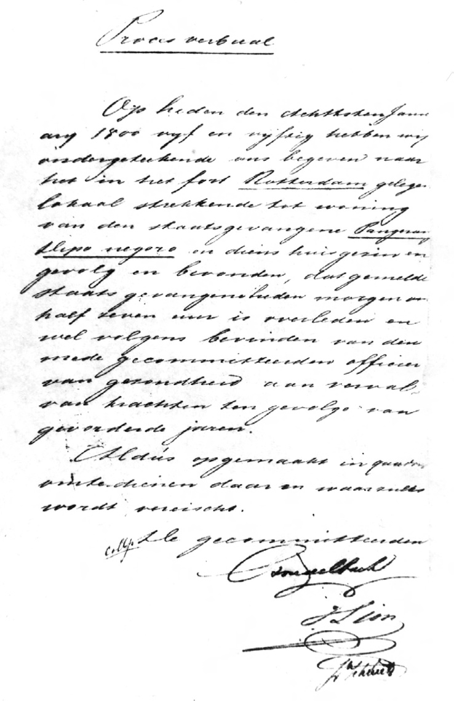

> *Plate 81. Dipanagara’s death certificate dated 8 January 1855; AN BGG, 10 May 1855, La R geheim. Photograph by courtesy of the Arsip Nasional, Jakarta.*

In early March 1849, some four months after his audience with De Perez in early March 1849, tragedy struck when Dipanagara’s second son, the fourteen-year-old Radèn Mas Sarkuma, died after a short illness. Buried in a small plot of government land in the Kampung Melayu (Malay quarter) of Makassar, this sudden bereavement set the prince thinking. He asked for a meeting with the new governor, De Perez, having departed the previous December for Surabaya to fill the post of the recently deceased Pietermaat (note 230). He offered the governor a deal. If he was allowed to live the rest of his days in Makassar with his mother by his side he would no longer insist on his mortal remains being transferred back to Java after his death. Instead, he would be content to be buried in Makassar close to the grave of his son. Stating that he was now advanced in years and did not expect to live much longer, he made a number of suggestions with regard to future arrangements for himself and his family. He wanted his son’s grave to be encircled by a low stone wall and a burial plot set aside for himself immediately adjacent to it. He also asked that the government build a house for his wife and family, as well as outhouses for his servants and a small mosque for himself in the same area as his son’s gravesite so that he could enjoy more freedom in his remaining years. The money he had saved in Manado, which he said had amounted to f 120 a month and which had been deposited in the government treasury in the Minahasan capital,[^271] should be more than sufficient, in his view, to meet the costs of this construction provided the government donated the land. Even if he was not allowed to live outside Fort Rotterdam, a residence should still be prepared for his wife and surviving family in Makassar so they would have somewhere to live on his demise.

Canny to the last in financial matters, the prince made a persuasive case for providing for his family after his death and De Perez promised to convey his detailed proposals to the authorities in Batavia. Dipanagara also entrusted the governor with a letter and special presents for his mother, including a ring with a black gemstone, which he himself had worn, and f 100 in silver coin.[^272] Despite the straitened circumstances in which his family lived in the late 1840s, the former Java War leader still apparently had jewelry and cash savings to hand. Indeed, there is a reference in one of the governor’s reports to the prince having spent another f 100 on gold ornaments, which he had made up in April 1849 perhaps in connection with the items sent to his mother.[^273] In his letter to his parent, he carefully explained the arrangements he had proposed for her voyage from Semarang in the company of Pengalasan. It would only involve a five-day sea passage, he reassured her, a reference to the new steamers which had begun to link Java and the outer islands in the 1840s and which had cut journey times dramatically, making sea voyages an altogether less daunting prospect than the purgatorial sailing odysseys which Dipanagara had been forced to endure over a decade and a half earlier.[^274] In a heart-rending image of an exile’s unrequited longing, he told her that from now on whenever a ship steamed into Makassar harbour, both he and his grandchildren would be climbing the stairs to the attic to look out over the port to see if she had arrived. Come quickly was the message, but if you cannot come ‘no matter since we are both friends’.[^275]

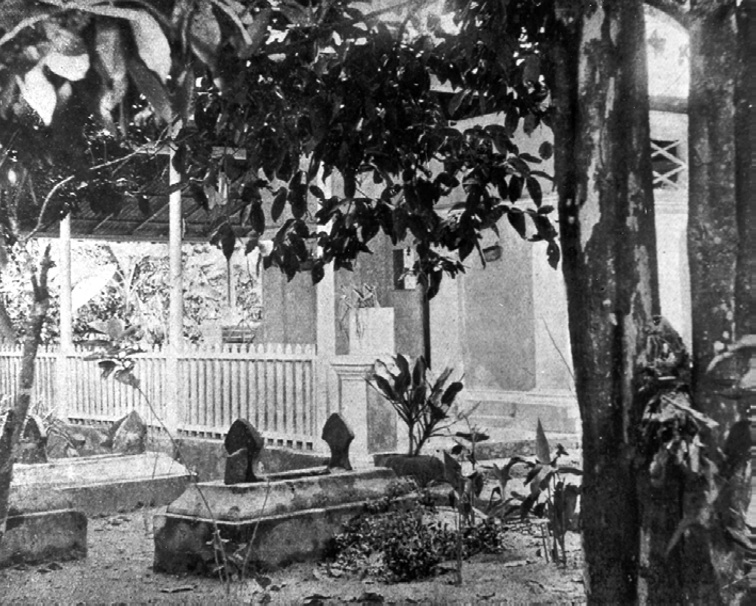

> *Plate 82. Dipanagara’s grave (foreground) and that of his son (Radèn Mas Sarkuma, died March 1849) behind the house in the Kampung Melayu, Makassar (present-day Jl. Irian no. 83), which was built by the Dutch for his widow after his death on 8 January 1855. These graves were moved to the main Kampung Melayu burial ground in the late nineteenth century. Photograph by courtesy of the KITLV, Leiden.*

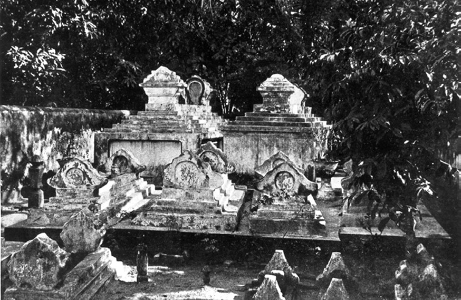

> *Plate 83. The grave of Dipanagara (left) and his last wife, Radèn Ayu Retnaningsih, in the Kampung Melayu public graveyard, Makassar. The graves of Dipanagara’s children and other relations are in the foreground. Photograph taken from M.Ch. van Rouveroy van Nieuwaal, ‘Het graf van Dipanagara te Makassar’, Tropisch Nederland, jg. 1928-29, p. 207.*

Mangkarawati was, however, too old and infirm to contemplate such a journey. Although delighted to hear from her son, she told the Yogya Resident, Baron A.H.W. de Kock (in office 1848-1851), that she was now ‘nearly eighty’[^276] and suffering from dropsy,[^277] a condition which would kill her just three years later (Chapter II). Very hard of hearing and almost blind, she was totally dependant on her spinster granddaughter, Radèn Ajeng Munthèng (Appendix IV), with whom she was then living in Yogyakarta. She thus had no energy or capacity to undertake the sea voyage to Makassar. De Kock gave her two days to think things over and even summoned six of Dipanagara’s brothers – including the soon to be exiled Pangéran Rangga – to put pressure on her, but she was adamant. Instead, she sent her son a letter explaining her aged condition and stating that her dearest wish was they should both enjoy prosperity (wilujeng) until they returned together to eternity.[^278] In the same dispatch in which De Kock forwarded Mangkarawati’s letter, he strongly advised Governor-General Rochussen against allowing Dipanagara to reside outside Fort Rotterdam. In his view, the political situation in the Yogya kraton was still too delicate, and there were fears that the prince might try to escape now that Makassar had become a free port. Developments at the sultan’s court (a reference to the knotty issue of finding a suitable successor to Hamengkubuwana V),[^279] the Resident added, should be allowed to run their course before any changes were made to the conditions under which Dipanagara was being held in Makassar.[^280]

And so it was decided. The governor-general passed a secret decree on 11 May 1849 that Dipanagara would spend the rest of his days within the walls of Speelman’s great fortress. Apart from the issue of the prince’s finances, a subject of obsessive Dutch correspondence, for which a resolution was eventually found a year later (19 May 1850) when it was decided to raise his allowance to f 500 a month, there are no further references to the former Java War leader in the Dutch records. None that is until the morning of Monday, 8 January 1855, when the Dutch authorities in Fort Rotterdam were roused early from their beds. One of the prince’s followers had appeared at the governor’s residence to announce that the prince had died just after sunrise at 6.30, almost the same time as the moment seventy years earlier when he had uttered his first cries after coming into the world before the pre-dawn fasting month meal in the women’s quarters of the Yogya kraton (Chapter II). After the governor had hurried over to the prince’s quarters to confirm the decease, a three-man commission was immediately appointed to authenticate an im portant document. The death certificate witnessed by the Assistant-Resident of Makassar, the military commandant and the chief medical officer to the garrison stated the course of death as ‘diminished physical strength (verval van krachten) due to advanced years’ (Sagimun 1965:358).

> Today, the eighth of January [eighteen] fifty-five, we the undersigned went to the room[s] in Fort Rotterdam which serve as the residence of the state prisoner, Pangeran Diponegoro [Dipanagara] and his family and following, and found that the aforementioned state prisoner had died this morning at half past six o’clock and indeed according to the findings of the co-delegated officer of health as a result of diminished strength due to advanced years.

> Thus made in quadruplicate to be used where and when this might be required.

> The delegates,

> [signed:] J.G. Crudelbach (Assistant-Resident and magistrate), J.T. Lion (infantry major), F.A.M. Schnetz (health officer first class).

A special burial allowance was immediately made available to the family under the terms of the 19 May 1850 financial arrangements for the prince’s upkeep and on the same afternoon Dipanagara was laid to rest in the Kampung Melayu.[^281] According to the notice which appeared a month later in the Javasche Courant and was subsequently carried in the Dutch national press – a modest recognition of the interest taken of the prince’s passing in the colonial metropolis – the burial ceremony had occurred ‘with full Islamic rights and with respect for his high birth […] in accordance with the wishes of the dead man, he was interred in the Kampong Melayu near the grave of his son [Radèn Mas Sarkuma]’.[^282]

Seven days after Dipanagara’s death, his widow and children had a pre-arranged meeting with the acting governor, Colonel Alexander van der Hart, to discuss their future. According to the governor’s report, they were ‘unanimous’ in their wish to remain in Makassar so that they could be near the grave of their recently departed father. It was perhaps lucky that were so minded for the government soon formed the view that they should under no circumstances be permitted to return to Java. Van der Hart, whose description of the way in which Dipanagara had brought up his children has already been mentioned, feared that the prince’s male offspring, especially his highly capable eldest son, Radèn Mas Kindar, could become the ‘centres of rebellion’ if they were allowed back. Their high noble birth, in Van der Hart’s view, would give them great potential influence in Yogya, whereas in South Sulawesi, despite their ‘religious connections’, they would be unlikely to exercise much sway over the local Makassarese and Bugis population.[^283] These sentiments were echoed by the Yogya Resident, W.C.E. Baron de Geer (in office 1855-1856), whose enquiries with Hamengkubuwana V revealed a firm determination on the sultan’s part that Dipanagara’s family should never again set foot in the Principalities.[^284] Such arguments won the day with the governor-general, Albertus Jacobus Duymaer van Twist (in office 1851-1856), who passed a secret decree in council on 10 May 1855 ordering that Dipanagara’s widow and children should continue to be treated as exiles and confined to Sulawesi, but that they would be allowed to retain the prince’s former f 6,000 annual stipend which would continue to be paid by the Yogya court.[^285] He also permitted them to live freely in Makassar where a residence would be found for them.

Both Van der Hart and his predecessor, De Perez, had advised that the government acquire land for Dipanagara’s family. Following his early March 1849 meeting with Dipanagara, De Perez had suggested that f 10,000 be set aside for this purpose,[^286] whereas Van der Hart had recommended that the family be given a sufficiently large plot to plant fruit trees and develop some ricefields, arguing that if the prince’s children were able to find useful employment they would find better ‘direction for their energies’ and perhaps make good marriages (whether to local Makassarese or to Javanese domiciled in Makassar he did not say) thus dissuading them from involvement in anti-Dutch activities.[^287] Subsequently, a sizeable block of land amounting to just under a hectare[^288] was acquired by the government in the area immediately adjacent to the graves of Dipanagara and his son. It had sufficient space for orchards, a market garden and sawah as well as a modest Dutch colonial style house, which stands to this day at no. 83 Jalan Irian. This was very much in line with what the prince had asked for at the time of his early March 1849 audience, and this is where his family and household retainers moved to during the course of the year following his death. His descendants continued to live there in the early 1970s when the research for the present book was undertaken in Makassar (Appendix IV note 10).

After the death of Radèn Ayu Retnaningsih later in the century, Dipanagara’s grave and that of his son were moved to the main Kampung Melayu public graveyard, which had just been opened on a 52 square metre block of land between present-day Jalan Andalas and Jalan Irian a short distance from the family house. A private burial ground, demarcated by a low brick wall, was set apart in the innermost part of the graveyard for the Dipanagara family (Plate 83) and two imposing white stuccoed tombs were erected for the prince and his consort (Rouveroy van Nieuwaal 1928:208). Known locally as the ‘grave of the sultan of Java’ (kuburan sultan Jawa), the area around the twin tombs would become the final resting place for most of the prince’s Makassar-born descendants. The street adjacent to his grave would subsequently be given his name at the instigation of local supporters of the Indonesian nationalist cause (Kalff 1927-28:523). However, although Dipanagara’s memory was revered in Makassar and more widely in Indonesia, especially by nationalist youth groups of the inter-war years such as Jong Celebes (‘Young Celebes’) and Jong Java (‘Young Java’), as well as by the recently established Partai Kommunis Indonesia (Indonesian Communist Party), which had portraits of Dipanagara displayed at its 1921 Party Congress in Semarang and in its Madiun office (Ricklefs 2007:233), his family seems to have found the upkeep of the site beyond their very limited means. During the course of the century following Dipanagara’s death, most of the orchards and ricefields were sold to provide cash for the family. A report from the late 1920s speaks of the grave site as a collection of ‘dirty moss-covered stones, a broken down limestone-leached little wall and the rotting remains of vegetation’ (Kalff 1927-28:523). It would, however, eventually become a place of national reverence after the prince was recognized as a pahlawan nasional (national hero) by the newly independent Republic of Indonesia in the early 1950s. In January 1955, for example, the hundredth anniversary of the prince’s death was celebrated at the now restored grave site with considerable ceremony (Sagimun 1965:455). So the wheel of history turned full circle. The much feared exile of Fort Rotterdam had become the hero par excellence of the modern Indonesian state. This pious and complex man, whom the Parangkusuma prophecy would warn would only be ‘counted amongst the ancestors’ for a brief moment, was now vested with immortality in the national pantheon of a country he had never dreamt of in his lifetime. Historical transformations rarely come stranger than this. Meanwhile, both Makassar governors under whom Dipanagara was incarcerated would meet untimely deaths.[^289]

### Conclusion

It is a truism that men and women are shaped by the age in which they live. Dipanagara was no exception. Nine years before the prince’s birth, Thomas Paine had written that ‘these are the times that try men’s souls’, a reference to the troubled onset of the American Revolution. Such ‘interesting times’, as the Chinese adage has it, certainly characterised the epoch Dipanagara lived through half a world away in Java. Born into the seemingly immutable ‘old order’ of the late eighteenth-century Principalities, he died in the high colonial era of Governor-General Duymaer van Twist, an era when steamboats had begun to ply the inter-island sea routes and the new commercial system of free ports had replaced the closed monopoly of the Dutch East Indies Company. The Agrarian Law (1870), which would open the Indies up to massive private investment, was only a decade and a half away. This was the age when the Dutch were reaping unimaginable wealth from the Cultivation System at the expense of Javanese peasant cultivators who in certain areas, such as Grobogan and Demak, were experiencing terrible famines (1849-1850) and typhoid epidemics (1846-1850; Elson 1994:99-127), an age when, as Radèn Salèh, laconically put it, the only conversation amongst colonial Indies society was café et sucre, sucre et café (‘coffee and sugar, sugar and coffee’).[^290] These were the years which Multatuli would later give voice to in his Max Havelaar of de Koffij-veilingen der Nederlandsche Handel-Maatschappij (‘Max Havelaar or the coffee auctions of the Dutch Trading Company’) (1860) in the figure of Droogstoppel (‘Dry Stubble’), the brass-is-brass Amsterdam coffee broker who knew the price of everything and the value of nothing (Nieuwenhuys 1973:149-50). What price then for a mystic prince in such a universe? Not much for the Dutch judging from the rather brief paragraph published in their colonial and national newspapers at the time of his death, but what about the Javanese? What did Dipanagara mean for them? It is clear that he was a pivotal figure in the history of modern Java, his death occurring at almost the exact mid-point between the treaty of Giyanti (1755) and the declaration of Indonesian independence (1945), but how much of this was due to his own innate qualities and how much to the times in which he lived? Just imagine for a moment that he had been born a hundred years earlier in 1685 or a century afterwards in 1885. The first would have placed him full square in the turbulent decades of the Kartasura period (1680-1742) which, if he had survived and not suffered the fate of his namesake, the first Pangéran Dipanagara (exiled to Cape Colony in 1723 following an abortive rebellion, see Chapter IX), might have seen him emerge as one of the luminaries of Pakubuwana II’s (reigned 1726-1749) court with an interest in the type of Sufi-inspired Javanese-Islamic literature favoured by the circle around the queen mother, Ratu Pakubuwana (died 1732; Ricklefs 1998:39-91, 106-26, 254-60, 253-309). But would he have been cast in heroic mould of a Ratu Adil or Just King leading a popular uprising against the colonial power? Hardly. The second would have situated him at the heart of the founder generation of the Indonesian ‘national movement’ with the likes of Dr Tjipto Mangunkusumo (1885-1943), Radèn Mas Soetomo (1888-1938), and Radèn Mas Suwardi Suryaningrat alias Ki Hadjar Dewantara (1889-1959) as his direct or near contemporaries. Given Dipanagara’s personal abilities, his deep root of faith, administrative and financial acumen, as well as his interest in the modern world – witness his fascination with the navigational instruments on the corvette Pollux – it is likely that he would have made his mark in some capacity on modern Indonesia: a republican prince perhaps? But it is unclear whether he would have emerged as quite the crucial figure which he became at the time of the Java War.

The unusual epoch in which Dipanagara lived is thus vital for an understanding of his life. His experience underscores the truth of Karl Popper’s dictum that history is the struggle of men and ideas, not just of the material conditions of their existence. Had it not been for the peremptory violence visited on the south-central Javanese courts by Daendels and Raffles in the four short years between 1808 and 1812, violence which tore the heart out of the Yogya kraton, one can imagine Dipanagara living in relative obscurity at Tegalreja, attending to his religious duties and dying in mid-century as a quirky santri prince, scourge of the Yogya aristocracy and the kafir (heretic) Dutch. Despite his evident abilities – witness the brief reference to these in Panular’s ‘Chronicle of the fall of Yogyakarta’ (Chapter VIII) – the fact that he rates not a single reference in the British reports (1811-1816), a period when he was supposedly functioning as a key adviser to his father, the third sultan, and mentor to his younger brother, the fourth sultan, indicates that he was not quite the prominent figure in the political life of the sultanate he sought to portray in his babad (Chapter VIII). Nahuys van Burgst probably had his measure better when he described Dipanagara and his uncle, Mangkubumi, before the Java War as men who ‘stood quite neutral and were universally considered as good quiet persons without the least ambition’ (Chapter X). The agrarian crisis of 1823-1825 and the ineptitude of the Dutch representatives in Yogyakarta in the two years leading up to the Java War were the twin catalysts for the prince’s emergence as a major political figure, much as Governor-General Van Imhoff (in office 1741-1750) and the issue of the leasing of Mataram’s coastal dependencies had been at the time of Sultan Mangkubumi’s rebellion in 1746 (Ricklefs 1974a:40-3). Once cast in a leadership role, however, Dipanagara brought to his task a competence and ap peal greater even than that of his revered great-grandfather, Mangkubumi. A devout Muslim, who believed himself part of the international community of Believers, he was what Ricklefs has described as the personification of the ‘mystic synthesis’ in Java (Ricklefs 2007:8) – a Javanese Muslim who saw no problem with contacting the goddess of the Southern Ocean, undertaking pilgrimages to holy sites associated with Java’s spirit guardians and rulers, and drinking bottles of ‘medicinal’ sweet Cape wine, while maintaining a staunch commitment to his Islamic duties. Part of the ‘long shadow of Sultan Agung’,[^291] Dipanagara fought both for the restoration of an idealized Javanese past, and the establishment of a new moral order in which the teachings of Islam, especially its legal codes, would be enforced. This was the essence of his popular appeal for the religious communities and his importance for the future, where his particular form of ‘mystic synthesis’ would form one of the key strands of Islamic piety in post-1830 Javanese society (Ricklefs 2007:30-83). His insistence on Javanese cultural norms in language, dress and etiquette also cast him in the role of a proto Javanese nationalist. Here was a man who, in Nicolaus Engelhard’s words (p. 510), was ‘in all matters a Javanese and followed Javanese custom’. But one cannot pursue this too far. There is no indication that he entertained any notions of national independence in the modern sense, not even for his native Java. Indeed, it would be nearly another century after the Java War before such ideas gained universal currency amongst the Indonesian nationalist elite. The most Dipanagara could conceive was a return to the seventeenth-century status quo. From the evidence of Hasan Munadi and Ali Basah Pengalasan, he had in mind the era when the Dutch had been confined to the northeast coast of Java as traders and were not involved politically in the affairs of the south-central Javanese courts. He even talked, Munadi suggested, of allocating the Dutch two north coast cities – Batavia and Semarang – where they would be allowed to reside and pursue their commercial interests unhindered, just so long as these did not exploit the local population (Dipanagara’s insistence on market prices being paid for Javanese products and land lease contracts was prescient considering what would happen under Van den Bosch’s Cultivation System). This harked back to the situation which existed during Sultan Agung’s reign (1613-1646) before the political disasters of his successor, Amangkurat I (reigned 1646-1677), had opened a high road to Dutch intervention in the Javanese hinterland.

That this was an impossible dream is self-evident. Despite the insecurities of Holland’s transition from patrician republic to nation state between 1785 and 1813 – precisely the period of Dipanagara’s youth and early manhood – there was no possibility of a Dutch retreat to the status quo of the early Company era. Daendels’ mailed fist and the insufferable arrogance of the English were proof enough that a new form of European power was now being applied to colonial affairs. The European Prometheus had been unbound. Despite the 1815 mutiny, sepoy bayonets continued to sustain Raffles’ ramshackle regime (1811-1816), and even when the inexperienced post-1816 returned Dutch administration came close to disaster first by exacerbating the agrarian crisis which precipitated the Java War and then by wasting two years (1825-1827) before the tide of battle could be turned, the possibility of a Dutch exit from Java was never an option.[^292] The importance of Java for the post-1830 Dutch economy would be argument enough for this – witness the plans by Palmer & Company of Calcutta, the Dutch colonial state’s main creditor bank, to send sepoys to Java in May 1826 to help turn the tide of battle and ensure the security of their six million Sicca rupee loan (p. 428). Yet Dutch insecurities remained. The successful Belgian revolt of 1830 intensified them, temporarily threatening the Netherlands with French invasion and a new European war. For Dipanagara this would mean summary arrest and exile, an exile in which Dutch fears dictated an increasingly restrictive regime which for the last twenty-two years kept him and his family prisoners in Fort Rotterdam. Dipanagara’s pitiful death in Makassar points to the human tragedy at the heart of this tale. The waste of a life, the suffering of a family, the ruin of a society. The policies imposed by Van den Bosch may have been the saving of the Dutch state, but they spelt disaster for the Javanese. After 1830 a new world had been born. It was a turning point as significant as any in colonial history. But it would exact a terrible cost.

## Notes

[^1]: A popular Indonesian song about Dipanagara, which translates roughly as follows: ‘Yet there is in Sulawesi/ in a most quiet spot/ near the wild jungle/ far from the hurly-burly/ a place set apart/ the grave of Dipanagara/ a true hero/ who defended our people/ a hero with a pure heart’.

[^2]: Prabuningrat had been taken by surprise by a Dutch attack when he was resting with Dipanagara in the Selarong hills. He had covered his nephew’s retreat by a rearguard action involving fifty cavalry, but had been killed by a sabre stroke as he was returning to join Dipanagara’s main force. Lieutenant-Colonel B.J. Sollewijn, the commander of the 1st mobile column, described what happened: ‘an unusually well-dressed rebel, who had escaped by luck from the crush [of the cavalry charge], hastily attempted to escape […] but his horse was suddenly shot from under him […] Sergeant Cassenhoven begged permission to charge with the cavalry and he rushed up to him and sabred him to death’. The dead man was subsequently recognised as Pangéran Prabuningrat by his diamond-studded kris which was found by the local village inhabitants of Sélanangkul, Louw and De Klerck 1894-1909, V:386-9. Dipanagara later stated that the cannon shot, which felled Prabuningrat’s horse, took off his uncle’s left leg, Knoerle, ‘Journal’, 16.

[^3]: BD (Manado) IV:178-9, XXXVII (Asmaradana) 50-4. sang nata angandika alon/ dhateng Kangjeng Panembahan/ kyai pan kawula/ tampi wangsiting Hyang Agung/ kalamun badhé kawula. 51. punika wekasanèki/ apan tan dados punapa/ dadya kang sinuwun mangké/ samya tumungkul sadaya/ kalamun semu waspa/ Panembahan alon matur/ paran sultané ingkang dadya. 52. ing bésuk wekasanèki/ […]. 53. […]/ sri naléndra ngandika/ kénging tan kénginga iku/ kyai mapan kawula. 54. namung nuwun ambélani / dhumateng kang samya prapta/ inggih ing sabilollahé. It should be noted that since August 1825, Mangkubumi had borne the title of panembahan, usually given to respected senior male members of the royal family. In the same passage in his babad, Dipanagara spoke bitterly against Pangéran Purbaya (the future Pakubuwana VII, reigned 1830-1858) and the other princes of the Surakarta court who, in his view, had sinned greatly against the Almighty and His Prophet by allying themselves with the Dutch.

[^4]: Pangéran Ngabèhi and his two sons along with a twenty-strong mounted following had been cornered in the Kelir Mountains on 21-9-1829. Seeing that they had no way out, they had declared that they were kangjeng gusti (princes of the blood), but the ngabèhi (junior officer) of the Indonesian barisan (troop) involved had ordered them to hand over their kris, stating that he recognised no kangjeng gusti on the rebel side. When they refused, the junior officer then ordered his men to go in and finish them off. Once they had been killed, the heads of the corpses were cut off and placed on bamboo poles, their bodies being thrown down the ravine. Only when their identities had been discovered were the heads of Ngabèhi and his two sons given a decent Islamic burial, see the report of Colonel J.B. Cleerens in Louw and De Klerck 1894-1909, V:395-6.

[^5]: BD (Manado) IV:188, XXXVII (Asmaradana) 97. sarta mijil wespanèki/ rumaos kantun pribadya/ lawan ing Tanah Jawané/ rumaos tan saged nata/ lamun amrih salaminya/ dhumateng kang samya kantun. ‘Tears welled up [and] the sultan/ felt he was left alone/ in the Land of Java./ He felt he could not control,/ even if he strove to all the time,/ those that remained behind.’

[^6]: See the list of surrendered commanders in Sagimun 1965:401. Appendix VIII also gives dates. On the death of Pangéran Ngabèhi and his two sons, see Chapter XI note 89. On Mangkubumi’s surrender, see Dj.Br. 9B, Report of Radèn Tumenggung Pancaatmaja, 12 Sura AJ 1757 (AD 13-7-1829), stating that the wong cilik (‘little people’) would be happy when Mangkubumi submitted to the Dutch because they always regarded him as ‘greater’ than Dipanagara. In fact, people had lined the roads for fourteen leagues when Mangkubumi eventually came to Yogya from Kulon Praga in October 1829.

[^7]: See Chapter III note 67. Dipanagara had to seek help from an elderly female dhukun (herbalist/healer) in the village of Sabédha (Sebada) by the name of Nyai Asmaratruna, whom he described as a coquettish widow who flirted and made jokes with him, see BD (Manado) IV:230, XXXVIII (Mijil) 158-9. ing Sebédha na dhukun sawiji/ wus sepuh pawèstri/ gumati kelangkung. 159. mapan dhateng kangjeng sri bupati/ ragi kenès mangko/ rondha nyai Asmaraturuné.

[^8]: For a biography of Roeps, see Javasche Courant, 4-7-1840; Louw and De Klerck 1894-1909, II:283 note 2. Born on 1-1-1805 in The Hague, he came to Java in 1816 with his father who was posted as a lieutenant-adjutant in the Dutch colonial army. His mother and nine of his ten siblings died when he was in his early teens, and he was brought up by a Javanese nyai (housekeeper; concubine) speaking fluent Javanese. A graduate of the Semarang Military School, he was a second-lieutenant at the age of 18 (12-8-1823), and had participated in the Boné expedition (1824-1825). During the Java War, he served in Lieutenant-Colonel Joseph Le Bron de Vexela’s 3rd mobile column in the Mataram area, earning a name for his bravery and the unofficial motto semper idem (‘always the same’). He died from wounds sustained fighting the Acehnese at Baros in East Sumatra on 23-3-1840.

[^9]: Dipanagara’s knowledge of the fording places across the Praga was critical here, allowing his force to cross in safety whereas the pursuing Dutch cavalry were caught in the deep mid-stream and had their horses swept away from under them. Even so a Dutch hussar got close enough to fire a pistol shot at him before being run through by lance thrusts from Dipanagara’s bodyguard, Louw and De Klerck 1894-1909, V:388-9, 700-1.

[^10]: Louw and De Klerck 1894-1909, V:425-6. On the Javanese belief that no Mataram prince should cross the Bagawanta River because Sultan Agung (reigned 1613-1647) had taken exception to its disgusting name, see Multatuli 1862-77, IV:286; Van Praag 1947:13.

[^11]: See Appendix VIIb under Kyai Haji Samparwedi.

[^12]: dK160, Valck, ‘Inlichtingen’, entries of 5-10-1829, 6-10-1829, reports of Hasan Munadi.

[^13]: dK 160, Valck, ‘Inlichtingen’, 6-10-1829, report of Hasan Munadi on Dipanagara’s contacts with Musbah. See further Louw and De Klerck 1894-1909, V:524.

[^14]: dK 209, Report of Ngabèhi Kramadimeja of interview with Mas Tumenggung Kudatirta (Lengis), a member of Dipanagara’s entourage in Bagelèn, for Colonel J.B. Cleerens (Menorèh), 25-2-1830.

[^15]: Pengalasan reported that Dipanagara had not attacked Yogya in 1825 ‘out of self interest’ but for the ‘welfare of Java’ and because the sultan (Hamengkubuwana V) was not able to act as protector of the Islamic religion, dK 49, Colonel J.B. Cleerens (Gunungpersada) to H.M. de Kock (Magelang), 25-12-1825. On Dipanagara’s views of the Surakarta court, see note 3.

[^16]: dK 160, Valck, ‘Inlichtingen’, 6-10-1829, report of Hasan Munadi.

[^17]: dK 49, Colonel J.B. Cleerens (Gunungpersada) to H.M. de Kock (Magelang), 22-12-1829, reporting Blitar’s son as saying in broken Malay: Ya itu Kolonel punya perbilang tetapi orang dari luar perchaya lain. Dipo Negoro bilang Kumpeni tiada bisa tahan kluar begitu banyak wang seperti sekarang dan kapan dia tinggal sembuni satu dengan dua tahun Kompeni tiada bisa bayar dia punya serdadu.

[^18]: Pengalasan’s partiality to opium is mentioned in dK 49, Colonel J.B. Cleerens (Kedhung Kebo) to H.M. de Kock (Magelang), 14-11-1829, stating that after Pengalasan’s surrender on 13-11-1829, he, together with the three tumenggung and eleven officers (panji, ngabèhi, rangga) who came over with him, ‘took a good piece of opium’ provided by Cleerens from the Dutch military stores.

[^19]: dK 49, Colonel J.B. Cleerens (Bubutan) to H.M. de Kock (Magelang), 26-9-1829, referring to Pengalasan as ‘a well-known name for us’ and asking De Kock to treat him leniently and with respect, especially in view of his wife’s connections with the Yogya court (she was apparently a daughter of Pangéran Blitar I).

[^20]: Kacawang is a village just to the southwest of Kajoran in the Karanggayam sub-district of Karanganyar Residency in present-day south Banyumas, see Schoel 1931:139, sub: ‘Kajoran’.

[^21]: Cleerens reported that Pengalasan ‘writes much for a Javanese and expresses himself well or so I hear’, Carey 1974b:282.

[^22]: He would soon afterwards (12-12-1829) leave to join Imam Musbah in Ledhok, see Louw and De Klerck 1894-1909, V:526.

[^23]: Adisurya would die soon afterwards (circa 8-12-1829) on Mount Sirnabaya, see Louw and De Klerck 1894-1909, V:516-7.

[^24]: dK 49, Colonel J.B. Cleerens (Gunungpersada) to H.M. de Kock (Magelang), 2-12-1829.

[^25]: dK 49, Colonel J.B. Cleerens (Gunungpersada) to H.M. de Kock (Magelang), 2-12-1829.

[^26]: dK 49, Colonel J.B. Cleerens (Gunungpersada) to H.M. de Kock (Magelang), 3-12-1829, 5-12-1829; H.M. de Kock (Magelang) to Colonel J.B. Cleerens (Gunungpersada), 4-12-1829. De Kock had tasked Hasan Munadi with taking his letter to Dipanagara.

[^27]: Blauw & Bril, see Carey 1974b:285.

[^28]: dK 49, Colonel J.B. Cleerens (Gunungpersada) to H.M. de Kock (Magelang), 3-12-1829; dK 210, Radèn Adipati Abdullah Danureja (Winong/Kebumèn) to Ali Basah Kerta Pengalasan (Gunungpersada), n.y. (? mid-December 1829), acknowledging the gift of tea, sugar and white bread. On the spread of Europeanised tastes in food at the south-central Javanese courts, see Chapter V note 65.

[^29]: dK 49, Colonel J.B. Cleerens (Gunungpersada) to H.M. de Kock (Magelang), 14-12-1829. The Dutch had great difficulty translating Pengalasan’s letter into Dutch and even the élève voor de Javaansche taal, C.L. van den Berg, who was serving at that time in Magelang, was not able to decipher his colloquial Javanese. See further Chapter III note 79.

[^30]: dK 49, Colonel J.B. Cleerens (Panjer) to H.M. de Kock (Magelang), 16-1-1830.

[^31]: dK 210, Colonel J.B. Cleerens (Panjer) to Colonel F.D. Cochius (Magelang), 9-2-1830; Colonel J.B. Cleerens (Menorèh) to Colonel F.D. Cochius (Magelang), 26-2-1830, refer to the ‘great favour’ which Pengalasan enjoyed with Dipanagara and his influence over the prince.

[^32]: This news was carried in the Javasche Courant of 7-1-1830, citing the article ‘Oorlog in Turkijen’ (War in Turkey) from the Journal d’Anvers of 23-8-1829.

[^33]: On 21 December 1829, when news came through that the Russian army was only seven days march from the Adrianople, he confided to De Kock, ‘I hope the Muslims take a knock and the Russians remain as rulers in Constantinople. Then we could say to our friends: the Turks have been defeated in battle by the Russians’ (Ik hoop de Musulmanes klop blyve krygen en dat de Russen in Constantinople zullen blyven regeeren dan zoude wij aan ons vrienden kunnen zeggen, orang Rum soeda kala prang sama orang Rus), dK 49, Colonel J.B. Cleerens (Gunungpersada) to H.M. de Kock (Magelang), 21-12-1829, See further Colonel J.B. Cleerens (Banaran/Panjer) to H.M. de Kock (Magelang), 3-1-1830, thanking De Kock for sending him a copy of the Javasche Courant of 3-1-1830 which carried news from the Adrianople front and which he had translated for Pengalasan because he had become curious when he heard the title ‘Pasha’ with reference to Hasan Ali Pasha, the Ottoman governor of Smyrna (Izmir), who had been sent to Adrianople to defend the fortress city; Carey 1979:217 note 93.

[^34]: dK 49, Colonel J.B. Cleerens (Panjer) to H.M. de Kock (Magelang), 12-1-1830.

[^35]: dK 210, H.M. de Kock (Magelang) to Colonel J.B. Cleerens (Gunungpersada), 29-12-1829.

[^36]: dK 210, Colonel J.B. Cleerens (Binong; ? Binangun) to Radèn Adipati Abdullah Danureja (Winong/Kebumèn), 7-12-1829; Radèn Adipati Abdullah Danureja (Winong/Kebumèn) to Colonel J.B. Cleerens (Binong; ? Binangun), 7-12-1829. Cleerens had asked that Dipanagara’s eldest son (Dipanagara II), his younger brother, Pangéran Adisurya, and Ali Basah Mertanagara should be sent as emissaries of high rank to arrange the ceasefire. Danureja suggested instead an exchange of a high-ranking Dutch officer for a Javanese of similar status, presumably one of Dipanagara’s basah.

[^37]: dK 210, Ali Basah Kertapengalasan (Gunungpersada) to Radèn Adipati Abdullah Danureja (Winong/Kebumèn), 27 Jumadilakir AJ 1757 (AD 26-12-1829).

[^38]: Prins 2002:203, states that Van den Bosch arrived ‘in Java’ on 2-1-1830, whereas Louw and De Klerck 1894-1909, V:529, give 4-1-1830 as the date that Z.M. Rupel docked in Batavia. The discrepancy in dates may refer to Van den Bosch’s initial landing at Mérak in the Sunda Straits and his eventual arrival in Batavia.

[^39]: H.M. de Kock (Magelang) to Colonel F.D. Cochius (commanding the army in the field), 11-1-1830, quoted in Kielstra 1896b:299.

[^40]: dK 23, Johannes van den Bosch (Batavia) to H.M. de Kock (Magelang), 6-1-1830.

[^41]: UBL, BPL 1346 ‘J.B. de Salis brieven’, H.M. de Kock (Dutch Army HQ Zeeland) to J.B. de Salis (Utrecht), 22-6-1831. On De Kock’s Zeeland command (1831-36), see Genealogie De Kock 1996-7:419.

[^42]: In the words of Van den Bosch, ‘our officers who have associated much with him [in Magelang] over the past few days speak with praise about his intelligence and frank character, and General de Kock completely shares that opinion’, Van den Bosch (Batavia/Bogor) to King William I (The Hague), 14-3-1830, quoted in Van den Kemp 1896a:416. See further Carey 1981a:lxix note 194. On Major de Stuers’ view that during the war Dipanagara had shown ‘a superiority of character little found amongst present-day Javanese, princes’ (une superiorité de caractère peu commune aux princes Javanais de nos jours), see Kielstra 1896a:92, quoting De Stuers 1833.

[^43]: A highly experienced engineer officer, Cochius was not deemed to have any political savoir-faire in ‘native affairs’ (Louw and De Klerck 1894-1909, V:510), unlike Cleerens and the mobile column commander in Kedhu, Lieutenant-Colonel Louis du Perron, who was specifically requested by Cleerens to come down to Kedhung Kebo as his temporary replacement in late December 1829, when he moved to Kebumèn to open negotiations with Dipanagara, due to his ‘iron patience with the Javanese’, dK 49, Colonel J.B. Cleerens (Gunungpersada) to H.M. de Kock (Magelang), 22-12-1829.

[^44]: dK 210, Colonel J.B. Cleerens (Kemit) to H.M. de Kock (Magelang), 20-1-1830.

[^45]: dK 209, Colonel J.B. Cleerens (Menorèh) to Colonel F.D. Cochius (Magelang), 26-2-1830.

[^46]: dK 23, Johannes van den Bosch (Batavia/Bogor) to H.M. de Kock (Magelang), 12-3-1830. See further Carey 1982:7.

[^47]: This is where the Padri leader, Imam Bonjol (1772-1864), was initially exiled after his capture by the Dutch in 1837. Complaints by the Resident of Preanger about having a prisoner of Imam Bonjol’s stature under his authority and the inadvisability of allowing the aged Padri leader to come into close contact with the local Sundanese inhabitants forced his removal first to Ambon (1839-1841) and then to Manado (1841-1864), Dobbin 1972:18-9.

[^48]: dK 23, Johannes van den Bosch (Batavia/Bogor) to H.M. de Kock (Magelang), 12-1-1830. See further Louw and De Klerck 1894-1909, V:570.

[^49]: BD (Manado) IV:251-399, XXXIX.108-XLIII.118, covers the whole process of the negotiations up to Dipanagara’s capture in Magelang and his departure for Semarang on 28-3-1830.

[^50]: BD (Manado) IV:260-1, XXXIX (Pucung) 169-72. Ki Melangi mangkana ingkang winuwus/ […]. 171. […]/ kalamun pinirsa/ inggih dhateng ngèlminèki/ pan rumiyin duk jeneng Jeng Rasulullah. 172. lamun wonten serat pan pinirsa tuhu/ awon saénira/ mapan lawan dènwangsuli.

[^51]: BD (Manado), IV:261, XXXIX.173-4, describing Dipanagara’s delight at Kyai Melangi’s explanation, he asked him why he had not told him this tradition before, to which the kyai replied that he was too afraid of Kyai Maja and his supposedly superior knowledge of the Qur’ān and Hadith to do so.

[^52]: Dipanagara appears to have been at Sampang just to the west of Gunung Kebo in western Bagelèn (present-day south Banyumas), see Louw and De Klerck 1894-1909, V:Map. This is where he rode out from on 16-2-1830 for his meeting with Colonel Cleerens at Rèmakamal, BD (Manado), IV:285, XL.87.

[^53]: BD (Manado), IV:261-2, XXXIX.176-179; dK 49, Colonel J.B. Cleerens (Panjer) to H.M. de Kock (Magelang), 16-1-1830, 17-1-1830, reporting Danureja’s submission and his subsequent departure under escort to meet De Kock in Magelang and brief him on Dipanagara’s situation.

[^54]: BD (Manado), IV:267, XXXIX (Pucung) 212. pan mengkana osiking tyas kang sinuhun/ baya karsaning Hyang/ ingsun kinon anglakoni/ lara wirang apan gon ingsun nèng donya.

[^55]: BD (Manado) IV:280, XL (Megatruh) 61. marma kang tyas pan langkung pitajengipun/ nulya sang nata nuruti.

[^56]: DK 127, Dipanagara (Sampang) to Colonel J.B. Cleerens (Kemit), 17 Syaban, AH 1245 (AD 14-2-1830).

[^57]: BD (Manado) IV:267-70, XXXIX.213-36. Both Rèmakamal and Rèma Jatinegara are in present-day southern Banyumas, an area which at this time was within the old borders of Bagelèn.

[^58]: Dipanagara was accompanied by some 200 mounted troops – mainly armed with pikes – when he came down to Rèmakamal from Sampang on 16-2-1830, and he was expecting a further 200 to join him there and accompany him to Kecawang and Kalireja. In fact, by the time he reached Menorèh on 21-2-1830, his armed entourage had grown to at least 700, and this had increased still further to over 800 when he entered Magelang on 8-3-1830, see note 80.

[^59]: dK 210, Colonel J.B. Cleerens (Kemit) to Colonel F.D. Cochius (Magelang), 9-2-1830.

[^60]: dK 209, Colonel J.B. Cleerens (Menorèh) to Colonel F.D. Cochius (Magelang), 26-2-1830, 27-2-1830, reporting that Pengalasan had asked for satu laksa rupiah (10,000 rupiah), of which f  1,000 should be made available immediately. Cleerens gave him the f 200 to purchase clothes for Dipanagara, but told him that the prince would have to speak with him in person about the larger amount, which did not happen before Dipanagara reached Magelang.

[^61]: dK 210, Colonel J.B. Cleerens (Kemit) to Colonel F.D. Cochius (Magelang), 9-2-1830.

[^62]: dK 208, J.F. Walraven van Nes (Yogyakarta) to Colonel F.D. Cochius (Magelang), 18-2-1830. Van Nes had shown the letter to the Yogya patih, Danureja IV, and Major Tumenggung Wiranagara – now styled Pangéran Prabuningrat – who both said that they had seen nothing like it.

[^63]: BD (Manado) IV:289-90, XL (Megatruh) 113-5. lawan kurnèl marmané pratandhaningsun/ ika sun prenah iki/ nèng tengah tulisan iku/ sab iya Kangjeng Nabi/ negarané Mekah mangko. 114. Mekah iku satengahing jagad satuhu/ marma yèn sira tan [k]apti/ iya angurmati iku/ mring Kangjeng Nabi ta iki/ Muhamad sun tan ayun. 115. sabab ingsun iki mapan darma tuhu/ kang duwé Agama Nabi.

[^64]: BD (Manado), IV:281-2, XL. 65-9. Dipanagara’s original letter in pégon script is in dK 208. It reads as follows: ingkang serat Ingkang Sinuhun Kanjeng Sultan tumekaa marang sira Kornèl Kalèrès apadéné marang sira Mayor Bekes ing sawusé tabéningsun marang sira karo-karoné marmané isun aputusan bocahinsun si Pengulu Peqih Ibrahîm karo si Dolah Haji Badaruddîn apadéné si Dolah Melangi sabab isun mirsa khabar yèn bocahisun si Perwiradirja awèh layang marang bocahisun si Adipati Danureja layang bakal katur isun yèn isun diaturi pedhama karo Jénderal anadéné khabaré yèn isun biyèn mengko yèn diaturi pedhama isun iya andhangani anadéné khabaré yèn isun wis andhangani ya ing pedhama iku mau bocahisun si Perwiradirja bakal nungsul maréné séba marang isun kang sarta Kornèl Nahus apadéné Kornèl Kawakis mulané isun utusan marang sira sabab penggalihisun sira ora béda ya karo Kornèl Nahus apadéné Kornèl Kawakis sabab déné si Peng[a]lasan ora béda karo si Perwiradirja ananging ingkang dadi kersaningsun isun mundhut pesanggerahan si Romakamal lan si Kejawang karo sira Kornèl Kalèrès Mayor Bekes padha methuka marang isun ana ing Romakamal yèn isun wus ketemu karo sira laju isun mesanggerahan ana ing Kajawang pamerihisun persaka lan sira sabab isun mirsa khabar yèn Jénderal saiki ora ana dadi isun angantèni saktekaning Jénderal yèn upama Jénderal wis teka sun perih Jénderal kirima layang marang isun, isun mundhut pesanggerahan ana Kalireja ing kono muga isun ketemua lan Jénderal. Kaserat ing dinten Jum’ah wulan Sya’ban tanggal kaping pitulas ing taun Jimawal hijratannabi s.m. min Makati li’l-Madînati’sysyarîfah 1 2 4 5. ‘This letter of His Highness the Sultan [is] to you Colonel Cleerens and moreover to you Major Buschkens. After my greetings to you both, the reason I sent as messengers my followers Pengulu Pekih Ibrahim together with Haji Dullah Badarudin and also Dullah Melangi is because I heard the news that my follower [Ali Basah Senthot] Prawiradirja had given a letter to my follower Adipati [Abdullah] Danureja, a letter which was to be given to me and in which I was asked [to make] peace with the general [De Kock]. Just as in former times, when I was asked to make peace, I was in agreement, so also now there is the news that I had agreed to the aforementioned peace. [I request] that my follower Prawiradirja will come here to have an audience with me together with Colonel Nahuys and Colonel Cochius. That is why I sent messengers to you because in my opinion you are no different from Colonel Nahuys and Colonel Cochius, just as [Ali Basah Kerta] Pengalasan is no different from Prawiradirja. But my wish is to ask you for pesanggrahan [temporary bamboo audience halls] at Rèmakamal and at Kecawang, and [I request] Colonel Cleerens and Major Buschkens to await me at Rèmakamal. When I have met you [there] I will go to the pesanggrahan at Kecawang. My wish is to be near you because I have heard the news that the general is not there. Therefore, I shall wait until the arrival of the general. In the event that the general has arrived, I ask him to send a letter to me [and] I ask for a pesanggrahan at Kalireja and there may I meet the general. Written on Friday the seventeenth of the month of Saban in the year Jimawal in the year of the flight of The Prophet from Mecca to Medina ‘5 4 2 1’ [17 Syaban AH 1245 or AD 12-1830]’. I am grateful to the late Dr Th.G.Th. Pigeaud for making the transliteration and helping me with the translation.

[^65]: BD (Manado), IV:285-9, XL.87-107, states that the original plan was for Cleerens to arrive first at midday and for Dipanagara to follow an hour later, but Cleerens did not leave Kemit until 10 a.m. by which time Dipanagara was already waiting for him at the pesanggrahan at Rèmakamal.

[^66]: BD (Manado), IV:285-6, XL.87-93. The pusaka kris had been carried by Ali Basah Mertanagara, who had been given responsibility for ensuring that the journey passed off safely.

[^67]: BD (Manado), IV:287, XL.98-9.

[^68]: BD (Manado), IV:289-90, XL.108-112, states that Cleerens offered to fire a 25-gun salute, but Dipanagara asked for a 75-gun salute instead since he was the representative of The Prophet in Java. He stated that the ‘friends’ of The Prophet were 74 in number, so a 75-gun salute would honour them all at once, together with The Prophet himself. ‘But’ said Dipanagara, ‘you have paid me enough respect already – during the five years of war, you must have fired over 100,000 cannon shots in my honour!’

[^69]: BD (Manado) IV:301-2, XL.182-3; Louw and De Klerck 1894-1909, V:554, 721.

[^70]: Kielstra 1896b:299, quoting Colonel J.B. Cleerens (Kecawang) to Colonel F.D. Cochius (Magelang), 18-2-1830.

[^71]: Appendix XIII. The abrupt end to Colonel Cleerens’ career as military commandant of Sumatra’s west coast on 31-5-1837 is mentioned in Louw and De Klerck 1894-1909, I:326 note 1. It occurred shortly after the government decided to impose more stringent restrictions on Dipanagara’s freedom of movement in Makassar. Cleerens had only just turned 52, and was well short of the usual military retirement age (55) for general officers. He was also only accorded a colonel’s pension not that of a major-general to which he was entitled by virtue of his 1835 promotion. Administrative incompetence rather than suspicion of his dealings with Dipanagara, however, appears to have been the main cause of Cleerens’ ouster since he went on to make a career for himself as Resident of Preanger (1844-1846) and governor of Maluku (1846-1850), postings which were dogged by his lack of administrative capacity, Van ’t Veer 1979:199. See further note 191.

[^72]: dK 209, Colonel J.B. Cleerens (Menorèh) to Colonel F.D. Cochius (Magelang), 26-2-1830.

[^73]: dK 209, Colonel J.B. Cleerens (Menorèh) to Colonel F.D. Cochius (Magelang), 26-2-1830. On Sayyid Hasan, see Chapter X note 18.

[^74]: dK 209, Colonel J.B. Cleerens (Menorèh) to Colonel F.D. Cochius (Magelang), 26-2-1830. Cleerens specifically mentioned the ‘clique’ around Basah Gandakusuma (born 1810), which included his elder brother, Mertanagara (born circa 1808), and Pangéran Dipanagara II (born circa 1803).

[^75]: On Haji Ngisa’s role as the ‘clown’ (hansworst) in Dipanagara’s entourage at Menorèh, see dK 209, Colonel J.B. Cleerens (Menorèh) to Colonel F.D. Cochius (Magelang), 26-2-1830. On his links with Kyai Maja’s family’s pradikan village of Pulo Kadang, see Appendix VIIb.

[^76]: dK 209, Colonel J.B. Cleerens (Menorèh) to Colonel F.D. Cochius (Magelang), 28-2-1830.

[^77]: dK 209, Colonel J.B. Cleerens (Menorèh) to Colonel F.D. Cochius (Magelang), 27-2-1830.

[^78]: dK 209, Colonel J.B. Cleerens (Menorèh) to Colonel F.D. Cochius (Magelang), 25-2-1830. Cleerens had tried to persuade him by telling him that in the opinion of some ulama ‘good things’ could be done during the fasting month, and that it was also possible to transact business at night after the fast had been broken, but Dipanagara had still refused. He had also pointed out that since De Kock had put nothing in writing about the nature of the negotiations, there was nothing for him to reply to.

[^79]: This encampment was reconnoitred during a special advance visit by Cleerens, Pengalasan and Haji Ngisa to Magelang, with the cooperation of the Resident of Kedhu, F.G. Valck, Louw and De Klerck 1894-1909, V:562.

[^80]: Some impression of the number of armed followers Dipanagara had with him at this time can be seen from the list of weapons which Major Michiels collected during the disarming of Dipanagara’s prajurit at Metésih following his arrest. These included 832 pikes, 87 rifles (presumably infantry flintlocks) and a huge number of kris which were later returned to their original owners after Dipanagara’s departure from Magelang, Louw and De Klerck 1894-1909, V:598.

[^81]: dK 209, Colonel J.B. Cleerens (Menorèh) to Colonel F.D. Cochius (Magelang), 27-2-1830.

[^82]: dK 209, Colonel J.B. Cleerens (Menorèh) to Colonel F.D. Cochius (Magelang), 26-2-1830. Cleerens advised that Senthot should not be permitted to bring too many of his troops to Magelang in the event that he was brought up from Yogya to attend the meeting presumably because he feared they might join with Dipanagara’s forces against the Dutch should it come to an armed showdown. In the end, Senthot did not attend the Magelang meeting. According to Dipanagara, Pangéran Dipanagara II, brought 50 soldiers with him from northern Kedhu, BD (Manado), IV:368, XLII.181.

[^83]: These were the infantry of Cleerens’ 7th mobile column commanded by Captain Lambertus Gennet, and the jager (riflemen) of Captain B.G. Rinia van Nauta’s 6th mobile column commanded by Lieutenant F.C. Gilly de Montela, see Louw and De Klerck 1894-1909, V:562, 644. Other troops, which were already in the town, included Major Michiels’ 11th mobile column from Wanasaba, units of Lieutenant-Colonel Louis du Perron’s 16th, 17th and 18th Kedhu garrison companies (Louw and De Klerck 1894-1909, V:758), and about 200 cavalry from the 7th Hussar regiment under command of Major Johan Jacob Perié.

[^84]: NA, GKA, 30-7-1830 no. 32k geheim, Johannes van den Bosch (Bogor) to Minister of the Colonies (The Hague), 14-3-1830.

[^85]: BD (Manado), IV:353-4, XLII.68-72.

[^86]: BD (Manado), IV:354, XLII (Gurisa) 73-4. Maglang kathah ngili samya/ pan langkung awrating karya / pan iya sadina-dina. 74. karya pasanggrahan ika/ pan kebak-kebak kéwala/ langkung kathah segah ika/ maésa gangsal sadina.

[^87]: See KITLV H 340, H.M. de Kock, ‘Verslag van het voorgevallene met den Pangeran Dipo-Nagoro kort vóór, bij en na zijne overkomst’ (henceforth: De Kock, ‘Verslag’), Magelang, 1-4-1830; Louw and De Klerck 1894-1909, V:560-75, 588-90, quote from it in extenso.

[^88]: Dipanagara mentions in his babad that his mother, his third eldest son, Pangéran Adipati Anom (later Pangéran Dipaningrat), and his two young daughters, Radèn Ayu Basah (also known as Radèn Ayu Gusti) and Radèn Ajeng Munthèng (he meant Randèn Ajeng Impun), came up to join him, BD (Manado), IV:351, XLII.51-3. His two youngest sons, Radèn Mas Jonèd (born circa 1815) and Radèn Mas Raib (born circa 1816; Appendix IV), were also with him at Metésih, Louw and De Klerck 1894-1909, V:591, as was his eldest son, Pangéran Dipanagara II, who had come to Magelang with Ali Basah Imam Musbah from northern Kedhu. It is not certain exactly which family members were brought from Semarang, but they may have included Pangéran Adipati Anom and his second eldest son, Pangéran Dipakusuma, who had submitted to Colonel Tumenggung Wiranagara on 8-1-1830, Louw and De Klerck 1894-1909, V:319-20, 744; Sagimun 1965:303. There is internal evidence from Dipanagara’s letter to his mother written from Batavia before he left for Manado on 3-5-1830 that she was with him in Magelang, see Appendix XIII.

[^89]: BD (Manado), IV:359, XLII (Gurisa) 112-3. pan tiyang Kedhu punika. 113. kathah kang lumebet ika/ prajurit dhateng paduka/ dados kèthèr damel kula/ kelawan supaosnya.

[^90]: BD (Manado), IV:361, XLII (Gurisa) 128-31. hèh Residhèn wruhanira/ prakara wong padha prapta. 129. kang wèwèh mring ingsun padha/ aja dadi atinira/ pan wus adaté wong Jawa/ lamun iku ngrungu warta. 130. ingsun parek pan padha prapta/ anggawa duwèkira/ tan étung tebu lan gula/ dènpenging mongsa kenaha. 131. jer iku wis padha ngrasa/ yèn lajering Jawa ika.

[^91]: These jokes were occasioned by the fact that neither Dipanagara nor De Kock were accompanied on these pre-dawn walks by their adjutants or senior officials – Basah Mertanagara in the case of Dipanagara, and Major De Stuers and Resident Valck in the case of De Kock – their absence giving rise to ribaldry by the two men about De Stuers’ need for a lot of sleep, and Ali Basah Mertanagara and Valck’s relationship with their wives and partners, Valck being reluctant to leave his Javanese mistress too early in the mornings for fear of being chided, BD (Manado) IV:375-7, XLII.237-54. See further Louw and De Klerck 1894-1909, V:576; p. 440 (on Valck’s Javanese mistresses).

[^92]: BD (Manado), IV:377, XLII (Gurisa) 255. déné sadaya punika/ samya mukti sukawirya/ kawula lawan paduka/ dadya jodo samya priya. Dipanagara’s wife, Radèn Ayu Maduretna (Ratu Kedhaton), had died on 28-2-1828 (Appendix IV), and De Kock’s partner, Luise Fredericke Wilhelmine Gertrud Baroness von Bilfinger (born Berlin 1788), had died in Magelang on 28-11-1828, see Genealogie De Kock 1996:7.

[^93]: Gandakusuma was not in fact Dipanagara’s son-in-law although the prince had strongly urged that he should marry his widowed daughter, Radèn Ayu Jayakusuma, after the end of the Java War, see Appendix XIII. Wattendorff may have confused Gandakusuma with his elder brother, Mertanagara, who at various stages had been married to no less than two of Dipanagara’s daughters, see Appendix IV note 5.

[^94]: BD (Manado), IV:382, XLII.290. The key phrase is lir mas kèntir toya. See further Carey 1982:12.

[^95]: BD (Manado), IV:382-3, XLIII.1-5. See further Carey 1982:12.

[^96]: BD (Manado), IV:383, XLIII.6. De Kock states that Dipanagara arrived at 7.30 a.m., Louw and De Klerck 1894-1909, V:590.

[^97]: BD (Manado), IV:383, XLIII.6. Radèn Salèh’s famous painting of Dipanagara’s capture (1857) depicts him dressed in a green turban, long white jubah (tabard) worn over pantaloons, long-sleeved jacket, broad gold cloth belt with a string of prayer beads (tasbèh) attached and shawl flung over his shoulders. A contemporary Indonesian source (Van den Broek 1873-77, 24:99) confirms that the prince wore very similar attire during his original journey to Magelang on 8 March but with the addition of a white gauze veil to hide his face from the prying eyes of the multitude who gathered to see him pass.

[^98]: BD (Manado), IV:383-4, XLIII.7-12.

[^99]: BD (Manado), IV:384, XLIII.15. See further Carey 1982:13.

[^100]: BD (Manado), IV:384-6, XLIII.15-26. See further Carey 1982:13-14.

[^101]: BD (Manado), IV:385, XLIII.20-1.

[^102]: BD (Manado), IV:385-6, XLIII.22-7.

[^103]: On the translation arrangements during the Magelang meeting, see Louw and De Klerck 1894-1909, V:599 note 1, quoting De Kock, ‘Verslag’, 1-4-1830: ‘The Resident [Valck] was of considerable help to me since he speaks the Malay language very well; he translated into Malay what I said in Dutch, while Haji Ngisa translated this further into Javanese for Dipanagara. Since Haji Ngisa, who was apparently afraid, did not translate everything correctly, Captain Roeps offered me admirable assistance.’ On Dipanagara’s knowledge of Malay, see dK 209, Colonel J.B. Cleerens (Menorèh) to Colonel F.D. Cochius (Magelang), 25-2-1830 (‘I spoke to the chief rebel [Dipanagara] in Malay […] [his patih] Danureja translating although I had every reason to believe that he understood what I said’); NA, GKA, 20-9-1830 no. 58k geheim, Major F.V.H.A. de Stuers (Semarang) to Johannes van den Bosch (Batavia/Bogor), 31-3-1830, ‘Dipanagara always says that he understands no Malay, but he was forced to put aside his pretence due to the circumstances [he now finds himself in] and he often speaks Malay with me even though he finds it unpleasant’. See further p. 107; Carey 1982:14 note 53.

[^104]: Colonel Cleerens and Ali Basah Pengalasan had returned to Cleerens’ military headquarters at Kedhung Kebo in Bagelèn immediately after escorting Dipanagara to Magelang on 8-3-1830.

[^105]: BD (Manado), IV:386-90, XLIII.27-55. See further Carey 1982:15-6.

[^106]: De Kock was referring to the fact that he had addressed Dipanagara as ‘His Highness Sultan Ngabdulkamid’ during his correspondence with the prince in 1827, as had Commissioner-General Du Bus de Gisignies in September 1827 at the time of the Salatiga negotiations, BD (Manado), IV:390-1, XLIII.55-62; Carey 1982:17. This had seemed to recognise his royal pretensions as holy war leader and regulator of religion in Java.

[^107]: BD (Manado), IV:390-2, XLIII.55-73. See further Carey 1982:17-8.

[^108]: Louw and De Klerck 1894-1909, V:597-8. See also Du Bus 433, J.F.W. van Nes (Yogyakarta) to Colonel W.A. Roest (?) (Magelang), 29-3-1830, stating that Dipanagara preferred death to imprisonment and wanted to be buried with his forefathers at Imagiri. The recipient of Van Nes’ letter is unclear. The name seems to read ‘Colonel W.G. Riesz’, but a survey of the names of all the serving officers in Louw and De Klerck 1894-1909, indicate there was no person of that description in Magelang at this time. Instead, it seems that De Kock’s senior staff officer, Colonel W.A. Roest, was intended.

[^109]: Du Bus 433, J.F.W. van Nes (Yogyakarta) to Colonel W.A. Roest (?) (Magelang), 29-3-1830, mentions the role of ‘Senthot’s priest’ Haji Ngisa.

[^110]: Du Bus 433, J.F.W. van Nes (Yogyakarta) to Colonel W.A. Roest (?) (Magelang), 29-3-1830 (on Musbah’s imprisonment); Van den Broek 1873-77, 24:104, on the placing in stocks of Kertasiluman and Dullah Sumadilaga.

[^111]: There is a discrepancy in the Dutch sources regarding the time of Dipanagara’s departure from Magelang: whereas De Kock states that it was shortly after ten o’clock, De Stuers (Louw and De Klerck 1894-1909, V:741) reported that the prince was taken away ‘at about nine o’clock’, which seems too early; Van Nes suggests that it was eleven o’clock which seems more likely, see Du Bus 433, J.F.W. van Nes (Yogyakarta) to Colonel W.A. Roest (Magelang), 29-3-1830.

[^112]: dK 49, Colonel J.B. Cleerens (Kedhung Kebo) to H.M. de Kock (Magelang), 30-3-1830, stating that Cakrajaya had shown himself to be ‘unusually gay’ on hearing the news of Dipanagara’s capture, exclaiming, begitu baik, sekarang prang habis, betul, sungu-sungu. For a biography of Cakrajaya/Cakranegara, see Carey 1974b:271-8.

[^113]: Kraus 2005:279, 282. Pieneman’s tableau entitled ‘De onderwerping van Diepo Negoro aan Luitenant-Generaal De Kock, 28 Maart 1830’ (The submission of Dipanagara to Lieutenant-General De Kock, 28 March 1830), was based on a sketch made by De Stuers. It hung in De Kock’s house in The Hague and was eventually given by his family to the Rijksmuseum in Amsterdam in 1907 some sixty-two years after De Kock’s death, see Carey 1982:1 note 2.

[^114]: Dipanagara’s use of coarse Low Javanese (ngoko) in his rejoinder to De Kock is mentioned in Du Bus 433, J.F.W. van Nes (Yogyakarta) to Colonel W.A. Roest (?) (Magelang), 29-3-1830. It is not evident from the language of his babad that Dipanagara had spoken to De Kock in a particularly rough form of ngoko, see Carey 1982:20-1 note 69.

[^115]: A reference to De Kock’s subordinate position to Van den Bosch, and his relinquishment of the office of lieutenant-governor-general on 16-1-1830 when the latter took office.

[^116]: Although Dipanagara misrepresented De Kock’s conversation at this point, it is clear that the latter was guilty of deception. Van den Bosch was not in central Java at this time, but remained throughout in Bogor, where he was suffering from an illness which prevented him from working, see below page 703.

[^117]: Du Bus 433, J.F.W. van Nes (Yogyakarta) to Colonel W.A. Roest (?) (Magelang), 29-3-1830.

[^118]: BD (Manado), IV:392-9, XLIII.73-118. See further Carey 1982:20-4.

[^119]: No women were in Dipanagara’s entourage at the time of his capture.

[^120]: See Carey 1982:25, who identifies from the left Captain J.J Roeps, Major J.J. Perié, De Kock and Major F.V.H.A. de Stuers.

[^121]: DK 49, Colonel J.B. Cleerens (Kedhung Kebo) to H.M. de Kock (Magelang), 28-3-1830.

[^122]: On the unseasonal rains, which had turned the fields around Dipanagara’s residence at Tegalreja into mud and prevented the Dutch cavalry from following him as he made his escape across the sawah on 20 July 1825, see p. 601.

[^123]: See Van den Broek 1873-77, 24:105, who states that Dipanagara’s two wives, Radèn Ayu Retnaningsih and Radèn Ayu Retnaningrum, his brother-in-law, ‘Dullah’ (Radèn Tumenggung) Dipawiyana, and some 40 followers were sent to Semarang on 30-3-1830, from Yogya.

[^124]: AN, Exhibitum 20-9-1830 no. 58k, Major F.V.H.A. de Stuers (Semarang) to Johannes van den Bosch (Bogor), 31-3-1830.

[^125]: Knoerle, ‘Journal’, 34 (liking for bread), 47 (refusal of wine).

[^126]: Knoerle, ‘Journal’, 4, 11-3.

[^127]: De Stuers even slept in his room at night, AN, Exhibitum 20-9-1830 no. 58k, F.V.H.A. de Stuers (Semarang) to Johannes van den Bosch (Bogor), 31-3-1830.

[^128]: AN, Exhibitum 20-9-1830 no. 58k, Johannes van den Bosch (Bogor) to H.M. de Kock (Magelang), 19-4-1830. Both Roeps and De Stuers were gazetted as knights of the order (Ridder der orde van den Nederlandsche Leeuw) on 5-7-1831, Louw and De Klerck 1894-1909, I:267 note 1; II:283 note 2.

[^129]: AN, Exhibitum, 20-9-1830 no. 58k, F.V.H.A. de Stuers (Batavia) to Johannes van den Bosch (Bogor), 9-4-1830. See further Louw and De Klerck 1894-1909, V:745.

[^130]: The SS Van der Capellen was the first steamship in service in the Netherlands Indies and had been plying the Semarang-Batavia route since 1825, Broeze 1979:268. Its skipper was the young Scotsman, Captain Andrew Davidson (circa 1809-1831), who was employed by the Thompson, Robert & Co steamship company, Van Enk 1999:219 note 86.

[^131]: De Stuers explained that these ‘legal rights’ meant that ‘he [would have] the authority to appoint one priest at Yogya and one in Solo, who would exercise the law according to the Qur’ān and not according to our [European] laws’, Louw and De Klerck 1894-1909, V:744. For a full discussion of this issue of legal jurisdiction, see Chapter VIII.

[^132]: AN, Exhibitum 20-9-1830, F.V.H.A. de Stuers (Semarang) to Johannes van den Bosch (Bogor), 31-4-1830.

[^133]: Knoerle, ‘Journal’, 42. On the zemzem spring, see Juynboll 1930:121-2, who relates the story of Hagar wandering in desperation between the hills of Safā and Marwah in the vicinity of Mecca looking for water for herself and her son Ishmael (Ismā’īl) after being driven out by Abraham, eventually finding a spring of pure water bubbling from her son’s feet after seven fruitless journeys. Dipanagara related the same story to Knoerle, but with Abraham not Hagar in the central role.

[^134]: This was the firm, Macquoid, Davidson & Company, Van Enk 1999:112, 213, who gives his name as ‘Gordon Frank Davidson’. See further Campbell 1915, II:780.

[^135]: Davidson clearly mistook Dipanagara’s sister, Radèn Ayu Dipawiyana, for his second wife. Of his three remaining wives, only Radèn Ayu Retnaningsih accompanied him into exile.

[^136]: For a description of these conditions, see De Haan 1935b, II:222. The cellar below the Stadhuis, which had been rebuilt in 1710, was six feet deep and was used as the police jail of Batavia until 1846. Built for a maximum of 100 prisoners, 300 were apparently kept there in 1845 when 85 percent died of typhus and dysentery within four months, a mortality rate which convinced the town authorities to order its closure. On Hasan Besari’s death, see Appendix VIIb.

[^137]: Bik had also served as baljuw (magistrate) of Batavia from 28-8-1828, see Bervoets 1977:2.

[^138]: The Jakarta City Museum, which is housed in the former Stadhuis in the Kota (downtown) district of the Indonesian capital.

[^139]: Knoerle, ‘Journal’, 47.

[^140]: AN, Exhibitum 20-9-1830 no. 58k, Johannes van den Bosch (Bogor) to Jan Izaäk van Sevenhoven (Yogyakarta), 30-4-1830, mentioning his calomel (mercury chloride) treatment.

[^141]: BD (Manado), IV:421, XLIII (Maskumambang) 283. sabab Jèndral teksih sanget gènnya sakit/ pan kalih tileman.

[^142]: A Leiden-trained lawyer, Merkus was bitterly opposed to Van den Bosch’s policies, in particular his re-introduction of the old VOC system of forced crop deliveries which developed into the ‘Cultivation System’ (1830-1870). He died in office as governor-general (1841-1844), Stapel 1941:91.

[^143]: AN, Exhibitum 20-9-1830 no. 58k, Johannes van den Bosch (Bogor) to Pieter Merkus (Commissaris ter regeling der Vorstenlanden, Yogyakarta), 19-4-1830, stating that ‘every priest who could read the Qur’ān was deeply disturbed about the abolition of its penalties’.

[^144]: �������������������������������������������������������������������������������������� AN, Exhibitum 20-9-1830 no. 58k, Johannes van den Bosch (Bogor) to Pieter Merkus (Commissaris ter regeling der Vorstenlanden, Yogyakarta), 19-4-1830.

[^145]: ��������������������������������������������������������������������������������������� AN, Exhibitum 20-9-1830 no. 58k, Johannes van den Bosch (Bogor) to Jan Izaäk van Sevenhoven (Yogyakarta), 30-4-1830.

[^146]: NA, Ministerie van Koloniën 2538, Besluit van den Gouverneur-Generaal buiten rade, 30-4-1830 no. 1 (henceforth: Besluit van den Gouverneur-Generaal buiten rade, 30-4-1830 no. 1), preamble and instruction no. 1 for the Resident of Manado. On Kyai Maja’s exile, see Chapter XI.

[^147]: AN, Exhibitum 20-9-1830 no. 58k, J.C. Goldman and J. Bousquet (Batavia) to Johannes van den Bosch (Bogor), 29-4-1830.

[^148]: Besluit van den Gouverneur-Generaal buiten rade, 30-4-1830 no. 1. This meant that it was the first order signed by Van den Bosch on that day without the Raad van Indië (council of the Indies) being in session.

[^149]: Knoerle, ‘Journal’, 47.

[^150]: BD (Manado), IV:417-8, XLIII (Maskumambang) 251-5. sun dhingin ayun kongkonan. 252. gelisira sun wetara pitung sasi/ angkat ulihira/ mapan dadi patbelas sasi/ marma becik ing ngantènana. 253. nèng Menadhu mapan kiwa lawan sepi/ gedhé omahira/ lan jembar polantanèki/ lan parek gunung segara. 254. kebon jembar akèh omah becik-becik/ lamun ayun dolan/ anèng gunung pan parek iki/ ana ing kéné pan iya. 255. nora nana lamun ayun dolan iki/ lawan srerawungan/ lan wong akèh kéné iki/ sirèku weruh pribadya. 251. ‘I* must send first [to Holland]. 252. The most speedy journey is about seven months/ there and back/ then becomes fourteen months/ therefore it is better to wait 253. in Manado, which is secluded and quiet,/ [where] there is a large house/ and the view extensive/ and close to mountains and sea 254. [Where there are] many large gardens/ fine houses/ [and] if you wish to wander/ to those mountains/ which are over there 255. there will be nobody who will wish to walk there/ for company./ There are many people here [in Batavia]/ as you yourself know.’ * Captain Roeps reporting Van den Bosch’s supposed conversation. On Dipanagara’s hope that he would be allowed to make the haj to Mecca, perhaps in the company of Haji Badarudin and Haji Ngisa, who had both twice made the pilgrimage (Appendix VIIb), or with Kyai Maja himself, see Knoerle, ‘Journal’, 21, 25.

[^151]: The loss of the Dutch possessions in Cape Colony and Ceylon (Sri Lanka), which had been taken over by the British in stages between 1795 and 1806 during the Revolutionary and Napoleonic wars, had deprived the Netherlands Indies government of traditional places of exile of members of the Javanese elite, see further p. 372 (on Pangéran Dipakusuma’s family in Ceylon) and p. 500 (on Radèn Kaap’s family in Cape Colony). The only alternative was imprisonment in one of the royal castles in Holland, which was proposed for Dipanagara in 1833, but rejected by the Dutch king (pp. 735-8).

[^152]: This sum had been recouped by the government from the Yogya court, and the same process was proposed in Dipanagara’s case.

[^153]: AN, Exhibitum 20-9-1830 no. 58k, J.C. Goldman and J. Bousquet (Batavia) to Johannes van den Bosch (Bogor), 29-4-1830.

[^154]: Besluit van den Gouverneur-Generaal buiten rade, 30-4-1830 no. 1. On the refusal of the two haji chosen by Dipanagara from Kyai Maja’s entourage to join him in Manado, see p. 723.

[^155]: AN, Exhibitum 20-9-1830 no. 58k, Johannes van den Bosch (Bogor) to Pieter Merkus (Yogyakarta), 19-4-1830; Dj.Br. 65A, ‘Ingekomen stukken van het Gouvernment’, Johannes van den Bosch (Bogor) to Commissarissen ter regeling der Vorstenlanden (Yogyakarta), 22-4-1830.

[^156]: On Dipanagara’s suggestion that Pangéran Dipanagara II should live at Tegalreja, see BD (Manado), IV:419, XLIII.263. He may not have understood the extent of the damage sustained by his former residence when it was burnt following the Dutch expedition on 20-7-1825 at the start of the Java War. Indeed, it does not seem to have been inhabitable at this time. On its later use as an orchard by Pangéran (post-1829, Panembahan) Mangkubumi and a place where the Yogya Resident obtained grass for his horses, see Chapter II note 56.

[^157]: During the war, Dipanagara had given him the title of Pangéran Adipati Anom or crown prince, but De Kock had required him to take the more modest name of Pangéran Dipaningrat after his father’s arrest on 28-3-1830, Van den Broek 1873-77, 24:105. Exiled to Ambon in 1840 along with his two brothers, Pangéran Dipakusuma and Radèn Mas Raib, he was described in the Dutch reports as insane, Chapter II note 37; AN, Brieven Ambon 1189b, ‘Staat der te Amboina aanwezige Staats Gevangenen onder ultimo December 1841’.

[^158]: Bik’s charcoal sketch of Dipanagara in the Stadhuis shows it tucked into his belt.

[^159]: Knoerle, ‘Journal’, 1. On Van den Bosch’s resumption of his usual work schedule, see AN, Exhibitum 20-9-1830 no. 58k, Johannes van den Bosch (Bogor) to Jan Izaäk van Sevenhoven (Yogyakarta), 30-4-1830.

[^160]: Roeps had been given leave to return on two-years’ furlough to Holland during which time he was invited to serve again under De Kock, this time with the Dutch Army in Zeeland – mobilised to prevent a possible French invasion from the Southern Netherlands (post-1830, Belgium). He departed Java in July 1830, see Appendix XIII note 2; Louw and De Klerck 1894-1909, II:283 note 2.

[^161]: On Dipanagara’s conversation with Roeps as reported in his babad, see BD (Manado), IV:430, XLIII (Maskumambang) 275-6. lawan maning jaluk mami/ iya marang Jèndral/ [apan] Walonda sawiji/ sun gawé lelirunira. 276. nging bisa cara Jawa lir sirèki/ sabab ingsun iya/ cara Lumayu tan ngerti/ Kapitan matur sandika. On Dipanagara’s views on Malay and Knoerle’s doubtful linguistic ability, see further pp. 106-7, 109.

[^162]: Knoerle, ‘Journal’, 2. Knoerle also apprised Dipanagara of the details of Van den Bosch’s 30-4-1830 official order regarding his exile, Knoerle 1835:166. On the morning of Dipanagara’s departure on 3 May, the secretary of the Netherlands Indies government, J. van Schoor, had also come to the prince in the name of the governor-general to pass on Van den Bosch’s regrets at not being able to see him in person during his stay in Batavia, Knoerle, ‘Journal’, 47.

[^163]: During the Napoleonic Wars, corvettes or sloops-of-war were around 100 feet in length, displaced 380-400 metric tonnes, were armed with 16-18 muzzle loading smooth bore naval cannon mounted on a single flush deck, and had a crew of 90-120, Gresham 2002:12-7, 87.

[^164]: Although the Belgian Revolt had yet to break out (24-8-1830), raising the spectre of a new European war and potential hostile British naval operations in Indonesian waters, the Dutch authorities were all too aware of how tenuous was their writ in the eastern Indonesian archipelago at this time. For a reference to the loading of six guns in the battery on board the Pollux with shot when a small bark hove into view and the dispatch of the Pollux’s sloop to investigate an English ship, The Regret (Captain Carr), sailing from Banda with a cargo of spices (nutmeg) for Batavia later in the voyage, see Knoerle, ‘Journal’, 19, 31.

[^165]: Knoerle, ‘Journal’, 1. On the arrangements for Dipanagara and his party, see note 176.

[^166]: Knoerle, ‘Journal’, 16-7, on the decision of the corvette’s commander, Kaptein-ter-zee (referred to by Knoerle as ‘Colonel’) Eeg, not to make for Surabaya to take on further supplies, to which Knoerle noted ‘from a political point of view I backed up the colonel. Our appearance in the roads of Surabaya would naturally cause much ado as much amongst the Europeans as more especially with the natives [Javanese]’.

[^167]: Van den Bosch’s 30-4-1830 besluit gives the names of 17 followers, whereas Knoerle, ‘Journal’, 1-2, lists nineteen (11 men and 8 women) who accompanied him to Manado. Two others – Tirtadrana, who functioned as Dipanagara’s scribe, and Suranata, who was perhaps a member of the Yogya ‘priestly’ Suranatan regiment – joined him from Kyai Maja’s following at Tonsea Lama (Tondano) after he had arrived in Manado on 12-6-1830, see Appendix XII.

[^168]: J. van der Vinne, J.Th. Bik, and the harbourmaster, J.N. Olijve. Dipanagara also mentions two colonels, one of whom was the commandant of the First Military Division based in Batavia, and the other was Kapitein-ter-Zee (naval captain) Eeg, the commander of the Pollux, who also bore the army rank of colonel, BD (Manado), IV:423-4, XLIII.297-307.

[^169]: Knoerle, ‘Journal’, 40-1. On Dipanagara’s supposed relationship with Crawfurd, see pp. 109, 375-7.

[^170]: BD (Manado), IV:423-4, XLIII.300-3.

[^171]: Knoerle, ‘Journal’, 2.

[^172]: Knoerle, ‘Journal’, 8, 14.

[^173]: Knoerle, ‘Journal’, 2; the departure of the Pollux with Dipanagara and his party was officially reported in the Government Gazette on 6 May, Javasche Courant 53, 6-5-1830. Makassar (11-7-1833/8-1-1855)

[^174]: BD (Manado), IV:425, XLIII (Maskumambang) 308-11. nulya babar layar mangkat sing Betawi/ mring Menadhu ika/ mapan datan angsal angin/ langkung remben kang baita. 309. lawan laknat mapan kathah ingkang sakit/ myang kang modar/ sajroning baita sami/ susah kang tyasing sri naléndra. 310. bokmenawa telas jidhèt* tan dumugi/ ing Menadhu ika/ mangkana wus tan winarni/ ing Menadhu sampun prapta. 311. mapan ngantos kalih tengah wulan iki/ lampahnya naléndra/ Menadhu saking Betawi/ sabab tan wonten anginnya. * Rusche 1908-09, II:266 has pejah. I have followed the sense of that correction in the translation.

[^175]: Knoerle, ‘Journal’, 4.

[^176]: Knoerle, ‘Journal’, 12. The location of Dipanagara’s cabin, known as the ‘front cabin’ (voorkajuit), which had served as the personal quarters of the commander of the Dutch East Indies Navy, Colonel Wardenburg, during his recent voyage to Batavia from Europe (November 1829-April 1830), see Knoerle 1835:166-7. The cabin connected directly with another in which his wife, Radèn Ayu Retnaningsih, his sister, Radèn Ayu Dipawiyana and brother-in-law, Radèn Tumenggung Dipawiyana, were lodged, and was adjacent to a third in which the rest of his 19-strong following were accommodated.

[^177]: Knoerle, ‘Journal’, 11-2. Knoerle, ’Journal’, 8-9, gives a description of Retnaningsih, ‘the Radèn Ayu of Dipanagara is a lady of about twenty to twenty-two years of age. She has a beautifully formed face and large eloquent eyes. The whole composition of her face is striking and the diffidence and fear which it expresses increases the desire of the well-intentioned man to treat her with courtesy’.

[^178]: Knoerle, ‘Journal’, 33.

[^179]: Knoerle, ‘Journal’, 44, where Dipanagara referred to Sulawesi as the ‘lima Bugis’, the five Bugis ‘peninsulas’.

[^180]: Knoerle, ‘Journal’, 45.

[^181]: Knoerle, ‘Journal’, 8.

[^182]: Knoerle, ‘Journal’, 45, where he refers to having sorted out ‘Horsburgh’s map of the Indian archipelago’. See further Horsburgh 1817, I.

[^183]: Knoerle, ‘Journal’, 13.

[^184]: Knoerle, ‘Journal’, 14.

[^185]: Knoerle, ‘Journal’, 16-7.

[^186]: Knoerle, ‘Journal’, 36-7, ‘never again will I be in a position to see a face so striking as that of Dipanagara while engaged in wine tasting. The two bottles [of Rhine wine and sweet Cape Constantia] were in front of him and in turns from one to the other they were tasted by means of a beer glass […] the next day I came to Dipanagara at the moment when he was finishing the last of the Constantia […] he told me that the wine tasted very good all the more so because he had not drunk this delicious wine for five years.’ On Dipanagara’s partiality for sweet Cape Dutch wine provided by the wife of the Yogya Resident, A.H. Smissaert, just before the Java War, see p. 524.

[^187]: Knoerle, ‘Journal’, 12, ‘Dipanagara hung the portrait for a moment on the door of his cabin and told me […] that he would gladly like to have this painting, but that he could not hang it in a place where it was visible to ordinary people, [since] it was inappropriate and would give rise to false expectations amongst his retinue – as though he as a great man was showing another great man such honour! […] Dipanagara asked me if our king was a son-in-law of the king of England [George III, reigned 1760-1820] and who was the most powerful of the two, and if King William had been informed that he, Dipanagara, was being taken to Manado.’

[^188]: Knoerle, ‘Journal’, 14.

[^189]: Knoerle, ‘Journal’, 13, Dipanagara ‘preferred on our journey during our confidential conversations when we are sitting on his straw mattress to call me kowé [familiar ‘you’ in Javanese]. I have so far called him Kangjeng Tuwan Pangéran [‘honourable sir prince’]. I asked him what meaning he gave to the word kowé […] [and he] said it was from a sincere heart (manah waras) and that I must consider it a token of [his] friendship.’ It is clear that Knoerle relied heavily on his Javanese servant, Sagareja, to help him with the translation of Dipanagara’s rapid conversation, much of it in Low Javanese.

[^190]: Knoerle, ‘Journal’, 32, remarking that Dipanagara ‘steadfastly denied it remarking that he did not need this supply in view of the fact that there were enough people in his army who knew how to manufacture gunpowder’. See further p. 610.

[^191]: Multatuli 1862-77, IV:286; Van Praag 1947:15. Multatuli later made it appear that his conversations with Colonel Cleerens had taken place at Batu Gajah, the governor’s residence in Ambon, when Cleerens was governor of Maluku (1846-1850). But since Multatuli only arrived in Ambon in 1852, two years after Cleerens’ death, this is an impossibility. Paul van ’t Veer (1979:193, 454 note 183) suggests that Multatuli was remembering a conversation with Cleerens from his meeting with the Flemish officer in Cianjur or Parakan Salak either from late 1845 or the first half of 1846, when Cleerens was Resident of Preanger. See further note 71.

[^192]: A.H. Knoerle (Surabaya) to Johannes van den Bosch (Batavia/Bogor), 9-7-1830, in Knoerle 1835:171. Knoerle had by this time learnt of his promotion as first lieutenant in recognition of his successful mission as officer escort of Dipanagara.

[^193]: Knoerle, Journal’, 37. Dipanagara suggested quite sensibly that the government would one day require a Resident on Flores to provide assistance to Dutch ships which might be in need of assistance. Knoerle had argued against the necessity of such a move. See further Chapter X note 241.

[^194]: Knoerle, ‘Journal’, 50, mentioned that a day after Dipanagara’s arrival, the prince made a tour on horseback with him of three leagues (fifteen kilometres) outside the town and they bathed together, presumably in an adjacent lake or waterfall.

[^195]: Knoerle, ‘Journal’, 49-50.

[^196]: Knoerle 1835:173. For a list of the furniture acquired for Dipanagara, see AN, Besluit van den Gouverneur-Generaal, 12-2-1831 no. 25, ‘Staat en inventaris van de voor rekening van het gouvernement […] ingekochte meubelaire goederen benevens twee paarden ingevolge besluit van de Resident van Manado in dato 14 Junij no. 15 ten diensten van den Staatsgevangenen Pangerang Diepo Negoro’, Manado, 16-6-1830. This shows that the Dutch authorities in Manado spent f 912 in copper and f 24 in silver (the latter the cost of the standard lamp referred to as a grote lantaarn met eene patent lamp, most likely a Dutch import) on the following items: a dozen chairs (f 100), two clothes cabinets (lodekantje), one without curtains (f 25) and one with large curtains (f 35), a book case and writing table (f 70), a large dining table with ebony wood legs and copper feet (f 70), a mirror with a gilded surround (f 60), two small ebony wood drinks tables (knaapen, Carey 1981a:247 note 48), four large serving plates and six smaller plates with gold edgings (f  180), three cupboards (hangstalpen) (f 75), two cut-glass wine carafes (f 10), six wine glasses (f 6), six beer glasses (f 6), four large rattan floor mats (rottings matten) (one for each room) (f 70), two low wooden beds (rustbanken) (f 100), two copper spittoons (f 30), one Japanese screen (f 20), and one lacquered tray with handles (f 15). In addition, f 200 was spent on acquiring the two horses, which were soon afterwards returned to their original owner when Dipanagara decided against riding, AN, Exhibitum 30-10-1830 no. 28, D.F.W. Pietermaat (Manado) to Johannes van den Bosch (Batavia/Bogor), 20-8-1830. See further p. 726.

[^197]: AN, Besluit van den Gouverneur-Generaal in rade, 12-2-1831 no. 25, D.F.W. Pietermaat (Manado) to Johannes van den Bosch (Batavia/Bogor), 3-7-1830.

[^198]: AN, Besluit van den Gouverneur-Generaal in rade, 12-2-1831 no. 25, D.F.W. Pietermaat (Manado) to Johannes van den Bosch (Batavia/Bogor), 3-7-1830.

[^199]: AN, Besluit van den Gouverneur-Generaal in rade, 12-2-1831 no. 25, D.F.W. Pietermaat (Manado) to Johannes van den Bosch (Batavia/Bogor), 3-7-1830.

[^200]: Knoerle 1835:174; Chapter XI note 79. According to Pietermaat, Haji Amad Tajib and some of Kyai Maja’s other followers had come in secret to visit Dipanagara in Manado shortly after his arrival, leading to a tightening of Dutch military surveillance of Kyai Maja’s Tondano settlement, AN, Besluit van den Gouverneur-Generaal in rade, 12-2-1831 no. 25, D.F.W. Pietermaat (Manado) to Johannes van den Bosch (Batavia/Bogor), 3-7-1830.

[^201]: Knoerle, ‘Journal’, 51. The Tondano plateau is at 892 metres of elevation and the lowest mean temperature is around 69 degrees Fahrenheit, Atlas 1990:26; Wallace 2002: paragraph 179.

[^202]: AN, Exhibitum 12-4-1831 no. XI, D.F.W. Pietermaat (Manado) to Johannes van den Bosch (Batavia/Bogor), 13-1-1831, reference to the imminent arrival of an engineer officer from Ternate whose task was to survey a suitable building for Dipanagara and his family in the environs of Manado. Since there are no further references in the Manado Residency letters to this engineer officer or to Dipanagara’s move to alternative accommodation in Manado, it seems that the prince and his family remained in Fort New Amsterdam up to the time of their transfer to Makassar on 20-6-1833.

[^203]: BD (Manado) IV:426, LXIII.314-21.

[^204]: AN, Besluit van den Gouverneur-Generaal in rade, 30-10-1830 no. 28, D.F.W. Pietermaat (Manado) to Johannes van den Bosch (Batavia/Bogor), 20-8-1830, referring to Bosman’s ‘lack of consideration’ in his dealings with Dipanagara.

[^205]: BD (Manado), IV:426, XLIII (Maskumambang) 319-20. pan ingsun tan darbé karsa. 320. kirim layang pan ingsun tan bisa nulis/ ya mung tabé ingwang/ sira tekakena iki/ mring Jéndral Van de Bos ika.

[^206]: vdB 391, ‘Voorstellen [van den] Pangerang Diepo Negoro aan den Luitenant-Adjudant Knoerle in de tegenwoordigheid van den […] 2e Luitenant [C.] Bosman’, Manado, 19-6-1830, proposals 3, 4 and 6.

[^207]: NA, Exhibitum 20-9-1830 no. 58k geheim, ‘Verbaal Hadjie Ngisoh [Haji Ngisa]’, 20-4-1830.

[^208]: BD (Manado), IV:427, XLIII (Maskumambang) 322. mapan langkung pageblug ingkang dhatengi/ laknat kathah pejah/ mangkana wus tan winarni. �������������������������������������������� The Dutch sources are silent on such an epidemic in 1830-1832, but there are references to a severe drought in April-November 1833, which led to serious fires in the interior of Manado in August 1833 and heavy fevers (possibly cholera, bile fever or dysentry) which claimed 17-18 lives in the Chinese quarter (kampong cina) near Fort New Amsterdam and spread into the interior with devastating effects in neighbouring Gorontalo where all the local Dutch officials apart from the Resident fell sick or died, AN, Geheim Verbaal, 23-7-1834 no. 172k, J.P.C. Cambier (Manado) to J.C. Baud (Batavia/Bogor), 13-2-1834.

[^209]: AN, Besluit van den Gouverneur-Generaal in rade, 30-10-1830 no. 28, D.F.W. Pietermaat (Manado) to Johannes van den Bosch (Batavia/Bogor), 20-8-1830.

[^210]: AN, Besluit van den Gouverneur-Generaal in rade, 12-2-1831 no. 25.

[^211]: AN, Besluit van den Gouverneur-Generaal in rade, 2-7-1831 no. 15, J.P.C. Cambier (Manado) to Johannes van den Bosch (Batavia/Bogor), 22-4-1831, referring to the report by Dipanagara’s scribe, Tirtadrana, that Dipanagara was still hoping that Captain Roeps would arrive in Manado with a suitable sailing vessel to take him to Jeddah, the prince’s greatest desire being to make the haj to Mecca, a voyage for which he was saving regularly out of his monthly allowance.

[^212]: By April 1831, according to his scribe, Tirtadrana, Dipanagara had saved f 1,762.50 out of the f 5,422 he had received since his arrival in Manado in June 1830, his only luxury being the purchase of a gold kris sheath for his heirloom dagger, Kangjeng Kyai Ageng Bandayuda. This sheath had been sold at auction in Manado and purchased on Dipanagara’s behalf for f 214.50. The acting Resident of Manado, J.P.C. Cambier (in office 1831-1833), reckoned that by this time, Dipanagara had built up savings of f 4,000, including money and f 400 in jewels which the prince had brought out from Java. His f 311 monthly allowance was divided as follows: 1. f 110 for the upkeep of his household; 2. f 111 to pay the wages of his servants (see further Appendix XII); 3. f  50 for his wife, Radèn Ayu Retnaningsih, and f 20 each for his sister and brother-in-law, AN, Besluit van den Gouverneur-Generaal in rade, 2-7-1831 no. 15, J.P.C. Cambier (Manado) to Johannes van den Bosch (Batavia/Bogor), 22-4-1831.

[^213]: AN, Besluit van den Gouverneur-Generaal in rade, 30-10-1830 no. 28, D.F.W. Pietermaat (Manado) to Johannes van den Bosch (Batavia/Bogor), 20-8-1830; AN, Besluit van den Gouverneur-Generaal in rade, 2-7-1831 no. 15, J.P.C. Cambier (Manado) to Johannes van den Bosch (Batavia/Bogor), 22-4-1831, relating Dipanagara’s comment.

[^214]: AN, Besluit van den Gouverneur-Generaal in rade, 2-7-1831 no. 15, J.P.C. Cambier (Manado) to Johannes van den Bosch (Batavia/Bogor), 22-4-1831, referring to Dipanagara’s verregaande stijfhoofdig[heid]. Cambier was in confirmed in post on 24-4-1834.

[^215]: AN, Besluit van den Gouverneur-Generaal ad interim (J.C. Baud) in rade, 24-4-1833 no. 19; 4-7-1833 no. 10, F.G. Valck (Yogyakarta) to Director-General of Finances (Batavia), 18-5-1833; Director-General of Finances (Batavia) to J.C. Baud (Batavia/Bogor), 29-5-1833. Van den Bosch decided to charge the sultan f 600 a month, ‘with anything remaining to be returned at the end of the year’, thus enabling the government to recoup all its additional expenses before any reimbursements were made to the sultan’s treasury.

[^216]: AN, Besluit van den Gouverneur-Generaal ad interim (J.C. Baud) in rade, 24-4-1833 no. 19, J.P.C. Cambier (Manado) to J.C. Baud (Batavia/Bogor), 22-2-1833, listing f 81.90 for goods received by Dipanagara in Batavia between 9-4-1830 and 3-5-1830.

[^217]: AN, Besluit van den Gouverneur-Generaal in rade, 2-7-1831 no. 15, J.P.C. Cambier (Manado) to Johannes van den Bosch (Batavia/Bogor), 22-4-1831.

[^218]: AN, Besluit van den Gouverneur Generaal in rade, 2-7-1831 no. 15, J.P.C. Cambier (Manado) to Johannes van den Bosch (Batavia/Bogor), 22-4-1831.

[^219]: AN, Exhibitum 12-4-1831 no. XI, D.F.W. Pietermaat (Manado) to Johannes van den Bosch (Batavia/Bogor), 13-1-1831, reporting that now that a garden had been laid out for him, Dipanagara was taking more recreation and spending more money. At Dipanagara’s request, f 25 had been spent on purchasing a small plot of land on the hill behind his garden where a small meditation pavilion (pendhapa) could be constructed.

[^220]: Mandoyokusumo 1977:33 no. 30, gives her mother’s name as ‘Bendara Mas Ajeng Sasmitaningsih’ which indicates that she was of commoner stock. A well-born unofficial wife (garwa ampéyan) of a Javanese ruler would have been accorded the title of Bendara Radèn Ayu.

[^221]: Knoerle, ‘Journal’, 9, describes Dipanagara’s sister as ‘strongly built’.

[^222]: BD (Manado), IV:428, XLIII (Maskumambang) 329-32. sareng sampun lami sri bupati iki/ wonten ing kitha Menadhu sangsaya iki/ gung coba mring sri naléndra. 330. ingkang rayi pribadi sring karya iki/ lingsem ing naléndra/ Dèn Ayu Dipayanèki/ pan katut tumenggungira. 331. nging sang nata pan wus tan ningali kalih/ nging Allah Tangala/ kang linundhungan nerpati/ lan supangat Nabi kita. 332. siyang dalu .

[^223]: Van den Bosch’s enquriries were made via Commissioner for the Regulation of Affairs in the Princely States, Jan Izaäk van Sevenhoven, who took soundings with the newly appointed Resident of Yogyakarta, F.G. Valck. This last had been present in Magelang – as Resident of Kedhu (in office 1826-1830) – when Retnaningsih and Dipanagara’s other followers elected to accompany the prince into exile, Dj.Br. 17, ‘Minuten der uitgaande brieven aan den Gouverneur-Generaal van den Commissaris aan de Hoven [Jan Izaäk van Sevenhoven]’, 1-1-1831 – 31-1-1831, J.I. van Sevenhoven (Yogyakarta) to Johannes van den Bosch (Batavia/Bogor), 30-7-1831.

[^224]: AN, Besluit van den Gouverneur-Generaal in rade, 2-7-1831 no. 15.

[^225]: BNg, III:373, LXII.11-12, gives the birth date as Rebo Pon, 1 Shaban, taun Dal AJ 1759 (AD 4-1-1832), and the child’s name as ‘Radèn Mas Menadhorahman’. But there is no mention of this name in Dipanagara’s babad or in the Dutch sources. See further Appendix IV.

[^226]: By 27-8-1832, Radèn Tumenggung Dipawiyana and Rajamenggala together with their respective wives, were back in Batavia, and by 10-9-1832, they had reached Yogyakarta, where the ever suspicious Resident, F.G. Valck, complained that the Batavian authorities had not held them long enough to check their characters and backgrounds, AN, Besluit van den Gouverneur-Generaal in rade, 4-10-1831 no. 12, J.F.W. van Nes (Batavia) to Johannes van den Bosch, 27-8-1832; F.G. Valck (Yogyakarta) to Johannes van den Bosch (Batavia/Bogor), 10-10-1832.

[^227]: AN, Besluit van den Gouverneur-Generaal ad interim (J.C. Baud) in rade, 24-4-1833 no. 19, J.P.C. Cambier (Manado) to J.C. Baud (Batavia/Bogor), 22-2-1833. Radèn Mas Kindar subsequently bore the title of Pangéran Abdurrahman, but this was not recognised by the Dutch, Appendix IV note 8.

[^228]: Radèn Mas Sarkuma (1834-1849), and possibly Radèn Mas Mutawaridin (Pangéran Dulkabli) (born circa 1835), are mentioned in the Dutch reports as children of Dipanagara by Retnaningsih, see Appendix IV notes 8-9.

[^229]: AN, Geheim Besluit van den Gouverneur-Generaal 10-5-1855 La R, Colonel A. van der Hart (Makassar) to A.J. Duymaer van Twist (Batavia/Bogor), 12-1-1855, stating that Radèn Mas Kindar and his younger brother, Radèn Mas Dulkabli (Radèn Mas Sarkuma had since died, 3-1849), had received a ‘complete priestly education’ from Dipanagara, but that Kindar had matured into a ‘warm and zealous Muslim’ rather than a ‘fanatic’ (dweeper). See further Sagimun 1965:359-60.

[^230]: NA, Koloniaal Archief A.272, Stamboek [service record] of Mr Daniel, Francois, Willem Pietermaat (born Schiedam 2-10-1790, died Simpang, Surabaya 30-11-1848), states that he was granted two-years’ leave in the Netherlands in January 1831, and left the Manado Residency the following month in the hands of J.P.C. Cambier, who served as acting Resident (1831-1834). Pietermaat does not seem to have taken his furlough at this time because the next entries on his record indicate that he was immediately appointed a deputy judge of the Hooggerechtshof (High Court) in Batavia (1832-1833). After supervising Dipanagara’s transfer to Makassar (20-6-1833 – 12-7-1833), he briefly served as deputy governor of Makassar and Resident of Semarang (both posts held in 1834), before becoming Resident of Batavia (1834-1837). Health reasons then forced him to ask to take his delayed two-year leave in the Netherlands (1838-1840). On his return to the Indies, he served as Resident of Surabaya (1840-1848), dying in post.

[^231]: Carey 1981a:lix note 73. Unfortunately, the two pégon script copies made by Cohen Stuart’s scribes in Batavia in the mid-1870s are now illegible because of the oxidisation of the ink on the thin paper used. The Makassar original is also now no longer extant. See further pp. xvi-xvii.

[^232]: This may have been the former Kedhu village official, Kyai Tirtadrana, who had joined Dipanagara from Kyai Maja’s entourage in Tonsea Lama in August 1830 (Appendix XII), and served as a Dutch spy reporting to Pietermaat and Cambier on Dipanagara’s movements. Described by Pietermaat as a ‘very able man’ fluent in Malay, he accompanied the Resident on visits to Dipanagara in Fort New Amsterdam, AN, Besluit van den Gouverneur-Generaal in rade, 30-10-1830 no. 28, D.F.W. Pietermaat (Manado) to Johannes van den Bosch (Batavia/Bogor), 20-8-1830. F.G. Valck, then serving as Resident of Yogyakarta (1831-1841), however, characterised him as untrustworthy. He had apparently been dismissed as a head demang of the Grabag district in northeastern Kedhu before the Java War for corruption and extortion. Taken on by Valck during the war as a spy based in Magelang, he was supposed to report the movements of Dipanagara’s forces, but had betrayed Valck’s secrets and had plotted with Dipanagara’s forces to kill the head opium pachter (tax farmer) of Kedhu, Johannes (? an Armenian), and capture his tax farm moneys as he was travelling from Magelang to Yogya, Dj.Br. 17, J.I. van Sevenhoven (Yogyakarta) to Johannes van den Bosch (Batavia/Bogor), 30-7-1831. The only other possibilities are that the priest, referred to various as ‘Sataruna’ or ‘Suranata’, who was sent over from Tonsea Lama, to help Dipanagara’s religious duties during the fasting month of March-April 1831, and who presumably could write Javanese in pégon script; or that his brother-in-law Dipawiyana, who was reported to be fluent in both Javanese and pégon script (Knoerle:10), were the amanuenses used by Dipanagara for the composition of his babad.

[^233]: BD (Manado) I:1, I (Mijil) 1-3. sun amedhar suraosaning ati/ atembang pamiyos/ pan kinarya anglipur brangtané/ anèng Kitha Menadhu duk kardi/ tan ana kaèksi/ nging sihing Hyang Agung. 2. mapan kathah kang karasèng galih/ ing tingkah kadudon/ pan mangkana ing tyas pangasthiné/ kaya paran solah ingsun iki/ yèn tan ana ugi/ apura Hyang Agung. 3. lara wirang pan wus sun lakoni/ nging panuhuning ngong/ ingkang karilan kang dhingin kabèh/ kulawarga kang ngèsthokken yekti/ mring Agama Nabi/ olèh apitulung.

[^234]: A Waterloo veteran, he was nicknamed ‘Général Baionette’ (General Bayonet) by Napoleon because of his predilection for the use of this weapon in close hand-to-hand combat.

[^235]: NA, Ministerie van Koloniën 2846, Besluit van den Gouverneur-Generaal ad interim (J.C. Baud) in rade, 8-3-1833 no. 2.

[^236]: AN, Exhibitum 20-3-1833, Geheim Verbaal no. 470a, D.F.W. Pietermaat (Manado) to Johannes van den Bosch (Batavia/Bogor), 9-3-1833.

[^237]: A water fortress at the junction of the Maas and Waal rivers, Loevestein was built between 1357 and 1368. It was renowned for the celebrated escape of the Rotterdam scholar, Hugo de Groot (1583-1645), who smuggled himself out hidden in a book case.

[^238]: Built in 1410 and extensively altered and rernovated through the years, Woerden had served as a none too arduous billet for the gentlemen-prisoners of the Dutch Directory in 1798, Schama 1977:324.

[^239]: Built partly out of the profits of Van den Bosch’s Cultivation System (1830-1870), these nineteenth-century frontier defense works, comprised a line of canals, sluices and fortifications south of Utrecht in western Holland, known as the Nieuwe Hollandse waterlinie (‘New Dutch Water Line’). They were originally designed to prevent another French invasion like that of 1795-1796 when the French Army of the North had crossed the frozen canals and rivers into Holland and had established a pro-French regime in The Hague.

[^240]: Correspondence relating to Van den Bosch’s proposal can be found in the besluit of the Minister of the Colonies, 28-7-1834 no. 177k, in NA, Ministerie van Koloniën 4234, Geheim Verbaal, 23-7-1834 no. 177k geheim. See further AN, Exhibitum, 9-12-1834 La R geheim, J.C. Baud (Batavia/ Bogor) to Johannes van den Bosch (The Hague), 2-2-1834; Johannes van den Bosch (The Hague) to J.C. Baud (Batavia/Bogor), 28-7-1834), King William I (The Hague) to Johannes van den Bosch (The Hague), 9-12-1834.

[^241]: The three founders of the Indische Partij (Indies Party), E.F.E. Douwes Dekker (Setiabuddhi, 1879-1950), Radèn Mas Suwardi Suryaningrat (Ki Hadjar Dewantara, 1889-1959), and Dr Tjipto Mangunkusumo (1885-1943), were exiled to the Netherlands by the Indies government in 1913 and were only allowed to return at the end of World War I (1914-1918).

[^242]: Named after Speelman’s birthplace in Holland.

[^243]: Besides Dipanagara, his wife, Retnaningsih, and eighteen-month old son, Radèn Mas Abdurrahman (Radèn Mas Kindar), twenty-three followers accompanied the prince, AN, Exhibitum 13-10-1834 La E geheim, D.F.W. Pietermaat (Makassar) to J.C. Baud (Batavia/Bogor), 23-7-1834; Appendix XII.

[^244]: AN, Besluit van den Gouverneur-Generaal ad interim (J.C. Baud), 8-3-1833 no. 2; AN, Geheim Verbaal, 13-10-1834 La E, D.F.W. Pietermaat (Manado) to J.C. Baud (Batavia/Bogor), 9-3-1833; J.C. Baud (Batavia/Bogor) to Governor of Makassar, 20-3-1833 zeer geheim (secret instructions handed over by Pietermaat to the governor of Makassar on the arrival of the Circe); D.F.W. Pietermaat (Manado) to J.C. Baud (Batavia/Bogor), 20-6-1833 (reporting Dipanagara’s embarkation); 11-7-1833 (reporting his administration of oath to ship’s officers of Circe on arrival in Makassar).

[^245]: AN, Geheim Besluit van den Gouverneur-Generaal, 15-7-1837 no. 57, written advice of J.I. van Sevenhoven, 16-12-1836.

[^246]: These officers’ quarters had been created on Daendels’ orders in 1809 from the previous houses of the chief administrator (hoofdadministrateur), preacher (predikant) and storeman (winkelier), so that the whole military garrison could be housed inside the fort, KITLV H 817, A.J.A.F. Eerdmans, ‘Algemeene geschiedenis van Celebes’, volume I, part 2:355-6, referring to Daendels’ report of 23-8-1809 to the Minister of Colonies (The Hague). I am grateful to Professor C. Campbell Macknight for this information, personal communication, Leiden, 10-12-1975. The reference to the particular officer’s billet no. 6, occupied by Dipanagara, having been the home of two lieutenants, is in AN, Besluit van den Gouverneur-Generaal ad interim (Pieter Merkus) in rade, 10-5-1841 no. 3, R. de Bousquet (Makassar) to Governor-General ad interim (Batavia/Bogor), 14-12-1840.

[^247]: Baud served as ad interim governor-general from 10-1-1833 to 31-1-1834, while Van den Bosch carried out his duties as commissioner-general, see Appendix IX note 6.

[^248]: AN, Besluit van den Gouverneur-Generaal ad interim (J.C.Baud), 11-3-1833, geheim, La A.

[^249]: Holland traditionally had seven provinces to which four ‘Generaliteitslanden’ (Generality lands; Limburg, Vlaanderen, Brabant and Gelre [Venlo]) had been added between the treaties of Westphalia in 1648 and Utrecht in 1713, thus making eleven ‘provinces’. The Christianised regions of Ambon and Minahasa (Manado) were sometimes referred to in jest as the ‘twelfth’ and ‘thirteenth’ provinces of Holland given their staunchly pro-Dutch stance during the colonial period (1602-1942).

[^250]: This was Radèn Mas Sarkuma (born July 1834), who had died prematurely aged 13 in March 1849 (Appendix IV), and had been buried in the Kampung Melayu (Malay quarter) of Makassar where Dipanagara’s grave would also be situated.

[^251]: AN, Besluit van den Gouverneur-Generaal in rade, 21-6-1844 no. 16, P.J.B. de Perez (Governor of Moluccas) (Makassar) to Pieter Merkus (Batavia/Bogor), 9-4-1844; AN, Geheim Besluit van den Gouverneur-Generaal in rade, 11-5-1849 La V, P.J.B. de Perez (Makassar) to J.J. Rochussen (Batavia/Bogor), 20-3-1849 (on Dipanagara’s decision to be buried in Makassar rather than at Imagiri as he had originally intended when he was exiled in 1830).

[^252]: These were Gunadanti (alias Trunadanti), who served as Dipanagara’s principal domestic helper, Dipanagara’s panakawan, Sahiman (alias Rujakbeling) and Kasimun (alias Wangsadikrama/ Sadikrama), the latter’s wife, Sarinah, and Teplak (alias Fikpak, alias Rujakgadhung), who was originally described as a ‘man servant’ but seems to have become more like a panakawan after the transfer of the bulk of Dipanagara’s other followers to Tondano via Ambon in June 1839, NA, Ministerie van Koloniën 4502, Geheim Besluit van den Gouverneur-Generaal, 16-9-1837, citing the secret letter of Governor of Makassar, R. de Bousquet, 10-7-1837 no. La A; AN, Besluit van den Gouverneur-Generaal in rade, 19-5-1850 no. 8, enclosing ‘Nominatieve Lijst van den staatsgevangene Pangerang Diepo Negoro en famille [sic] benevens volgelingen en bedienden’, Makassar, 7-11-1849, which refers to Rujakgadhung as a ‘follower’ (volgeling) rather than a ‘servant’ (bediender). See further Appendix XII nos. 7, 12-13 and 18. By the time this register was drawn up in late 1849, Dipanagara is listed as having two additional male servants (Godek and Dalima), in addition to seven women (three of whom were the wives of his panakawan) and four children born to members of his household.

[^253]: ������������������������������������������������������������������������������������������ AN, Besluit van den Gouverneur-Generaal in rade, 21-6-1844 no. 16, P.J.B. de Perez (Makassar) to Pieter Merkus (Batavia/Bogor), 9-4-1844.

[^254]: AN, Geheim Besluit van den Gouverneur-Generaal in rade, 11-1-1840 La B.

[^255]: AN, Geheim Besluit van den Gouverneur-Generaal in rade, 11-5-1849 La V, P.J.B. de Perez (Surabaya) to J.J. Rochussen (Batavia/Bogor), 20-3-1849, stating that now that Makassar was a free port Dipanagara would have greater ease in escaping by using one of the numerous ‘native boats which constantly crowded Makassar harbour’. But in the governor’s view, Dipanagara showed no signs of wanting to escape and start new political disturbances in Java. In 1846, two years’ before Makassar’s opening as a free port, the governor had taken the precaution of reissuing the rules relating the settlement of foreigners in Makassar which required them to ask his permission first, Staatsblad van Nederlandsch Indië 54, 12-10-1849, referring to regulation 9-9-1846 no. 7 of the governor of Celebes en Onderhoorigheden.

[^256]: Salèh’s second wife, Radèn Ayu Danudireja, was a daughter of Dipanagara’s former junior army commander (amad dullah) in Bagelèn, Mas Kertawangsa Kalapa-aking, Carey 1982:5 note 22.

[^257]: NA, Ministerie van Koloniën 4340, GKA, 24-1-1848 geheim, J.C. Baud (The Hague) to King William II (The Hague), 24-1-1848.

[^258]: This occurred in April 1844 when one upstairs and one downstairs room of the adjacent officers’ billet no. 7 was made available to Dipanagara and his family through knocking down the partition wall at the cost of f 1,062, the bulk of it (f 877) for the renovation of alternative officer’s accommodation for the displaced artillery lieutenant, AN, Besluit van den Gouverneur-Generaal in rade, 21-6-1844 no. 16, P.J.B. de Perez (Makassar) to Pieter Merkus (Batavia/Bogor), 9-4-1844; Major J.W.D. Kobold (garrison commander, Makassar) to P.J.B. de Perez (Makassar), n.d. See Map 7.

[^259]: These texts, which were apparently copied for Dipanagara in the Surakarta kraton library, are discussed in Chapter III and Chapter III note 34. See further Carey 1981a:lxiii note 112.

[^260]: NA, Ministerie van Koloniën, Besluit van den Gouverneur-Generaal buiten rade, 30-4-1830 no. 1, Johannes van den Bosch, ‘Instructions for the Resident of Manado’, paragraph 7, ‘Dipanagara is to be treated in a friendly way by the Resident in accordance with his high birth and rank’.

[^261]: AN, Besluit van den Gouverneur-Generaal buiten rade, 25-10-1844 no. 6, P.J.B. de Perez (Makassar) to Pieter Merkus (Batavia/Bogor), 29-1-1844.

[^262]: Pigeaud 1967-80, I:132-3, 212-4, 223. The name Asmara Supi is derived from the Arabic sūfī, an adept in mysticism.

[^263]: AN, Besluit van den Gouverneur-Generaal buiten rade, 25-10-1844 no. 6, P.J.B. de Perez (Makassar) to Pieter Merkus (Batavia/Bogor), 29-1-1844, containing a handwritten note in Javanese possibly by Dipanagara, in which he asks for the Surat Ménak laré kang ngantos dumugi Lakad, and the Surat Semara Supi ngantos mantuk dhateng Banjar Alim as well as the Surat Gandakusumu kang ngantos dumugi Jakaradéya, the Surat Manikmaya, the Surat Purwa kang ngantos dumugi Brongtayuda and the Surat Angrèni kang ngantos demugi [sic] Panji Lalèyan. The first text would have dealt with The Prophet’s birth (how his mother Aminah conceived him), His shaving (Paras Nabi), and His Ascension to Heaven (Mikrad). Dipanagara’s requests proved difficult for the Dutch authorities in Surakarta to fulfill. Apart from one text, the Serat Manikmaya, all the other texts were hard to procur in Surakarta and the assistance of Pakubuwana VII was requested. The copies were eventually made in stages under the supervision of the Assistant-Resident of Surakarta between 15-5-1846 (Serat Manikmaya) until 27-8-1847, when the longest, the Purwa cycle of wayang plays up to the great ‘Brothers’ War’ (Bratayuda) was completed. See further Chapter III note 34.

[^264]: The dates of the copies were made by a clerk of the Algemene Secretarie (General Secretariat) in Batavia onto the letter of the Assistant-Resident of Surakarta to Algemeen Secretaris (Batavia), 10-10-1844, in AN, Besluit van den Gouverneur-Generaal buiten rade, 25-10-1844 no. 6.

[^265]: This second notebook seems incomplete and has been heavily damaged by water and termites.

[^266]: AN, Besluit van den Gouverneur-Generaal in rade, 21-6-1844, P.J.B. de Perez (Makassar) to Pieter Merkus (Batavia/Bogor), 9-4-1844.

[^267]: ����������������������������������������������������������������������������������������� AN, Besluit van den Gouverneur-Generaal in rade, 19-5-1850 no. 8, P.J.B. de Perez (Makassar) to J.J. Rochussen (Batavia/Bogor), n.d. (? 11-1848). Dipanagara II had been exiled to Sumenep in July 1834 for supposedly gathering a band of followers in Kedhu, shunning contacts with Europeans and announcing the immediate return of Dipanagara and Senthot from exile to start a new war against the Dutch, Houben 1994:238-9. He was subsequently transferred to Ambon in 1851, Appendix IV.

[^268]: AN, Besluit van den Gouverneur-Generaal in rade, 19-5-1850 no. 8, report of Governor of Makassar (? P.J.B. de Perez), 13-10-1849, on Dipanagara’s situation in Fort Rotterdam as ‘bordering on poverty’. The f 4,200 annual allowance, which had been fixed on 16-9-1837, following the decision to transfer the bulk of Dipanagara’s followers to Tondano, was found to be inadequate for the upkeep of Dipanagara’s growing family, and the government decided to raise it to f 6,000, the extra costs to be recouped from the Yogya treasury if possible, but failing that – and Hamengkubuwana V was pleading poverty – the government itself agreed to pay, Algemene Secretaris (Batavia) to Baron A.H.W. de Kock (Yogyakarta), 28-2-1850; Baron A.H.W. de Kock (Yogyakarta) to J.J. Rochussen (Batavia/Bogor), 11-3-1850, stating that the ‘finances of Hamengkubuwana V are still in a very critical and confused state […] Dipanagara’s allowance of f 350 per month is greater than many of the princes allowances in Yogyakarta’.

[^269]: Even the official portrait of Dipanagara (Plate 12), which appears to have been made at the time of his marriage on 25-7-1807, was removed from the kraton and given to Dipanagara’s family, interview with Ibu Dr Sahir (lineal descendant of Pangéran Dipanagara II), Kota Baru, Yogyakarta, May 1972.

[^270]: AN, Geheim Besluit van den Gouverneur-Generaal in rade, 11-5-1849 La V, P.J.B. de Perez (Surabaya) to J.J. Rochussen (Batavia/Bogor), 20-3-1849. De Perez had moved to Surabaya as Resident on 8-12-1848, see Klaassen 1979:26.

[^271]: On the initial savings made by Dipanagara in Manado before his monthly allowance was cut, see above note 212.

[^272]: The other presents included: 1. from Dipanagara: two pieces of white linen to make jackets, and a pot of ambergris oil (amberolie); and 2. from Retnaningsih, a jacket, a sarong (bathik wrap-around) and some parem (dried linament made of ground herbs and water which is prepared by immersion in warm water), listed in AN, Geheim Besluit van den Gouverneur-Generaal in rade, 11-5-1849 La V, Dipanagara and Radèn Ayu Retnaningsih (Makassar) to Radèn Ayu Mangkarawati (Yogyakarta) , 25 Rabingulakir AJ 1777 (AD 20-3-1849).

[^273]: AN, Besluit van den Gouverneur-Generaal in rade, 19-5-1850 no. 8, Governor of Celebes (Makassar) to J.J. Rochussen (Batavia/Bogor), 9-11-1849.

[^274]: This requirement to send a steamer to pick Radèn Ayu Mangkarawati up in Semarang because a long sailing voyage would prove too tiring for her, is specifically mentioned in De Perez’s advice to the government and it is likely that he had discussed it with Dipanagara, see AN, Geheim Besluit van den Gouverneur-Generaal, 11-5-1849 La V.

[^275]: AN, Geheim Besluit van den Gouverneur-Generaal in rade, 11-5-1849 La V, Dipanagara and Radèn Ayu Retnaningsih (Makassar) to Radèn Ayu Mangkarawati (Yogyakarta), 25 Rabingulakir AJ 1777 (AD 20-3-1849).

[^276]: This refers to her age according to the Christian calendar. At this time she was already 82 in Javanese years, see further p. 74.

[^277]: A condition in which watery fluid gathers in the tissues and cavities of the body making movement painful and difficult.

[^278]: AN, Geheim Besluit van den Gouverneur-Generaal in rade, 11-5-1849 La V, Radèn Ayu Mangkarawati (Yogyakarta) to Baron A.H.W. de Kock (Yogyakarta), 24 Jumadilawal, AJ 1777 (AD 18-4-1849). Mangkarawati’s letter only exists in Dutch translation, but the key words one surmises that she might have used would have been slamet or wilujeng ‘safe and sound’ (namely, good health, spiritual prosperity and welfare) and ngantos mantuk nèng donya akérat (until we return to eternity).

[^279]: For a good discussion of the tensions surrounding the choice of a successor to the near impotent Hamengkubuwana V in the period 1847 to 1855, see Houben 1994:199-214.

[^280]: AN, Geheim Besluit van den Gouverneur-Generaal, 11-5-1849 La V, Baron A.H.W. de Kock (Yogyakarta) to J.J. Rochussen (Batavia/Bogor), 23-4-1849.

[^281]: AN, Geheim Besluit van den Gouverneur-Generaal in rade, 10-5-1855 La R, Colonel A. van der Hart (Makassar) to A.J. Duymaer van Twist (Batavia/Bogor), 12-1-1855.

[^282]: Javasche Courant 10, 3-2-1855, the notice was carried in the Nieuwe Rotterdamsche Courant (NRC 92), which had received the news by colonial mail overland from Marseilles, on 2-4-1855.

[^283]: AN, Geheim Besluit van den Gouverneur-Generaal in rade, 10-5-1855 La R, Colonel A. van der Hart (Makassar) to A.J. Duymaer van Twist (Batavia/Bogor), 30-1-1855.

[^284]: AN, Besluit van den Gouverneur-Generaal in rade, 10-5-1855 La R, Hamengkubuwana V (Yogyakarta) to W.C.E. Baron de Geer (Yogyakarta), 16 Jumadilakir AJ 1786 (AD 5-3-1855); W.C.E. Baron de Geer (Yogyakarta) to Duymaer van Twist (Batavia/Bogor), 12-3-1855.

[^285]: AN, Geheim Besluit van den Gouverneur-Generaal in rade, 10-5-1855 La R. The arrangements for the f 6,000 stipend are referred to in the letter of the inspector of Finances (Batavia) to A.J. Duymaer van Twist (Batavia/Bogor), 30-4-1855.

[^286]: AN, Geheim Besluit van den Gouverneur-Generaal in rade, 11-5-1849 La V, P.J.B. de Perez (Makassar) to J.J. Rochussen (Batavia/Bogor), 23-1-1849.

[^287]: AN, Besluit van den Gouverneur-Generaal in rade, 10-5-1855 La R, Colonel A. van der Hart (Makassar) to A.J. Duymaer van Twist (Batavia/Bogor), 30-1-1855.

[^288]: The actual size of the plot acquired by the government was 9,372 square metres, with two roads (present-day Jalan Andalas and Jalan Irian) running through it and bounded on the east by Jalan Diponegoro.

[^289]: Klaassen 1979:26 (on the death at sea of De Perez on 18-3-1859 during the Second Boné Expedition); and Kielstra 1911:1030 (on the murder of Van der Hart by one of his servants in May 1855).

[^290]: D’Almeida 1864, II:292. The full quote reads: Café et sucre, sucre et café, c’est tout-ce qu’on parle ici. C’est vraiment un air triste pour une artiste. ‘Coffee and sugar, sugar and coffee, this is all that people talk about here. It is really a sad atmosphere for an artist’.

[^291]: Merle C. Ricklefs, ‘Islamising Java; The long shadow of Sultan Agung’, Archipel 56:469-82.

[^292]: Although it is clear that Dipanagara had no chance of winning the war, the teaching materials currently provided at the Dutch Royal Military Academy (Koninklijke Militaire Akademie) at Breda indicate that Dutch army historians are still exaggerating the military threat posed by the prince in order to pretend that Holland had conquered a truly formidable enemy in 1825-30, see http://www.nimh.nl/nl/geschiedenis/tijdbalk/1814_1914_nederlands_indie. I am grateful to Amrit Gomperts for this reference.
