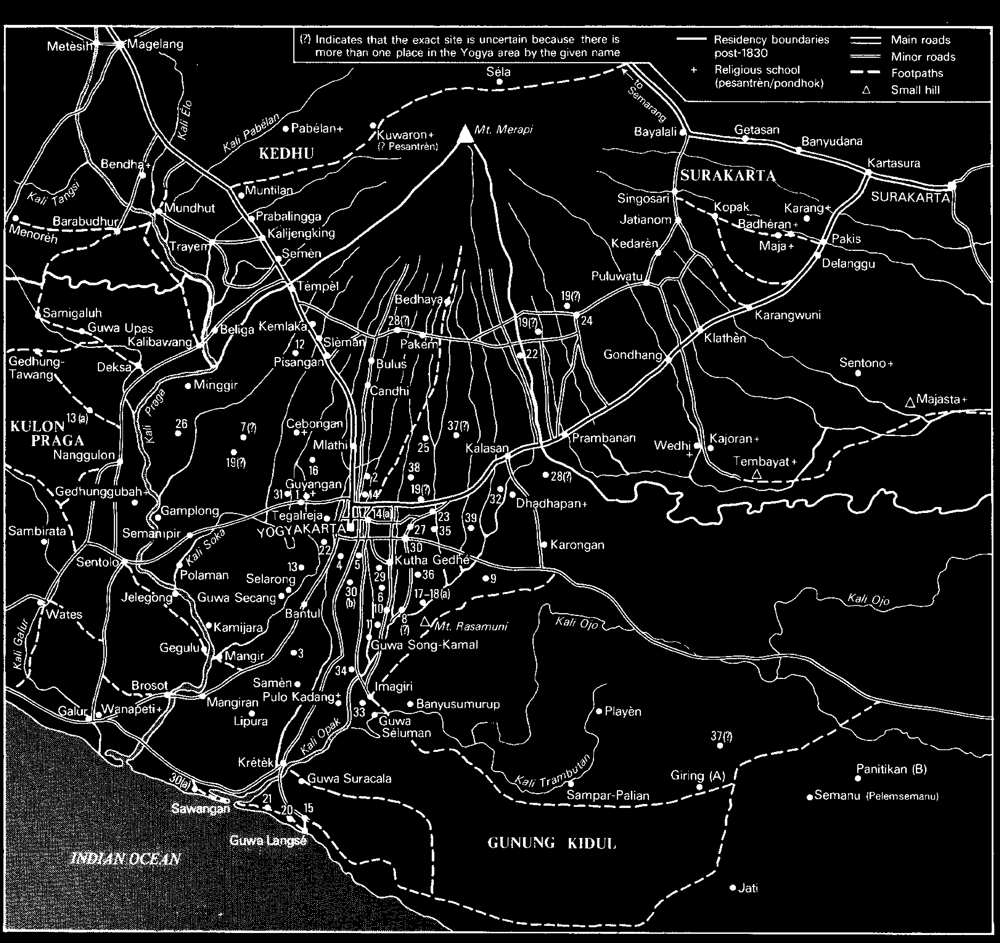

# Appendix VIIa: List of Religious Boarding Schools, Centres of Fiqh Law Scholars, and Tax-Free Areas in Yogyakarta Pre-1832

- List of religious boarding schools (pesantrèn, pondhok), centres of scholars learned in fiqh law

- (pathok negari), and tax-free areas set aside for men of religion and keepers of royal grave-

- sites (pradikan, pamutihan, jurukuncèn) in

- [^1]

- Yogyakarta pre-1832

- [Numbers refer to the locations given in Map 8]

- 1 Amberkatawang (Gamping) pamutihan kalangenan, previously three jung, in 1832 no more land given; kalangenan built by Hamengkubuwana II when sultan (see Appendix VI). 2 Blunyah pamutihan jurukunci, burial place of Kyai Kelipa of Jipang and Kyai Bimacilik, later Radèn Tumenggung Prawiradiningrat, a younger brother of Ratu Ageng (pre-1812, Ratu Kedhaton) was buried there with his descendants; previously three jung, in 1832 only one jung. 3 Balong (Guyangan) pamutihan jurukunci, burial place of Radèn Ayu Menyangan and Nyai Purwadiningrat with their sentana (relations); previously ½ jung, in 1832 still ½ jung. 4 Dhongkèlan pathok negari, tanah tiyasa Ratu Kedhaton, mosque, religious living and pradikan land set up by and in the gift of Ratu Kedhaton, mother of Hamengkubuwana III; previously 25 cacah, in 1832 three jung.

- 5 Gadhing pamutihan, previously 1½ jung, in 1832 no more land given. 6 Grojogan pamutihan, previously 2 jung, in 1832 no more land given. 7 Gunung Gemak pamutihan jurukunci, according to the jurukunci, previously ½ jung given for the upkeep of the grave of Pangéran Cakraningrat, in 1832 no more land given. 8 Gunung Kelir pamutihan jurukunci, grave of Ratu Malang, Pangéran Cakraningrat (Pangéran Sampang) and Radèn Ayu Lembah; previously ½ jung given for the upkeep of the graves, in 1832 still ½ jung. 9 Jalasutra pamutihan jurukunci, grave of Kyai Ageng Bengkung, previously three jung given for the upkeep of the grave, in 1832 only ½ jung. 10 Jati pamutihan, previously 1 jung, in 1832 no more land given. 11 Jejeran pamutihan jurukunci, grave of Kyai Tumenggung Gajah, Radèn Tumenggung Sumadiningrat and Radèn Tumenggung Wiryawinata; previously two jung for the jurukunci, in 1832 only one jung. 12 Jumeneng pamutihan, previously ½ jung, in 1832 no more land given. 13 Kasongan pamutihan pathok negari, previously seven jung, in 1832 no more land given. 14 Kricakan pamutihan, previously two jung, in 1832 no more land given. 14a Lempuyangan (Yogya) burial place of Kyai Adipati Mangkupraja, Pangéran Sumedhang, Pangéran Adipati Madura, Mas Ayu Pulungyun, mother of Radèn Tumenggung Colonel Mertanagara.[^2]

- 15 Mancingan pamutihan kalangenan, graves of Sèh Maulana Maghribi and Sèh Belabelu; previously 1½ jung for the upkeep of the pesanggrahan at Parangtritis and Parangwédang (see 20-21), in 1832 no more land given. 16 Melangi pathok negari, tanah tiyasa kaluwarga Danurejan, mosque, religious living and pradikan land of the Danurejan family; previously 25 cacah of land, after 1832 three jung.

- 17 Palérèd Kauman previously one jung, after 1832 no more land given. 18 Palérèd grave of Ratu Pelabuhan, previously two jung of land for the jurukunci, in 1832 ½ jung.

| 18a | Palérèd ing Trayeman pamutihan, previously 1½ jung, in 1832 no more land given. 19 Papringan ingkang wau pathok negari, previously 25 cacah of land, in 1832 pathok negari abolished. 20 Parangtritis pesanggrahan 21 Parangwédang pesanggrahan (see 15) 22 Pakuncèn pamutihan jurukunci, grave of the royal ancestor Nyai Ageng Derpayuda (mother of Ratu Ageng Tegalreja) and her children and grandchildren; previously three jung, in 1832 still three jung. |

| 22a | Pencar(sari) pamutihan, previously one jung, in 1832 none. 23 Pengawatreja (Ngawatreja) pamutihan kalangenan, previously three jung for wong mutihan, after 1832 no land given; kalan genan built by Hamengkubuwana II when sultan (Appendix VI). 24 Pijènan pamutihan jurukunci, previously two jung for the jurukunci, after 1832 no land. 25 Plasajené (Plasakuning) pathok negari, previously 25 cacah, in 1832 three jung; kalangenan built by Hamengkubuwana III when still Crown Prince (see Appendix VI). 26 Pucang Anom pamutihan, previously one jung, in 1832 no land given. 27 Purwareja pathok negari, previously 25 cacah, in 1832 three jung; kalangenan built by Hamengkubuwana II when still Crown Prince (see Appendix VI). 28 Rejadani pamutihan, previously one jung, after 1832 still one jung. 29 Rejakusuma pamutihan kalangenan, previously one jung, after 1832 no land given; kalangenan built by Hamengkubuwana II when still Crown Prince (see Appendix VI). 30 Rejawinangun pamutihan kalangenan, previously one jung, in 1832 no land given; kalangenan built by Hamengkubuwana II when still Crown Prince (see Appendix VI). |

| 30a | Samas pamutihan, previously one jung, in 1832 no land given; kalangenan built by Hamengkubuwana II when still Crown Prince (see Appendix VI). |

| 30b | Sèwon pamutihan jurukunci, grave of Ratu Kencana Wulan previously ½ jung from the legacy of the Ratu, in 1832 no land given; previously three jung for jurukunci, in 1832 no land given. 31 Tangkilan pamutihan kalangenan, previously one jung, in 1832 no land given; unknown when kalangenan built. 32 Tanjungtirta pamutihan kalangenan, previously one jung, in 1832 no more land given; kalangenan built by Hamengkubuwana II when sultan (see Appendix VI). 33 Gunung Telaga (Gamping) pamutihan jurukunci kalangenan, previously one jung, after 1832 no more land given; kalangenan built by Hamengkubuwana II when sultan (see Appendix VI). 34 Turi pamutihan, previously 25 cacah of land, after 1832 no land given. 35 Wanacatur pamutihan kalangenan, previously one jung, in 1832 no more land accorded; kalangenan built by Hamengkubuwana II when sultan (see Appendix VI). 36 Wanakrama pamutihan, previously three jung, after 1832 still three jung. 37 Wanasari pamutihan, previously two jung, after 1832 none. 38 Wanayasa pamutihan, previously two jung, after 1832 none. 39 Wotgalèh pamutihan jurukunci, previously three jung, in 1832 none; grave of Ratu Giring with her son Panembahan Purbaya and descendants; 2½ jung for jurukunci, after 1832 still 2½ jung. |

- Mardikan areas held by Surakarta in Gunung Kidul

- a

| Giring (Playèn district, Gunung Kidul) | grave of Ki Ageng Giring; one bau of |

- land from Surakarta, in 1832 still one bau.[^3]

- b

| Panithikan (Nithikan, Semanu district, | grave of Pangéran Pamot, Ratu Gunung Kidul) Pakubuwana and her descendants; previously 12 jung of land from Surakarta, in 1832 still 12 jung. |

- Mardikan areas in Yogya whose location is unclear

- 1 Bacinan pamutihan, previously one jung, in 1832 none. 2 Duwungas pamutihan, previously one jung, in 1832 still one jung. 3 Kebon (? Kebanaran) pamutihan, previously ½ jung, in 1832 none. 4 Plotingan pamutihan, previously one jung, in 1832 none. 5 Warak pamutihan, previously three jung, in 1832 none.

- Mardikan areas outside Yogya

- 1 Pekalongan pamutihan, earlier no land, after 1832 still no land; the site of the grave of Sunan Amangkurat I (r. 1646-1677) séda Tegalarum.

- Religious teachers in Yogya (1831)

- Kampong Religious teachers and numbers of pupils Total

- 1 Kadanurejan Nur Samsi (10); Mustakak (5); Nur Iman (2) 17 2 Kauman Ngusman (3); Suryadi (15); Rakiman (15); Ngabdullah (5); Iman (8) 46 3 Kraton Amad Ripangi (5); Amad Anom (2) 7 4 Mangkubumèn Abjani (4); Abdul Samad (3); Amad Sangi (4); (Mangkuratan) Nur Samsi (5); Amad Kalipah (7) 23 5 Pakualaman Muntaka (7); Amad Ripangi (14); Ngarpani (5); Nitireja (7); Resamenggala (3) 36 6 Prabuningratan Amad Anom (4) 4 7 Suranatan Waladaka (2); Mulyani (2); Amad Ngali (2); Sarawidi (10); Amad Ngijan (6); Amad Masam (7) 29 8 pathok negari[^4] Melangi (Kyai Melangi) (50) Pekalongan (Kyai Sakaputa) (12) Plothingan (Haji Abdullatip) (30) Wanakrama (Kyai Mukiba) (30) 122

- (Total number of pupils) (284)

> *Map 8. Location of religious boarding schools (pesantrèn, pondhok), centres of scholars

- learned in fiqh law (pathok negari), and tax-free areas set aside for men of religion

- and keepers of royal gravesites (pradikan, pamutihan, jurukuncèn) in Yogyakarta pre-1832. The numbers refer to the places listed in Appendix VIIa.

## Notes

[^1]: KITLV H 698 b, ‘Diverse aanteekeningen uit het gewone (niet geheime) Residentie Archief te Jogjakarta’, iic-ic, ‘Opgave van den pengoeloe der landen aan priesters afgestaan voor het onderhouden van graven’; Dj.Br.77II, ‘Rapport van den Kyai Pengulu Kamalodiningrat aangaande zijne onderhebbende priesters dewelke in onderscheidene kampongs aan kinderen het onderwijs geven in den godsdienst (ngaji)’, 9-1831.  For a description of the terms pradikan, pamutihan, pathok negari, see the glossary.

[^2]: Note of G.P. Rouffaer. Mas Ayu Pulungyun’s name is usually spelt ‘Pulangyun’, see Appendix III. She was the daughter of the patih of Kendhal on the north coast, Mas Ngabèhi Cakrasemita, and was born in Kaliwungu, see Serat salasilah para leloehoer ing Kandanoerejan:151.

[^3]: 1 bau = 7096.5 m2; 1 cacah = unspecified number of bau; 1 jung = 4 bau. Usually 1 cacah referred to the amount of land which could be worked by an able-bodied tribute paying peasant (wong sikep) and his immediate family and dependants (numpang, rayat, bujang), who could number anywhere between five and thirty people.

[^4]: Before 1825, religious instruction (ngaji) had been given in the pathok negari of Dhongkèlan, Kasongan and Plasa Kuning and in the pamutihan of Wanasari and Wanayasa, but by 1831 there were no more santri at these places.
